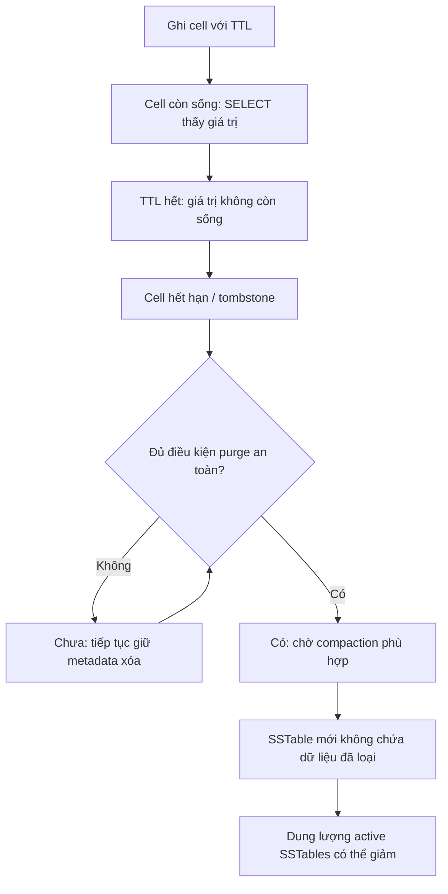
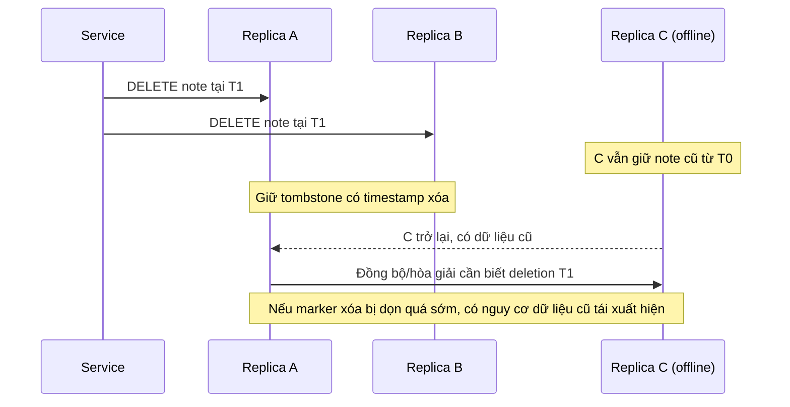
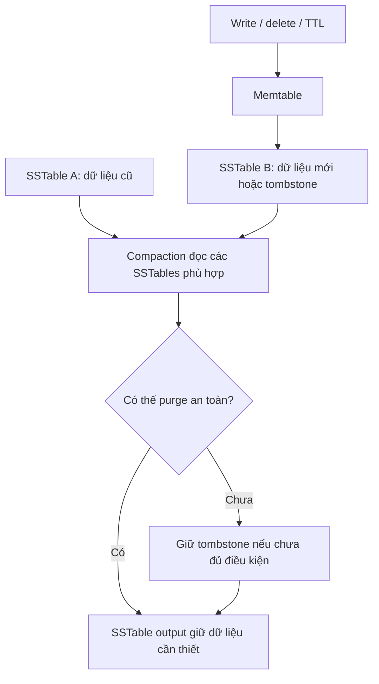
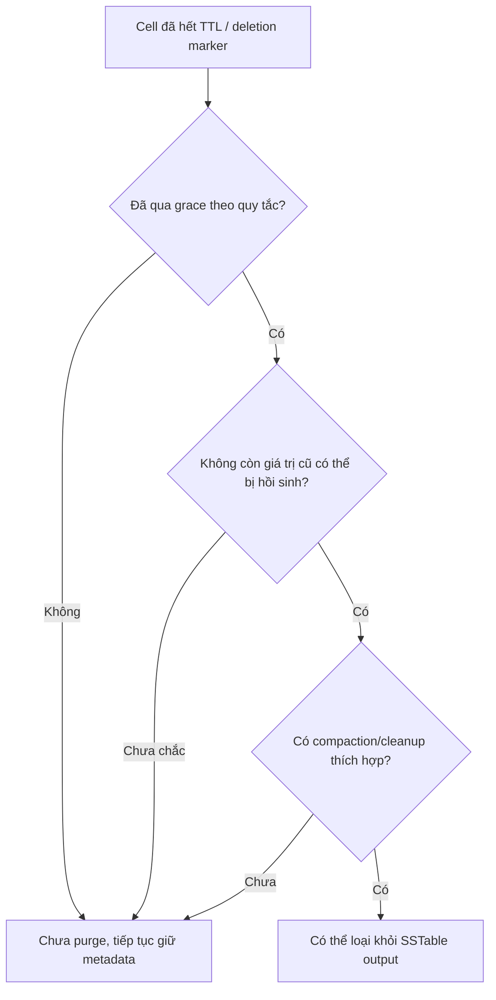

# Dữ liệu hết hạn, compaction và thời điểm thu hồi dung lượng

Trong **Apache Cassandra**, đặt `TTL 3600` không có nghĩa một giờ sau, dữ liệu đã lập tức biến mất khỏi mọi tệp SSTable và ổ đĩa được giải phóng ngay. **TTL (*Time To Live*)** quyết định thời điểm một giá trị hết hiệu lực ở tầng đọc. Sau khi hết hạn, Cassandra phải xử lý thông tin xóa dữ liệu trong hệ thống có nhiều replica, thường dưới dạng **tombstone**. Và chỉ khi một quá trình **compaction** phù hợp diễn ra, bảo đảm những điều kiện an toàn liên quan đã thỏa mãn, dữ liệu hết hạn cùng tombstone tương ứng mới có cơ hội được loại bỏ khỏi các SSTable đang hoạt động.

Phân biệt ba thời điểm này giúp giải đáp những câu hỏi thực tế:

- “Vì sao `SELECT` không thấy bản ghi nữa nhưng dung lượng ổ đĩa chưa giảm?”
- “Tại sao bảng có TTL vẫn sinh nhiều tombstone và các truy vấn đọc trở nên chậm?”
- “`gc_grace_seconds` có phải thời gian lưu dữ liệu sau TTL hay không?”
- “Có thể giảm `gc_grace_seconds` về 0 để lấy lại dung lượng nhanh hơn không?”
- “Dùng `TimeWindowCompactionStrategy` (TWCS) khi nào và vì sao chỉ hợp với một số mẫu ghi?”
- “Làm thế nào để ứng dụng **Spring Data Cassandra** đặt TTL đúng, kiểm thử hạn dùng và đo ảnh hưởng trên cluster?”

Bài thuộc chương **TTL và tombstone** của module **Spring Data Cassandra**. Nội dung liên kết giữa CQL, partition key, entity mapping, repository, `CassandraTemplate`, Java Driver, consistency level và hoạt động vận hành của một cơ sở dữ liệu phân tán.

> **Nguyên tắc chính:** **Hết hạn logic không đồng nghĩa xóa vật lý tức thì.** TTL khiến giá trị không còn hợp lệ khi đọc sau thời điểm hết hạn; tombstone phục vụ việc hòa giải xóa giữa các replica; compaction quyết định khi nào dữ liệu hết hạn có thể được loại khỏi SSTable theo điều kiện an toàn.

## 1. Ba mốc thời gian phải nhớ

Giả sử một ghi chú đơn hàng được tạo lúc 10:00, có TTL 60 phút. Với một ví dụ đơn giản, bỏ qua sai lệch đồng hồ và biến động cluster:

| Mốc | Trạng thái logic | Trạng thái lưu trữ cần hiểu |
| --- | --- | --- |
| 10:00 — ghi dữ liệu | `delivery_note` có hiệu lực | Cell có giá trị và thông tin TTL/expiration |
| 11:00 — TTL hết | Giá trị không còn được trả như dữ liệu sống | Giá trị hết hạn được Cassandra xử lý như dữ liệu đã xóa/tombstone |
| Sau 11:00, trước khi đủ điều kiện dọn | Không thấy giá trị khi đọc | SSTable vẫn có thể chứa cell hết hạn và metadata xóa |
| Sau khi qua khoảng grace cần thiết | Vẫn không thấy giá trị | Tombstone **có thể đủ điều kiện** được dọn trong compaction thích hợp |
| Sau compaction loại bỏ hợp lệ | Vẫn không thấy giá trị | Một số SSTable cũ được thay bởi SSTable mới không còn dữ liệu đã dọn |

Không có một phép đếm giờ duy nhất bảo đảm rằng sau 11:00 cộng thêm đúng `gc_grace_seconds` là ổ đĩa sẽ giảm dung lượng.



Sơ đồ chỉ mô tả vòng đời tổng quát. Việc giữ tombstone, kiểm tra dữ liệu bị che khuất ở SSTable khác, snapshots, chính sách compaction và chi tiết phiên bản Cassandra có thể tác động đến thời điểm xóa vật lý.

### Hai khái niệm khác nhau về “đã xóa”

**Xóa logic:** Một query đúng CL, tại thời điểm sau TTL, không trả giá trị đã hết hạn như dữ liệu sống.

**Thu hồi vật lý:** Dữ liệu/tombstone không còn được lưu trong các SSTable hoạt động sau khi compaction an toàn và việc xóa các SSTable cũ hoàn tất. Snapshot hoặc backup ngoài luồng có thể vẫn giữ bản sao dữ liệu, nên “đã thu hồi khỏi active SSTables” **không tự nghĩa là đã xóa khỏi toàn bộ hệ thống lưu trữ/bản sao lưu**.

## 2. Cassandra lưu dữ liệu theo partition và cell

Để hiểu TTL, trước tiên cần biết Cassandra lưu dữ liệu **theo partition**, với **clustering columns** định vị hàng trong partition. Mỗi regular cell có thể có timestamp và thông tin về TTL tùy thao tác ghi.

Một bảng dùng cho log sự kiện khách hàng theo ngày:

```sql
CREATE TABLE IF NOT EXISTS commerce_ks.events_by_customer_day (
    tenant_id uuid,
    customer_id uuid,
    bucket_day date,
    event_time timestamp,
    event_id uuid,
    event_type text,
    summary text,
    payload text,
    PRIMARY KEY (
        (tenant_id, customer_id, bucket_day),
        event_time,
        event_id
    )
) WITH CLUSTERING ORDER BY (
    event_time DESC,
    event_id DESC
);
```

Giải thích:

1. `(tenant_id, customer_id, bucket_day)` là **composite partition key**.
2. `event_time` và `event_id` là **clustering columns**, sắp xếp các sự kiện trong đúng partition.
3. `event_type`, `summary` và `payload` là những **regular columns**.
4. Một khách có thể có nhiều sự kiện trong cùng một partition/ngày; kích thước partition phải được kiểm soát theo write rate và bytes thực tế.
5. Cassandra phân phối các bản sao của partition theo RF và replication strategy, chứ không tự sao chép mọi bảng read model khác nhau.

**TTL không phải là cách chia partition.** Nếu toàn bộ dữ liệu của một người dùng nằm trong một partition quá lớn, đặt TTL vẫn không làm partition key tốt lên. Cần thiết kế bucket/shard theo mẫu đọc và quy mô.

## 3. TTL của Cassandra: đơn vị và phạm vi

TTL là thời gian sống của dữ liệu tính bằng **giây** khi sử dụng cú pháp CQL `USING TTL`. Ví dụ:

```sql
INSERT INTO commerce_ks.events_by_customer_day (
    tenant_id, customer_id, bucket_day,
    event_time, event_id, event_type, summary, payload
)
VALUES (
    11111111-1111-1111-1111-111111111111,
    22222222-2222-2222-2222-222222222222,
    '2026-11-25',
    '2026-11-25T03:00:00Z',
    33333333-3333-3333-3333-333333333333,
    'VIEWED',
    'Đã xem sản phẩm',
    '{"source":"mobile"}'
)
USING TTL 3600;
```

Các regular columns được ghi trong mutation sẽ có thời gian hết hạn tương ứng, theo quy tắc TTL của Cassandra. Những cột **primary key** cần để định danh partition/hàng không được hiểu như các regular cell có TTL độc lập. Khi tất cả dữ liệu sống của một hàng đã hết hạn, hàng đó có thể không còn xuất hiện trong kết quả đọc.

### TTL không phải tính năng hỗ trợ giống nhau cho mọi loại dữ liệu

- Một regular column `text`, `int` hoặc `timestamp` có thể có TTL khi ghi theo API phù hợp.
- **Counter columns** có các quy tắc khác và không hỗ trợ TTL như regular columns.
- Collection, UDT, static columns, row markers và mutation đặc biệt có semantics cụ thể theo phiên bản/loại ghi.
- Không đặt kỳ vọng rằng mỗi phần tử bên trong một collection tự có TTL độc lập giống một regular column, nếu chưa kiểm tra schema và CQL thực tế.
- TTL có giới hạn biểu diễn/thời điểm hết hạn; với TTL rất dài cần kiểm tra giới hạn và overflow policy của phiên bản Cassandra, không tự coi giá trị cực lớn luôn hợp lệ.

### TTL bắt đầu khi nào?

Trong mô hình thông dụng, TTL được tính từ thời điểm ghi/timestamp liên quan, theo cơ chế thời gian của Cassandra. Đồng hồ node/coordinator, timestamp được cung cấp và các giới hạn phiên bản có thể ảnh hưởng kết quả. Không nên dùng TTL như công cụ hẹn giờ chính xác tới từng mili giây hay cơ chế scheduler thay cho một workflow có deadline rõ.

Ví dụ `TTL 3600` có nghĩa giá trị được thiết kế hết hiệu lực sau khoảng **3600 giây** theo semantics Cassandra, không có một job nền riêng phải thức dậy đúng giây thứ 3600 để xóa tệp dữ liệu.

## 4. TTL ở cấp column: cập nhật một cột không luôn kéo theo cột khác

Giả sử một bảng riêng lưu trạng thái và ghi chú đơn hàng:

```sql
CREATE TABLE IF NOT EXISTS commerce_ks.order_notes_by_id (
    tenant_id uuid,
    order_id uuid,
    status text,
    delivery_note text,
    updated_at timestamp,
    PRIMARY KEY ((tenant_id, order_id))
);
```

Seed dữ liệu:

```sql
INSERT INTO commerce_ks.order_notes_by_id (
    tenant_id, order_id, status, delivery_note
)
VALUES (
    11111111-1111-1111-1111-111111111111,
    44444444-4444-4444-4444-444444444444,
    'PENDING',
    'Để hàng ở quầy lễ tân'
);
```

Chỉ cập nhật `delivery_note` và đặt TTL 600 giây:

```sql
UPDATE commerce_ks.order_notes_by_id
USING TTL 600
SET delivery_note = 'Gọi khi tới'
WHERE tenant_id = 11111111-1111-1111-1111-111111111111
  AND order_id = 44444444-4444-4444-4444-444444444444;
```

Nếu không có `default_time_to_live` ở bảng và không có ghi cạnh tranh:

- `delivery_note` mới có TTL 600 giây.
- `status = 'PENDING'` không bị áp TTL mới **chỉ vì nó cùng hàng**.
- `updated_at` nếu chưa ghi thì không tự nhận timestamp mới theo ý nghĩa của một cột regular.
- Khi `delivery_note` hết hạn, `status` có thể vẫn tồn tại.

**Không nhầm TTL cấp cell với “xóa cả hàng sau 10 phút”.** Muốn một hàng biến mất khỏi kết quả đọc, cần xem những cell/row marker còn sống và chính sách TTL của tất cả dữ liệu được ghi.

### Không phải mọi phương thức cập nhật đều giữ TTL

Nếu một cột đang có TTL mà ứng dụng **ghi lại giá trị** của cột ấy, write mới có thể thay TTL/timestamp của cell theo statement và table defaults. Cùng một chuỗi được ghi lại không đồng nghĩa dữ liệu vẫn giữ thời điểm hết hạn cũ.

Ví dụ:

```sql
UPDATE commerce_ks.order_notes_by_id
USING TTL 1200
SET delivery_note = 'Gọi khi tới'
WHERE tenant_id = 11111111-1111-1111-1111-111111111111
  AND order_id = 44444444-4444-4444-4444-444444444444;
```

Đây là một **write mới**, có TTL 1200 giây cho cột được cập nhật trong statement. Không nên đọc một cell cũ rồi ghi lại để “giữ nguyên” khi ứng dụng không thực sự muốn làm mới nó.

## 5. Cách kiểm tra TTL bằng CQL

CQL cung cấp hàm `TTL(column)` để quan sát **thời gian sống còn lại** của một cell tương ứng, khi cột/kiểu dữ liệu hỗ trợ.

```sql
SELECT status,
       delivery_note,
       TTL(delivery_note) AS note_ttl,
       WRITETIME(delivery_note) AS note_write_time
FROM commerce_ks.order_notes_by_id
WHERE tenant_id = 11111111-1111-1111-1111-111111111111
  AND order_id = 44444444-4444-4444-4444-444444444444;
```

Cách diễn giải:

| Kết quả `TTL(delivery_note)` | Khả năng diễn giải |
| --- | --- |
| Số dương | Có TTL còn lại theo thời điểm đọc |
| `null` trong khi cột có giá trị | Có thể là cell không có TTL |
| `null` khi cột đã mất giá trị | Có thể hết hạn, bị xóa hoặc chưa bao giờ được ghi |
| Query không trả hàng | Không còn hàng sống quan sát được theo request; chưa nói gì về bytes vật lý |

**`SELECT` không giúp nhìn thấy tombstone vật lý**. Không thể khẳng định “đã compaction sạch” chỉ vì `TTL(column)` là `null` hay query trả danh sách rỗng.

`WRITETIME(column)` phản ánh timestamp ghi của cột khi có thể truy vấn; nó không phải thời điểm Cassandra cuối cùng thu hồi dung lượng. Cả `TTL` và `WRITETIME` có các giới hạn với một số loại cột/collection/counter, nên phải kiểm tra schema thật.

### Thực hành kiểm thử TTL ngắn

1. Dùng keyspace/table test riêng.
2. Ghi một note với `USING TTL 20`.
3. Đọc ngay và kiểm tra `TTL(note)` là một số dương phù hợp.
4. Sau khi hết TTL, đọc lại để xác minh note không còn là giá trị sống.
5. Không kỳ vọng dung lượng đĩa giảm ngay lập tức.
6. Không dùng TTL 1 giây trong các integration test dễ bị ảnh hưởng bởi clock/scheduling; chọn biên thời gian có khoảng dự phòng hợp lý.

## 6. Default TTL của bảng

Cassandra có thuộc tính bảng **`default_time_to_live`**, áp dụng TTL mặc định cho dữ liệu được ghi nếu không có một cách override phù hợp.

Ví dụ tạo bảng lịch sử chỉ cần giữ khoảng một ngày:

```sql
CREATE TABLE IF NOT EXISTS commerce_ks.short_lived_events (
    tenant_id uuid,
    bucket_day date,
    event_time timestamp,
    event_id uuid,
    message text,
    PRIMARY KEY ((tenant_id, bucket_day), event_time, event_id)
) WITH CLUSTERING ORDER BY (event_time DESC, event_id DESC)
  AND default_time_to_live = 86400;
```

`86400` giây tương ứng một ngày. Bảng mới có chính sách mặc định như vậy sẽ làm các cell được ghi không có TTL cụ thể chịu hạn dùng của bảng theo semantics Cassandra.

Một câu `ALTER TABLE` minh họa:

```sql
ALTER TABLE commerce_ks.short_lived_events
WITH default_time_to_live = 172800;
```

**Thay default TTL không tự động viết lại lịch sử.** Nó không retroactively cấp thời hạn 2 ngày mới cho mọi cell đã tồn tại; các cell cũ có thông tin TTL/timestamp từ lần ghi trước.

### TTL 0 có nghĩa gì?

Trong các phiên bản Cassandra hỗ trợ, `USING TTL 0` được dùng khi muốn **không gắn TTL cho write mới/loại bỏ TTL của cột được ghi lại** theo semantics hiện hành, kể cả trong những trường hợp cần override table default TTL. Đừng nhầm “TTL 0” với “hết hạn ngay lập tức”. Hãy xác minh hành vi cụ thể trên phiên bản cluster và trong kết hợp `default_time_to_live` trước khi dùng.

**Cảnh báo:** Một câu lệnh ghi lại cột để loại TTL có thể thay đổi cả timestamp/giá trị do đồng thời. Không dùng `USING TTL 0` như thao tác bảo trì toàn bảng nếu chưa có kế hoạch.

### Default TTL khác `gc_grace_seconds`

| Thuộc tính | Vai trò |
| --- | --- |
| `default_time_to_live` | Thời gian sống mặc định của các giá trị được ghi |
| `USING TTL N` | TTL cho những giá trị được mutation tương ứng ghi |
| `gc_grace_seconds` | Một yếu tố giữ thông tin xóa đủ lâu để giảm nguy cơ dữ liệu cũ quay lại từ replica chưa đồng bộ |
| Compaction strategy | Quy tắc gộp/thay SSTable và cơ hội purge dữ liệu không còn cần |

Hai loại thời gian này không cộng lại thành **thời hạn xóa đĩa được bảo đảm**.

## 7. Tombstone là gì và từ đâu xuất hiện?

Cassandra có nhiều replica. Nếu một replica nhận lệnh xóa còn replica khác tạm thời offline, chỉ xóa bytes tại replica đang hoạt động là chưa đủ. Replica offline có thể trở lại với giá trị cũ, và trong quá trình hòa giải Cassandra cần biết giá trị ấy đã bị xóa.

**Tombstone** là thông tin đánh dấu xóa để Cassandra giải quyết điều đó theo timestamp và các quy tắc lưu trữ phân tán.

Các nguyên nhân thường gặp:

| Hành động | Loại tình huống tạo tombstone |
| --- | --- |
| `DELETE col FROM ... WHERE key = ...` | Xóa một cột |
| `DELETE FROM ... WHERE partition/clustering key ...` | Xóa một row hoặc phạm vi dữ liệu |
| `UPDATE ... SET col = null` | Null mutation mang ý nghĩa xóa regular column |
| `USING TTL N` khi N hết hạn | Cell hết hạn được xử lý như dữ liệu đã xóa |
| Xóa/sửa collection theo dạng CQL | Có thể tạo collection/range/element tombstones tùy operation |
| Xóa một range clustering | Range tombstone để che những hàng trong khoảng |

Không phải mọi tombstone đều có cùng cấu trúc. **Cell tombstone, row tombstone, range tombstone, partition deletion** và collection deletion có chi phí/hành vi riêng.

### Tombstone không phải row bị “đánh dấu là dữ liệu còn sống”

Một tombstone **không xuất hiện như một entity Java** khi repository đọc. Nó nằm trong representation của Cassandra để phục vụ thứ tự xóa/ghi. `repository.findById(...)` trả `Optional.empty()` không cho biết vì key chưa từng tồn tại, do TTL hết hay do deletion marker.

### Null khác UNSET

Trong prepared statement có thể gặp ba trạng thái:

| Giá trị khi bind regular column | Hiệu ứng logic của mutation |
| --- | --- |
| Giá trị cụ thể | Ghi giá trị mới |
| `null` | Xóa giá trị tương ứng, có thể tạo tombstone |
| `UNSET` | Không áp dụng phép ghi lên cột đó |

Một PATCH request thiếu field nên có thể ánh xạ tới **không sửa cột**; explicit null có thể là **xóa cột** theo hợp đồng API. Nếu service gộp hai trường hợp, nó có thể tạo tombstone hàng loạt khi client chỉ muốn đổi một trường khác.

## 8. Vì sao tombstone không thể bị xóa ngay?

Giả sử replica A và B nhận lệnh xóa tại T1, còn replica C offline nên vẫn giữ giá trị cũ được ghi từ T0.



Hiện tượng dữ liệu bị xóa **xuất hiện lại** do replica cũ quay lại sau khi marker xóa đã bị loại quá sớm thường được gọi là **zombie data** hoặc **data resurrection**.

Để giảm rủi ro, Cassandra giữ thông tin xóa trong một khoảng phù hợp và yêu cầu chiến lược repair/availability hoạt động đúng. `gc_grace_seconds` là một phần của cơ chế này, nhưng không thay thế **anti-entropy repair**.

### Tombstone còn có thể che dữ liệu ở SSTable khác

Ngay trên **cùng node**, một tombstone mới có thể che dữ liệu cũ nằm ở SSTable khác:

```text
SSTable-01: note = "Giao sau 18:00"  (timestamp cũ)
SSTable-02: DELETE note             (timestamp mới hơn)
```

Nếu chỉ dọn `DELETE note` ở SSTable-02 khi giá trị cũ vẫn còn và được xét trong read, hệ thống có thể tái xuất dữ liệu cũ. **Compaction phải xét các overlap/dữ liệu bị che khuất và các điều kiện purge tương ứng**.

Đây là lý do compaction không thể đơn giản coi `gc_grace_seconds` đã hết là xóa ngay mọi tombstone mà không xét những tệp liên quan.

## 9. `gc_grace_seconds` không phải đồng hồ tự giải phóng disk

`gc_grace_seconds` là thuộc tính bảng liên quan khoảng thời gian giữ tombstone theo semantics Cassandra, mặc định thường là **864000 giây (10 ngày)** ở nhiều phiên bản, nhưng **phải đọc cấu hình của bảng thật** thay vì mặc định số này luôn đúng.

Ví dụ thay một thuộc tính bảng trong môi trường đã đánh giá an toàn:

```sql
ALTER TABLE commerce_ks.order_notes_by_id
WITH gc_grace_seconds = 864000;
```

Đây là một ví dụ schema configuration, **không phải đề xuất cần chạy lại** nếu bảng đã được quản lý bằng migration.

### Minh họa trên dòng thời gian

Giả định:

- TTL của cell: 1 giờ.
- Cell hết hạn tại **11:00**.
- `gc_grace_seconds = 864000` (10 ngày).
- Replica/repair và dữ liệu chồng lấp SSTable ở trạng thái bình thường.

```text
10:00   Ghi note với TTL 3600
11:00   Note hết hạn logic; read không còn thấy note
        |
        | Thông tin hết hạn/xóa còn phải được giữ an toàn
        |
+10 ngày kể từ mốc xóa/hết hạn liên quan
        Có thể đủ điều kiện grace, NHƯNG chưa chắc được purge
        |
        | Chờ compaction phù hợp và điều kiện an toàn khác
        v
        SSTable mới có thể bỏ dữ liệu/tombstone cũ
        |
        v
        Dung lượng active SSTables có thể giảm
```

**Không có phép cộng cố định `TTL + gc_grace_seconds = thời điểm disk freed`.** Grace period chỉ là một trong các điều kiện. Compaction có thể đến muộn, dữ liệu còn bị giữ bởi SSTable overlap, snapshot hoặc yêu cầu an toàn khác.

### Có nên đặt gc_grace_seconds = 0?

Không được xem đây là tối ưu mặc định. Giảm về 0 khi replica mất kết nối lâu, repair không đầy đủ hoặc workload delete phức tạp có thể tăng rủi ro **data resurrection**. Một số workload với TTL đồng nhất, dữ liệu bất biến và thiết kế vận hành đặc thù có thể cân nhắc chính sách khác, nhưng cần hiểu rõ **phiên bản Cassandra, cơ chế repair, downtime tối đa, backup/restore, compaction strategy** và chứng minh an toàn trên cluster thật.

Một câu như:

```sql
ALTER TABLE commerce_ks.order_notes_by_id
WITH gc_grace_seconds = 0;
```

được đưa vào **chỉ để nhận diện cấu hình rủi ro**, không phải bài tập được khuyến nghị chạy trên production.

## 10. Repair và grace period liên quan thế nào?

Trong Cassandra, **anti-entropy repair** giúp các replica trao đổi/hòa giải dữ liệu để giảm phân kỳ. Nếu một replica vắng mặt lâu hơn chính sách retention của deletion markers và không được repair kịp, các bản ghi cũ có thể gây rủi ro khi replica trở lại.

Về nguyên tắc vận hành:

1. Biết `gc_grace_seconds` của từng bảng.
2. Biết thời gian node tối đa có thể offline, thời gian cần để phục hồi.
3. Có lịch **repair hoàn tất an toàn** theo giới hạn/khuyến nghị của phiên bản, thay vì chỉ lên lịch rồi không theo dõi thành công.
4. Có cảnh báo repair thất bại/kéo dài và dữ liệu diverge.
5. Cân nhắc snapshot restore từ bản sao cũ và quy trình bootstrap/rebuild.
6. Không giảm grace để “chữa” thiếu dung lượng mà không phân tích cả vòng đời replica.

### Hinted handoff có thay repair không?

**Không.** Hints có thể giúp chuyển một số mutation đã bỏ lỡ trong cửa sổ giữ hint phù hợp, nhưng có giới hạn thời gian/dung lượng và không thay thế anti-entropy repair. Không nên kết luận “đã bật hints thì `gc_grace_seconds` có thể bằng 0”.

### TTL có ít rủi ro hơn DELETE không?

TTL expiration có cơ chế metadata thời điểm hết hạn, nhưng không nên suy nó **luôn an toàn khi grace = 0** cho mọi bảng/phiên bản. Dữ liệu sửa nhiều lần, TTL khác nhau, overlapping SSTables, snapshot restore và downtime có thể làm điều kiện purge phức tạp. Hãy đánh giá bằng chiến lược vận hành có căn cứ.

## 11. Compaction là gì?

Cassandra dùng SSTables để lưu dữ liệu trên đĩa. Các SSTables phần lớn **immutable**: khi cập nhật/xóa, hệ thống ghi mutation mới thay vì sửa trực tiếp bytes ở mọi SSTable cũ. **Compaction** gộp/viết lại các SSTables để tổ chức dữ liệu hiệu quả hơn, xử lý phiên bản bị che khuất và loại dữ liệu/tombstone khi đủ điều kiện.



Compaction không phải một lệnh `DELETE` CQL, cũng không chạy đúng thời điểm mỗi TTL hết hạn. Nó phụ thuộc vào compaction strategy, số lượng/tuổi/kích thước SSTables, mức ghi, khả năng tài nguyên và các giới hạn vận hành.

### Vì sao disk có thể tăng trước khi giảm?

Khi compaction viết SSTable mới, Cassandra có thể cần **dung lượng tạm thời** để chứa output trong lúc input SSTables chưa được giải phóng. Vì vậy, khi một bảng đang nhiều tombstone, việc bật compaction mạnh trên ổ đĩa gần đầy **có thể làm tình hình xấu hơn**.

Phải giám sát available disk, pending compactions và compaction throughput. Không cố ép compaction lớn khi không có dung lượng và kế hoạch.

## 12. Compaction strategy: STCS, LCS và TWCS

Cassandra có các chiến lược tổ chức SSTable khác nhau. Ba tên thường gặp:

| Chiến lược | Ý tưởng chung | Điểm cần xét với TTL/tombstone |
| --- | --- | --- |
| **STCS — SizeTieredCompactionStrategy** | Gom các SSTables có kích thước tương đồng | Hợp một số write-heavy workloads; lịch gộp không nhất thiết trùng TTL, tombstones có thể tồn tại lâu |
| **LCS — LeveledCompactionStrategy** | Tổ chức SSTables theo levels để kiểm soát overlap | Thường giúp kiểm soát số SSTable trong read, nhưng có write/compaction amplification |
| **TWCS — TimeWindowCompactionStrategy** | Gom SSTables theo các cửa sổ thời gian | Đặc biệt đáng cân nhắc với dữ liệu thời gian, write-once, TTL tương đối đồng nhất và ít ghi dữ liệu cũ |

Không có chiến lược nào tự bảo đảm rằng **mọi cell vừa hết TTL sẽ được xóa vật lý ngay**. Tính phù hợp phụ thuộc query/read pattern, thời gian ghi, cập nhật, tombstone, disk và phiên bản.

### STCS

STCS thường dựa trên nhóm SSTable có kích thước tương tự. Nếu workload liên tục ghi dữ liệu mới nhưng một số SSTables cũ không tham gia compaction trong thời gian dài, tombstone hoặc expired cells có thể còn nằm trong dữ liệu hoạt động lâu hơn TTL.

Không kết luận STCS “không bao giờ dọn tombstone”; kết quả phụ thuộc compaction thực tế và điều kiện an toàn.

### LCS

LCS tổ chức SSTable theo levels nhằm giảm overlap trong những trường hợp đọc thích hợp, đổi lại có thể phát sinh thêm công ghi/compaction. Khi bảng chứa nhiều update/delete và read-heavy workload, LCS có thể đáng thử — nhưng chọn theo dữ liệu, không chỉ vì muốn disk giảm sau TTL.

### TWCS

TWCS phân SSTables vào **time windows**. Với dữ liệu event hoặc log **ghi một lần, ít sửa, TTL gần đồng nhất**, hệ thống có thể thuận lợi hơn để xác định SSTables hoặc windows chứa dữ liệu đã hết hiệu lực.

Ví dụ một bảng thời gian ngắn hạn:

```sql
CREATE TABLE IF NOT EXISTS commerce_ks.ephemeral_metrics_by_device_day (
    device_id uuid,
    bucket_day date,
    event_time timestamp,
    event_id uuid,
    metric_value double,
    PRIMARY KEY ((device_id, bucket_day), event_time, event_id)
) WITH CLUSTERING ORDER BY (event_time DESC, event_id DESC)
  AND default_time_to_live = 604800
  AND compaction = {
      'class': 'TimeWindowCompactionStrategy',
      'compaction_window_unit': 'DAYS',
      'compaction_window_size': '1'
  };
```

Ví dụ chọn TTL 7 ngày và compaction window 1 ngày **để minh họa cú pháp**. Không có quy tắc “TTL 7 ngày thì cửa sổ bắt buộc 1 ngày”; lựa chọn window size phải dựa trên ingest rate, kích thước SSTable, số windows đang hoạt động và chính sách vận hành.

## 13. Vì sao TWCS không phải lựa chọn tốt cho mọi bảng TTL?

TWCS thường phù hợp khi các đặc điểm sau cùng có mặt:

- Event/log **append-only** hoặc gần như chỉ ghi một lần.
- Timestamp của các ghi tương đối cùng dòng thời gian thực tế.
- TTL tương đối đồng nhất trong một bảng hoặc cửa sổ.
- Ít sửa/xóa các hàng đã được ghi từ lâu.
- Hạn dùng đủ rõ để các cửa sổ dữ liệu cùng hết hiệu lực.

Cẩn thận nếu:

1. **Late/out-of-order writes:** Event trễ được ghi vào partition/thời gian cũ, làm thời gian lưu dữ liệu trong SSTables không đồng nhất như giả định.
2. **Updates vào hàng cũ:** Một update mới của dữ liệu cũ có thể xuất hiện trong SSTable thuộc window khác, tăng overlap giữa deletion/timestamp và dữ liệu cũ.
3. **TTL rất khác nhau:** Một SSTable chứa dữ liệu còn sống xen lẫn dữ liệu đã hết TTL, khó loại trọn.
4. **Ghi/delete liên tục vào cùng key:** Tombstones và giá trị cũ có thể nằm ở những SSTables/windows khác nhau.
5. **Clock skew hoặc timestamp tùy ý:** Sắp xếp theo thời gian cho compaction bị méo.
6. **Snapshot/backup giữ SSTables:** Disk thực tế chưa giảm dù active SSTables đã được compact.

**Đừng chọn TWCS chỉ vì cột có TTL.** Hãy chọn theo **hình dạng workload và lifecycle**, và benchmark đường đọc/ghi, compaction và lượng SSTables tồn đọng trên cùng kiểu dữ liệu thực.


## 14. Vì sao dữ liệu hết hạn không được thu hồi ngay cả sau compaction?

Một trường hợp thường gặp:

```text
Ngày 1: Ghi event với TTL = 1 ngày
Ngày 2: Event hết hạn; query không thấy event
Ngày 3: Vẫn thấy dữ liệu tốn disk
Ngày 12: Đã qua nhiều ngày nhưng disk chưa giảm rõ rệt
```

Điều đó **không đủ** để kết luận TTL hỏng. Những khả năng cần xem:

1. **Grace period chưa đủ** cho deletion marker của dữ liệu liên quan.
2. **Chưa có compaction phù hợp** chạy trên những SSTables cần gộp.
3. **Dữ liệu bị tombstone che khuất nằm ở SSTables khác** và chưa thể purge an toàn.
4. **Vẫn có cell sống** với TTL dài hơn hoặc không có TTL trong cùng SSTable.
5. **Có update vào hàng cũ**, làm SSTables khác thời gian chồng lấp với nhau.
6. **Snapshot/backup giữ file** mà compaction không còn sử dụng ở active table.
7. **Có ghi dữ liệu mới liên tục**, nên tổng dung lượng tăng nhanh hơn phần được thu hồi.
8. **Compaction bị backlog**, throttling hoặc thiếu tài nguyên/dung lượng.

### Điều kiện để an toàn purge

Ở mức khái niệm:



Sơ đồ đơn giản hóa các thuật toán khác nhau của Cassandra/compaction strategy. Điều kiện thực còn phụ thuộc phiên bản, timestamp, phạm vi compaction, overlapping SSTables, chính sách tombstone và cơ chế an toàn. Tránh gắn nhãn “đã có thể xóa” chỉ bằng một phép tính thời gian trên application server.

### Có nên ép major compaction để giải phóng dung lượng?

**Không nên mặc định.** Major compaction có thể tiêu thụ I/O, CPU, dung lượng đĩa tạm và ảnh hưởng trực tiếp latency. Với những compaction strategy như TWCS, hành động này còn có thể trộn dữ liệu từ nhiều windows, làm mất lợi ích cô lập thời gian.

Trước khi chạy bất kỳ lệnh bảo trì compaction nào, cần đánh giá bằng công cụ vận hành của Cassandra version đang dùng, bảo đảm đủ disk headroom, xem backlog và lên kế hoạch phù hợp. Không thực hiện trên production chỉ vì thấy bảng nhiều tombstones.

## 15. Tombstone ảnh hưởng hiệu năng đọc như thế nào?

Một query thường phải đọc, so sánh timestamp và bỏ qua những cell/hàng đã bị xóa trước khi trả các hàng còn sống. Khi một partition hoặc range chứa rất nhiều tombstone, Cassandra có thể phải quét qua lượng dữ liệu lớn **để tìm được một số ít hàng còn sống**.

Ví dụ bảng event theo thời gian:

```text
Một partition theo khách/ngày:
  20.000 event đã hết TTL
  10 event còn sống

UI yêu cầu 10 event gần nhất:
  Cassandra có thể phải xử lý nhiều deletion markers
  tùy clustering order, vị trí dữ liệu và SSTables.
```

Số thực tế phụ thuộc thứ tự clustering, layout SSTables, phạm vi query và các tối ưu của phiên bản. Không phải mọi query trên partition có nhiều tombstone đều phải đọc đúng 20.000 marker.

### Dấu hiệu có vấn đề

- Request p95/p99 tăng khi số hàng hết hạn tăng.
- Driver thường xuyên nhận timeout khi query chỉ trả vài entity.
- Cassandra có warning hoặc failure liên quan lượng tombstone phải quét theo ngưỡng cấu hình.
- Một partition rất rộng có TTL/DELETE xen kẽ, khiến đọc range phải xử lý nhiều dữ liệu không sống.
- Compaction backlog và dung lượng SSTable tăng dù retention thấp.

**Giảm page size không chữa tận gốc tombstone-heavy read.** Driver page size chỉ kiểm soát số row mục tiêu mỗi lần fetch; nếu cần quét nhiều tombstone để tìm row sống, chi phí server vẫn có thể lớn.

### Các ngưỡng tombstone không phải SLA nghiệp vụ

Cassandra có các cấu hình/ngưỡng cảnh báo hoặc thất bại khi read gặp quá nhiều tombstone, tùy phiên bản và cách thống kê. Không nên chỉ tăng ngưỡng để dẹp log. Hãy xử lý workload: partition size, query range, TTL distribution, update/delete rate và compaction policy.

## 16. Phân biệt TTL retention với xóa vì quyền riêng tư

Một sản phẩm có thể có hai yêu cầu khác nhau:

1. **Retention:** Sự kiện được phép đọc trong bảy ngày, sau đó không còn trong API.
2. **Deletion/compliance:** Xóa dữ liệu người dùng khỏi tất cả các nơi lưu trữ theo một quy định cụ thể.

TTL có thể hỗ trợ yêu cầu thứ nhất, nhưng **không đủ để tự chứng minh yêu cầu thứ hai**.

| Nơi dữ liệu có thể tồn tại | TTL tại bảng Cassandra có xử lý toàn bộ không? |
| --- | --- |
| Cell sống trong bảng chính | TTL làm cell hết hiệu lực khi đến hạn |
| Tombstone/expired cell trong SSTable hoạt động | Chờ đủ điều kiện và compaction để purge |
| Replica đang offline | Phải xét hội tụ, repair và chính sách xóa |
| Snapshot của Cassandra | Có thể giữ SSTable cũ, cần lifecycle riêng |
| Backup ngoài cluster | Có retention và quy trình xóa/khôi phục riêng |
| CDC, event bus, logs, cache, search index | Không tự bị xóa khi TTL Cassandra hết |
| Read model Cassandra khác | Không tự đồng bộ hạn dùng nếu không có mutation/TTL tương ứng |

Vì vậy nên viết requirement rõ ràng:

- **Logical retention SLA:** Sau thời hạn nào API không được trả dữ liệu.
- **Physical storage reclamation objective:** Mục tiêu về tốc độ thu hồi trong active dataset, không xem đó là guarantee chỉ bởi TTL.
- **Compliance deletion workflow:** Các bản sao, backup, logs, derived stores, key management và bằng chứng audit phải được xử lý theo chính sách tổ chức.
- **RPO/RTO và restore:** Nếu khôi phục snapshot cũ, phải tránh phục hồi dữ liệu đã bị xóa theo chính sách.

**Không hứa “TTL 7 ngày bảo đảm bytes bị xóa vĩnh viễn sau đúng 7 ngày”.** Đó là mô tả sai về Cassandra và backup lifecycle.

## 17. Spring Data Cassandra: làm sao đặt TTL khi ghi?

Spring Data Cassandra hỗ trợ entity mapping, repository và `CassandraTemplate`. Nhưng với TTL cần xác định **phương thức ghi, phiên bản framework và statement cuối cùng**.

Một số phiên bản cung cấp annotation **`@TimeToLive`** trên entity property hoặc các write options có TTL. Tuy nhiên, chi tiết annotation, kiểu dữ liệu, method builder và cách map TTL từ entity khác nhau theo phiên bản. **Không giả định `repository.save(...)` tự chọn TTL theo ý muốn chỉ vì field Java tên `ttl`.**

### Entity mapping không tự làm biến mất toàn bộ hàng

Ví dụ entity:

```java
import java.io.Serializable;
import java.util.UUID;

import org.springframework.data.cassandra.core.mapping.PrimaryKey;
import org.springframework.data.cassandra.core.mapping.Table;

@Table("order_notes_by_id")
public class OrderNoteEntity {

    @PrimaryKey
    private OrderNoteKey key;

    private String status;
    private String deliveryNote;

    // Constructor/getters/setters và mapping @Column thực tế.
}
```

`OrderNoteKey` là composite primary-key class cần khai báo đầy đủ với `@PrimaryKeyClass` và các `@PrimaryKeyColumn` đúng schema. Đây là ví dụ giản lược về entity, **không phải source biên dịch độc lập**.

Gọi:

```java
repository.save(entity);
```

không cho biết TTL đã được đặt bằng bao nhiêu. Cần kiểm tra:

- Bảng có `default_time_to_live` không?
- Save dùng insert hay update path nào và có write options gì?
- Có annotation TTL được framework hỗ trợ và được mapper đọc đúng không?
- Những regular columns nào thực sự được ghi trong statement?
- Null property có bị bỏ qua, UNSET hay ghi thành deletion marker theo đường API?
- TTL của các cell cũ có bị làm mới do save lại hay không?

### Dùng CassandraTemplate khi cần TTL cụ thể

`CassandraTemplate` có các API ghi và tùy chọn liên quan write options trong những phiên bản phù hợp. Đường làm an toàn là **đối chiếu API của release đang dùng**, tạo một test ghi có TTL rồi xác nhận qua `SELECT TTL(column)`.

Không nên sao chép một chữ ký `insert(entity, options)` hoặc `update(entity, options)` từ tài liệu của release khác mà bỏ qua khác biệt overload/builder. Nếu ứng dụng có yêu cầu chính xác về TTL từng field, CQL prepared statement với `USING TTL ?` là một lựa chọn rõ ràng để kiểm thử.

## 18. Java Driver 4: ví dụ TTL tường minh theo request

Một cách tránh nhập nhằng về TTL là dùng prepared statement và bind TTL theo ý định rõ.

```java
import java.util.Objects;
import java.util.UUID;

import com.datastax.oss.driver.api.core.CqlSession;
import com.datastax.oss.driver.api.core.cql.PreparedStatement;
import com.datastax.oss.driver.api.core.cql.BoundStatement;
import com.datastax.oss.driver.api.core.DefaultConsistencyLevel;

public final class ExpiringNoteWriter {

    private final CqlSession session;
    private final PreparedStatement updateNote;

    public ExpiringNoteWriter(CqlSession session) {
        this.session = Objects.requireNonNull(session);
        this.updateNote = session.prepare("""
            UPDATE commerce_ks.order_notes_by_id
            USING TTL ?
            SET delivery_note = ?
            WHERE tenant_id = ? AND order_id = ?
            """);
    }

    public void setNoteWithExpiry(
            UUID tenantId,
            UUID orderId,
            String note,
            int ttlSeconds) {

        if (tenantId == null || orderId == null) {
            throw new IllegalArgumentException("Missing order key");
        }
        if (note == null) {
            throw new IllegalArgumentException(
                "Use a separate explicit deletion operation"
            );
        }
        if (ttlSeconds <= 0 || ttlSeconds > 86400) {
            throw new IllegalArgumentException(
                "TTL outside permitted business range"
            );
        }

        BoundStatement statement = updateNote.bind(
                ttlSeconds, note, tenantId, orderId)
            .setConsistencyLevel(
                DefaultConsistencyLevel.LOCAL_QUORUM
            );

        session.execute(statement);
    }
}
```

Ở đây:

- `USING TTL ?` là bind marker dành cho TTL của những cell được ghi bởi mutation phù hợp.
- `ttlSeconds` là số giây, giới hạn tối đa 86.400 trong ví dụ do **business rule**, không phải mức trần toàn Cassandra.
- `delivery_note` là regular column, được ghi với TTL; những cột regular **không nằm trong SET** không bị cập nhật bởi statement này.
- `tenant_id`, `order_id` là primary key bắt buộc; không được null/UNSET.
- `LOCAL_QUORUM` là một ví dụ policy, cần RF/topology thật.
- `CqlSession` phải được chia sẻ/quản lý theo lifecycle ứng dụng, không tạo cho mỗi HTTP request.

### Nếu muốn xóa note ngay?

Không dùng `USING TTL 1` như cách thay thế cho một xóa chủ đích. Dùng mutation xóa rõ:

```sql
DELETE delivery_note
FROM commerce_ks.order_notes_by_id
WHERE tenant_id = ?
  AND order_id = ?;
```

Câu CQL trên có bind markers là mẫu dành cho prepared statement. Nó xóa logic cột theo semantics Cassandra và có thể tạo tombstone ngay; TTL là chính sách hết hạn, không phải một cơ chế né tombstone.

### Nếu muốn giữ note không đổi?

Không bind `null` vào `SET delivery_note = ?`. Dùng query chỉ cập nhật cột khác hoặc **UNSET** cho cột được bỏ qua khi prepared statement/loại mutation hỗ trợ. Đọc rồi ghi lại note cũ có thể vô tình làm mới TTL và tăng write amplification.

## 19. Tương tác giữa TTL và consistency level

Một cell hết TTL được coi là không còn sống theo semantics Cassandra, nhưng sự đồng bộ giữa các replica, tombstone và việc ghi cạnh tranh vẫn cần CL/repair được thiết kế đúng.

Giả sử RF = 3 trong một DC:

- `LOCAL_ONE` read chỉ cần một replica, có thể nhanh hơn nhưng chịu rủi ro dữ liệu lệch vì các mutation khác chưa hội tụ.
- `LOCAL_QUORUM` read cần hai replica local, tạo điều kiện giao nhau với write local quorum phù hợp.
- `ALL` cần toàn bộ replica của partition và nhạy với replica chậm/down.

**TTL không thay consistency.** Một TTL hết hạn không tạo transaction nhiều replica hoặc nhiều partition. Quorum cũng không đẩy nhanh compaction hoặc xóa active SSTables.

### Ghi mới trước/ sau hạn TTL

Một update mới trên cùng cột có thể tạo cell mới với timestamp và TTL mới. Khi các mutation tranh chấp, Cassandra dùng write timestamp cùng quy tắc hóa giải và xóa; không nên giả định thứ tự request HTTP chính là thứ tự giá trị cuối.

Với field như `status` hoặc quyền truy cập, nếu việc giá trị hết hạn làm thay đổi nghiệp vụ, nên có test về concurrent writes, TTL refresh, replica lag và cache. Nếu cần “chỉ cập nhật khi trạng thái cũ đúng”, dùng conditional mutation/LWT khi phù hợp, không dựa vào TTL một mình.

## 20. Tombstone với nhiều partition và paging

Giả sử service gọi:

```java
repository.findAllByKey_TenantIdAndKey_CustomerIdAndKey_BucketDay(
    tenantId, customerId, day
);
```

Method trên là **ví dụ tên dẫn xuất theo property**, không chứng minh mọi version parser đã hỗ trợ đường key ấy. Nó cần schema có composite key đầy đủ, và nếu partition lớn cần một API paging phù hợp.

Một số sai lầm:

1. **`SELECT *` trên một partition rất lớn:** Trả nhiều row, có thể lẫn nhiều expired cells và tombstones.
2. **`LIMIT 20` trên query thiếu partition key:** Không sửa được đường đọc sai schema.
3. **Driver page size 20:** Chỉ giới hạn số row mục tiêu mỗi fetch; Cassandra vẫn có thể phải duyệt nhiều tombstone để tìm row sống.
4. **Trả `List<T>` lớn:** Java materialize nhiều entity, dùng thêm heap dù database đã paging ở tầng driver.
5. **Đổi CL để chữa tombstone scanning:** Có thể tác động latency nhưng không sửa nguyên nhân ở layout/truy vấn.

Khi cần hiển thị từng phần, nên dùng `Slice` hoặc cơ chế paging state tương thích, đúng partition key và clustering range, không dùng offset-style pagination kiểu SQL.

### Đọc nhiều bucket

Nếu dữ liệu được chia theo `bucket_day`, muốn đọc 7 ngày cần điều phối nhiều partition. Cassandra không tự có thứ tự toàn cluster chỉ vì các partition đều có clustering `event_time DESC`.

Một API timeline có thể:

- Duyệt bucket mới nhất đến cũ nhất.
- Giữ cursor/page state cho bucket hiện tại.
- Có giới hạn số bucket và số row mỗi request.
- Chuyển bucket khi hết dữ liệu sống.
- Có thể bỏ qua bucket chỉ có expired rows nhưng vẫn cần đo chi phí quét.
- Không tái sử dụng paging state của bucket cũ cho bucket mới.

TTL giúp giới hạn khoảng thời gian dữ liệu sống, **không tự thiết kế cursor tổng hợp**.

## 21. TTL và workload: chọn schema theo query trước

Một bảng events có thể ghi hàng triệu bản ghi/giờ. Nếu chỉ thêm TTL cho một bảng có partition key `tenant_id` và không có bucket, partition có thể tiếp tục rất lớn:

```sql
-- Mẫu cần tránh với workload lớn:
PRIMARY KEY ((tenant_id), event_time, event_id)
```

Nếu một tenant tạo lưu lượng lớn, tất cả sự kiện trong khoảng thời gian dài có cùng partition. Một số rows đã hết hạn nhưng storage metadata/tombstone còn trong SSTables có thể làm đọc rất đắt.

Thiết kế tốt hơn theo use case:

```sql
PRIMARY KEY ((tenant_id, customer_id, bucket_day),
             event_time, event_id)
```

Hoặc kết hợp shard/bucket phù hợp với throughput thật, không mặc định bucket ngày luôn đủ. Phải đo:

- Số hàng và bytes trung bình trong mỗi partition.
- Tốc độ ghi vào hot partition.
- Query ranges theo thời gian.
- TTL distribution và khối lượng dữ liệu sống.
- Khối lượng tombstones sau expiry.
- Backfill/out-of-order writes vào bucket cũ.
- Hiệu quả của compaction strategy và giới hạn disk.

**TTL là vòng đời giá trị; partition key là đường đọc và placement.** Cả hai cần được thiết kế cùng nhau nhưng không thay thế nhau.

## 22. Theo dõi disk và tombstones trong môi trường thật

Một nhóm công cụ thường dùng khi vận hành Cassandra gồm:

```text
nodetool tablestats
nodetool compactionstats
nodetool status
```

Tên lệnh/định dạng output và bộ metric có thể khác giữa Cassandra 3.x, 4.x, 5.x hoặc bản phân phối. Chỉ chạy/diễn giải những công cụ phù hợp với quyền và quy trình môi trường.

### Cần quan sát điều gì?

| Quan sát | Vì sao quan trọng |
| --- | --- |
| Disk used của active table/keyspace | Kích thước SSTables đang hoạt động |
| Snapshot/backup disk usage | File cũ có thể vẫn bị giữ ngoài active SSTables |
| Pending compactions | Backlog có thể khiến dữ liệu hết hạn còn lâu |
| Completed/failed compactions | Compaction có hoạt động và hoàn tất không |
| SSTable count / size distribution | Gợi ý chiến lược compaction, overlap |
| Tombstone scans / read warnings | Truy vấn đang duyệt nhiều dữ liệu xóa |
| Read p95/p99 và timeout | Ảnh hưởng lên API |
| Write rate, mutation size, TTL distribution | Dự báo lượng expired cells |
| Repair progress/failure | Nguy cơ dữ liệu lệch replica |
| Partition size/hot partitions | Chi phí đọc lớn không chỉ vì TTL |

### Đọc metadata bảng thật

```sql
SELECT keyspace_name, table_name,
       default_time_to_live, gc_grace_seconds, compaction
FROM system_schema.tables
WHERE keyspace_name = 'commerce_ks';
```

Câu query minh họa các trường schema phổ biến; hãy kiểm tra cột/kết quả theo Cassandra version. Trong `cqlsh` còn có thể dùng:

```text
DESCRIBE TABLE commerce_ks.events_by_customer_day;
```

`DESCRIBE` là lệnh của **cqlsh**, không phải query repository gửi qua Java Driver.

**Không dùng mỗi một metric để kết luận.** Disk không giảm có thể do ingestion tăng, snapshots, compaction chưa purge; read latency tăng có thể do hot partition, I/O, GC hoặc tombstones. Cần tương quan nhiều tín hiệu.

## 23. Khi thay đổi TTL hoặc compaction strategy

### Đổi default TTL

```sql
ALTER TABLE commerce_ks.short_lived_events
WITH default_time_to_live = 259200;
```

Điều này tác động chính sách mặc định cho những lần ghi phù hợp về sau. Nó **không tự động đặt TTL mới lên mọi dữ liệu lịch sử**. Nếu cần áp policy retention mới cho các bản ghi cũ, phải thiết kế migration/backfill hoặc deletion workflow riêng, có checkpoint và kiểm tra hiệu ứng.

### Đổi compaction strategy

```sql
ALTER TABLE commerce_ks.short_lived_events
WITH compaction = {
    'class': 'TimeWindowCompactionStrategy',
    'compaction_window_unit': 'DAYS',
    'compaction_window_size': '1'
};
```

Đây chỉ là ví dụ cú pháp **thay cấu hình**, không phải đề xuất chạy vô điều kiện. Một chiến lược compaction mới có thể tác động lớn tới I/O, SSTable layout, disk và lịch bảo trì. Phải đánh giá workload ghi, TTL, lịch sử update, out-of-order data, khoảng cửa sổ và migration plan.

### Đổi gc_grace_seconds

Giảm grace không tự ép compaction hoặc giải phóng ngay disk. Trước khi đổi phải xác nhận:

1. Replica downtime tối đa có thể xảy ra.
2. Repair cadence và việc repair thật sự hoàn tất.
3. Backup/restore, snapshot retention, hints và node replacement.
4. Tombstones do TTL **và** do DELETE/collection mutations.
5. Overlapping SSTables và mức write/update dữ liệu cũ.
6. Cassandra version, compaction strategy, quy tắc purge.
7. Khả năng rollback và tình huống phát hiện zombie data.

Quản lý mọi thay đổi bằng migration/review và quan sát sau rollout; không chỉnh trực tiếp trên production để thử giảm disk.

## 24. Case study: dữ liệu chỉ cần sống 7 ngày nhưng disk cứ tăng

**Bối cảnh:** Một service ghi sự kiện hành vi vào Cassandra, có TTL 7 ngày. API chỉ đọc những sự kiện trong 7 ngày gần nhất, nhưng sau một tháng dung lượng vẫn tăng và các read đôi khi timeout.

### Dữ kiện cần thu thập

| Câu hỏi | Ý nghĩa |
| --- | --- |
| TTL đặt trên từng mutation hay default của bảng? | Có cell nào không có TTL không? |
| TTL phân bố đồng nhất hay nhiều giá trị? | Có khó loại trọn SSTable không? |
| Partition key gồm những thành phần nào? | Có hot/huge partition không? |
| Compaction strategy nào, pending bao nhiêu? | Có được purge đều không? |
| Có update event cũ/backfill trễ không? | TWCS có bị cross-window overlap không? |
| `gc_grace_seconds` bao nhiêu? | Grace có đang là một điều kiện chặn purge không? |
| Có snapshots/backup giữ SSTables không? | Disk usage có nằm ngoài active dataset không? |
| Tốc độ ingest ngày nay so với tuần trước? | Dung lượng tăng có thể do tốc độ ghi tăng |
| Query đọc đúng partition/range không? | Timeout có thể do tombstones/hot partitions |
| Repair và sức khỏe replica thế nào? | Có an toàn khi purge hay chưa? |

### Một trình tự xử lý hợp lý

1. **Không vội giảm gc_grace_seconds.** Đó có thể là cách làm tăng nguy cơ resurrection mà không giải quyết nguyên nhân.
2. Xác minh TTL của dữ liệu mới bằng `TTL(column)` trên một số khóa test/canary.
3. Phân loại active SSTables, snapshots và backup để biết dung lượng ở đâu.
4. Đo read latency, tombstone scanning, partition size và compaction backlog.
5. Xem bảng có phù hợp TWCS không: append-only, TTL tương đối đồng nhất, ít update/backfill cũ.
6. Nếu bảng sai partition, thiết kế bảng đọc theo bucket/shard mới thay vì ép compaction cứu query.
7. Xây migration/dual-write/backfill/reconciliation có checkpoint nếu thay bảng.
8. Đo lại disk, read p95/p99 và tỷ lệ expired rows sau thay đổi.

**Kết luận của case study:** “TTL không thu hồi disk ngay” không phải một bug đơn giản có thể sửa bằng một tham số. Nó cần phân tích **schema + mutation semantics + replica/repair + compaction + backups + workload**.

## 25. Kiểm thử tích hợp TTL và tombstone

Một unit test mock repository không chứng minh TTL thực của Cassandra. Cần integration test trên cluster/test keyspace có schema và compaction strategy tương ứng.

### Test A — TTL có hiệu lực

1. Seed một record có regular column `delivery_note` với TTL đủ dài để kiểm tra.
2. Đọc ngay và xác minh `TTL(delivery_note)` dương.
3. Đọc trước mốc hết hạn và xác minh giá trị tồn tại.
4. Sau mốc hết hạn với thời gian dự phòng, đọc lại và xác minh giá trị không còn.
5. Đừng assert “disk đã giảm” ngay sau hết TTL.

### Test B — cập nhật một cột không làm hết cột khác

1. Seed `status = PENDING` không TTL.
2. Ghi `delivery_note = "A"` với TTL ngắn.
3. Sau hạn note, xác minh `status` vẫn còn, note không còn.
4. Đảm bảo câu `UPDATE` chỉ SET đúng note.
5. Kiểm tra `TTL(status)` nếu kiểu cột hỗ trợ và giải thích kết quả.

### Test C — ghi lại cùng giá trị có thể thay TTL

1. Seed note với TTL 30 giây.
2. Đợi một khoảng vừa đủ.
3. Ghi lại note bằng statement có TTL 60 giây.
4. Đọc `TTL(note)` để xem thời gian sống mới.
5. Xem lại semantics nếu ứng dụng muốn “giữ TTL cũ” chứ không làm mới.

### Test D — null khác UNSET

1. Seed `delivery_note = "A"`.
2. Bind `UNSET` khi chỉ cập nhật status.
3. Xác minh note vẫn tồn tại.
4. Seed lại; bind `null` hoặc `DELETE delivery_note`.
5. Xác minh note không còn là giá trị sống, nhưng **không kết luận tombstone đã bị purge**.

### Test E — compaction/repair dưới lỗi replica

Trên cluster test đủ replica:

1. Seed dữ liệu và thực hiện expiration/delete.
2. Mô phỏng một replica offline trong khoảng có kiểm soát.
3. Khôi phục và repair theo procedure.
4. Kiểm tra giá trị đã xóa không xuất hiện lại.
5. Đo tác động compaction và disk theo phiên bản.

**Không chạy ngắt node hay thao tác compaction phá tải trên production chỉ để test tài liệu.**

### Ví dụ kiểm tra TTL bằng Java Driver

```java
PreparedStatement selectTtl = session.prepare("""
    SELECT delivery_note, TTL(delivery_note) AS remaining
    FROM commerce_ks.order_notes_by_id
    WHERE tenant_id = ? AND order_id = ?
    """);

Row row = session.execute(
    selectTtl.bind(tenantId, orderId)
).one();

if (row != null) {
    String note = row.getString("delivery_note");
    Integer secondsRemaining = row.isNull("remaining")
        ? null
        : row.getInt("remaining");
    // Assert theo thời gian test, tránh so khớp chính xác từng giây.
}
```

Đoạn Java này là **phần thân test** giả định imports, `session` và khóa được định nghĩa trước. Với TTL nhỏ, nên assert trong khoảng chấp nhận, không kiểm tra một số giây tuyệt đối khiến test flakey do scheduler/clock.

## 26. Lỗi thường gặp và cách xử lý

| Triệu chứng | Nguyên nhân có thể | Hướng điều tra |
| --- | --- | --- |
| Row không còn đọc được nhưng disk chưa giảm | TTL chỉ làm hết hạn logic; chưa purge | Xem grace, compaction, snapshots, active SSTables |
| `TTL(column)` trả null | Cột không TTL, hết hạn hoặc không còn giá trị | Seed/so sánh trước-sau, không suy riêng từ null |
| Đặt TTL 7 ngày nhưng vài cột sống mãi | Mutation chỉ có TTL trên những cột được ghi, hoặc default khác | Kiểm tra generated CQL và metadata từng cell |
| Repository save làm thời hạn thay đổi | Ghi lại cột với TTL/timestamp mới | Xem mapper/write options và CQL thực |
| Đọc rất ít row nhưng timeout | Quét tombstone/range lớn, hot partition hoặc replica chậm | Xem read metrics, tombstone warnings, partition schema |
| Một node hồi phục làm dữ liệu cũ xuất hiện | Tombstone purge sớm, repair/downtime hoặc clock issue | Điều tra resurrection, repair, grace, backup restore |
| `gc_grace_seconds` giảm mà disk không đổi | Chưa có compaction hoặc tombstone chưa đủ điều kiện khác | Đo compaction state, SSTable overlap, snapshots |
| TWCS có nhiều expired SSTables tồn lâu | Update cũ, out-of-order writes, mixed TTL hoặc config window | Xem pattern ghi và SSTables/time windows |
| Compaction khiến ổ đĩa gần đầy | Cần temporary disk cho output | Kiểm tra capacity/headroom, hạn chế bảo trì phá tải |
| Sau ALTER default TTL, hàng cũ vẫn sống | ALTER không retroactively rewrite cells | Cần retention migration cho dữ liệu lịch sử |
| Query ở DC khác thấy trạng thái khác | Replica chưa hội tụ, CL hoặc write cạnh tranh | Xem RF/CL, repair, replication và timestamp |
| Dữ liệu vẫn có trong backup sau TTL | Backup/snapshot lifecycle độc lập | Thực hiện chính sách retention/deletion riêng |
| API PATCH vô tình xóa field | Gộp absent và explicit null | Phân biệt UNSET với null và test ba trạng thái |
| Cột có TTL nhưng service mất kiểm soát expiry | Retry/upsert refresh TTL, clock skew | Có operation ID, định nghĩa deadline và kiểm tra mutation |
| Thêm `LIMIT 25` vẫn đọc chậm | Partition quá rộng hoặc tombstone-heavy scan | Sửa query/range/bucket, đừng chỉ chỉnh LIMIT |

## 27. Bài tập thực hành

### Bài 1 — hết hạn có đồng nghĩa giải phóng disk không?

Một cell có TTL 60 giây. Sau 70 giây, `SELECT` không còn trả giá trị, nhưng disk không giảm. Cassandra có đang sai không?

<details>
<summary>Đáp án gợi ý</summary>

Chưa có đủ bằng chứng. TTL khiến cell hết hiệu lực logic, còn metadata xóa/dữ liệu cũ có thể nằm trong SSTables đến khi grace, điều kiện purge và compaction phù hợp. Snapshot hoặc ingest mới cũng có thể làm disk chưa giảm.

</details>

### Bài 2 — TTL một cột

Row có `status = 'PENDING'` không TTL và `delivery_note = 'A'` với TTL 10 phút. Sau 10 phút, status có tự mất không?

<details>
<summary>Đáp án gợi ý</summary>

Không chỉ vì note hết TTL. TTL thường áp cho cell được ghi với TTL; status không bị ảnh hưởng nếu không có TTL/default table TTL hay mutation khác tác động đến nó.

</details>

### Bài 3 — default TTL sau migration

Một bảng mới đặt `default_time_to_live = 86400`. Sau đó DBA đổi thành 172800. Các cell cũ tự được thêm 24 giờ không?

<details>
<summary>Đáp án gợi ý</summary>

Không mặc định. Đổi table default tác động các ghi phù hợp về sau; cell lịch sử giữ thông tin TTL/timestamp từ write trước nếu không được ghi lại. Muốn đổi retention cũ cần migration/workflow riêng.

</details>

### Bài 4 — grace và repair

Một replica có thể offline 14 ngày, trong khi bảng đặt `gc_grace_seconds = 864000` (10 ngày), và không có repair bảo đảm. Nguy cơ gì?

<details>
<summary>Đáp án gợi ý</summary>

Replica cũ có thể bỏ lỡ deletion markers, và tombstone đã bị purge ở replica khác trước khi nó được đồng bộ. Khi node trở lại, có nguy cơ zombie data/data resurrection. Cần đánh giá repair/downtime/rebuild/backup policy; không giảm grace để giải quyết thiếu disk.

</details>

### Bài 5 — TWCS phù hợp khi nào?

Bảng A chỉ ghi log append-only, TTL thống nhất 7 ngày, ít late writes. Bảng B liên tục update cùng keys cũ, có TTL từ 1 ngày tới 1 năm. Bảng nào đáng đánh giá TWCS hơn?

<details>
<summary>Đáp án gợi ý</summary>

Bảng A có đặc tính phù hợp hơn để thử TWCS vì dữ liệu chủ yếu viết một lần, hạn dùng tương đối đồng nhất và windows dễ cách ly. Bảng B có cập nhật dữ liệu cũ và TTL không đồng nhất, cần cân nhắc strategy khác và benchmark.

</details>

### Bài 6 — DELETE với TTL thấp

Team muốn “xóa ngay” note bằng cách ghi lại chính nó với TTL = 1 thay vì `DELETE note`. Cách đó có tương đương hoàn toàn không?

<details>
<summary>Đáp án gợi ý</summary>

Không nên coi tương đương. TTL là chính sách hết hạn của write mới, trong khi DELETE là mutation xóa tường minh. Cả hai có thể dẫn tới metadata xóa nhưng timestamp, thời điểm hiệu lực và tương tác với ghi cạnh tranh khác nhau. Dùng xóa đúng contract của nghiệp vụ.

</details>

### Bài 7 — null và UNSET

Một request PATCH chỉ đổi `status`, không truyền `deliveryNote`. Code bind `null` cho note. Rủi ro gì?

<details>
<summary>Đáp án gợi ý</summary>

Trong mutation hỗ trợ, bind null có nghĩa xóa regular column và có thể tạo tombstone. Nếu không muốn thay note, phải bỏ assignment hoặc dùng UNSET đúng semantics. Đừng gộp field absent và explicit null ở tầng request parsing.

</details>

### Bài 8 — có nên ép major compaction?

Bảng dùng TWCS, nhiều event đã hết TTL, ổ đĩa còn 8% trống. Developer đề xuất chạy major compaction ngay. Có nên làm không?

<details>
<summary>Đáp án gợi ý</summary>

Không nên tự động. Compaction có thể cần thêm temporary disk và I/O, nhất là khi disk gần đầy. Với TWCS còn có rủi ro trộn windows. Cần đánh giá tài nguyên, pending compactions, snapshots, SSTables, và quy trình vận hành được duyệt trước khi can thiệp.

</details>

### Bài 9 — TTL và compliance

API không trả dữ liệu sau bảy ngày, nhưng backup ở object storage giữ một năm. Có thể nói dữ liệu đã bị xóa vật lý hoàn toàn sau bảy ngày không?

<details>
<summary>Đáp án gợi ý</summary>

Không. TTL chỉ quyết định lifecycle dữ liệu của bảng Cassandra theo semantics cụ thể. Backup, snapshot, CDC, logs, cache và read models có chính sách riêng. Nếu có yêu cầu xóa dữ liệu, phải thiết kế workflow liên hệ mọi bản sao đó.

</details>

### Bài 10 — vì sao LIMIT không chữa tombstone scan?

Một partition chứa 30.000 sự kiện đã hết TTL. Query mới chỉ cần 10 event sống nhưng p99 vẫn cao dù dùng `LIMIT 10`. Cần xem gì?

<details>
<summary>Đáp án gợi ý</summary>

`LIMIT` giới hạn số row kết quả, không miễn trừ chi phí server duyệt các deletion markers để tìm row sống. Cần xem clustering range, partition/bucket size, tombstone scan metrics, compaction backlog và tình trạng replica; sửa query/schema khi cần.

</details>

## 28. Checklist quản lý TTL, tombstone và dung lượng

- [ ] Đã định nghĩa rõ **logical retention** khác với **physical storage reclamation**.
- [ ] Biết TTL tính theo **giây**, có các giới hạn và semantics theo Cassandra version.
- [ ] Biết TTL áp cho những cell được ghi, không mặc định cho toàn bộ primary key hoặc các cột không cập nhật.
- [ ] Đã xác minh `USING TTL`, `default_time_to_live` và override của framework thực tế.
- [ ] Không suy repository `save` tự làm đúng TTL nếu chưa xem CQL/write options.
- [ ] Đã test `TTL(column)` trước và sau hết hạn với thời gian dự phòng.
- [ ] Không suy `SELECT` trả null là tombstone đã bị dọn khỏi SSTable.
- [ ] Không nhầm `USING TTL 0` với “hết hạn ngay”.
- [ ] PATCH phân biệt absent/UNSET với explicit null/deletion.
- [ ] Biết TTL/DELETE tạo dữ liệu xóa cần được hòa giải giữa các replica.
- [ ] Đã hiểu nguy cơ **zombie data** khi purge tombstone quá sớm.
- [ ] Biết `gc_grace_seconds` của từng bảng, chính sách repair và thời gian replica có thể down.
- [ ] Không tự giảm `gc_grace_seconds` về 0 chỉ vì thiếu disk.
- [ ] Đã xem cách giữ dữ liệu cũ trong overlapping SSTables ảnh hưởng tombstone purge.
- [ ] Không hứa `TTL + gc_grace_seconds` là thời hạn disk được giải phóng.
- [ ] Có theo dõi compaction backlog và đủ disk headroom cho compaction output.
- [ ] Chọn STCS/LCS/TWCS dựa trên **workload**, không chỉ nhìn thấy cột có TTL.
- [ ] Với TWCS, đã xem write-once, TTL tương đồng, late writes và updates vào dữ liệu cũ.
- [ ] Đã đo tombstone scans, partition size, read p95/p99 và timeout.
- [ ] Đã thiết kế partition key/bucket/shard đúng truy vấn và lưu lượng.
- [ ] Không kỳ vọng driver page size hoặc `LIMIT` tự chữa tombstone-heavy query.
- [ ] Có lifecycle rõ cho snapshots, backups, CDC, caches và read models.
- [ ] Đã đánh giá TTL refresh, concurrency và timestamp khi ghi lại cùng cột.
- [ ] Có integration tests cho TTL, expired reads, null/UNSET và cột còn sống.
- [ ] Có kế hoạch migration khi đổi table default TTL hay compaction strategy.
- [ ] Không dùng thao tác compaction/chaos production nếu chưa có phê duyệt và phương án an toàn.

**Kết luận:** Trong Cassandra, **TTL hết hạn làm dữ liệu không còn sống ở tầng truy vấn**, nhưng **tombstone** vẫn có vai trò quan trọng trong hòa giải dữ liệu giữa các replica. **`gc_grace_seconds`** giúp đặt ra một giới hạn an toàn liên quan deletion markers, còn **compaction** mới là quá trình có thể loại dữ liệu hết hạn khỏi SSTables khi những điều kiện thích hợp đã thỏa. Vì vậy, **thời điểm không đọc thấy giá trị không phải thời điểm chắc chắn đã thu hồi dung lượng**. Với Spring Data Cassandra, hãy kiểm soát TTL trên từng write, dùng schema theo partition/bucket đúng mẫu đọc, quan sát tombstone/repair/compaction, và thiết kế retention cùng backup lifecycle như một hệ thống phân tán thực thụ.
