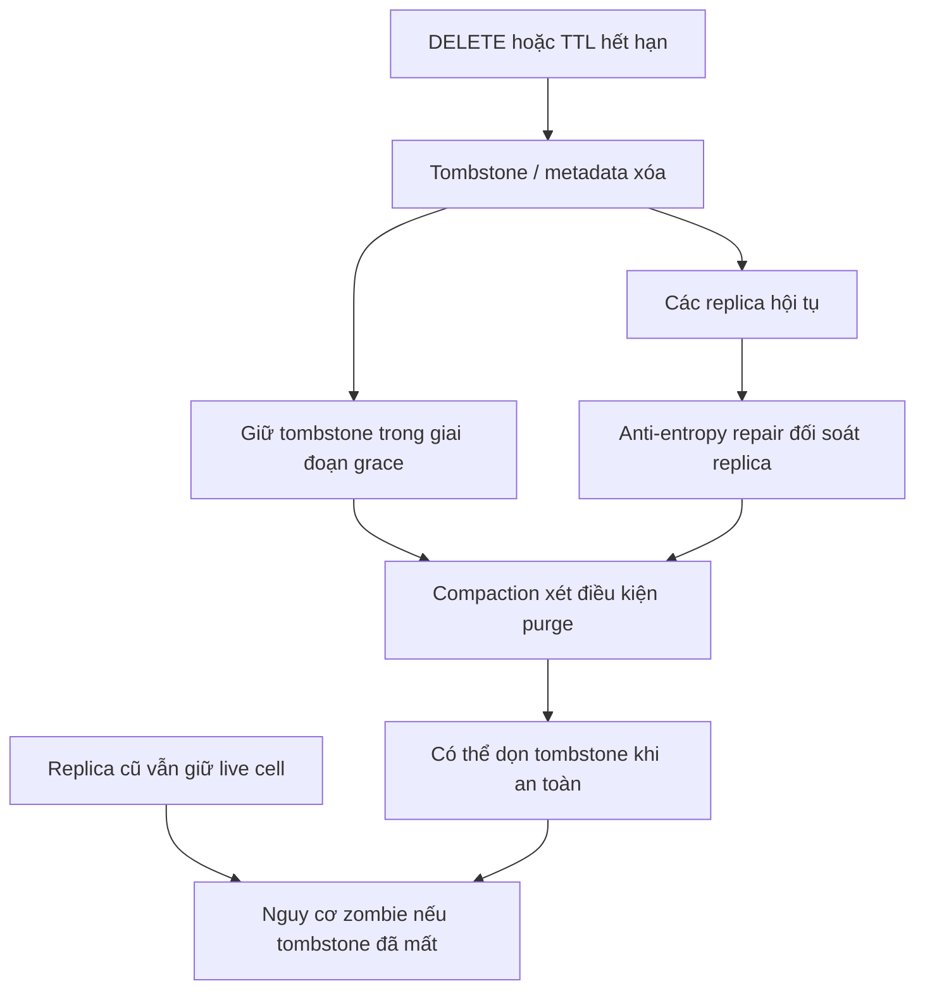
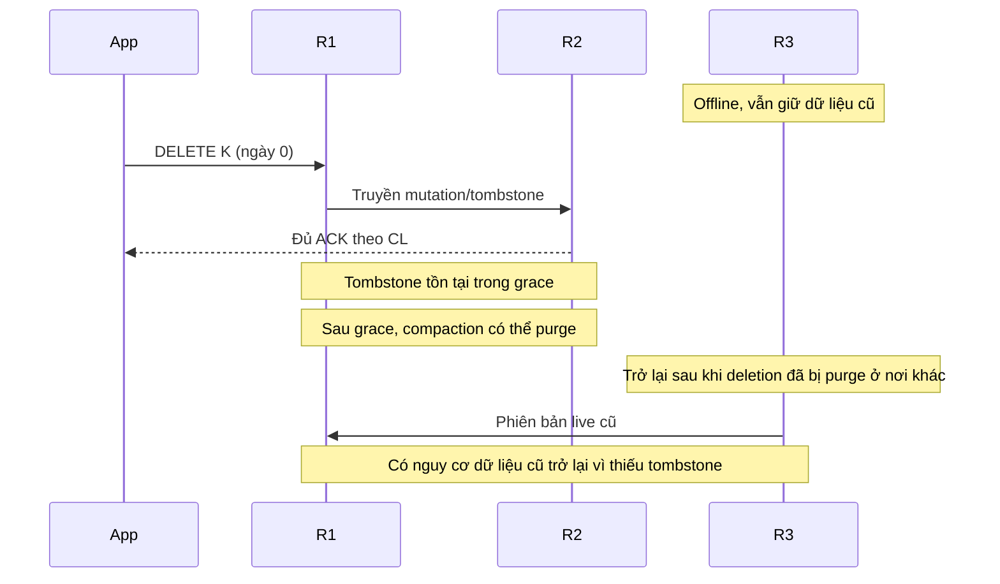
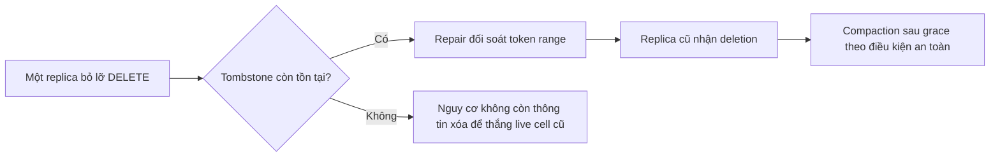

# gc_grace_seconds, repair và nguy cơ dữ liệu bị xóa xuất hiện trở lại

Trong **Spring Data Cassandra**, lời gọi `repository.deleteById(...)`, `CassandraTemplate.delete(...)` hoặc một câu `DELETE` qua `CqlTemplate` có thể trả về thành công, nhưng điều đó **không có nghĩa mọi bản sao dữ liệu đã bị xóa vật lý ngay lập tức**. Apache Cassandra là cơ sở dữ liệu phân tán: một partition có nhiều replica, replica có thể tạm thời không liên lạc được và dữ liệu được hòa giải theo timestamp của mutation. Để các replica cuối cùng đồng ý rằng một giá trị đã bị xóa, Cassandra sử dụng **tombstone**.

Tombstone cũng cần được dọn để tránh chiếm dung lượng và làm truy vấn chậm. Tuy nhiên, dọn quá sớm — trước khi replica từng vắng mặt kịp nhận thông tin xóa — có thể dẫn tới hiện tượng **zombie data**, tức dữ liệu đã xóa bất ngờ xuất hiện trở lại. Ba khái niệm gắn chặt với nhau là **`gc_grace_seconds`**, **anti-entropy repair** và **compaction**.

Bài học thuộc chương **TTL và tombstone** của module `SPRING_DATA_CASSANDRA`. Sau bài này, bạn cần giải thích được tombstone tồn tại để làm gì, phân biệt “đủ điều kiện xóa tombstone” với “đã xóa vật lý”, nhận diện một kịch bản zombie, thiết kế lịch repair an toàn và đánh giá các thay đổi `gc_grace_seconds` trong hệ thống có nhiều node/datacenter.

## 1. Tombstone: một phép xóa có thể được truyền giữa các replica

Giả sử keyspace được cấu hình với replication factor (RF) là 3. Một partition có các bản sao tại R1, R2 và R3. Khi ứng dụng xóa một cell hoặc một hàng, Cassandra ghi **deletion marker (tombstone)** kèm metadata thời gian. Marker này có thể được truyền giữa các replica và tham gia vào quy tắc hòa giải phiên bản.

| Trạng thái | Cách hiểu đúng |
| --- | --- |
| Cell còn giá trị sống | Có một phiên bản dữ liệu có write timestamp và metadata liên quan |
| Cell đã bị xóa bằng `DELETE` | Tombstone ghi nhận rằng phiên bản cũ không nên được coi là còn sống |
| Giá trị hết hạn TTL | Hết hạn tạo ngữ nghĩa xóa; dữ liệu hết hạn tham gia vào việc xử lý tombstone/compaction |
| Một replica tạm thời không nhận được deletion | Replica đó có thể vẫn giữ **phiên bản cũ** |
| Tombstone được dọn sau khi đáp ứng điều kiện compaction | Marker không còn để đối chiếu với dữ liệu cũ nếu dữ liệu cũ xuất hiện lại |

Điều quan trọng là **xóa không phải chỉ xóa khỏi một file tại thời điểm nhận request**. Trong hệ phân tán, marker xóa phải tồn tại đủ lâu để bản sao cũ không thể vô tình trở thành nguồn khôi phục dữ liệu đã bị xóa.



Sơ đồ trình bày **mối quan hệ logic**, không có nghĩa Cassandra mặc định kiểm tra “repair đã hoàn tất” như điều kiện bắt buộc trước mọi lần purge. Trong cấu hình truyền thống, vượt thời gian grace và điều kiện compaction có thể đủ để tombstone được dọn; chính vì vậy **vận hành repair đúng hạn là trách nhiệm của hệ thống**.

## 2. Bảng ví dụ và dữ liệu phân tán theo partition

Giả sử hệ thống telemetry lưu event của thiết bị theo tenant và ngày UTC. Một keyspace minh họa dùng `NetworkTopologyStrategy`:

```sql
-- Ví dụ dành cho cluster có datacenter tên dc1.
-- RF và tên DC phải khớp topology thực tế khi triển khai.
CREATE KEYSPACE IF NOT EXISTS telemetry
WITH replication = {
    'class': 'NetworkTopologyStrategy',
    'dc1': 3
};
```

Bảng:

```sql
CREATE TABLE telemetry.events_by_device_day (
    tenant_id    text,
    device_id    text,
    event_day    date,
    occurred_at  timestamp,
    event_id     uuid,
    event_type   text,
    payload      text,
    PRIMARY KEY ((tenant_id, device_id, event_day),
                 occurred_at, event_id)
) WITH CLUSTERING ORDER BY (occurred_at DESC, event_id DESC)
  AND gc_grace_seconds = 864000;
```

Ở đây `(tenant_id, device_id, event_day)` là **partition key ghép**; `occurred_at` và `event_id` là **clustering columns**. Các replica được xác định theo **partition key**, không theo `event_type` hoặc `payload`.

Ví dụ đọc các event mới nhất:

```sql
SELECT occurred_at, event_id, event_type
FROM telemetry.events_by_device_day
WHERE tenant_id = ?
  AND device_id = ?
  AND event_day = ?
LIMIT 50;
```

Câu CQL ràng buộc đủ partition key và sử dụng thứ tự clustering trong partition. Các vấn đề tombstone có thể làm đường đọc này chậm, ngay cả khi CQL vốn hợp lệ: Cassandra phải phân biệt cell đang sống, cell bị xóa, row bị xóa và thông tin hết hạn khi xử lý kết quả.

**Lưu ý:** DDL trên chỉ là mô hình học tập. Không tạo/đổi keyspace hay table production từ bài viết; schema migration phải có review, kiểm thử và lịch triển khai riêng.

## 3. `gc_grace_seconds` thực sự điều khiển điều gì?

`gc_grace_seconds` là **thuộc tính cấp bảng**, đơn vị giây, được dùng để xác định một khoảng thời gian giữ thông tin xóa trước khi tombstone có thể đủ điều kiện được **purge** bởi compaction theo cơ chế và phiên bản Cassandra đang dùng.

```sql
ALTER TABLE telemetry.events_by_device_day
WITH gc_grace_seconds = 864000;
```

Với giá trị `864000`:

\[
864000\ \text{giây} = 10\ \text{ngày}
\]

Trong nhiều cấu hình Cassandra truyền thống, 10 ngày là giá trị mặc định thường gặp; **không suy ra đó là giá trị đang áp dụng** cho mọi bảng, mọi phiên bản hoặc mọi dịch vụ được quản lý. Hãy kiểm tra metadata và thiết lập thực tế của cluster.

### `gc_grace_seconds` không phải TTL

| Thuộc tính | Áp dụng cho | Ý nghĩa |
| --- | --- | --- |
| `USING TTL 3600` | Cell được ghi bằng câu CQL có TTL | Giá trị có thời hạn sống một giờ, sau đó hết hạn |
| `default_time_to_live` | Những giá trị ghi vào bảng theo chính sách TTL mặc định | Tạo chính sách hết hạn ở mức bảng, có các giới hạn và ngoại lệ |
| `gc_grace_seconds` | Thời gian grace liên quan đến tombstone của bảng | Hỗ trợ an toàn khi tombstone được xét purge |
| Thời điểm chạy compaction | SSTable và chiến lược compaction | Ảnh hưởng **khi nào** dữ liệu/tombstone có thể bị loại bỏ vật lý |
| Anti-entropy repair | Các replica/token ranges | Đối soát những phiên bản dữ liệu khác nhau giữa replica |

Ví dụ một cell có TTL một giờ **không đồng nghĩa** sau một giờ toàn bộ byte trên đĩa biến mất. Sau TTL, giá trị không còn được trả như một live cell khi đã hết hạn, nhưng dữ liệu hết hạn/tombstone còn phải đi qua cơ chế lưu trữ và compaction phù hợp.

### Ba nhầm lẫn nguy hiểm

1. `gc_grace_seconds = 864000` **không bảo đảm tombstone bị xóa chính xác sau 10 ngày**.
2. Grace đã hết **không đồng nghĩa replica vắng mặt đã được repair**.
3. Tăng read/write consistency level **không tự thay thế repair** và không làm replica mất liên lạc chắc chắn nhận được deletion.

Một tombstone có thể tồn tại lâu hơn grace vì SSTable chưa được compact, có overlap với dữ liệu còn cũ hoặc còn các điều kiện an toàn khác. Ngược lại, **không nên dựa vào việc compaction “có lẽ sẽ chậm” để cho phép repair trễ**.

## 4. Zombie data: dữ liệu bị xóa xuất hiện trở lại như thế nào?

Xem một partition có ba replica R1, R2, R3. Ban đầu chúng đều lưu:

```text
K = (tenant-a, device-7, 2026-11-25, t1, event-1)
event_type = "SENSOR_ALERT"
```

Một chuỗi sự kiện rủi ro:

| Thời điểm minh họa | R1 | R2 | R3 |
| --- | --- | --- | --- |
| Ngày 0, trước khi xóa | Có live cell | Có live cell | Có live cell |
| Ngày 0, R3 bị ngắt kết nối | Online | Online | Offline, còn live cell cũ |
| Ngày 0, DELETE được chấp nhận | Nhận tombstone | Nhận tombstone | Không nhận tombstone |
| Ngày 1–10 | Tombstone vẫn còn | Tombstone vẫn còn | Vẫn offline |
| Ngày 11, compaction phù hợp | Tombstone **có thể** bị purge | Tombstone **có thể** bị purge | Vẫn còn live cell cũ |
| Ngày 12, R3 quay lại và tiến hành đồng bộ/đọc | Không còn deletion để thắng | Không còn deletion để thắng | Có thể phát tán phiên bản cũ |

Khi thông tin xóa đã bị dọn khỏi các replica khỏe mạnh mà R3 vẫn giữ phiên bản live trước deletion, hoạt động trao đổi dữ liệu/repair về sau có thể **khôi phục phiên bản cũ**. Đây là hiện tượng *zombie resurrection*.



Đây là một **kịch bản có điều kiện**, không phải kết luận rằng “cứ qua ngày thứ 11 là chắc chắn zombie”. Nếu tombstone chưa được purge, hoặc R3 đã nhận deletion qua một cơ chế đồng bộ trước đó, dữ liệu có thể vẫn được bảo vệ. Điều gây rủi ro là **replica còn dữ liệu cũ + không nhận deletion + tombstone ở nơi khác đã biến mất**.

### Vì sao consistency level không đủ?

Với RF = 3 và write `QUORUM`/local quorum trong một DC, xóa được xác nhận từ R1 và R2 ngay cả khi R3 offline. Quorum giúp thao tác có điều kiện ACK rõ ràng, nhưng **không cam kết R3 đã nhận tombstone**. Khi tombstone bị purge trước lúc đối soát R3, vấn đề vẫn có thể xảy ra.

Ngay cả một lần `SELECT` trả kết quả rỗng tại R1/R2 cũng không phải bằng chứng deletion đã được truyền an toàn tới mọi replica có thể còn giữ dữ liệu cũ.

## 5. Repair phòng tránh zombie bằng cách nào?

**Anti-entropy repair** là cơ chế Cassandra đối chiếu dữ liệu giữa các replica của những token ranges được yêu cầu, phát hiện khác biệt và đồng bộ các phiên bản cần thiết. Cassandra có các cách thực hiện/triển khai repair khác nhau theo phiên bản và công cụ vận hành, nhưng ý nghĩa cốt lõi ở đây là: **replica từng bỏ lỡ deletion cần nhận được thông tin xóa trong khi tombstone vẫn còn**.

Nếu repair thành công trước khi tombstone đủ điều kiện bị purge, R3 có cơ hội nhận deletion. Sau đó khi compaction dọn tombstone ở các replica theo điều kiện thích hợp, không còn một replica lưu bản cũ có thể làm dữ liệu sống lại.



### Sự khác biệt giữa repair và những cơ chế khác

| Cơ chế | Giúp điều gì? | Vì sao không tự thay repair định kỳ? |
| --- | --- | --- |
| **Hinted handoff** | Lưu/chuyển một số mutation khi replica tạm thời không sẵn sàng | Hints có cửa sổ lưu giữ, giới hạn và điều kiện vận hành; node offline quá lâu có thể bỏ lỡ |
| **Read repair / reconciliation khi đọc** | Có thể đồng bộ khác biệt được phát hiện trong một số thao tác đọc | Chỉ liên quan các phạm vi được đọc, không chắc bao phủ toàn bộ dữ liệu trước grace |
| **Anti-entropy repair** | Đối soát những token ranges được chọn giữa replica | Phải chạy **đủ phạm vi, đúng lịch, thành công**; gọi một lệnh nhưng bỏ sót ranges không đủ |
| **Compaction** | Hợp nhất SSTable và dọn dữ liệu/tombstone phù hợp | Không có chức năng tự đến replica offline để thông báo deletion bị bỏ lỡ |
| **Consistency QUORUM** | Quy định số ACK/response cần thiết | Không yêu cầu mọi replica đều đã nhận deletion |

Không dựa vào **một cơ chế duy nhất** như hints hoặc “ứng dụng có nhiều SELECT” để thay cho kế hoạch repair. Trong hệ đa DC, phải hiểu replication strategy và những DC/replica nào thực sự được bao phủ.

## 6. Lịch repair và quan hệ với `gc_grace_seconds`

Một nguyên tắc vận hành truyền thống là **hoàn thành repair đầy đủ phạm vi trên toàn bộ dữ liệu cần bảo vệ trong khoảng thời gian ngắn hơn `gc_grace_seconds`**, có dự phòng cho lỗi job, thời gian node vắng mặt và chạy lại.

Ví dụ nếu `gc_grace_seconds = 10` ngày:

- Repair chạy **một lần mỗi 7 ngày** chỉ là điểm khởi đầu để lập lịch, không phải bảo đảm; một job lỗi hoặc kéo dài có thể tạo khoảng trống quá 10 ngày.
- Cần biết **lần repair thành công cuối cùng** của mọi phạm vi dữ liệu/replica quan trọng, không chỉ “lần gần nhất đã bấm chạy”.
- Nếu một replica đã vắng mặt quá lâu, việc khởi động lại rồi đưa vào phục vụ bình thường **không phải lúc nào cũng an toàn**. Cần theo playbook recovery/rebuild theo phiên bản và tình trạng dữ liệu.
- Với nhiều node, nhiều DC, repair bị chia nhỏ theo ranges, lịch phải bảo đảm **coverage thực tế**, không chỉ có một cron job.

### Công thức tư duy về biên an toàn

Đặt:

- `G`: thời gian grace của bảng;
- `I`: khoảng thời gian tối đa giữa những lần repair **thành công và đủ phạm vi**;
- `F`: thời gian dự phòng cho việc phát hiện lỗi, retry, node chậm và bảo trì.

Một mục tiêu vận hành có ích là:

\[
I + F < G
\]

Đây là **quy tắc lập lịch có dự phòng**, không phải định lý bảo đảm tuyệt đối: còn phải xét trường hợp replica offline vượt grace, repair không bao phủ token range, timestamp sai hoặc SSTable/compaction có đặc tính riêng.

Nếu không thể đáp ứng điều kiện vận hành này, đừng chỉ đặt `gc_grace_seconds = 0` cho hệ thống “nhẹ hơn”; hãy đánh giá tăng grace, nâng năng lực repair, điều chỉnh kiến trúc retention hoặc thay đổi quy trình thay thế node.

## 7. Full repair, incremental repair và phạm vi thực thi

Cassandra hỗ trợ các chế độ và công cụ repair khác nhau; ý nghĩa mặc định, option CLI và tương tác giữa repair, SSTable được đánh dấu repaired/unrepaired có thể khác theo phiên bản. Vì vậy cần thiết kế theo **kết quả coverage**, không chỉ nhớ tên một flag.

Ví dụ một lệnh tham khảo:

```bash
# Minh họa cú pháp thường dùng; KHÔNG chạy trên production
# trước khi đối chiếu tài liệu đúng phiên bản và playbook.
nodetool repair --full telemetry events_by_device_day
```

`--full` chỉ cách yêu cầu **full repair** trong những phiên bản có hỗ trợ cú pháp đó. Không nên hiểu rằng một lần gọi trên một node luôn bảo đảm mọi partition ở mọi replica và DC đã được repair. Phải kiểm tra token range, repair ownership, song song, incremental/full strategy, tình trạng job và cả những node bị loại khỏi scope.

Điểm cần kiểm soát:

1. **Scope:** keyspace/table, token ranges, primary range, datacenter và số node tham gia.
2. **Success:** job kết thúc thành công; không có range thất bại hoặc bỏ dở.
3. **Lịch sử:** lần thành công cuối theo phạm vi, không chỉ theo thời điểm cron được kích hoạt.
4. **Node vắng mặt:** node offline trong quá trình repair có được đối soát về sau không?
5. **Load:** repair tốn CPU, disk I/O, network và có thể ảnh hưởng p95/p99 của API.
6. **Version:** một số chiến lược incremental/repair từng có thay đổi và lỗi theo release; kiểm tra hướng dẫn vận hành đúng cluster.

**Repair không phải backup.** Nếu dữ liệu đã bị purge hoặc live cell cũ đã làm dữ liệu sống lại, repair không tự suy ra lịch sử nghiệp vụ để “xóa lại đúng” khi không còn marker/tài liệu nguồn đáng tin. Phục hồi có thể cần nguồn sự thật độc lập và quy trình reconciliation.

## 8. Compaction quyết định khi nào tombstone được purge

Cassandra ghi dữ liệu xuống SSTable bất biến. Compaction hợp nhất các SSTable và có thể loại bỏ dữ liệu không còn cần thiết, bao gồm tombstone **đã đủ điều kiện**. Nhưng an toàn purge không chỉ dựa vào tuổi tombstone.

### Điều cần ghi nhớ

- **`gc_grace_seconds` là điều kiện về thời gian**, không phải bộ hẹn giờ xóa file sau đúng `G` giây.
- **SSTable overlap** và sự tồn tại của các phiên bản dữ liệu khác có thể khiến tombstone phải được giữ lâu hơn để tránh làm giá trị cũ lộ ra.
- **Compaction strategy** ảnh hưởng khi nào các SSTable được xét và phạm vi compaction; không phải mọi tombstone đủ tuổi đều được dọn trong cùng một đợt.
- **Tombstone dày đặc** có thể tăng chi phí quét, memory/CPU và read latency, đặc biệt với partition rộng và query đi qua nhiều hàng đã xóa.
- Một số phiên bản/cấu hình có cơ chế điều khiển purge tombstone bổ sung; phải kiểm tra behavior và metric thực tế, không coi tất cả phiên bản giống nhau.

| Tình huống | Có chắc dọn tombstone ngay không? | Lý do |
| --- | --- | --- |
| TTL vừa hết | **Không** | Giá trị hết hạn không đồng nghĩa đã được compact |
| DELETE vừa được ACK | **Không** | Marker cần tồn tại để replica hội tụ |
| Vừa qua `gc_grace_seconds` | **Không** | Cần compaction và các điều kiện purge thích hợp |
| Đã chạy repair thành công | **Không** | Repair và compaction là hai quá trình khác nhau |
| Tombstone đã đủ điều kiện purge, compaction phù hợp chạy | **Có thể** | Phụ thuộc phạm vi SSTable và quy tắc triển khai |

### Với TTL-heavy workload

Nếu bảng chứa dữ liệu theo bucket thời gian và **phần lớn hàng hết hạn cùng chu kỳ**, một chiến lược compaction theo thời gian (ví dụ TWCS khi phù hợp) có thể giúp các SSTable hết hạn được loại bỏ hiệu quả hơn. Nhưng hiệu quả còn phụ thuộc cách ghi/out-of-order writes, kích thước cửa sổ, TTL, cập nhật muộn và phiên bản Cassandra. **Không đặt `gc_grace_seconds = 0` chỉ vì đang dùng TWCS**.

Khi liên tục viết lại dữ liệu cũ hoặc có dữ liệu trễ vào time window đã qua, việc dọn SSTable hết hạn phức tạp hơn. Cần thiết kế retention và đường ghi ngay từ đầu thay vì chỉ trông chờ compaction khắc phục.

## 9. Ví dụ TTL và DELETE trong CQL

Một lệnh chèn event với TTL một ngày:

```sql
INSERT INTO telemetry.events_by_device_day
    (tenant_id, device_id, event_day,
     occurred_at, event_id, event_type, payload)
VALUES (?, ?, ?, ?, ?, ?, ?)
USING TTL 86400;
```

TTL áp dụng cho những giá trị không thuộc primary key được ghi theo ngữ nghĩa CQL. `event_day` là khóa partition, **không phải thứ bị TTL thay đổi làm di chuyển partition**. TTL khiến cell được ghi có thời hạn sống, nhưng **không biến xóa vật lý thành thao tác tức thì**.

Một lệnh xóa hàng theo **đầy đủ primary key**:

```sql
DELETE FROM telemetry.events_by_device_day
WHERE tenant_id = ?
  AND device_id = ?
  AND event_day = ?
  AND occurred_at = ?
  AND event_id = ?;
```

Và xóa riêng cột:

```sql
DELETE payload FROM telemetry.events_by_device_day
WHERE tenant_id = ?
  AND device_id = ?
  AND event_day = ?
  AND occurred_at = ?
  AND event_id = ?;
```

Lệnh `DELETE payload` tạo ngữ nghĩa xóa **cell payload**; lệnh `DELETE FROM` có thể tạo marker xóa ở phạm vi hàng phù hợp. Kiểu marker khác nhau ảnh hưởng cách Cassandra phải xử lý phạm vi các giá trị cũ, nhưng cả hai đều cần được quản lý để bảo vệ consistency.

### Đọc TTL còn lại

```sql
SELECT event_type, payload,
       TTL(payload) AS payload_ttl,
       WRITETIME(payload) AS payload_write_us
FROM telemetry.events_by_device_day
WHERE tenant_id = ?
  AND device_id = ?
  AND event_day = ?
  AND occurred_at = ?
  AND event_id = ?;
```

`TTL(payload)` giúp kiểm tra số giây còn lại khi cell có TTL. `WRITETIME(payload)` trả write timestamp theo microsecond của **live cell phù hợp**, không phải lịch sử các tombstone đã bị dọn. Nếu giá trị đã hết hạn/xóa, kết quả có thể là `null` hoặc không còn hàng để xem. Không thể khẳng định “không có tombstone” chỉ vì truy vấn này không tìm được payload.

## 10. Spring Data Cassandra: thao tác xóa không bỏ qua tombstone

Spring Data cung cấp các tầng trừu tượng tiện lợi, nhưng cơ chế tombstone là **thuộc về Cassandra**, không đổi theo API Java.

| Đường ghi/xóa | Ví dụ | Có thể sinh tombstone? |
| --- | --- | --- |
| Repository | `repository.deleteById(key)` | **Có**, theo ngữ nghĩa deletion của CQL |
| CassandraTemplate | `template.delete(entity)` | **Có**, với thao tác xóa tương ứng |
| CqlTemplate/Java Driver | CQL `DELETE` | **Có** |
| Insert/update có TTL | `INSERT ... USING TTL ...` | Cell hết hạn sẽ được xử lý qua metadata hết hạn/tombstone |
| Update viết `null` vào cell | `UPDATE ... SET column = null` | Thường có ngữ nghĩa xóa cell |
| Statement để tham số **UNSET** | Bỏ qua field trong một thao tác phù hợp | Không tương đương việc gửi `null` để xóa |

### Entity có khóa ghép

```java
import java.io.Serializable;
import java.time.Instant;
import java.time.LocalDate;
import java.util.UUID;
import org.springframework.data.cassandra.core.cql.Ordering;
import org.springframework.data.cassandra.core.mapping.PrimaryKeyClass;
import org.springframework.data.cassandra.core.mapping.PrimaryKeyColumn;
import org.springframework.data.cassandra.core.mapping.PrimaryKeyType;

@PrimaryKeyClass
public class EventKey implements Serializable {
    @PrimaryKeyColumn(name = "tenant_id", ordinal = 0,
            type = PrimaryKeyType.PARTITIONED)
    private String tenantId;

    @PrimaryKeyColumn(name = "device_id", ordinal = 1,
            type = PrimaryKeyType.PARTITIONED)
    private String deviceId;

    @PrimaryKeyColumn(name = "event_day", ordinal = 2,
            type = PrimaryKeyType.PARTITIONED)
    private LocalDate eventDay;

    @PrimaryKeyColumn(name = "occurred_at", ordinal = 3,
            type = PrimaryKeyType.CLUSTERED,
            ordering = Ordering.DESCENDING)
    private Instant occurredAt;

    @PrimaryKeyColumn(name = "event_id", ordinal = 4,
            type = PrimaryKeyType.CLUSTERED,
            ordering = Ordering.DESCENDING)
    private UUID eventId;

    public EventKey() {}
    // Thực tế phải bổ sung constructor, getters/setters,
    // equals() và hashCode() cho toàn bộ thuộc tính khóa.
}
```

```java
import org.springframework.data.cassandra.core.mapping.Column;
import org.springframework.data.cassandra.core.mapping.PrimaryKey;
import org.springframework.data.cassandra.core.mapping.Table;

@Table("events_by_device_day")
public class DeviceEvent {
    @PrimaryKey
    private EventKey key;

    @Column("event_type")
    private String eventType;

    @Column("payload")
    private String payload;

    public DeviceEvent() {}
    // Thực tế bổ sung constructor và getters/setters.
}
```

Các lớp là **khung ánh xạ** minh họa, chưa phải toàn bộ source chạy độc lập. Vì cột `occurred_at` có kiểu `timestamp`, `Instant` cần được chuẩn hóa ở độ chính xác millisecond nếu được đưa vào khóa. `event_day` phải được tính theo quy tắc bucket UTC nhất quán giữa writer/reader.

Repository:

```java
import org.springframework.data.cassandra.repository.CassandraRepository;

public interface DeviceEventRepository
        extends CassandraRepository<DeviceEvent, EventKey> {
}
```

Khi service gọi:

```java
// key đã được kiểm tra đầy đủ tenantId, deviceId, eventDay,
// occurredAt và eventId; quyền tenant đã được xác minh.
repository.deleteById(key);
```

... API này **không tự bảo đảm mọi replica đã nhận xóa**. Nó thực hiện thao tác xóa theo đường truy cập Spring Data và consistency/options đang áp dụng. Vấn đề retention tombstone, repair và recovery của replica vẫn phải được giải quyết ở tầng vận hành Cassandra.

### CqlTemplate: bind giá trị TTL thay vì nối chuỗi

```java
import java.time.Instant;
import java.time.LocalDate;
import java.util.UUID;
import com.datastax.oss.driver.api.core.cql.SimpleStatement;
import org.springframework.data.cassandra.core.cql.CqlTemplate;

public void writeWithTtl(
        CqlTemplate template, String tenantId, String deviceId,
        LocalDate day, Instant occurredAt, UUID eventId,
        String eventType, String payload, int ttlSeconds) {

    if (tenantId == null || tenantId.isBlank()
            || deviceId == null || deviceId.isBlank()
            || day == null || occurredAt == null || eventId == null
            || ttlSeconds < 1 || ttlSeconds > 7 * 86400) {
        throw new IllegalArgumentException("Dữ liệu hoặc TTL không hợp lệ");
    }

    SimpleStatement statement = SimpleStatement.builder(
            "INSERT INTO telemetry.events_by_device_day " +
            "(tenant_id, device_id, event_day, occurred_at, event_id, " +
            " event_type, payload) VALUES (?, ?, ?, ?, ?, ?, ?) " +
            "USING TTL ?")
            .addPositionalValues(
                    tenantId, deviceId, day, occurredAt, eventId,
                    eventType, payload, ttlSeconds)
            .build();

    template.execute(statement);
}
```

Đây là ví dụ về **giới hạn TTL ở biên service** và bind values. `ttlSeconds` cần có hợp đồng nghiệp vụ; không dùng `0` tùy tiện để thể hiện “xóa bản ghi”. `CqlTemplate` sử dụng statement/driver nhưng **không quyết định lịch repair hoặc thời gian purge**. Cấu hình keyspace/session và xử lý consistency của ứng dụng cần được xác minh riêng.

## 11. Cảnh báo về `gc_grace_seconds = 0`

Đặt:

```sql
-- Chỉ minh họa một cấu hình nguy hiểm trên bảng có nhiều replica.
-- KHÔNG chạy khi chưa có đánh giá vận hành đặc biệt.
ALTER TABLE telemetry.events_by_device_day
WITH gc_grace_seconds = 0;
```

... nghĩa là giảm cực mạnh cửa sổ grace để tombstone có thể đủ điều kiện dọn sớm. Trong bảng **có replication và có thể có node không sẵn sàng**, điều này làm tăng nguy cơ zombie nếu tombstone bị purge trước khi replica còn giữ dữ liệu cũ được đối soát.

Một số workload đặc biệt và cấu hình phiên bản cụ thể có thể có lý do cân nhắc grace rất thấp — chẳng hạn dữ liệu chỉ TTL với giả định vận hành/compaction cực chặt — nhưng **đó là ngoại lệ cần chứng minh**, không phải mẹo tối ưu dung lượng chung. Ngay cả với bảng TTL-only, vẫn phải xét update muộn, replica outage, compaction strategy và liệu dữ liệu hết hạn có thể được tái nhập từ nguồn cũ hay không.

Nếu mục tiêu là giảm tombstone scan, hãy **tìm nguyên nhân gốc**: API liên tục `DELETE` rồi `INSERT`, partition quá lớn, TTL phân bố hỗn hợp, query đọc xuyên dải hàng đã xóa, hoặc chiến lược compaction không phù hợp. Chỉ chỉnh grace để che lỗi workload có thể đổi một vấn đề hiệu năng thành **mất tính đúng đắn của dữ liệu**.

## 12. Giám sát, điều tra và ứng phó

Nên theo dõi **cả dữ liệu và tiến độ repair**:

| Tín hiệu | Ý nghĩa vận hành |
| --- | --- |
| Thời điểm **repair thành công đầy đủ phạm vi** | Có bằng chứng các replica/ranges đã được đối soát trước khi hết grace |
| Repair failed, interrupted, skipped ranges | Có thể tạo khoảng trống bảo vệ deletion |
| Node down lâu hơn lịch repair hoặc grace | Cần playbook phục hồi, không đơn thuần mở lại traffic |
| Pending compaction, disk/IO, SSTable count | Ảnh hưởng tốc độ và khả năng purge tombstone |
| Tombstone scanned / warning/abort metrics | Tín hiệu truy vấn tốn công xử lý marker xóa |
| Read p95/p99, timeout, retries | Có thể tăng khi quét nhiều tombstone hoặc replica chậm |
| TTL/DELETE rate theo bảng/partition | Giúp định vị nguồn tombstone nhiều |
| Dữ liệu đã xóa xuất hiện lại | Sự cố correctness cần đối soát ngay, không chỉ tối ưu query |

Tên metric/công cụ cụ thể và lệnh kiểm tra thay đổi theo Cassandra release/phân phối. Có thể sử dụng dashboard, `nodetool`, repair orchestration và logs phù hợp với phiên bản đang chạy. Không chạy `major compaction` hoặc rebuild hàng loạt trong giờ cao điểm chỉ để “dọn cho sạch” nếu chưa hiểu chi phí.

### Khi nghi dữ liệu zombie xuất hiện

1. **Khoanh vùng** keyspace, bảng, full primary key, replica/DC và timestamp có liên quan.
2. **Xác minh nguồn sự thật nghiệp vụ**: deletion thực sự có được yêu cầu và ACK không? Có replay/backfill nào ghi lại dữ liệu không?
3. Kiểm tra **lịch sử repair và node outage**, đặc biệt khoảng offline dài hơn grace.
4. Kiểm tra thay đổi `gc_grace_seconds`, compaction, TTL và thời điểm các node quay lại cluster.
5. **Ngăn nguồn dữ liệu cũ tiếp tục phát tán** theo playbook vận hành; không tự động bật node stale vào serving path nếu chưa đánh giá.
6. Lập phương án khôi phục dữ liệu đúng với timestamp/quy tắc xung đột và kiểm soát việc phát lại deletion, theo dõi các partition liên quan.
7. Sau sự cố, cập nhật **lịch repair, cảnh báo node offline và recovery playbook** để ngăn tái diễn.

Không thể kết luận chắc zombie chỉ từ một query trả hàng đã từng bị xóa: cũng có thể có **một writer hợp lệ mới** đã chèn lại hàng hoặc một pipeline replay đã đưa dữ liệu cũ vào. Cần bằng chứng từ timeline và nguồn ghi.

## 13. Các tình huống cần quyết định

### Tình huống A: Repair cứ bảy ngày là an toàn?

Cluster dùng `gc_grace_seconds = 10` ngày; cron repair mỗi bảy ngày. Lần thứ nhất hoàn thành, lần thứ hai thất bại nhưng không có cảnh báo, lần thứ ba chạy sau 14 ngày.

**Phân tích:** Không an toàn chỉ dựa vào cron. Khoảng cách giữa các **lần repair thành công đủ phạm vi** có thể vượt grace. Cần cảnh báo lỗi, theo dõi coverage và có dự phòng lịch/retry.

### Tình huống B: Hints sẽ cứu replica offline 12 ngày?

R3 mất liên lạc 12 ngày, trong khi `gc_grace_seconds = 10` ngày. Một số mutation được ghi trong thời gian này.

**Phân tích:** Không được mặc định hints còn tồn tại và truyền hết deletion. Hints có giới hạn cửa sổ và điều kiện lưu giữ; cần quy trình phục hồi/rebuild/repair theo trạng thái thực của R3. Cho R3 quay lại phục vụ không kiểm soát có thể gây zombie.

### Tình huống C: TTL một ngày, grace 10 ngày

Một event có TTL một ngày. Sau đúng 24 giờ, `SELECT` không còn trả event. Có thể kết luận các byte đã được xóa vật lý và grace đang không có tác dụng?

**Phân tích:** Không. Hết hạn logic và dọn vật lý là hai quá trình khác nhau. Compaction và metadata TTL/tombstone vẫn chi phối việc dọn dữ liệu.

### Tình huống D: Hạ grace xuống 0 để giảm latency

Một bảng nhiều replica phát sinh nhiều tombstone vì API liên tục đổi trạng thái. Developer muốn `gc_grace_seconds = 0` để mọi query “nhẹ hơn”.

**Phân tích:** Không nên. Cần đo partition/query path, nguồn DELETE/TTL và khả năng compaction, sửa workload hoặc schema. Grace bằng 0 có thể biến sự cố hiệu năng thành dữ liệu sống lại khi replica offline.

### Tình huống E: QUORUM cho DELETE và READ

RF=3; R3 offline, R1/R2 xác nhận `DELETE` với QUORUM. Ngày 12, R3 quay lại sau khi tombstone ở R1/R2 đã bị purge. Có còn rủi ro zombie?

**Phân tích:** Có. QUORUM chỉ yêu cầu hai ACK, không chứng minh R3 đã nhận deletion. Nếu không có thông tin xóa để thắng dữ liệu cũ, R3 có thể góp phần tái xuất hiện giá trị.

### Tình huống F: Chỉ repair một token range

Một đợt repair “thành công” nhưng chỉ chạy một phần nhỏ token ranges, còn nhiều range khác đã hơn grace không được đối soát.

**Phân tích:** Không đủ. Phải kiểm tra **coverage toàn bộ dữ liệu cần bảo vệ**, các replica và phạm vi DC tương ứng; chỉ một job exit code 0 không chứng minh mọi deletion đã được truyền.

## 14. Checklist trước khi thay đổi `gc_grace_seconds`

1. **Xác định RF và topology:** số replica từng partition, các DC và cách ứng dụng định tuyến coordinator.
2. **Xác nhận retention:** TTL, DELETE, tombstone volume, thời gian giữ dữ liệu nghiệp vụ.
3. **Đo repair coverage:** lịch sử thành công, khoảng cách tối đa, ranges bị bỏ sót và thời gian node offline.
4. **Định nghĩa margin:** có thời gian đủ để phát hiện lỗi job, retry và phục hồi replica trước khi hết grace.
5. **Đánh giá compaction strategy:** SSTable overlap, TTL pattern, late writes, disk và IO.
6. **Không xem grace là lịch purge:** compaction có thể giữ marker lâu hơn, nhưng không được dựa vào may mắn đó để repair trễ.
7. **Thử fault scenario:** DELETE khi replica offline, repair trước/sau grace, TTL hết hạn và node quay lại trong staging.
8. **Đánh giá quyền thao tác DDL:** thay đổi schema phải qua migration được phê duyệt, có rollback/operational plan.
9. **Quan sát sau triển khai:** repair errors, node outage, tombstone metrics, p95/p99 và dấu hiệu dữ liệu xuất hiện lại.
10. **Bảo toàn nguồn sự thật:** có log hoặc dữ liệu đối soát để xử lý trường hợp phục hồi không thể suy ra từ Cassandra.

## Kết luận

**`gc_grace_seconds`** đặt một khoảng thời gian grace để tombstone có thể tiếp tục bảo vệ thao tác xóa trước khi được xét purge; **compaction** quyết định việc dọn dữ liệu vật lý theo các điều kiện của SSTable, còn **anti-entropy repair** đưa những replica từng bỏ lỡ deletion về trạng thái nhất quán trong khi thông tin xóa vẫn còn. Nếu một replica mang dữ liệu cũ quay lại **sau khi tombstone đã bị purge** ở nơi khác, dữ liệu đã xóa có thể **xuất hiện trở lại**.

Trong Spring Data Cassandra, `deleteById`, `CassandraTemplate` hay `CqlTemplate` chỉ là những cách phát mutation; chúng không thay thế chính sách vận hành replica. Hãy theo trình tự **thiết kế bảng theo truy vấn → chọn retention/TTL và grace hợp lý → bảo đảm repair đủ phạm vi, đúng hạn → kiểm soát node outage và compaction → giám sát tombstone/latency → kiểm thử phục hồi**. Mục tiêu không chỉ là giảm dung lượng đĩa, mà còn **không để dữ liệu đã xóa sống lại** trong hệ phân tán.
