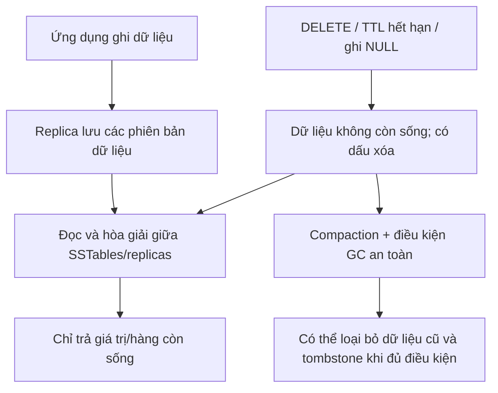

# Truy vấn qua nhiều tombstone và dấu hiệu suy giảm hiệu năng

Trong **Apache Cassandra**, lệnh xóa dữ liệu hoặc việc một giá trị hết hạn **TTL** thường không khiến dữ liệu cũ biến mất ngay khỏi các tệp SSTable. Cassandra ghi lại trạng thái xóa dưới dạng **tombstone** để các replica có thể hòa giải dữ liệu đã xóa với những bản sao hoặc các phiên bản dữ liệu cũ. Tombstone là một phần thiết yếu của mô hình dữ liệu phân tán, không phải “rác” có thể tùy tiện tắt đi.

Vấn đề xuất hiện khi một câu truy vấn phải **đọc, đối chiếu và bỏ qua rất nhiều tombstone** trước khi tìm đủ các hàng còn sống. Một endpoint chỉ trả 20 bản ghi vẫn có thể tiêu tốn tài nguyên lớn, dẫn đến độ trễ p95/p99 tăng, cảnh báo từ Cassandra, timeout, áp lực CPU/heap và trong một số trường hợp bị chặn theo ngưỡng bảo vệ của server.

Bài học thuộc chương **TTL và tombstone** trong module **SPRING_DATA_CASSANDRA**: truy cập Cassandra bằng entity mapping, repository, `CassandraTemplate` và CQL, đồng thời thiết kế bảng theo truy vấn, partition key, consistency, paging và hiệu năng của dữ liệu phân tán. Chủ đề trực tiếp là **“Truy vấn qua nhiều tombstone và dấu hiệu suy giảm hiệu năng”**: tại sao xảy ra, quan sát bằng công cụ gì, đọc đúng dấu hiệu và thay đổi mô hình dữ liệu ra sao.

> **Nguyên tắc xuyên suốt:** `LIMIT 20` giới hạn số hàng kết quả, **không** bảo đảm Cassandra chỉ phải kiểm tra 20 hàng hoặc 20 tombstone. Muốn khắc phục nguyên nhân, phải nhìn cả cách ghi/xóa, phân bố dữ liệu, đường truy vấn, compaction và điều kiện vận hành.

## 1. Mục tiêu học tập

Sau bài này, bạn có thể:

1. Giải thích nguồn tạo tombstone từ **DELETE, TTL hết hạn và ghi NULL**, phân biệt với việc dữ liệu đã được loại bỏ vật lý.
2. Mô tả lý do read path có thể gặp nhiều tombstone dù câu CQL đã có đầy đủ partition key.
3. Phân biệt **số hàng trả về**, **số hàng/cell phải xét**, **page size** và **giới hạn `LIMIT`**.
4. Nhận diện dấu hiệu qua **cảnh báo tombstone**, query tracing, metrics, `nodetool tablestats`, read latency và timeout.
5. Hiểu vai trò của **compaction**, `gc_grace_seconds`, repair và nguy cơ dữ liệu đã xóa xuất hiện trở lại nếu thu gom tombstone quá sớm.
6. Đánh giá khi nào **TimeWindowCompactionStrategy (TWCS)** có ích với dữ liệu TTL theo thời gian và khi nào TWCS không phù hợp.
7. Thiết kế partition/bucket và retention để truy vấn không thường xuyên đi qua dải dữ liệu đã hết hạn.
8. Viết CQL và ví dụ Java Driver/Spring Data để kiểm tra read warnings mà không diễn giải sai kết quả.
9. Tạo integration test có TTL/xóa và kiểm tra các điều kiện khiến đọc chậm, đồng thời hiểu giới hạn của Testcontainers một node.
10. Lập checklist chẩn đoán trước khi thay đổi schema, compaction hoặc các ngưỡng bảo vệ của Cassandra.

## 2. Bảng ví dụ: nhật ký hoạt động theo học viên

Giả sử nền tảng học tập có endpoint:

```text
GET /tenants/{tenantId}/students/{studentId}/activities?limit=20
```

Nó hiển thị các sự kiện gần đây: `LESSON_STARTED`, `LESSON_COMPLETED`, `COURSE_OPENED`. Để giới hạn chi phí lưu trữ, hệ thống chỉ giữ nhiều sự kiện trong một khoảng thời gian rồi để chúng tự hết hạn.

Bảng được thiết kế theo hướng đọc của một học viên:

```sql
CREATE TABLE IF NOT EXISTS learning.activity_by_student (
    tenant_id uuid,
    student_id uuid,
    event_at timestamp,
    event_id uuid,
    event_type text,
    event_payload text,
    PRIMARY KEY ((tenant_id, student_id), event_at, event_id)
) WITH CLUSTERING ORDER BY (event_at DESC, event_id ASC);
```

Giả định keyspace `learning` đã được tạo bởi migration trước khi ứng dụng khởi động.

| Thành phần | Loại | Ảnh hưởng đến truy vấn |
| --- | --- | --- |
| `(tenant_id, student_id)` | **Partition key ghép** | Định vị các sự kiện của một học viên trong một tenant |
| `event_at` | Clustering column 1, giảm dần | Sự kiện mới hơn đứng trước trong cùng partition |
| `event_id` | Clustering column 2 | Phân biệt các sự kiện có cùng thời điểm |
| `event_type` | Regular column | Dữ liệu hiển thị và có thể hết hạn |
| `event_payload` | Regular column | Dữ liệu chi tiết, có thể hết hạn |

CQL đọc 20 hàng mới nhất:

```sql
SELECT event_at, event_id, event_type
FROM learning.activity_by_student
WHERE tenant_id = ? AND student_id = ?
LIMIT 20;
```

Câu query đã có **đầy đủ partition key**. Đây là điều kiện cần cho đường đọc định vị tốt, nhưng **chưa đủ** để bảo đảm mọi partition đều nhỏ hoặc ít tombstone.

### 2.1. Ghi sự kiện có TTL

Một thao tác INSERT có TTL một tuần:

```sql
INSERT INTO learning.activity_by_student (
    tenant_id, student_id, event_at, event_id,
    event_type, event_payload
) VALUES (?, ?, ?, ?, ?, ?)
USING TTL 604800;
```

`604800` là **số giây** (7 ngày). Đây là ví dụ về retention, không phải khuyến nghị TTL chung cho mọi sản phẩm.

TTL được áp dụng cho các **giá trị cột có hỗ trợ TTL** được ghi bởi mutation, không biến partition key thành một timer nghiệp vụ tự động. Khi các giá trị đang sống hết hạn, chúng không còn được trả về như dữ liệu sống; hệ thống vẫn cần quản lý thông tin xóa để không làm giá trị cũ trên replica khác “sống lại”.

### 2.2. Xóa sự kiện theo khóa đầy đủ

```sql
DELETE FROM learning.activity_by_student
WHERE tenant_id = ?
  AND student_id = ?
  AND event_at = ?
  AND event_id = ?;
```

Đây là xóa một hàng đã biết đầy đủ primary key. Không được bỏ `event_at` và `event_id` chỉ để “xóa một hoạt động”, vì một lệnh chỉ theo partition key có thể xóa **toàn partition**. Mỗi kiểu xóa có thể tạo tombstone ở phạm vi khác nhau.

### 2.3. Vì sao event_at không phải thời điểm TTL bắt đầu?

`event_at` là **thời điểm nghiệp vụ** và clustering key. Nó không tự quyết định khi nào một giá trị hết TTL. TTL gắn với mutation/giá trị được ghi, chịu ảnh hưởng thời điểm ghi và write timestamp theo ngữ nghĩa Cassandra.

Nếu ứng dụng backfill dữ liệu sự kiện cũ hôm nay với `USING TTL 604800`, không được tự giả định những sự kiện đó đã hết hạn chỉ vì `event_at` là năm trước. Cần phân biệt **event time**, **write timestamp** và **expiration policy**, đặc biệt trong batch import.

## 3. Tombstone là gì và nó hình thành từ đâu?

**Tombstone** là dấu ghi nhận một thao tác xóa/giá trị hết hiệu lực. Khi các replica chưa nhận được cùng một chuỗi mutation, Cassandra cần dấu này để hòa giải: nếu chỉ loại bỏ dữ liệu mà không giữ thông tin xóa, một replica quay lại sau sự cố có thể gửi giá trị cũ và làm nó xuất hiện trở lại.



### 3.1. Các nguồn tombstone thường gặp

| Nguồn | Ví dụ | Điều cần nhớ |
| --- | --- | --- |
| `DELETE` một cột | `DELETE event_payload FROM ...` | Xóa giá trị cụ thể, thường để lại cell deletion marker |
| `DELETE` một hàng | `DELETE FROM ... WHERE` đầy đủ khóa | Đánh dấu xóa hàng |
| `DELETE` partition hoặc dải clustering | Xóa nhiều hàng trong một partition | Có thể sinh partition/range tombstones; mức ảnh hưởng lớn |
| TTL hết hạn | `INSERT ... USING TTL 604800` | Giá trị không còn sống khi hết thời hạn; phải được xử lý như dữ liệu đã xóa |
| Ghi CQL `NULL` | `UPDATE ... SET event_payload = null` | Trong Cassandra, thường có ngữ nghĩa xóa giá trị thay vì “không thay đổi” |
| Cập nhật collection | Thay/loại phần tử hay ghi lại collection | Có thể tạo tombstone tùy kiểu collection và thao tác |

Không phải mọi tombstone có cùng chi phí: **cell, row, partition và range tombstones** ảnh hưởng các đường đọc khác nhau. Mức tác động phụ thuộc vị trí của chúng so với slice cần truy vấn, số SSTables chứa phiên bản cũ và quá trình compaction.

### 3.2. Tombstone không phải lỗi dữ liệu

Một ứng dụng có TTL hoặc xóa đúng nghiệp vụ **sẽ tạo tombstone**. Mục tiêu không phải đạt “không có tombstone” bằng mọi giá, mà là:

- Tránh đặt dữ liệu xóa/hết hạn dày đặc ngay trên đường đọc nóng.
- Đảm bảo cleanup diễn ra an toàn qua compaction và repair.
- Tránh một query phải xét quá nhiều tombstone để trả vài hàng.
- Quan sát tăng trưởng, không đánh giá hiệu năng chỉ từ số row còn sống.

### 3.3. Xóa logic và xóa vật lý là hai giai đoạn

Khi một giá trị bị xóa/hết TTL:

1. Giá trị đó không còn nên xuất hiện trong kết quả đọc theo ngữ nghĩa hiện hành.
2. Hệ thống vẫn có thể lưu dấu xóa và phiên bản cũ trong SSTables.
3. Compaction xem xét tombstone cùng dữ liệu nó che và điều kiện garbage collection.
4. Chỉ khi an toàn, những dữ liệu này mới có thể được loại bỏ vật lý.

**`DELETE` thành công không có nghĩa disk space được thu hồi ngay.** Tương tự, TTL vừa hết hạn không bảo đảm `nodetool tablestats` hoặc dung lượng SSTable giảm tức thì.

## 4. Vì sao truy vấn có thể phải đi qua nhiều tombstone?

Đường đọc của Cassandra cần tổng hợp dữ liệu từ các cấu trúc lưu trữ liên quan và hòa giải các phiên bản bằng timestamp/tombstone. Nếu các vị trí mà query cần đi qua đã bị xóa hoặc hết hạn, chúng không được tính như hàng sống cuối cùng trả cho ứng dụng.

Ví dụ dòng thời gian:

```text
Partition (tenant=T, student=S), thứ tự event_at DESC:

[01] sự kiện đã hết hạn  -> tombstone
[02] sự kiện đã hết hạn  -> tombstone
[03] sự kiện bị DELETE   -> tombstone
...
[950] sự kiện đã hết hạn -> tombstone
[951] sự kiện còn sống  -> row A
[952] sự kiện còn sống  -> row B
...
[970] sự kiện còn sống  -> row T

CQL: SELECT ... WHERE tenant_id=T AND student_id=S LIMIT 20

Kết quả HTTP: 20 hàng sống.
Công việc đọc: có thể phải xử lý rất nhiều dấu xóa trên đường tìm chúng.
```

Đây là **mô phỏng logic**, không khẳng định Cassandra sẽ quét đúng 950 tombstone trong mọi cấu hình. Số mục thực tế được kiểm tra phụ thuộc SSTable layout, compaction, vị trí dữ liệu, slice restrictions và phiên bản server.

### 4.1. LIMIT không có nghĩa “đọc tối đa LIMIT hàng”

```sql
SELECT event_id, event_at, event_type
FROM learning.activity_by_student
WHERE tenant_id = ? AND student_id = ?
LIMIT 20;
```

`LIMIT 20` giới hạn số hàng **trả về cho query**, không giới hạn số tombstone phải đối chiếu để tìm đủ hàng còn sống.

Một `LIMIT` nhỏ có thể giảm lượng dữ liệu trả về và đôi khi giảm công việc đọc, nhưng **không loại bỏ chi phí truy tìm sau nhiều hàng đã bị xóa**. Không dùng `LIMIT` như một phương án chữa lỗi tombstone-scanning.

### 4.2. Page size cũng không bảo đảm chi phí đọc nhỏ

Page size của Java Driver điều khiển số hàng mục tiêu trong một lần fetch. Khi trong vùng truy vấn có nhiều tombstone:

- Truy vấn có thể phải xét thêm các mục đã xóa để dựng page có hàng sống.
- Một page có ít hàng sống không có nghĩa máy chủ chỉ làm ít việc.
- Duyệt hết `ResultSet` đồng bộ có thể tự fetch page tiếp theo, làm query xử lý nhiều dữ liệu hơn dự kiến.
- Paging state là continuation của **cùng CQL và tham số**, không phải offset độc lập.

**Đừng lấy `rows.size()` hoặc `getAvailableWithoutFetching()` làm “số tombstone đã quét”.** Hai con số này mô tả dữ liệu đã trả/đang sẵn có, không đo toàn bộ công việc server đã thực hiện.

### 4.3. Truy vấn có partition key vẫn có thể chậm

Có đầy đủ `(tenant_id, student_id)` giúp xác định partition. Nhưng nếu partition đó:

- quá lớn vì giữ sự kiện nhiều năm;
- có tỷ lệ delete/update/TTL cao;
- có nhiều SSTables chứa phiên bản chồng lấp;
- thường bị đọc những vùng đã hết hạn;
- là hot partition với nhiều reader/writer đồng thời;

thì latency vẫn có thể tăng mạnh.

**Query-driven design không dừng ở việc chọn đúng partition key.** Phải thiết kế kích thước, vòng đời, clustering range và tải của từng partition.

## 5. Dấu hiệu ứng dụng và cluster đang suy giảm hiệu năng

Tombstone-heavy reads có thể xuất hiện dưới nhiều hình thức:

| Dấu hiệu | Ở tầng nào? | Diễn giải đúng |
| --- | --- | --- |
| p95/p99 read latency tăng | API, Java Driver, Cassandra | Query ngày càng tốn chi phí; không riêng tombstone |
| Cảnh báo server về số tombstone được quét | Cassandra query log / response warnings | Read đã xử lý số dấu xóa cao |
| `tombstone_warn_threshold` bị vượt | Cassandra server | Cảnh báo vượt ngưỡng cảnh giác được cấu hình |
| `tombstone_failure_threshold` bị vượt | Cassandra server | Truy vấn có thể bị chặn/thất bại để bảo vệ node, tùy phiên bản/đường thực thi |
| Read timeout tăng | Driver/API | Coordinator/replica không đáp ứng đúng deadline; phải điều tra nguyên nhân |
| CPU/GC tăng hoặc node chậm | Cassandra JVM | Áp lực xử lý nhiều phiên bản dữ liệu/tombstone hoặc nguyên nhân khác |
| Compaction backlog lớn | Cassandra storage | Tombstone/giá trị cũ có thể chậm được xem xét loại bỏ |
| Partition size/tombstone histogram tăng | Metrics, nodetool | Cần xác định bảng và query gây tải |
| Disk không giảm dù TTL đã hết | SSTables | Xóa vật lý cần compaction và điều kiện an toàn |
| `LIMIT 20` nhưng request vẫn chậm | API/Cassandra | Có thể phải quét nhiều dữ liệu để trả 20 hàng |

### 5.1. Hai ngưỡng tombstone thường được nhắc đến

Trong nhiều bản Apache Cassandra, cấu hình server có các tham số như:

- `tombstone_warn_threshold`: ngưỡng phát **warning** khi read đã xử lý quá nhiều tombstone.
- `tombstone_failure_threshold`: ngưỡng **bảo vệ** có thể khiến read không tiếp tục trong một số điều kiện.

Giá trị mặc định, nội dung warning, loại tombstone được tính và behavior chính xác **có thể khác nhau theo Cassandra version/distribution**. Không copy một ngưỡng lấy từ bài blog rồi xem nó là giá trị hiện có trên production; phải kiểm tra **cấu hình thực tế của cluster**.

Điểm quan trọng hơn con số tuyệt đối: **đừng tăng ngưỡng chỉ để làm cảnh báo biến mất.** Nếu query đang quét quá nhiều dữ liệu, tăng ngưỡng có thể khiến node chịu tải lớn hơn và request timeout muộn hơn.

### 5.2. Warning không phải khẳng định nguyên nhân duy nhất

Query chậm có thể do:

- Partition lớn nhưng hầu hết là dữ liệu sống;
- Fan-out qua nhiều partition/index;
- Network và replica latency;
- SSTables quá nhiều, compaction backlog hoặc disk I/O;
- GC/heap pressure;
- Hot partition;
- Consistency level và topology;
- Tombstone density cao.

Cần **kết hợp warning với CQL, latency, row counts, partition size và compaction metrics**, không chỉ nhìn một dòng log rồi đổi schema ngay lập tức.

## 6. Quan sát bằng CQL và query tracing

### 6.1. Kiểm tra chính câu truy vấn

Một endpoint chỉ hiển thị gần đây có thể dùng:

```sql
SELECT event_at, event_id, event_type
FROM learning.activity_by_student
WHERE tenant_id = ?
  AND student_id = ?
LIMIT 20;
```

Để giảm phạm vi read, nếu nghiệp vụ chỉ cần sự kiện từ thời điểm cụ thể:

```sql
SELECT event_at, event_id, event_type
FROM learning.activity_by_student
WHERE tenant_id = ?
  AND student_id = ?
  AND event_at >= ?
LIMIT 20;
```

Cả hai query dùng đầy đủ partition key. Predicate range trên **clustering column đầu tiên** giúp giới hạn slice cần tìm; nó **có thể** giảm số tombstone phải đi qua nếu các dấu xóa chủ yếu nằm ngoài khoảng đó.

Nhưng `event_at >= ?` **không tự bảo đảm một query luôn nhanh**, đặc biệt nếu nhiều mục gần đây vừa hết TTL hoặc bị xóa. Phải benchmark trên dữ liệu thật và tính đến thứ tự clustering `DESC`.

### 6.2. Dùng cqlsh TRACING có kiểm soát

Trong môi trường test, có thể bật query tracing cho một số truy vấn đại diện:

```sql
TRACING ON;

SELECT event_at, event_id, event_type
FROM learning.activity_by_student
WHERE tenant_id = 11111111-1111-1111-1111-111111111111
  AND student_id = 22222222-2222-2222-2222-222222222222
LIMIT 20;

TRACING OFF;
```

Tracing có thể cung cấp các sự kiện về replica/read path, mức xử lý dữ liệu và cảnh báo phù hợp phiên bản. **Nội dung tracing không phải một API ổn định dùng để tính tombstone count trong code ứng dụng**.

Không bật tracing cho mọi request production khi cluster đang quá tải. Tracing tạo thêm công việc và dữ liệu; hãy dùng **lấy mẫu, truy vấn cụ thể và quyền truy cập phù hợp**.

### 6.3. Quan sát warning từ response

Cassandra có thể gửi **server-side warnings** kèm response khi query chạm điều kiện cảnh báo, và Java Driver 4.x có thể cung cấp qua `ExecutionInfo.getWarnings()`.

Warning hữu ích để liên hệ câu query cụ thể với tình trạng tombstone-scanning, nhưng **không bảo đảm mọi query chậm đều có warning**, và không phải mọi warning đều nói về tombstone.

Không đưa warning thô chứa thông tin nội bộ về thẳng HTTP response cho người dùng cuối. Nên chuyển thành sự kiện quan sát có kiểm soát, có query ID và số liệu đã được loại bỏ thông tin nhạy cảm.

## 7. Quan sát qua nodetool, metrics và compaction

### 7.1. nodetool tablestats

Trên Cassandra node, lệnh quản trị `nodetool tablestats` cung cấp thống kê về keyspace/table, ví dụ:

```text
nodetool tablestats learning.activity_by_student
```

Tùy phiên bản, output có thể có các trường liên quan **average/max tombstones per slice**, **live cells per slice**, partition size, SSTable count, read latency và dung lượng bảng.

Đây là những số đo **theo node, table và cửa sổ thống kê**, không phải bản giải thích đầy đủ cho từng HTTP request. Một giá trị trung bình thấp có thể che một partition cực nóng với số tombstone rất cao.

### 7.2. tablehistograms

```text
nodetool tablehistograms learning activity_by_student
```

Trong những phiên bản hỗ trợ, lệnh này báo các phân phối/histogram như read/write latency, SSTables per read và partition/cell size. Tên trường và availability thay đổi theo phiên bản, vì vậy hãy đối chiếu bản đang chạy trước khi thiết lập parser/alert.

**Không cố diễn giải `tablehistograms` như một phép đo tombstone trực tiếp nếu output không có chỉ số đó.** Nó giúp đặt tombstone trong bức tranh read latency và storage layout.

### 7.3. Metrics liên quan tombstone

Một số bản Cassandra cung cấp những metrics ở mức table như:

- `TombstoneScannedHistogram`: phân phối số tombstone được xử lý trong các lần read.
- `LiveScannedHistogram`: phân phối số live cells/rows được xét trong read.
- `ReadLatency` và các latency histograms khác.
- `SSTablesPerReadHistogram`, compaction pending tasks và số lượng SSTable.

Tên metric JMX/Prometheus và phạm vi đếm có thể khác theo server/distribution, exporter và phiên bản. Hãy kiểm tra schema metrics thật trước khi viết dashboard.

Thay vì chỉ vẽ một chỉ số đơn lẻ, đối chiếu:

```text
Query: activity_by_student / recent-activities
  p95, p99 request latency
  tombstones scanned per read
  live cells/rows scanned
  SSTables per read
  compaction backlog
  read timeouts và request rate
  hot partition / tenant distribution
```

Nếu p99 tăng cùng số tombstone được quét, đó là bằng chứng mạnh cần điều tra đường đọc. Nhưng tương quan chưa phải kết luận về nguyên nhân duy nhất.

### 7.4. Compactionstats và log

```text
nodetool compactionstats
```

Lệnh này giúp kiểm tra compactions đang chạy/chờ. Không phải cứ có tombstone thì compaction có thể xóa nó ngay; cần xét **gc_grace, overlap SSTables, repair state, compaction strategy** và điều kiện an toàn khác.

Trong server logs, những câu tương tự “scanned over ... tombstones” có thể giúp truy ra bảng và truy vấn, nhưng format phụ thuộc phiên bản. Hãy lưu **query fingerprint** thay vì log nguyên UUID/PII của học viên.

## 8. Ví dụ Java Driver: đọc kết quả và nhận warning

Khi cần quan sát trực tiếp server warnings, ứng dụng có thể gọi `CqlSession` qua Java Driver 4.x. Ví dụ sau giới hạn một request thành tối đa 20 hàng, trả DTO cùng các warnings để tầng vận hành xử lý.

```java
import java.time.Instant;
import java.util.ArrayList;
import java.util.List;
import java.util.Objects;
import java.util.UUID;

import com.datastax.oss.driver.api.core.CqlSession;
import com.datastax.oss.driver.api.core.cql.BoundStatement;
import com.datastax.oss.driver.api.core.cql.PreparedStatement;
import com.datastax.oss.driver.api.core.cql.ResultSet;
import com.datastax.oss.driver.api.core.cql.Row;

public record ActivityItem(
        Instant eventAt,
        UUID eventId,
        String eventType) {
}

public record ActivityQueryResult(
        List<ActivityItem> items,
        List<String> serverWarnings) {
}

public class ActivityReadDao {

    private final CqlSession session;
    private final PreparedStatement recent;

    public ActivityReadDao(CqlSession session) {
        this.session = Objects.requireNonNull(session);
        this.recent = session.prepare("""
            SELECT event_at, event_id, event_type
            FROM learning.activity_by_student
            WHERE tenant_id = ? AND student_id = ?
            LIMIT 20
            """);
    }

    public ActivityQueryResult recentForStudent(
            UUID tenantId, UUID studentId) {

        Objects.requireNonNull(tenantId, "tenantId");
        Objects.requireNonNull(studentId, "studentId");

        BoundStatement statement = recent
            .bind(tenantId, studentId)
            .setPageSize(20);

        ResultSet result = session.execute(statement);
        List<ActivityItem> items = new ArrayList<>();

        for (Row row : result) {
            items.add(new ActivityItem(
                row.getInstant("event_at"),
                row.getUuid("event_id"),
                row.getString("event_type")));
        }

        return new ActivityQueryResult(
            List.copyOf(items),
            List.copyOf(result.getExecutionInfo().getWarnings()));
    }
}
```

**Ghi chú về ví dụ:** mỗi `public record`/class cần nằm trong một tệp Java riêng khi triển khai thực tế. Kết quả truy vấn được chặn bởi `LIMIT 20` nên vòng lặp không dự kiến đọc quá 20 hàng của query. Với một query **không có LIMIT**, duyệt `ResultSet` đến hết có thể kích hoạt driver lấy những page tiếp theo và tạo tải lớn.

`ExecutionInfo.getWarnings()` cung cấp những warnings gắn với **execution info đang được đọc**. Nếu query thực sự đi qua nhiều page, cần thu thập execution info của từng page theo API tương ứng, không mặc định warnings của page đầu mô tả toàn bộ các page.

### 8.1. Không dùng warnings để làm logic nghiệp vụ

Không viết:

```java
// Không nên: bỏ dữ liệu hợp lệ chỉ vì có warning quan sát.
if (!result.getExecutionInfo().getWarnings().isEmpty()) {
    return List.of();
}
```

Warning là **tín hiệu vận hành**, không phải cơ chế xác định dữ liệu thuộc quyền người dùng hay logic filtering. Nếu Cassandra trả exception hoặc timeout, xử lý theo chính sách lỗi thực sự của API; nếu có warnings, hãy đo và phát cảnh báo nội bộ phù hợp.

### 8.2. Spring Data Repository và CassandraTemplate có khác quy luật không?

Không. `CassandraRepository` và `CassandraTemplate` dùng Spring Data mapping cho entity; bên dưới vẫn là Cassandra/driver. Một query đi qua nhiều tombstone **không trở nên rẻ hơn** chỉ vì nó được gọi bằng repository method thay vì `CqlSession`.

Nếu API cần chỉ số/cảnh báo đặc thù mà abstraction hiện tại không lộ trực tiếp, có thể thêm **DAO đọc bằng driver** hoặc quan sát server-side metrics. Không nên thay toàn bộ repository chỉ để đo một warning.

## 9. Dùng Spring Data Cassandra đúng mô hình truy vấn

Định nghĩa composite key tương ứng bảng hoạt động:

```java
import java.io.Serializable;
import java.time.Instant;
import java.util.UUID;

import org.springframework.data.cassandra.core.cql.PrimaryKeyType;
import org.springframework.data.cassandra.core.mapping.PrimaryKeyClass;
import org.springframework.data.cassandra.core.mapping.PrimaryKeyColumn;

@PrimaryKeyClass
public class ActivityKey implements Serializable {

    @PrimaryKeyColumn(name = "tenant_id", ordinal = 0,
                      type = PrimaryKeyType.PARTITIONED)
    private UUID tenantId;

    @PrimaryKeyColumn(name = "student_id", ordinal = 1,
                      type = PrimaryKeyType.PARTITIONED)
    private UUID studentId;

    @PrimaryKeyColumn(name = "event_at", ordinal = 2,
                      type = PrimaryKeyType.CLUSTERED)
    private Instant eventAt;

    @PrimaryKeyColumn(name = "event_id", ordinal = 3,
                      type = PrimaryKeyType.CLUSTERED)
    private UUID eventId;

    protected ActivityKey() {}

    // Constructor, getters/setters, equals/hashCode theo toàn bộ khóa.
}
```

Entity:

```java
import org.springframework.data.cassandra.core.mapping.Column;
import org.springframework.data.cassandra.core.mapping.PrimaryKey;
import org.springframework.data.cassandra.core.mapping.Table;

@Table("activity_by_student")
public class ActivityByStudent {

    @PrimaryKey
    private ActivityKey key;

    @Column("event_type")
    private String eventType;

    @Column("event_payload")
    private String eventPayload;

    protected ActivityByStudent() {}

    public ActivityKey getKey() { return key; }
    public String getEventType() { return eventType; }
    public String getEventPayload() { return eventPayload; }

    // Constructor và setters hoặc persistence constructor phù hợp dự án.
}
```

Repository có method CQL tường minh:

```java
import java.util.List;
import java.util.UUID;

import org.springframework.data.cassandra.repository.CassandraRepository;
import org.springframework.data.cassandra.repository.Query;

public interface ActivityRepository
        extends CassandraRepository<ActivityByStudent, ActivityKey> {

    @Query("""
        SELECT *
        FROM learning.activity_by_student
        WHERE tenant_id = ?0 AND student_id = ?1
        LIMIT 20
        """)
    List<ActivityByStudent> recent(
        UUID tenantId, UUID studentId);
}
```

Method đọc này phù hợp partition key. Tuy nhiên, nếu TTL/hành vi xóa tạo nhiều tombstone trong chính partition được đọc, truy vấn **vẫn có thể phát sinh warnings và latency cao**.

### 9.1. Khi cần tùy chọn TTL theo mỗi lần ghi

Trong Spring Data Cassandra, một số phiên bản cho phép đặt TTL qua mapping `@TimeToLive` hoặc write options. Vì API/semantics có khác biệt theo phiên bản, khi cần kiểm soát rõ TTL của từng mutation, **CQL với `USING TTL` là baseline dễ quan sát**.

Không giả định mọi `repository.save(...)` đều dùng cùng TTL theo nghiệp vụ nếu không kiểm tra statement thực tế và mapping/write options.

### 9.2. Tránh đọc quá nhiều rồi lọc ở Java

Ví dụ anti-pattern:

```java
List<ActivityByStudent> all =
    repository.findByKey_TenantIdAndKey_StudentId(
        tenantId, studentId);

// Sau đó mới lọc tất cả hàng trong Java.
```

Nếu method trả toàn bộ một partition lớn, việc lọc phía Java có thể làm tăng read cost và heap. Mặt khác, thêm `WHERE event_type = ?` trực tiếp lên bảng khi `event_type` chỉ là regular column cũng **không mặc định hợp lệ hoặc hiệu quả**.

Giải pháp phải dựa trên **query-driven design**: chọn bảng theo hướng đọc hoặc lọc trong phạm vi một partition có giới hạn thực sự và đúng semantics paging.

## 10. TTL hết hạn nhưng tombstone vẫn nhiều: vì sao?

Giả sử retention là 7 ngày. Vào ngày thứ 8, những giá trị đã ghi ngày đầu không còn sống. Nhưng quá trình cleanup không diễn ra như việc xóa ngay một file hoặc một hàng khỏi ổ đĩa.

Những yếu tố ảnh hưởng:

1. **SSTable bất biến:** Cassandra ghi các phiên bản vào SSTables; muốn hợp nhất/loại bỏ cần compaction.
2. **Hòa giải replica:** các node không nhất thiết đã thấy cùng mutation/deletion.
3. **`gc_grace_seconds`:** cấu hình liên quan khoảng an toàn giữ tombstone trước khi có thể thu gom, tùy chiến lược và điều kiện khác.
4. **Overlapping SSTables:** tombstone có thể cần được giữ nếu dữ liệu cũ nó che vẫn tồn tại ở SSTable khác.
5. **Repair và node downtime:** dữ liệu cũ trên replica vắng mặt có thể tạo rủi ro resurrection nếu cleanup quá sớm.
6. **Compaction strategy và backlog:** quyết định những SSTables được hợp nhất, khi nào, với chi phí I/O ra sao.

### 10.1. TTL không phải công cụ “không cần compaction”

Một table chỉ dùng TTL vẫn có thể có nhiều expired cells/tombstones và đọc chậm nếu compaction không thu gom được kịp hoặc read path đi qua các SSTables chứa dữ liệu đã hết hạn.

Đừng gắn một TTL ngắn rồi mặc định Cassandra sẽ có storage footprint và read latency ổn định. Phải quan sát **số SSTables, tình trạng compaction, tỷ lệ tombstone và đặc tính query**.

### 10.2. Cột có TTL khác nhau trong cùng row

Nếu `event_type` hết hạn sau 7 ngày nhưng `event_payload` hết hạn sau 30 ngày, hàng có thể ở trạng thái **một số cột còn sống, một số cột hết hạn**.

Điều này ảnh hưởng:

- Query chọn mỗi `event_type` hoặc `event_payload`.
- Row/column liveness và những cột có mặt trong kết quả.
- Việc đọc partial projections.
- Khả năng gom SSTables theo thời gian trong TWCS.

**Không đồng nhất “hàng hết hạn” với “mọi ô đã được xóa cùng lúc”** khi các cột ghi ở nhiều mutation và có TTL khác nhau.

## 11. gc_grace_seconds và nguy cơ dữ liệu đã xóa sống lại

`gc_grace_seconds` là một phần quan trọng của cơ chế an toàn tombstone. Với mô hình replica truyền thống, một node có thể offline trong lúc xóa dữ liệu; khi quay lại, node đó vẫn giữ phiên bản cũ.

Tình huống:

```text
T0: Replica A, B, C đều có event X.

T1: Client DELETE X.
    A và B nhận tombstone.
    C offline, chưa thấy deletion.

T2: Quá trình compaction thu gom tombstone quá sớm
    khi C chưa được repair/đồng bộ.

T3: C quay lại, trả phiên bản cũ của X.

Rủi ro:
    X có thể được tái đưa vào hệ thống
    vì không còn tombstone đủ mới để che bản cũ.
```

Đó là dạng **zombie data** hoặc resurrection mà các quy tắc giữ tombstone và repair giúp phòng tránh.

### 11.1. Không giảm gc_grace_seconds để “chữa timeout”

Giảm `gc_grace_seconds` có thể khiến tombstone đủ điều kiện được thu gom sớm hơn trong một số hoàn cảnh. Nhưng đó **không phải** một nút giảm latency không có tác dụng phụ.

Trước khi thay đổi phải xem:

- Replication factor và mô hình failure.
- Lịch repair, khả năng node offline lâu.
- Compaction strategy và overlap SSTables.
- Cơ chế repair-based tombstone garbage collection (nếu server hỗ trợ) và giới hạn cụ thể.
- Các yêu cầu retention, restore, backup và dữ liệu cần xóa.
- Chính sách vận hành của Cassandra version/distribution.

**Không hướng dẫn đặt `gc_grace_seconds: 0` đại trà trên production.** Trong một số mô hình dữ liệu/hệ thống có điều kiện rất chặt, policy khác có thể được cân nhắc, nhưng phải được đánh giá và kiểm thử với chuyên gia vận hành.

### 11.2. Repair và compaction là hai việc khác nhau

- **Repair** giúp replica đối chiếu/sửa khác biệt dữ liệu trong cluster.
- **Compaction** hợp nhất các SSTables và có thể thu gom tombstones khi an toàn.

Repair **không đồng nghĩa** tombstone lập tức biến mất; compaction **không thay thế** repair để đảm bảo replica offline đã nhận deletions.

Nếu cảnh báo tombstone ngày càng tăng, chỉ chạy compaction thủ công ngay lập tức không chắc giải quyết nguyên nhân; cần xem lệnh ghi/xóa, tính chất table, số SSTables, repair history và workload đọc.

## 12. Compaction strategy: STCS, LCS, TWCS

Các **compaction strategies** ảnh hưởng khi nào SSTables được gộp, mức write amplification, chi phí đọc và cơ hội tombstone được thu gom. Không có chiến lược nào phù hợp với tất cả dữ liệu.

| Strategy | Định hướng | Điều cần chú ý với tombstone |
| --- | --- | --- |
| **STCS** — SizeTieredCompactionStrategy | Gom các SSTables có kích thước tương tự | Có thể có nhiều SSTables chồng lấp; cleanup phụ thuộc chu kỳ compaction |
| **LCS** — LeveledCompactionStrategy | Tổ chức SSTables theo levels, kiểm soát overlap cho nhiều workload đọc | Có thể giảm SSTables cần đọc nhưng chi phí compaction/ghi có thể cao |
| **TWCS** — TimeWindowCompactionStrategy | Nhóm SSTables theo cửa sổ thời gian, thường phù hợp dữ liệu time-series được ghi gần như bất biến với TTL tương đối đồng nhất | Có thể giúp loại SSTables hết hạn theo cửa sổ; nhạy với dữ liệu trễ và timestamp/TTL lệch |
| **UCS/strategy mới** | Có thể có ở các Cassandra version mới | Kiểm tra hỗ trợ và hướng dẫn version; không copy config từ release khác |

### 12.1. Khi TWCS đáng đánh giá

Ví dụ activity feed:

- Các sự kiện được **append**, ít update lại giá trị đã ghi.
- TTL cho các sự kiện **tương đối đồng nhất**.
- Write timestamps gần với thứ tự thời gian phát sinh.
- Retention theo thời gian; dữ liệu thường hết hạn theo nhóm.
- Workload đọc tập trung vào dữ liệu gần đây.

Trong các điều kiện này, TWCS có thể giúp gom dữ liệu vào SSTables theo cửa sổ và làm những SSTables chứa dữ liệu hết hạn toàn bộ trở nên dễ thu gom hơn khi đủ điều kiện.

**TWCS không loại bỏ yêu cầu repair/gc_grace.** Nó cũng không tự sửa partition quá lớn hoặc query thiếu khóa.

### 12.2. Khi TWCS có thể gây bất ngờ

- Job backfill ghi các sự kiện cũ với timestamp tường minh rất xa quá khứ.
- Ứng dụng liên tục update/delete những hàng cũ.
- TTL không đồng nhất hoặc một số cột không có TTL.
- Dữ liệu được ghi out-of-order nhiều.
- Các giá trị thuộc nhiều cửa sổ bị trộn trong SSTables do workload/compaction.
- Retention và query pattern không theo thời gian.

Trong những trường hợp đó, SSTables có thể không trở thành “completely expired” như mong đợi. Việc chọn TWCS chỉ vì thấy tên `TimeWindow` mà chưa đánh giá **timestamp source, TTL policy và update pattern** là một sai lầm phổ biến.

### 12.3. Không đổi strategy khi chưa đo

Việc đổi compaction strategy có thể thay đổi workload I/O đáng kể và tạo backlog trong một thời gian. Trước khi triển khai:

1. Chọn môi trường thử nghiệm có dữ liệu/TTL tương tự production.
2. Đo số SSTables per read, p95/p99, compaction throughput và disk.
3. Xác minh repair/backup/rollback plan.
4. Theo dõi trong nhiều chu kỳ TTL/compaction.
5. Từng bước áp dụng và đánh giá tác động tới các workload khác.

Không thực hiện major compaction bừa bãi trong giờ cao điểm chỉ để “dọn tombstone”. Nó có thể tạo áp lực tài nguyên lớn và thậm chí làm giảm cơ hội compaction hữu ích trong một số strategy.

## 13. Thiết kế lại partition và retention để tránh read qua tombstone

Một partition `(tenant_id, student_id)` có thể phình ra nếu mỗi học viên tạo hàng triệu activity events. Một cách làm phổ biến là đưa thêm **time bucket** vào partition key:

```sql
CREATE TABLE IF NOT EXISTS learning.activity_by_student_day (
    tenant_id uuid,
    student_id uuid,
    day_bucket date,
    event_at timestamp,
    event_id uuid,
    event_type text,
    PRIMARY KEY ((tenant_id, student_id, day_bucket),
                 event_at, event_id)
) WITH CLUSTERING ORDER BY (event_at DESC, event_id ASC);
```

Câu query cho **một ngày**:

```sql
SELECT event_at, event_id, event_type
FROM learning.activity_by_student_day
WHERE tenant_id = ?
  AND student_id = ?
  AND day_bucket = ?
LIMIT 20;
```

Lợi ích:

- Một partition chỉ giữ sự kiện của **một học viên trong một ngày**.
- Partition cũ có thể ít được query khi UI chỉ hiển thị gần đây.
- Dễ thiết kế retention và theo dõi kích thước theo ngày.
- Truy vấn theo ngày vẫn định vị đúng partition key.

### 13.1. Bucket không tự giải quyết mọi tombstone

Nếu một học viên phát sinh 10 triệu sự kiện trong một ngày, partition theo ngày vẫn quá lớn. Khi đó cần đánh giá **bucket nhỏ hơn, sharding hoặc giới hạn workload** theo số liệu thực tế.

Nếu mỗi ngày có rất ít sự kiện, bucket theo ngày làm nhiều partition phải duyệt, tăng chi phí orchestration. Chọn bucket phải dựa trên **event rate, kích thước row, retention và kiểu đọc**.

### 13.2. API “20 hoạt động mới nhất” xuyên nhiều ngày

Với bảng theo ngày, UI có thể cần:

1. Đọc partition của ngày hôm nay, theo clustering DESC.
2. Nếu chưa đủ 20 hàng sống, đọc ngày trước đó.
3. Dừng khi đủ số hàng hoặc đạt giới hạn ngày/retention.
4. Trả cursor ứng dụng có **day bucket hiện tại + paging state** cho query trong ngày.
5. Khi filter hoặc tenant/student thay đổi, reset cursor.

Không thể dùng một raw Cassandra paging state của ngày A như token đọc partition ngày B. Token gắn với **cùng câu CQL và bind values**, bao gồm ngày trong partition key.

### 13.3. Chọn thời gian đọc theo hợp đồng sản phẩm

Nếu sản phẩm chỉ cần activity 7 ngày gần nhất, hãy thể hiện điều kiện đó trong truy vấn/khóa. Không cần để một endpoint bất ngờ đi qua 5 năm lịch sử có TTL nếu người dùng không được xem dữ liệu cũ.

Nhưng cũng đừng “tối ưu” bằng cách lọc chỉ page đầu rồi coi đó là toàn bộ dữ liệu phù hợp. Nếu có nhiều tombstone trong vùng gần đây, vẫn cần cơ chế lấy tiếp các page/bucket với giới hạn tải và hợp đồng completeness rõ ràng.

## 14. TTL, DELETE và lựa chọn thay thế ở mức dữ liệu

### 14.1. TTL tốt cho dữ liệu có vòng đời dự đoán được

TTL thường phù hợp:

- Event/log tạm thời.
- Cache-like records với retention cố định.
- Session/activity data mà sản phẩm chấp nhận tự hết hạn.
- Time-series append-only có query theo cửa sổ thời gian.

Nhưng với bảng có **update liên tục, nhiều cột TTL khác nhau, DELETE dày đặc hoặc đọc xuyên lịch sử lâu dài**, TTL có thể tạo nhiều tombstone cần được đánh giá kỹ.

### 14.2. Tránh DELETE hàng loạt trên hot partition

Một quy trình dọn dữ liệu bằng cách đọc mọi `event_id` rồi gọi DELETE từng hàng thường xuyên có thể tạo nhiều tombstone, tăng write load và read amplification.

Cần cân nhắc:

- Đưa retention vào thiết kế bảng/time bucket.
- Chỉ xóa theo khóa cụ thể khi nghiệp vụ thực sự yêu cầu.
- Tránh tạo quá nhiều collection tombstones do cập nhật collection lớn.
- Tách bảng hot data khỏi archive/history khi phù hợp.
- Khi cần xóa dữ liệu lớn theo một thời đoạn, đánh giá mô hình partition và khả năng drop/truncate/migration trong phạm vi an toàn thay vì hàng triệu row deletes.

**Không xóa cả bảng/keyspace hoặc drop partition chỉ để cải thiện benchmark** nếu đó là dữ liệu người dùng cần giữ. Những lựa chọn “dọn nhanh” phải phù hợp lifecycle và yêu cầu khôi phục.

### 14.3. Không dùng ALLOW FILTERING để “né” tombstone

Nếu query hiện tại thiếu partition key:

```sql
-- Không phải giải pháp mặc định:
SELECT *
FROM learning.activity_by_student
WHERE event_type = 'LESSON_COMPLETED'
ALLOW FILTERING;
```

Thêm `ALLOW FILTERING` có thể làm Cassandra đọc rộng hơn, không làm tombstone biến mất. Secondary index/SAI cũng không bảo đảm tự loại bỏ mọi chi phí truy vấn có tombstone cao; cần benchmark trên phiên bản/distribution thực tế.

Đối với query thường xuyên theo `event_type`, hãy xem xét một bảng đọc có partition key phù hợp, với chiến lược TTL/update/retention nhất quán.

## 15. NULL, UNSET và partial updates

Trong Spring Data Cassandra, entity mapping giúp viết ít CQL nhưng cũng đòi hỏi hiểu ngữ nghĩa **NULL** trong mutation.

Giả sử API PATCH chỉ cập nhật `event_type` mà không gửi `event_payload`. Nếu code tạo entity thiếu dữ liệu và ghi `event_payload = null`, Cassandra có thể hiểu là **xóa cột**, dẫn đến tombstone không mong muốn.

Phân biệt:

| Ý nghĩa | Hành động phù hợp |
| --- | --- |
| Field không xuất hiện trong PATCH | **Không sửa cột** (bỏ cột khỏi UPDATE hoặc dùng UNSET khi API hỗ trợ) |
| Field được gửi với giá trị mới | Ghi giá trị đó |
| Field được gửi null với ý nghĩa xóa | Ghi deletion/tombstone theo contract |
| Row có TTL riêng | Giữ rõ thời điểm/expiration policy và các cột bị tác động |

Ví dụ cập nhật đúng một regular column:

```sql
UPDATE learning.activity_by_student
SET event_type = ?
WHERE tenant_id = ?
  AND student_id = ?
  AND event_at = ?
  AND event_id = ?;
```

Không ghi `event_payload = null` nếu không có yêu cầu xóa nó.

Cassandra có cơ chế **UNSET** cho một số bind variables để bỏ qua giá trị trong statement, nhưng khả năng hỗ trợ và hành vi cần kiểm tra trên phiên bản CQL/Java Driver đang dùng. Tránh sử dụng `null` như từ đồng nghĩa của “không thay đổi”.

### 15.1. Không đọc partial projection rồi save như entity đầy đủ

Nếu query chỉ `SELECT event_type` để hiển thị DTO, đừng dựng một entity thiếu `event_payload` rồi gọi `save()` không kiểm soát. Tùy write path của Spring Data/version và cấu hình null handling, điều đó có thể tạo mutation ngoài ý muốn.

DTO/projection chỉ đọc và CQL `UPDATE` chỉ cột cần sửa là hướng dễ kiểm chứng hơn.

## 16. Tác động của consistency, retry và nhiều replica

### 16.1. Consistency không xóa tombstone khỏi read path

Đổi consistency từ `LOCAL_ONE` sang `LOCAL_QUORUM` có thể thay đổi số replica tham gia hoặc yêu cầu xác nhận, nhưng **không xóa tombstone trên SSTables** và không làm một query phải kiểm tra hàng đã xóa trở thành miễn phí.

Đôi khi tăng consistency còn làm query phải chờ lâu hơn khi cluster đang quá tải. Việc lựa chọn consistency phải dựa vào replication factor, SLA, yêu cầu đọc/ghi và failure model.

### 16.2. Timeout và retry có thể tạo thêm tombstone

Một request DELETE hoặc UPDATE ghi NULL có thể đã được áp dụng trên một số replica dù phía client bị timeout. Retry cần có ID/khóa và chính sách an toàn:

- Không sinh khóa clustering mới chỉ vì retry.
- Không xóa lặp một phạm vi lớn mà không kiểm soát.
- Không coi timeout là bằng chứng mutation chưa xảy ra.
- Không tăng retry vô hạn khi cluster đã có compaction/read pressure.
- Phối hợp repair và đối soát khi có nhiều replica/projection.

Lưu ý: **retry một DELETE với cùng khóa không nhất thiết tạo một “hàng tombstone mới” độc lập ở mức logic**, nhưng mutation, timestamp và write workload vẫn có chi phí. Không suy diễn số tombstone chính xác từ số lần gọi API.

### 16.3. Dữ liệu lịch sử và consistency khi backfill

Khi nhập sự kiện cũ, một số giá trị có write timestamp/TTL khác, có thể xuất hiện ở vị trí clustering cũ nhưng chưa hết hạn theo thời điểm ghi mới. Nếu backfill vô tình dùng timestamp tương lai hoặc TTL sai, cleanup/compaction sẽ trở nên khó dự đoán.

Phải tài liệu hóa:

- `event_at` là mốc nghiệp vụ hay timestamp ghi?
- TTL tính theo **retention của sự kiện** hay theo **thời điểm import**?
- Có cần TTL còn lại (remaining TTL) khi backfill?
- Trường hợp event đã quá hạn có nên không nhập?
- Writer và replay có dùng cùng policy timestamps không?

Tài liệu **Timestamp và xung đột** liên quan chặt chẽ: tombstone dùng timestamp để hòa giải mutation, nên sai timestamp có thể làm dữ liệu đã xóa xuất hiện lại hoặc khiến update hợp lệ bị che.

## 17. Kiểm thử tombstone-heavy reads

Một unit test mock repository không thể mô phỏng SSTables, TTL expiry, compaction, warning thresholds hoặc replica reconciliation. Cần **integration test** với Cassandra thật, và kiểm tra hiệu năng ở môi trường tải đại diện.

### 17.1. Ca test chức năng với TTL ngắn

Quy trình đề xuất:

1. Khởi tạo Cassandra test cô lập, keyspace và bảng `activity_by_student`.
2. Dùng UUID riêng để tạo một partition chỉ cho test.
3. Ghi nhiều event với TTL ngắn (ví dụ vài giây) và một số event không TTL.
4. Chờ hết TTL trong phạm vi test có timeout kiểm soát, không dùng sleep vô hạn.
5. Query lại đúng partition; xác minh event hết hạn không còn là giá trị sống.
6. Ghi/xóa thêm một số event và xác minh `LIMIT` đếm kết quả sống, không trả những hàng chỉ còn dấu xóa.
7. Kiểm tra CQL projection, paging và dữ liệu khác tenant/student không bị lẫn.
8. Dọn đúng fixture đã tạo và dừng container; không chạy trên production.

**TTL expiry không đồng nghĩa tombstone đã được compact.** Test đơn giản xác minh kết quả đọc, không thể kết luận hiệu năng cleanup hay số SSTables chỉ bằng vài giây chờ.

### 17.2. Khung test bằng Java Driver

Đoạn thân test dưới đây giả định đã có `CqlSession session`, `UUID tenantId` và `UUID studentId` và schema test đã tạo:

```java
import java.time.Instant;
import java.util.UUID;

import com.datastax.oss.driver.api.core.cql.SimpleStatement;

UUID expiredId = UUID.randomUUID();
UUID liveId = UUID.randomUUID();
Instant expiredAt = Instant.parse("2026-11-25T09:00:00Z");
Instant liveAt = Instant.parse("2026-11-25T08:59:00Z");

session.execute(SimpleStatement.newInstance(
    """
    INSERT INTO learning.activity_by_student
        (tenant_id, student_id, event_at, event_id,
         event_type, event_payload)
    VALUES (?, ?, ?, ?, ?, ?)
    USING TTL 2
    """,
    tenantId, studentId, expiredAt, expiredId,
    "LESSON_STARTED", "temporary"
));

session.execute(SimpleStatement.newInstance(
    """
    INSERT INTO learning.activity_by_student
        (tenant_id, student_id, event_at, event_id,
         event_type, event_payload)
    VALUES (?, ?, ?, ?, ?, ?)
    """,
    tenantId, studentId, liveAt, liveId,
    "LESSON_COMPLETED", "persistent"
));

// Test thực đợi expiration có giới hạn rồi query lại;
// dùng Awaitility hoặc polling bounded phù hợp dự án.
```

Sau khi TTL của event đầu hết hạn, query trong partition có thể chỉ trả event `liveId`. Với test thực, cần kiểm tra số hàng và không hiện `expiredId`, nhưng **không suy ra độ trễ ổn định từ fixture hai hàng**.

### 17.3. Ca test với dữ liệu dày đặc tombstone

Để tạo workload đại diện:

- Seed hàng nghìn hoặc nhiều hơn các hàng có TTL đã hết hạn trong **cùng vùng clustering**.
- Đặt một nhóm hàng sống ở phía sau dải đó.
- Chạy query đọc `LIMIT 20` nhiều lần có warm-up và đo latency distribution.
- Quan sát warnings, tracing, `TombstoneScannedHistogram` và number of SSTables per read.
- So sánh với cùng số lượng hàng sống nhưng ít tombstone.
- Thử thay đổi time window/bucket để đo tác động của query-driven redesign.

Không cố làm production tạo hàng triệu tombstone chỉ để demo. Testcontainers một node đủ cho tính đúng CQL/TTL, **không đủ** để kết luận p99 trên cluster nhiều replica và nhiều node.

### 17.4. Kiểm tra warning có thể không ổn định trên test nhỏ

Một test có 5 hoặc 20 tombstone có thể **không chạm ngưỡng warning**. Giá trị server thresholds và giao thức cảnh báo khác nhau theo version. Đừng viết assertion bắt buộc có warning sau khi insert vài hàng TTL rồi kết luận hệ thống lỗi khi warning không xuất hiện.

Với một test về warning thresholds, cần cấu hình server test rõ ràng và **đo bằng metrics/tracing** phù hợp. Bảo đảm test không tạo tải làm ảnh hưởng các worker hoặc dịch vụ khác.

## 18. Runbook chẩn đoán khi p99 tăng

Khi endpoint bắt đầu timeout, nên làm theo thứ tự:

### Bước 1: Khoanh vùng query

Ghi nhận query fingerprint như `recent-activities-by-student`, keyspace/table, kiểu tham số, page size và consistency. Không đưa full tenant/student IDs vào log công khai.

### Bước 2: Kiểm tra đường truy vấn

Xem `PRIMARY KEY` thực tế:

- Đã có đầy đủ partition key chưa?
- Có dùng đúng clustering range không?
- Query có `ALLOW FILTERING` hoặc index fan-out ngoài ý muốn không?
- Có đang đọc một partition nhiều năm dù UI chỉ cần vài ngày không?

### Bước 3: Xem cảnh báo và metrics

Tìm tombstone warnings, read timeouts, p95/p99 và distribution của partition size/SSTables per read. Nếu cần, trace có kiểm soát một query đại diện.

### Bước 4: Xác định nguồn tombstone

Xem workload ghi: TTL bao lâu, DELETE có thường xuyên không, partial update có ghi NULL không, collection có bị thay liên tục không, event replay/backfill có ảnh hưởng không.

### Bước 5: Kiểm tra compaction và repair

Đối chiếu:

- Strategy đang dùng (STCS/LCS/TWCS/loại khác).
- Compaction backlog và disk headroom.
- `gc_grace_seconds` và lịch repair.
- Node offline/replica lag.
- Cửa sổ TTL, overlap SSTables và dữ liệu ghi trễ.

### Bước 6: Thay đổi ở nguồn gốc

Tùy kết quả:

- Thu hẹp CQL theo clustering time range.
- Thiết kế time buckets và giới hạn retention.
- Đổi quy trình ghi NULL/DELETE hoặc chính sách TTL.
- Tối ưu compaction strategy **nếu workload và server phù hợp**.
- Xây bảng đọc cho hot query thay vì `ALLOW FILTERING`.
- Kiểm soát tải, page size và API deadlines.

### Bước 7: Đo lại và theo dõi regression

So sánh trước/sau bằng dữ liệu đại diện và cùng topology:

| Chỉ số | Trước | Sau — cần đạt |
| --- | --- | --- |
| p95/p99 read latency | Đo thực tế | Giảm và ổn định theo SLA |
| Tombstones scanned/read | Đo thực tế | Giảm ở hot queries |
| Live cells/rows scanned | Đo thực tế | Phù hợp số hàng trả |
| SSTables per read | Đo thực tế | Không tăng không kiểm soát |
| Read timeout/error | Đo thực tế | Về mức chấp nhận |
| Compaction backlog | Đo thực tế | Ổn định, không tích tụ |
| Disk/SSTable size | Đo thực tế | Tuân theo retention |
| Repair completion | Quan sát | Đúng lịch an toàn dữ liệu |

**Đừng viết “p99 giảm 80%” khi chưa đo.** Bài toán tombstone đặc biệt phụ thuộc dữ liệu, thời gian, layout SSTables và topology.

## 19. Các lỗi thường gặp

| Triệu chứng | Giải thích có thể | Hướng xử lý |
| --- | --- | --- |
| `LIMIT 20` nhưng query timeout | Phải quét nhiều tombstone để tìm 20 hàng sống | Xem query slice, metrics và partition layout |
| Có tombstone warning sau đợt DELETE | Nhiều deletion markers trên hot read path | Xem phạm vi DELETE, sửa retention/bucket |
| TTL hết nhưng disk không giảm | Còn SSTables, compaction/gc-grace chưa đủ điều kiện | Kiểm tra compaction, TTL window, repair |
| Đổi page size nhưng latency không cải thiện | Page size không loại bỏ số tombstone phải xét | Giảm vùng đọc/tombstone density |
| `nodetool tablestats` trung bình bình thường nhưng một tenant chậm | Skew/hot partition bị che trong average | Đo worst-case partition, query tracing |
| Tăng `tombstone_failure_threshold` thì lỗi biến mất | Bỏ rào bảo vệ, chưa giảm khối lượng đọc | Quay lại xử lý nguyên nhân, benchmark |
| Giảm `gc_grace_seconds` quá thấp | Có nguy cơ zombie data khi replica chưa đồng bộ | Rà soát repair/offline policy, không chỉnh bừa |
| Bật TWCS nhưng SSTables không hết hạn theo nhóm | TTL không đồng nhất, update/backfill cũ | Kiểm tra time windows/timestamps và workload |
| Testcontainers không có warnings | Chưa đủ tombstone hoặc threshold khác | Kiểm tra test config, đo trên dữ liệu đủ lớn |
| Spring Data query chậm dù PK đúng | Partition rộng, tombstone nhiều hoặc I/O cao | Kiểm tra partition size và read path |
| `@Query` theo event_type bị từ chối | Regular column không phải access path | Thiết kế bảng/index được đánh giá |
| PATCH làm tạo tombstone không mong muốn | Ghi NULL thay vì bỏ qua cột | Chỉnh write path; tách absent/null |
| Read sau DELETE vẫn thấy dữ liệu cũ | Replica lag/consistency hoặc tombstone GC không an toàn | Điều tra repair, timestamps, consistency |
| Cursor page tiếp bị sai khi đổi bucket | Paging state gắn với query và bind values | Version hóa cursor, reset khi đổi partition |
| P99 xấu dần theo tuổi bảng | Retention/compaction chưa giữ ổn định | Theo dõi dữ liệu qua nhiều TTL windows |

## 20. Bài tập thực hành

Cho bảng:

```sql
CREATE TABLE learning.notifications_by_user (
    tenant_id uuid,
    user_id uuid,
    created_at timestamp,
    notification_id uuid,
    notification_type text,
    body text,
    PRIMARY KEY ((tenant_id, user_id), created_at, notification_id)
) WITH CLUSTERING ORDER BY (created_at DESC, notification_id ASC);
```

Một hệ thống gửi nhiều thông báo, mỗi notification có TTL 3 ngày. Màn hình chỉ hiển thị 20 thông báo gần đây. Sau vài tháng, p99 tăng, một số request có warning quét nhiều tombstone.

Hãy trả lời:

1. Vì sao `WHERE tenant_id = ? AND user_id = ? LIMIT 20` vẫn có thể quét nhiều tombstone?
2. Dữ liệu hết TTL có bị xóa ngay khỏi SSTable khi đồng hồ chạm ngày thứ tư không?
3. Phân biệt số hàng trả về và số tombstone được Cassandra xử lý.
4. Hai loại ngưỡng warning/failure tombstone thường gặp dùng để làm gì? Vì sao không nên tăng vô hạn?
5. `pageSize=20` có ngăn query đi qua hơn 20 tombstone không?
6. `nodetool tablestats` giúp xem những nhóm số liệu nào?
7. Java Driver 4.x có thể đọc server warnings ở API nào?
8. Khi nào nên bật cqlsh `TRACING ON`? Vì sao không bật cho mọi request production?
9. Nếu chỉ cần thông báo 3 ngày gần nhất, một điều kiện clustering theo `created_at` có thể giúp gì?
10. Nếu một user có 1 triệu thông báo mỗi ngày, thêm `day_bucket` đã đủ chưa?
11. Khi dùng bảng `notifications_by_user_day`, cursor API phải quản lý những trạng thái nào?
12. Vì sao thay `gc_grace_seconds` quá thấp có thể làm dữ liệu đã xóa “sống lại”?
13. Repair và compaction có vai trò khác nhau như thế nào?
14. Khi nào TWCS phù hợp với notification table có TTL tương đối đồng nhất?
15. Nếu có backfill hàng cũ không TTL, TWCS có còn luôn phù hợp không?
16. Câu lệnh `UPDATE ... SET body = null` khác gì “không gửi body trong PATCH”?
17. Nếu query đổi thành lọc `notification_type`, có nên dùng `ALLOW FILTERING` mặc định không?
18. Vì sao `LOCAL_QUORUM` không khiến tombstone biến mất khỏi SSTables?
19. Unit test repository mock có thể kiểm chứng hiệu năng tombstone không?
20. Những chỉ số nào cần so sánh trước và sau khi thay schema/retention?

**Gợi ý:** `LIMIT` đếm kết quả sống chứ không đặt trần tombstone đã xét. TTL tạo trạng thái hết hiệu lực nhưng cleanup vật lý phụ thuộc SSTables, compaction, repair và điều kiện an toàn. Metrics/tracing cùng p99 giúp phân biệt nguyên nhân. Bucket theo ngày có thể giảm partition size, nhưng cần được chọn theo tải thật; TWCS cần phù hợp với time-series append-only và TTL đồng nhất. Không dùng `ALLOW FILTERING`, tăng thresholds hoặc giảm `gc_grace_seconds` như một mẹo sửa nhanh.

## 21. Checklist code review và vận hành

- [ ] Query có đủ partition key và clustering restrictions phù hợp.
- [ ] Đã hiểu `LIMIT`/page size không giới hạn số tombstone phải xử lý.
- [ ] TTL được chọn theo retention nghiệp vụ, không dùng tùy tiện.
- [ ] Đã phân biệt event time, write timestamp và thời điểm hết TTL.
- [ ] Không tạo DELETE hàng loạt trên hot read path nếu có phương án thiết kế tốt hơn.
- [ ] Không ghi NULL khi mục tiêu là “không sửa cột”.
- [ ] Đã đo p95/p99, tombstone scans và SSTables per read.
- [ ] Có dashboard/tracing có kiểm soát cho query quan trọng.
- [ ] Kiểm tra warning/failure thresholds thực tế theo server version.
- [ ] Không tăng thresholds chỉ để che tải.
- [ ] Có lịch repair phù hợp với chính sách tombstone GC.
- [ ] Không giảm `gc_grace_seconds` mà chưa đánh giá nguy cơ zombie data.
- [ ] Compaction strategy tương thích workload và TTL policy.
- [ ] Nếu dùng TWCS, đã xem xét update trễ, backfill và TTL không đồng nhất.
- [ ] Partition/bucket được chọn theo growth, hot users và retention.
- [ ] Cursor không tái sử dụng qua table/query/bind values/bucket khác.
- [ ] Integration test dùng Cassandra thật với TTL/delete, không chỉ mock.
- [ ] Benchmark được thực hiện trên topology và dữ liệu đại diện.
- [ ] Đã có kế hoạch migration, rollout, giám sát và rollback.
- [ ] Không coi Spring Data repository API là giải pháp tự động chữa tombstone-heavy reads.

## 22. Ghi nhớ

**Tombstone là thông tin xóa cần thiết cho Cassandra phân tán.** DELETE, ghi NULL và TTL hết hạn có thể khiến read path phải xử lý nhiều tombstone trước khi trả những hàng còn sống. Vì vậy, **query trả 20 hàng không đồng nghĩa Cassandra chỉ đọc 20 hàng**.

**Dấu hiệu chính cần điều tra** là p95/p99 tăng, read timeouts, server tombstone warnings, histogram số tombstone được quét, số SSTables per read, hot partitions và backlog compaction. Đo bằng query tracing có kiểm soát, metrics và `nodetool`; không chỉ tăng warning/failure thresholds.

**Giải pháp bền vững đi từ mô hình dữ liệu và vòng đời ghi/xóa**: partition/bucket hợp lý, clustering range đúng nhu cầu, TTL phù hợp, tránh xóa/NULL không cần thiết, compaction strategy đúng workload và repair an toàn. `gc_grace_seconds` không phải công tắc dọn nhanh; hạ thấp tùy tiện có thể làm dữ liệu cũ xuất hiện trở lại.

### Tài liệu tham khảo chính thức

- [Apache Cassandra — Tombstones](https://cassandra.apache.org/doc/stable/cassandra/managing/operating/compaction/tombstones.html)
- [Apache Cassandra — TimeWindowCompactionStrategy](https://cassandra.apache.org/doc/stable/cassandra/managing/operating/compaction/twcs.html)
- [Apache Cassandra — Compaction](https://cassandra.apache.org/doc/stable/cassandra/managing/operating/compaction/overview.html)
- [Apache Cassandra — CQL Data Manipulation](https://cassandra.apache.org/doc/stable/cassandra/developing/cql/dml.html)
- [Apache Cassandra — Repair](https://cassandra.apache.org/doc/stable/cassandra/managing/operating/repair.html)
- [Apache Cassandra Java Driver 4 — Paging](https://docs.datastax.com/en/developer/java-driver/4.17/manual/core/paging/)
- [Spring Data Cassandra — CassandraTemplate](https://docs.spring.io/spring-data/cassandra/reference/cassandra/template.html)
- [Spring Data Cassandra — Repository Query Methods](https://docs.spring.io/spring-data/cassandra/reference/cassandra/repositories/query-methods.html)
