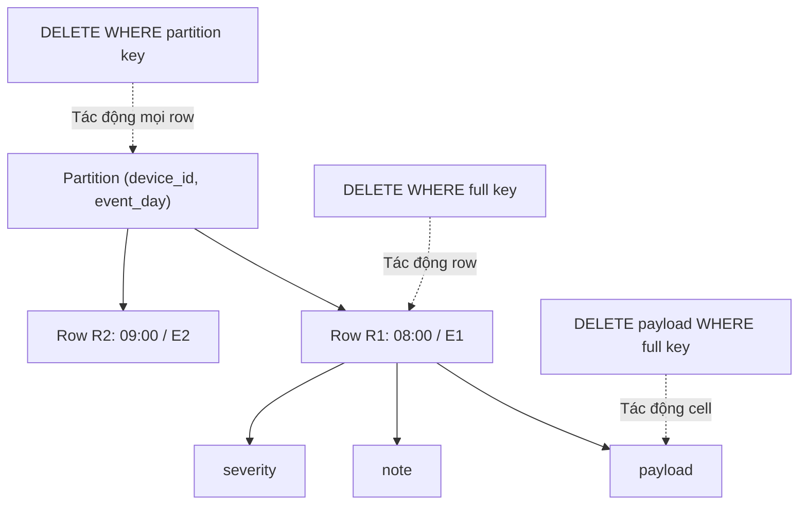
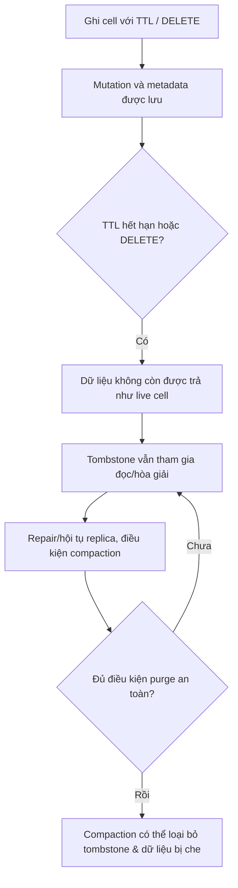

# Kiểm thử TTL và xóa dữ liệu theo phạm vi cột hoặc partition trong Spring Data Cassandra

**TTL (time to live)** và **DELETE** đều có thể khiến dữ liệu không còn xuất hiện trong kết quả `SELECT` của Apache Cassandra, nhưng chúng không tương đương với thao tác giải phóng dữ liệu vật lý ngay lập tức. TTL được áp lên các cell được ghi, khiến chúng hết hạn sau một khoảng thời gian; DELETE tạo thông tin xóa (*tombstone*) cho phạm vi được chỉ định. Tombstone phải tồn tại đủ lâu để replica chưa nhận mutation cũ không làm dữ liệu đã xóa xuất hiện lại.

Với **Spring Data Cassandra**, developer có thể gặp TTL qua `CassandraTemplate`/`CassandraOperations`, các write options, `@TimeToLive` ở những phiên bản hỗ trợ, hoặc thông qua CQL `USING TTL`. Xóa có thể diễn ra ở cấp cột, hàng, một khoảng clustering hoặc cả partition; API repository như `deleteById` chỉ có ý nghĩa khi xem đúng cấu trúc primary key của entity. Kiểm thử cần làm rõ **phạm vi biến mất của dữ liệu**, **metadata TTL/tombstone**, **sự hội tụ giữa replica** và **chi phí đọc/ghi**.

Bài thuộc chương **TTL và tombstone** của module `SPRING_DATA_CASSANDRA`. Nó kết hợp entity mapping, repository, CassandraTemplate, `CqlTemplate`, CQL/Java Driver, cách thiết kế bảng theo truy vấn, partition key, consistency, paging và kiểm soát hiệu năng trong mô hình dữ liệu phân tán.

> **Nguyên tắc trọng tâm:** Khi nói “đã xóa”, hãy xác định **xóa cell, xóa row, xóa một vùng clustering hay xóa partition**. Khi nói “TTL đã hết”, hãy kiểm tra **cell nào thực sự có TTL**; không giả định toàn bộ row hoặc partition luôn hết hạn cùng lúc. Không dùng sự vắng mặt trong một lần `SELECT` làm bằng chứng rằng tombstone đã được compact và giải phóng khỏi mọi replica.

## 1. Mục tiêu học tập và những câu hỏi cần trả lời

Sau bài này, người học cần giải thích và thực hiện được:

1. TTL áp dụng trên dữ liệu nào, bắt đầu và kết thúc như thế nào?
2. CQL `TTL(column)` khác `WRITETIME(column)` và cột nghiệp vụ `expires_at` ở đâu?
3. `DELETE column`, `DELETE row` và `DELETE partition` ảnh hưởng những bản ghi nào?
4. Vì sao DELETE hoặc TTL hết hạn tạo tombstone thay vì xóa sạch ngay trên đĩa?
5. Vì sao `gc_grace_seconds`, compaction, repair và sự cố replica liên quan đến rủi ro dữ liệu “sống lại”?
6. Những thao tác Spring Data nào phù hợp để ghi TTL hoặc xóa đúng phạm vi?
7. Kiểm thử tự động thế nào khi TTL phụ thuộc đồng hồ và replica có thể phản hồi không đồng thời?
8. Làm sao đánh giá tombstone, read latency và truy vấn theo partition/clustering ở môi trường thực?

Hai nhóm kiểm thử phải tách biệt: **kiểm thử hành vi CQL/ứng dụng** (đọc thấy hay không thấy cột/hàng/partition) và **kiểm thử vận hành phân tán** (replica, compaction, repair, storage). Một lab một node có thể chứng minh semantics cơ bản nhưng không chứng minh khả năng chịu lỗi của cluster RF=3.

## 2. Thiết kế bảng ví dụ có partition và clustering key rõ ràng

Hệ thống thu thập sự kiện thiết bị theo ngày. Một API cần lấy các sự kiện mới nhất của một thiết bị trong một ngày. Bảng theo truy vấn:

```sql
CREATE TABLE events_by_device_day (
    device_id uuid,
    event_day date,
    occurred_at timestamp,
    event_id uuid,
    payload text,
    note text,
    severity int,
    PRIMARY KEY ((device_id, event_day), occurred_at, event_id)
) WITH CLUSTERING ORDER BY (
    occurred_at DESC,
    event_id DESC
)
AND default_time_to_live = 0;
```

Trong schema này:

- **Partition key** là cặp `(device_id, event_day)`. Một partition chứa sự kiện của một thiết bị trong một ngày.
- **Clustering columns** là `occurred_at` và `event_id`. Chúng phân biệt hàng và tạo thứ tự thời gian trong partition.
- **Regular columns** là `payload`, `note`, `severity`. Có thể ghi TTL hoặc xóa riêng từng cột này.
- `default_time_to_live = 0` nghĩa là bảng **không áp TTL mặc định**; chỉ những mutation yêu cầu TTL tường minh mới hết hạn theo TTL đó.

Ví dụ đường đọc tốt:

```sql
SELECT occurred_at, event_id, payload, note, severity
FROM events_by_device_day
WHERE device_id = ?
  AND event_day = ?
LIMIT 20;
```

Đây là truy vấn theo **đủ partition key**, dùng clustering order để lấy 20 sự kiện gần nhất. Không phải một truy vấn tổng hợp mọi thiết bị/ngày. Nếu muốn lọc `severity > 3` trên toàn bộ hệ thống, TTL hay DELETE không giúp tạo đường truy cập mới; vẫn phải thiết kế bảng hoặc công cụ tìm kiếm phù hợp.

### Hai hàng trong một partition

Trong lab, dùng ID đơn giản:

```text
Partition: (device_id = D1, event_day = 2026-11-25)

Clustering row R1:
  occurred_at = 2026-11-25T08:00:00Z
  event_id    = E1
  payload     = "temp=27"
  note        = "important"
  severity    = 2

Clustering row R2:
  occurred_at = 2026-11-25T09:00:00Z
  event_id    = E2
  payload     = "temp=31"
  note        = "review"
  severity    = 4
```

Khi xóa `payload` của R1, `note` và `severity` của R1 vẫn phải còn. Khi xóa R1, R2 vẫn phải còn. Khi xóa **partition** `(D1, 2026-11-25)`, cả R1 lẫn R2 phải không còn được nhìn thấy theo semantics đọc bình thường.

## 3. TTL trong Cassandra hoạt động ở cấp cell

TTL được đặt trong **giây** bằng CQL `USING TTL n` cho những mutation hỗ trợ. Thông thường, TTL áp dụng lên các cell **được mutation ấy ghi**, không tự gắn lên mọi cột của row hoặc mọi row khác trong partition.

Ví dụ ghi dữ liệu ban đầu **không có TTL**:

```sql
INSERT INTO events_by_device_day (
    device_id, event_day, occurred_at, event_id,
    payload, note, severity
) VALUES (
    11111111-1111-1111-1111-111111111111,
    '2026-11-25',
    '2026-11-25T08:00:00Z',
    aaaaaaaa-aaaa-aaaa-aaaa-aaaaaaaaaaa1,
    'temp=27',
    'important',
    2
);
```

Sau đó chỉ ghi lại `payload` với TTL 60 giây:

```sql
UPDATE events_by_device_day
USING TTL 60
SET payload = 'temp=28'
WHERE device_id = 11111111-1111-1111-1111-111111111111
  AND event_day = '2026-11-25'
  AND occurred_at = '2026-11-25T08:00:00Z'
  AND event_id = aaaaaaaa-aaaa-aaaa-aaaa-aaaaaaaaaaa1;
```

Kết quả mong đợi:

- `payload` có TTL và sẽ hết hạn sau khoảng 60 giây theo cơ chế Cassandra.
- `note` và `severity` **không bị gắn TTL chỉ vì chúng ở cùng row**.
- Partition key và clustering key **không phải** các cell dữ liệu thông thường có thể đặt TTL để một “khóa tự hết hạn”.
- Sau khi `payload` hết hạn, row vẫn có thể được đọc vì `note` và `severity` vẫn sống.

Điểm cuối rất quan trọng: một cột biến mất không chứng minh toàn bộ hàng đã bị xóa. Nếu một row không còn regular/static cell hoặc row liveness phù hợp, khả năng row xuất hiện sau TTL còn phụ thuộc cách mutation tạo row marker và schema; đừng tự đặt giả định “chỉ một TTL luôn xóa trọn row” khi các cell có TTL khác nhau.

### TTL không phải thời điểm sự kiện

TTL được tính theo semantics ghi và thời hạn sống do Cassandra lưu, không phải phép tự động `occurred_at + n` dựa trên ngày sự kiện. Một sự kiện đến muộn vẫn có thể tồn tại thêm 60 giây kể từ lần mutation gắn TTL. Nếu nghiệp vụ muốn retention dựa trên **thời điểm sự kiện**, cần thiết kế chính sách tính TTL/cửa sổ lưu giữ có kiểm soát, không đơn giản ghi `USING TTL 60` cho mọi sự kiện.

## 4. Cú pháp USING TTL cho INSERT và UPDATE

### INSERT có TTL cho những giá trị được ghi

```sql
INSERT INTO events_by_device_day (
    device_id, event_day, occurred_at, event_id,
    payload, note, severity
) VALUES (
    11111111-1111-1111-1111-111111111111,
    '2026-11-25',
    '2026-11-25T09:00:00Z',
    aaaaaaaa-aaaa-aaaa-aaaa-aaaaaaaaaaa2,
    'temp=31',
    'review',
    4
)
USING TTL 120;
```

Các regular cells được ghi trong lệnh INSERT có thể nhận TTL 120 giây. Khi cả những cell tạo khả năng nhìn thấy hàng đã hết hạn, hàng có thể không còn xuất hiện trong kết quả đọc. Để kiểm chứng, xem `TTL(payload)`, `TTL(note)` và `TTL(severity)` **trước khi hết hạn**.

### UPDATE một số cột với TTL

```sql
UPDATE events_by_device_day
USING TTL 30
SET payload = 'volatile-data',
    severity = 3
WHERE device_id = 11111111-1111-1111-1111-111111111111
  AND event_day = '2026-11-25'
  AND occurred_at = '2026-11-25T08:00:00Z'
  AND event_id = aaaaaaaa-aaaa-aaaa-aaaa-aaaaaaaaaaa1;
```

`payload` và `severity` trong mutation này nhận TTL, nhưng `note` không bị ghi lại. Nếu `note` có giá trị sống, nó vẫn còn sau khi hai cell kia hết hạn.

### USING TTL 0 và ghi đè TTL

Với một cột đã được ghi TTL trước đó, một mutation mới với TTL 0 có thể được dùng để **ghi lại giá trị không có TTL tường minh**:

```sql
UPDATE events_by_device_day
USING TTL 0
SET payload = 'retained'
WHERE device_id = 11111111-1111-1111-1111-111111111111
  AND event_day = '2026-11-25'
  AND occurred_at = '2026-11-25T08:00:00Z'
  AND event_id = aaaaaaaa-aaaa-aaaa-aaaa-aaaaaaaaaaa1;
```

Đây **không** phải lệnh “hủy lịch hết hạn của toàn row” mà là **ghi lại** cell `payload` theo mutation mới. Với bảng có `default_time_to_live` khác 0, cần kiểm tra quy tắc tương tác giữa TTL tường minh và table default theo phiên bản Cassandra; không áp dụng máy móc ví dụ `default_time_to_live = 0` sang bảng có retention mặc định.

**Không gắn TTL lên counter** hoặc primary-key components như một cột thường. Cassandra có giới hạn riêng về TTL với collection, static columns và từng loại mutation; cần kiểm tra CQL và hành vi được hỗ trợ của phiên bản triển khai.

## 5. TTL(column), WRITETIME(column) và những gì SELECT có thể chứng minh

Cassandra cung cấp hàm `TTL(column)` để xem **số giây TTL còn lại** của một cell đang sống và hàm `WRITETIME(column)` để xem **write timestamp** ở độ phân giải microsecond khi được hỗ trợ.

```sql
SELECT payload,
       TTL(payload) AS payload_ttl_s,
       WRITETIME(payload) AS payload_written_us,
       note,
       TTL(note) AS note_ttl_s,
       severity,
       TTL(severity) AS severity_ttl_s
FROM events_by_device_day
WHERE device_id = 11111111-1111-1111-1111-111111111111
  AND event_day = '2026-11-25'
  AND occurred_at = '2026-11-25T08:00:00Z'
  AND event_id = aaaaaaaa-aaaa-aaaa-aaaa-aaaaaaaaaaa1;
```

Khi vừa gắn `TTL 60` cho `payload`:

| Cột | `TTL(column)` kỳ vọng | Ý nghĩa |
|---|---|---|
| `payload` | Một số dương giảm dần, thường gần 60 lúc mới ghi | Cell có expiration |
| `note` | `null` (nếu không có TTL) | Cell được giữ không giới hạn bởi TTL |
| `severity` | `null` nếu trước đó không có TTL; số dương nếu UPDATE đã gắn TTL | TTL phụ thuộc mutation gần nhất thắng xung đột |

Không assert `TTL(payload) = 60` một cách cứng nhắc: giữa thời điểm ghi, mạng, coordinator và lúc SELECT, một số giây có thể đã trôi qua. Với integration test, hãy kiểm tra **`0 < TTL(payload) <= configuredTTL`** khi cell còn sống và không ghi lại.

Sau khi hết TTL, `payload` không còn được thấy như một cell sống; nếu các cột khác vẫn tồn tại, row vẫn có thể được trả về nhưng `payload` sẽ là null/vắng dữ liệu theo mapping. **`TTL(payload) = null` một mình không đủ chứng minh cell đã hết hạn**, vì cell không có TTL hoặc đã biến mất cũng có thể trả null; phải kiểm tra **giá trị cell và ngữ cảnh**.

`WRITETIME` không phải giá trị cột `occurred_at` hay `updated_at`, và các hàm này không tạo audit history. Không dùng `WRITETIME` lên partition/clustering key hoặc các kiểu không hỗ trợ như thể mọi thuộc tính entity đều là cell regular.

## 6. Bảng có default_time_to_live: tác dụng và giới hạn

Cassandra cho phép đặt TTL mặc định ở **table schema**:

```sql
CREATE TABLE events_with_retention (
    device_id uuid,
    event_day date,
    occurred_at timestamp,
    event_id uuid,
    payload text,
    PRIMARY KEY ((device_id, event_day), occurred_at, event_id)
) WITH default_time_to_live = 86400;
```

`86400` giây bằng một ngày. Các giá trị được ghi vào bảng chịu chính sách mặc định theo semantics của server, trừ khi statement đặt TTL tường minh theo quy tắc hỗ trợ của phiên bản. Những điểm cần nhớ:

- Table default **không phải** một background job chạy `DELETE FROM ...` mỗi 24 giờ.
- TTL ở bảng hoặc cell không có nghĩa Cassandra đã loại bỏ vật lý tất cả SSTable liên quan ngay sau hạn.
- Một mutation mới có thể thay đổi TTL của **những cell mà nó ghi**, không tự cập nhật toàn bộ lịch sử TTL của những cột khác.
- Sự có mặt của `default_time_to_live` không biến cột `event_day` thành dữ liệu tự xóa theo lịch ngày.
- Đổi default TTL trên một bảng đang có dữ liệu cần đánh giá tác động với **dữ liệu cũ, dữ liệu mới, row liveness và phiên bản server**; không coi schema change là một thao tác retroactive đơn giản.

Không nên thử thay `default_time_to_live` của bảng production chỉ để mô phỏng hết hạn nhanh. Trong lab, dùng **bảng khác hoặc keyspace test** để so sánh TTL explicit với table default.

## 7. DELETE có nhiều phạm vi, không phải một lệnh đồng nhất

Cassandra có thể lưu thông tin xóa ở các mức khác nhau. Với bảng `events_by_device_day`:

| Phạm vi xóa | Điều kiện khóa | Tác động logic |
|---|---|---|
| **Một cột (cell)** | Đủ primary key xác định row + tên regular column | Cột bị xóa; các cột khác của row có thể còn |
| **Một row** | Đủ partition key và toàn bộ clustering key | Những cell/hàng tại clustering key ấy bị xóa |
| **Một khoảng clustering** | Đủ partition key, điều kiện range clustering hợp lệ | Những row trong khoảng bị xóa theo range tombstone |
| **Cả partition** | Đủ partition key, không ràng buộc clustering row riêng | Mọi row trong partition bị xóa về mặt logic |
| **Toàn bảng** | `TRUNCATE`/`DROP TABLE` | Phạm vi lớn và semantics khác; **không phải** DELETE một partition |

Sơ đồ:



**Điều kiện chính là primary key**, không phải số hàng đang xuất hiện trong kết quả SELECT. Với composite partition key `(device_id, event_day)`, chỉ cung cấp `device_id` là thiếu khóa, không phải “xóa toàn bộ ngày của thiết bị”. Nếu thật sự cần xóa lịch sử nhiều ngày, ứng dụng phải liệt kê/điều phối các bucket tương ứng hoặc thiết kế quy trình retention theo bucket.

## 8. Xóa đúng một cột, không đụng các cột còn lại

CQL:

```sql
DELETE payload
FROM events_by_device_day
WHERE device_id = 11111111-1111-1111-1111-111111111111
  AND event_day = '2026-11-25'
  AND occurred_at = '2026-11-25T08:00:00Z'
  AND event_id = aaaaaaaa-aaaa-aaaa-aaaa-aaaaaaaaaaa1;
```

Lệnh nhắm tới **regular column `payload` của một row**. Nếu row còn `note` và `severity`, đọc row theo full key vẫn trả các giá trị ấy:

```sql
SELECT payload, note, severity
FROM events_by_device_day
WHERE device_id = 11111111-1111-1111-1111-111111111111
  AND event_day = '2026-11-25'
  AND occurred_at = '2026-11-25T08:00:00Z'
  AND event_id = aaaaaaaa-aaaa-aaaa-aaaa-aaaaaaaaaaa1;
```

**Kỳ vọng:** `payload` null/vắng; `note = 'important'`; `severity` vẫn bằng giá trị sống được ghi gần nhất.

Một số trường hợp dễ nhầm:

- `DELETE payload ...` là **mutation xóa**, không phải gán một chuỗi rỗng.
- `UPDATE ... SET payload = null` trong Cassandra có thể tạo thông tin xóa thay vì lưu một Java null như giá trị bình thường; cách converter/driver xử lý null và UNSET phải được kiểm tra riêng.
- Khi cả row chỉ có một cell sống, xóa cell ấy có thể khiến row không còn xuất hiện; nhưng đó **không** có nghĩa đã chạy partition delete.
- `DELETE payload` không cho phép xóa primary-key column bằng cách coi nó là regular column.

Nếu bảng có **static column**, thao tác xóa static cell có quy tắc phạm vi khóa riêng vì static cell sống ở cấp partition; không suy luận từ ví dụ regular-column ở đây. Nên xây bài test tách biệt cho static column nếu dự án sử dụng.

## 9. Xóa một row bằng toàn bộ primary key

Với bảng có hai clustering columns:

```sql
DELETE FROM events_by_device_day
WHERE device_id = 11111111-1111-1111-1111-111111111111
  AND event_day = '2026-11-25'
  AND occurred_at = '2026-11-25T08:00:00Z'
  AND event_id = aaaaaaaa-aaaa-aaaa-aaaa-aaaaaaaaaaa1;
```

Đây là **row delete**. Nó tác động row R1 xác định bởi cả `occurred_at` và `event_id`; **không nên làm mất** row R2 có timestamp khác, dù cùng `device_id + event_day`.

Kiểm tra bằng truy vấn một partition:

```sql
SELECT occurred_at, event_id, payload, note, severity
FROM events_by_device_day
WHERE device_id = 11111111-1111-1111-1111-111111111111
  AND event_day = '2026-11-25';
```

Sau row delete, kỳ vọng R1 không còn trong kết quả bình thường, R2 vẫn có mặt nếu chưa hết TTL hoặc bị xóa trước đó.

**Cảnh báo:** trong Cassandra, một `UPDATE`/`DELETE` trên primary key chưa có sẵn có thể tạo mutation/tombstone mà không báo lỗi “không tìm thấy row”. Không coi việc DELETE không ném exception là bằng chứng row trước đó đã tồn tại. Nếu nghiệp vụ yêu cầu điều kiện tồn tại, phải dùng quy trình/conditional statement thích hợp với đánh đổi LWT.

## 10. Xóa cả partition bằng đúng partition key

Phạm vi rộng hơn:

```sql
DELETE FROM events_by_device_day
WHERE device_id = 11111111-1111-1111-1111-111111111111
  AND event_day = '2026-11-25';
```

Câu lệnh xác định **một partition** theo hai thành phần partition key và không đặt điều kiện clustering cụ thể. Mọi clustering row trong partition đó sẽ bị che bởi **partition deletion marker/tombstone** theo timestamp mutation và semantics Cassandra.

Kiểm tra:

```sql
SELECT occurred_at, event_id, payload
FROM events_by_device_day
WHERE device_id = 11111111-1111-1111-1111-111111111111
  AND event_day = '2026-11-25';
```

**Kỳ vọng:** không có row sống được trả về nếu không có mutation mới hơn hoặc dữ liệu bất thường. Nhưng thao tác này **không** xóa partition `(D1, 2026-11-24)` hoặc `(D2, 2026-11-25)`.

Một sai lầm nghiêm trọng là nhầm lệnh xóa cả partition với việc xóa một row theo repository:

- `deleteById(new CompositeKey(...))` thường phải có **đầy đủ khóa của một row**, tùy entity mapping.
- Muốn xóa tất cả clustering rows thuộc `device_id + event_day`, phải dùng **CQL partition delete rõ ràng** hoặc một API phù hợp đã được kiểm chứng.
- Không để một method `deleteDay(deviceId)` bỏ qua `event_day` rồi giả định sẽ xóa đúng một ngày.

**Không dùng `TRUNCATE` để xóa một partition.** `TRUNCATE events_by_device_day` tác động **toàn bảng**, và là thao tác vận hành nguy hiểm khác về phạm vi và phục hồi.

## 11. Xóa một khoảng clustering: range tombstone

Khi cần xóa những sự kiện cũ hơn một mốc trong **một partition xác định**, một số dạng DELETE hỗ trợ điều kiện khoảng trên clustering columns:

```sql
DELETE FROM events_by_device_day
WHERE device_id = 11111111-1111-1111-1111-111111111111
  AND event_day = '2026-11-25'
  AND occurred_at < '2026-11-25T09:00:00Z';
```

Ý đồ là xóa các clustering rows trong partition ngày `2026-11-25` có `occurred_at` nhỏ hơn 09:00. Với primary key `((device_id, event_day), occurred_at, event_id)`, `occurred_at` là clustering column đầu tiên, nên range theo cột đó là một mẫu phù hợp về cấu trúc. **Khả năng hỗ trợ biến thể DELETE range và ràng buộc prefix cụ thể cần xác minh trên Cassandra version đang chạy**; không mở rộng thành một bộ lọc tùy ý trên cột thường.

Một range tombstone có thể che phủ nhiều row mà không cần lưu từng lệnh xóa row riêng biệt. Nhưng việc đọc các partition có nhiều range tombstone vẫn có thể tốn chi phí, đặc biệt khi kết hợp TTL, compaction và số lượng SSTable lớn.

**Phân biệt:**

- `DELETE payload WHERE full row key`: xóa một regular cell.
- `DELETE WHERE full row key`: xóa row.
- `DELETE WHERE partition key + clustering range`: xóa một vùng row trong partition, nếu cú pháp hợp lệ.
- `DELETE WHERE partition key only`: xóa toàn partition.

Không dùng `ALLOW FILTERING` để “đổi” một điều kiện DELETE trái primary key thành truy vấn hợp lệ; thay vào đó, thiết kế retention theo bucket/partition rõ ràng.

## 12. Tombstone được tạo và được thu hồi như thế nào?

Một tombstone là thông tin ghi nhận dữ liệu đã bị xóa hoặc đã hết hạn, để replica/SSTable cũ không tự đưa dữ liệu đó trở lại trong quá trình đọc và hội tụ.



Không nên hiểu sơ đồ là một timer đảm bảo sau `TTL + gc_grace_seconds` giây tombstone chắc chắn biến mất. Cassandra còn phải thỏa **điều kiện compaction, quan hệ giữa các SSTable, replica và repair**, phụ thuộc chiến lược compaction, phiên bản và cấu hình.

Ví dụ một cell hết TTL nhưng vẫn còn metadata/liveness/tombstone trong SSTable. Một `SELECT` không trả cell sống **không chứng minh** không gian đĩa của cell đã được thu hồi. Dung lượng đĩa chỉ thực sự giảm hoặc được tái sử dụng sau quá trình compaction/thao tác lưu trữ thích hợp.

### Tombstone không phải một loại duy nhất

| Loại hoặc phạm vi khái niệm | Nguồn thường gặp | Ảnh hưởng |
|---|---|---|
| Cell tombstone | Xóa riêng một cột | Che giá trị cell cũ |
| Row deletion marker | Xóa row theo full primary key | Che dữ liệu row tương ứng |
| Range tombstone | Xóa một dải clustering rows | Che nhiều row theo clustering range |
| Partition deletion marker | Xóa theo partition key, không ràng buộc clustering | Che các row thuộc partition |
| Expiring cell / TTL tombstone | TTL kết thúc | Giá trị hết hạn bị coi là không còn sống |

Chi tiết biểu diễn nội bộ khác nhau theo loại mutation/phiên bản lưu trữ. Mục tiêu của bảng là **phân biệt phạm vi logic**, không khẳng định mỗi loại luôn chiếm đúng một tombstone vật lý trong mọi SSTable.

## 13. gc_grace_seconds, repair và nguy cơ zombie data

Mục đích lịch sử của `gc_grace_seconds` là hỗ trợ việc giữ dấu xóa đủ lâu để replica chưa nhận DELETE có thời gian hội tụ thông qua những cơ chế như repair. Nếu xóa tombstone quá sớm, một replica cũ còn giữ giá trị sống có thể gửi lại giá trị ấy trong quá trình đồng bộ và khiến dữ liệu đã xóa xuất hiện lại — hiện tượng **zombie data**.

Ví dụ:

```text
Replica R1: nhận DELETE state=X, giữ tombstone tại timestamp T
Replica R2: tạm offline, còn dữ liệu state=X cũ
R1: tombstone bị purge trước khi R2 nhận được DELETE
R2: trở lại và trao đổi dữ liệu với R1

Nếu các điều kiện gây lỗi hội tụ xảy ra:
  dữ liệu cũ từ R2 có thể tái xuất hiện.
```

**Không tự giảm `gc_grace_seconds` xuống 0 trong production** chỉ để thấy đĩa giảm nhanh. Trong một số kiến trúc, phiên bản và quy trình có điều kiện riêng cho việc quản lý tombstone, nhưng quyết định phải căn cứ vào RF, thời gian node offline, repair cadence, compaction, TTL pattern và hướng dẫn vận hành của bản Cassandra thực tế.

Hinted handoff **không thay thế anti-entropy repair** cho mọi sự cố kéo dài. Cần lập lịch repair, xác minh trạng thái node và theo dõi tombstone trước khi thay đổi retention/garbage collection.

### Kiểm thử một node không kiểm chứng zombie

Một lab RF=1 có thể thấy `DELETE` che dữ liệu và TTL hết hạn; nó không thể chứng minh replica nào đã nhận dấu xóa hoặc repair có đủ khả năng ngăn zombie data. Kiểm thử đó cần **cluster riêng với RF > 1**, lịch node offline/repair có kiểm soát và đo đạc đúng, không gây lỗi giả trên production.

## 14. Write timestamp, thứ tự mutation và DELETE

Cassandra hòa giải các giá trị cạnh tranh dựa trên **write timestamp** ở độ phân giải microsecond. Khi một DELETE có timestamp cao hơn mutation trước đó, tombstone có thể che giá trị cũ. Ngược lại, một mutation hợp lệ có timestamp cao hơn sau DELETE có thể tạo dữ liệu sống trở lại.

Ví dụ chỉ làm trong lab:

```sql
UPDATE events_by_device_day
USING TIMESTAMP 1760000000000100
SET note = 'before-delete'
WHERE device_id = 11111111-1111-1111-1111-111111111111
  AND event_day = '2026-11-25'
  AND occurred_at = '2026-11-25T08:00:00Z'
  AND event_id = aaaaaaaa-aaaa-aaaa-aaaa-aaaaaaaaaaa1;

DELETE note FROM events_by_device_day
USING TIMESTAMP 1760000000000200
WHERE device_id = 11111111-1111-1111-1111-111111111111
  AND event_day = '2026-11-25'
  AND occurred_at = '2026-11-25T08:00:00Z'
  AND event_id = aaaaaaaa-aaaa-aaaa-aaaa-aaaaaaaaaaa1;
```

Sau DELETE, một bản ghi note mới có timestamp `1760000000000150` (thấp hơn tombstone) không nên thắng. **Thứ tự request đến coordinator không phải thứ tự nghiệp vụ tuyệt đối.**

**Lưu ý cực kỳ quan trọng cho lab:** Khi đã dùng `USING TIMESTAMP` cố định, không trộn ngẫu nhiên với writes do driver tạo timestamp hiện tại, rồi dự đoán kết quả dựa trên thời điểm chạy. Nếu timestamp thủ công thấp hơn giá trị trước đó, mutation “mới chạy” có thể không được thấy. Các ca test timestamp nên tạo bảng/keyspace riêng hoặc dùng khóa hoàn toàn mới và chọn một quy tắc timestamp nhất quán.

TTL và timestamp giải quyết hai việc khác nhau:

- **TTL** xác định khi nào cell hết hạn theo semantics expiration.
- **Write timestamp** quyết định giá trị nào được giữ khi có mutation cạnh tranh.

Một cell đã hết TTL không tự trở thành “trạng thái dữ liệu trước đó”; TTL không làm hồi sinh phiên bản cũ dưới cell. Nếu cần lưu lịch sử, hãy thiết kế bảng event/history riêng.

## 15. Consistency và tính đúng đắn của kiểm thử TTL/DELETE

Cùng một DELETE hoặc TTL update có thể được quan sát khác nhau nếu read/write dùng CL quá yếu trong lúc replica chưa hội tụ.

| Bối cảnh | Điều cần biết |
|---|---|
| Write `LOCAL_ONE`, read `LOCAL_ONE` ngay | Có thể không thấy mutation mới nếu read chọn replica chưa nhận ghi |
| Write `LOCAL_QUORUM`, read `LOCAL_QUORUM` trong cùng DC RF=3 | Có giao nhau về tập replica dưới những giả định phù hợp; vẫn cần xét timestamp, concurrency |
| Read ở DC2 sau write local tại DC1 | Không suy ra data đã hội tụ ở DC2 ngay |
| Cluster RF=1 | Không thể mô phỏng quorum hoặc replica lag |
| Đọc qua nhiều trang trong một partition | Paging state không phải snapshot bất biến của dữ liệu |

**TTL test chỉ dùng `SELECT` một lần ngay sau write ở CL=ONE rất dễ báo false negative.** Nếu đang test semantics của TTL, hãy:

1. Xác định keyspace/RF và chọn CL phù hợp mục tiêu.
2. Ghi bằng một mutation có key cố định, verify giá trị được đọc thấy trước khi đợi TTL.
3. Dùng polling với deadline thay vì một giấc ngủ cố định ngắn.
4. Kiểm tra kết quả sau expiry, phân biệt cell biến mất với row/partition biến mất.
5. Khi cần, đo trace/replica convergence trong lab nhiều node riêng.

Không mặc định `LOCAL_QUORUM` làm TTL mạnh hơn hoặc tombstone được purge nhanh hơn; CL xác định điều kiện phản hồi, không chạy compaction thay bạn.

## 16. Spring Data Cassandra: mô hình entity và composite key

Mapping bảng ví dụ sang Java:

```java
import java.io.Serializable;
import java.time.Instant;
import java.time.LocalDate;
import java.util.UUID;

import org.springframework.data.cassandra.core.cql.Ordering;
import org.springframework.data.cassandra.core.mapping.PrimaryKeyClass;
import org.springframework.data.cassandra.core.mapping.PrimaryKeyColumn;
import org.springframework.data.cassandra.core.mapping.PrimaryKeyType;

@PrimaryKeyClass
public class DeviceEventKey implements Serializable {

    @PrimaryKeyColumn(name = "device_id", ordinal = 0,
        type = PrimaryKeyType.PARTITIONED)
    private UUID deviceId;

    @PrimaryKeyColumn(name = "event_day", ordinal = 1,
        type = PrimaryKeyType.PARTITIONED)
    private LocalDate eventDay;

    @PrimaryKeyColumn(name = "occurred_at", ordinal = 2,
        type = PrimaryKeyType.CLUSTERED, ordering = Ordering.DESCENDING)
    private Instant occurredAt;

    @PrimaryKeyColumn(name = "event_id", ordinal = 3,
        type = PrimaryKeyType.CLUSTERED, ordering = Ordering.DESCENDING)
    private UUID eventId;

    // Constructor, getters/setters, equals/hashCode theo key semantics.
}
```

Entity:

```java
import org.springframework.data.cassandra.core.mapping.Column;
import org.springframework.data.cassandra.core.mapping.PrimaryKey;
import org.springframework.data.cassandra.core.mapping.Table;

@Table("events_by_device_day")
public class DeviceEvent {

    @PrimaryKey
    private DeviceEventKey key;

    @Column("payload")
    private String payload;

    @Column("note")
    private String note;

    @Column("severity")
    private Integer severity;

    // Constructor, getter/setter; chú ý field null khi update.
}
```

Một repository với ID đúng kiểu composite key:

```java
import org.springframework.data.cassandra.repository.CassandraRepository;

public interface DeviceEventRepository
        extends CassandraRepository<DeviceEvent, DeviceEventKey> {
}
```

**Hệ quả quan trọng:** `deleteById(DeviceEventKey)` nhắm vào **một row**, vì key class chứa **cả partition key và clustering columns**. Nó không phải API để xóa mọi row của `deviceId + eventDay`.

Các lớp Java được rút gọn có chủ đích để nhấn vào mapping; khi đưa vào project, cần constructor và accessor phù hợp mapping framework, `equals/hashCode` cho key và test round-trip. Với bảng thực tế dùng static columns hoặc UDT, phạm vi mutation/TTL có những chi tiết riêng cần kiểm tra thêm.

## 17. Spring Data write options, @TimeToLive và những giới hạn phiên bản

Spring Data Cassandra có các API hỗ trợ cấu hình TTL cho mutation được mapping. Các đường sử dụng thường gặp gồm:

| Đường ghi | Vai trò | Cần lưu ý |
|---|---|---|
| `CassandraOperations.insert(entity)` | Ghi entity, dùng các default theo mapping/driver | Không mặc định mọi field luôn có TTL |
| `InsertOptions` | TTL và các tùy chọn insert theo phiên bản hỗ trợ | TTL áp dụng cho các cell được insert |
| `UpdateOptions` | Tùy chọn update theo API hỗ trợ | Không tự biến update toàn entity thành update một cột |
| `@TimeToLive` | Metadata TTL trên một thuộc tính của entity ở bản Spring Data hỗ trợ | Cần kiểm tra annotation/property type và write behavior cụ thể |
| `CqlOperations` / `CqlTemplate` | Thực thi CQL có `USING TTL ?` rõ ràng | Phù hợp khi muốn chỉ ghi một hoặc vài cột |
| `CqlSession` | Prepared/bound statement ở Java Driver | Kiểm soát CQL, TTL, consistency, paging và timeout |

Một ví dụ ý đồ dùng builder cho insert trong các bản hỗ trợ:

```java
import java.time.Duration;
import org.springframework.data.cassandra.core.CassandraOperations;
import org.springframework.data.cassandra.core.InsertOptions;

// Kiểm tra đúng builder/overload của Spring Data Cassandra đang dùng.
InsertOptions options = InsertOptions.builder()
    .ttl(Duration.ofSeconds(120))
    .build();

operations.insert(event, options);
```

`event` là một `DeviceEvent` hoàn chỉnh có khóa hợp lệ. **Đoạn này chủ yếu minh họa điểm cấu hình TTL ở tầng entity**; cú pháp/overload phải được đối chiếu Javadoc của phiên bản thư viện thực tế. Không đoán rằng một cách ghi entity có TTL bằng `InsertOptions` sẽ chỉ đặt TTL lên `payload`: entity có thể chứa nhiều regular columns và converter có thể ghi nhiều giá trị.

Khi yêu cầu “chỉ `payload` có TTL, `note` phải giữ”, dùng một lệnh `UPDATE ... USING TTL ? SET payload = ? WHERE full-key` sẽ rõ hơn.

### Vì sao null và UNSET là chi tiết dễ gây lỗi?

Nếu entity có `payload = null` và service gọi `save(entity)` hoặc `update(entity)`, hành vi SQL/CQL sinh ra phụ thuộc mapping, converter và quy tắc xử lý null/unset. Cassandra phân biệt:

- **NULL**: có thể tạo mutation xóa cell/tombstone.
- **UNSET**: thường có ý nghĩa “không ghi cột này” ở những statement/driver phiên bản hỗ trợ.

Không suy ra rằng “field null nghĩa là để nguyên cột” khi chưa kiểm tra. Với bảng có TTL và tombstone, một update toàn entity không chủ ý có thể làm tăng tombstones hoặc ghi đè TTL của các cột khác. Cần chọn update đúng cột và có integration test trên version thực.

## 18. CqlOperations: API rõ ràng cho xóa cột và partition

`CqlOperations` nằm ở lớp CQL của Spring Data Cassandra (implementation thông dụng là `CqlTemplate`), phù hợp khi thao tác theo **phạm vi khóa CQL cụ thể** thay vì mơ hồ ở mức mapped entity.

Một DAO ví dụ:

```java
import java.time.Instant;
import java.time.LocalDate;
import java.util.UUID;

import org.springframework.data.cassandra.core.cql.CqlOperations;
import org.springframework.stereotype.Repository;

@Repository
public class EventMaintenanceDao {
    private final CqlOperations cql;

    public EventMaintenanceDao(CqlOperations cql) {
        this.cql = cql;
    }

    public void updatePayloadWithTtl(
            UUID deviceId, LocalDate day, Instant occurredAt,
            UUID eventId, String payload, int ttlSeconds) {

        if (ttlSeconds < 1 || ttlSeconds > 3600) {
            throw new IllegalArgumentException("ttl must be 1..3600");
        }
        cql.execute(
            "UPDATE events_by_device_day USING TTL ? " +
            "SET payload = ? " +
            "WHERE device_id = ? AND event_day = ? " +
            "AND occurred_at = ? AND event_id = ?",
            ttlSeconds, payload, deviceId, day, occurredAt, eventId
        );
    }

    public void deletePayload(
            UUID deviceId, LocalDate day, Instant occurredAt, UUID eventId) {
        cql.execute(
            "DELETE payload FROM events_by_device_day " +
            "WHERE device_id = ? AND event_day = ? " +
            "AND occurred_at = ? AND event_id = ?",
            deviceId, day, occurredAt, eventId
        );
    }

    public void deleteEventRow(
            UUID deviceId, LocalDate day, Instant occurredAt, UUID eventId) {
        cql.execute(
            "DELETE FROM events_by_device_day " +
            "WHERE device_id = ? AND event_day = ? " +
            "AND occurred_at = ? AND event_id = ?",
            deviceId, day, occurredAt, eventId
        );
    }

    public void deleteDayPartition(UUID deviceId, LocalDate day) {
        cql.execute(
            "DELETE FROM events_by_device_day " +
            "WHERE device_id = ? AND event_day = ?",
            deviceId, day
        );
    }
}
```

Ví dụ dùng overload `CqlOperations.execute(String, Object... args)` trên các phiên bản hỗ trợ: Spring có thể prepare/bind các tham số; cần đối chiếu Javadoc đúng dependency. Các biến `deviceId`, `day`, `occurredAt`, `eventId` phải được validate và thuộc phạm vi dữ liệu actor có quyền thao tác.

**Ba method xóa có phạm vi rất khác nhau** dù cùng bắt đầu bằng `DELETE`. Đặc biệt `deleteDayPartition` là một thao tác phá hủy toàn bộ sự kiện của một thiết bị trong một ngày; không nên công khai như endpoint thường chỉ cần xóa một event.

**Idempotency:** gọi lại một DELETE với cùng khóa thường có thể chấp nhận ở mức logic “không còn dữ liệu”, nhưng mỗi lần mutation mới có thể mang timestamp mới và tạo thêm thông tin xóa. Với retry sau timeout, cần chính sách ID và timestamp phù hợp, không chỉ giả định mọi DELETE luôn không có tác dụng phụ.

## 19. Java Driver prepared statements và một bài test tích hợp có polling

Với Java Driver 4.x, có thể prepare trước mẫu CQL:

```java
import java.time.Instant;
import java.time.LocalDate;
import java.util.UUID;

import com.datastax.oss.driver.api.core.CqlSession;
import com.datastax.oss.driver.api.core.cql.PreparedStatement;

public final class TtlDriverDao {
    private final CqlSession session;
    private final PreparedStatement withTtl;
    private final PreparedStatement byKey;

    public TtlDriverDao(CqlSession session) {
        this.session = session;
        this.withTtl = session.prepare(
            "UPDATE events_by_device_day USING TTL ? " +
            "SET payload = ? WHERE device_id = ? AND event_day = ? " +
            "AND occurred_at = ? AND event_id = ?"
        );
        this.byKey = session.prepare(
            "SELECT payload, note, TTL(payload) AS ttl_s " +
            "FROM events_by_device_day " +
            "WHERE device_id = ? AND event_day = ? " +
            "AND occurred_at = ? AND event_id = ?"
        );
    }

    public void setPayload(
            int seconds, String payload, UUID deviceId, LocalDate day,
            Instant occurredAt, UUID eventId) {
        session.execute(
            withTtl.bind(seconds, payload, deviceId, day, occurredAt, eventId)
        );
    }

    public boolean payloadHasExpired(
            UUID deviceId, LocalDate day, Instant occurredAt, UUID eventId) {
        var row = session.execute(
            byKey.bind(deviceId, day, occurredAt, eventId)
        ).one();
        return row != null
            && row.isNull("payload")
            && "important".equals(row.getString("note"));
    }
}
```

Đây là DAO minh họa, giả định đã có một row chứa `note = 'important'` **không TTL** và có khóa đúng. Phương thức `payloadHasExpired` chứng minh một trường hợp cụ thể: cell payload không còn sống trong khi note vẫn còn. Nó **không** phân biệt được “payload chưa từng có” với “payload đã hết hạn” nếu không có bước xác minh dữ liệu **trước** khi đợi.

### Integration test tránh sleep cố định

Nếu dự án có thư viện Awaitility và Cassandra test riêng, mẫu tư duy:

```java
import static org.awaitility.Awaitility.await;
import static org.junit.jupiter.api.Assertions.assertEquals;

import java.time.Duration;
import org.junit.jupiter.api.Test;

@Test
void onlyPayloadExpiresAndNoteSurvives() {
    // Setup: seed row có note="important", không TTL và payload="initial".
    // verify row trước khi update, sử dụng full primary key.

    dao.setPayload(12, "temporary", deviceId, day, occurredAt, eventId);

    // Trước khi hết hạn phải xác nhận payload thật sự được ghi.
    assertEquals("temporary", readPayloadByFullKey());

    await()
        .atMost(Duration.ofSeconds(45))
        .pollInterval(Duration.ofSeconds(1))
        .untilAsserted(() -> {
            // readPayloadByFullKey() nên trả null khi cell hết TTL.
            assertEquals(null, readPayloadByFullKey());
            assertEquals("important", readNoteByFullKey());
        });
}
```

Đây là **khung test**: cần đặt bên trong một test class thực tế, khai báo `dao`/`deviceId`/`day`/`occurredAt`/`eventId` và các helper, seed dữ liệu và có dependency Awaitility. Không coi đoạn rút gọn là file Java chạy độc lập.

Tại sao dùng polling? TTL có độ phân giải theo giây và timing thực phụ thuộc lúc mutation được nhận, node clock và network. Một `Thread.sleep(12_000)` rồi assert ngay có thể tạo test flakiness. Polling có deadline, kết quả trước/sau rõ ràng sẽ bền hơn khi chạy CI.

**Đừng dùng TTL quá ngắn** như 1 giây cho integration test có startup và request overhead biến động lớn; giá trị 10–30 giây thường giúp bài test dễ quan sát hơn, dù thời lượng chạy dài hơn.

## 20. Bài lab: kiểm chứng riêng TTL, DELETE cell, row, partition

Chỉ thực hành trên **keyspace lab có thể xóa**, không sử dụng keyspace production hoặc keyspace dùng chung. Để tránh test ảnh hưởng lẫn nhau, **mỗi ca phải dùng ID hoặc partition mới**, thay vì ghi lại vào khóa từng nhận tombstone timestamp cao từ ca trước.

### 20.1. Chuẩn bị keyspace và bảng

```sql
CREATE KEYSPACE IF NOT EXISTS ttl_lab
WITH replication = {
    'class': 'NetworkTopologyStrategy',
    'dc1': 1
};

CREATE TABLE IF NOT EXISTS ttl_lab.events_by_device_day (
    device_id uuid,
    event_day date,
    occurred_at timestamp,
    event_id uuid,
    payload text,
    note text,
    severity int,
    PRIMARY KEY ((device_id, event_day), occurred_at, event_id)
) WITH CLUSTERING ORDER BY (
    occurred_at DESC,
    event_id DESC
)
AND default_time_to_live = 0;
```

`dc1` và RF=1 chỉ là cấu hình cho Cassandra test một node nếu node thực có DC tên `dc1`. Trong cluster RF>1, đặt RF phù hợp topology, replication strategy và consistency đã lựa chọn. **Không bật các schema action mang tính phá hủy** như `RECREATE_DROP_UNUSED` trên keyspace có dữ liệu ngoài lab.

Để các câu query tiếp theo ngắn, chọn keyspace trong cqlsh:

```sql
USE ttl_lab;
```

### 20.2. Seed hai hàng trong cùng partition

```sql
INSERT INTO events_by_device_day (
    device_id, event_day, occurred_at, event_id,
    payload, note, severity
) VALUES (
    11111111-1111-1111-1111-111111111111,
    '2026-11-25',
    '2026-11-25T08:00:00Z',
    aaaaaaaa-aaaa-aaaa-aaaa-aaaaaaaaaaa1,
    'initial-r1', 'important-r1', 2
);

INSERT INTO events_by_device_day (
    device_id, event_day, occurred_at, event_id,
    payload, note, severity
) VALUES (
    11111111-1111-1111-1111-111111111111,
    '2026-11-25',
    '2026-11-25T09:00:00Z',
    aaaaaaaa-aaaa-aaaa-aaaa-aaaaaaaaaaa2,
    'initial-r2', 'important-r2', 4
);
```

Kiểm tra có đúng hai hàng:

```sql
SELECT occurred_at, event_id, payload, note, severity
FROM events_by_device_day
WHERE device_id = 11111111-1111-1111-1111-111111111111
  AND event_day = '2026-11-25';
```

**Kỳ vọng:** R1 và R2 cùng thuộc partition ngày, theo clustering order mới nhất trước. Nếu đã chạy lab trước đó cùng ID thì trạng thái có thể khác vì dữ liệu/tombstone cũ; hãy làm sạch **đúng keyspace lab** và dùng ID mới để có baseline đáng tin cậy.

### 20.3. Ca TTL chỉ một cột

```sql
UPDATE events_by_device_day
USING TTL 30
SET payload = 'temporary-r1'
WHERE device_id = 11111111-1111-1111-1111-111111111111
  AND event_day = '2026-11-25'
  AND occurred_at = '2026-11-25T08:00:00Z'
  AND event_id = aaaaaaaa-aaaa-aaaa-aaaa-aaaaaaaaaaa1;
```

Ngay sau khi ghi, đọc:

```sql
SELECT payload, TTL(payload) AS payload_ttl_s,
       note, TTL(note) AS note_ttl_s, severity
FROM events_by_device_day
WHERE device_id = 11111111-1111-1111-1111-111111111111
  AND event_day = '2026-11-25'
  AND occurred_at = '2026-11-25T08:00:00Z'
  AND event_id = aaaaaaaa-aaaa-aaaa-aaaa-aaaaaaaaaaa1;
```

**Kỳ vọng trước hạn:** `payload = 'temporary-r1'`, `payload_ttl_s` dương, `note = 'important-r1'` và `note_ttl_s = null`.

Sau khi đã quá 30 giây và quá trình đọc thấy expiration, chạy lại cùng SELECT. **Kỳ vọng:** `payload` null, nhưng `note` và `severity` vẫn còn, R1 vẫn có thể đọc được. Không cần đợi compaction để kiểm chứng logical expiry.

### 20.4. Ca DELETE chỉ một cột

Trong **một row mới hoặc sau khi seed lại một test độc lập**:

```sql
DELETE note
FROM events_by_device_day
WHERE device_id = 11111111-1111-1111-1111-111111111111
  AND event_day = '2026-11-25'
  AND occurred_at = '2026-11-25T09:00:00Z'
  AND event_id = aaaaaaaa-aaaa-aaaa-aaaa-aaaaaaaaaaa2;
```

Đọc R2:

```sql
SELECT payload, note, severity
FROM events_by_device_day
WHERE device_id = 11111111-1111-1111-1111-111111111111
  AND event_day = '2026-11-25'
  AND occurred_at = '2026-11-25T09:00:00Z'
  AND event_id = aaaaaaaa-aaaa-aaaa-aaaa-aaaaaaaaaaa2;
```

**Kỳ vọng:** `note` không còn; `payload` và `severity` của R2 không bị xóa chỉ vì chúng nằm trong cùng row.

### 20.5. Ca DELETE một row

```sql
DELETE FROM events_by_device_day
WHERE device_id = 11111111-1111-1111-1111-111111111111
  AND event_day = '2026-11-25'
  AND occurred_at = '2026-11-25T08:00:00Z'
  AND event_id = aaaaaaaa-aaaa-aaaa-aaaa-aaaaaaaaaaa1;
```

Kiểm tra cả partition: **R1 biến mất, R2 vẫn còn** (nếu R2 chưa bị xóa). Không dùng `DELETE payload` để mô phỏng row delete.

### 20.6. Ca DELETE cả partition

```sql
DELETE FROM events_by_device_day
WHERE device_id = 11111111-1111-1111-1111-111111111111
  AND event_day = '2026-11-25';
```

Sau lệnh này, truy vấn partition mục 20.2 phải không còn row sống. Hãy thử seed **một partition khác** như `(D1, 2026-11-26)` hoặc `(D2, 2026-11-25)` và xác minh nó **không bị tác động**. Đây là bước quan trọng để phát hiện nhầm phạm vi DELETE.

### Bảng kỳ vọng tóm tắt

| Thao tác | R1.payload | R1.note | R2 |
|---|---|---|---|
| Sau seed | `initial-r1` | `important-r1` | Còn nguyên |
| TTL 30 chỉ cho R1.payload, trước hạn | `temporary-r1` | `important-r1` | Còn nguyên |
| TTL hết, chưa xóa khác | null | `important-r1` | Còn nguyên |
| DELETE R2.note | Như trạng thái TTL hiện tại | `important-r1` | R2 còn nhưng note null |
| DELETE toàn R1 | Không còn row R1 | Không còn row R1 | R2 còn |
| DELETE partition | Không còn row R1 | Không còn row R1 | Không còn row R2 |

Dòng mô tả phụ thuộc **thứ tự thao tác lab** ở trên. Với test tự động, nên dùng key riêng cho mỗi case để không bị ảnh hưởng từ timing TTL, tombstone timestamp hoặc test khác.

## 21. Negative tests: phải kiểm tra cả những gì không được phép

Ngoài kiểm thử “xóa thành công”, cần test những yêu cầu có thể làm mất dữ liệu ngoài ý muốn:

1. **Thiếu một thành phần composite partition key:** chỉ có `device_id`, không có `event_day`; ứng dụng không được âm thầm xóa mọi ngày.
2. **Thiếu clustering key khi định xóa một row:** service nhận `event_id` nhưng không có `occurred_at`; không được đổi sang xóa partition để “cho chạy”.
3. **Thiếu authorization:** user không sở hữu `device_id`; câu DELETE phải bị chặn trước tầng Cassandra.
4. **TTL âm/bằng 0/quá lớn:** API có hợp đồng rõ, không âm thầm biến thành “xóa ngay” hay “lưu vĩnh viễn” nếu đó không phải ý định.
5. **Row không tồn tại:** DELETE có thể không trả lỗi; cần semantics nghiệp vụ riêng nếu API phân biệt 404 và xóa idempotent.
6. **Ghi đè sau tombstone:** mutation mới có timestamp thấp hơn dấu xóa không làm cell sống lại.
7. **TTL không áp lên cột còn lại:** kiểm tra `TTL(note)` null và `note` vẫn đọc được.
8. **Thao tác trên nhiều bucket:** xóa một `event_day` không xóa ngày kế cận.
9. **Retry sau timeout:** kiểm tra không chuyển nhầm từ column delete sang partition delete.
10. **Bảng production:** cấm tự dùng `TRUNCATE`/`DROP TABLE` thay DELETE theo khóa.

Khi test lỗi CQL hoặc input sai, hãy xác định lỗi nằm ở **validation tầng service**, **binding/mapping**, **quy tắc primary key của Cassandra** hay **consistency/replica**. Không chỉ assert một thông báo exception dạng chuỗi dễ thay đổi theo phiên bản.

## 22. Tombstone ảnh hưởng paging và hiệu năng như thế nào?

Một truy vấn có `LIMIT 20` chỉ yêu cầu **tối đa 20 live rows**, chứ không hứa Cassandra chỉ xem 20 entry vật lý trong memtable/SSTable. Nếu hàng ngàn row đã hết TTL hoặc bị DELETE xen giữa các row đang sống, Cassandra có thể phải đọc nhiều tombstone để tìm đủ 20 row hợp lệ.

Ví dụ partition ngày có 100.000 sự kiện nhưng 99% `payload` đã hết TTL và phần lớn row không còn dữ liệu sống. Một query đọc 20 row mới nhất có thể phát sinh chi phí đáng kể do:

- Nhiều SSTable chứa các phiên bản cell/tombstone khác nhau.
- Tombstone range/row/partition cần được áp trong quá trình đọc.
- TTL áp không đồng nhất khiến row vẫn còn sống nhờ một cell, dù phần lớn dữ liệu đã hết hạn.
- Compaction chưa thu hồi dữ liệu bị che.
- Hot partition hoặc nhiều request cùng đọc một bucket lớn.

Các biện pháp thiết kế thường quan trọng hơn việc chỉ thay `LIMIT`:

| Vấn đề | Hướng giải quyết |
|---|---|
| Partition quá rộng | Bucket theo ngày/giờ hoặc shard hợp lý; giới hạn khối lượng mỗi partition |
| TTL nhiều và đồng loạt | Đánh giá retention pattern, write amplification và compaction strategy |
| Cần xóa cả ngày | Thiết kế partition theo ngày để DELETE có phạm vi rõ |
| Nhiều range tombstones | Tránh dồn quá nhiều xóa khoảng vào các partition cực lớn |
| Dữ liệu cũ tồn lưu lâu | Vận hành compaction/repair và theo dõi tombstone |
| Đọc mọi partition | Thiết kế bảng theo access pattern; không lạm dụng `ALLOW FILTERING` |
| Danh sách dài | Dùng paging state/page size đúng cơ chế, giới hạn response |
| Xóa/TTL trên nhiều projection | Xây quy trình đồng bộ, reconciliation và quan sát riêng |

Compaction strategy như TWCS có thể phù hợp một số workload dữ liệu time-series với TTL, nhưng yêu cầu cửa sổ thời gian, cách dữ liệu đến muộn và timestamp phải được kiểm chứng kỹ. Không chỉ bật một strategy vì thấy nhiều tombstone.

## 23. Quan sát hệ thống: những chỉ số cần thu thập

Để biết DELETE/TTL gây tải thực tế ra sao, dùng công cụ vận hành của phiên bản Cassandra và driver đang chạy:

- **Read latency p50/p95/p99** theo table, statement và partition key hotspot (không log dữ liệu nhạy cảm).
- **Tombstones scanned per read** và warning/failure do tombstone threshold nếu Cassandra có metric/log tương ứng.
- **SSTable count, compaction pending, disk usage, live/total space** để hiểu chưa thu hồi vật lý.
- **Partition size** và số clustering rows, đặc biệt với partition nóng.
- **Node up/down, hinted handoff, repair status** khi RF>1.
- **Write latency, timeout, retry** cho mutation TTL/DELETE.
- **TTLs thực tế của live cells**, được kiểm chứng có chọn lọc bằng `TTL(column)`.

Các lệnh như `nodetool tablestats`, `nodetool compactionstats`, metrics của Cassandra/Prometheus và log server có thể giúp theo dõi; cú pháp/metric cụ thể tùy phiên bản, **không nhất thiết có một cột “số tombstone đang tồn tại” chính xác từ một query CQL đơn giản**.

Đừng chạy `COUNT(*)` toàn bảng hoặc scan một lượng lớn partition trên production để “đếm tombstones”. Không dùng `DESCRIBE TABLE` làm bằng chứng storage đã compact; lệnh đó chỉ xem schema.

## 24. Một số hiểu nhầm điển hình

| Nhận định | Đúng hay sai? | Giải thích |
|---|---|---|
| “TTL 30 nghĩa là xóa cả partition sau 30 giây.” | **Sai** | TTL gắn với những cell được mutation ghi |
| “TTL(column) trả null là chắc chắn vừa hết hạn.” | **Sai** | Cell không có TTL hoặc không tồn tại cũng có thể null |
| “DELETE một cột xóa luôn mọi cột của row.” | **Sai** | Cell deletion có phạm vi riêng |
| “DELETE theo partition key chỉ xóa row mới nhất.” | **Sai** | Nhắm tới toàn partition |
| “deleteById(compositeKey) là xóa cả partition.” | **Sai** | Key gồm clustering columns biểu diễn một row |
| “Sau DELETE, disk space giảm ngay.” | **Sai** | Tombstone, SSTable và compaction có lifecycle riêng |
| “LIMIT 20 luôn chỉ cần đọc 20 giá trị vật lý.” | **Sai** | Có thể phải vượt tombstone mới tìm đủ live rows |
| “Giảm gc_grace_seconds về 0 luôn tốt hơn.” | **Sai** | Có rủi ro zombie khi replica không hội tụ |
| “Consistency QUORUM làm TTL hết hạn sớm hơn.” | **Sai** | CL và TTL giải quyết hai chuyện khác nhau |
| “Một lần SELECT rỗng chứng minh mọi replica đã xóa sạch.” | **Sai** | Logical read không chứng minh purge vật lý |
| “Update entity với null luôn giữ nguyên column trong DB.” | **Sai** | Cần kiểm tra NULL/UNSET và converter |
| “DELETE không lỗi nghĩa là row trước đó có tồn tại.” | **Sai** | Cassandra mutation không mặc định báo missing row |
| “Row delete và TRUNCATE có phạm vi như nhau.” | **Sai** | TRUNCATE tác động toàn table |
| “TTL hết hạn tự làm sống lại phiên bản cell trước đó.” | **Sai** | TTL không phải version stack để undo |

## 25. Checklist trước khi triển khai tính năng TTL hoặc xóa dữ liệu

1. **Access pattern:** bảng có partition key/clustering key phù hợp thao tác cần xóa không?
2. **Phạm vi chính xác:** cell, row, range hay partition; method/API có tên thể hiện đúng phạm vi?
3. **Authorization:** actor có quyền thao tác đúng thiết bị/tenant/bucket không?
4. **TTL ở đâu:** table default, InsertOptions, UpdateOptions, annotation hay CQL tường minh?
5. **Cột còn lại:** có cell nào phải tồn tại lâu hơn không; đã test TTL riêng từng cột?
6. **Thời gian:** TTL tính bằng giây; dùng polling test, tránh assert thời điểm hết hạn đúng tuyệt đối.
7. **Writetime:** có hiểu sự cạnh tranh giữa ghi mới, xóa và mutation với timestamp cao/thấp?
8. **Null/UNSET:** mapper có gây tombstone ngoài dự kiến khi ghi entity thiếu field?
9. **Retry/idempotency:** khi timeout, có lặp mutation an toàn và giữ nguyên khóa không?
10. **Replicas:** RF/CL đủ để kiểm thử semantics và hội tụ chưa?
11. **Tombstone lifecycle:** có repair cadence, gc grace, compaction phù hợp?
12. **Hiệu năng:** partition size, số row, tombstone-scanned, paging, p95/p99 đã được đo chưa?
13. **Retention:** default TTL thay đổi có ảnh hưởng dữ liệu cũ/mới và đồng bộ projection không?
14. **Đảm bảo không phá hủy:** test tách biệt, không dùng production `TRUNCATE`/`DROP`.
15. **Schema và phiên bản:** API Spring Data Cassandra, driver và CQL DELETE/TTL được thử với dependency thực tế?
16. **Observability:** log chỉ chứa mã query/ID an toàn, không tiết lộ payload nhạy cảm?
17. **Hậu kiểm:** sau khi xóa, kiểm tra đúng những gì biến mất **và** những gì phải còn.
18. **Kế hoạch phục hồi:** hiểu rủi ro xóa nhầm partition và khả năng backup/restore phù hợp.

**Kết luận:** Với Spring Data Cassandra, kiểm thử TTL và DELETE phải bắt đầu từ **cấu trúc primary key** và **phạm vi mutation**. TTL chỉ làm những cell được gắn TTL hết hạn; `DELETE column` nhắm tới cell, `DELETE` với full primary key nhắm tới row, còn `DELETE` với partition key đầy đủ mà không có clustering key nhắm tới **cả partition**. Các hành động này tạo/duy trì tombstone theo cơ chế Cassandra, không bảo đảm giải phóng đĩa tức thì. Một hệ thống đúng cần **query-driven data model**, thực hiện statement phù hợp qua CassandraTemplate/CqlTemplate hoặc Driver, kiểm thử thời gian với polling, bảo vệ authorization, và vận hành cẩn trọng compaction, repair, consistency và paging.

## Tài liệu tham khảo

- [Apache Cassandra — CQL Data Manipulation](https://cassandra.apache.org/doc/stable/cassandra/developing/cql/dml.html): `INSERT`/`UPDATE` với TTL, `DELETE`, clustering restrictions.
- [Apache Cassandra — CQL Data Definition](https://cassandra.apache.org/doc/stable/cassandra/developing/cql/ddl.html): primary key và `default_time_to_live`.
- [Apache Cassandra — Tombstones](https://cassandra.apache.org/doc/stable/cassandra/managing/operating/compaction/tombstones.html): khái niệm tombstone và tác động đến vận hành.
- [Apache Cassandra — Repair](https://cassandra.apache.org/doc/stable/cassandra/managing/operating/repair.html): đồng bộ replica, anti-entropy repair.
- [Spring Data Cassandra — Mapping](https://docs.spring.io/spring-data/cassandra/reference/object-mapping.html): `@Table`, `@PrimaryKeyClass` và object mapping.
- [Spring Data Cassandra — Template API](https://docs.spring.io/spring-data/cassandra/reference/cassandra/template.html): thao tác insert, update, delete ở tầng entity.
- [Spring Data Cassandra — CQL Template](https://docs.spring.io/spring-data/cassandra/reference/cassandra/cql-template.html): `CqlOperations`, bind statement và query API.
- [Java Driver — Prepared statements](https://apache.github.io/cassandra-java-driver/4.18.1/core/statements/prepared/): chuẩn bị statement và bind parameters.
