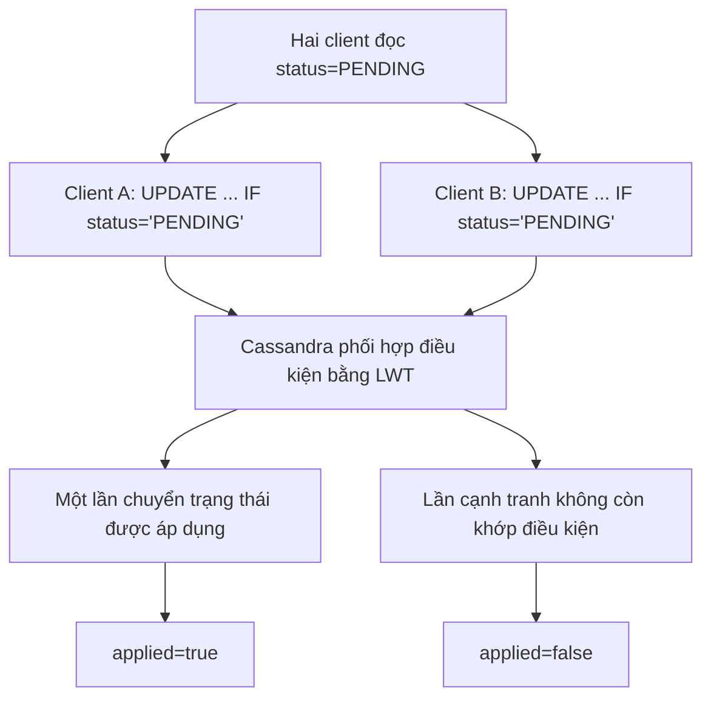
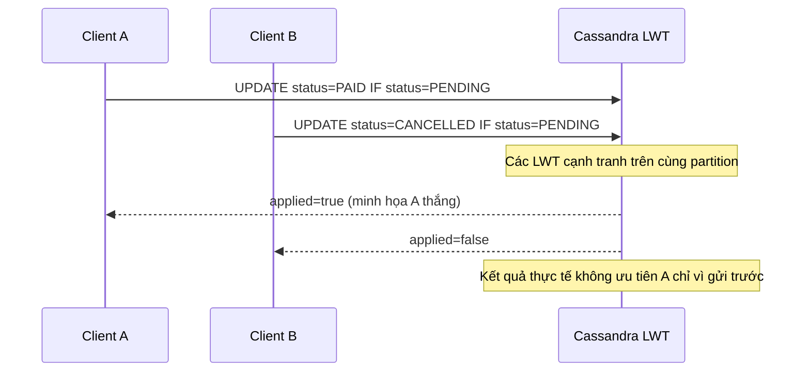
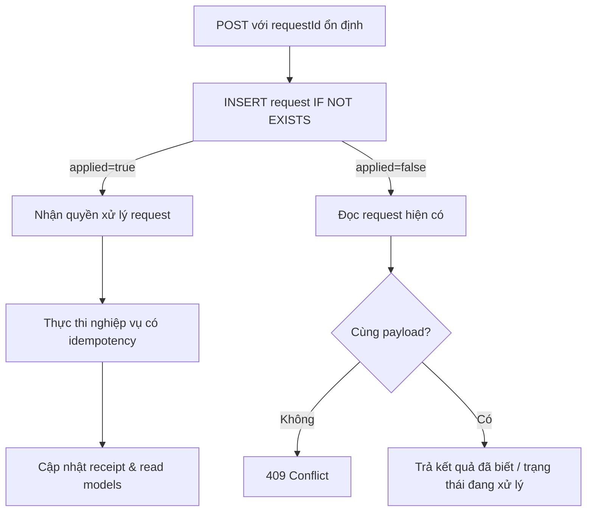

# Lightweight transaction và cập nhật có điều kiện

## 1. Vấn đề: hai yêu cầu cùng muốn thay đổi một bản ghi

Trong **Spring Data Cassandra**, `CassandraRepository.save(...)`, `CassandraTemplate`, `CqlTemplate` và câu CQL `INSERT`/`UPDATE` thông thường chủ yếu dựa trên **upsert** theo primary key. Điều này phù hợp với nhiều hệ thống phân tán có thể ghi lại cùng một giá trị, nhưng không tự bảo vệ các quy tắc như:

- Một mã đặt chỗ chỉ được người đầu tiên chiếm thành công.
- Đơn hàng chỉ chuyển từ `PENDING` sang `PAID` nếu nó vẫn còn `PENDING`.
- Hai người sửa cùng đối tượng không được âm thầm ghi đè thay đổi của nhau.
- Một khóa idempotency không thể được hai request sử dụng cho hai tác vụ khác nhau.
- Chỉ xóa đối tượng khi nó còn đúng phiên bản hoặc trạng thái cho phép.

Xét ví dụ:

```text
Ban đầu: order.status = PENDING

Worker A: SELECT -> PENDING
Worker B: SELECT -> PENDING
Worker A: UPDATE status = PAID
Worker B: UPDATE status = CANCELLED

Hai UPDATE thường đều có thể được chấp nhận.
Trạng thái cuối phụ thuộc write timestamps/quy tắc xung đột,
không phải quy tắc nghiệp vụ "ai kiểm tra trước được quyền sửa".
```

Một bước **đọc trước rồi ghi sau** không phải compare-and-set nguyên tử. Dù cả đọc và ghi đều dùng `LOCAL_QUORUM`, một writer khác vẫn có thể can thiệp ở khoảng giữa hai request.

**Lightweight transaction (LWT)** là cơ chế Cassandra dùng để hỗ trợ **thao tác có điều kiện**, chẳng hạn `INSERT ... IF NOT EXISTS`, `UPDATE ... IF status = 'PENDING'` và `DELETE ... IF EXISTS`. LWT dựa trên một giao thức đồng thuận thuộc họ **Paxos** để các replica phối hợp quyết định liệu mutation có được áp dụng hay không.



LWT không biến Cassandra thành RDBMS có giao dịch ACID tổng quát. Bài này tập trung vào **một hàng/partition và bất biến mà CQL điều kiện thực sự kiểm tra được**, đồng thời chỉ ra giới hạn khi ứng dụng có nhiều bảng đọc phi chuẩn hóa.

## 2. Phân biệt upsert, compare-and-set và optimistic locking

| Cơ chế | Câu lệnh điển hình | Bảo đảm chính | Không bảo đảm |
| --- | --- | --- | --- |
| Ghi thường | `UPDATE ... SET ... WHERE pk=?` | Ghi mutation theo khóa, dùng reconciliation của Cassandra | Không kiểm tra giá trị trước đó; có thể upsert |
| Insert điều kiện | `INSERT ... IF NOT EXISTS` | Chỉ insert khi hàng chưa tồn tại theo điều kiện LWT | Không bảo vệ uniqueness ở bảng/khóa khác |
| Update điều kiện | `UPDATE ... IF status=?` | Chỉ ghi khi điều kiện trên dữ liệu hiện tại khớp | Không tự kiểm tra invariant ở bảng khác |
| Delete điều kiện | `DELETE ... IF EXISTS` hoặc điều kiện được hỗ trợ | Chỉ xóa khi điều kiện phù hợp | Không lập tức thu hồi bytes/tombstone trên mọi replica |
| Optimistic locking qua version | `UPDATE ... IF version=?` hoặc `@Version` | Phát hiện bản ghi đã bị sửa so với phiên bản caller đọc | Không tự merge thay đổi hoặc tạo transaction xuyên nhiều bảng |
| Phối hợp ở application service | Idempotency, workflow, retry, reconciliation | Giữ hợp đồng nghiệp vụ giữa nhiều read models | Không thay thế điều kiện nguyên tử tại nguồn sự thật |

**Optimistic locking** không có nghĩa “không cần xử lý cạnh tranh”. Nó có nghĩa không giữ một khóa độc quyền dài hạn ở ứng dụng; khi ghi, hệ thống **kiểm tra lại điều kiện** để phát hiện phiên bản đã đổi. LWT là một cách Cassandra thực thi điều kiện đó.

LWT có phạm vi của **dữ liệu được điều kiện kiểm tra trong partition liên quan**. Một bảng `orders_by_id` và một bảng `orders_by_customer_day` là hai read models riêng: thành công LWT ở bảng thứ nhất **không tự đồng bộ** bảng thứ hai.

## 3. Chuẩn bị schema có khóa chính rõ ràng

Ví dụ một ứng dụng quản lý đơn hàng:

```sql
-- Chỉ dùng replication này để học trên local một node.
CREATE KEYSPACE IF NOT EXISTS shop_lab
WITH replication = {
    'class': 'SimpleStrategy',
    'replication_factor': 1
};

CREATE TABLE IF NOT EXISTS shop_lab.orders_by_id (
    order_id uuid PRIMARY KEY,
    customer_id uuid,
    status text,
    total_amount decimal,
    version bigint,
    last_request_id uuid,
    updated_at timestamp
);
```

`order_id` là **partition key**, đồng thời là toàn bộ primary key. Với bảng này, điều kiện `WHERE order_id = ?` xác định một hàng rõ ràng. Các ví dụ LWT dưới đây đều truy cập một khóa `order_id`; không phụ thuộc query lọc rộng trên cột thường.

Ghi hàng khởi tạo:

```sql
INSERT INTO shop_lab.orders_by_id
    (order_id, customer_id, status, total_amount, version)
VALUES (
    11111111-1111-4111-8111-111111111111,
    22222222-2222-4222-8222-222222222222,
    'PENDING',
    199000.00,
    0
);
```

Lệnh `INSERT` trên **không có `IF NOT EXISTS`**, vì vậy ghi lại cùng khóa có tính upsert. Nếu nghiệp vụ muốn chỉ tạo đơn lần đầu thì cần điều kiện riêng.

### Cấu hình ứng dụng Java/Spring

Ví dụ dependency khi dùng Spring Boot:

```xml
<dependency>
    <groupId>org.springframework.boot</groupId>
    <artifactId>spring-boot-starter-data-cassandra</artifactId>
</dependency>
```

Kết nối local minh họa:

```yaml
spring:
  cassandra:
    contact-points: 127.0.0.1:9042
    local-datacenter: datacenter1
    keyspace-name: shop_lab
    schema-action: none
```

`datacenter1` phải là tên DC thực tế. Không để ví dụ `SimpleStrategy`/RF=1 đi thẳng vào production; khi cần quan sát Paxos/quorum và failure mode, phải chuẩn bị cluster nhiều replica với replication strategy phù hợp.

## 4. `INSERT ... IF NOT EXISTS`: tạo mới có điều kiện

### 4.1. Cú pháp CQL

```sql
INSERT INTO shop_lab.orders_by_id
    (order_id, customer_id, status, total_amount, version)
VALUES (
    33333333-3333-4333-8333-333333333333,
    22222222-2222-4222-8222-222222222222,
    'PENDING',
    199000.00,
    0
)
IF NOT EXISTS;
```

Lần đầu nếu chưa có hàng, kết quả điều kiện sẽ có dạng ý nghĩa:

```text
[applied]
---------
True
```

Gửi lại cùng `INSERT ... IF NOT EXISTS` khi hàng đã tồn tại thường cho:

```text
[applied]
---------
False
```

Khi điều kiện thất bại, Cassandra có thể trả **những giá trị hiện tại** liên quan đến điều kiện trong result set; tập cột cụ thể phụ thuộc loại conditional statement và cách nó được thực thi. **Không viết code phụ thuộc cấu trúc các cột phụ khi chưa kiểm thử trên phiên bản Cassandra/driver đang dùng.** Trường hợp chỉ cần quyết định thành công/thất bại, kiểm tra `[applied]` là trọng tâm.

### 4.2. Trường hợp sử dụng phù hợp

- Giữ một `request_id` duy nhất trong bảng idempotency được thiết kế theo khóa.
- Tạo một tài nguyên nếu khóa chưa có.
- Giữ chỗ một tên định danh **theo đúng khóa tra cứu**, ví dụ một `external_ref` được chuẩn hóa.
- Tránh hai writer cùng tạo hàng trùng primary key khi cần kết quả “ai thắng quyền tạo”.

**Giới hạn quan trọng:** `IF NOT EXISTS` chỉ kiểm tra **hàng tương ứng với primary key đang ghi**. Nếu bạn cần bảo đảm email duy nhất nhưng bảng được định danh bằng `user_id`, `INSERT IF NOT EXISTS` theo `user_id` **không kiểm tra tất cả hàng có cùng email**. Cần thiết kế bảng đặt email làm key hoặc một cơ chế cấp phát/giữ chỗ có tính nhất quán phù hợp, rồi xử lý đồng bộ giữa bảng chỉ mục và bảng chính.

## 5. `UPDATE ... IF`: chuyển trạng thái có điều kiện

Một đơn chỉ được thanh toán nếu trạng thái hiện tại còn là `PENDING`:

```sql
UPDATE shop_lab.orders_by_id
SET status = 'PAID',
    updated_at = '2026-11-25T08:30:00Z'
WHERE order_id = 11111111-1111-4111-8111-111111111111
IF status = 'PENDING';
```

**Ý nghĩa:** Cassandra kiểm tra điều kiện ở **thời điểm LWT điều phối**, thay vì dựa vào một kết quả SELECT mà client từng đọc trước đó. Nếu một request khác đã chuyển `status` sang `CANCELLED`, lệnh trên không được áp dụng và trả `[applied]=false`.



**Không được suy rằng** một câu `UPDATE` bình thường sau đó sẽ tự bị chặn. Nếu writer khác không dùng LWT và ghi `status='CANCELLED'` với write timestamp mới hơn, nó vẫn có thể tác động đến giá trị cuối. Các writer cùng quản lý một bất biến nên đi qua **cùng chính sách ghi có điều kiện** hoặc quy trình phối hợp tương đương.

### 5.1. Thêm điều kiện về phiên bản

Một cách khác để phát hiện sửa đổi đồng thời là dùng cột `version`:

```sql
UPDATE shop_lab.orders_by_id
SET status = 'PAID',
    version = 8
WHERE order_id = 11111111-1111-4111-8111-111111111111
IF version = 7;
```

Client đã đọc `version=7` chỉ được ghi nếu phiên bản hiện tại **vẫn là 7**. Nếu một writer khác đổi phiên bản trước, `applied=false` buộc ứng dụng quyết định: đọc lại, trả conflict hay thử lại trên trạng thái mới.

Số `7` và `8` chỉ minh họa **quy tắc tăng phiên bản do ứng dụng quản lý**; không mặc nhiên là số version đầu tiên của annotation `@Version`. Trong ứng dụng thật, cần đảm bảo mọi đường ghi có ảnh hưởng cùng entity đều tuân thủ quy ước version, nếu không optimistic locking có thể bị bỏ qua.

### 5.2. `IF EXISTS` và kiểm tra tồn tại

Nếu chỉ muốn cập nhật hàng đã có:

```sql
UPDATE shop_lab.orders_by_id
SET status = 'SHIPPED'
WHERE order_id = 11111111-1111-4111-8111-111111111111
IF EXISTS;
```

Câu này khác `UPDATE` thường, vốn có thể upsert một hàng mới chỉ chứa `order_id` và `status`. `IF EXISTS` bảo vệ **tồn tại**, nhưng **không bảo vệ** một quy tắc như “không cho chuyển từ CANCELLED sang SHIPPED”. Khi cần state machine, chọn điều kiện theo trạng thái/phiên bản phù hợp.

## 6. `DELETE` có điều kiện và tombstone

Xóa cũng có thể mang điều kiện, ví dụ:

```sql
DELETE FROM shop_lab.orders_by_id
WHERE order_id = 11111111-1111-4111-8111-111111111111
IF EXISTS;
```

Với hàng có trạng thái nghiệp vụ, có thể cần kiểm tra điều kiện được hỗ trợ thay vì xóa bất chấp:

```sql
DELETE FROM shop_lab.orders_by_id
WHERE order_id = 11111111-1111-4111-8111-111111111111
IF status = 'CANCELLED';
```

Các lệnh conditional delete trả thông tin `[applied]`. `applied=false` có thể nghĩa là hàng đã biến mất hoặc trạng thái hiện tại không thỏa điều kiện; cần xử lý theo quy tắc nghiệp vụ đã định.

**Khi xóa thành công, Cassandra vẫn dùng tombstone.** LWT bảo vệ **điều kiện thực thi xóa**, không làm dữ liệu biến mất vật lý ngay trên mọi replica hoặc tự xóa bản sao trong các bảng khác, backup, cache và hệ thống downstream. Khi dữ liệu phân tán, tombstone, repair và `gc_grace_seconds`/cơ chế thu gom tương ứng vẫn cần được vận hành đúng.

### Khi nào không nên xóa cứng?

Với đơn hàng phải giữ audit trail, một chuyển trạng thái `CANCELLED` hoặc `DELETED` có điều kiện có thể phù hợp hơn việc xóa hàng ngay. Nếu luật bảo mật yêu cầu xóa dữ liệu, cần quy trình xóa rộng qua tất cả read models và bản sao liên quan, không chỉ một `DELETE IF EXISTS`.

## 7. `[applied]`: phân biệt điều kiện thất bại với lỗi thực thi

Kết quả conditional statement **khác** một lệnh `UPDATE` thường:

| Kết quả | Điều biết được | Cách xử lý thường gặp |
| --- | --- | --- |
| `[applied] = true` | Điều kiện được chấp nhận và mutation đã áp dụng theo kết quả LWT thành công | Tiếp tục workflow, đồng bộ read models |
| `[applied] = false` | Điều kiện không được đáp ứng khi xử lý LWT | Xác định conflict/đã tồn tại, trả kết quả nghiệp vụ |
| Timeout, mất kết nối, request error | Client **không xác định chắc** mutation đã áp dụng hay chưa chỉ từ lỗi | Dừng retry mù quáng; reconcile hoặc retry theo chiến lược an toàn |
| `Unavailable` | Không đủ replica/điều kiện quorum cho request trong trạng thái cụm được biết | Kiểm tra topology, RF, serial/normal consistency và sức khỏe cluster |

**Cảnh báo quan trọng khi retry:** giả sử yêu cầu A đã chuyển trạng thái `PENDING → PAID` thành công ở Cassandra nhưng response bị mất. A retry cùng câu `IF status='PENDING'`; lần sau có thể nhận **`applied=false`**, vì trạng thái giờ là `PAID`. Kết quả false của **lần retry không chứng minh lần đầu chưa thành công**.

```text
Lần 1:  UPDATE status=PAID IF status=PENDING
        Server: APPLIED
        Client: timeout, không nhận được kết quả

Lần 2:  UPDATE status=PAID IF status=PENDING
        Server: NOT APPLIED vì status hiện là PAID
        Client: nhận applied=false

Kết luận đúng: phải kiểm tra request identity và trạng thái hiện tại.
Không được kết luận "thanh toán thất bại" chỉ từ false của lần 2.
```

Nếu nghiệp vụ cần phản hồi “đã xử lý chính request này” thì nên có **request ID ổn định** và trạng thái xử lý/biên nhận thích hợp, không chỉ so sánh một giá trị `status`.

## 8. Java Driver: prepare, bind, thực thi và đọc kết quả LWT

Java Driver 4.x cho phép xử lý conditional statement bằng `CqlSession` và `ResultSet.wasApplied()`.

```java
import java.util.UUID;

import com.datastax.oss.driver.api.core.CqlSession;
import com.datastax.oss.driver.api.core.DefaultConsistencyLevel;
import com.datastax.oss.driver.api.core.cql.BoundStatement;
import com.datastax.oss.driver.api.core.cql.PreparedStatement;
import com.datastax.oss.driver.api.core.cql.ResultSet;
import org.springframework.stereotype.Repository;

@Repository
public class ConditionalOrderWriter {

    private final CqlSession session;
    private final PreparedStatement markPaid;

    public ConditionalOrderWriter(CqlSession session) {
        this.session = session;
        this.markPaid = session.prepare("""
            UPDATE shop_lab.orders_by_id
            SET status = ?
            WHERE order_id = ?
            IF status = ?
            """);
    }

    public boolean markPaidIfPending(UUID orderId) {
        BoundStatement statement = markPaid.bind(
            "PAID",
            orderId,
            "PENDING"
        ).setConsistencyLevel(DefaultConsistencyLevel.LOCAL_QUORUM)
         .setSerialConsistencyLevel(DefaultConsistencyLevel.LOCAL_SERIAL);

        ResultSet result = session.execute(statement);
        return result.wasApplied();
    }
}
```

Ở ví dụ trên:

1. `PreparedStatement` được tạo một lần cho **một mẫu CQL cố định**, không prepare lại cho từng request.
2. `BoundStatement` chứa giá trị của mỗi lần gọi; không chia sẻ object đã bind giữa các HTTP request.
3. `setConsistencyLevel(...)` là **normal consistency** của request.
4. `setSerialConsistencyLevel(...)` chọn **serial consistency** dùng cho pha điều kiện LWT.
5. `result.wasApplied()` chỉ có ý nghĩa khi thực thi đã trả kết quả hợp lệ, không được dùng để suy đoán từ timeout.

**Lưu ý môi trường:** ví dụ `LOCAL_QUORUM`/`LOCAL_SERIAL` minh họa cấu hình trên cluster phục vụ theo DC. Với RF=1 local, không thể kiểm tra các đánh đổi quorum/failover của cụm RF=3. Ứng dụng thật phải chọn mức consistency theo replication strategy, local datacenter, SLO và loại nghiệp vụ.

### 8.1. Nếu cần biết vì sao điều kiện thất bại

Trong một số conditional responses, Cassandra trả về các giá trị hiện tại có thể giúp chẩn đoán conflict. Nhưng hợp đồng kết quả phụ thuộc câu CQL và phiên bản. Một cách an toàn ở tầng ứng dụng là:

```text
result.wasApplied() == false
    -> đọc lại hàng theo primary key
    -> phân biệt NOT_FOUND, ALREADY_PAID, CANCELLED, CONFLICT
    -> áp dụng quyền truy cập và chính sách retry/idempotency
```

Đọc lại là **một truy vấn khác**, nên không phải snapshot bất biến của thời điểm LWT thất bại. Nếu có cạnh tranh liên tục, giá trị đã có thể thay đổi lần nữa; không coi đọc lại là một transaction mở rộng.

### 8.2. Insert điều kiện bằng Java Driver

```java
PreparedStatement create = session.prepare("""
    INSERT INTO shop_lab.orders_by_id
        (order_id, customer_id, status, version)
    VALUES (?, ?, ?, ?)
    IF NOT EXISTS
    """);

boolean created = session.execute(
    create.bind(orderId, customerId, "PENDING", 0L)
).wasApplied();
```

Đoạn này minh họa phần thân một phương thức có sẵn `session`, `orderId`, `customerId`; kiểm tra `created` và trả kết quả nghiệp vụ phù hợp, không coi một request timeout là `created=false`.

## 9. Normal consistency và serial consistency: hai nút điều khiển

Cassandra phân biệt:

| Tùy chọn | Ví dụ | Vai trò khái quát |
| --- | --- | --- |
| **Normal consistency** | `ONE`, `LOCAL_ONE`, `QUORUM`, `LOCAL_QUORUM` | Điều kiện phản hồi/ghi-đọc thông thường liên quan request |
| **Serial consistency** | `SERIAL`, `LOCAL_SERIAL` | Phạm vi phối hợp **serial/Paxos** khi kiểm tra điều kiện LWT |

Không dùng `LOCAL_SERIAL` thay cho `LOCAL_QUORUM` trên một `UPDATE` thường rồi nghĩ nó tự kiểm tra điều kiện. Câu CQL phải thực sự chứa `IF` hoặc là thao tác LWT tương ứng.

Với RF local bằng 3:

```text
LOCAL_QUORUM: cần đa số replica local (2 trên 3) cho normal quorum.
LOCAL_SERIAL: pha điều kiện được phối hợp theo serial consistency local.
```

`SERIAL` và `LOCAL_SERIAL` có ý nghĩa khác nhau trong topology nhiều datacenter; lựa chọn sai có thể gây bất ngờ về latency và phạm vi đồng thuận. Khi triển khai nhiều DC, cần xét chiến lược ghi/đọc đa DC và chính sách nhất quán của ứng dụng, không chỉ sao chép ví dụ local.

### 9.1. Vì sao LWT thường chậm hơn ghi thường?

Ghi điều kiện đòi hỏi **các vòng điều phối đồng thuận/đọc kiểm tra trạng thái** ngoài đường ghi thường. Số vòng trao đổi thực tế phụ thuộc phiên bản Cassandra, tình trạng tranh chấp, khả năng tối ưu và topology. Vì vậy:

- Độ trễ ở LWT thường cao hơn mutation không điều kiện.
- Khi nhiều client cùng tranh một partition, contention/retry có thể tăng mạnh.
- Không nên biến **mọi** `save()` thành LWT nếu nghiệp vụ không yêu cầu bất biến được kiểm tra.
- LWT bảo vệ tính đúng, nhưng vẫn cần **chặn request rate, giới hạn concurrent writers và đo p95/p99**.

**Không hứa con số cố định** như “LWT luôn cần đúng bốn network round trips”, vì implementation và tối ưu hóa có thể khác nhau theo phiên bản Cassandra.

## 10. Optimistic locking bằng `@Version` trong Spring Data Cassandra

Khi ứng dụng đọc **toàn bộ entity**, chỉnh sửa rồi lưu, một số phiên bản Spring Data Cassandra hỗ trợ **optimistic locking** thông qua `org.springframework.data.annotation.Version`.

```java
import java.math.BigDecimal;
import java.util.UUID;

import org.springframework.data.annotation.Version;
import org.springframework.data.cassandra.core.mapping.Column;
import org.springframework.data.cassandra.core.mapping.PrimaryKey;
import org.springframework.data.cassandra.core.mapping.Table;

@Table("orders_by_id")
public class OrderById {

    @PrimaryKey("order_id")
    private UUID orderId;

    @Column("status")
    private String status;

    @Column("total_amount")
    private BigDecimal totalAmount;

    @Version
    @Column("version")
    private Long version;

    protected OrderById() {
    }

    public UUID getOrderId() {
        return orderId;
    }

    public String getStatus() {
        return status;
    }

    public void setStatus(String status) {
        this.status = status;
    }

    public Long getVersion() {
        return version;
    }

    // Bổ sung constructor/accessors cho thuộc tính còn lại.
}
```

Repository:

```java
import java.util.UUID;

import org.springframework.data.cassandra.repository.CassandraRepository;

public interface OrderByIdRepository
        extends CassandraRepository<OrderById, UUID> {
}
```

Luồng nghiệp vụ:

```java
import java.util.UUID;

import org.springframework.stereotype.Service;
import org.springframework.dao.OptimisticLockingFailureException;

@Service
public class OrderEditor {

    private final OrderByIdRepository repository;

    public OrderEditor(OrderByIdRepository repository) {
        this.repository = repository;
    }

    public void changeStatus(UUID id, String newStatus) {
        OrderById order = repository.findById(id)
            .orElseThrow(() -> new IllegalArgumentException("Không có đơn"));

        order.setStatus(newStatus);

        try {
            repository.save(order);
        } catch (OptimisticLockingFailureException conflict) {
            throw new OrderVersionConflictException(
                "Đơn đã thay đổi; cần tải lại trạng thái", conflict);
        }
    }
}

class OrderVersionConflictException extends RuntimeException {
    OrderVersionConflictException(String message, Throwable cause) {
        super(message, cause);
    }
}
```

**Ý tưởng:** Spring Data lưu một phiên bản cùng entity và dùng điều kiện theo version khi cập nhật. Nếu entity ở database đã mang version khác phiên bản mà client đọc, thao tác cần được coi là **xung đột ghi**, thường biểu hiện qua `OptimisticLockingFailureException` ở các API hỗ trợ.

**Những điểm phải kiểm tra theo phiên bản Spring Data Cassandra hiện dùng:**

- Thuộc tính version nên dùng một kiểu số được framework hỗ trợ, ví dụ `Long`/`Integer`, và map với cột CQL tương ứng.
- Quy tắc khởi tạo version và giá trị ban đầu cho insert do framework quản lý; **không gán cứng** rằng mọi phiên bản bắt đầu tại 0 hay 1.
- Đường insert/update nào có áp dụng điều kiện LWT, và đường nào bỏ qua cơ chế đó, phải kiểm thử trên Cassandra thật.
- Không có phép merge tự động khi xung đột: service phải quyết định trả HTTP `409 Conflict`, hiển thị thông báo, đọc lại hoặc thử một workflow mới.
- Nếu vẫn có những writer cập nhật cùng hàng bằng CQL thường mà **không cập nhật version/điều kiện**, chúng có thể vượt qua hợp đồng optimistic locking của ứng dụng. Chính sách ghi phải nhất quán giữa các adapter.

### 10.1. Vì sao `@Version` khác chỉ thêm một cột `version`?

Nếu bảng chỉ có cột `version` mà code thực hiện:

```text
SELECT version = 7
UPDATE status = PAID, version = 8   -- không có IF!
```

thì hai writer vẫn có thể cùng đọc version 7 rồi ghi chồng nhau. **Optimistic locking đòi hỏi phiên bản phải được kiểm tra trong thao tác ghi có điều kiện**. `@Version` cung cấp cơ chế framework làm việc đó ở các API được hỗ trợ; nếu tự viết CQL thì phải thêm `IF version = ?` và quản lý kết quả `[applied]`.

### 10.2. `@Version` không thay thế quy tắc state machine

Giả sử version vừa đọc còn chính xác, nhưng caller muốn chuyển `CANCELLED → PAID` trái quy tắc nghiệp vụ. Optimistic locking chỉ kiểm tra **không có thay đổi cạnh tranh**, không tự biết trạng thái nào được phép chuyển.

Tầng service vẫn phải kiểm tra domain rules; với bất biến cần bảo vệ trước concurrency, câu CQL `IF status = 'PENDING'` hoặc cơ chế version/điều kiện thích hợp phải thực thi trên nguồn sự thật.

## 11. Cách chọn `@Version` hay CQL `IF` tường minh

| Tình huống | Hướng tiếp cận | Lý do |
| --- | --- | --- |
| Chỉnh sửa entity đầy đủ có UI “lưu thay đổi” | `@Version` trên entity, repository save được hỗ trợ | Dễ phát hiện thay đổi từ người khác |
| Chỉ chuyển `PENDING → PAID` | `UPDATE ... IF status = 'PENDING'` | Điều kiện diễn đạt trực tiếp domain invariant |
| Tạo tài nguyên một lần theo khóa | `INSERT ... IF NOT EXISTS` | Bảo vệ quyền tạo ở cùng primary key |
| Sửa đúng vài cột và có version | `UPDATE ... SET ..., version=? IF version=?` | Tránh materialize/ghi lại mọi field |
| Xóa chỉ khi còn trạng thái cho phép | Conditional `DELETE` | Bảo vệ điều kiện xóa trước cạnh tranh |
| Cập nhật nhiều bảng phi chuẩn hóa | Application service + LWT ở nguồn sự thật + reconciliation | Không có transaction quan hệ xuyên các bảng |
| Đếm lượt xem/thống kê gần đúng | Counter hoặc event aggregation phù hợp | Không dùng LWT cho mọi increment vô điều kiện |

**Hai cách không đối lập:** một domain có thể dùng `@Version` cho CRUD chỉnh sửa entity, đồng thời có adapter CQL `IF` cho một số chuyển trạng thái quan trọng. Nhưng khi hai đường cùng sửa một hàng, cần thiết kế **quy tắc version/trạng thái chung** để không tạo lỗ hổng cạnh tranh.

### Partial update và `@Version`

Nếu chỉ muốn sửa `status`, đừng cố đọc một projection thiếu các cột khác rồi gọi `save` như thể entity đầy đủ. Một câu partial update có điều kiện thường rõ hơn:

```sql
UPDATE shop_lab.orders_by_id
SET status = 'PAID', version = 13
WHERE order_id = 11111111-1111-4111-8111-111111111111
IF version = 12;
```

Ứng dụng phải tính `newVersion` một cách nhất quán và chỉ chấp nhận thành công khi `[applied]=true`. Nếu điều kiện sai, không tự đẩy version lên cao và ghi lại mù quáng: phải đọc lại trạng thái mới và quyết định theo nghiệp vụ.

## 12. Idempotency: không chỉ dựa vào `IF`

LWT giải quyết **điều kiện cạnh tranh tại một khóa**. Idempotency giải quyết một bài toán liên quan nhưng khác: **một yêu cầu nghiệp vụ được gửi nhiều lần có gây tác dụng lặp không?**

Ví dụ `POST /payments` có thể bị client gửi lại vì mất mạng. Dù mỗi lần đều dùng `UPDATE ... IF status='PENDING'`, vẫn cần phân biệt:

- Lần đầu áp dụng nhưng client không nhận được response.
- Một request khác vừa thanh toán cùng đơn.
- Cùng request ID nhưng payload khác.
- Nhiều bước: ghi nhận thanh toán ở bảng A, gửi thông báo và cập nhật read model B.

Một mô hình bảng idempotency minh họa:

```sql
CREATE TABLE IF NOT EXISTS shop_lab.payment_requests_by_id (
    request_id uuid PRIMARY KEY,
    order_id uuid,
    payload_hash text,
    state text,
    created_at timestamp
);
```

Để **giữ chỗ một request ID**:

```sql
INSERT INTO shop_lab.payment_requests_by_id
    (request_id, order_id, payload_hash, state)
VALUES (?, ?, ?, 'RECEIVED')
IF NOT EXISTS;
```

Khi `[applied]=false`, đọc trạng thái của `request_id` hiện tại, so sánh `order_id` và `payload_hash`, rồi quyết định trả kết quả đã lưu hoặc báo xung đột. Phải giữ request ID ổn định giữa các lần thử; tạo UUID mới ở mỗi retry làm mất ý nghĩa idempotency.

**Giới hạn quan trọng:** việc giữ `request_id` thành công **không đồng nghĩa** bước `UPDATE orders_by_id` hoặc thao tác với cổng thanh toán ngoài Cassandra đã hoàn thành. Hai bảng/ứng dụng bên ngoài **không được commit nguyên tử** chỉ vì một lệnh `IF NOT EXISTS` thành công. Cần workflow có trạng thái (`RECEIVED` → `PROCESSING` → `COMPLETED`/`FAILED`), retry an toàn, giám sát và đối soát.



Không dùng một cột `state='PROCESSING'` làm khóa phân tán vĩnh viễn nếu không có chính sách khôi phục worker chết giữa chừng. Nếu hệ thống cần ownership/lease, phải thiết kế timeout, fencing token hoặc phiên bản có điều kiện phù hợp.

## 13. LWT, write timestamps và cạnh tranh với ghi thường

Trong Cassandra, mutation không điều kiện thường dùng **last-write-wins theo write timestamp**. LWT có cơ chế điều kiện để phối hợp quyết định ghi, nhưng không có nghĩa mọi câu ghi không điều kiện khác đến cùng partition sẽ tự chờ Paxos rồi tôn trọng domain invariant.

Những nguyên tắc cần giữ:

1. Các writer sửa cùng dữ liệu quan trọng nên tuân theo **một chính sách ghi nhất quán**.
2. Không tự đặt `USING TIMESTAMP` để ép giá trị thắng LWT; conditional statements có giới hạn đối với **user-supplied timestamps**.
3. Nếu một service tự đặt write timestamp quá xa tương lai, các ghi hợp lệ tiếp theo có thể bất ngờ không thắng theo LWW.
4. `LOCAL_QUORUM`/`ALL` trên ghi thường **không tự tạo compare-and-set**.
5. LWT có hiệu lực theo **điều kiện và phạm vi partition được kiểm tra**, không phải một phiên bản MVCC toàn cluster.

### 13.1. Vì sao không trộn LWT với `USING TIMESTAMP` tùy ý?

CQL có thể cho phép `USING TIMESTAMP` trên nhiều lệnh ghi thường, nhưng **conditional update/insert dùng LWT không hỗ trợ timestamp tùy đặt theo cùng cách** vì đồng thuận và thứ tự mutation phải được quản lý nhất quán. Không xây cơ chế optimistic locking bằng cách “đọc `WRITETIME` rồi tự cộng 1 microsecond” nếu không hiểu hệ quả phân tán. Dùng `@Version` hoặc `IF version = ...` phù hợp hơn cho bất biến cập nhật.

### 13.2. Counter và LWT

Counter column được dùng với phép cộng/trừ, ví dụ:

```sql
UPDATE shop_lab.order_counters_by_id
SET view_count = view_count + 1
WHERE order_id = ?;
```

Trong Cassandra, bảng counter cần schema riêng và các điều kiện/TTL/LWT thông thường **không được áp dụng cho counter giống cột thường**. Nếu cần chống cộng trùng một cách chặt chẽ, thiết kế một luồng sự kiện có ID duy nhất và aggregation kiểm soát idempotency, thay vì kỳ vọng `counter + 1 IF ...` sẽ giải quyết được.

## 14. Conditional batch và ranh giới một partition

Cassandra hỗ trợ batch với những quy tắc riêng. Với **conditional batch/LWT**, các lệnh có điều kiện phải tuân thủ giới hạn partition và những quy tắc cú pháp mà phiên bản Cassandra hỗ trợ. Không được gom tùy ý:

```text
UPDATE orders_by_id IF status = PENDING
INSERT orders_by_customer_day IF NOT EXISTS
INSERT payment_requests_by_id IF NOT EXISTS
```

rồi coi đó là **một transaction ACID xuyên ba bảng với các partition keys khác nhau**. Những keyspace/bảng trên có thể được phân vùng ở các node/replica khác nhau và không thể được bảo vệ bởi một điều kiện Paxos duy nhất theo cách đó.

Ngay cả **logged batch** thông thường cũng không tạo isolation quan hệ như JPA/RDBMS. Batch có cơ chế atomicity theo ngữ nghĩa Cassandra, nhưng không đồng nghĩa các câu lệnh luôn được quan sát như một transaction toàn cục có rollback tự động đối với mọi thay đổi nghiệp vụ.

**Khi cần nhiều bước**, chọn nguồn sự thật và workflow có khả năng phát hiện/cân bằng trạng thái:

```text
PaymentService
   1. LWT chuyển trạng thái ở source of truth
   2. Ghi event/outcome với ID ổn định
   3. Đồng bộ orders_by_customer_day
   4. Retry/đối soát nếu ghi một bảng thất bại
   5. Thông báo trạng thái eventual consistency của API
```

Chính sách retry, bền vững của event/outbox và xử lý partial failure phải được thiết kế tường minh; không dùng dấu `@Transactional` để suy ra đã có commit ACID xuyên Cassandra và dịch vụ ngoài.

## 15. Giải quyết conflict ở application service

LWT trả một **kết quả điều kiện**, không đưa ra quyết định UX hoặc business cuối cùng. Gợi ý chuyển kết quả thành hợp đồng API:

| Tình huống | Điều kiện kiểm tra | Phản hồi ứng dụng gợi ý |
| --- | --- | --- |
| Tạo tài nguyên mới | `INSERT IF NOT EXISTS` áp dụng | `201 Created` |
| Tài nguyên đã tồn tại với cùng idempotency key/payload | `applied=false`, kiểm tra receipt | Trả lại kết quả trước đó nếu đã xác nhận |
| Cùng idempotency key nhưng payload khác | `applied=false`, hash khác | `409 Conflict` |
| Trạng thái đã đổi so với mong đợi | `UPDATE IF status=...` false | `409 Conflict` hoặc phản hồi domain phù hợp |
| Entity đã có phiên bản khác | `@Version` phát hiện conflict | `409 Conflict`, yêu cầu đọc lại |
| Đơn không tồn tại | Đọc/điều kiện cho biết không có | `404 Not Found` khi phù hợp |
| LWT timeout, kết quả chưa rõ | Không có `[applied]` xác nhận | Trạng thái chưa xác định; kiểm tra receipt/reconciliation, không báo thất bại giả |

Không coi status HTTP ở bảng là hợp đồng bắt buộc cho mọi API; cần xét yêu cầu idempotency, đồng bộ với dịch vụ thanh toán, mức độ bí mật thông tin và quy ước lỗi của hệ thống.

### Ví dụ chiến lược xử lý ở service

```java
public enum PaymentTransition {
    APPLIED,
    ALREADY_PAID,
    CONFLICT,
    NOT_FOUND
}
```

Một implementation có thể gọi `writer.markPaidIfPending(id)`. Nếu true, trả `APPLIED`. Nếu false, đọc lại hàng để phân loại, **nhưng** nếu kết quả LWT ban đầu bị mất do timeout thì không thể coi đây là nhánh `false`: cần đường xác minh theo request ID. Việc đọc lại có thể gặp race mới, nên thiết kế phản hồi để không khẳng định quá mức.

### Bảo mật và phân quyền vẫn ở tầng service

`IF status='PENDING'` không kiểm tra người dùng có quyền thanh toán đơn hay không. Application service phải xác thực tenant/customer trước khi ghi, và hạn chế ai được phép áp dụng transition. Không coi UUID khó đoán hoặc điều kiện LWT là thay thế authorization.

## 16. Chi phí, contention và cách đo hiệu năng

LWT nên được sử dụng vì **tính đúng của một điều kiện**, không vì mong tăng hiệu năng. Một số yếu tố chi phí:

| Yếu tố | Vì sao làm LWT đắt hơn? | Biện pháp |
| --- | --- | --- |
| Paxos/coordination | Phải có đồng thuận cho điều kiện | Chỉ dùng với bất biến thật sự cần |
| Nhiều writer trên cùng partition | Cạnh tranh, phải thử lại hoặc nhận false | Giới hạn concurrency, tách workload hợp lý |
| Network giữa các replica/DC | Tăng round trips và tail latency | Chọn topology, serial CL phù hợp |
| Timeout/retry không kiểm soát | Retry storm, trạng thái không rõ | Request ID ổn định, retry budget và reconciliation |
| Partition lớn/hot | Latency truy vấn/ghi trên partition tăng | Thiết kế key/bucket theo truy vấn |
| Thêm nhiều read models | Nhiều đường ghi và consistency lag | Đo chi phí đồng bộ sau LWT |

### Chỉ số nên theo dõi

- **p50/p95/p99 latency** riêng cho LWT và ghi thường.
- Tỷ lệ **`[applied]=true` / `false`** theo query family, phân biệt conflict kỳ vọng với lỗi kỹ thuật.
- Số **timeouts, unavailable, retries**, bao gồm các trường hợp outcome chưa xác định.
- Số client **cạnh tranh cùng partition**, số request/giây và queue/timeouts trên coordinator.
- Số read models chưa đồng bộ, tuổi sự kiện tồn đọng và thời gian reconciliation.
- CPU, network, disk/compaction, kích thước partition và tình trạng replica.

Không giả định mọi phiên bản Cassandra/driver phát lộ cùng tên metric. Dùng tracing có kiểm soát hoặc metrics khả dụng trên môi trường thật; tránh bật query tracing cho mọi request production.

### Khi nào nên dùng cách khác?

Nếu một hệ thống cần giao dịch phức tạp xuyên nhiều thực thể, các bất biến toàn cục, tổng tiền chính xác ở nhiều tài khoản hoặc uniqueness xuyên nhiều partition, hãy đánh giá lại domain boundaries và kiến trúc persistence. LWT rất hữu ích cho **CAS tại khóa được thiết kế đúng**, nhưng không phải sự thay thế nguyên vẹn của transaction engine trong RDBMS.

## 17. Những sai lầm thường gặp

| Nhận định hoặc cách làm sai | Hệ quả | Cách sửa |
| --- | --- | --- |
| “Đọc ở `QUORUM` rồi update thường là đủ” | Race giữa SELECT và UPDATE | Dùng `UPDATE ... IF` khi cần nguyên tử |
| “`INSERT` luôn báo lỗi khi trùng primary key” | Upsert có thể ghi đè | `INSERT ... IF NOT EXISTS` cho điều kiện tạo mới |
| “`UPDATE` chỉ sửa hàng đã tồn tại” | Có thể tạo hàng chưa đủ cột | Dùng `IF EXISTS` hoặc điều kiện miền nghiệp vụ |
| “`applied=false` nghĩa là network lỗi” | Lẫn conflict nghiệp vụ với lỗi kỹ thuật | Phân loại kết quả điều kiện |
| “LWT timeout chắc chắn chưa áp dụng” | Báo thất bại sai, retry gây tác dụng phụ | Outcome unknown, xác minh request ID |
| “Retry LWT false chứng minh lần đầu thất bại” | False có thể do lần đầu đã thành công | Đọc receipt/trạng thái theo idempotency |
| “Một `@Version` bảo vệ mọi đường ghi” | CQL thường bỏ qua version | Chuẩn hóa writer và kiểm thử |
| “`@Version` tự biết state machine” | Transition trái domain vẫn có thể áp dụng | Validation + điều kiện nghiệp vụ |
| “`LOCAL_SERIAL` là normal CL mạnh hơn” | Sai vai trò pha serial | Đặt normal và serial CL đúng API |
| “LWT trên bảng A cũng khóa bảng B” | Read models lệch trạng thái | Service đồng bộ/đối soát |
| “Batch biến ba partition thành transaction JPA” | Hiểu sai atomicity/isolation | Giới hạn batch và thiết kế workflow |
| “Có thể dùng LWT cho counter +1” | Counter có giới hạn riêng và không idempotent | Sự kiện có ID và aggregation phù hợp |
| “LWT miễn phí nên cứ thêm vào mọi write” | p99, CPU và contention tăng | Chỉ dùng theo yêu cầu bất biến |
| “Dùng `USING TIMESTAMP` lớn để luôn thắng” | Timestamp bất thường, ghi sau không thắng | Chính sách timestamp nhất quán; dùng CAS |
| “Kết quả conditional không cần integration test” | CQL, binding, `[applied]` có thể bị dùng sai | Test với Cassandra thật |

## 18. Kiểm thử LWT từ đơn giản tới nhiều replica

### 18.1. Kiểm thử CQL trong `cqlsh`

```sql
-- Chọn ID mới cho test.
INSERT INTO shop_lab.orders_by_id
    (order_id, status, version)
VALUES (aaaaaaaa-aaaa-4aaa-8aaa-aaaaaaaaaaaa, 'PENDING', 0)
IF NOT EXISTS;

UPDATE shop_lab.orders_by_id
SET status = 'PAID', version = 1
WHERE order_id = aaaaaaaa-aaaa-4aaa-8aaa-aaaaaaaaaaaa
IF version = 0;

-- Gửi lại, kỳ vọng điều kiện version=0 không còn đúng.
UPDATE shop_lab.orders_by_id
SET status = 'PAID', version = 1
WHERE order_id = aaaaaaaa-aaaa-4aaa-8aaa-aaaaaaaaaaaa
IF version = 0;

SELECT order_id, status, version
FROM shop_lab.orders_by_id
WHERE order_id = aaaaaaaa-aaaa-4aaa-8aaa-aaaaaaaaaaaa;
```

Kỳ vọng trong lab mới và không có writer khác: insert lần đầu áp dụng, update version lần đầu áp dụng, update version lần hai không áp dụng, hàng cuối có `status=PAID`, `version=1`. `IF NOT EXISTS` không tạo thêm một hàng có cùng primary key.

### 18.2. Integration test Spring Data với `@Version`

Kiểm thử kịch bản hai phiên bản object:

1. Tạo hàng mới thông qua **đường framework có hỗ trợ version**.
2. Đọc hai bản entity độc lập `copyA` và `copyB` từ cùng primary key.
3. Sửa `copyA`, gọi `save`, kiểm tra version đã thay đổi.
4. Sửa `copyB` vẫn giữ version cũ, gọi `save`, kỳ vọng framework **phát hiện optimistic locking conflict**.
5. Xác nhận dữ liệu của `copyA` không bị `copyB` ghi đè.
6. Dùng driver query riêng đọc `version` và giá trị sau cùng để đối chiếu.
7. Kiểm tra đường CQL tự viết có tuân thủ điều kiện version; nếu không, chỉ ra rủi ro bypass.

Sử dụng một **Cassandra test instance thật** với schema khớp entity và phiên bản Spring Data. Mock repository chỉ chứng minh service gọi phương thức, không chứng minh framework phát CQL điều kiện hay ánh xạ version đúng.

### 18.3. Kiểm thử cạnh tranh

Cho nhiều worker cùng cố chuyển một đơn `PENDING`:

```text
Worker A: UPDATE status='PAID'      IF status='PENDING'
Worker B: UPDATE status='CANCELLED' IF status='PENDING'
Worker C: UPDATE status='PAID'      IF status='PENDING'
```

Trong test được kiểm soát, xác nhận **không thể có nhiều transition trái nhau đều được áp dụng từ cùng trạng thái PENDING** theo cơ chế LWT. Không giả định worker nào thắng từ thứ tự thread được tạo. Thu thập `applied`, response time và trạng thái cuối.

### 18.4. Thử timeout và kết quả không rõ

Một test thực tế nên mô phỏng lỗi mạng/response bị mất **sau khi coordinator có thể đã áp dụng mutation**. Cần kiểm tra:

- Service không tự coi timeout là `applied=false`.
- Client retry giữ nguyên `requestId` và payload.
- Hệ thống có thể trả trạng thái đã xử lý, đang xử lý hoặc cần đối soát thay vì tạo thanh toán thứ hai.
- Nếu LWT lần retry trả false, service biết phân biệt **đã thanh toán bởi request này** với **conflict của request khác**.
- Không có vòng retry vô hạn khi cluster bị unavailable.

### 18.5. RF=3 và topology nhiều replica

Một Cassandra container với RF=1 **không kiểm tra được** toàn bộ tính chất serial quorum, mất replica hay Paxos trong cluster thật. Với môi trường thử nhiều replica:

1. Xác minh replication strategy/datacenter và local DC của Java Driver.
2. Thử normal CL/serial CL được lựa chọn.
3. Mô phỏng một replica down và quan sát latency/availability của LWT.
4. Mô phỏng contention khi nhiều client kết nối vào các coordinator khác nhau.
5. Kiểm tra replica hồi phục, repair và trạng thái nhất quán sau failure mode.

Không tắt node/thay đổi RF trên production chỉ để kiểm chứng bài tập. Test failover phải có kế hoạch phục hồi cụm thử nghiệm.

## 19. Bài tập thực hành

**Bài 1 — Upsert hay điều kiện?** Một API gửi hai `INSERT` cùng `order_id`. Hãy so sánh kết quả khi không có `IF NOT EXISTS` với khi có. Thiết kế một test xác nhận chỉ một request tạo tài nguyên thành công theo điều kiện.

**Bài 2 — Race đọc rồi ghi.** Hai worker cùng đọc `PENDING` trước khi thực hiện `UPDATE` thường. Vẽ timeline và giải thích vì sao `LOCAL_QUORUM` trên cả hai bước không tạo compare-and-set nguyên tử.

**Bài 3 — CQL `IF`.** Viết một lệnh chỉ chuyển `PENDING → PAID` và một lệnh chỉ chuyển `PENDING → CANCELLED`. Khi chạy đồng thời cùng khóa, kết quả `[applied]` phải được hiểu thế nào?

**Bài 4 — Optimistic version.** Dùng cột `version bigint`. Hai client cùng đọc `version=10`; hãy viết CQL thay đổi status kèm `version=11` khi `IF version=10`. Giải thích tại sao không thể cả hai cùng thành công cập nhật từ version 10 nếu dùng cùng cơ chế điều kiện đúng.

**Bài 5 — `@Version`.** Khai báo entity Spring Data Cassandra có `@Version Long version`, repository và test hai object đọc từ cùng hàng. Xác định loại lỗi cần xử lý khi object thứ hai cố lưu phiên bản cũ.

**Bài 6 — Kết quả chưa rõ.** LWT đầu tiên đã được áp dụng nhưng response bị mất; lần hai cùng request nhận `applied=false`. Vì sao kết luận “lần thanh toán đầu thất bại” là sai? Thiết kế `request_id`/receipt để khôi phục kết quả.

**Bài 7 — Serial consistency.** Với RF local = 3, phân biệt `LOCAL_QUORUM` và `LOCAL_SERIAL`, giải thích vì sao chúng nằm ở hai API setter khác nhau trên `BoundStatement`.

**Bài 8 — Uniqueness.** `users_by_id` có partition key `user_id`. Tại sao `INSERT IF NOT EXISTS` trên bảng này không bảo đảm `email` duy nhất? Thiết kế bảng lookup theo email và phân tích khả năng sai lệch nếu bước tạo user thất bại sau khi giữ chỗ email.

**Bài 9 — Hai read models.** Chuyển status ở `orders_by_id` bằng LWT, còn cập nhật `orders_by_customer_day` bị timeout. Hãy mô tả xử lý trạng thái trung gian, retry idempotent và reconciliation.

**Bài 10 — Phân biệt conflict và infrastructure error.** Thiết kế mapping cho `applied=false`, `WriteTimeout`, `Unavailable` và optimistic locking conflict thành các kết quả service/HTTP thích hợp. Không tiết lộ thông tin nội bộ Cassandra trong HTTP response.

### Câu hỏi tự kiểm tra

1. LWT giải quyết race nào mà `SELECT` rồi `UPDATE` thường không giải quyết?
2. Vì sao Cassandra dùng cơ chế Paxos cho những thao tác `IF`?
3. `INSERT IF NOT EXISTS` kiểm tra uniqueness trong phạm vi khóa nào?
4. `UPDATE ... IF status=?` khác `UPDATE ... SET status=?` ở điểm nào?
5. `[applied]=false` có đồng nghĩa với timeout hoặc lỗi mạng không?
6. Vì sao retry LWT có thể trả false sau khi lần đầu đã thành công?
7. `@Version` được dùng ở tầng nào và có thể bị bypass ra sao?
8. Tại sao optimistic locking không tự bảo vệ domain state machine?
9. Normal consistency và serial consistency khác nhau trong LWT ở đâu?
10. Vì sao LWT không tự tạo transaction ACID xuyên hai bảng theo truy vấn?
11. Cần những gì để một request ID trở thành cơ chế idempotency có thể phục hồi?
12. Khi nào LWT có thể gây chi phí lớn do contention trên một partition?
13. Vì sao query theo partition key vẫn cần thiết ngay cả khi dùng LWT?
14. Integration test nào cần cluster nhiều replica thay vì Cassandra local RF=1?

## Kết luận

**Lightweight transaction** trong Cassandra cung cấp thao tác có điều kiện nhờ cơ chế phối hợp kiểu Paxos: `INSERT ... IF NOT EXISTS`, `UPDATE ... IF ...` và các dạng `DELETE` điều kiện giúp bảo vệ **một bất biến gắn với khóa/partition được thiết kế đúng**. `ResultSet.wasApplied()` cho biết yêu cầu điều kiện được áp dụng khi có phản hồi hợp lệ; timeout là **kết quả chưa rõ**, không thể tự coi như thất bại. Với Spring Data Cassandra, `@Version` giúp thực hiện **optimistic locking** trên những đường entity được hỗ trợ, còn CQL `IF version = ...` phù hợp khi cần partial update hoặc chính sách tường minh. Tuy vậy, LWT không thay thế phân quyền, domain state machine, idempotency, giao dịch xuyên nhiều bảng, hay quy trình retry/đối soát giữa các read models phi chuẩn hóa. Hãy giới hạn LWT ở các điểm cần tính đúng, cấu hình normal/serial consistency phù hợp, kiểm thử dưới cạnh tranh và đo p95/p99 trước khi triển khai vào đường ghi có tải lớn.
