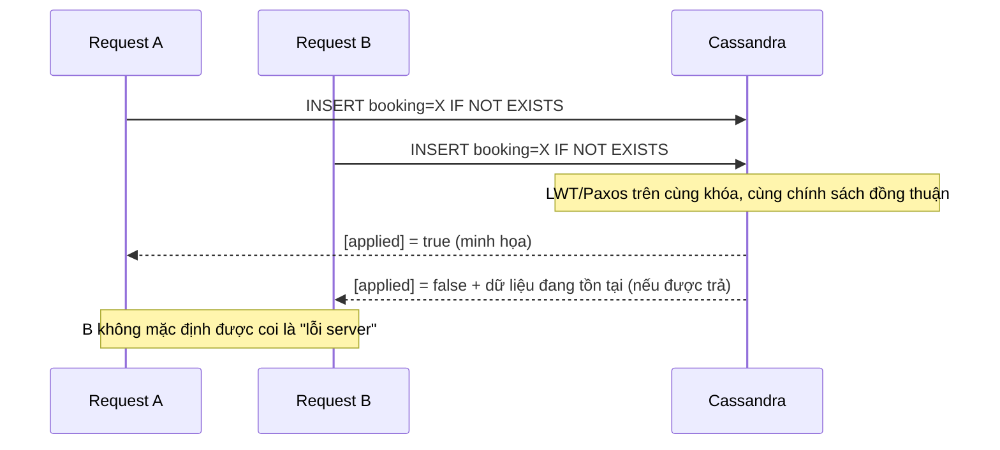
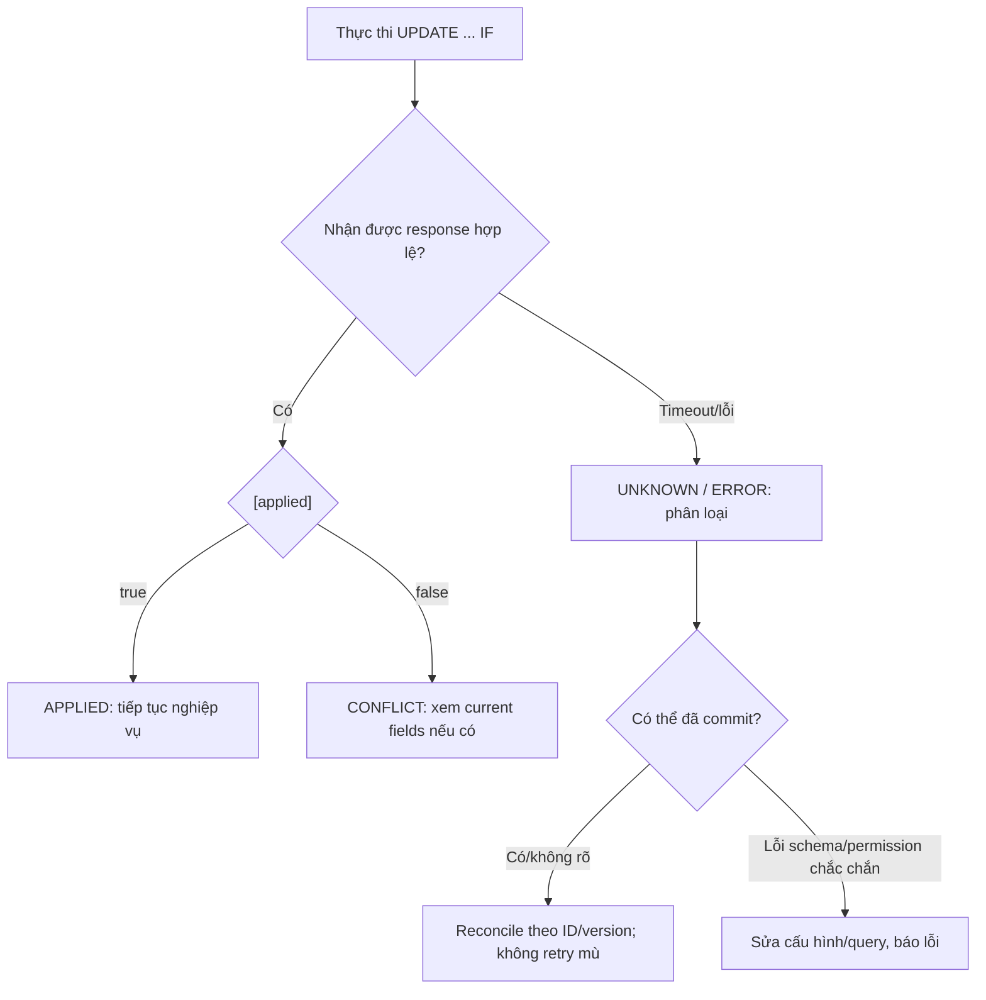
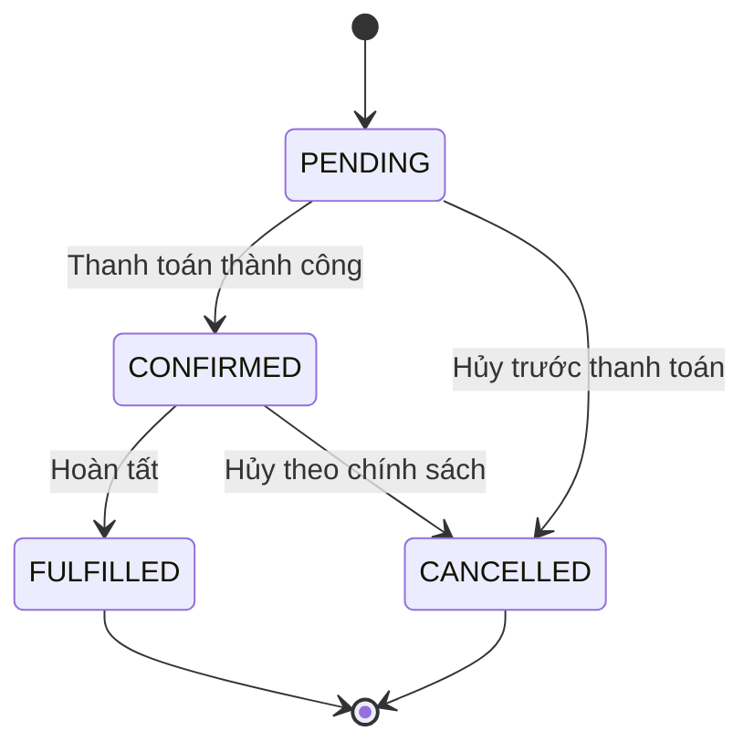

# Kết quả applied và dữ liệu hiện có khi điều kiện không khớp

Trong Apache Cassandra, một câu lệnh có điều kiện như `INSERT ... IF NOT EXISTS` hoặc `UPDATE ... IF status = 'PENDING'` sử dụng **lightweight transaction (LWT)** để quyết định thao tác có được áp dụng hay không. Phản hồi quan trọng nhất là cột **`[applied]`**: `true` nghĩa là điều kiện đạt và mutation được áp dụng; `false` nghĩa là điều kiện không đạt. Khi điều kiện không khớp, Cassandra **có thể trả về giá trị hiện có** của hàng/các cột liên quan để ứng dụng hiểu tại sao xung đột xảy ra.

Điều khó ở đây không phải đọc một boolean, mà là **diễn giải phản hồi đúng**: dữ liệu nào thực sự được trả, giá trị đó có còn mới khi ứng dụng xử lý không, làm sao phân biệt `[applied] = false` với timeout, và khi nào nên đọc lại dữ liệu trước khi quyết định nghiệp vụ.

Bài thuộc chương **LWT và khóa lạc quan** của module **`SPRING_DATA_CASSANDRA`**. Module hướng dẫn truy cập Cassandra qua entity mapping, Repository, `CassandraTemplate` và CQL, đồng thời nhấn mạnh thiết kế bảng theo truy vấn, partition key, consistency, paging và kiểm soát hiệu năng trong mô hình dữ liệu phân tán. Nội dung tập trung vào **phản hồi điều kiện của LWT và cách xử lý optimistic conflict**, không coi LWT là transaction quan hệ đa bảng.

**Sau bài học, bạn có thể:**

1. Đọc và phân loại `[applied] = true`, `[applied] = false` và **outcome chưa xác định** do timeout/lỗi hạ tầng.
2. Biết giá trị hiện có nào **có thể** xuất hiện khi `IF NOT EXISTS` hoặc `IF column = value` thất bại.
3. Đọc kết quả LWT bằng Java Driver 4.x và kiểm tra **column definitions/null** trước khi truy cập giá trị.
4. Dùng version/status làm điều kiện optimistic locking mà không giả định write timestamp hay consistency level tạo CAS.
5. Tổ chức DAO/service trả về kiểu kết quả rõ ràng thay vì chỉ ném exception hoặc trả boolean thiếu ngữ cảnh.
6. Xử lý retry, idempotency, tranh chấp, nhiều datacenter và phản hồi HTTP phù hợp.
7. Viết integration test kiểm chứng **cả trường hợp applied, not applied và timeout**.

## 1. LWT giải quyết vấn đề gì?

Giả sử hai worker cùng nhận yêu cầu chuyển booking từ `PENDING` sang trạng thái cuối:

- Worker A muốn chuyển sang `CONFIRMED`.
- Worker B muốn chuyển sang `CANCELLED`.

Nếu hai worker chỉ thực hiện `UPDATE` thông thường, cả hai lệnh có thể được xác nhận ghi; Cassandra giải quyết giá trị cuối của cell bằng cơ chế **last-write-wins theo write timestamp**. Điều đó **không bảo đảm** chỉ một worker được phép thông báo “đã hoàn tất chuyển trạng thái”.

Với LWT, mỗi worker gửi **điều kiện mà nó tin vẫn đúng**. Ví dụ:

```sql
UPDATE booking_state_by_id
SET status = 'CONFIRMED'
WHERE booking_id = ?
IF status = 'PENDING';
```

Khi hai thao tác điều kiện cạnh tranh trên cùng hàng và cùng phạm vi đồng thuận hợp lệ, Cassandra dùng cơ chế **Paxos/LWT** để quyết định điều kiện và kết quả. Một thao tác có thể nhận `[applied] = true`, thao tác còn lại nhận `[applied] = false` do giá trị hiện có đã thay đổi.

**Điểm mấu chốt:** LWT kiểm tra điều kiện trong giao thức đồng thuận. Nó không chỉ đơn thuần chạy `SELECT` ở client rồi `UPDATE` sau đó.

## 2. Bảng CQL minh họa: một booking, một partition

Ta dùng bảng trạng thái theo khóa `booking_id`:

```sql
CREATE TABLE IF NOT EXISTS booking_state_by_id (
    booking_id uuid PRIMARY KEY,
    status text,
    business_version bigint,
    holder_id uuid,
    last_event_id uuid,
    updated_at timestamp
);
```

| Cột | Ý nghĩa |
| --- | --- |
| `booking_id` | Partition key; tất cả writer của cùng booking cạnh tranh trên một đối tượng |
| `status` | Trạng thái như `PENDING`, `CONFIRMED`, `CANCELLED` |
| `business_version` | Phiên bản nghiệp vụ do ứng dụng quản lý để kiểm tra optimistic lock |
| `holder_id` | Người đang sở hữu quyền xử lý/giữ booking theo domain |
| `last_event_id` | ID yêu cầu/sự kiện đã áp dụng để hỗ trợ idempotency |
| `updated_at` | Thời gian nghiệp vụ; **không tự là write timestamp** của Cassandra |

Ví dụ dữ liệu:

```sql
INSERT INTO booking_state_by_id (
    booking_id, status, business_version, holder_id, last_event_id, updated_at
) VALUES (
    5947e8fa-770c-43ce-a890-9b26c5e175dd,
    'PENDING',
    3,
    735a9cdb-3c13-462f-9d20-c4f51e52eed5,
    945eab85-38c1-41b0-bb12-8a31a931edce,
    '2026-11-25T03:00:00Z'
);
```

Những UUID và thời gian chỉ là dữ liệu **thực hành**. Bảng được thiết kế cho query theo `booking_id`, không hỗ trợ quét tùy ý theo `status` chỉ vì có LWT.

## 3. Cột [applied] là hợp đồng kết quả của điều kiện

CQL conditional statement trả về một kết quả có trường boolean **`[applied]`**.

| Giá trị | Ý nghĩa | Có phải lỗi hạ tầng? |
| --- | --- | --- |
| `[applied] = true` | Cassandra xác nhận điều kiện đúng và mutation đã được áp dụng | Không |
| `[applied] = false` | Cassandra xác nhận điều kiện **không đúng**, mutation có điều kiện không được áp dụng | Không |
| Không nhận response vì timeout/lỗi | Client chưa xác định chắc chắn outcome cuối cùng | **Có thể**, nhưng không đồng nghĩa `false` |

**Ba điểm phải nhớ:**

1. `[applied] = false` là **kết quả được trả về hợp lệ** của truy vấn, thường được ánh xạ thành **business conflict**, không phải `DataAccessException` bắt buộc.
2. `[applied] = true` cho biết **câu điều kiện đã được áp dụng**, không chứng minh mọi side effect khác như gửi email hoặc thu tiền đã hoàn tất.
3. Timeout **không có giá trị `[applied]` đáng tin cậy**. Một request có thể đã được commit ở cluster nhưng client chưa nhận được phản hồi.

### CQL minh họa

```sql
UPDATE booking_state_by_id
SET status = 'CONFIRMED', business_version = 4
WHERE booking_id = 5947e8fa-770c-43ce-a890-9b26c5e175dd
IF status = 'PENDING' AND business_version = 3;
```

Nếu hàng hiện có là `PENDING`, version `3` và không có writer cạnh tranh thay đổi trước khi điều kiện được quyết định, kết quả mong đợi:

```text
 [applied]
-----------
      True
```

Nếu status/version đã thay đổi, kết quả có thể trông như:

```text
 [applied] | status    | business_version
-----------+-----------+-----------------
     False | CANCELLED |                4
```

Bảng kết quả `false` là **minh họa dạng dữ liệu**, không phải cam kết mọi phiên bản Cassandra luôn trả đúng các cột, thứ tự và giá trị mẫu này. Tập cột phụ thuộc **điều kiện `IF`, kiểu DML và schema**.

## 4. Tại sao Cassandra trả dữ liệu hiện có khi IF thất bại?

Khi điều kiện không thỏa, client thường cần biết **phiên bản nào đang thắng**:

- Bạn gửi `IF status = 'PENDING'`, nhưng giá trị hiện có là `CANCELLED`.
- Bạn gửi `IF business_version = 3`, nhưng hàng đã lên version `4`.
- Bạn gửi `INSERT ... IF NOT EXISTS`, nhưng đã có một booking cùng khóa.

Cassandra có thể trả những giá trị hiện hành liên quan đến điều kiện để ứng dụng:

1. Diễn giải **vì sao thao tác không được áp dụng**.
2. Cung cấp thông tin conflict cho API hoặc log (khi được phép).
3. Phân biệt **retry của cùng nghiệp vụ** với một request đang cạnh tranh khác.
4. Quyết định có cần thực hiện **một câu SELECT mới** để lấy trạng thái hiện tại đầy đủ không.

**Nhưng:** các giá trị đó là trạng thái quan sát tại thời điểm xử lý điều kiện, **không phải snapshot bất biến sau khi response đã về tới client**. Một writer khác có thể cập nhật ngay sau đó.

## 5. Phân biệt IF NOT EXISTS và IF column = value

Hai dạng conditional phổ biến có **ngữ nghĩa kiểm tra khác nhau**:

| Câu CQL | Điều kiện | Khi `false` cần lưu ý |
| --- | --- | --- |
| `INSERT ... IF NOT EXISTS` | Chỉ tạo nếu hàng mục tiêu chưa tồn tại theo định nghĩa CQL | Có thể trả về **giá trị của hàng hiện có** để chỉ ra xung đột |
| `UPDATE ... IF status = ?` | Chỉ cập nhật nếu cột `status` bằng giá trị kỳ vọng | Thường có **giá trị hiện có của cột được kiểm tra** |
| `UPDATE ... IF status = ? AND business_version = ?` | Hai điều kiện phải cùng đúng | Thường có **các giá trị hiện có của những cột trong IF** |
| `UPDATE ... IF EXISTS` | Chỉ cập nhật nếu hàng tồn tại | Nếu không tồn tại thì **không có hàng đầy đủ để trả** |
| `DELETE ... IF ...` | Chỉ xóa khi điều kiện đúng | Có thể trả các giá trị liên quan đến điều kiện khi thất bại |

**Không thiết kế DAO dựa trên giả định “mọi LWT thất bại đều trả toàn bộ hàng”.** Đặc biệt với `IF EXISTS` thất bại, không có hàng để cung cấp; với `IF column = value`, các cột **không nằm trong IF** có thể không hiện diện trong response.

### Ví dụ: yêu cầu IF status nhưng muốn holder_id

```sql
UPDATE booking_state_by_id
SET status = 'CONFIRMED'
WHERE booking_id = ?
IF status = 'PENDING';
```

Nếu kết quả `false`, bạn có thể thấy giá trị hiện có của `status`. **Không được mặc định** trường `holder_id` hay `updated_at` luôn tồn tại trong cùng response; hãy kiểm tra metadata hoặc đọc lại theo khóa nếu nghiệp vụ cần những trường đó.

## 6. Trường hợp 1: INSERT IF NOT EXISTS khi hàng đã có

Ứng dụng muốn tạo booking mới:

```sql
INSERT INTO booking_state_by_id (
    booking_id, status, business_version, holder_id, last_event_id, updated_at
) VALUES (?, 'PENDING', 1, ?, ?, ?)
IF NOT EXISTS;
```

Hai request cùng `booking_id`:



Khi B nhận `false`, có hai câu hỏi nghiệp vụ khác nhau:

- **Đây có phải request lặp của chính A?** So sánh `last_event_id`/idempotency key nếu giá trị đó có trong response hoặc sau một lần đọc xác minh.
- **Đây có phải booking được tạo bởi yêu cầu khác?** Nếu thế, trả conflict và không ghi đè dữ liệu.

**Thận trọng với sự tồn tại của hàng:** `IF NOT EXISTS` là điều kiện trên hàng/key theo semantics Cassandra, không nên đánh đồng với “mỗi cột đều khác null”. Một hàng có thể tồn tại dù một số cột optional là null.

## 7. Trường hợp 2: UPDATE ... IF và các cột của điều kiện

Giả sử trạng thái hợp lệ để xác nhận là `PENDING` ở version `3`:

```sql
UPDATE booking_state_by_id
SET status = 'CONFIRMED',
    business_version = 4,
    updated_at = ?
WHERE booking_id = ?
IF status = 'PENDING' AND business_version = 3;
```

Hai yêu cầu A và B cùng đọc version `3`. A áp dụng trước:

```text
A: expected status=PENDING, expected version=3
   -> [applied]=true, row chuyển thành CONFIRMED/version=4

B: expected status=PENDING, expected version=3
   -> [applied]=false,
      thông tin điều kiện có thể cho biết status=CONFIRMED, version=4
```

Không nên tự động gọi:

```text
B: Thấy version mới là 4.
   Tự đổi expected version thành 4 và UPDATE lại ngay.
```

Đó có thể là hành vi **ghi đè quyết định của A** mà không hỏi liệu transition còn hợp lệ. Hãy trả business conflict hoặc chạy lại state machine theo thông tin mới, với **giới hạn retry** rõ ràng.

### Vì sao kiểm tra cả status và version?

- `status` diễn đạt **trạng thái cần có** để transition hợp lệ.
- `business_version` phát hiện sự thay đổi kể cả khi giá trị status được đưa về trạng thái cũ (tình huống giống **ABA**).
- Kiểm tra hai điều kiện làm hợp đồng rõ hơn, nhưng chỉ đúng nếu **mọi writer liên quan cập nhật version nhất quán và không bypass LWT**.

Một cột tên `business_version` thông thường **không tự bật optimistic locking**. Nó chỉ có tác dụng khi xuất hiện trong điều kiện nguyên tử hoặc được Spring Data hỗ trợ qua `@Version` theo đúng phiên bản.

## 8. Trường hợp 3: IF EXISTS không có dữ liệu đầy đủ

Câu lệnh:

```sql
UPDATE booking_state_by_id
SET status = 'PENDING'
WHERE booking_id = ?
IF EXISTS;
```

Nếu hàng mục tiêu **không tồn tại**, `[applied] = false`. Không có cơ sở để truy xuất `holder_id`, `status` hoặc `business_version` từ một hàng không tồn tại.

**Vì sao vẫn dùng IF EXISTS?**

- Không muốn `UPDATE` thông thường tạo dữ liệu mới như một upsert.
- Cần phân biệt “hàng đã có” với “hàng chưa được tạo”.
- Muốn một thao tác chỉ thành công khi record mục tiêu tồn tại.

**Giới hạn quan trọng:** `IF EXISTS` chỉ kiểm tra **tồn tại**, không bảo vệ một business transition cụ thể. Nếu hàng đang `CANCELLED`, câu `UPDATE ... SET status = 'PENDING' IF EXISTS` vẫn có thể được áp dụng. Muốn kiểm tra trạng thái cũ, dùng `IF status = ?` hoặc một cơ chế version/state machine phù hợp.

## 9. Dữ liệu trả về không phải SELECT * mặc định

Thói quen từ cơ sở dữ liệu quan hệ có thể khiến developer mong:

```sql
UPDATE ... IF ... RETURNING *;
```

Nhưng Cassandra LWT không có contract SQL `RETURNING *` tổng quát như vậy. Dữ liệu trả về trong conditional response phụ thuộc loại lệnh và điều kiện:

1. **Conditional INSERT khi hàng tồn tại** có thể trả các cột của dữ liệu hiện có.
2. **Conditional UPDATE/DELETE thất bại** có thể trả các cột được kiểm tra trong `IF`.
3. **`IF EXISTS` thất bại** không có một hàng hiện có để trả đầy đủ.
4. **Applied = true** thường chỉ cần boolean thành công; đừng giả định mọi cột hiện có đều được phản hồi.
5. Các phiên bản Cassandra/driver và query shape có thể tạo khác biệt về **tập cột, null, tên cột và metadata**.

### Quy tắc API an toàn

**Chỉ đọc cột khi bạn xác nhận cột thực sự có trong `ColumnDefinitions`.** Sau đó kiểm tra giá trị null trước khi đọc kiểu primitive. Nếu dữ liệu không được trả nhưng service cần trạng thái đầy đủ, hãy chạy **SELECT theo primary key** với consistency thích hợp, hiểu rằng đó là một lần đọc khác thời điểm.

Không phụ thuộc vào **vị trí cột thứ hai/thứ ba** trong `Row` nếu có thể đọc theo tên rõ ràng; thứ tự cột phản hồi có thể khác nhau giữa conditional statements.

## 10. Java Driver 4.x: lấy [applied] bằng Row

Giả sử ứng dụng đã cấu hình `CqlSession` thông qua Spring và bảng tồn tại:

```java
import java.time.Instant;
import java.util.UUID;
import com.datastax.oss.driver.api.core.CqlSession;
import com.datastax.oss.driver.api.core.DefaultConsistencyLevel;
import com.datastax.oss.driver.api.core.cql.BoundStatement;
import com.datastax.oss.driver.api.core.cql.PreparedStatement;
import com.datastax.oss.driver.api.core.cql.ResultSet;
import com.datastax.oss.driver.api.core.cql.Row;

public class BookingTransitionGateway {
    private final CqlSession session;
    private final PreparedStatement transition;

    public BookingTransitionGateway(CqlSession session) {
        this.session = session;
        this.transition = session.prepare("""
            UPDATE booking_state_by_id
            SET status = ?, business_version = ?,
                last_event_id = ?, updated_at = ?
            WHERE booking_id = ?
            IF status = ? AND business_version = ?
            """);
    }

    public ResultSet executeTransition(
            UUID bookingId,
            String newStatus,
            long nextVersion,
            UUID eventId,
            Instant now,
            String expectedStatus,
            long expectedVersion) {

        BoundStatement statement = transition.bind(
                newStatus,
                nextVersion,
                eventId,
                now,
                bookingId,
                expectedStatus,
                expectedVersion)
            .setConsistencyLevel(DefaultConsistencyLevel.LOCAL_QUORUM)
            .setSerialConsistencyLevel(
                    DefaultConsistencyLevel.LOCAL_SERIAL);

        return session.execute(statement);
    }
}
```

Ví dụ này trình bày API rõ ràng, nhưng ở production **không nên để `ResultSet` thoát ra toàn bộ controller/service**: lớp DAO nên chuyển nó thành **typed outcome** và phân biệt xung đột với lỗi hạ tầng. Các `ConsistencyLevel` trên chỉ là ví dụ; lựa chọn thực tế phụ thuộc RF, topology và chiến lược writer, nhất là multi-DC.

### Đọc boolean [applied]

```java
ResultSet rs = gateway.executeTransition(
    bookingId, "CONFIRMED", 4L, eventId, Instant.now(),
    "PENDING", 3L);

Row response = rs.one();
if (response == null) {
    throw new IllegalStateException(
            "Conditional statement returned no result row");
}

boolean applied = response.getBoolean("[applied]");
if (applied) {
    // Transition đã được áp dụng.
} else {
    // Điều kiện không đạt; đọc các giá trị hiện có nếu được trả.
}
```

Driver cũng có convenience API `ResultSet.wasApplied()` để kiểm tra conditional outcome. Khi triển khai, vẫn nên **hiểu metadata/giá trị Row** nếu cần giải thích xung đột; một boolean đơn lẻ không chứa current status/version.

**Không suy ra `applied = false` bằng cách kiểm tra `rs.one() == null`.** Một conditional result hợp lệ có row `[applied]`; nếu không có, đó là tình huống khác phải phân loại theo contract driver.

## 11. Java Driver: đọc dữ liệu hiện có một cách phòng thủ

Hãy giả sử câu `IF` kiểm tra `status` và `business_version`. Trong trường hợp failed LWT, response có thể chứa hai giá trị hiện có này. **Không truy cập cột tùy ý trước khi kiểm tra metadata**:

```java
import com.datastax.oss.driver.api.core.cql.Row;

static String currentStatusOrNull(Row row) {
    if (!row.getColumnDefinitions().contains("status")) {
        return null; // Cột này không có trong conditional response.
    }
    return row.isNull("status") ? null : row.getString("status");
}

static Long currentVersionOrNull(Row row) {
    if (!row.getColumnDefinitions().contains("business_version")) {
        return null;
    }
    return row.isNull("business_version")
            ? null : row.getLong("business_version");
}
```

Hai hàm trên **trả null trong hai trường hợp khác nhau**: cột **không có trong response** hoặc cột **có nhưng SQL/CQL NULL**. Nếu ứng dụng cần phân biệt chính xác, đừng dùng một `null` chung; hãy trả kiểu trạng thái như `NOT_RETURNED`/`PRESENT_NULL`/`PRESENT_VALUE`.

**Vì sao kiểm tra null trước `getLong`?** `long` là primitive, không biểu diễn được null. Dùng `row.isNull(...)` để tránh nhầm “không có phiên bản” thành một số hợp lệ hoặc gặp lỗi decoding. Khi version được mô hình hóa bằng `Long` nullable trong domain, không tự coi null là version `0` trừ khi contract quy định.

### Ví dụ đầy đủ về ba trạng thái một field

```java
enum FieldPresence {
    NOT_RETURNED,
    PRESENT_NULL,
    PRESENT_VALUE
}

record CurrentField<T>(FieldPresence presence, T value) {}

static CurrentField<String> inspectStatus(Row row) {
    if (!row.getColumnDefinitions().contains("status")) {
        return new CurrentField<>(
                FieldPresence.NOT_RETURNED, null);
    }
    if (row.isNull("status")) {
        return new CurrentField<>(
                FieldPresence.PRESENT_NULL, null);
    }
    return new CurrentField<>(
            FieldPresence.PRESENT_VALUE, row.getString("status"));
}
```

Đoạn code dùng Java hỗ trợ `record`. Các kiểu `CurrentField` và `FieldPresence` là **mô hình hóa ở tầng ứng dụng**, không phải class do Cassandra tự trả. Chúng giúp API không ngầm khẳng định đã đọc được current status khi driver thực tế **không trả cột đó**.

## 12. Cẩn trọng với IF NOT EXISTS: current row và idempotency

Khi `INSERT ... IF NOT EXISTS` bị từ chối, Cassandra có thể phản hồi dữ liệu của hàng đang tồn tại. Ví dụ:

```sql
INSERT INTO booking_state_by_id (
    booking_id, status, business_version,
    holder_id, last_event_id
) VALUES (
    5947e8fa-770c-43ce-a890-9b26c5e175dd,
    'PENDING', 1,
    735a9cdb-3c13-462f-9d20-c4f51e52eed5,
    945eab85-38c1-41b0-bb12-8a31a931edce
) IF NOT EXISTS;
```

Nếu `[applied] = false`:

- **Không được lấy riêng `[applied]` rồi kết luận đây là một booking của người khác.**
- Kiểm tra `last_event_id`/request ID nếu response có trả và policy cho phép.
- Nếu ID hiện có trùng request đang retry, đây **có thể là lần gọi lại** của chính nghiệp vụ đã hoàn tất.
- Nếu ID khác, có thể là một yêu cầu cạnh tranh; trả conflict theo nghiệp vụ.
- Nếu field cần thiết **không có trong response**, đọc theo `booking_id` rồi đưa ra quyết định với state/version.

**Quan trọng:** việc một bản ghi đang tồn tại có cùng `last_event_id` là tín hiệu idempotency chỉ khi **toàn bộ quy trình phát ID và cập nhật field đó được thiết kế đáng tin cậy**. Không lấy một chuỗi tùy ý do client gửi làm bằng chứng sở hữu booking.

## 13. Phản hồi false không khóa trạng thái cho lần xử lý sau

Giả sử `UPDATE ... IF status = 'PENDING'` trả:

```text
[applied] = false
status    = CONFIRMED
version   = 4
```

Ngay sau khi Cassandra quyết định điều kiện, một writer khác có thể chuyển `CONFIRMED` sang `CANCELLED`/version `5`. Đến lúc service nhận response:

```text
Thời điểm T1: CAS của B không áp dụng; current=CONFIRMED/v4.
Thời điểm T2: Writer C áp dụng transition mới; current=CANCELLED/v5.
Thời điểm T3: B nhận response chứa CONFIRMED/v4.
```

**Không hiểu response false như “một snapshot được khóa cho B đọc mãi”.** Nó là thông tin xung đột từ một thời điểm xử lý câu điều kiện; không có transaction mới tự động bảo vệ các hành động tiếp theo.

Vì vậy, nếu service muốn **thử một transition khác**, phải tạo **điều kiện LWT mới** dựa trên state/version mà nghiệp vụ chấp nhận, thay vì ghi thường theo thông tin đã lỗi thời.

### Có cần SELECT lại ngay không?

Không phải lúc nào cũng cần:

- Nếu API chỉ cần trả `409 Conflict`, các cột trả về từ conditional response có thể đủ cho một thông báo an toàn.
- Nếu logic retry cần đánh giá một trạng thái mới, nên đọc lại hoặc thực hiện CAS mới với expected state/version rõ ràng.
- Nếu hiển thị chi tiết booking, SELECT theo khóa có thể cần vì LWT response không hứa trả toàn bộ các cột.

**Đọc lại cũng không phải snapshot bất biến.** Nếu tính đúng đòi bảo vệ giữa đọc và ghi, điều kiện phải được kiểm tra **trong mutation tiếp theo**.

## 14. Phân biệt business conflict và outcome không xác định

Đừng dùng một biến boolean duy nhất để biểu diễn mọi trường hợp:



| Loại kết quả | Thao tác đã được áp dụng? | Cách xử lý |
| --- | --- | --- |
| **APPLIED** | Được xác nhận | Trả success, thực hiện side effects có idempotency |
| **NOT_APPLIED** | Điều kiện không đạt, mutation LWT không áp dụng | Trả conflict hoặc đánh giá lại state machine |
| **UNKNOWN** | Client **không biết chắc** | Reconcile, read verification, retry có giới hạn nếu an toàn |
| **FAILED_INFRA** | Request thất bại do cấu hình/kết nối/overload/permission | Xử lý theo loại lỗi, không tráo thành conflict |

**Cấm anti-pattern:**

```java
try {
    return executeConditionalUpdate();
} catch (RuntimeException ex) {
    return false; // SAI: biến timeout thành "điều kiện không khớp".
}
```

Một timeout có thể xảy ra **sau khi mutation đã được áp dụng** nhưng trước khi client nhận response. Nếu service trả conflict trong trường hợp đó, người dùng có thể gửi lại một request mới và tạo side effect trùng.

## 15. Thiết kế typed outcome thay vì chỉ trả boolean

Một tầng DAO dễ kiểm thử nên có một **kết quả phân loại rõ ràng**:

```java
import java.util.UUID;

public sealed interface CasOutcome {
    record Applied(UUID bookingId, long newVersion)
            implements CasOutcome {}

    record Rejected(
            UUID bookingId,
            CurrentField<String> currentStatus,
            CurrentField<Long> currentVersion)
            implements CasOutcome {}

    record Unknown(UUID bookingId, String reason)
            implements CasOutcome {}
}
```

Mẫu trên minh họa Java 17+; `CurrentField` là kiểu đã định nghĩa ở mục 11. Nếu hệ thống có Java thấp hơn, có thể dùng class/enum thay cho `sealed interface`.

Ánh xạ phản hồi:

```java
Row row = result.one();
if (row == null) {
    throw new IllegalStateException("No LWT result row");
}

if (row.getBoolean("[applied]")) {
    return new CasOutcome.Applied(bookingId, newVersion);
}

return new CasOutcome.Rejected(
        bookingId,
        inspectStatus(row),
        inspectVersion(row)); // Tương tự inspectStatus cho bigint.
```

Đoạn `inspectVersion` là **hàm tương tự `inspectStatus`** đã minh họa, cần bổ sung trong dự án thật. Hàm chuyển phản hồi nên nằm trong DAO/gateway; controller chỉ biết `Applied`/`Rejected`/`Unknown`, không phụ thuộc cột driver `[applied]`.

### Không biến exception thành Unknown một cách máy móc

Một DAO có thể bắt timeout/retryable error thành outcome cần reconcile theo contract, nhưng lỗi **invalid CQL**, sai mapping hoặc permission không phải trạng thái “có thể đã ghi” theo cùng cách. Phải phân loại exception chính xác theo **driver và môi trường triển khai**.

Đối với lỗi nghiêm trọng mà hệ thống không thể xử lý, có thể **ném exception có cấu trúc** thay vì cố gói mọi thứ thành một kiểu `Unknown`.

## 16. @Version và optimistic locking trong Spring Data Cassandra

Spring Data Cassandra có hỗ trợ optimistic locking cho entity đánh dấu **`@Version`** ở những phiên bản được hỗ trợ. Khi dùng đúng mapping, Spring Data có thể sử dụng cơ chế **compare-and-set/LWT** để ngăn một update với version lỗi thời.

Ví dụ entity:

```java
import java.util.UUID;
import org.springframework.data.annotation.Version;
import org.springframework.data.cassandra.core.mapping.PrimaryKey;
import org.springframework.data.cassandra.core.mapping.Table;

@Table("booking_state_by_id")
public class BookingState {
    @PrimaryKey("booking_id")
    private UUID bookingId;

    private String status;

    @Version
    private Long businessVersion;

    // Bổ sung constructor/getter/setter theo yêu cầu mapping.
}
```

**Lưu ý:** khi ánh xạ `businessVersion` sang cột `business_version`, hãy khai báo `@Column("business_version")` nếu naming strategy không bảo đảm tự chuyển như mong muốn. Ví dụ:

```java
@Version
@org.springframework.data.cassandra.core.mapping.Column("business_version")
private Long businessVersion;
```

Với mapping và phiên bản hỗ trợ đúng, cập nhật một entity mang version lỗi thời có thể gây **`OptimisticLockingFailureException`**. Nhưng khác biệt quan trọng với Java Driver:

- **Repository/Template ở tầng entity** có thể **chuyển conflict thành exception** theo API.
- Điều đó **không có nghĩa** exception luôn chứa các giá trị hiện tại của `status` và `business_version`.
- Nếu nghiệp vụ cần trả current version để người dùng xử lý, có thể **đọc lại sau conflict** hoặc dùng custom gateway cho LWT response.
- Đừng tự tăng `@Version` trong mọi nơi cùng lúc với cơ chế versioning của framework nếu không hiểu cách nó quản lý giá trị.

**Bài này dùng field business_version ở hai hướng khác nhau để so sánh:** một là field thường do ứng dụng kiểm tra thủ công qua `IF`; hai là field đánh dấu `@Version` để framework quản lý. **Không triển khai hai cơ chế cùng lúc một cách tùy tiện** trên cùng entity/đường ghi.

## 17. Repository và @Query: không tự suy ra [applied]

Repository giúp đọc/ghi entity và biểu diễn query bằng method name hoặc `@Query`:

```java
import java.util.UUID;
import org.springframework.data.cassandra.repository.CassandraRepository;

public interface BookingStateRepository
        extends CassandraRepository<BookingState, UUID> {
}
```

Nhưng cần phân biệt:

1. `repository.save(entity)` **thông thường** là thao tác mapping/ghi theo contract repository. Nó không tự thực hiện điều kiện `IF status = ?` chỉ vì entity có trường `status`.
2. Với entity có **`@Version`**, module Spring Data hỗ trợ optimistic locking theo quy tắc riêng; kiểm tra phiên bản và exception contract.
3. Một `@Query` viết câu `UPDATE ... IF ...` **không bảo đảm** mọi kiểu return của repository sẽ cung cấp trực tiếp `Row`/`[applied]`/current fields theo ý bạn.
4. Các dạng derived queries thường **không phải nơi tốt nhất** để xử lý một conditional response giàu metadata.

Khi mục tiêu chỉ là **từ chối update lỗi thời**, `@Version` có thể đủ rõ. Khi cần **đưa current status/version trả về trong LWT response** hoặc phân loại nhiều kết quả chi tiết, custom DAO dùng `CqlSession` thường dễ kiểm soát hơn.

### CassandraTemplate và CqlOperations

`CassandraTemplate` cung cấp mapping/query/options. `CqlOperations`/`CqlTemplate` cho phép thực thi CQL và sử dụng `RowMapper`/callback. Nếu API/version cho phép đọc conditional result và options đầy đủ, bạn có thể sử dụng chúng; nếu không, xuống Java Driver để kiểm soát `BoundStatement` và `ResultSet` tường minh.

Không mở một `CqlSession` mới cho mỗi LWT. Có thể tiêm **cùng session bean do Spring quản lý** để tất cả đường truy cập chia sẻ hạ tầng kết nối.

## 18. Consistency level thông thường và serial consistency

Một conditional statement liên quan đến **hai loại consistency**:

| Nhóm | Giá trị ví dụ | Chức năng |
| --- | --- | --- |
| Regular consistency | `ONE`, `LOCAL_QUORUM`, `QUORUM`, `ALL` | Điều kiện replica cho phần đọc/ghi thông thường/pha áp dụng |
| Serial consistency | `SERIAL`, `LOCAL_SERIAL` | Phạm vi pha đồng thuận **Paxos/LWT** |

Java Driver 4.x:

```java
BoundStatement statement = prepared.bind(
        newStatus, newVersion, eventId, now,
        bookingId, expectedStatus, expectedVersion)
    .setConsistencyLevel(DefaultConsistencyLevel.LOCAL_QUORUM)
    .setSerialConsistencyLevel(
            DefaultConsistencyLevel.LOCAL_SERIAL);
```

**Không nhầm:** `LOCAL_QUORUM` không tự tạo compare-and-swap, `LOCAL_SERIAL` không thay thế regular consistency. Câu lệnh thành LWT vì có **`IF`**.

Với hệ thống nhiều datacenter, `LOCAL_SERIAL` chỉ đồng thuận trong local DC theo mô hình Cassandra, nên **không mặc định đáp ứng invariant toàn cục nếu cùng key có writer cạnh tranh ở nhiều DC**. Cần phân tích `SERIAL` hoặc writer ownership/routing rõ ràng.

### Giới hạn phạm vi

LWT bảo vệ điều kiện trong phạm vi thao tác và key được thiết kế. Nó **không biến nhiều bảng/partition thành transaction ACID tổng quát**. Nếu một booking được thể hiện ở nhiều bảng denormalized, việc LWT thành công ở bảng state không chứng minh bản sao ở bảng timeline/search đã cập nhật.

## 19. Optimistic locking và state machine nghiệp vụ

Giả sử workflow:



Một optimistic lock không tự biết **transition nào hợp lệ**. Điều kiện `IF business_version = 3` chỉ xác nhận version chưa đổi; nó không tự quyết định chuyển `CANCELLED → PENDING` là sai nghiệp vụ.

Do đó:

- **State machine** xác định những transition được phép.
- **Version/status check qua LWT** bảo vệ quyết định khi có concurrency.
- **Idempotency key** tránh thực thi cùng ý định nhiều lần.
- **Reconciliation/outbox** bảo vệ side effects và bảng denormalized.

Đừng coi một `[applied] = true` là bảo đảm ứng dụng đã hoàn thành **tất cả** các bước workflow bên ngoài Cassandra.

## 20. Xử lý conflict trên HTTP API

Một API `PATCH /bookings/{id}/status` có thể nhận **expectedVersion** từ client theo hợp đồng optimistic concurrency. Service thực hiện CAS, sau đó ánh xạ:

| Outcome nội bộ | HTTP thường dùng | Lưu ý |
| --- | --- | --- |
| `Applied` | `200 OK` / `204 No Content` | Trả kết quả hoặc không có body theo contract |
| `Rejected` do version/state đã đổi | `409 Conflict` | Có thể dùng `412 Precondition Failed` nếu dựa vào `If-Match`/ETag |
| `Rejected` vì record chưa tồn tại | `404 Not Found` trong contract thích hợp | `IF EXISTS` fail không có dữ liệu hàng đầy đủ |
| Timeout/unknown outcome | `503 Service Unavailable` hoặc trạng thái retry/reconcile theo API | Không nói chắc rằng mutation không áp dụng |
| Invalid input/transition | `400 Bad Request` hoặc `422 Unprocessable Content` | Phân biệt business rule với concurrent conflict |

### Ví dụ thông báo conflict an toàn

```json
{
  "code": "BOOKING_VERSION_CONFLICT",
  "message": "Booking đã thay đổi; vui lòng tải lại trước khi thử tiếp.",
  "currentStatus": "CONFIRMED",
  "currentVersion": 4,
  "retryable": false
}
```

Hai trường `currentStatus`/`currentVersion` chỉ nên có **khi backend thực sự có dữ liệu hợp lệ và người gọi được phép xem**. Nếu conditional response không trả các cột đó, **bỏ field hoặc đánh dấu chưa biết**, không tự điền version đoán được. Nếu cần dữ liệu mới nhất, làm một `SELECT` theo khóa rồi xác thực quyền trước khi trả.

**Không trả thông tin holder/owner của tenant khác** trong response conflict chỉ vì Cassandra trả một số cột hiện có. LWT không thay thế cơ chế phân quyền.

## 21. Retry một conflict có nên tự động không?

**Không retry ngay mọi `[applied] = false`**. Đó là một sự kiện business meaningful: điều kiện cũ của bạn đã sai.

Ví dụ:

```text
Worker A: PENDING/v3 -> CONFIRMED/v4 [applied=true]
Worker B: PENDING/v3 -> CANCELLED/v4 [applied=false]
```

Nếu B nhìn version mới rồi tự đổi `IF version = 4` để `CANCELLED` thắng, B đã **thay đổi quyết định nghiệp vụ** mà không đánh giá workflow. Hành vi đúng có thể là:

- Dừng và trả conflict để caller quyết định.
- Đọc lại, xem transition còn được phép hay không, sau đó gửi **CAS mới**.
- Nếu request là retry idempotent của thao tác đã áp dụng, trả success tương đương.
- Với thao tác commutative được thiết kế rõ, có thể thử lại có giới hạn, nhưng phải bảo vệ version/state và side effects.

### Kế hoạch retry có giới hạn

```text
1. Một request có idempotency key ổn định.
2. Thử CAS trên expected state/version.
3. Nếu applied: ghi nhận thành công.
4. Nếu false: kiểm tra dữ liệu hiện có / đọc lại khi cần.
5. Nếu cùng event đã xử lý: trả kết quả idempotent.
6. Nếu conflict thực: trả conflict hoặc đưa vào state machine.
7. Nếu timeout: reconcile, không đoán false.
8. Chặn số retry và backoff theo policy.
```

Không tạo `eventId` mới cho **cùng một yêu cầu retry** nếu idempotency contract muốn nhận diện cùng ý định. Nếu event ID đổi ở mỗi lần thử, một lần commit thành công nhưng response mất có thể bị hiểu thành một giao dịch mới.

## 22. Response current values có phải read-your-writes không?

**Không.** Khi `[applied] = false`, current fields mô tả trạng thái liên quan đến lần kiểm tra condition; nó không phải một đảm bảo rằng client đã đọc một snapshot transaction hay đang giữ lock trên row.

Các khái niệm khác nhau:

| Khái niệm | Định nghĩa |
| --- | --- |
| Current values trong LWT false | Dữ liệu có thể được Cassandra trả để giải thích điều kiện không đạt |
| Read-your-writes | Đọc thấy hiệu ứng các ghi của chính client theo nhất quán/topology phù hợp |
| Linearizable conditional operation | Điều kiện được xử lý theo giao thức đồng thuận trong phạm vi được bảo vệ |
| Snapshot lâu dài | Tập dữ liệu giữ nguyên trong suốt nhiều lần đọc |
| Entity version | Giá trị nghiệp vụ/framework dùng để bảo vệ cập nhật lỗi thời |

Không suy từ một current value nhận được rằng **toàn bộ row, mọi bảng hoặc mọi DC** đã được khóa/đọc trong cùng một snapshot. Cassandra LWT có bảo đảm riêng theo điều kiện, nhưng không cung cấp transaction quan hệ đa bảng cho API nghiệp vụ.

## 23. Timeout, unavailable và contention

LWT có chi phí coordination cao hơn ghi thường và nhạy với contention trên cùng partition. Các tình huống:

| Tình huống | Có [applied] không? | Chiến lược |
| --- | --- | --- |
| Condition false | Có, `false` | Business conflict |
| Condition true | Có, `true` | Tiếp tục nghiệp vụ |
| Client timeout trước response | Thường không có response hợp lệ | Unknown/reconcile |
| Replica unavailable | Không có outcome điều kiện được xác nhận | Kiểm tra availability/topology, retry có kiểm soát |
| Contention nhiều writer | Có thể conflict, timeout hoặc lỗi contention theo phiên bản | Giới hạn concurrent CAS theo key, backoff |
| Schema/permission error | Thực thi không hợp lệ | Sửa query/config, không retry vô hạn |

**Đặc biệt với timeout:** một phản hồi lỗi không chứng minh điều kiện sai. Đừng chuyển mọi `WriteTimeoutException` hoặc lỗi driver khác thành `NOT_APPLIED`. Một conditional request có thể đã được quyết định/applied trong cluster trước khi client bỏ cuộc.

### Reconcile sau unknown

1. Dùng `booking_id` và event ID ổn định để đọc lại.
2. Kiểm tra `last_event_id`/version/status theo workflow.
3. Phân loại “đã hoàn tất”, “thuộc request khác”, “vẫn chưa rõ”.
4. Chỉ retry theo chính sách idempotent.
5. Ghi metrics cho unknown outcome và số lần phải can thiệp thủ công.

Một lần `SELECT` sau timeout cũng phải dùng consistency phù hợp và **không tự là bằng chứng duy nhất** khi vẫn còn hoạt động cạnh tranh hoặc replication lag.

## 24. Kiểm thử tích hợp phản hồi false

Một unit test mock boolean là cần thiết, nhưng **không chứng minh Cassandra trả những cột nào**. Hãy có integration test trên Cassandra cùng phiên bản với production hoặc môi trường tương đương.

**Chuẩn bị một hàng:**

```sql
INSERT INTO booking_state_by_id (
    booking_id, status, business_version, holder_id, last_event_id
) VALUES (
    5947e8fa-770c-43ce-a890-9b26c5e175dd,
    'PENDING', 3,
    735a9cdb-3c13-462f-9d20-c4f51e52eed5,
    945eab85-38c1-41b0-bb12-8a31a931edce
) IF NOT EXISTS;
```

**Test A — Applied:**

```sql
UPDATE booking_state_by_id
SET status = 'CONFIRMED', business_version = 4
WHERE booking_id = 5947e8fa-770c-43ce-a890-9b26c5e175dd
IF status = 'PENDING' AND business_version = 3;
```

Kỳ vọng trong điều kiện test sạch: `[applied] = true`.

**Test B — Not applied vì version cũ:**

```sql
UPDATE booking_state_by_id
SET status = 'CANCELLED', business_version = 4
WHERE booking_id = 5947e8fa-770c-43ce-a890-9b26c5e175dd
IF status = 'PENDING' AND business_version = 3;
```

Kỳ vọng: `[applied] = false`. Ghi lại **danh sách cột thực tế** trong response và kiểm tra giá trị của cột `status`, `business_version` **chỉ khi có trong metadata**.

**Test C — IF NOT EXISTS khi row đã tồn tại:**

```sql
INSERT INTO booking_state_by_id (
    booking_id, status, business_version
) VALUES (
    5947e8fa-770c-43ce-a890-9b26c5e175dd,
    'PENDING', 1
) IF NOT EXISTS;
```

Kỳ vọng: `[applied] = false`; kiểm tra response có các current fields nào trong Cassandra/driver version đang thử.

**Test D — IF EXISTS khi row không có:**

```sql
UPDATE booking_state_by_id
SET status = 'PENDING'
WHERE booking_id = 81760cbb-c387-4fbd-96ba-993ce66247d0
IF EXISTS;
```

Kỳ vọng với ID chưa hề có hàng: `[applied] = false`, **không mong đầy đủ current row**.

**Yêu cầu về dữ liệu test:** dùng keyspace riêng, ID chưa có dữ liệu trước đó, không chạy trên booking thật. Để test lặp lại, làm mới dữ liệu đúng chính sách và không giả định một `DELETE` xóa tức thì toàn bộ tombstones lịch sử.

## 25. Kiểm thử bằng Java Driver: metadata và null

Một integration test nên kiểm tra ba lớp thông tin:

```java
ResultSet result = session.execute(boundStatement);
Row row = result.one();

if (row == null) {
    throw new AssertionError("Expected conditional response row");
}

boolean applied = row.getBoolean("[applied]");

// Kiểm chứng shape của kết quả:
boolean hasStatus =
        row.getColumnDefinitions().contains("status");
boolean hasVersion =
        row.getColumnDefinitions().contains("business_version");

if (!applied && hasStatus && !row.isNull("status")) {
    String currentStatus = row.getString("status");
    // Assert status theo trạng thái test, không phải thứ tự cột.
}

if (!applied && hasVersion &&
        !row.isNull("business_version")) {
    long currentVersion = row.getLong("business_version");
    // Assert version theo dữ liệu đang lưu.
}
```

Nên log trong môi trường test:

- `row.getColumnDefinitions()`: các cột thực sự xuất hiện.
- `applied`: true/false.
- Có/không có `status`, `business_version`.
- Các giá trị null/không null.
- Phiên bản Cassandra server/Java Driver/Spring Data.

**Trong production, không dump tất cả cột chứa PII/ID nhạy cảm** chỉ để debug conflict. Log có thể ghi tên cột, số lượng conflict, latency, query shape và correlation ID theo chính sách bảo mật.

## 26. Kiểm thử concurrency: hai writer cùng version

Để chứng minh optimistic locking, tạo booking test với `status = PENDING` và version `3`, rồi chạy đồng thời hai request:

```text
Writer A:
  SET status=CONFIRMED, version=4
  IF status=PENDING AND version=3

Writer B:
  SET status=CANCELLED, version=4
  IF status=PENDING AND version=3
```

Khi cả hai thực thi theo cùng phạm vi LWT và không có writer bypass điều kiện, kỳ vọng **không phải cả hai đều applied=true**. Trường hợp thông thường là một thắng, một thua điều kiện; dưới tải/sự cố có thể có timeout hoặc kết quả chưa rõ.

Sau test:

1. Đọc row theo `booking_id` để xác minh trạng thái cuối.
2. So sánh current fields trong response false với dữ liệu hiện có tại thời điểm nhận/truy vấn; chấp nhận rằng có thể khác nếu có ghi tiếp.
3. Xác minh chỉ worker applied được phép tạo side effect tiếp theo, và side effect có idempotency.
4. Kiểm tra bất kỳ writer nào đang dùng update thường có thể phá invariant.
5. Đo conflict rate, latency p95/p99 và retry count.

**Đừng dùng việc cả hai API call trả HTTP 200 làm bằng chứng hai LWT đều applied.** HTTP mapping có thể sai; integration test cần kiểm tra `[applied]` trực tiếp.

## 27. Những sai lầm phổ biến

| Sai lầm | Hậu quả | Cách sửa |
| --- | --- | --- |
| `[applied] = false` bị xem là lỗi mạng | Retry vô ích, sai HTTP status | Xử lý như business conflict |
| Timeout bị chuyển thành `false` | Che mất khả năng thao tác đã commit | Trả unknown/reconcile |
| Coi failed LWT luôn trả `SELECT *` | Đọc cột không có, lỗi decoder, lộ dữ liệu | Kiểm tra ColumnDefinitions, đọc lại khi cần |
| Gọi `getLong` trên cột version null | Sai xử lý hoặc exception | Kiểm tra `isNull` và metadata |
| Coi field không được trả là giá trị null thực trong DB | Báo sai current state | Phân biệt NOT_RETURNED/PRESENT_NULL |
| Trả current holder cho tenant khác | Rò rỉ dữ liệu | Phân quyền và data minimization |
| Tự tăng expected version rồi retry khi conflict | Ghi đè transition hợp lệ khác | Chạy lại state machine, giới hạn retry |
| Dùng `UPDATE` thường cho một writer khác | Phá invariant LWT | Thống nhất write path |
| Nghĩ `QUORUM` tương đương CAS | Lost update vẫn xảy ra | Dùng `IF`/`@Version` theo yêu cầu |
| Không dùng event ID ổn định | Retry tạo nhiều side effects | Idempotency key/last event tracking |
| Dùng `IF EXISTS` như kiểm tra trạng thái hợp lệ | Chuyển state sai dù row tồn tại | Kiểm tra status/version cụ thể |
| Coi false response là snapshot bất biến | Quyết định trên state đã cũ | Revalidate/CAS mới khi cần |
| Chỉ mock repository, không test response thật | Không phát hiện thiếu current fields | Integration test với Cassandra |
| Chỉ xem latency trung bình | Bỏ sót contention/tail latency | Đo p95/p99 và conflict rate |

## 28. Ma trận lựa chọn API

| Nhu cầu | Lựa chọn hợp lý | Lý do |
| --- | --- | --- |
| CRUD không cần CAS | Repository/`CassandraTemplate` | Ít mã, tận dụng mapping |
| Optimistic locking theo entity version | `@Version` nếu phiên bản Spring Data hỗ trợ | Framework quản lý version/conflict |
| Muốn biết applied và current fields trong failed LWT | **`CqlSession` + `PreparedStatement` + `Row`** | Kiểm soát phản hồi và metadata rõ ràng |
| CQL conditional đơn giản, framework có callback đủ | `CqlOperations`/`CqlTemplate` | Dùng CQL và chuyển kết quả theo callback |
| LWT multi-DC | API hỗ trợ serial/regular CL rõ | Cần chính sách đồng thuận/writer ownership |
| Muốn conflict HTTP đầy đủ status/version | Custom gateway + DTO | Không làm controller phụ thuộc Row |
| Cần history của tất cả transition | Bảng event/audit riêng | LWT response không phải event log |
| Cần transaction ACID đa bảng và side effects | Thiết kế workflow/outbox/saga phù hợp | Cassandra LWT không tự giải quyết |

**Quy tắc chọn công cụ:** ưu tiên abstraction cao nhất thể hiện đúng **điều kiện ghi, outcome và khả năng quan sát cần thiết**. Đi xuống Java Driver là hợp lý khi cần đọc chính xác conditional response, nhưng không biến mọi CRUD thành driver code chỉ để thấy `[applied]`.

## 29. Câu hỏi tự kiểm tra

**Câu 1.** `[applied] = false` có phải exception hoặc timeout không?

<details>
<summary>Đáp án gợi ý</summary>

Không. Đó là kết quả hợp lệ của LWT khi điều kiện không đạt; timeout có thể để lại outcome chưa xác định và phải xử lý riêng.
</details>

**Câu 2.** Tại sao không được luôn đọc `holder_id` từ phản hồi `UPDATE ... IF status = ?` thất bại?

<details>
<summary>Đáp án gợi ý</summary>

Vì phản hồi có thể chỉ bao gồm các cột được kiểm tra trong `IF`, không hứa trả toàn bộ hàng. Cần kiểm tra column metadata hoặc SELECT lại khi cần thông tin holder.
</details>

**Câu 3.** `INSERT ... IF NOT EXISTS` trả false và current `last_event_id` trùng request ID. Có thể kết luận gì?

<details>
<summary>Đáp án gợi ý</summary>

Đây có thể là retry của yêu cầu đã áp dụng. Cần xác minh hợp đồng idempotency và dữ liệu liên quan trước khi trả thành công tương đương; không mặc định mọi false đều là booking của người khác.
</details>

**Câu 4.** Vì sao cột `business_version` trong entity không tự bảo vệ optimistic locking?

<details>
<summary>Đáp án gợi ý</summary>

Một field thường chỉ là dữ liệu. Phải có `IF business_version = ?`/LWT hoặc cơ chế `@Version` của Spring Data được hỗ trợ và dùng đúng để kiểm tra cập nhật lỗi thời.
</details>

**Câu 5.** Cassandra trả `status = 'CONFIRMED'` trong response false. Giá trị đó có chắc vẫn đúng một giây sau không?

<details>
<summary>Đáp án gợi ý</summary>

Không. Writer khác có thể cập nhật sau thời điểm LWT kiểm tra điều kiện. Nếu cần thay đổi dựa trên state mới, phải kiểm tra lại bằng điều kiện nguyên tử.
</details>

**Câu 6.** Khi version field có trong Row nhưng bằng null, `getLong` có thể dùng trực tiếp như version hợp lệ không?

<details>
<summary>Đáp án gợi ý</summary>

Không nên. Kiểm tra `isNull` trước khi đọc primitive và giữ contract phân biệt null, cột không được trả và số version thực.
</details>

**Câu 7.** `LOCAL_QUORUM` có thay thế `LOCAL_SERIAL` trên conditional update không?

<details>
<summary>Đáp án gợi ý</summary>

Không. Regular consistency và serial consistency là hai cấu hình khác nhau; LWT dùng pha đồng thuận Paxos riêng.
</details>

**Câu 8.** Khi client timeout sau một LWT, có nên retry ngay với event ID mới không?

<details>
<summary>Đáp án gợi ý</summary>

Không. Request trước có thể đã được áp dụng. Dùng event ID ổn định, đọc xác minh/reconcile và retry có giới hạn theo chính sách idempotency.
</details>

**Câu 9.** `@Version` bị conflict có bắt buộc trả current status/version trong exception không?

<details>
<summary>Đáp án gợi ý</summary>

Không. Framework có thể báo `OptimisticLockingFailureException` mà không mang toàn bộ current row. Nếu API cần thông tin đó, dùng custom DAO hoặc đọc lại sau conflict.
</details>

**Câu 10.** LWT applied=true trong bảng state đã chứng minh bảng timeline và email cũng cập nhật thành công chưa?

<details>
<summary>Đáp án gợi ý</summary>

Chưa. LWT chỉ bảo vệ phạm vi điều kiện được Cassandra thực thi. Ghi bảng khác và side effects cần retry/outbox/reconciliation độc lập.
</details>

## 30. Checklist triển khai production

1. **Partition key** có đúng đối tượng cần bảo vệ invariant không?
2. Mọi writer liên quan có dùng **cùng chính sách điều kiện/LWT**, tránh ghi thường bypass không?
3. Câu `IF` có kiểm tra **status, version, owner** cần thiết theo domain không?
4. DAO có đọc và phân loại **`[applied] true/false`** đúng không?
5. Với `false`, code chỉ đọc **những cột có trong ColumnDefinitions** không?
6. Có phân biệt **cột không trả về**, **cột null** và **giá trị thực** không?
7. Có hạn chế dữ liệu current state trả qua API theo **tenant/authorization** không?
8. Có xử lý **timeout/unknown outcome** khác business conflict không?
9. Idempotency/event ID có **ổn định qua retry** không?
10. Có tránh retry ngay vô hạn hoặc tự tăng expected version sau conflict không?
11. Regular consistency và serial consistency có phù hợp RF/topology không?
12. Multi-DC writer ownership có bảo vệ invariant mong muốn không?
13. Spring Data `@Version` có đúng phiên bản/mapping và được integration test không?
14. Có test `INSERT IF NOT EXISTS` true/false, `UPDATE IF` true/false, `IF EXISTS` false không?
15. Có test cạnh tranh, lỗi hạ tầng, timeout và chuyển đổi HTTP status không?
16. Có log metrics **applied rate, conflict rate, unknown outcomes, latency p95/p99** không?
17. Có quy trình reconciliation cho các bảng denormalized và side effects không?

## 31. Ghi nhớ

- **`[applied] = true`**: câu lệnh có điều kiện đã được áp dụng. **`[applied] = false`**: điều kiện không khớp, không phải lỗi mạng. **Timeout**: outcome có thể chưa xác định.
- Khi LWT thất bại, Cassandra **có thể trả dữ liệu hiện có**, nhưng **không bảo đảm mọi loại IF đều trả toàn bộ hàng**.
- Với `IF status = ?` hoặc `IF business_version = ?`, phản hồi false thường có giá trị hiện tại **của những cột được kiểm tra**. Với `IF NOT EXISTS`, có thể có dữ liệu của hàng đã tồn tại. Với `IF EXISTS` thất bại, không có hàng đầy đủ để trả.
- Dùng **`Row.getColumnDefinitions()`** và **`Row.isNull(...)`** trước khi đọc field. **Không trả cột đoán được** khi response không chứa nó.
- Current values trong response false **không phải snapshot bất biến**. Nếu cần một quyết định mới, hãy dùng state machine và CAS mới; đọc lại không thay thế được điều kiện nguyên tử.
- **`@Version`** của Spring Data Cassandra có thể hỗ trợ optimistic locking, nhưng exception conflict **không mặc nhiên mang current row**. Khi cần metadata chi tiết, dùng custom gateway/Java Driver.
- **Regular consistency** và **serial consistency** khác nhau; `QUORUM` không tạo CAS, `LOCAL_SERIAL` cần được đánh giá trong multi-DC.
- **Không retry mù quáng** khi timeout hoặc conflict. Dùng event ID ổn định, idempotency, reconciliation và giới hạn concurrency.
- LWT bảo vệ **điều kiện trong phạm vi thao tác**, không phải transaction đa bảng, event history hay side effects ngoài Cassandra.

### Tài liệu tham khảo

- [Apache Cassandra – CQL data manipulation](https://cassandra.apache.org/doc/stable/cassandra/developing/cql/dml.html)
- [Apache Cassandra – CQL consistency levels](https://cassandra.apache.org/doc/stable/cassandra/developing/cql/consistency.html)
- [Apache Cassandra – Architecture overview](https://cassandra.apache.org/doc/stable/cassandra/architecture/overview.html)
- [Apache Cassandra Java Driver – Statements](https://apache.github.io/cassandra-java-driver/4.18.0/core/statements/)
- [Apache Cassandra Java Driver – Prepared statements](https://apache.github.io/cassandra-java-driver/4.18.0/core/statements/prepared/)
- [Apache Cassandra Java Driver – Consistency](https://apache.github.io/cassandra-java-driver/4.18.0/core/consistency/)
- [Spring Data for Apache Cassandra – Optimistic locking](https://docs.spring.io/spring-data/cassandra/reference/cassandra/template.html)
- [Spring Data for Apache Cassandra – Repository query methods](https://docs.spring.io/spring-data/cassandra/reference/cassandra/repositories/query-methods.html)
- [Spring Data for Apache Cassandra – CqlTemplate](https://docs.spring.io/spring-data/cassandra/reference/cassandra/cql-template.html)
