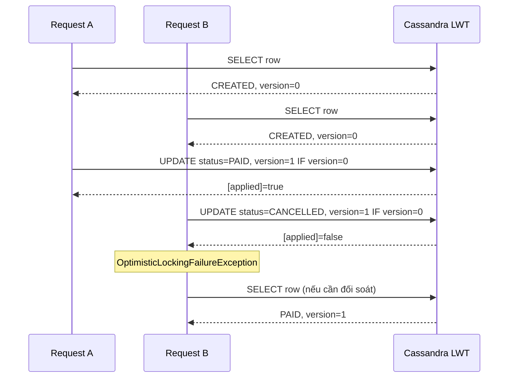
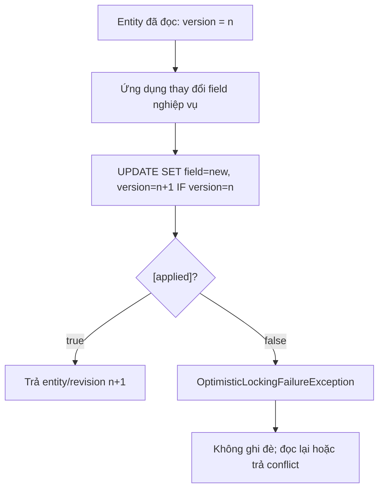

# Ánh xạ @Version và cơ chế tăng phiên bản

Một ứng dụng dùng **Spring Data Cassandra** có thể có nhiều service hoặc nhiều request cùng cập nhật một đơn hàng. Hai request đọc cùng trạng thái `CREATED`, rồi một request chuyển sang `PAID`, request còn lại chuyển sang `CANCELLED`. Nếu cả hai chỉ gọi `UPDATE` thông thường, Apache Cassandra có thể chấp nhận cả hai mutation, sau đó giải quyết xung đột theo **write timestamp**. Điều này phù hợp cơ chế lưu trữ phân tán nhưng chưa chắc phù hợp quy tắc nghiệp vụ: một request dựa trên dữ liệu cũ không nên âm thầm ghi đè trạng thái đã thay đổi.

**Optimistic locking (khóa lạc quan)** giải quyết vấn đề bằng việc kiểm tra **phiên bản (version)** của dữ liệu tại lúc ghi. Trong **Spring Data Cassandra**, annotation **`@Version`** đánh dấu một property số nguyên làm cột phiên bản. Framework dùng **lightweight transaction (LWT)** của Cassandra để kiểm tra điều kiện và chỉ tăng phiên bản nếu cập nhật được chấp nhận. Khi phiên bản trên server khác với phiên bản entity đang giữ, thao tác ghi bị từ chối và Spring báo **`OptimisticLockingFailureException`** thay vì âm thầm ghi đè.

Bài này thuộc chương **LWT và khóa lạc quan** của module **SPRING_DATA_CASSANDRA**, đặt trong bối cảnh truy cập Apache Cassandra bằng entity mapping, repository, `CassandraTemplate` và CQL. Ta sẽ đi từ schema, Java entity, CQL `IF`, repository `save`, quá trình **version 0 → 1 → 2**, tới xung đột thực tế, LWT và kiểm thử.

> Các ví dụ theo tài liệu **Spring Data Cassandra 4.5.x**, Apache Cassandra với CQL/LWT và Java 17+. Chỉ chạy các câu thay đổi schema/dữ liệu trong keyspace thử nghiệm; kiểm tra API và compatibility theo đúng phiên bản dự án trước khi đưa lên production.

## 1. Mục tiêu học tập

Sau bài này, bạn có thể:

1. Giải thích vì sao **last-write-wins (LWW)** chưa đủ để ngăn một request cũ ghi đè thay đổi nghiệp vụ mới.
2. Khai báo đúng **`org.springframework.data.annotation.Version`** trên một property entity và ánh xạ nó thành cột CQL.
3. Hiểu cách Spring Data phân biệt entity **mới/chưa lưu** và entity **đã tồn tại** khi có `@Version`.
4. Mô tả đường đi từ **`version = null`** tới **`version = 0`**, rồi tăng lên **1, 2, 3...** sau mỗi lần cập nhật thành công.
5. Hiểu tương quan giữa `@Version`, `INSERT ... IF NOT EXISTS`, `UPDATE ... IF version = ?` và **LWT**.
6. Dùng **`CassandraRepository.save`** và **`CassandraTemplate`** để bảo vệ thao tác trên **một entity**.
7. Bắt và xử lý `OptimisticLockingFailureException` một cách đúng đắn, không tự động ghi đè sau xung đột.
8. Phân biệt xung đột phiên bản đã biết với **timeout/lỗi mạng có kết quả chưa xác định**.
9. Nhận ra giới hạn đối với batch, CQL ghi trực tiếp, nhiều bảng phi chuẩn hóa, TTL và write timestamp.
10. Thiết kế integration test chứng minh chỉ một trong hai bản sao cũ có thể cập nhật thành công.

## 2. Bài toán: hai request cùng đọc một phiên bản

Giả sử đơn hàng có:

```text
order_id = 11111111-1111-1111-1111-111111111111
status   = CREATED
version  = 0
```

Hai request song song:

| Thời điểm logic | Request A | Request B |
|---|---|---|
| T1 | Đọc `status=CREATED, version=0` | |
| T2 | | Đọc `status=CREATED, version=0` |
| T3 | Muốn ghi `status=PAID` | |
| T4 | | Muốn ghi `status=CANCELLED` |
| T5 | Hoàn tất ghi | Hoàn tất ghi |

Nếu cả hai gọi `UPDATE orders SET status = ? WHERE order_id = ?` **không có điều kiện**, cả hai có thể báo thành công. Dữ liệu cuối được hòa giải theo write timestamp, **không phải** theo ý nghĩa “trạng thái nào được phép chuyển”.

Trong nhiều nghiệp vụ, B không được phép hủy đơn khi A đã thanh toán. Khi đó, cả hai phải kiểm tra:

```sql
... WHERE order_id = ?
IF version = 0;
```

Nếu A cập nhật và làm `version` từ 0 thành 1, B giữ bản sao `version=0` sẽ **không còn đáp ứng điều kiện**. B phải đọc lại dữ liệu và quyết định nghiệp vụ tiếp theo thay vì ghi đè.

### 2.1. Optimistic locking không phải khóa toàn thời gian

Khóa lạc quan có tính chất:

- Không giữ một **mutex/lock server** trong suốt khoảng thời gian request đọc và người dùng chỉnh sửa.
- Cho phép nhiều actor **đồng thời đọc** cùng một phiên bản.
- Kiểm tra xung đột tại **thời điểm commit mutation**, dùng cơ chế compare-and-set.
- Khi xung đột, client nhận lỗi hoặc kết quả không áp dụng và phải quyết định **retry, merge hoặc từ chối**.
- Hiệu quả khi tỷ lệ tranh chấp thấp hơn nhiều so với số lượt đọc.

`@Version` không chặn request khác đọc row và **không khóa mọi cột trong tất cả bảng**. Bảo vệ chỉ đúng khi **mọi đường ghi liên quan tuân thủ cùng quy tắc version**.

### 2.2. Sơ đồ diễn biến



Đây là thứ tự minh họa khi hai thao tác có cùng `expectedVersion` và không có thao tác khác. Trong thực tế, request A hoặc B đều có thể thắng, nhưng **không được có hai lần chuyển version 0 → 1 thành công trên cùng row** thông qua cùng cơ chế CAS.

## 3. @Version là annotation nào?

Trong Spring Data Cassandra, phải import:

```java
import org.springframework.data.annotation.Version;
```

**Không nhầm** với một annotation cùng tên trong framework khác hoặc một property `version` chỉ được đặt tên mà không có annotation. `@Version` thuộc **Spring Data Commons**, được module Cassandra sử dụng để phát hiện entity mới và thực thi optimistic locking.

Ví dụ khai báo:

```java
@Version
@Column("version")
private Long version;
```

Ở đây:

- `@Version` có ý nghĩa **quản lý phiên bản**.
- `@Column("version")` chỉ định tên cột CQL, là **regular column**.
- `Long` là numeric wrapper. Với entity mới, `null` giúp Spring Data nhận diện là chưa được lưu.
- Sau khi insert thành công theo flow của Spring Data Cassandra, phiên bản ban đầu là **0** (theo ví dụ chính thức cho `Long`).
- Sau mỗi update entity thành công qua flow có kiểm tra phiên bản, framework nâng phiên bản lên **1, 2, 3...**.

**Không phải một cột Java `@Version` nào cũng có thể gắn tùy ý vào khóa chính**. Trong bài này, version là regular column `bigint`; nó **không** thuộc partition key hay clustering key và **không** phải counter column.

### 3.1. @Version khác các khái niệm “version” khác

| Thuộc tính | Ví dụ | Vai trò |
|---|---|---|
| `@Version Long version` | 0 → 1 → 2 | Revision logic của entity, được kiểm tra bằng LWT |
| CQL write timestamp | `1700000000000000` | Timestamp microsecond dùng phân giải xung đột mutation thường |
| `updated_at timestamp` | `2026-11-25T10:00:00Z` | Giá trị thời gian nghiệp vụ do ứng dụng cung cấp |
| Version của schema | Migration V1/V2 | Phiên bản cấu trúc database; không là optimistic lock của row |
| Revision của sự kiện Kafka | Sequence/event ID | Thứ tự event ở một kênh; chỉ liên quan CAS nếu được thiết kế rõ |

Không dùng `updated_at` để thay thế `@Version` nếu mục tiêu là khóa lạc quan. Hai request có thể nhận cùng timestamp millisecond hoặc clock của các host bị lệch; trong khi **LWT so sánh giá trị cột hiện tại với expected version**.

### 3.2. Dùng Long thay vì tự tăng primitive

Spring Data Commons có quy tắc phát hiện entity mới: property `@Version` kiểu **wrapper** mà `null` được xem là mới; với version kiểu **primitive**, giá trị `0` có thể mang ý nghĩa chưa lưu. Vì vậy việc khởi tạo version và đánh số ban đầu có thể gây nhầm khi sử dụng primitive.

Bài này dùng **`Long`** và để `null` trước lần insert đầu để có state rõ ràng. Không tự viết `entity.setVersion(1L)` trước lần `save` đầu, không “tự tăng trước” trong controller. Framework đảm nhiệm cơ chế tăng khi thao tác được chấp nhận.

## 4. Tạo schema CQL cho entity có version

### 4.1. Keyspace và bảng thử

```sql
-- Dành cho lab một node. Production nhiều datacenter cần
-- replication strategy/replication factor phù hợp thực tế.
CREATE KEYSPACE IF NOT EXISTS sdc_version_lab
WITH replication = {
    'class': 'SimpleStrategy',
    'replication_factor': 1
};

CREATE TABLE IF NOT EXISTS sdc_version_lab.orders_by_id (
    order_id uuid PRIMARY KEY,
    status text,
    total_cents bigint,
    updated_at timestamp,
    version bigint
);
```

Ý nghĩa thiết kế:

| Cột | Loại CQL | Mục đích |
|---|---|---|
| `order_id` | `uuid PRIMARY KEY` | Partition key định danh đúng một order row |
| `status` | `text` | Trạng thái nghiệp vụ |
| `total_cents` | `bigint` | Giá trị tiền theo đơn vị nhỏ, tránh sai số floating point |
| `updated_at` | `timestamp` | Thời điểm cập nhật để hiển thị/audit nhẹ |
| `version` | `bigint` | Revision CAS do Spring Data quản lý |

Tất cả thao tác ghi/đọc bản ghi trong bài đều xác định **`order_id`**. Không cần `ALLOW FILTERING` hoặc secondary index để làm optimistic locking cho một row theo khóa.

**Không tự thêm index lên `version`** chỉ để làm CAS. Điều kiện `IF version = ...` được đánh giá trong **LWT trên row/partition đã xác định**, không cần một truy vấn quét toàn bảng theo version.

### 4.2. Phiên bản là dữ liệu thực trên server

`@Version` không phải trường chỉ tồn tại trong bộ nhớ Java. Khi ghi thành công, CQL row chứa một giá trị `version` thực để các request khác kiểm tra.

Có thể quan sát:

```sql
SELECT order_id, status, total_cents, updated_at, version
FROM sdc_version_lab.orders_by_id
WHERE order_id = 11111111-1111-1111-1111-111111111111;
```

Nếu record chưa được tạo thì không có row. Nếu đã tạo bằng Spring Data theo `@Version Long`, version thường bắt đầu bằng **0**; nếu đã cập nhật một lần, thành **1**.

### 4.3. Tách dữ liệu version khỏi CQL counter

Cột `version bigint` là số bình thường, **không phải `counter`**. Trên một ghi CAS, Spring Data chuẩn bị giá trị mới rồi làm điều kiện cũ; ví dụ `SET version = 1 ... IF version = 0`. Nó không phải lệnh `SET version = version + 1` của CQL counter.

Cassandra counter có semantics và giới hạn riêng; không dùng counter để thay thế cột version do `@Version` quản lý.

## 5. Ánh xạ entity Java có @Version

Ví dụ file `OrderState.java`:

```java
import java.time.Instant;
import java.util.UUID;

import org.springframework.data.annotation.Version;
import org.springframework.data.cassandra.core.mapping.Column;
import org.springframework.data.cassandra.core.mapping.PrimaryKey;
import org.springframework.data.cassandra.core.mapping.Table;

@Table("orders_by_id")
public class OrderState {

    @PrimaryKey("order_id")
    private UUID orderId;

    @Column("status")
    private String status;

    @Column("total_cents")
    private Long totalCents;

    @Column("updated_at")
    private Instant updatedAt;

    @Version
    @Column("version")
    private Long version;

    public OrderState() {
    }

    public OrderState(
        UUID orderId, String status, Long totalCents, Instant updatedAt
    ) {
        this.orderId = orderId;
        this.status = status;
        this.totalCents = totalCents;
        this.updatedAt = updatedAt;

        // Để null cho entity mới; Spring Data thiết lập sau insert.
        this.version = null;
    }

    public UUID getOrderId() {
        return orderId;
    }

    public void setOrderId(UUID orderId) {
        this.orderId = orderId;
    }

    public String getStatus() {
        return status;
    }

    public void setStatus(String status) {
        this.status = status;
    }

    public Long getTotalCents() {
        return totalCents;
    }

    public void setTotalCents(Long totalCents) {
        this.totalCents = totalCents;
    }

    public Instant getUpdatedAt() {
        return updatedAt;
    }

    public void setUpdatedAt(Instant updatedAt) {
        this.updatedAt = updatedAt;
    }

    public Long getVersion() {
        return version;
    }

    public void setVersion(Long version) {
        this.version = version;
    }
}
```

Giả định Spring Boot/`CqlSession` kết nối tới keyspace mặc định `sdc_version_lab`. `@Table("orders_by_id")` không tự tạo keyspace và không tự đồng bộ schema production.

### 5.1. Những lưu ý khi thiết kế entity

- **Version phải là property persist được**: không đánh dấu `@Transient` cho field này.
- Đừng dùng `@Version` trên một field chỉ có getter tính toán nhưng không map được sang cột.
- CQL column `version` phải tồn tại trong bảng với kiểu tương thích Java `Long`, tức `bigint` trong ví dụ.
- Không đặt `@Version` lên `orderId` hoặc component của partition key.
- Không dùng `@Version` như một field client tự do chỉnh sửa; API chỉ nên nhận `expectedVersion` để kiểm tra, còn entity mới được xử lý ở server.
- Với DTO/partial projection, bảo đảm version được tải đầy đủ nếu sau đó thực hiện save. Lưu một entity không có version hợp lệ có thể khiến framework hiểu nhầm là mới.

### 5.2. Cấu hình kết nối tối thiểu (lab)

Ví dụ Spring Boot 3.x:

```yaml
spring:
  cassandra:
    contact-points: 127.0.0.1
    port: 9042
    local-datacenter: datacenter1
    keyspace-name: sdc_version_lab
```

Tên datacenter `datacenter1` chỉ minh họa; kiểm tra cluster thực tế, ví dụ:

```sql
SELECT data_center FROM system.local;
```

Ứng dụng cần có dependency tương ứng như `spring-boot-starter-data-cassandra` và phiên bản Spring Data Cassandra phù hợp. Không chạy auto-schema generation trên production chỉ để thử bài này; ưu tiên migration CQL có kiểm soát.

## 6. @Version giúp Spring Data phân biệt entity mới và đã lưu

Đây là một khía cạnh quan trọng của `@Version` ngoài việc kiểm tra xung đột.

### 6.1. Với Long version = null

Khi bạn tạo entity mới:

```java
OrderState order = new OrderState(
    UUID.randomUUID(),
    "CREATED",
    199_000L,
    Instant.now()
);

System.out.println(order.getVersion()); // null
```

Với `@Version Long` đang `null`, Spring Data xem entity này là **mới**. Lần insert/saving đầu được bảo vệ bằng **`IF NOT EXISTS`** theo cơ chế optimistic locking của Cassandra. Nếu điều kiện được áp dụng, phiên bản ban đầu được gán **0**.

Sau đó:

```text
Trước lưu:      version = null
Lần INSERT:     IF NOT EXISTS; lưu version = 0
Sau insert:     version = 0
Lần UPDATE #1:  IF version = 0; ghi version = 1
Lần UPDATE #2:  IF version = 1; ghi version = 2
...
```

Đây là chuỗi logic trong tài liệu Spring Data Cassandra; CQL do framework sinh có thể khác về thứ tự cột và bind markers.

### 6.2. Vì sao đã có UUID vẫn có thể được xem là mới?

Không có version, nhiều repository dựa vào trạng thái của `@Id`/`@PrimaryKey` để suy ra entity mới. Nhưng Cassandra không có cơ chế auto-increment ID phổ biến như RDBMS: ứng dụng thường **tạo UUID trước khi insert**.

Khi có `@Version`, cơ chế state detection ưu tiên kiểm tra **version property**, thay vì tự kết luận “có UUID tức là row đã tồn tại”. Như vậy entity có `orderId` đã được cấp nhưng `version == null` vẫn có thể được insert đúng flow create-if-absent.

### 6.3. Không tự đặt version = 0 rồi gọi save để tạo mới

Với **wrapper `Long`**, Spring Data xem `null` là trạng thái mới. Một entity mới bị gán nhầm `version=0L` có thể bị hiểu là entity **đã lưu** và đi theo nhánh update/CAS, không phải nhánh insert mong muốn.

Sai lầm thường gặp:

```java
OrderState order = new OrderState(
    id, "CREATED", 199_000L, Instant.now()
);
order.setVersion(0L); // Không nên tự khởi tạo để “chuẩn bị insert”.

repository.save(order);
```

Hãy để version `null` và cho `repository.save`/`template.insert` xử lý theo mapping, **không tự chuẩn bị số version bằng tay**. Nếu phải import dữ liệu lịch sử, cần kế hoạch migration riêng thay vì áp dụng flow này bừa bãi.

### 6.4. Một phần vì thế không nên dùng version làm ID

ID trả lời câu hỏi “đây là order nào?”. Version trả lời “bản trạng thái mà client đang giữ là revision nào?”. Chúng phải có vai trò khác nhau:

```text
(order_id = X, version = 0) -> (order_id = X, version = 1)
```

Cả hai vẫn là **cùng một row theo `order_id`**, không phải hai partition khác nhau.

## 7. Lưu qua CassandraRepository: tự tăng version có điều kiện

### 7.1. Khai báo repository

```java
import java.util.UUID;

import org.springframework.data.cassandra.repository.CassandraRepository;

public interface OrderStateRepository
        extends CassandraRepository<OrderState, UUID> {
}
```

Repository mặc định cung cấp `save`, `findById` và các method CRUD. Khi entity đã mapping `@Version`, đường ghi **single-entity** qua API hỗ trợ optimistic locking sẽ sử dụng LWT/version check theo cơ chế của Spring Data.

### 7.2. Tạo một order mới

```java
import java.time.Instant;
import java.util.UUID;

public OrderState createOrder(
    OrderStateRepository repository, long totalCents
) {
    OrderState newOrder = new OrderState(
        UUID.randomUUID(),
        "CREATED",
        totalCents,
        Instant.now()
    );

    // Version trước khi save là null.
    OrderState saved = repository.save(newOrder);

    // Với @Version Long, initial version là 0.
    System.out.println(saved.getVersion()); // 0

    return saved;
}
```

Đây là **fragment method** để minh họa các lời gọi, đặt trong service class thực tế. Nếu `repository.save` không được chấp nhận vì `IF NOT EXISTS` không thỏa, framework báo lỗi optimistic locking thay vì silently upsert một row khác có cùng primary key.

**Quan trọng:** dùng **đối tượng được method trả về** làm nguồn state sau save, đặc biệt khi entity immutable hoặc framework có thể tạo đối tượng mới. Đừng giả định bản object trước khi gọi luôn được cập nhật tại chỗ trong mọi kiểu mapping.

### 7.3. Cập nhật bằng save()

Giả sử đã có order với `version = 0`:

```java
OrderState current = repository.findById(orderId).orElseThrow();

current.setStatus("PAID");
current.setUpdatedAt(Instant.now());

OrderState updated = repository.save(current);

System.out.println(updated.getVersion()); // 1
```

Về ngữ nghĩa, framework kiểm tra rằng server vẫn lưu `version = 0` rồi ghi trạng thái cùng **`version = 1`** trong một conditional mutation. Nếu trước đó actor khác làm version thành 1, request này không thể “vượt qua” bằng version 0.

**Không cần tự gọi `current.setVersion(current.getVersion() + 1)`.** Framework phải nhận bản cũ để đặt điều kiện và tự tính bản mới. Nếu tự tăng trước, ứng dụng có thể gửi một expected version **sai** và nhận lỗi khó hiểu hoặc phá vỡ logic.

### 7.4. Không trộn thao tác cứu nguy không điều kiện

Một lệnh khác:

```sql
UPDATE sdc_version_lab.orders_by_id
SET status = 'CANCELLED'
WHERE order_id = 11111111-1111-1111-1111-111111111111;
```

**không tự đi qua cơ chế `@Version`**, vì đây là CQL viết trực tiếp không có `IF version = ...` và không tăng version. Nó có thể cập nhật `status` dù entity Spring Data đang nắm revision 1.

Nếu dùng repository cho một số writer nhưng những writer khác dùng `CqlSession`, job ETL, bulk loader hoặc CQL console không điều kiện, bạn **không còn bảo đảm** optimistic locking cho toàn bộ các thay đổi. Cần quy ước mọi đường mutation thuộc aggregate phải tuân thủ version/CAS.

## 8. CQL tương đương: IF NOT EXISTS và IF version = ?

Để hiểu framework làm gì, hãy chạy một luồng CQL **tương đương về ngữ nghĩa**. Đây không phải bản chụp chính xác từng statement Spring Data 4.5 sinh ra.

### 8.1. Tạo row lần đầu

```sql
INSERT INTO sdc_version_lab.orders_by_id (
    order_id, status, total_cents, updated_at, version
) VALUES (
    11111111-1111-1111-1111-111111111111,
    'CREATED',
    199000,
    '2026-11-25T09:00:00Z',
    0
)
IF NOT EXISTS;
```

Nếu row chưa tồn tại, server trả `[applied] = true` và row có `version = 0`.

Thử chạy lại nguyên statement:

```sql
INSERT INTO sdc_version_lab.orders_by_id (
    order_id, status, total_cents, version
) VALUES (
    11111111-1111-1111-1111-111111111111,
    'CREATED',
    199000,
    0
)
IF NOT EXISTS;
```

Vì primary key đã tồn tại, server trả `[applied] = false`. Đây là ràng buộc “không tạo trùng khóa”, không chỉ là kiểm tra version.

### 8.2. Update thành phiên bản 1

```sql
UPDATE sdc_version_lab.orders_by_id
SET status = 'PAID',
    version = 1,
    updated_at = '2026-11-25T09:01:00Z'
WHERE order_id = 11111111-1111-1111-1111-111111111111
IF version = 0;
```

Khi row đang có version 0, kết quả `[applied] = true`. Đọc lại:

```sql
SELECT order_id, status, version
FROM sdc_version_lab.orders_by_id
WHERE order_id = 11111111-1111-1111-1111-111111111111;
```

Kỳ vọng:

```text
status  = PAID
version = 1
```

### 8.3. Writer giữ bản cũ version 0 sẽ thất bại

```sql
UPDATE sdc_version_lab.orders_by_id
SET status = 'CANCELLED',
    version = 1
WHERE order_id = 11111111-1111-1111-1111-111111111111
IF version = 0;
```

Ở thời điểm này server đang có `version = 1`, nên kết quả:

```text
[applied] = false
```

Trạng thái `PAID` vẫn tồn tại; request cũ **không** được áp dụng. Khi Spring Data thực hiện logic tương ứng qua entity có `@Version`, nhánh thất bại được chuyển thành **`OptimisticLockingFailureException`**.

### 8.4. Update từ phiên bản 1 lên 2

```sql
UPDATE sdc_version_lab.orders_by_id
SET status = 'SHIPPED',
    version = 2,
    updated_at = '2026-11-25T09:02:00Z'
WHERE order_id = 11111111-1111-1111-1111-111111111111
IF version = 1;
```

Nếu không có mutation cạnh tranh khác, kết quả `[applied] = true`, version cuối thành 2.

### 8.5. Mô hình version và CAS



Một câu `UPDATE` không điều kiện có thể **upsert** row không tồn tại. Điều kiện `IF version = n` biến thao tác thành CAS và ngăn việc ghi khi precondition không thỏa.

## 9. Hai bản sao entity và ngoại lệ OptimisticLockingFailureException

### 9.1. Scenario đầy đủ với repository

Giả sử order vừa tạo có version 0:

```java
OrderState first = repository.findById(orderId).orElseThrow();
OrderState second = repository.findById(orderId).orElseThrow();

System.out.println(first.getVersion());  // 0
System.out.println(second.getVersion()); // 0

first.setStatus("PAID");
OrderState savedFirst = repository.save(first);

System.out.println(savedFirst.getVersion()); // 1

second.setStatus("CANCELLED");

// second vẫn mang version=0, nhưng server đã là version=1.
repository.save(second); // throws OptimisticLockingFailureException
```

Hai lần `findById` tạo hai bản sao mapping độc lập của cùng một row. Bản `second` không tự đổi theo `savedFirst`; điều kiện tại Cassandra phát hiện phiên bản đã khác.

### 9.2. Bắt đúng exception

```java
import org.springframework.dao.OptimisticLockingFailureException;

try {
    repository.save(second);
} catch (OptimisticLockingFailureException ex) {
    // Conflict: bản entity này đã stale.
    // Không gọi save() lại vô điều kiện với version mới tùy tiện.
    // Có thể trả 409/412 hoặc tải state hiện tại để xử lý.
}
```

Trong Spring, `OptimisticLockingFailureException` là ngoại lệ của tầng truy cập dữ liệu. Nó **khác** việc dùng `CqlSession` trực tiếp rồi nhận `ResultSet.wasApplied() == false`: Spring Data chuyển conditional write failure sang exception theo API của nó.

### 9.3. Lần update thất bại có làm tăng phiên bản không?

Về trạng thái đã được lưu trên server: **không**. Nếu `IF version = 0` không thỏa, mutation không được chấp nhận, nên không có update từ request đó và version server vẫn giữ trạng thái thắng của writer khác.

Tuy nhiên, **trạng thái Java object của request thất bại có thể phụ thuộc implementation và lifecycle callback**. Không dựa vào object đang giữ trong exception path như nguồn state chuẩn; hãy đọc lại từ server nếu cần xử lý tiếp.

### 9.4. Trường hợp hai request cùng gửi đúng một entity Java object

Không chia sẻ **một object entity mutable** giữa nhiều request/threads rồi cùng gọi setter và save. Dù CAS có thể bảo vệ dữ liệu trên server, data race trong JVM vẫn có thể khiến payload của cả hai request trộn với nhau.

Mỗi request nên giữ **đối tượng làm việc riêng**, hoặc sử dụng DTO immutable rồi nạp state và áp dụng theo một phương thức transaction/CAS rõ ràng.

## 10. Service bảo vệ expectedVersion từ client

Một API HTTP thường nhận:

```json
{
  "status": "PAID",
  "expectedVersion": 0
}
```

Client đang yêu cầu: “Chỉ chuyển trạng thái nếu bản tôi đã xem vẫn là phiên bản 0.”

### 10.1. Không chỉ đọc mới nhất rồi save

Một lỗi logic phổ biến:

```java
// API nhận expectedVersion, nhưng đoạn code này bỏ qua nó.
OrderState current = repository.findById(orderId).orElseThrow();
current.setStatus(nextStatus);
return repository.save(current);
```

Code trên có CAS ở mức repository, nhưng nếu client gửi **expectedVersion đã cũ**, server vừa tải state mới nhất rồi vẫn áp dụng thay đổi của client. Như vậy request có thể vượt qua version check của framework dù client đang sửa dữ liệu đã lỗi thời.

**Cần so sánh expectedVersion của client với version vừa đọc** trước khi thay đổi, sau đó vẫn dựa vào CAS của `save` để chặn race phát sinh sau SELECT.

### 10.2. Service minh họa

```java
import java.time.Instant;
import java.util.Objects;
import java.util.UUID;

import org.springframework.stereotype.Service;

@Service
public class OrderCommandService {

    private final OrderStateRepository repository;

    public OrderCommandService(OrderStateRepository repository) {
        this.repository = repository;
    }

    public OrderState changeStatus(
        UUID orderId, long expectedVersion, String nextStatus
    ) {
        OrderState current = repository.findById(orderId)
            .orElseThrow(() -> new IllegalArgumentException(
                "Khong tim thay order"
            ));

        if (!Objects.equals(current.getVersion(), expectedVersion)) {
            throw new VersionConflictException(
                "Client dang giu phien ban cu"
            );
        }

        // Kiểm tra quyền và transition hợp lệ trước khi ghi.
        current.setStatus(nextStatus);
        current.setUpdatedAt(Instant.now());

        try {
            return repository.save(current);
        } catch (org.springframework.dao.OptimisticLockingFailureException ex) {
            throw new VersionConflictException(
                "Order vua thay doi trong luc xu ly"
            );
        }
    }

    public static class VersionConflictException
            extends RuntimeException {
        public VersionConflictException(String message) {
            super(message);
        }
    }
}
```

Đoạn code có hai lớp bảo vệ:

1. **Precondition HTTP/client:** `expectedVersion` phải khớp phiên bản vừa đọc. Nếu không, request cũ bị từ chối ngay.
2. **LWT tại Cassandra:** sau khi đọc, actor khác vẫn có thể ghi; `repository.save(current)` kiểm tra lại version ở thời điểm mutation.

**Không giải quyết race bằng cách chỉ làm `SELECT` và `if(version == expected) UPDATE` không điều kiện.** Khoảng giữa hai câu lệnh vẫn đủ để một writer khác thay đổi row.

### 10.3. Mapping sang HTTP 409 hoặc 412

Ở tầng REST, ứng dụng có thể quy ước:

| Tình huống | Phản hồi gợi ý |
|---|---|
| Tạo order mới, `IF NOT EXISTS` thành công | `201 Created` |
| Gửi cập nhật với expectedVersion cũ | `409 Conflict` hoặc `412 Precondition Failed` |
| CAS thất bại vì writer khác ghi xen vào | `409 Conflict` / `412 Precondition Failed` |
| Order không tồn tại | `404 Not Found` |
| Transition không được phép theo trạng thái hiện tại | `409 Conflict` / `422 Unprocessable Content` theo API |
| Timeout / lỗi kết nối chưa rõ kết quả | Không gộp thành conflict; xử lý idempotency và đối soát |

Nếu dùng chuẩn HTTP `If-Match`/ETag, có thể biểu diễn version thành ETag và trả `412 Precondition Failed` khi điều kiện không còn đúng. Thiết kế ETag cần gắn với **resource thực** và không lộ dữ liệu nhạy cảm; không tự suy ra version của mọi bảng bằng một con số toàn cục.

### 10.4. Tránh nuốt mất nguyên nhân xung đột

Bộ xử lý lỗi nên giữ thông tin hữu ích như order ID (đã kiểm soát lộ thông tin), expectedVersion, loại thao tác, correlation ID và error category. Không log toàn bộ row hoặc thông tin nhạy cảm chỉ để debug.

## 11. @Version khi xóa entity

Spring Data Cassandra optimistic locking áp dụng cho **insert, update và delete entity** thuộc đường ghi hỗ trợ cơ chế version. Đây là điều dễ bị bỏ sót khi thiết kế API xóa đơn hàng.

### 11.1. Xóa theo entity chứa version

```java
OrderState current = repository.findById(orderId).orElseThrow();

// Nếu writer khác đã cập nhật row giữa SELECT và DELETE,
// đường xóa entity có kiểm tra version có thể bị từ chối.
repository.delete(current);
```

Về CQL tương đương về ngữ nghĩa:

```sql
DELETE FROM sdc_version_lab.orders_by_id
WHERE order_id = 11111111-1111-1111-1111-111111111111
IF version = 2;
```

Nếu row có version 2 thì điều kiện được chấp nhận; nếu một writer khác đã nâng version lên 3, xóa stale không được áp dụng và Spring báo lỗi optimistic locking.

### 11.2. Delete không tăng version

Một lần xóa được chấp nhận tạo **tombstone** theo semantics Cassandra. Nó **không mang ý nghĩa phải tăng version lên n+1 rồi tiếp tục giữ row**. Row sau xóa có thể không còn hiển thị; cần hiểu vòng đời tombstone/compaction và nguy cơ tái tạo khóa.

### 11.3. deleteById không tương đương delete(entity)

`repository.deleteById(id)` chỉ có **ID**, không có expectedVersion từ bản người dùng đã đọc. Không được mặc định nó bảo vệ cùng precondition như **`repository.delete(entityWithVersion)`**.

Nếu API yêu cầu “chỉ xóa revision mà tôi đang xem”, nên làm rõ expectedVersion rồi dùng một đường xóa có kiểm tra version, hoặc viết CQL `DELETE ... IF version = ?` qua API đã được kiểm chứng.

Trong production, cần test xem repository/template version thực tế áp dụng optimistic locking ở **overload nào**; tài liệu Spring Data mô tả optimistic locking ở **single-entity operations**, không cho phép suy rộng sang mọi bulk/query mutation.

## 12. @Version và CQL CAS tự viết: khi nào dùng cách nào?

### 12.1. @Version cho entity được framework quản lý

`@Version` giúp Spring Data tự thực hiện:

- Nhận diện state mới qua version property.
- Chèn row bằng **IF NOT EXISTS**.
- Kiểm tra version trước **UPDATE**.
- Ghi version mới khi update được chấp nhận.
- Kiểm tra version khi **DELETE entity**.
- Báo `OptimisticLockingFailureException` khi có xung đột đã biết.

Code ứng dụng ngắn, nhưng **chỉ an toàn khi các mutation thực sự đi qua đường hỗ trợ version**.

### 12.2. CQL CAS tường minh cho tác vụ hẹp hoặc driver-specific

Khi cần chỉ cập nhật một cột và tránh các field khác bị map thành mutation, có thể dùng prepared CQL:

```java
import java.util.UUID;

import com.datastax.oss.driver.api.core.CqlSession;
import com.datastax.oss.driver.api.core.cql.PreparedStatement;
import com.datastax.oss.driver.api.core.cql.ResultSet;

public class OrderCasWriter {

    private final CqlSession session;
    private final PreparedStatement updateStatus;

    public OrderCasWriter(CqlSession session) {
        this.session = session;
        this.updateStatus = session.prepare("""
            UPDATE sdc_version_lab.orders_by_id
            SET status = ?, version = ?
            WHERE order_id = ?
            IF version = ?
            """);
    }

    public boolean changeStatus(
        UUID orderId, long expectedVersion, String newStatus
    ) {
        ResultSet resultSet = session.execute(
            updateStatus.bind(
                newStatus,
                expectedVersion + 1,
                orderId,
                expectedVersion
            )
        );
        return resultSet.wasApplied();
    }
}
```

Ở đây, code tự quản lý version; `ResultSet.wasApplied()` trả **true/false** cho statement có điều kiện. Với Spring Data entity `@Version`, framework quản lý phần này và có thể nâng `OptimisticLockingFailureException`.

**Đừng trộn hai cơ chế theo cách khiến version tăng hai lần.** Nếu một đường gọi CAS tự viết đã nâng version, một entity stale được lưu tiếp qua repository sẽ bị từ chối; đó là hệ quả đúng.

### 12.3. Khi nào không dùng @Version?

Có thể không cần optimistic locking cho:

- Sự kiện bất biến ghi theo event ID duy nhất mà có chính sách idempotency riêng.
- Lệnh upsert được thiết kế để **thắng theo write timestamp** và không cần kiểm tra giá trị cũ.
- Bảng thống kê/materialized read model mà conflict được giải quyết bằng cơ chế khác.

Không dùng `@Version` nếu chi phí LWT cao nhưng nghiệp vụ không cần invariant. Ngược lại, không bỏ version khỏi aggregate nhạy cảm chỉ để tăng throughput khi đã có rủi ro mất cập nhật.

## 13. LWT, consistency level và chi phí hiệu năng

### 13.1. Vì sao optimistic locking không miễn phí?

LWT của Cassandra dùng giao thức đồng thuận kiểu **Paxos** để kiểm tra điều kiện và chỉ chấp nhận mutation khi condition phù hợp. Điều này đòi hỏi thêm trao đổi giữa các replica, vì vậy thường có độ trễ cao hơn write thường.

| Loại write | Mục tiêu | Đánh đổi |
|---|---|---|
| `UPDATE ...` không `IF` | Upsert nhanh theo LWW | Không phát hiện stale write |
| `INSERT ... IF NOT EXISTS` | Chỉ tạo row khi chưa có | LWT, thêm coordination |
| `UPDATE ... IF version = n` | CAS chống ghi đè khi version thay đổi | LWT, thêm latency và contention |
| Entity `@Version` + `repository.save` | Framework quản lý CAS/version | Thuận tiện nhưng mỗi thao tác bảo vệ có chi phí LWT |
| `DELETE ... IF version = n` | Chỉ xóa đúng revision | LWT, có chi phí và tạo tombstone khi xóa |

Bảng này không cung cấp số mili-giây cố định. Chi phí thực tế phụ thuộc replication, datacenter, workload, consistency, mức tranh chấp và tải.

### 13.2. Regular consistency và serial consistency là hai thứ khác

Một conditional mutation liên quan:

- **Regular consistency level**, ví dụ `LOCAL_QUORUM`, cho điều kiện phản hồi ghi/đọc thường.
- **Serial consistency level**, `SERIAL` hoặc `LOCAL_SERIAL`, cho pha đồng thuận LWT trong phạm vi phù hợp.

Cần cấu hình theo replication strategy và topology. Chỉ tăng regular consistency lên `QUORUM` **không biến một UPDATE không IF thành CAS**.

Trên cluster lab RF=1, bạn vẫn có thể thử LWT để học cơ chế nhưng không suy ra tính khả dụng/hiệu năng như production với RF=3 nhiều node.

### 13.3. Hot key và contention

Nếu hàng nghìn request/s cùng cập nhật **cùng `order_id`** với `@Version`, nhiều request sẽ giữ version cũ và thất bại. Việc retry liên tục càng làm tăng tải trên partition nóng và số lượt Paxos.

Dấu hiệu cần đo:

- Tỷ lệ `OptimisticLockingFailureException` theo endpoint.
- p50/p95/p99 latency của các request LWT.
- Thời gian chờ, request timeout và số retry.
- Key hoặc tenant có contention cao (ghi metric có kiểm soát dữ liệu nhạy cảm).
- Ghi đa bảng/read model phát sinh sau CAS thành công.
- Số HTTP request lặp lại do client không dùng ETag/version phù hợp.

Khi contention quá cao, cần cân nhắc **serialize theo aggregate ở tầng ứng dụng, queue theo key, thiết kế business workflow hoặc giảm tần suất cập nhật**, không chỉ tăng timeout vô hạn.

### 13.4. Không dùng LWT như distributed lock toàn hệ thống

`@Version` bảo vệ CAS của **row/entity cụ thể**; nó không phải “transaction SQL bao trùm nhiều bảng” và không tự cung cấp distributed lock cho toàn bộ ứng dụng. Với nhiều partition hoặc nhiều hệ thống ngoài Cassandra, cần thêm idempotency, đối soát và orchestration.

## 14. Retry, timeout và idempotency

### 14.1. Conflict được phản hồi khác timeout

Nên phân biệt ba tình huống:

| Kết quả | Ý nghĩa | Hành động khởi đầu |
|---|---|---|
| **APPLIED** | LWT được server xác nhận condition thỏa | Trả kết quả mới, dùng version được lưu |
| **NOT_APPLIED / conflict** | Condition không khớp; Spring báo `OptimisticLockingFailureException` | Không ghi đè; trả conflict/đọc lại |
| **UNKNOWN / timeout** | Client không nhận kết quả chắc chắn | Đối soát theo operation ID và key; tránh tự kết luận thất bại |

Không coi mọi `DataAccessException` là optimistic-lock conflict. Mapping lỗi, schema sai, cluster unavailable, timeout và LWT không thỏa là các loại sự cố khác nhau.

### 14.2. Vì sao retry vô điều kiện là nguy hiểm?

Giả sử client gửi `UPDATE version 3 → 4`. Server áp dụng, nhưng phản hồi bị mất. Client retry cùng mutation:

- Lần retry thấy version server đã là 4.
- Điều kiện `IF version = 3` không đạt.
- Client nhận conflict, **dù lần đầu có thể đã thành công**.

Muốn API idempotent theo request, cần **operation ID/idempotency key**, lưu đủ thông tin nhận diện request và đối soát state thực tế. `@Version` bảo vệ stale write nhưng **không tự bảo đảm retry trả cùng response**.

### 14.3. Sau conflict nên làm gì?

Các chiến lược hợp lý:

1. **Từ chối với 409/412:** client đọc lại rồi yêu cầu người dùng xác nhận.
2. **Merge có kiểm soát:** chỉ nếu các thay đổi độc lập, có quy tắc merge đúng nghiệp vụ.
3. **Retry có giới hạn:** nạp lại phiên bản hiện tại, kiểm tra lại transition và expectedVersion; chỉ thử lại khi thao tác **an toàn để thực hiện lại**.
4. **Hủy command:** nếu state mới làm thao tác không còn hợp lệ (ví dụ không thể CANCEL sau PAID).

Sai lầm:

```java
// KHÔNG NÊN: chuyển mọi conflict thành ghi đè bằng state mới.
try {
    repository.save(stale);
} catch (OptimisticLockingFailureException ex) {
    OrderState fresh = repository.findById(stale.getOrderId()).orElseThrow();
    fresh.setStatus(stale.getStatus());
    repository.save(fresh);
}
```

Đoạn này làm mất mục đích “phải kiểm tra thay đổi của người khác” — nó cố áp lại lệnh cũ bất chấp trạng thái mới. Nếu business thật sự cho phép retry, **phải đánh giá lại điều kiện nghiệp vụ trên state mới** trước.

## 15. Giới hạn @Version: batch, raw CQL, TTL và nhiều read model

### 15.1. Chỉ hỗ trợ optimistic locking cho single-entity operations

Tài liệu Spring Data Cassandra nêu rõ: **Optimistic Locking chỉ được hỗ trợ trên thao tác single-entity; không hỗ trợ batch operations.**

Vì vậy, không được viết một batch chứa nhiều entity `@Version` rồi giả định framework sẽ tự CAS từng entity độc lập với cùng bảo đảm như `save(entity)`.

Nếu nghiệp vụ cần thay đổi nhiều row hoặc nhiều bảng, hãy xác định invariant thực sự cần bảo vệ và chọn giải pháp:

- LWT/CAS cho **một aggregate chủ đạo**.
- Sau đó ghi read models bằng cơ chế idempotent và đối soát.
- Hoặc thiết kế một transaction/workflow khác với giới hạn được hiểu rõ.
- Không đánh đồng Cassandra batch với transaction SQL đa bảng có isolation tùy ý.

### 15.2. Raw CQL không tự tăng version

`@Version` chỉ là metadata được Spring Data sử dụng khi thực hiện đường ghi hỗ trợ nó. Nếu chạy:

```sql
UPDATE sdc_version_lab.orders_by_id
SET status = 'REFUNDED'
WHERE order_id = 11111111-1111-1111-1111-111111111111;
```

CQL này **không có `IF version = ...`** và **không thay `version`**. Một request entity đã đọc version 2 có thể sau đó ghi version 3 và ghi đè status mà không biết raw CQL vừa thay đổi status.

Do đó, cần **quy ước cho mọi writer**, kể cả script vận hành, import, job cleanup, CassandraTemplate query update và client service khác. Không thể chỉ gắn annotation rồi tuyên bố mọi write vào bảng đều đã được khóa lạc quan.

### 15.3. Version field phải không bị mất khi lưu entity

Nếu query chỉ chọn:

```sql
SELECT order_id, status
FROM sdc_version_lab.orders_by_id
WHERE order_id = 11111111-1111-1111-1111-111111111111;
```

rồi ánh xạ kết quả thành `OrderState` và gọi `save`, field `version` có thể là `null` vì không được SELECT. Spring Data có thể hiểu object là entity **mới** và thử `IF NOT EXISTS` thay vì update mong đợi.

Với những thao tác **có ý định ghi lại**, hãy tải **version đầy đủ**; với API chỉ hiển thị, dùng projection/DTO để không lẫn partial entity vào write path.

### 15.4. TTL và @Version

CQL TTL áp dụng cho những giá trị được ghi. Nếu `version` có TTL và hết hạn trước các field nghiệp vụ khác, một row có thể còn `status` nhưng version bị xóa logic; flow `@Version` lúc đó không còn precondition đáng tin cậy theo mô hình dự kiến.

Đặc biệt chú ý:

- Ghi `UpdateOptions.ttl(...)` lên một entity có version có thể làm thay đổi TTL của những field được ghi.
- Nếu TTL áp dụng cả version, nó có thể hết hạn cùng hoặc khác status.
- Không cố xây dựng lifecycle “row có version vẫn tồn tại nhưng version tự xóa” mà không thiết kế lại cơ chế CAS.
- Với aggregate cần optimistic lock trong suốt thời gian sống, nên xem xét **giữ version là regular column không TTL** hoặc dùng table/schema retention có chủ đích phù hợp.
- Nếu toàn bộ row có TTL và được phép tái tạo khóa sau hết hạn, phải thiết kế lại ý nghĩa “cùng ID” và xử lý retry/create-if-absent.

TTL không thay thế version check, và version check không giải quyết mọi tình huống expired/tombstone/recreate.

### 15.5. @Version không tạo đồng bộ nguyên tử giữa nhiều bảng

Trong Cassandra, để phục vụ truy vấn bạn thường có:

```text
orders_by_id
orders_by_customer_month
orders_by_status_day
```

Một CAS thành công ở `orders_by_id` không tự cập nhật đồng thời các bảng khác. Nếu ứng dụng cần hiển thị read model mới sau cập nhật, phải thiết kế:

- Idempotent write cho bảng phụ.
- Retry/compensation hoặc job reconciliation.
- Event/outbox phù hợp với kiến trúc.
- Quy tắc thứ tự event và tránh replay event cũ.
- Monitoring cho độ trễ đồng bộ giữa các read models.

**Optimistic lock là một cơ chế bảo vệ sửa đổi row**, không phải transaction coordinator cho toàn bộ hệ thống.

## 16. Thêm @Version vào bảng đang chạy: migration an toàn

### 16.1. Thêm cột CQL không đủ

Nếu bảng trước đó có:

```sql
CREATE TABLE sdc_version_lab.legacy_orders_by_id (
    order_id uuid PRIMARY KEY,
    status text
);
```

Thêm cột:

```sql
ALTER TABLE sdc_version_lab.legacy_orders_by_id
ADD version bigint;
```

Các row cũ **không tự có `version = 0`**. Khi đọc, mapper có thể nhận `null`. Nếu sau đó gửi entity có `@Version Long` với null vào `save`, framework có thể xem là **mới** và thử `INSERT IF NOT EXISTS`, bị từ chối vì row cũ đã tồn tại.

### 16.2. Quy trình chuyển đổi gợi ý

1. **Kiểm kê writer:** tìm các API, job, script CQL, ETL và service khác vẫn ghi bảng cũ.
2. **Bổ sung schema:** thêm cột `version bigint` qua migration có kiểm soát.
3. **Chọn chiến lược backfill:** khởi tạo version cho các row cũ với quy tắc an toàn (có thể cần batch job theo primary key; không dùng một `UPDATE` toàn bảng như SQL).
4. **Kiểm soát ghi xen giữa:** tránh để writer cũ tiếp tục ghi trạng thái nhưng không đổi version trong khi backfill/rollout.
5. **Triển khai theo đợt:** chuyển các writer sang flow version-aware, kiểm tra mapping/return values.
6. **Giám sát conflict:** đo `OptimisticLockingFailureException` và phản hồi API trong giai đoạn chạy song song.
7. **Kết thúc cutover:** bảo đảm không còn đường ghi bỏ qua version hoặc đã có chiến lược ngoại lệ rõ ràng.

**Không tự chạy:**

```sql
-- KHÔNG HỢP LỆ như SQL toàn bảng; thiếu partition key:
UPDATE sdc_version_lab.legacy_orders_by_id
SET version = 0;
```

Cassandra `UPDATE` cần xác định key phù hợp. Backfill phải xác định primary key từng row hoặc đi qua một pipeline dữ liệu thích hợp.

### 16.3. Version bằng 0 và row đã tồn tại

Nếu row cũ có `version = 0`, nó là một entity **đã tồn tại**, không phải lúc nào cũng có nghĩa “mới”. Trong ví dụ `Long` wrapper, **`null`** mới là dấu hiệu state chưa lưu. Vì vậy migration từ row không version sang row version 0 cần được thử rõ ràng trên phiên bản Spring Data đang dùng.

### 16.4. Rollback không chỉ là đổi annotation

Nếu rollback code về writer không cập nhật version, những thao tác mới có thể phá vỡ invariant của writer đang dùng `@Version`. Vì vậy rollback phải bao gồm chính sách ghi và trạng thái dữ liệu, không chỉ xóa annotation trong Java.

## 17. Integration test chứng minh tăng version và phát hiện stale write

Đây là cách tốt nhất để xác minh contract trên stack thực.

### 17.1. Test môi trường

Chuẩn bị Cassandra test instance với keyspace `sdc_version_lab` và bảng `orders_by_id` ở mục 4. Có thể dùng Testcontainers hoặc một Cassandra server test được CI quản lý. Không dùng cluster production cho test có seed/mutation.

Đảm bảo test dùng **Spring Data Cassandra** thực, không chỉ mock repository: mock không thực thi LWT nên không chứng minh optimistic locking.

### 17.2. JUnit 5 test minh họa

```java
import static org.assertj.core.api.Assertions.assertThat;
import static org.assertj.core.api.Assertions.assertThatThrownBy;

import java.time.Instant;
import java.util.UUID;

import org.junit.jupiter.api.Test;
import org.springframework.beans.factory.annotation.Autowired;
import org.springframework.boot.test.context.SpringBootTest;
import org.springframework.dao.OptimisticLockingFailureException;

@SpringBootTest
class OrderStateRepositoryIT {

    @Autowired
    private OrderStateRepository repository;

    @Test
    void versionShouldIncreaseAndRejectStaleEntity() {
        UUID id = UUID.randomUUID();

        OrderState newOrder = new OrderState(
            id, "CREATED", 199_000L, Instant.now()
        );

        // Phiên bản khởi đầu được giao cho framework.
        assertThat(newOrder.getVersion()).isNull();

        OrderState stored = repository.save(newOrder);
        assertThat(stored.getVersion()).isEqualTo(0L);

        // Hai lần đọc tạo hai snapshot khác nhau của cùng row.
        OrderState a = repository.findById(id).orElseThrow();
        OrderState b = repository.findById(id).orElseThrow();

        assertThat(a.getVersion()).isEqualTo(0L);
        assertThat(b.getVersion()).isEqualTo(0L);

        a.setStatus("PAID");
        OrderState saved = repository.save(a);

        assertThat(saved.getVersion()).isEqualTo(1L);

        b.setStatus("CANCELLED");

        assertThatThrownBy(() -> repository.save(b))
            .isInstanceOf(OptimisticLockingFailureException.class);

        OrderState current = repository.findById(id).orElseThrow();

        assertThat(current.getStatus()).isEqualTo("PAID");
        assertThat(current.getVersion()).isEqualTo(1L);
    }
}
```

Test nên chạy trong keyspace riêng, tạo ID ngẫu nhiên và không phụ thuộc vào thứ tự test khác. Nếu không có Testcontainers, setup schema/cluster phải được chuẩn bị trước; `@SpringBootTest` tự nó không tạo Cassandra server.

### 17.3. Kiểm tra lần update tiếp theo

Sau test cơ bản, có thể thêm:

```java
OrderState current = repository.findById(id).orElseThrow();

current.setStatus("SHIPPED");
OrderState shipped = repository.save(current);

assertThat(shipped.getVersion()).isEqualTo(2L);
```

Điều kiện: đoạn code chạy sau khi version trong row đã là 1, không có mutation cạnh tranh. Dùng cùng `id` của test method hoặc tách test riêng với setup dữ liệu tương ứng.

### 17.4. Test create-if-absent

Một kiểm thử khác có thể tạo hai entity mới cùng `orderId` và `version == null`, rồi gọi `save` hai lần. Lần đầu được chấp nhận, lần sau **không thể tạo trùng row** qua `IF NOT EXISTS`. Bắt `OptimisticLockingFailureException` cho lần thứ hai theo contract của Spring Data.

### 17.5. Test delete stale

Tạo order, tải hai bản sao, update bản A để tăng version, sau đó cố xóa bản B bằng `repository.delete(b)`. Kết quả mong đợi: xóa stale không được chấp nhận; cần đối chiếu behavior chính xác của overload trên phiên bản đang dùng.

**Không chỉ test @Version bằng assert getVersion() tăng trong Java.** Bằng chứng cốt lõi là **writer stale bị từ chối tại Cassandra**, vì đó mới là optimistic locking thật sự.

## 18. Troubleshooting: @Version không tăng hoặc không chặn ghi

| Hiện tượng | Nguyên nhân có thể | Cách điều tra và sửa |
|---|---|---|
| `version` luôn `null` sau đọc | Thiếu cột CQL; query SELECT không lấy version; mapping sai | Kiểm tra `DESCRIBE TABLE`, `@Column("version")`, SELECT đầy đủ |
| Entity có UUID nhưng save bị xem là mới | `@Version Long` đang null | Xem state detection, migration và flow create |
| Entity mới `version=0L` lại bị update | Tự khởi tạo wrapper version trước insert | Để null trước create; dùng API đúng |
| `version` không tăng sau raw CQL | CQL không đi qua Spring Data `@Version` | Dùng CAS với `IF version` hoặc đường entity hỗ trợ |
| Hai request cùng update thành công không báo conflict | Một writer bypass version; hoặc không thực sự ghi cùng row/version | Kiểm tra generated CQL, đường ghi, key và LWT |
| `OptimisticLockingFailureException` xuất hiện thường xuyên | Contention theo cùng key; stale client; replay command | Giảm contention, báo 409/412, phân tích retry |
| `OptimisticLockingFailureException` khi insert | ID đã tồn tại với `IF NOT EXISTS` | Không upsert mù; kiểm tra uniqueness/idempotency |
| Không thể save partial entity | Query không chọn version/primary key cần thiết | Dùng projection chỉ đọc hoặc nạp entity đầy đủ |
| `deleteById` xóa dù client version cũ | Method chỉ có ID, thiếu expectedVersion | Dùng xóa entity có version hoặc CAS delete rõ ràng |
| Update thường theo status vượt qua CAS | Một service/script chạy `UPDATE` không `IF` | Đồng bộ chính sách ghi trên mọi writer |
| LWT timeout nhưng không rõ server đã ghi chưa | Mất phản hồi sau conditional mutation | Đối soát theo operation ID, đọc state, không kết luận false |
| Đặt custom write timestamp với LWT bị lỗi | Conditional CQL không cho `USING TIMESTAMP` tùy ý | Bỏ custom timestamp cho LWT; dùng timestamp do giao thức |
| Dùng batch với nhiều versioned entity | Optimistic locking không được hỗ trợ cho batch | Tách single-entity CAS và workflow idempotent |
| Version hết hạn trước status | TTL tác động lên version column | Sửa policy TTL và mapping; đảm bảo version còn sống |
| API có version nhưng vẫn ghi đè dữ liệu từ client cũ | Service bỏ qua expectedVersion client khi load lại row | So precondition trước save và vẫn để LWT chặn race |
| LWT latency tăng mạnh | Tranh chấp/hot partition, replication và round-trip | Đo p95/p99, conflict rate, data model, consistency |

### 18.1. Checklist khi có incident lost update

1. Xác nhận **primary key** mà mỗi request đã thao tác, không chỉ cùng business ID ở log.
2. Xem Spring Data entity có `@Version` đúng package và cột `version bigint` tương ứng.
3. Kiểm tra đường ghi là `save(entity)`/`update(entity)` hỗ trợ version hay raw query không điều kiện.
4. Đối chiếu expectedVersion của client, version trước mutation và version hiện trên server.
5. Kiểm tra có CQL `IF version = ?` / `IF NOT EXISTS` trong đường ghi thực tế hay không.
6. Xác định exception là optimistic conflict, timeout, mapping hoặc lỗi khác.
7. Kiểm tra có job/script/worker bỏ qua version hoặc update một read model khác không.
8. Đo contention và retry theo key nóng; không tự tăng timeout nếu không rõ nguyên nhân.
9. Bổ sung integration test chứng minh stale write bị từ chối cho từng đường ghi quan trọng.

## 19. Bài tập thực hành

### Bài 1 — Chọn import chính xác

Trong Spring Data Cassandra, import nào đúng cho optimistic locking?

```java
import org.springframework.data.annotation.Version;
```

**Đáp án:** Đây là annotation `@Version` được Spring Data Cassandra hỗ trợ.

### Bài 2 — Dự đoán phiên bản

Entity `OrderState` dùng `@Version Long version`, vừa được tạo với `version = null`. Không có actor khác tranh chấp.

**Hỏi:** version sau lần insert thành công, update thành công lần một, lần hai?

**Đáp án:** **0 → 1 → 2**.

### Bài 3 — Hai request đồng thời

A và B cùng đọc `version=4`. A ghi `version=5 IF version=4` thành công. B vẫn gửi `IF version=4`.

**Hỏi:** B có được áp dụng không?

**Đáp án:** Không, nếu không có thao tác khác làm version trở về 4; CQL trả `[applied]=false` và Spring Data báo `OptimisticLockingFailureException`.

### Bài 4 — Phân tích code sai

```java
OrderState order = repository.findById(id).orElseThrow();
order.setVersion(order.getVersion() + 1);
order.setStatus("PAID");
repository.save(order);
```

**Hỏi:** Lỗi gì?

**Đáp án:** Tự tăng version trước khi framework thực hiện CAS, làm sai expected version. Chỉ sửa field nghiệp vụ, để Spring Data tăng khi update thành công.

### Bài 5 — Migration cũ

Bảng đã có nhiều row nhưng chưa có cột version. Bạn thêm `version bigint` và đưa `@Version` vào Java.

**Hỏi:** Vì sao những row cũ có thể bị xem là entity mới?

**Đáp án:** Wrapper version đọc thành `null`; state detection có thể coi nó là mới. Cần backfill/quản lý cutover trước khi bật version cho mọi writer.

### Bài 6 — Xóa stale

Order đang có version 8, client cũ giữ version 7 và muốn xóa. Viết CQL:

```sql
DELETE FROM sdc_version_lab.orders_by_id
WHERE order_id = 11111111-1111-1111-1111-111111111111
IF version = 7;
```

**Kỳ vọng:** `[applied] = false`; không xóa row đã có version 8.

### Bài 7 — Tại sao đọc mới nhất rồi save vẫn sai?

Endpoint nhận `expectedVersion=5`. Service bỏ qua field này, tải row version 6, sửa trạng thái và gọi `save`. Nó có thể thành công không? Điều gì sai về contract của client?

**Đáp án:** Có thể thành công vì service đã tải bản mới version 6. Nhưng client đang sửa từ phiên bản 5; service phải so sánh precondition client trước khi lưu, rồi dùng LWT để chặn race.

### Bài 8 — So sánh @Version và last-write-wins

Hai request `UPDATE status` không `IF` có thể cùng thành công; kết quả được hòa giải theo write timestamp. Nếu phải đảm bảo stale request bị từ chối, nên dùng gì?

**Đáp án:** CAS/LWT bằng `IF version = expected` hoặc entity `@Version`, không chỉ tăng consistency.

### Bài 9 — Retry sau timeout

Request gửi CAS `version 3 → 4`, server đã ghi nhưng response bị mất. Retry cùng expectedVersion=3 nhận conflict.

**Hỏi:** Có được kết luận request đầu đã thất bại không?

**Đáp án:** Không. Phải đối soát state/operation ID vì lần đầu có thể đã hoàn tất.

### Bài 10 — Batch và nhiều bảng

Một workflow tạo order ở `orders_by_id` và cập nhật `orders_by_customer_month`. Có `@Version` trong entity `OrderState`, liệu hai bảng được update nguyên tử như transaction SQL không?

**Đáp án:** Không. Optimistic locking hỗ trợ single-entity operations, không tự giải quyết batch/multi-read-model transaction.

### Bài 11 — Testing

Từ integration test mục 17, bổ sung bước:

1. Tạo entity mới, assert version 0.
2. Đọc hai bản sao, A update thành version 1.
3. B lưu bản sao cũ phải throw optimistic-locking exception.
4. Đọc lại và assert status/version giữ nguyên theo A.
5. C cập nhật version 1 → 2, assert thành công.

**Tại sao không dùng Mockito mock repository để thay test này?** Vì mock không thực thi CQL LWT và không kiểm tra CAS thật trên Cassandra.

### Bài 12 — Thiết kế API

Dựng endpoint `PATCH /orders/{id}/status` nhận `expectedVersion`, yêu cầu authenticated tenant, kiểm tra transition và trả version mới.

**Yêu cầu:** chỉ ra các nhánh `404`, `409/412`, thành công, timeout và validation error. Thêm idempotency key nếu request có thể được gửi lại sau timeout.

## 20. Câu hỏi tự kiểm tra

1. **`@Version` Cassandra nằm trong package nào?** `org.springframework.data.annotation`.
2. **Property version phù hợp ở bài này là kiểu gì?** `Long` ánh xạ CQL `bigint`, để `null` trước create.
3. **Insert của versioned entity sử dụng điều kiện gì?** `IF NOT EXISTS` theo tài liệu Spring Data Cassandra.
4. **Version ban đầu của `@Version Long` sau insert là bao nhiêu?** **0**.
5. **Sau một update thành công từ version 0, version trở thành bao nhiêu?** **1**.
6. **Hai writer cùng mang version 0 có thể đều thực hiện CAS chuyển lên 1 thành công không?** Không trong cơ chế điều kiện của cùng row.
7. **Version được tăng ở client trước khi save hay do framework khi ghi thành công?** Do framework quản lý; không tự tăng trước.
8. **LWT xác minh điều kiện ở đâu?** Ở Cassandra qua `IF version = ...`/`IF NOT EXISTS`, không chỉ trong JVM.
9. **Ngoại lệ Spring Data báo khi version không khớp?** `OptimisticLockingFailureException`.
10. **`repository.save` của entity `@Version` có giống raw `UPDATE` không `IF` không?** Không; đường save có optimistic lock dùng LWT.
11. **`@Version` có chống được một raw CQL writer bỏ qua version không?** Không.
12. **Xóa entity versioned có thể kiểm tra version không?** Có với đường single-entity delete hỗ trợ version; delete theo ID không mang expectedVersion như vậy.
13. **Có thể dùng @Version cho batch updates như một transaction không?** Không; Spring Data chỉ hỗ trợ optimistic locking ở single-entity operations.
14. **`QUORUM` có tự bật CAS không?** Không. Chỉ conditional CQL có `IF` mới thực hiện LWT.
15. **Vì sao conflict cần được báo về client?** Vì dữ liệu đã đổi, cập nhật cũ có thể không còn hợp lệ.
16. **Timeout có luôn nghĩa `wasApplied=false` không?** Không; kết quả có thể chưa xác định.
17. **Entity đọc thiếu cột `version` có an toàn để save không?** Không; có thể bị nhận là mới hoặc thiếu precondition.
18. **Tại sao phải đồng bộ mọi writer?** Vì raw mutation không cập nhật version có thể phá vỡ invariant.
19. **Cần làm gì khi thêm version cho row cũ?** Migration/backfill và cutover tránh mixed writers.
20. **Optimistic locking có thay thế mô hình dữ liệu Cassandra theo truy vấn không?** Không; partition, clustering, consistency và paging vẫn là thiết kế riêng.

## 21. Tổng kết

- **`@Version`** đánh dấu property revision của entity Spring Data Cassandra. Dùng **`org.springframework.data.annotation.Version`**, thường là **`Long version`** ánh xạ cột **`bigint`**.
- Với entity mới `version == null`, Spring Data nhận diện là mới, thực hiện **`INSERT IF NOT EXISTS`** và lưu phiên bản đầu **0**; những lần update thành công nâng lên **1, 2, 3...**.
- Khi update, framework dùng **LWT/CAS** tương đương `UPDATE ... SET version=n+1 ... IF version=n`. Writer giữ bản sao cũ bị từ chối và nhận **`OptimisticLockingFailureException`**.
- **Không tự tăng version** trước khi save. Dùng entity trả về từ repository/template để lấy version mới, và tải đúng version khi đọc entity để cập nhật.
- **LWT có chi phí**: các request tranh chấp cùng key có thể gây latency/timeout và tỉ lệ conflict cao. Chọn optimistic lock cho invariant cần bảo vệ, không lạm dụng cho mọi mutation.
- **Không bảo vệ mọi đường ghi**: raw CQL không IF, batch, job ETL hoặc bảng read model khác có thể bỏ qua version nếu không được thiết kế rõ.
- **Delete entity** có thể kiểm tra version; **deleteById** chỉ có ID và không tự thay thế precondition của client. TTL, tombstone và migration version cũng cần chiến lược riêng.
- **Phân biệt conflict với timeout**: timeout có thể đã áp dụng mutation, nên retry cần idempotency/đối soát.
- **Kiểm chứng bằng integration test thật với Cassandra**: hai bản sao cùng version, một save thành công, một save bị từ chối, dữ liệu cuối giữ version đúng.

## Tài liệu tham khảo

1. [Spring Data Cassandra — Persisting Entities: Optimistic Locking](https://docs.spring.io/spring-data/cassandra/reference/cassandra/template.html): cơ chế `@Version`, `IF NOT EXISTS`, CAS cho update/delete, version 0 → 1 và ngoại lệ; giới hạn single-entity.
2. [Spring Data Cassandra — Repository Core Concepts / Entity State Detection](https://docs.spring.io/spring-data/cassandra/reference/repositories/core-concepts.html): phát hiện new entity theo `@Version`, wrapper null, primitive zero và `@Id`.
3. [Spring Data Cassandra — Mapping](https://docs.spring.io/spring-data/cassandra/reference/object-mapping.html): annotation entity, `@PrimaryKey`, `@Column` và `@Version`.
4. [Spring Data Cassandra 4.5 — CassandraOperations JavaDoc](https://docs.spring.io/spring-data/cassandra/docs/4.5.x/api/org/springframework/data/cassandra/core/CassandraOperations.html): `save`, `insert`, `update` và `delete` cho entity.
5. [Spring Data Cassandra 4.5 — CassandraRepository JavaDoc](https://docs.spring.io/spring-data/cassandra/docs/4.5.x/api/org/springframework/data/cassandra/repository/CassandraRepository.html): CRUD methods và entity mapping.
6. [Spring Data Commons — Version annotation](https://docs.spring.io/spring-data/commons/docs/3.5.x/api/org/springframework/data/annotation/Version.html): marker version cho optimistic locking.
7. [Spring Framework — OptimisticLockingFailureException](https://docs.spring.io/spring-framework/docs/current/javadoc-api/org/springframework/dao/OptimisticLockingFailureException.html): ngoại lệ khi optimistic locking thất bại.
8. [Apache Cassandra — CQL Data Manipulation](https://cassandra.apache.org/doc/stable/cassandra/developing/cql/dml.html): `INSERT IF NOT EXISTS`, `UPDATE ... IF`, `DELETE ... IF` và chi phí LWT.
9. [Apache Cassandra — Lightweight Transactions](https://cassandra.apache.org/doc/stable/cassandra/developing/cql/cql_singlefile.html): CAS/Paxos và các điều kiện CQL.
10. [Apache Cassandra Java Driver 4.19 — Consistency Levels](https://apache.github.io/cassandra-java-driver/4.19.0/core/consistency/): regular và serial consistency, `SERIAL`/`LOCAL_SERIAL`.
11. [Apache Cassandra Java Driver 4.19 — Prepared Statements](https://apache.github.io/cassandra-java-driver/4.19.0/core/statements/prepared/): bind CQL parameters và tái sử dụng statement.
12. [Apache Cassandra — Data Modeling](https://cassandra.apache.org/doc/stable/cassandra/developing/data-modeling/): thiết kế bảng theo primary key/access pattern trước khi tối ưu ghi.
