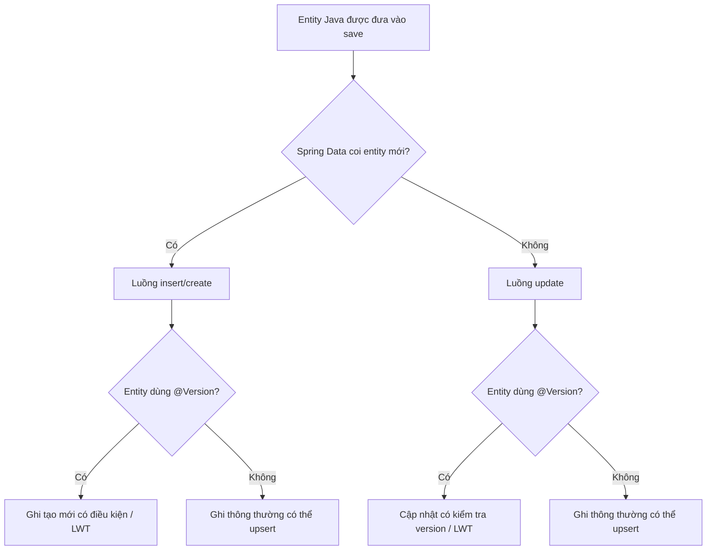
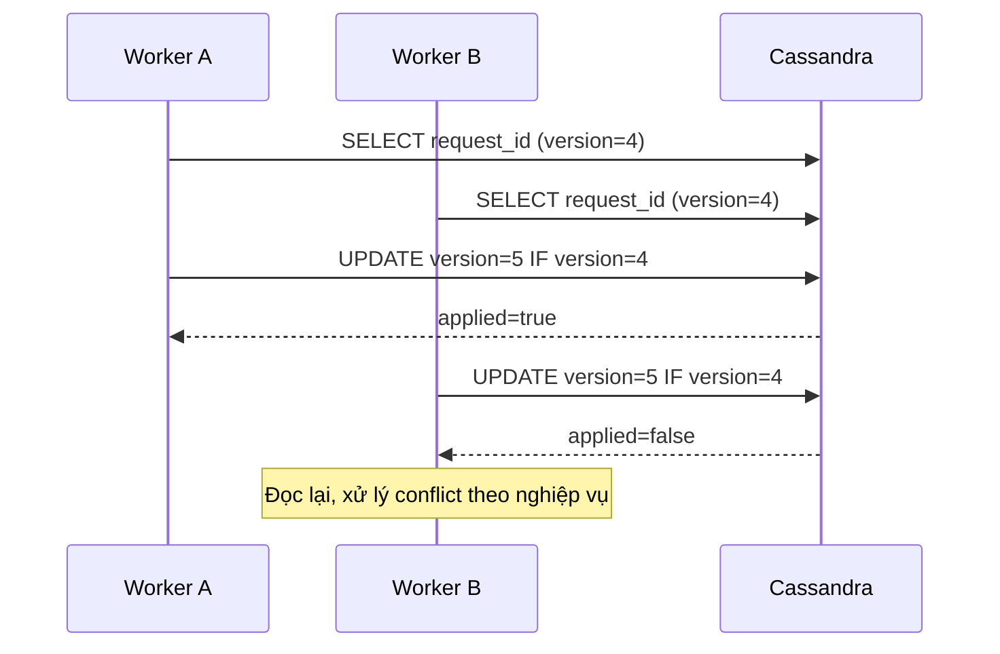

# Nhận biết entity mới với phiên bản và Persistable trong Spring Data Cassandra

Một entity Java có thể đã được gán `UUID` nhưng **chưa hề được ghi vào Cassandra**. Ngược lại, một entity có cùng ID với hàng đã tồn tại có thể đang mang **phiên bản dữ liệu cũ**. Với Spring Data Cassandra, việc xác định entity là **mới (`isNew`)** hay **đã tồn tại theo trạng thái đối tượng** ảnh hưởng đến lựa chọn thao tác lưu và, khi dùng **`@Version`**, tới việc áp dụng **optimistic locking bằng lightweight transaction (LWT)**.

Bài thuộc chương **LWT và khóa lạc quan** của module **SPRING_DATA_CASSANDRA**. Ta sẽ học cách Spring Data nhận biết entity mới bằng **version property**, **ID** và interface **`Persistable`**, cách tránh sai lầm khi ID được cấp trước, vì sao `@Version` không đơn thuần là một số để hiển thị, và cách kiểm thử các tình huống create trùng khóa, cập nhật stale entity, retry và mất kết nối.

Các ví dụ dùng Java 17+, Spring Data Cassandra và Apache Cassandra, với keyspace `commerce` giả định đã tồn tại. **Các chi tiết về giá trị version khởi tạo, callback và overload repository/template cần được kiểm chứng trên phiên bản thư viện của dự án**; hãy dựa vào test tích hợp thay vì phỏng đoán một giá trị version tuyệt đối.

## 1. Hai câu hỏi khác nhau: isNew và hàng có tồn tại không?

Giả sử ứng dụng quản lý yêu cầu phê duyệt:

```java
UUID id = UUID.fromString(
    "11111111-1111-1111-1111-111111111111"
);

// Đối tượng mới trong bộ nhớ, nhưng ID đã có giá trị.
ApprovalRequest request = new ApprovalRequest();
request.setRequestId(id);
request.setStatus("PENDING");
```

Có hai câu hỏi phải tách riêng:

1. **Spring Data coi đối tượng này mới không?** Đây là kết quả của chiến lược *entity state detection* — dựa trên `Persistable`, `@Version` hoặc ID, tùy kiểu entity.
2. **Cassandra đã lưu một hàng có cùng primary key chưa?** Đây là trạng thái **thực tế trong cluster**, có thể thay đổi bởi một writer khác.

`isNew() == true` **không phải** câu lệnh `SELECT` kiểm tra hàng chưa tồn tại. Ngay cả khi ứng dụng tin đối tượng “mới”, một client khác vẫn có thể đã tạo hàng cùng khóa. Chính vì vậy, khi yêu cầu không ghi đè create trùng, phải dựa vào thao tác điều kiện ở Cassandra — không dựa riêng vào việc kiểm tra ID hoặc gọi `existsById()` trước.

| Khái niệm | Thuộc tầng nào? | Có bảo đảm không có hàng cùng khóa? |
| --- | --- | --- |
| ID khác `null` | Java object | **Không.** Chỉ nói đối tượng có định danh. |
| `isNew()` | Spring Data mapping/repository | **Không.** Đây là quyết định phía client. |
| `existsById(id)` | Một lần đọc Cassandra | **Không cho thao tác ghi tiếp theo.** Có thể bị writer khác chen ngang. |
| `INSERT ... IF NOT EXISTS` | Cassandra LWT | **Có điều kiện áp dụng:** chỉ một create thắng cho trạng thái khóa được xét theo protocol. |
| `UPDATE ... IF version = ?` | Cassandra LWT | Chỉ cập nhật nếu version hiện tại đúng như kỳ vọng. |

Sơ đồ khái niệm:



Sơ đồ chỉ mô tả ý tưởng của luồng lưu. CQL chính xác do framework sinh ra còn phụ thuộc phiên bản, metadata, hình thức gọi API và cấu hình của ứng dụng.

## 2. Spring Data xác định entity mới như thế nào?

Trong Spring Data Commons, các chiến lược thường gặp:

- **Entity triển khai `Persistable<ID>`:** Spring Data sử dụng `isNew()` do entity cung cấp để phát hiện trạng thái mới. Khi đó **lập trình viên phải chịu trách nhiệm** để method phản ánh đúng vòng đời đối tượng.
- **Entity không triển khai `Persistable` nhưng có `@Version`:** version là tín hiệu xác định entity mới. Với kiểu tham chiếu như `Long`, `null` thường biểu thị mới; với kiểu nguyên thủy như `long`, `0` thường là tín hiệu mới theo quy ước của Spring Data.
- **Không có `Persistable` và không có `@Version`:** xét ID. ID `null` thường được coi là mới; ID đã có giá trị thường được coi là không mới.

Quy tắc này thuộc **cơ chế xác định trạng thái entity**, không thay thế điều kiện `WHERE` hoặc primary key trong Cassandra.

| Entity | Trạng thái ví dụ | Cách hiểu dự kiến |
| --- | --- | --- |
| `@PrimaryKey UUID id`; không có version | `id = null` | Thường được coi là mới. |
| `@PrimaryKey UUID id`; không có version | `id = UUID.randomUUID()` | Thường bị coi là *không mới* dù chưa ghi DB. |
| `@Version Long version` | `version = null` | Có thể nhận biết là mới dù ID đã được gán. |
| `@Version Long version` | `version` đã được framework gán sau lưu/đọc | Đường cập nhật dùng version làm điều kiện. |
| `@Version long version` | `version = 0` | Thường là tín hiệu mới theo quy ước primitive version. |
| Implements `Persistable<UUID>` | `isNew() == true` | Framework nhận theo trạng thái được entity cung cấp. |

**Khuyến nghị:** Ưu tiên `Long` thay cho `long` khi muốn dùng `null` làm trạng thái “chưa được lưu”, vì đó là tín hiệu tường minh hơn. Không tự đặt version ban đầu bằng một số tùy ý khi chưa biết chiến lược version của Spring Data Cassandra.

### 2.1. Khi có ID nhưng chưa có version

Một factory thường gán ID ở ứng dụng:

```java
UUID id = UUID.randomUUID();
ApprovalRequest row = new ApprovalRequest();
row.setRequestId(id);     // ID khác null.
row.setStatus("PENDING");  // Nhưng vẫn chưa ghi.
row.setVersion(null);      // Dùng Long @Version: tín hiệu mới.
```

Nếu entity **không** implement `Persistable`, `@Version Long` giúp phân biệt create và update trong tình huống ID được cấp trước.

Không suy ra `version = null` ở dữ liệu **đã lưu** luôn là một create hợp lệ. Một hàng legacy thiếu version, một mapper đọc thiếu cột hoặc một client CQL không tuân protocol có thể khiến việc nhận biết không còn phản ánh thực tế. Đó là lý do phải quản lý schema và migration khi thêm version cho hệ thống đã có dữ liệu.

## 3. Schema CQL và entity dùng @Version

Thiết kế bảng tìm yêu cầu phê duyệt bằng ID:

```sql
CREATE TABLE commerce.approval_requests_by_id (
    request_id uuid PRIMARY KEY,
    owner_id uuid,
    status text,
    version bigint,
    updated_at timestamp
);
```

`request_id` là partition key đơn. `version bigint` là **cột dữ liệu thường**, không thuộc primary key; dùng nó để kiểm tra trạng thái trước khi ghi.

### 3.1. Entity ánh xạ khóa và version

```java
import java.time.Instant;
import java.util.UUID;

import org.springframework.data.annotation.Version;
import org.springframework.data.cassandra.core.mapping.Column;
import org.springframework.data.cassandra.core.mapping.PrimaryKey;
import org.springframework.data.cassandra.core.mapping.Table;

@Table("approval_requests_by_id")
public class ApprovalRequest {

    @PrimaryKey("request_id")
    private UUID requestId;

    @Column("owner_id")
    private UUID ownerId;

    @Column("status")
    private String status;

    @Version
    @Column("version")
    private Long version;

    @Column("updated_at")
    private Instant updatedAt;

    public ApprovalRequest() {}

    public UUID getRequestId() { return requestId; }
    public void setRequestId(UUID value) { requestId = value; }

    public UUID getOwnerId() { return ownerId; }
    public void setOwnerId(UUID value) { ownerId = value; }

    public String getStatus() { return status; }
    public void setStatus(String value) { status = value; }

    public Long getVersion() { return version; }
    public void setVersion(Long value) { version = value; }

    public Instant getUpdatedAt() { return updatedAt; }
    public void setUpdatedAt(Instant value) { updatedAt = value; }
}
```

Trong ví dụ:

- `@PrimaryKey("request_id")` xác định khóa của entity.
- `@Version` chỉ ra thuộc tính được Spring Data quản lý cho optimistic locking.
- `@Column("version")` nối tên Java với cột CQL `version`; cột phải có kiểu phù hợp (`bigint` ↔ `Long`).
- ID được tạo từ ứng dụng, không có cơ chế tự tăng số của Cassandra.
- Code có setter `setVersion` để minh họa mapping, **không** khuyến khích service tự gán version trong thao tác nghiệp vụ bình thường.

### 3.2. Repository với ID kiểu UUID

```java
import java.util.UUID;
import org.springframework.data.cassandra.repository.CassandraRepository;

public interface ApprovalRequestRepository
        extends CassandraRepository<ApprovalRequest, UUID> {
}
```

`UUID` ở generic thứ hai là kiểu của **full primary key**. Entity mới hay cũ **không được quyết định bởi kiểu generic**: generic chỉ nói repository định danh hàng bằng `UUID`.

Repository hoạt động khi Spring Data Cassandra scanning, entity mapping và `CqlSession` được cấu hình đúng. `@Version` không tự tạo cột CQL nếu dự án quản lý schema bằng migration riêng.

## 4. @Version thay đổi ý nghĩa save: insert và update có điều kiện

Một `INSERT` hoặc `UPDATE` thông thường trong Cassandra có tính chất upsert theo primary key. Khi một entity dùng version và được lưu qua **đường API có hỗ trợ optimistic locking**, Spring Data Cassandra có thể dùng **lightweight transaction** nhằm ngăn create trùng hoặc ghi đè bằng bản chụp cũ.

Hai tình huống cốt lõi:

### 4.1. Tạo mới: điều kiện không tồn tại

CQL minh họa:

```sql
INSERT INTO commerce.approval_requests_by_id (
    request_id, owner_id, status, version, updated_at
) VALUES (
    11111111-1111-1111-1111-111111111111,
    22222222-2222-2222-2222-222222222222,
    'PENDING',
    0,
    '2026-11-25T09:00:00Z'
) IF NOT EXISTS;
```

`IF NOT EXISTS` là điều kiện để mutation chỉ được áp dụng khi hàng chưa tồn tại. Giá trị `0` ở đây chỉ là **minh họa một phiên bản ban đầu**, không phải hợp đồng cứng rằng mọi phiên bản Spring Data Cassandra luôn khởi tạo `Long version` bằng số 0. Trong ứng dụng, hãy để framework xác định version khi lưu rồi kiểm tra entity được trả về.

Nếu có hai client cùng cố tạo `request_id`:

- Một client có thể nhận kết quả áp dụng thành công.
- Client còn lại sẽ không được áp dụng lệnh create đó do hàng đã tồn tại.
- Framework/API có thể chuyển điều kiện thất bại thành ngoại lệ optimistic-locking; cần kiểm tra hành vi cụ thể của đường gọi.

### 4.2. Cập nhật: điều kiện version hiện tại khớp

Giả sử một hàng đang có `version = 4`, được hai worker đọc cùng lúc. CQL tương đương về mặt ý tưởng:

```sql
UPDATE commerce.approval_requests_by_id
SET status = 'APPROVED',
    version = 5
WHERE request_id = 11111111-1111-1111-1111-111111111111
IF version = 4;
```

Nếu chưa có writer khác đổi version, điều kiện có thể thành công. Nếu một worker đã nâng version lên 5, lệnh của worker còn lại với `IF version = 4` trả `[applied] = false`.

| Trạng thái hiện tại trên Cassandra | Điều kiện | Kết quả |
| --- | --- | --- |
| `version=4` | `IF version=4` | Mutation được áp dụng; version mới theo yêu cầu. |
| `version=5` | `IF version=4` | Không áp dụng; client có bản chụp stale. |
| Hàng không tồn tại | `IF version=4` | Không áp dụng vì điều kiện không thỏa. |
| Hàng legacy có version thiếu/null | `IF version=4` | Không áp dụng; cần chiến lược migration/hợp đồng dữ liệu. |

**Optimistic locking không phải chỉ là “đọc version rồi UPDATE thường”.** Điều kiện phải được Cassandra thực thi trong protocol LWT, thay vì chạy `if` cục bộ trong Java rồi gửi mutation không điều kiện.



### 4.3. Không khóa dữ liệu trong suốt vòng đời đối tượng

LWT kiểm tra điều kiện **khi mutation được gửi**, không giữ lock từ lúc repository đọc entity cho đến khi người dùng nhấn lưu. Đây chính là ý nghĩa “optimistic”: nhiều writer có thể cùng làm việc, và trường hợp xung đột chỉ được phát hiện vào thời điểm commit/ghi.

Cần lưu ý:

- LWT có chi phí giao tiếp replica lớn hơn ghi thông thường.
- Version giúp phát hiện *stale write* khi **mọi writer tuân protocol**.
- Một client CQL trực tiếp ghi `status` hoặc `version` mà không dùng điều kiện có thể phá vỡ bảo đảm nghiệp vụ.
- Version không biến một thao tác ghi hai bảng/partition thành transaction ACID.
- `@Version` không tự quyết định chuyển trạng thái nào hợp lệ; nghiệp vụ có thể cần kiểm tra thêm `status` và quyền người dùng.

## 5. Thực hành: tạo entity mới với UUID gán sẵn

Một service tạo yêu cầu phê duyệt:

```java
import java.time.Instant;
import java.util.UUID;
import org.springframework.stereotype.Service;

@Service
public class ApprovalRequestService {
    private final ApprovalRequestRepository requests;

    public ApprovalRequestService(ApprovalRequestRepository requests) {
        this.requests = requests;
    }

    public ApprovalRequest create(UUID ownerId) {
        ApprovalRequest row = new ApprovalRequest();
        row.setRequestId(UUID.randomUUID());
        row.setOwnerId(ownerId);
        row.setStatus("PENDING");
        row.setUpdatedAt(Instant.now());

        // Không tự điền version khi tạo entity mới.
        // Version null là tín hiệu isNew theo @Version Long.
        return requests.save(row);
    }

    public ApprovalRequest approve(UUID requestId) {
        ApprovalRequest row = requests.findById(requestId)
            .orElseThrow(() ->
                new IllegalArgumentException("Request not found"));

        if (!"PENDING".equals(row.getStatus())) {
            throw new IllegalStateException("Request is not pending");
        }

        row.setStatus("APPROVED");
        row.setUpdatedAt(Instant.now());

        // Version đọc từ DB được dùng để kiểm soát ghi cạnh tranh.
        return requests.save(row);
    }
}
```

`save` trả về entity sau xử lý. **Nên tiếp tục dùng giá trị trả về của `save`**, vì framework có thể cập nhật metadata như version trên thực thể được trả về, không nhất thiết bảo đảm mọi kiểu entity immutable/mutable đều được thao tác giống nhau.

Nếu hai worker cùng đọc `PENDING` rồi cùng gọi `approve` hoặc một worker gọi `cancel`, bản ghi bị stale phải được xử lý bằng conflict/optimistic locking, không tự retry mà bỏ điều kiện.

### 5.1. Vì sao không nên kiểm tra existsById trước khi save?

```java
// Không phải cơ chế chống trùng nguyên tử.
if (!requests.existsById(id)) {
    requests.save(newEntity);
}
```

Giữa hai câu lệnh, một worker khác có thể đã tạo hàng cùng ID. Nếu yêu cầu create-only, đường lưu có `@Version`/LWT hoặc CQL `INSERT ... IF NOT EXISTS` mới có thể cung cấp điều kiện tại Cassandra.

### 5.2. Không dựa vào số version khởi tạo cứng

Một số đoạn code thường viết:

```java
row.setVersion(0L); // Có thể làm thay đổi nhận diện isNew.
requests.save(row);
```

Đối với kiểu tham chiếu `Long`, gán `0L` nghĩa là version **khác null**. Khi áp dụng chiến lược mặc định dựa trên version, entity có thể bị coi là **không mới**, dẫn đến đường cập nhật sai thay vì create. Hãy để framework khởi tạo version, và test kỳ vọng sau lưu là **có version hợp lệ**, không phụ thuộc giả định trước khi gọi `save`.

## 6. Persistable là gì và khi nào nên dùng?

Spring Data Commons cung cấp:

```java
import org.springframework.data.domain.Persistable;

public interface Persistable<ID> {
    ID getId();
    boolean isNew();
}
```

Đây là bản minh họa chữ ký giao diện để hiểu vai trò. Trong code dự án, chỉ cần `implements Persistable<UUID>`; **không tự khai báo lại giao diện framework**.

`Persistable` cho phép entity **tự thông báo trạng thái “mới”** thay vì để Spring Data mặc định suy từ version hoặc ID. Nó hữu ích khi:

- ID được cấp trước nhưng entity chưa lưu.
- Có một mô hình domain với constructor/factory khác nhau cho object tạo mới và object được tái tạo từ persistence.
- Cần kiểm soát rõ đường insert/update theo lifecycle riêng.
- Quy tắc new detection mặc định theo ID hoặc version không phản ánh đúng trạng thái object — và nhóm dự án có khả năng duy trì quy tắc đó một cách an toàn.

**Đừng dùng Persistable chỉ vì thấy ID đã gán.** Với entity có `@Version Long` và đường save/version framework phù hợp, cách đơn giản nhất thường là **để version quyết định trạng thái mới**. `Persistable` tăng trách nhiệm về lifecycle và có thể làm sai đường LWT nếu `isNew()` không được chuyển trạng thái đúng.

### 6.1. Thứ tự ưu tiên về mặt thiết kế

Khi triển khai `Persistable`, Spring Data sẽ dùng `isNew()` làm chiến lược new detection thay cho cách tự suy đơn thuần từ ID/version. Vì thế:

```text
Entity không implements Persistable:
    @Version Long null? -> thường là entity mới
    hoặc không có @Version -> ID null? -> entity mới

Entity implements Persistable:
    isNew() -> do code của entity quyết định
```

Đây là hai **chiến lược** cần lựa chọn có chủ đích. Khi kết hợp `Persistable` và `@Version`, chỉ một giá trị cờ `isNew` bị đặt sai có thể làm workflow create/modify không còn phù hợp với trạng thái version.

## 7. Mẫu Persistable có cờ trạng thái transient và constructor đọc dữ liệu

Một mẫu thường dùng là lưu cờ `newRecord` **chỉ trong bộ nhớ**, đánh dấu `true` khi factory tạo đối tượng mới và `false` khi mapping tái tạo đối tượng từ Cassandra.

Với bảng minh họa độc lập:

```sql
CREATE TABLE commerce.approval_requests_persistable_by_id (
    request_id uuid PRIMARY KEY,
    status text,
    version bigint
);
```

Entity:

```java
import java.util.UUID;

import org.springframework.data.annotation.PersistenceCreator;
import org.springframework.data.annotation.Transient;
import org.springframework.data.annotation.Version;
import org.springframework.data.cassandra.core.mapping.Column;
import org.springframework.data.cassandra.core.mapping.PrimaryKey;
import org.springframework.data.cassandra.core.mapping.Table;
import org.springframework.data.domain.Persistable;

@Table("approval_requests_persistable_by_id")
public class PersistableApprovalRequest implements Persistable<UUID> {

    @PrimaryKey("request_id")
    private final UUID requestId;

    @Column("status")
    private String status;

    @Version
    @Column("version")
    private Long version;

    @Transient
    private boolean newRecord;

    // Dành cho cơ chế ánh xạ khi đọc từ Cassandra.
    // Bật -parameters hoặc cung cấp metadata tên tham số constructor.
    @PersistenceCreator
    public PersistableApprovalRequest(UUID requestId, String status,
                                      Long version) {
        this.requestId = requestId;
        this.status = status;
        this.version = version;
        this.newRecord = false;
    }

    // Dành cho nghiệp vụ tạo đối tượng mới trước khi lưu.
    public static PersistableApprovalRequest newRequest(UUID id) {
        PersistableApprovalRequest row =
            new PersistableApprovalRequest(id, "PENDING", null);
        row.newRecord = true;
        return row;
    }

    @Override
    @Transient
    public UUID getId() {
        return requestId;
    }

    @Override
    @Transient
    public boolean isNew() {
        return newRecord;
    }

    public void markPersisted() {
        this.newRecord = false;
    }

    public UUID getRequestId() { return requestId; }
    public String getStatus() { return status; }
    public void setStatus(String value) { status = value; }
    public Long getVersion() { return version; }
    public void setVersion(Long value) { version = value; }
}
```

Lưu ý:

- `newRecord` có `@Transient` để **không tạo cột CQL** và không được persist như một trường dữ liệu nghiệp vụ.
- `isNew()` cũng được đánh dấu transient nhằm tránh nó bị nhận nhầm thành một property lưu trữ.
- `getId()` được đánh dấu transient trong ví dụ vì khóa lưu trữ thực là field `requestId`; tránh ánh xạ thêm một property getter `id` không có cột tương ứng.
- `@PersistenceCreator` cho Spring Data biết constructor dùng để tái tạo entity từ hàng DB; constructor này đặt `newRecord=false`.
- Factory `newRequest(...)` đặt `newRecord=true` dù `requestId` đã là UUID hợp lệ.
- Sau khi lưu thành công, phải bảo đảm đối tượng được dùng tiếp có trạng thái `newRecord=false`.
- Chữ ký constructor cần tương ứng các thuộc tính persistence và cấu hình giữ tên tham số khi compile.

**Đây là mẫu nâng cao**. Cần integration test để chứng minh phiên bản Spring Data Cassandra đang chạy thực sự dùng đúng persistence constructor và new-state strategy. Với đội ngũ chưa cần tùy biến phát hiện mới, entity thường có `@Version Long` mà **không implements Persistable** dễ bảo trì hơn.

### 7.1. Repository và chuyển trạng thái sau save

```java
import java.util.UUID;
import org.springframework.data.cassandra.repository.CassandraRepository;

public interface PersistableApprovalRepository
        extends CassandraRepository<PersistableApprovalRequest, UUID> {
}
```

Lưu tạo mới:

```java
UUID id = UUID.randomUUID();

PersistableApprovalRequest created =
    PersistableApprovalRequest.newRequest(id);

PersistableApprovalRequest saved = repository.save(created);

// Nếu ứng dụng sẽ dùng lại instance trả về cho một lần save tiếp theo,
// bảo đảm cờ trạng thái được chuyển sau khi lưu thành công.
saved.markPersisted();
```

Trong code production, nên đóng gói việc đổi trạng thái vào lifecycle đáng tin cậy, callback hoặc tầng lưu phù hợp với cả entity mutable/immutable, để không phải nhớ gọi `markPersisted()` ở mọi nơi.

**Không đổi cờ thành false trước khi Cassandra xác nhận ghi thành công.** Nếu write bị từ chối, timeout hoặc tạo trùng, việc đổi trạng thái khi chưa biết kết quả có thể dẫn tới retry sai loại thao tác.

### 7.2. Trường hợp nguy hiểm: entity tải về vẫn isNew=true

Một triển khai sai:

```java
@Transient
private boolean newRecord = true;

@Override
public boolean isNew() {
    return newRecord;
}

// Nhưng khi mapper tải hàng, không có callback/constructor nào đặt false.
```

Khi đọc entity từ Cassandra, `newRecord` vẫn `true`. Lần `save` tiếp theo có thể bị xem là **create** thay vì update, gây lỗi `IF NOT EXISTS` hoặc không đi theo đường kiểm tra version dự kiến.

Nếu dùng factory + constructor, phải kiểm tra thật rằng **object load từ repository luôn `isNew()==false`**. Với mapping dựa trên no-arg constructor hoặc entity callbacks, cách thiết lập cờ sẽ khác; không copy mẫu chưa kiểm thử vào dự án thật.

## 8. Kết hợp Persistable và @Version: tránh hai nguồn sự thật mâu thuẫn

Khi một entity có cả `Persistable` và `@Version`, có thể xuất hiện các tổ hợp:

| `isNew()` | `version` | Ý nghĩa khả dĩ | Đánh giá |
| --- | --- | --- | --- |
| `true` | `null` | Entity vừa được tạo trong bộ nhớ, chưa có version. | Phù hợp luồng create. |
| `false` | Version đã được lưu/đọc | Entity hiện có, dùng version cho CAS. | Phù hợp luồng update. |
| `true` | Version đã tồn tại | Entity báo mới dù có dấu vết đã lưu. | **Nguy cơ:** thử create lại/đi sai protocol. |
| `false` | `null` | Entity báo cũ nhưng thiếu version để so sánh. | **Nguy cơ:** lỗi optimistic locking hoặc dữ liệu legacy. |

Không viết logic `isNew()` dựa trên một biến cờ bị reset sau mỗi lần deserialize JSON hoặc tạo DTO. **Entity persistence** có lifecycle riêng; không để payload từ client quyết định một row mới/cũ chỉ bằng trường `new=true`.

Nếu muốn sử dụng cả hai cơ chế, đặt bất biến trong code:

```text
newRecord == true  -> version phải ở trạng thái chưa được persist
newRecord == false -> version phải là giá trị hợp lệ đã đọc/lưu
```

Và đảm bảo:

- Chỉ factory create được quyền tạo đối tượng với `newRecord=true`.
- Constructor/callback đọc DB phải đặt `newRecord=false`.
- Sau một lần save thành công, object dùng cho lần ghi tiếp theo phải là object có version mới và cờ false.
- Không để object bị sao chép vô ý kèm cờ `true`.
- Test hai trường hợp sai bất biến và phương thức xử lý.

Thực tế, nếu `@Version Long` đã giải quyết bài toán, **không cần thêm `Persistable`**. Việc đưa thêm một cờ transient có thể làm hệ thống phức tạp mà không có lợi ích.

## 9. @Version và câu hỏi “entity đã tồn tại”

Giả sử một ứng dụng dùng `@Version Long` rồi thực thi:

```java
ApprovalRequest stale = new ApprovalRequest();
stale.setRequestId(existingId);
stale.setStatus("APPROVED");
stale.setVersion(null); // Giả vờ đây là entity mới.
requests.save(stale);
```

Một đối tượng có `version=null` không tự chứng minh hàng Cassandra chưa tồn tại. Nếu đường save sử dụng conditional insert, thao tác có thể bị từ chối do đã có hàng.

Ngược lại, ứng dụng có thể tự đặt `version=7` cho một ID chưa có hàng, rồi gọi save. Khi đó đường update có điều kiện `IF version=7` thường thất bại vì hàng chưa tồn tại. **Không sửa bằng cách tự thử nhiều version liên tiếp**: phải xác định rõ yêu cầu nghiệp vụ là create hay update, và nguồn gốc version có đáng tin cậy không.

### 9.1. Thêm @Version vào bảng cũ: vấn đề migration

Nếu bảng đã có nhiều hàng không chứa `version` và nay code bắt đầu dùng optimistic locking:

1. Bổ sung cột `version` bằng schema migration thích hợp.
2. Quyết định cách gán version ban đầu cho các hàng cũ mà không gây ghi đè dữ liệu đang hoạt động.
3. Tổ chức rollout sao cho mọi writer liên quan đều hiểu protocol mới trước khi bắt đầu phụ thuộc vào version cho bảo đảm cạnh tranh.
4. Xác minh các hàng legacy khi đọc: `version=null` có thể khiến framework coi entity là mới.
5. Backfill hoặc chuyển đổi dữ liệu theo từng đợt có giới hạn tải, chú ý timestamp/TTL.
6. Kiểm tra stale update, create trùng và khả năng đọc/ghi của phiên bản ứng dụng cũ.

**Không chỉ thêm annotation `@Version` trong Java rồi kỳ vọng mọi hàng legacy tự có version hợp lệ.** Cassandra không tạo giá trị version mới cho dữ liệu cũ chỉ vì entity class thay đổi.

## 10. OptimisticLockingFailureException: xử lý conflict đúng cách

Với Spring Data, khi thao tác lưu có điều kiện không được áp dụng theo protocol optimistic locking, đường repository/template phù hợp có thể ném `OptimisticLockingFailureException` hoặc một ngoại lệ cụ thể dẫn xuất. Đây không nhất thiết là sự cố mạng.

```java
import org.springframework.dao.OptimisticLockingFailureException;

public ApprovalRequest approve(UUID requestId) {
    ApprovalRequest row = repository.findById(requestId)
        .orElseThrow(() -> new IllegalArgumentException("Missing request"));

    row.setStatus("APPROVED");

    try {
        return repository.save(row);
    } catch (OptimisticLockingFailureException conflict) {
        // Người khác đã tạo/cập nhật hàng theo phiên bản khác.
        // Chuyển thành kết quả nghiệp vụ như HTTP 409 Conflict,
        // hoặc đọc lại và quyết định theo state machine.
        throw conflict;
    }
}
```

Đoạn code là method minh họa trong một service đã có `ApprovalRequestRepository repository`. Không dùng `catch (Exception ignored)` rồi retry bằng một câu `UPDATE` không điều kiện: làm vậy triệt tiêu bảo đảm optimistic locking.

### 10.1. Conflict không giống timeout

| Kết quả | Có thể kết luận | Hướng xử lý |
| --- | --- | --- |
| CAS trả `[applied]=false` và framework báo optimistic conflict | Điều kiện không được áp dụng tại thời điểm kiểm tra. | Đọc lại, trả conflict hoặc tính toán lại thao tác nếu hợp lệ. |
| `WriteTimeoutException`, mất kết nối | Client không chắc mutation đã áp dụng hay chưa. | Đối soát trạng thái/version/idempotency trước retry. |
| `UnavailableException` | Không đủ replica theo điều kiện request. | Kiểm tra RF/CL/topology; không coi là version mismatch. |
| Truy vấn CQL sai/schema thiếu version | Lỗi cấu hình hoặc mapping. | Sửa schema/config, không retry như conflict. |

Một retry lại cùng entity cũ sau timeout **có thể thất bại vì lần đầu đã thành công**, nâng version rồi. Do đó, conflict ở lần retry không tự chứng minh lần đầu không chạy.

### 10.2. Khi nào nên retry?

- Khi conflict chỉ là tranh chấp tính toán có thể làm lại, có thể **đọc version mới, kiểm tra nghiệp vụ lại rồi lưu có điều kiện**.
- Khi trạng thái đã chuyển sang `CANCELLED` mà API muốn `APPROVED`, thường nên báo conflict thay vì “thử lại bằng mọi giá”.
- Khi có hiệu ứng bên ngoài (thu tiền, gửi thông báo), cần idempotency key hoặc workflow được thiết kế để không thực hiện hai lần.
- Retry phải có giới hạn và quan sát được số lần thất bại, tránh tạo tranh chấp LWT liên tục ở một partition nóng.

## 11. Spring Data @Version khác CAS CQL viết tay thế nào?

Một số đường truy cập:

| Cách làm | Ưu điểm | Trách nhiệm |
| --- | --- | --- |
| `@Version` + repository save | Framework quản lý version và đường optimistic locking phù hợp. | Entity mapping, lifecycle đúng và xử lý exception. |
| `@Version` + `CassandraTemplate` | Thao tác entity linh hoạt hơn và vẫn có cơ hội dùng version theo API hỗ trợ. | Kiểm tra overload/update semantics và conversion theo phiên bản. |
| `CqlTemplate` với `UPDATE ... IF version=?` | Kiểm soát CQL và đọc kết quả condition trực tiếp. | Tự quản lý version mới, binding, timeout và protocol concurrency. |
| Driver `CqlSession` / prepared LWT | Điều khiển consistency, serial consistency, kết quả driver. | Nhiều code, tự xử lý toàn bộ ngữ nghĩa. |

Ví dụ raw CQL tự quản version:

```sql
UPDATE commerce.approval_requests_by_id
SET status = 'APPROVED', version = 8
WHERE request_id = 11111111-1111-1111-1111-111111111111
IF version = 7;
```

Một dịch vụ dùng `CqlTemplate` có thể đọc kết quả:

```java
import java.util.UUID;
import org.springframework.data.cassandra.core.cql.CqlTemplate;

public boolean updateStatusIfVersionMatches(
        CqlTemplate cql, UUID id, String status,
        long expectedVersion) {
    if (expectedVersion == Long.MAX_VALUE) {
        throw new IllegalArgumentException("Version overflow");
    }

    return cql.execute(
        "UPDATE commerce.approval_requests_by_id " +
        "SET status = ?, version = ? WHERE request_id = ? IF version = ?",
        status, expectedVersion + 1, id, expectedVersion
    );
}
```

Một lời gọi `execute` trả `false` khi điều kiện không thỏa. Tuy nhiên, với một `UPDATE` **không có IF**, `true` không thể được diễn giải thành “đã cập nhật đúng một hàng”.

**Không trộn hai cách quản version mà thiếu hợp đồng chung.** Nếu một phần service dùng `@Version` do Spring quản lý, phần khác tự cập nhật version bằng CQL với quy tắc khác, dễ tạo conflict hoặc ghi đè khó giải thích.

## 12. Consistency của LWT và giới hạn bảo đảm

LWT sử dụng protocol Paxos. Khi yêu cầu có điều kiện, cần phân biệt:

- **Consistency level thông thường:** ví dụ `LOCAL_QUORUM` cho pha đọc/ghi của statement.
- **Serial consistency:** ví dụ `SERIAL` hoặc `LOCAL_SERIAL` cho pha điều kiện, tùy nhu cầu và topology.
- **Replication factor / datacenter:** ảnh hưởng số replica tham gia và phạm vi áp dụng.
- **Timeout:** client có thể không biết chắc kết quả khi request hoặc response bị mất.

Ví dụ cấu hình trên statement Java driver 4.x:

```java
import com.datastax.oss.driver.api.core.DefaultConsistencyLevel;
import com.datastax.oss.driver.api.core.cql.SimpleStatement;
import java.util.UUID;

UUID id = UUID.fromString(
    "11111111-1111-1111-1111-111111111111");

SimpleStatement cas = SimpleStatement.builder(
        "UPDATE commerce.approval_requests_by_id " +
        "SET status = ?, version = ? " +
        "WHERE request_id = ? IF version = ?")
    .addPositionalValues("APPROVED", 8L, id, 7L)
    .setConsistencyLevel(DefaultConsistencyLevel.LOCAL_QUORUM)
    .setSerialConsistencyLevel(DefaultConsistencyLevel.LOCAL_SERIAL)
    .build();

boolean applied = session.execute(cas).wasApplied();
```

`session` ở đây là `CqlSession` dùng chung do Spring quản lý trong ứng dụng thực tế. Đây là ví dụ về **driver statement**, không phải cách đặt tùy chọn trực tiếp vào annotation `@Version`.

**Không kết luận `@Version` mang đến transaction ACID đa partition hoặc xác nhận toàn bộ replica đã thấy dữ liệu ngay lập tức.** Bảo đảm của CAS gắn với điều kiện trên dữ liệu mà mutation tác động và phạm vi protocol. Khi cần bảo đảm xuyên các hệ thống khác nhau hoặc nhiều bảng truy cập, phải thiết kế thêm workflow tin cậy.

## 13. Các tác động bên ngoài: delete, bulk write, TTL và paging

### 13.1. Delete không mặc định đi theo save version

Một phương thức xóa bằng ID có thể khác với đường save entity đang được version-check. **Không mặc định** mọi overload `deleteById` hoặc mọi câu `DELETE` CQL đều tự kiểm tra version.

Nếu nghiệp vụ muốn “chỉ xóa khi version hiện hành bằng v”, cần sử dụng API hỗ trợ optimistic delete phù hợp với phiên bản hoặc CQL điều kiện có chủ đích, rồi kiểm tra kết quả.

```sql
DELETE FROM commerce.approval_requests_by_id
WHERE request_id = 11111111-1111-1111-1111-111111111111
IF version = 7;
```

### 13.2. Bulk operations có thể không tương đương từng CAS

Không mặc định `saveAll`, batch CQL hoặc bulk update tạo một transaction nguyên tử cho hàng loạt entity thuộc nhiều partition. Cần kiểm tra API và xử lý partial failure đúng với yêu cầu. Một loạt CAS riêng vẫn có thể có xung đột từng hàng độc lập.

### 13.3. TTL có thể làm mất version

Nếu bảng/giá trị dùng TTL và **cột `version` hết hạn** trong khi các cột nghiệp vụ còn sống, framework có thể đọc một entity thiếu version và hiểu sai trạng thái mới. Khi thiết kế optimistic locking:

- Xác định `version` có TTL cùng vòng đời với toàn bộ entity hay không.
- Tránh partial update làm TTL cột version khác các cột quan trọng mà không có chủ đích.
- Khi dữ liệu hết hạn theo chính sách, cần thiết kế toàn bộ vòng đời record để không có entity “nửa tồn tại”.
- Kiểm thử retry, TTL expiration và version mapping với đúng schema.

Không đặt TTL bừa bãi lên entity phiên bản rồi mong version vẫn dùng được sau khi hết hạn.

### 13.4. Paging không tạo snapshot

Nếu giao diện dùng Cassandra paging đọc danh sách entity và sau đó update từng entity bằng version, giữa trang đầu và trang cuối dữ liệu có thể thay đổi. **PagingState không phải snapshot transaction**; version giúp phát hiện xung đột lúc lưu, không giữ lock trong quá trình đọc nhiều trang.

## 14. Kiểm thử tích hợp: tạo mới, stale update và Persistable lifecycle

Một bài kiểm thử chỉ mock repository sẽ không chứng minh được Spring Data đã chọn đường LWT đúng. Nên dùng một Cassandra integration test thực tế, với schema tương thích phiên bản đang dùng.

### 14.1. Test @Version với ID gán trước

```java
import static org.junit.jupiter.api.Assertions.*;

import java.util.UUID;
import org.junit.jupiter.api.Test;
import org.springframework.beans.factory.annotation.Autowired;
import org.springframework.boot.test.context.SpringBootTest;
import org.springframework.dao.OptimisticLockingFailureException;

@SpringBootTest
class ApprovalVersionIntegrationTest {

    @Autowired
    ApprovalRequestRepository repository;

    @Test
    void versionDetectsNewEntityEvenWhenIdWasAssigned() {
        UUID id = UUID.randomUUID();

        ApprovalRequest row = new ApprovalRequest();
        row.setRequestId(id);
        row.setStatus("PENDING");
        assertNull(row.getVersion());

        ApprovalRequest saved = repository.save(row);

        assertNotNull(saved.getVersion());
        ApprovalRequest reloaded =
            repository.findById(id).orElseThrow();
        assertEquals("PENDING", reloaded.getStatus());
        assertNotNull(reloaded.getVersion());
    }

    @Test
    void staleSnapshotCannotOverwriteNewVersion() {
        UUID id = UUID.randomUUID();
        ApprovalRequest created = new ApprovalRequest();
        created.setRequestId(id);
        created.setStatus("PENDING");
        repository.save(created);

        ApprovalRequest first =
            repository.findById(id).orElseThrow();
        ApprovalRequest second =
            repository.findById(id).orElseThrow();

        first.setStatus("APPROVED");
        repository.save(first);

        second.setStatus("CANCELLED");
        assertThrows(OptimisticLockingFailureException.class,
            () -> repository.save(second));
    }
}
```

Hai lần `findById` tạo hai object đọc từ cùng version, rồi một object được lưu trước. Vì cả hai giữ version kỳ vọng ban đầu, lần lưu còn lại phải bị xử lý là stale theo optimistic locking.

**Ghi chú test:** Đoạn code giả định `@Version` đã được hỗ trợ và cấu hình đúng theo Spring Data Cassandra của dự án, keyspace đã có bảng, không có writer khác trên cùng UUID và driver có quyền đọc/ghi. Nếu loại ngoại lệ cụ thể khác theo API wrapper, kiểm tra cause và contract của phiên bản đang chạy; không đổi bài test thành `assertThrows(Exception.class)` quá rộng.

### 14.2. Test tạo trùng với cùng ID

Thêm một case:

```java
@Test
void duplicateCreationDoesNotSilentlyOverwrite() {
    UUID id = UUID.randomUUID();

    ApprovalRequest first = new ApprovalRequest();
    first.setRequestId(id);
    first.setStatus("PENDING");
    repository.save(first);

    ApprovalRequest duplicate = new ApprovalRequest();
    duplicate.setRequestId(id);
    duplicate.setStatus("CANCELLED");
    // Version vẫn null: entity tự được nhận là mới.

    assertThrows(OptimisticLockingFailureException.class,
        () -> repository.save(duplicate));

    assertEquals("PENDING",
        repository.findById(id).orElseThrow().getStatus());
}
```

Mục đích là kiểm tra hành vi create trùng ở tầng lưu có optimistic locking, **không phải** dựa trên `existsById` chạy trước ghi.

### 14.3. Test Persistable state

Với entity `PersistableApprovalRequest` ở phần 7:

```java
@Test
void persistableNewFlagMustChangeAfterLoading() {
    UUID id = UUID.randomUUID();

    PersistableApprovalRequest row =
        PersistableApprovalRequest.newRequest(id);

    assertTrue(row.isNew());

    PersistableApprovalRequest saved = persistableRepository.save(row);
    saved.markPersisted();

    assertFalse(saved.isNew());
    assertNotNull(saved.getVersion());

    PersistableApprovalRequest loaded =
        persistableRepository.findById(id).orElseThrow();

    assertFalse(loaded.isNew());
    assertNotNull(loaded.getVersion());
}
```

Đặt test này trong lớp có `PersistableApprovalRepository persistableRepository` được inject. Với constructor/callback khác, assertion này giúp phát hiện trường hợp mapper đọc về nhưng cờ `newRecord` vẫn `true`.

### 14.4. Test timeout không đồng nghĩa CAS false

Một test fault-injection có thể khiến client timeout giữa LWT. Kết quả lúc đó **chưa chắc chắn**: server có thể đã áp dụng mutation nhưng response thất lạc. Bài test không được suy ra `false` chỉ vì timeout; phải đọc lại trạng thái, version và idempotency marker khi quyết định retry.

Không khuyến khích chạy fault injection gây dừng node trên production. Test điều kiện và version trong một Cassandra container phù hợp cho logic cơ bản; để kiểm tra timeout/quorum/serial consistency khi node gặp lỗi cần cluster nhiều replica.

## 15. Những lỗi thường gặp khi nhận biết entity mới

| Triệu chứng | Nguyên nhân khả dĩ | Cách xử lý |
| --- | --- | --- |
| ID đã gán nhưng entity chưa từng lưu bị coi là không mới | Không có `@Version`/`Persistable`, chiến lược mặc định dựa vào ID khác null. | Dùng `@Version Long` hoặc chiến lược `Persistable` phù hợp. |
| Entity mới lại đi vào đường update với version 0 | Tự gán `Long version=0` trước save. | Để version ở `null` cho entity mới theo chiến lược wrapper version. |
| Entity đọc từ DB lại `isNew()==true` | Cờ `Persistable` không được reset sau hydrate. | Dùng persistence constructor/callback và integration test. |
| Version đang có nhưng `isNew()==true` | Sai vòng đời Persistable hoặc deserialize cờ từ client. | Chỉ cho factory tạo entity mới; kiểm tra bất biến giữa version/cờ. |
| Save lần hai bị báo duplicate create | Object được lưu xong vẫn giữ cờ new. | Sau save thành công dùng object/flag phiên bản mới và chuyển new=false. |
| Stale update ghi đè thành công ngoài dự kiến | Có một đường ghi CQL không điều kiện hoặc version bị bypass. | Thống nhất protocol CAS cho mọi writer. |
| Optimistic conflict bị coi là lỗi mạng | Không phân biệt CAS false với timeout/unavailable. | Trả conflict hoặc xử lý state machine; phân loại lỗi. |
| Retry sau timeout báo stale | Có thể lần đầu đã thành công và tăng version. | Đọc/đối soát trước retry; không bỏ điều kiện. |
| Hàng cũ không có version | Chưa migration/backfill đúng. | Lên kế hoạch chuyển schema và dữ liệu legacy, rollout theo giai đoạn. |
| Version biến mất sau TTL | TTL của version không đồng bộ với các cột khác. | Thiết kế retention cho cả entity/version, kiểm thử partial update. |
| Đặt `@Version` lên field không đúng schema | Cột/version type không tương thích CQL. | Kiểm tra `system_schema`, annotation và converter. |
| Tăng version bằng phép cộng CQL thường | CQL không hỗ trợ `SET version=version+1` trên `bigint` thông thường. | Tính version mới ở ứng dụng/framework, CAS với version cũ. |
| API trả “đã lưu” dù điều kiện `IF` thất bại | Không kiểm tra `[applied]`/ngoại lệ của đường save. | Kiểm chứng kết quả điều kiện từ repository/driver. |

### Checklist trước khi dùng @Version hoặc Persistable

1. ID có được gán trước khi lưu không? Nếu có, chiến lược entity mới dựa trên ID có phù hợp?
2. Version là `Long` hay `long`? Giá trị khởi tạo dự kiến theo framework/version nào?
3. Schema đã có cột version đúng kiểu và đủ dữ liệu legacy chưa?
4. Repository/template đang dùng có thực thi optimistic locking theo version không?
5. Mọi writer (kể cả batch, CqlTemplate, consumer, migration) có tuân protocol version không?
6. Có thật sự cần `Persistable` hay `@Version` đã đủ?
7. Nếu dùng Persistable, cờ `newRecord` có transient và được đặt đúng sau hydrate/save?
8. API có dùng entity đọc từ repository hoặc version đáng tin cậy khi thực thi cập nhật?
9. Đã phân biệt conflict, timeout và trạng thái chưa chắc chắn khi retry?
10. Có integration test tạo mới bằng ID gán trước, create trùng và stale update?
11. Có yêu cầu TTL/delete và nhiều bảng đọc ảnh hưởng đến version không?
12. LWT có đáp ứng SLA latency/throughput trên partition nóng chưa?

## 16. Bài tập tình huống

**Tình huống A — UUID gán trước.** Một entity có `@PrimaryKey UUID id` nhưng không có `@Version` và không triển khai `Persistable`. Service gán `id=UUID.randomUUID()` trước khi gọi repository save. Theo chiến lược default ID, Spring Data có thể xem entity mới hay cũ? Cách nào giúp biểu diễn “mới” rõ hơn?

**Tình huống B — Wrapper version.** Entity có `@Version Long version`. Một developer khởi tạo `version=0L` cho object chưa từng lưu. Vì sao điều này có thể khác với để version `null`?

**Tình huống C — Hai lần đọc.** Hai worker đọc cùng row ở `version=7`. A lưu thành công `version=8`. B lưu object cũ ở `version=7`. CQL nào giúp chặn ghi đè? Vì sao `LOCAL_QUORUM` đơn thuần không giải quyết race này?

**Tình huống D — Persistable flag.** Một class triển khai `Persistable` có `private boolean newRecord=true` nhưng không bao giờ đổi sang false khi đọc từ Cassandra. Điều gì có thể xảy ra khi gọi save trên entity được tải về?

**Tình huống E — Đổi cờ quá sớm.** Một service gọi `created.markPersisted()` **trước** khi save, sau đó ghi bị timeout. Có thể kết luận entity đã tồn tại không? Nên đặt lifecycle ra sao?

**Tình huống F — Legacy version.** Một hệ thống có hàng triệu row không có cột version; hôm nay deploy Java entity có `@Version Long`. Vì sao không nên bật đồng loạt mà thiếu migration?

**Tình huống G — CAS false hay timeout.** Một lần LWT bị timeout, retry cùng version trả `false`. Vì sao không thể kết luận lần đầu chưa ghi?

**Tình huống H — TTL.** `status` còn tồn tại nhưng `version` đã hết TTL. Việc dùng `@Version` có thể gặp vấn đề gì?

**Tình huống I — Trộn repository và raw CQL.** Một service dùng repository với `@Version`, nhưng worker khác chạy `UPDATE ... SET status='DONE'` không có `IF version=?`. Bảo đảm lạc quan còn đầy đủ không?

**Gợi ý trả lời:**

1. Với ID khác null và không có version/Persistable, default new detection thường coi entity không mới. `@Version Long` hoặc `Persistable.isNew` có thể diễn đạt chính xác hơn.
2. `Long` dùng `null` làm tín hiệu chưa persist; gán `0L` có thể khiến framework nhận dạng như object hiện có.
3. `UPDATE ... IF version=7` giúp Cassandra kiểm tra điều kiện trong LWT. `LOCAL_QUORUM` chỉ quy định số replica xác nhận, không ngăn hai writer ghi theo version cũ mà không có điều kiện.
4. Entity tải về vẫn bị xem là mới; save có thể thử create và gây duplicate/conflict thay vì update.
5. Không thể biết chắc khi timeout. Chỉ chuyển trạng thái sau thành công được xác nhận; khi không chắc, đọc lại/đối soát theo protocol.
6. Row legacy thiếu version sẽ bị nhận nhầm là mới hoặc không đáp ứng CAS; cần schema migration, backfill và rollout đồng bộ mọi writer.
7. Lần đầu có thể đã thành công và tăng version; lần retry không thỏa điều kiện vì version đã đổi.
8. Entity còn dữ liệu nhưng thiếu version có thể bị nhận là mới hoặc không thể cập nhật có điều kiện; cần retention hợp lý.
9. Không. Đường ghi không điều kiện có thể bỏ qua version protocol; phải thống nhất tất cả writer hoặc tách dữ liệu/ràng buộc.

**Ghi nhớ:** Trong Spring Data Cassandra, **entity mới là một quyết định phía framework**, khác với việc **hàng có tồn tại tại Cassandra**. `@Version Long` giúp nhận diện entity mới ngay cả khi ID đã gán và hỗ trợ optimistic locking bằng LWT khi lưu; `Persistable.isNew()` cho phép tự quyết định nhưng đòi hỏi quản lý lifecycle chính xác. Muốn chống ghi đè khi cạnh tranh, phải để Cassandra kiểm tra **`IF NOT EXISTS`/`IF version = ?`** và xử lý conflict/timeout đúng nghĩa, không dựa vào `existsById`, CL cao hoặc cờ Java đơn lẻ.

### Tài liệu tham khảo theo phiên bản

- [Spring Data Commons — Entity State Detection Strategies](https://docs.spring.io/spring-data/commons/reference/repositories/core-concepts.html#repositories.core-concepts)
- [Spring Data Cassandra — Optimistic Locking](https://docs.spring.io/spring-data/cassandra/reference/cassandra/template.html)
- [Spring Data Cassandra — Object Mapping](https://docs.spring.io/spring-data/cassandra/reference/cassandra/mapping.html)
- [Spring Data Cassandra — Repositories](https://docs.spring.io/spring-data/cassandra/reference/cassandra/repositories.html)
- [Apache Cassandra — CQL conditional statements and lightweight transactions](https://cassandra.apache.org/doc/stable/cassandra/developing/cql/dml.html)
