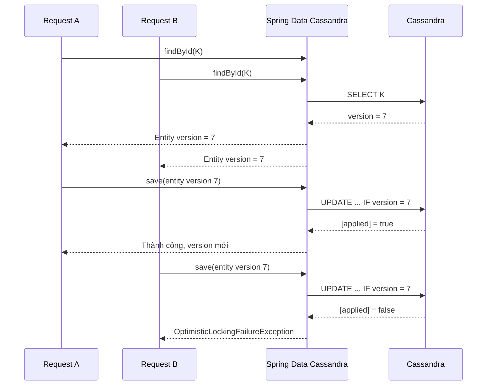
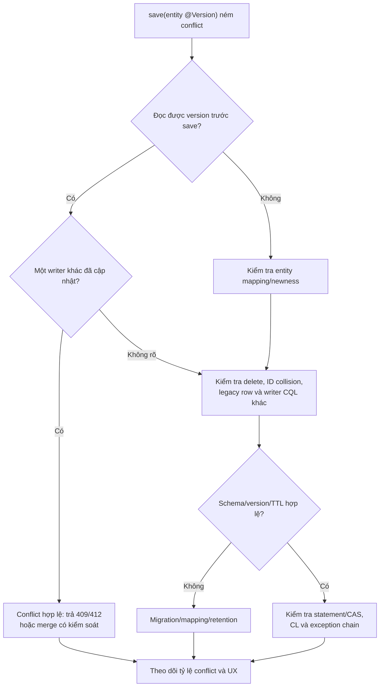

# OptimisticLockingFailureException khi ghi từ phiên bản cũ

## 1. Tình huống mở đầu: hai request cùng sửa một bản ghi

Giả sử một ứng dụng Spring Boot dùng **Spring Data Cassandra** để quản lý cấu hình của khách hàng. Hai tab trình duyệt cùng tải cấu hình của `customer_id = K`:

- **Request A** đọc cấu hình có `version = 7` và đổi chế độ hiển thị thành `dark`.
- **Request B** cũng đã đọc `version = 7`, nhưng muốn đổi thành `light`.
- A lưu trước và thành công. B lưu sau, vẫn mang phiên bản đã đọc **7**.

Nếu chỉ dùng lệnh `UPDATE` không điều kiện, hai thay đổi có thể đều được Cassandra chấp nhận; giá trị cuối được hòa giải theo **write timestamp**, không nhất thiết theo ý định của người dùng. Ứng dụng có nguy cơ **lost update**: một người ghi đè thay đổi của người khác mà không biết.

**Optimistic locking** giải quyết một yêu cầu cụ thể: *chỉ cho phép ghi dựa trên phiên bản đã đọc nếu phiên bản lưu trong Cassandra vẫn còn đúng như vậy*. Nếu phiên bản đã đổi, ứng dụng nhận xung đột thay vì âm thầm ghi đè.

Trong Spring Data Cassandra, entity có `@Version` có thể sử dụng cơ chế optimistic locking trên các đường persistence được hỗ trợ. Khi cập nhật từ **phiên bản cũ**, Spring Data có thể ném:

```java
org.springframework.dao.OptimisticLockingFailureException
```

Exception này không phải lời khẳng định “database bị hỏng”; trong tình huống cạnh tranh ghi, nó thường là **tín hiệu hợp lệ** để tầng nghiệp vụ xử lý xung đột.

### Sau bài học, bạn sẽ làm được

1. Giải thích vì sao `@Version` và **lightweight transaction (LWT)** có liên hệ trong Cassandra.
2. Tạo entity/repository có version, hiểu khác biệt giữa entity mới và entity đã lưu.
3. Nhận biết **stale entity**: object còn giữ version cũ sau khi hàng đã được cập nhật.
4. Bắt và xử lý `OptimisticLockingFailureException` mà không vô tình mất cập nhật.
5. Phân biệt **CAS conflict** với write timeout, unavailable, lỗi kết nối và lỗi schema.
6. Viết test tích hợp có hai bản sao của cùng entity và kiểm tra một cập nhật bị từ chối.
7. Đánh giá chi phí LWT, consistency level, retry, partition key và những đường ghi có thể bỏ qua version.

Bài thuộc chương **LWT và khóa lạc quan** của module `SPRING_DATA_CASSANDRA`, với trọng tâm truy cập Apache Cassandra bằng entity mapping, repository, `CassandraTemplate` và CQL theo đúng mô hình dữ liệu phân tán.

> Các đoạn mã dựa trên Spring Data Cassandra hiện đại (ví dụ nhánh 4.x), Java Driver 4.x và Java 17. Cách framework khởi tạo/tăng số version, loại statement CQL phát sinh và exception cụ thể phải được kiểm chứng bằng integration test trên phiên bản dự án. Ta tập trung vào **hợp đồng hành vi**, không tự khẳng định một chuỗi CQL được sinh giống nhau ở mọi bản phát hành.

## 2. Cơ chế optimistic locking nhìn từ ứng dụng

Cốt lõi của optimistic locking là **đọc trước, kiểm tra lúc ghi**. Hệ thống không giữ một khóa pessimistic kéo dài suốt thời gian người dùng chỉnh biểu mẫu.



Sơ đồ `UPDATE ... IF version = 7` là **mô hình CQL minh họa** điều kiện bảo vệ phiên bản, không phải bản trace chính xác của mọi phiên bản Spring Data Cassandra.

Ta tách ba khái niệm:

| Khái niệm | Ý nghĩa | Không đồng nghĩa với |
| --- | --- | --- |
| `@Version` | Thuộc tính Java được Spring Data quản lý để phân biệt version và hỗ trợ optimistic locking. | Một cột thời gian `updated_at`, hoặc một transaction nhiều bảng. |
| **LWT / CAS** | Cassandra đánh giá điều kiện `IF ...` qua giao thức đồng thuận phù hợp. | Khóa JVM, `synchronized`, hoặc ghi CQL không điều kiện. |
| `OptimisticLockingFailureException` | Spring thông báo thao tác ghi theo version không thể hoàn tất đúng hợp đồng. | Mọi loại lỗi mạng, mọi write timeout hoặc chứng cứ chắc chắn rằng writer khác là nguyên nhân duy nhất. |

**Không phải mọi cập nhật của Cassandra đều dùng LWT.** Ghi bình thường có semantics **upsert** và có thể không kiểm tra hàng đã tồn tại hay version hiện tại. Chỉ đường ghi **có điều kiện** mới cung cấp kiểm tra xung đột theo phiên bản.

## 3. Chuẩn bị bảng có khóa chính và cột version

Ví dụ nghiệp vụ: lưu cấu hình hiển thị theo từng khách hàng. Đường truy vấn chính là **đọc/cập nhật theo ID**, nên một partition key đơn là đủ.

### 3.1. Tạo keyspace cho môi trường lab

```sql
-- Chỉ dành cho một node ở DC dc1 khi học.
CREATE KEYSPACE IF NOT EXISTS learning
WITH replication = {
    'class': 'NetworkTopologyStrategy',
    'dc1': 1
};
```

**RF=1 không mô phỏng được khả năng chịu lỗi quorum của RF=3.** Khi muốn đo latency/failure behavior của LWT, dùng cluster thử nghiệm nhiều node với RF và local DC được cấu hình đúng.

### 3.2. Tạo bảng với version là cột thường

```sql
CREATE TABLE IF NOT EXISTS learning.preferences_by_customer_id (
    customer_id uuid PRIMARY KEY,
    theme text,
    language_code text,
    version bigint
);
```

Ở đây:

- `customer_id` là **primary key** và **partition key**; LWT cho một hàng dựa trên đúng khóa này.
- `theme` và `language_code` là thuộc tính có thể thay đổi.
- `version bigint` là cột để kiểm tra phiên bản; **không đưa version vào primary key**. Nếu cho version vào khóa, mỗi version trở thành **một hàng khác**, không còn phép kiểm tra cập nhật một hàng theo version như mong muốn.

**Không dùng `@Version` thay cho thiết kế khóa.** Khi bảng có composite primary key, mọi điều kiện update/insert vẫn phải định danh chính xác hàng qua các thành phần khóa tương ứng. Version phục vụ concurrency control, không quyết định phân bố partition hay paging.

### 3.3. Vì sao bảng ví dụ không có TTL?

Nếu cột version hết hạn vì TTL trong khi các cột nghiệp vụ vẫn còn, Spring Data có thể nhận diện sai entity là mới hoặc không thể kiểm tra điều kiện version như thiết kế. Để tập trung vào optimistic locking, bảng mẫu **không có `default_time_to_live`**.

Nếu ứng dụng buộc phải đặt TTL cho cả hàng, hãy phân tích cách version và các cột khác hết hạn cùng nhau, kiểm thử migration và tránh những write path chỉ gia hạn một số cột. Đừng gắn TTL ngắn riêng vào version khi dữ liệu cần còn sống lâu hơn.

## 4. Entity Spring Data Cassandra với @Version

### 4.1. Mapping tối thiểu

```java
package com.example.preferences.domain;

import java.util.UUID;

import org.springframework.data.annotation.Version;
import org.springframework.data.cassandra.core.mapping.Column;
import org.springframework.data.cassandra.core.mapping.PrimaryKey;
import org.springframework.data.cassandra.core.mapping.Table;

@Table("preferences_by_customer_id")
public class CustomerPreferences {

    @PrimaryKey("customer_id")
    private UUID customerId;

    @Column("theme")
    private String theme;

    @Column("language_code")
    private String languageCode;

    @Version
    private Long version;

    protected CustomerPreferences() {
    }

    public CustomerPreferences(
            UUID customerId, String theme, String languageCode) {
        this.customerId = customerId;
        this.theme = theme;
        this.languageCode = languageCode;
        // Cố ý để version = null khi tạo một entity mới.
    }

    public UUID getCustomerId() {
        return customerId;
    }

    public String getTheme() {
        return theme;
    }

    public String getLanguageCode() {
        return languageCode;
    }

    public Long getVersion() {
        return version;
    }

    public void changeTheme(String theme) {
        this.theme = theme;
    }

    public void changeLanguageCode(String languageCode) {
        this.languageCode = languageCode;
    }
}
```

Các điểm quan trọng:

1. `@Version` phải import từ **`org.springframework.data.annotation.Version`**.
2. `Long` dạng wrapper cho phép `null` diễn đạt trạng thái **chưa có version**. Đây là lựa chọn dễ hiểu hơn `long` nguyên thủy khi khởi tạo entity mới.
3. Ứng dụng **không nên tự tăng/sửa field version** nếu đã giao quản lý phiên bản cho Spring Data.
4. Spring Data có thể ghi/đọc private field qua mapping infrastructure; constructor bảo vệ dùng cho materialization.
5. Giá trị `customerId` đã được cấp trước khi lưu, nhưng `version == null` vẫn là tín hiệu entity mới theo chiến lược nhận biết qua version.
6. Entity trên biểu diễn một hàng; không biến `languageCode` thành clustering key chỉ vì UI cần chỉnh nó.

### 4.2. Vì sao không dùng Instant làm @Version?

`@Version` là **bộ đếm/giá trị quản lý concurrency**, không phải thời điểm thay đổi nghiệp vụ. Nếu cần hiển thị thời gian cập nhật, thêm `updated_at timestamp` riêng, với quy tắc timezone/clock rõ ràng.

Một request đọc `version=7` rồi lưu với version 7 giúp xác nhận đúng trạng thái trước đó. Chỉ so sánh `updated_at` theo đồng hồ máy ứng dụng không cho cùng ý nghĩa, nhất là khi có nhiều writer bị lệch đồng hồ.

### 4.3. @Version và Persistable là hai vấn đề khác nhau

Spring Data có các chiến lược nhận biết entity mới: dựa trên ID, dựa trên `@Version` hoặc dùng `Persistable.isNew()` nếu entity triển khai `Persistable`. Khi `Persistable` hiện diện, newness có thể được điều khiển bằng `isNew()` thay vì chỉ xét version.

Không ghép `Persistable`, `@Version` và các cờ `isNew` tùy tiện. Nếu kết hợp, cần kiểm thử cả **insert lần đầu**, **load từ Cassandra**, **save lại** và **stale update** để biết đường persistence thực tế.

## 5. Repository có lưu với optimistic locking

### 5.1. Khai báo CassandraRepository

```java
package com.example.preferences.repository;

import java.util.UUID;

import org.springframework.data.cassandra.repository.CassandraRepository;
import com.example.preferences.domain.CustomerPreferences;

public interface CustomerPreferencesRepository
        extends CassandraRepository<CustomerPreferences, UUID> {
}
```

Với entity ở phần 4, repository CRUD đủ cho ví dụ. Không cần viết một method tên `updateIfVersionMatches(...)` chỉ để bật optimistic locking trên đường `save` được framework hỗ trợ; `@Version` có vai trò điều khiển việc kiểm tra version của entity.

### 5.2. Tạo mới có ID nhưng version null

```java
UUID customerId = UUID.randomUUID();

CustomerPreferences fresh = new CustomerPreferences(
    customerId, "system", "vi"
);

CustomerPreferences saved = repository.save(fresh);

// Dùng instance được trả về để đọc version đã được quản lý.
Long storedVersion = saved.getVersion();
```

Cần lưu ý:

- `customerId` khác `null` **không chứng minh hàng đã tồn tại**.
- Với `@Version Long`, `version=null` là tín hiệu entity mới cho vòng đời entity phù hợp.
- Trên đường Spring Data hỗ trợ optimistic locking, tạo mới có thể dùng **điều kiện tương đương `IF NOT EXISTS`** để tránh ghi đè một hàng đã có cùng khóa.
- Giá trị version ban đầu và cách tăng chính xác nên lấy **từ object được trả về hoặc readback**, không hardcode rằng version đầu tiên nhất định là 0 hay 1 trên mọi phiên bản.
- Nếu entity mới dùng UUID đã trùng với hàng có sẵn, đường tạo có điều kiện có thể bị từ chối; không được coi thao tác đó như upsert an toàn.

### 5.3. Cập nhật entity đã lưu

```java
CustomerPreferences current = repository.findById(customerId)
    .orElseThrow();

Long expectedVersion = current.getVersion();

current.changeTheme("dark");

CustomerPreferences updated = repository.save(current);

Long newVersion = updated.getVersion();
```

Về mặt ý tưởng, Spring Data bảo vệ cập nhật bằng điều kiện giống:

```sql
-- Ví dụ CQL MÔ PHỎNG kiểm tra version:
UPDATE learning.preferences_by_customer_id
SET theme = 'dark', version = 8
WHERE customer_id = 11111111-1111-1111-1111-111111111111
IF version = 7;
```

Nếu điều kiện không còn đúng, Cassandra báo **không áp dụng mutation**, và Spring Data có thể chuyển thất bại version thành `OptimisticLockingFailureException`.

> Đoạn CQL trên chỉ minh họa nguyên lý khi version cũ là 7, version mới là 8. Không dùng nó để khẳng định Spring Data luôn sinh đúng danh sách cột/thứ tự câu lệnh ấy. Cụ thể, `repository.save` có thể ghi các thuộc tính khác của entity tùy mapping/đường lưu.

## 6. OptimisticLockingFailureException phát sinh lúc nào?

Tình huống điển hình:

1. Hai đối tượng Java khác nhau đọc **cùng một hàng** và nhận **cùng version**.
2. Object A lưu thành công và làm version trên Cassandra thay đổi.
3. Object B giữ version cũ, rồi gọi đường update có optimistic locking.
4. Điều kiện CAS của B không còn khớp.
5. Framework ném `OptimisticLockingFailureException` (hoặc loại con/phân loại liên quan trong họ exception theo phiên bản).

### Ví dụ tuần tự nhưng tái hiện cạnh tranh chính xác

```java
UUID id = UUID.randomUUID();

CustomerPreferences created = repository.save(
    new CustomerPreferences(id, "system", "vi")
);

// Hai lần đọc tạo hai snapshot Java tách biệt.
CustomerPreferences editorA =
    repository.findById(id).orElseThrow();

CustomerPreferences editorB =
    repository.findById(id).orElseThrow();

Long versionBefore = editorA.getVersion();
// editorB.getVersion() cũng phải bằng versionBefore.

editorA.changeTheme("dark");
CustomerPreferences savedA = repository.save(editorA);

editorB.changeTheme("light");
repository.save(editorB); // Mong đợi xung đột version.
```

**Đây là test về hai snapshot**, không cần hai thread thực sự chạy đồng thời để làm stale version. Thứ tự chạy có kiểm soát giúp hiểu cơ chế và tạo test ít flakiness hơn.

### Khi nào exception không phải “stale writer” thông thường?

Cần phân biệt một số trường hợp:

| Tình huống | Có thể xảy ra điều gì? | Chẩn đoán |
| --- | --- | --- |
| B lưu object cũ sau A đã tăng version | CAS update không thỏa; optimistic locking conflict. | Đây là tình huống chính của bài. |
| Hàng bị xóa giữa lúc B đọc và B lưu | Điều kiện version không còn khớp/hàng không còn. | Phân biệt nhu cầu báo “đã bị xóa” và “đã thay đổi”. |
| Khởi tạo entity với `version=null` nhưng ID đã tồn tại | Đường insert có điều kiện không thỏa. | Newness/ID collision, không nhất thiết hai người cùng sửa. |
| Legacy row có version `null` | Spring Data có thể coi entity là mới hoặc không đi đúng đường update. | Cần migration dữ liệu/version. |
| Một job dùng CQL trực tiếp không kiểm tra version | Ghi có thể thành công và phá quy tắc version. | Kiểm kê các write path, không chỉ repository. |
| Cassandra trả timeout/unavailable | Kết quả mutation có thể chưa chắc chắn. | Không kết luận là conflict nếu chưa có dấu hiệu điều kiện LWT không thỏa. |
| Lỗi mapping/cột/version sai kiểu | Repository có thể không khởi tạo hoặc thực thi đúng. | Kiểm tra schema, Java type và CQL thực tế. |

**Tên exception không đủ để xác định toàn bộ nguyên nhân**. Hãy xem statement/metadata, trạng thái đọc lại và những writer đang cùng ghi bảng trước khi quyết định hướng khôi phục.

## 7. Tại sao Cassandra cần LWT cho việc kiểm tra phiên bản?

### 7.1. Ghi không điều kiện không ngăn lost update

Hai statement như sau đều có thể được Cassandra chấp nhận:

```sql
UPDATE learning.preferences_by_customer_id
SET theme = 'dark'
WHERE customer_id = 11111111-1111-1111-1111-111111111111;

UPDATE learning.preferences_by_customer_id
SET theme = 'light'
WHERE customer_id = 11111111-1111-1111-1111-111111111111;
```

Đây là ghi bình thường theo primary key. Dù app có đọc version trước, câu UPDATE không chứa điều kiện `IF version = ...` nên **không có CAS**.

Việc gọi SELECT rồi UPDATE trong hai statement riêng cũng không đủ:

```text
A: SELECT version=7
B: SELECT version=7
A: UPDATE theme=dark (không IF)
B: UPDATE theme=light (không IF)
```

Khoảng thời gian giữa SELECT và UPDATE tạo **time-of-check/time-of-use race**. Chỉ thêm `synchronized` trong một JVM cũng không giải quyết khi ứng dụng có nhiều instance/pod.

### 7.2. CQL conditional update

CQL hỗ trợ điều kiện đặt ngay trên mutation:

```sql
UPDATE learning.preferences_by_customer_id
SET theme = 'dark',
    version = 8
WHERE customer_id = 11111111-1111-1111-1111-111111111111
IF version = 7;
```

Ý tưởng:

- Nếu giá trị version hiện tại của hàng thỏa `= 7`, update được **áp dụng** và version chuyển sang giá trị mới.
- Nếu version không khớp, update **không được áp dụng**, và client nhận kết quả điều kiện.
- Cassandra phối hợp việc đánh giá điều kiện bằng **LWT/Paxos** trong phạm vi dữ liệu được hỗ trợ, không biến UPDATE thành một transaction nhiều bảng/partition.

### 7.3. Conditional insert cho hàng chưa tồn tại

```sql
INSERT INTO learning.preferences_by_customer_id
(customer_id, theme, language_code, version)
VALUES (
    11111111-1111-1111-1111-111111111111,
    'system', 'vi', 1
) IF NOT EXISTS;
```

Đây là cách thể hiện **create-if-absent** bằng Cassandra. Nó khác `INSERT` thông thường, vốn có thể mang ngữ nghĩa upsert theo primary key.

Spring Data có thể thực thi điều kiện tương đương khi lưu một entity có `@Version` và được xác định là mới. Tuy nhiên, không nên coi một lời gọi `save` của bất kỳ entity **không có `@Version`** là bảo đảm unique.

## 8. Phân biệt exception của Spring và kết quả [applied] của Java Driver

### 8.1. Driver không tự biến mọi CAS failure thành OptimisticLockingFailureException

Khi chạy CQL trực tiếp bằng Java Driver, thao tác điều kiện thường trả một `Row` kết quả có trường `[applied]`.

```java
import java.util.UUID;

import com.datastax.oss.driver.api.core.CqlSession;
import com.datastax.oss.driver.api.core.cql.PreparedStatement;
import com.datastax.oss.driver.api.core.cql.Row;

PreparedStatement update = session.prepare(
    "UPDATE learning.preferences_by_customer_id " +
    "SET theme = ?, version = ? " +
    "WHERE customer_id = ? IF version = ?"
);

long expectedVersion = 7L;
long nextVersion = Math.addExact(expectedVersion, 1L);

Row result = session.execute(
    update.bind("dark", nextVersion, customerId, expectedVersion)
).one();

if (result == null) {
    throw new IllegalStateException(
        "LWT không trả hàng trạng thái như kỳ vọng"
    );
}

boolean applied = result.getBoolean("[applied]");

if (!applied) {
    // Version đã thay đổi, hàng không còn, hoặc điều kiện không thỏa.
    // Tầng ứng dụng phải quyết định cách chuyển thành domain/API error.
}
```

**Java Driver biết điều kiện có áp dụng hay không**; bản thân driver không biết tên entity Java, field `@Version` hay nghiệp vụ đang thao tác. Nếu service muốn biểu diễn conflict nhất quán với repository Spring Data, nó phải **chuyển đổi kết quả không applied** sang một exception/domain result phù hợp.

### 8.2. Khi nào nên tự ném Spring exception?

Có thể dùng Spring exception trong một adapter chỉ phục vụ ứng dụng Spring:

```java
import org.springframework.dao.OptimisticLockingFailureException;

if (!applied) {
    throw new OptimisticLockingFailureException(
        "Cấu hình đã thay đổi hoặc không còn phù hợp version yêu cầu"
    );
}
```

Tuy nhiên, nếu code dùng driver thuần trong thư viện chung, một **domain exception** như `StaleVersionConflict` có thể hợp kiến trúc hơn. Tầng adapter Spring chuyển domain conflict sang HTTP 409 hoặc Spring exception khi cần.

### 8.3. Không diễn giải lỗi timeouts như [applied] = false

Ba trạng thái khác nhau:

| Kết quả | Có kết luận mutation được áp dụng không? | Hướng xử lý |
| --- | --- | --- |
| LWT trả `[applied] = true` | Có: điều kiện đã được chấp nhận trong operation thành công. | Trả dữ liệu/version mới, tiếp tục theo nghiệp vụ. |
| LWT trả `[applied] = false` | Không: điều kiện không thỏa tại thời điểm kiểm tra. | Báo conflict, đọc lại, hoặc merge có kiểm soát. |
| LWT bị timeout/connection error | **Chưa chắc chắn** điều gì đã được áp dụng. | Kiểm tra/readback/đối soát, retry có giới hạn theo semantics statement. |

Tương tự, `OptimisticLockingFailureException` trong Spring không nên bị gộp vào một `catch (Exception)` rồi trả HTTP 500 cùng với lỗi mạng. Phân loại lỗi giúp người dùng biết phải reload hay chỉ thử lại sau khi hệ thống phục hồi.

## 9. Cách xử lý đúng trong service: giữ phiên bản client đã đọc

### 9.1. Sai lầm: load bản mới rồi ghi đè theo yêu cầu cũ

Giả sử client gửi request dựa trên version 7, nhưng service làm:

```java
// SAI khi client đã chỉnh một bản cũ mà không gửi expectedVersion.
CustomerPreferences latest = repository.findById(customerId)
    .orElseThrow();

latest.changeTheme(requestedTheme);
repository.save(latest);
```

Code này có thể **lưu thành công** bằng version mới mà service vừa tải. Nhưng nó không biết người dùng đã chỉnh từ version nào. Người dùng đọc version 7 có thể đang ghi đè version 8 vừa được người khác thay đổi — không có optimistic conflict nào được phát hiện cho **ý định cập nhật của client**.

Vì vậy, API chỉnh sửa từ dữ liệu đã đọc nên có một **expectedVersion** hoặc cơ chế điều kiện tương đương (ví dụ HTTP `If-Match` theo ETag được thiết kế đúng).

### 9.2. Yêu cầu API mang expectedVersion

DTO minh họa:

```java
package com.example.preferences.api;

public record ChangeThemeRequest(
    String theme,
    Long expectedVersion
) {
}

public record PreferencesView(
    String theme,
    String languageCode,
    Long version
) {
}
```

Trong mã Java thực tế, hai `public record` cần đặt trong hai file tương ứng hoặc điều chỉnh mức truy cập; đoạn gộp chỉ để trình bày hợp đồng.

Service có kiểm tra version mà client gửi:

```java
package com.example.preferences.service;

import java.util.Objects;
import java.util.UUID;

import org.springframework.dao.OptimisticLockingFailureException;
import org.springframework.stereotype.Service;

import com.example.preferences.domain.CustomerPreferences;
import com.example.preferences.repository.CustomerPreferencesRepository;

@Service
public class PreferencesService {

    private final CustomerPreferencesRepository repository;

    public PreferencesService(CustomerPreferencesRepository repository) {
        this.repository = repository;
    }

    public CustomerPreferences changeTheme(
            UUID customerId,
            String newTheme,
            Long expectedVersion) {

        if (customerId == null || expectedVersion == null) {
            throw new IllegalArgumentException(
                "customerId va expectedVersion la bat buoc"
            );
        }

        if (newTheme == null || newTheme.isBlank()) {
            throw new IllegalArgumentException(
                "theme khong duoc rong"
            );
        }

        CustomerPreferences current = repository.findById(customerId)
            .orElseThrow(() -> new IllegalArgumentException(
                "Khong tim thay cau hinh"
            ));

        if (!Objects.equals(
                current.getVersion(), expectedVersion)) {
            throw new OptimisticLockingFailureException(
                "Cau hinh da duoc cap nhat boi request khac"
            );
        }

        current.changeTheme(newTheme);

        // CAS ở tầng Spring Data vẫn cần thiết:
        // một writer khác có thể cập nhật sau phép so sánh ở trên.
        return repository.save(current);
    }
}
```

Có **hai lớp kiểm tra bổ sung cho nhau**:

1. So `expectedVersion` của client với version của bản vừa nạp để ngăn việc **âm thầm cập nhật từ form cũ**.
2. Gọi `repository.save(current)` qua đường `@Version` để phát hiện **writer xen giữa SELECT và UPDATE**.

Chỉ kiểm tra ở bước 1 **không đủ**, vì giữa phép so sánh và save vẫn có thể có concurrent write. Ngược lại, chỉ làm bước 2 mà bỏ version client có thể tránh conflict kỹ thuật nhưng vẫn gây **lost intention** đối với người dùng chỉnh form cũ.

**Bảo mật:** Service phải xác minh caller có quyền đối với `customerId` ở lớp authorization. Một ID hoặc expectedVersion hợp lệ **không tự cấp quyền** cập nhật dữ liệu khách hàng đó.

### 9.3. Đừng tự gán version client vào entity đã tải mới

Cách làm `current.version = expectedVersion` để “ép” kiểm tra CAS không nên được dùng như một pattern chung. Nó làm sai ý nghĩa vòng đời version do framework quản lý và có thể gây unexpected insert/update hoặc mapping lỗi.

Hãy so sánh expectedVersion ở service như trên, rồi cho Spring Data dùng version thực tế của entity vừa đọc để kiểm tra lần cuối lúc ghi.

## 10. Chuyển optimistic conflict thành phản hồi HTTP phù hợp

Khi API dùng REST, xung đột do dữ liệu đã thay đổi thường nên được trình bày rõ cho client, thay vì hiển thị lỗi hệ thống chung.

### 10.1. HTTP 409 Conflict

Ví dụ handler:

```java
package com.example.preferences.api;

import java.time.Instant;

import org.springframework.dao.OptimisticLockingFailureException;
import org.springframework.http.HttpStatus;
import org.springframework.http.ResponseEntity;
import org.springframework.web.bind.annotation.ExceptionHandler;
import org.springframework.web.bind.annotation.RestControllerAdvice;

@RestControllerAdvice
public class OptimisticConflictHandler {

    @ExceptionHandler(OptimisticLockingFailureException.class)
    public ResponseEntity<ConflictResponse> handleConflict(
            OptimisticLockingFailureException ex) {

        ConflictResponse body = new ConflictResponse(
            "PREFERENCES_VERSION_CONFLICT",
            "Dữ liệu đã thay đổi. Vui lòng tải lại trước khi lưu.",
            Instant.now()
        );

        return ResponseEntity.status(HttpStatus.CONFLICT).body(body);
    }

    public record ConflictResponse(
        String code,
        String message,
        Instant occurredAt
    ) {
    }
}
```

`409 Conflict` phù hợp với một contract dùng **version trong body**. Nếu API triển khai HTTP conditional requests đúng chuẩn bằng `If-Match`, **`412 Precondition Failed`** thường là lựa chọn tương ứng khi điều kiện HTTP không thỏa. Nên chọn một hợp đồng thống nhất và test từ controller đến client.

Không trả `200 OK` cho một ghi không được áp dụng, vì UI có thể báo đã lưu thành công dù mutation thất bại.

### 10.2. UX xử lý xung đột

Một luồng ứng dụng có thể:

1. Client gửi thay đổi kèm `expectedVersion`.
2. Server trả `409` nếu phiên bản đã cũ.
3. Client thông báo “Dữ liệu đã đổi từ nơi khác”.
4. Client tải phiên bản mới nhất, hiển thị **giá trị cũ, giá trị đang lưu và thay đổi chưa lưu** nếu cần.
5. Người dùng chọn giữ, sửa lại hoặc hủy thao tác.
6. Client gửi yêu cầu mới dựa trên **version mới**, sau khi đã quyết định nội dung cần ghi.

**Đừng âm thầm cập nhật lại version và gửi cùng giá trị cũ**. Làm vậy có thể vượt qua CAS nhưng tái tạo lost update ở tầng nghiệp vụ.

### 10.3. Không đưa dữ liệu nhạy cảm vào thông báo lỗi

Thông báo cho client nên dùng mã lỗi chung, không log nguyên giá trị thay đổi của khách hàng. Khi cần chẩn đoán, log request ID, query fingerprint, loại conflict và version trước/sau **theo chính sách bảo mật**, tránh lộ dữ liệu cá nhân.

## 11. Chính sách retry: khi nào nên thử lại?

### 11.1. Retry một optimistic conflict không giống retry lỗi mạng

Nếu B đang giữ version 7 và Cassandra đã chuyển sang version 8, thử lại nguyên xi:

```text
save(entity version=7)
save(entity version=7)
save(entity version=7)
```

sẽ không làm điều kiện `IF version = 7` đúng trở lại. Retry vô hạn chỉ tăng tải LWT và tạo thêm latency.

**Quy tắc:** Đối với thao tác chỉnh sửa do người dùng chủ động, thường **trả conflict** và yêu cầu xem/merge dữ liệu mới trước khi ghi lại.

### 11.2. Khi nào có thể tự retry có giới hạn?

Có một số operation mang semantics an toàn để tính lại từ trạng thái mới nhất, ví dụ:

- “Bảo đảm một cờ cấu hình đang `true`” nếu nghiệp vụ chấp nhận writer khác và phép gán tương thích.
- “Đánh dấu đã xử lý nếu chưa xử lý”, với idempotency và điều kiện rõ ràng.
- Một phép chuyển trạng thái **có thể tái đánh giá** từ bản mới mà không làm mất ý định của các request khác.

Mẫu xử lý:

```text
for attempt = 1..MAX_ATTEMPTS:
    current = read(K)
    candidate = recompute_from(current, command)
    try:
        save_with_version(candidate)
        return success
    catch optimistic_conflict:
        if attempt == MAX_ATTEMPTS:
            return conflict
        retry_with_new_read
```

Đây là **pseudocode**. Không dùng retry tự động cho mọi operation và không cố tăng số lần retry khi hot row đang liên tục cạnh tranh; có thể tạo bão CAS.

Trong quá trình retry, phải:

- Giới hạn số lần thử và tổng thời gian.
- Đọc lại state mới ở mỗi lượt.
- Tính lại thay đổi theo **ngữ nghĩa operation**, không chỉ dùng lại object stale.
- Kiểm tra cancellation/timeout của request.
- Cân nhắc backoff/jitter để giảm va chạm.
- Theo dõi conflict rate và độ trễ p95/p99.

### 11.3. Timeout của LWT là trạng thái có thể không chắc chắn

Nếu request gửi CAS rồi bị timeout, client có thể không biết mutation đã áp dụng hay chưa. Không mặc định timeout là optimistic conflict; cũng không mặc định operation chắc chắn chưa thực hiện.

Các bước xử lý thích hợp gồm:

1. Giữ ID/idempotency key của business command.
2. Đọc lại version và giá trị liên quan bằng policy phù hợp.
3. Đối chiếu trạng thái thực tế với mục tiêu nghiệp vụ.
4. Chọn retry/fail/reconcile theo kết quả và giới hạn thời gian.
5. Không chuyển tất cả `WriteTimeoutException`/`UnavailableException` thành HTTP 409.

Đặc biệt nếu request ghi một phần dữ liệu ở **nhiều bảng/partition**, optimistic locking trên một entity không biến cả workflow thành transaction ACID đa bảng.

## 12. CassandraTemplate và các đường ghi có thể bỏ qua @Version

Ứng dụng Spring Data Cassandra có thể ghi dữ liệu theo nhiều cách:

```text
Controller / Service
   |
   +--- CassandraRepository.save(entity @Version)
   |
   +--- CassandraTemplate (insert/update/save với mapping)
   |
   +--- CqlTemplate / CqlSession (CQL trực tiếp)
   |
   +--- @Query UPDATE trên repository
   |
   +--- Batch/import/backfill job
   |
   v
Cassandra partition + replicas
```

**Phải biết rõ write path nào kiểm tra version**. Một entity có `@Version` không tự buộc **mọi câu UPDATE CQL chạy trên cùng bảng** phải dùng LWT.

### 12.1. CassandraTemplate

`CassandraTemplate` cung cấp thao tác đối tượng theo metadata Spring Data. Với các đường lưu có hỗ trợ optimistic locking, framework có thể sử dụng field `@Version` và xử lý CAS.

Khi chọn một API cụ thể như `template.update(entity)`, `template.insert(entity)` hoặc `template.save(entity)`, hãy **kiểm tra hợp đồng phương thức/phiên bản**:

- Có bật version-aware write không?
- Insert tạo mới có điều kiện `IF NOT EXISTS` không?
- Có tự quản lý/increment version không?
- Exception khi CAS không applied là loại nào?
- Có ghi tất cả cột hay chỉ tập cột được chỉ định?

Không dùng một test `repository.save` để khẳng định tất cả overload của template đều có hành vi giống hệt.

### 12.2. CqlSession và @Query UPDATE

Ví dụ ghi **bỏ qua version**:

```java
session.execute(
    "UPDATE learning.preferences_by_customer_id " +
    "SET theme = 'light' " +
    "WHERE customer_id = " +
    "11111111-1111-1111-1111-111111111111"
);
```

Đoạn trên chỉ minh họa **một write path không có `IF`**; trong ứng dụng thật phải dùng prepared statement thay vì ghép input từ người dùng.

Tương tự, một method repository có `@Query("UPDATE ...")` nhưng không có điều kiện version **không tự trở thành LWT** chỉ vì entity class có `@Version`.

Hệ quả nguy hiểm: Writer A dùng repository/version-aware CAS, nhưng writer B dùng CQL không điều kiện và đổi `theme` mà **không tăng version**. A có thể ghi thành công dựa trên version cũ, làm mất dữ liệu của B. Vì thế các writer cùng bảng cần **hợp đồng concurrency chung**.

### 12.3. Thiết kế chính sách nhất quán giữa các đường ghi

| Đường ghi | Có bảo vệ version mặc định? | Việc cần làm |
| --- | --- | --- |
| Repository `save` của entity `@Version`, theo đường hỗ trợ | Có cơ chế optimistic locking phù hợp. | Test stale update và exception. |
| Template API version-aware được hỗ trợ | Phụ thuộc API/phiên bản và option. | Kiểm chứng CQL/exception bằng integration test. |
| Prepared CQL `UPDATE ... IF version = ?` | Có điều kiện do developer viết. | Kiểm tra `[applied]`, quản lý version và error mapping. |
| `UPDATE` CQL thông thường | **Không** có kiểm tra version. | Tránh cho dữ liệu cần CAS hoặc thiết kế ngoại lệ có quản lý. |
| Repository `@Query` với `UPDATE` không `IF` | Không nên mặc định có optimistic locking. | Thêm điều kiện hoặc đổi sang đường version-aware. |
| Job backfill/maintenance | Phụ thuộc logic job. | Có kế hoạch version/migration và tránh viết đè ngoài ý muốn. |

## 13. Consistency level và serial consistency khi dùng LWT

### 13.1. Normal CL không đồng nghĩa serial CL

Cassandra có các consistency level như `LOCAL_ONE`, `LOCAL_QUORUM`, `QUORUM`, `ALL` cho thao tác đọc/ghi thông thường. Với **LWT**, còn có **serial consistency** liên quan đến pha đồng thuận, ví dụ `SERIAL` và `LOCAL_SERIAL`.

| Lựa chọn | Vai trò | Không nên hiểu sai |
| --- | --- | --- |
| Normal CL `LOCAL_QUORUM` | Điều kiện phản hồi của operation theo replica ở local DC. | Không tự biến UPDATE thường thành CAS. |
| Serial CL `LOCAL_SERIAL` | Phạm vi pha đồng thuận LWT theo local DC khi hợp lệ. | Không phải lựa chọn để “đọc mới nhất” trên mọi `SELECT`. |
| `IF version = ?` | Nội dung điều kiện CAS của mutation. | Không được suy ra chỉ từ việc CL là quorum. |
| `@Version` | Metadata Spring Data kiểm soát version-aware persistence. | Không phải lệnh phân vùng dữ liệu hay cấu hình RF. |

Một CQL conditional update có thể được cấu hình trên Java Driver 4.x:

```java
import com.datastax.oss.driver.api.core.DefaultConsistencyLevel;

var statement = update.bind(
        "dark", nextVersion, customerId, expectedVersion)
    .setConsistencyLevel(DefaultConsistencyLevel.LOCAL_QUORUM)
    .setSerialConsistencyLevel(DefaultConsistencyLevel.LOCAL_SERIAL);

Row row = session.execute(statement).one();
```

Đoạn mã này là phần bổ sung cho `PreparedStatement update` ở phần 8. Chọn `LOCAL_SERIAL` phải phù hợp **topology, DC và phạm vi bảo đảm nghiệp vụ**, nhất là khi có nhiều data center.

**Không áp dụng cùng một setting cho mọi hệ thống.** LWT với RF=1 trên lab có thể dùng để kiểm chứng chức năng, nhưng không mô phỏng được sự chịu lỗi/latency của một cluster nhiều replica.

### 13.2. LWT có chi phí đáng kể

So với ghi bình thường, LWT cần thêm các lượt phối hợp giữa replica để đạt đồng thuận trên điều kiện. Do đó:

- Latency thường cao hơn mutation không điều kiện.
- Hot partition/hot row có thể khiến nhiều request cạnh tranh, thất bại CAS và thử lại.
- Timeout/phát hiện điều kiện không áp dụng cần được tính vào SLO.
- Tần suất xung đột là một **chỉ số nghiệp vụ/kỹ thuật quan trọng** để biết mô hình cập nhật có phù hợp hay không.
- Đổi `pageSize` của truy vấn đọc không làm LWT write rẻ hơn.

Khi yêu cầu chỉ là ghi sự kiện bất biến theo ID duy nhất và chấp nhận idempotent upsert, không nhất thiết đưa `@Version` vào mọi hàng. Dùng LWT ở nơi **cần bảo vệ cạnh tranh thật sự**.

### 13.3. Một partition không phải transaction toàn hệ thống

LWT bảo vệ điều kiện trong phạm vi operation Cassandra được hỗ trợ, không đảm bảo nguyên tử cho workflow:

```text
1. UPDATE preferences_by_customer_id
2. INSERT preferences_audit_by_customer
3. UPDATE customer_summary_by_region
```

Một trong ba bước có thể thất bại sau khi bước trước hoàn thành. Muốn nhất quán workflow, xem xét **outbox/event/reconciliation**, idempotency và xử lý trạng thái; không coi `@Version` là transaction ACID nhiều bảng.

## 14. Thiết kế thử nghiệm stale version đáng tin cậy

### 14.1. Integration test với hai snapshot

Ví dụ JUnit 5 (giả sử ứng dụng kiểm thử đã chạy Cassandra thật và có schema ở phần 3):

```java
package com.example.preferences;

import java.util.UUID;

import org.junit.jupiter.api.Test;
import org.springframework.beans.factory.annotation.Autowired;
import org.springframework.boot.test.context.SpringBootTest;
import org.springframework.dao.OptimisticLockingFailureException;

import com.example.preferences.domain.CustomerPreferences;
import com.example.preferences.repository.CustomerPreferencesRepository;

import static org.junit.jupiter.api.Assertions.*;

@SpringBootTest
class PreferencesOptimisticLockingIT {

    @Autowired
    CustomerPreferencesRepository repository;

    @Test
    void staleSnapshotMustNotOverwriteNewerVersion() {
        UUID id = UUID.randomUUID();

        CustomerPreferences inserted = repository.save(
            new CustomerPreferences(id, "system", "vi")
        );

        CustomerPreferences snapshotA =
            repository.findById(id).orElseThrow();

        CustomerPreferences snapshotB =
            repository.findById(id).orElseThrow();

        assertEquals(
            snapshotA.getVersion(),
            snapshotB.getVersion()
        );

        snapshotA.changeTheme("dark");
        CustomerPreferences afterA = repository.save(snapshotA);

        snapshotB.changeTheme("light");

        assertThrows(
            OptimisticLockingFailureException.class,
            () -> repository.save(snapshotB)
        );

        CustomerPreferences finalState =
            repository.findById(id).orElseThrow();

        assertEquals("dark", finalState.getTheme());
        assertEquals(afterA.getVersion(), finalState.getVersion());
        assertNotEquals(
            inserted.getVersion(),
            finalState.getVersion()
        );
    }
}
```

Đây là integration test sử dụng **hai object được nạp độc lập**. Nó tránh việc hai biến cùng trỏ tới một instance Java; nếu `snapshotA == snapshotB`, test sẽ không chứng minh stale version.

Các điểm cần xác minh:

1. Test thực sự kết nối Cassandra đã tạo schema, không phải mock repository.
2. Bản lưu đầu được đọc lại để biết version thực tế.
3. Snapshot A và B có cùng version trước update.
4. A lưu thành công và version tăng/đổi.
5. B bị từ chối với loại exception kỳ vọng.
6. Giá trị cuối vẫn là thay đổi của A, **không bị B ghi đè**.

**Không chạy test kiểu này trên bảng production**. Dùng keyspace/container thử nghiệm hoặc môi trường tích hợp riêng, và ID ngẫu nhiên để tránh chạm dữ liệu của test khác.

### 14.2. Test khi entity mới đã có ID trùng

Khởi tạo và lưu một entity với ID cố định. Sau đó tạo **một instance mới khác** cùng ID nhưng `version=null`, gọi `save`:

```java
UUID id = UUID.randomUUID();

repository.save(
    new CustomerPreferences(id, "system", "vi")
);

CustomerPreferences anotherNewObject =
    new CustomerPreferences(id, "light", "en");

// Kiểm tra đường insert có điều kiện và kết quả khi ID đã tồn tại.
// Với version-aware insert được hỗ trợ, đây là collision, không phải upsert.
assertThrows(
    OptimisticLockingFailureException.class,
    () -> repository.save(anotherNewObject)
);
```

Loại exception chính xác cho **trường hợp insert có điều kiện** có thể phụ thuộc phiên bản; nếu không khớp, ghi lại behavior được framework trả và cập nhật kỳ vọng test theo hợp đồng API thực tế, không bỏ qua việc tạo trùng khóa.

### 14.3. Test xóa sau đọc

1. Tạo entity và lưu.
2. Đọc một snapshot có version.
3. Xóa hàng bằng đường có kiểm soát.
4. Thử save snapshot cũ.
5. Xác nhận operation không âm thầm tạo lại hàng nếu ứng dụng yêu cầu **update-only**.

Cần hiểu rõ sự khác biệt giữa **delete** và **insert lại** trong Spring Data/CQL, đặc biệt khi API save có semantics upsert ở những đường không dùng version.

### 14.4. Test timeout không phải optimistic conflict

Giả lập network timeout hoặc làm mất quorum trong **môi trường được phép**; xác nhận:

- Exception timeout/unavailable không bị handler `409` phân loại nhầm.
- Ứng dụng không tự tạo UUID mới cho cùng business command nếu retry.
- Có readback/reconciliation cho trạng thái chưa chắc chắn.
- Log không lộ dữ liệu nhạy cảm.
- Hệ thống có giới hạn retry/backoff rõ ràng.

### 14.5. Test nhiều request đồng thời

Sau test hai snapshot tuần tự, có thể mở rộng bằng concurrent integration test có barrier:

```text
Thread A -> read version N ---- barrier ---- save A
Thread B -> read version N ---- barrier ---- save B
```

Mục tiêu không phải ép A luôn thắng; mục tiêu là kiểm chứng **không có hai update cùng version N đều được áp dụng** khi dùng đúng conditional write và không có mutation/đường ghi khác bỏ qua version.

Test concurrency có thể dao động theo lịch thread, nên cần đồng bộ thời điểm đọc và lưu hoặc tự tạo hai snapshot trước khi chạy song song.

## 15. Những bẫy kiến trúc thường gặp

### 15.1. Chỉ giữ version trong entity nhưng API không biết version

Một form được người dùng mở từ hôm trước không biết bản đang có version nào. Nếu service lúc ghi luôn `findById` mới rồi `save`, nó có thể overwrite thành công dù ý định người dùng đã cũ.

**Giải pháp:** đưa version vào response của lần đọc, và đưa expectedVersion (hoặc HTTP `If-Match` hợp lệ) vào request sửa đổi. Đừng bỏ version khỏi DTO nếu API cần chống lost update ở tầng người dùng.

### 15.2. Bắt conflict rồi auto-update version và save lại

```text
catch OptimisticLockingFailureException:
    latest = repository.findById(id)
    latest.theme = requestedOldTheme
    repository.save(latest)
```

Về mặt kỹ thuật, lần save mới có thể thành công; về mặt nghiệp vụ, nó **ghi đè lại thay đổi của writer khác**. Đây là pattern nguy hiểm nếu không có merge policy tường minh.

### 15.3. Ghi CQL trực tiếp không đổi version

Job đồng bộ có thể chạy:

```sql
UPDATE learning.preferences_by_customer_id
SET language_code = 'en'
WHERE customer_id = 11111111-1111-1111-1111-111111111111;
```

Nếu job bỏ qua version, một snapshot cũ có thể vẫn có version đúng và ghi đè dữ liệu job khi save. Cần kiểm kê **mọi writer**, không chỉ đường UI.

### 15.4. Bỏ qua version khi chuyển bảng hoặc backfill

Bổ sung `@Version` cho bảng đã có hàng với `version=null` dễ gây trạng thái newness/migration ngoài ý muốn. Một kế hoạch rollout phải tính tới:

- Dữ liệu lịch sử chưa có version.
- Writer cũ và writer mới chạy song song.
- Backfill version theo batch an toàn.
- Giám sát conflict và exception ở mỗi giai đoạn.
- Rollback nếu mapping/version semantics sai.

Không thêm annotation rồi giả định mọi bản ghi cũ được bảo vệ lập tức.

### 15.5. Version được lưu cùng TTL với dữ liệu không cùng hạn

Nếu version hết TTL trước các cột khác, phép đọc có thể trả entity có version null dù bản ghi vẫn còn dữ liệu. Điều này làm logic nhận biết newness/CAS thay đổi. Nên đặt **chính sách retention nhất quán** cho version và dữ liệu cần bảo vệ, hoặc tách bảng theo vòng đời.

### 15.6. Đặt @Version vào composite primary key

Đừng dùng version như clustering column để “lưu lịch sử nhiều version” nếu mục tiêu là optimistic locking một hàng. Lưu lịch sử bất biến có thể là **một bảng event/audit riêng**, trong khi bảng trạng thái hiện hành giữ `version` là cột thường phục vụ CAS.

### 15.7. Ghi nhiều cột và partial updates

Một CAS update thành công bảo vệ thao tác version-aware theo hợp đồng, nhưng việc **ghi tất cả cột** từ một object có dữ liệu stale có thể có tác động khác một patch chỉ cập nhật một field. Phải biết đường `save` ghi những cột nào và tránh kết hợp patch không điều kiện với full-entity CAS ngoài kế hoạch.

### 15.8. Sai partition key hoặc sai local DC

Nếu app trỏ sai keyspace hoặc tính sai bucket, version conflict có thể bị nhầm với not found hay insert collision. Cassandra LWT/CL không tự sửa đường định tuyến khi query dùng sai khóa.

## 16. Hiệu năng, phân bố tải và vận hành LWT

### 16.1. Đo p95/p99, không chỉ đo một request thành công

Các chỉ số có ích:

| Nhóm | Chỉ số | Giải thích |
| --- | --- | --- |
| **Xung đột** | Tỷ lệ `OptimisticLockingFailureException` / lần cập nhật | Có thể phản ánh hot row, tác vụ cạnh tranh hoặc API gửi version cũ. |
| **LWT** | p50/p95/p99 latency của CAS | Theo dõi chi phí coordination, network và contention. |
| **Hạ tầng** | Timeout/unavailable theo local DC/RF/CL | Không gộp vào conflict để tránh chẩn đoán sai. |
| **Ứng dụng** | Số lần reload/merge/retry của user | Cho biết UX conflict có phù hợp hay không. |
| **Phân vùng** | Hot partition/hot customer | Một khóa được nhiều writer cùng sửa là dấu hiệu cần thay đổi mô hình dữ liệu. |
| **Dữ liệu** | Số writer bypass version | Đảm bảo CAS không bị phá bởi batch/driver/manual CQL. |

Một hàng có tần suất cập nhật cực cao (ví dụ đếm view mỗi request) có thể không phù hợp với LWT version bump mỗi lần. Xem xét **event append-only**, aggregation bất đồng bộ hoặc mô hình phân mảnh theo query pattern, thay vì tăng retry vô hạn.

### 16.2. Chọn đúng mức nhất quán theo topology

Trong keyspace RF=3 và một DC, `LOCAL_QUORUM` thường cần hai replica ở local DC; LWT thêm pha đồng thuận theo serial consistency. Trong multi-DC, `LOCAL_SERIAL` và `SERIAL` có phạm vi khác nhau — cần thống nhất policy với yêu cầu thao tác xuyên vùng.

Chỉ thay đổi CL không bảo đảm tránh lost update khi câu UPDATE **không có điều kiện version**. Ngược lại, có version-aware LWT cũng không tạo snapshot nhất quán cho nhiều truy vấn trong các partition khác nhau.

### 16.3. Khi nên cân nhắc giải pháp khác

- **Cấu hình người dùng**: update không thường xuyên, cần phát hiện xung đột → `@Version` thường phù hợp.
- **Hồ sơ quan trọng**: cần CAS và audit, chọn policy LWT + lưu lịch sử có kiểm soát.
- **Counter sự kiện tần suất cao**: tránh CAS trên cùng hàng mỗi request; dùng mô hình counter/event processing phù hợp và hiểu retry semantics.
- **Dữ liệu append-only**: mỗi event có ID ổn định và không sửa sau khi ghi; có thể không cần version trên từng event.
- **Nhiều bảng liên quan**: cần orchestration/idempotency/outbox/reconciliation, không thể chỉ dựa vào optimistic lock của một entity.

## 17. Quy trình chẩn đoán khi gặp OptimisticLockingFailureException



Một checklist thao tác:

1. **Xác định chính xác operation**: create, update, delete, save qua repository hay CQL trực tiếp.
2. **Xác định entity state**: `customerId`, `version` trước khi ghi, trạng thái `isNew` nếu có `Persistable`.
3. **Đọc bản hiện tại** cùng primary key qua query đã thiết kế, với policy CL phù hợp; không log toàn bộ dữ liệu nhạy cảm.
4. **So version** của snapshot request với version hiện tại; kiểm tra có thao tác khác cập nhật, xóa, TTL hay migration.
5. **Kiểm kê write path** cùng bảng: repository, template, `@Query UPDATE`, CqlSession, jobs.
6. **Kiểm tra lỗi thực tế**: `[applied]=false` khác timeout/unavailable. Nếu dùng Spring, xem exception cause/statement tracing theo policy.
7. **Đánh giá quy tắc retry**: user edit thường trả conflict; operation tự merge mới có thể retry có giới hạn.
8. **Kiểm tra hiệu năng**: hot row, LWT contention, p95/p99, RF/CL/local DC.
9. **Kiểm chứng bằng test** với hai snapshot Java, không chỉ unit mock hoặc một thread.
10. **Cập nhật hợp đồng API** để client giữ expectedVersion và xử lý phản hồi nhất quán.

### Bảng lỗi nhanh

| Hiện tượng | Nguyên nhân khả dĩ | Điều cần kiểm tra |
| --- | --- | --- |
| Save B bị `OptimisticLockingFailureException` sau save A | B giữ version cũ. | Bình thường nếu optimistic locking đang hoạt động. |
| Không có conflict dù client dùng form cũ | Service tải entity mới và bỏ expectedVersion của client. | Thiết kế API/version ở tầng client. |
| Không có conflict dù hai writer khác nhau | Một writer bỏ qua version/điều kiện LWT. | Kiểm kê CQL generated và direct update. |
| Tạo mới cùng UUID thất bại | Version-aware insert có điều kiện phát hiện hàng tồn tại. | ID collision và newness, không kết luận lỗi mạng. |
| Conflict sau khi delete | Hàng không còn đáp ứng version kỳ vọng. | Xử lý deleted/not-found vs conflict theo hợp đồng. |
| Exception sau rollout `@Version` | Legacy row version null hoặc writer cũ. | Migration/backfill, rollout từng bước. |
| Stale update tự thành công sau retry | Code reload rồi overwrite thiếu merge policy. | Sửa thuật toán retry để không mất cập nhật. |
| `WriteTimeout` bị hiển thị là conflict | Handler bắt sai loại lỗi, trạng thái write không chắc chắn. | Tách timeouts/unavailable và CAS not-applied. |
| API quá chậm khi nhiều writer cùng sửa một ID | LWT contention/hot partition. | SLO, mô hình dữ liệu, giảm tần suất CAS. |
| Đọc version khác giữa hai DC | Replication/CL/topology khác nhau. | RF, local DC, serial/normal consistency, thời gian đồng bộ. |
| Hàng bị mất trường version | TTL/mapping/partial write khác nhau. | Cột version, schema và mọi đường ghi. |

## 18. Bài tập thực hành theo thứ tự

### Bài 1 — Phân biệt upsert và CAS

Tạo bảng `preferences_by_customer_id`. Chạy hai UPDATE không điều kiện thay đổi `theme` trên cùng `customer_id`; quan sát chúng không tự sinh duplicate-key exception như RDBMS.

Sau đó đặt `version=1` cho một hàng trong lab và thử:

```sql
UPDATE learning.preferences_by_customer_id
SET theme = 'dark', version = 2
WHERE customer_id = 11111111-1111-1111-1111-111111111111
IF version = 1;
```

Gửi lại **chính câu UPDATE điều kiện đó**. Kỳ vọng lần đầu điều kiện có thể applied (nếu version thực sự là 1), lần sau `[applied]=false` vì version đã là 2. Dùng ID riêng và trạng thái khởi tạo rõ ràng cho mỗi lần thực hành.

### Bài 2 — Thử hai snapshot qua repository

1. Lưu entity mới với version null và ID mới.
2. Đọc A và B từ cùng ID.
3. A đổi theme rồi save, ghi nhận version mới.
4. B đổi theme và save bằng version cũ.
5. Kiểm tra exception và giá trị cuối trong Cassandra.
6. Nếu B bị conflict, không sửa test bằng cách đặt B.version thành version mới; đó chính là hành vi cần phát hiện.

### Bài 3 — API có expectedVersion

Viết một endpoint nhận `ChangeThemeRequest(theme, expectedVersion)`. Kiểm tra:

- Gửi đúng version: cập nhật thành công, response mang version mới.
- Gửi version cũ: trả `409 Conflict` (hoặc `412` nếu dùng `If-Match`).
- Gửi request thiếu version: trả lỗi validation, không tự save không điều kiện.
- Hai request với cùng version tới gần đồng thời: chỉ một cập nhật condition/version nên được chấp nhận.
- Người dùng không có quyền customer: bị chặn authorization trước khi đọc/ghi dữ liệu không thuộc quyền.

### Bài 4 — So sánh failure của driver và Spring

Cùng một điều kiện CQL:

- Dùng Java Driver, quan sát `Row.getBoolean("[applied]")`.
- Dùng repository với entity `@Version`, quan sát exception của Spring khi stale.
- Giải thích nơi **mapping** từ LWT not-applied thành exception được thực hiện.
- Mô phỏng timeout riêng và xác nhận nó **không** được gộp vào nhánh conflict.

### Bài 5 — Kiểm tra writer bypass version

Tạo một snapshot qua repository, sau đó dùng CQL thường cập nhật `language_code` mà **không tăng version**. Thử save snapshot cũ. Quan sát vì sao phép kiểm tra version có thể không phát hiện thay đổi do writer CQL trực tiếp gây ra. Đề xuất một cơ chế thống nhất cho mọi writer.

### Bài 6 — Thiết kế cho tải cao

Giả sử có một hàng `account_statistics` được cập nhật 5.000 lần/giây. Phân tích vì sao LWT trên cùng version có thể tạo contention, latency và nhiều xung đột. Đề xuất mô hình event/aggregate/bucket phù hợp với query pattern Cassandra, kèm chiến lược idempotency và kiểm soát consistency.

### Ma trận kỳ vọng

| Kịch bản | Kết quả đúng cần kiểm chứng |
| --- | --- |
| Entity mới có ID, version null | Đường tạo mới được áp dụng đúng chính sách của Spring Data. |
| Entity mới trùng ID đã có | Không được âm thầm overwrite khi dùng version-aware create-if-absent. |
| Entity đã lưu với version đúng | Save thành công, version được quản lý và thay đổi. |
| Hai snapshot cùng version | Sau A, B bị phát hiện stale nếu không có writer bypass. |
| Hàng bị xóa sau khi nạp | Save snapshot cũ không được âm thầm tạo lại nếu update-only là contract. |
| Writer CQL không điều kiện | Có thể bỏ qua version; cần phát hiện/test và sửa đường ghi. |
| LWT `[applied] = false` | Bị từ chối vì điều kiện không thỏa; không xem là thành công. |
| LWT timeout | Trạng thái có thể chưa chắc chắn; cần readback/reconcile. |
| Retry nguyên stale entity | Không giải quyết conflict, không nên lặp vô hạn. |
| Retry sau merge có chủ đích | Chỉ cho phép khi nghiệp vụ định nghĩa và có giới hạn. |
| RF=1 lab | Kiểm tra chức năng mapping/CAS, không suy ra quorum RF=3. |
| Multi-DC | CL/serial CL phải phù hợp topology; không suy luận linearizability toàn hệ thống. |

## 19. Checklist code review trước khi triển khai

- [ ] Entity có `@Version` đúng package Spring Data, kiểu field tương thích cột CQL.
- [ ] `version` là cột dữ liệu thường, **không** thuộc primary key.
- [ ] New entity và loaded entity được phân loại newness đúng, nhất là khi dùng `Persistable`.
- [ ] Giá trị version do Spring Data quản lý; không có setter/logic tự tăng ngoài ý muốn.
- [ ] Các đường repository/template dùng optimistic locking đã được integration test về CQL và exception.
- [ ] Không có CQL `UPDATE`/`INSERT`/batch job khác vô tình bypass version, hoặc có ngoại lệ được thiết kế rõ.
- [ ] API chỉnh sửa gửi `expectedVersion` hoặc `If-Match`; không lặng lẽ reload rồi ghi đè yêu cầu cũ.
- [ ] Có phân biệt `OptimisticLockingFailureException`, `[applied]=false` và timeout/unavailable.
- [ ] Conflict trả status và thông điệp phù hợp, không làm client hiểu nhầm ghi thành công.
- [ ] Retry conflict được giới hạn; không tự overwrite sau reload nếu chưa merge theo chính sách.
- [ ] LWT chỉ dùng nơi cần CAS, đã đo latency/p95/p99 và mức contention trên hot rows.
- [ ] RF, normal CL, serial CL và local DC được chọn theo topology/sự chịu lỗi thực tế.
- [ ] TTL/default TTL không làm version biến mất trước dữ liệu cần được bảo vệ.
- [ ] Migration dữ liệu legacy có version null và rollout writer cũ/mới đã có kế hoạch.
- [ ] Các lỗi schema/ID collision, update sau delete và concurrent write có test.
- [ ] Không coi optimistic locking một hàng là transaction ACID đa bảng/partition.
- [ ] Có policy logging/tracing và authorization, không lộ nội dung bản ghi nhạy cảm.
- [ ] Đã kiểm thử trên Cassandra thật với hai snapshot, thay vì chỉ mock repository.

## 20. Tài liệu nên đọc tiếp

Để đối chiếu với phiên bản đang chạy, ưu tiên các nhóm tài liệu chính thức sau:

- **Spring Data Cassandra Reference — Optimistic Locking**: cách `@Version` được ánh xạ, sự khác nhau giữa insert/update version-aware và exception khi ghi stale.
- **Spring Data Cassandra Reference — Mapping và Repositories**: entity state detection, repository `save`, `CassandraTemplate` và đường ghi CQL.
- **Apache Cassandra CQL DML**: `INSERT IF NOT EXISTS`, `UPDATE ... IF`, kết quả `[applied]`, primary key và các giới hạn conditional statements.
- **Apache Cassandra Architecture — Lightweight Transactions**: LWT/Paxos, normal và serial consistency, tác động latency/availability.
- **Java Driver 4.x — Prepared/Bound Statements**: kết quả LWT, consistency level, serial consistency, timeouts và idempotency.

Một số cổng tài liệu chính thức:

- [Spring Data Cassandra Reference](https://docs.spring.io/spring-data/cassandra/reference/)
- [Apache Cassandra CQL DML](https://cassandra.apache.org/doc/latest/cassandra/developing/cql/dml.html)
- [Java Driver 4.x](https://apache.github.io/cassandra-java-driver/)

**Kết luận:** `OptimisticLockingFailureException` khi ghi từ phiên bản cũ là một **tín hiệu bảo vệ dữ liệu**, không phải một lỗi cần che giấu bằng retry vô hạn. Trong Spring Data Cassandra, `@Version` kết hợp đường persistence version-aware và điều kiện LWT giúp từ chối một thao tác dựa trên state đã thay đổi. Để bảo vệ toàn bộ luồng nghiệp vụ, ứng dụng vẫn phải giữ **expectedVersion của client**, xử lý conflict có chủ đích, phân biệt timeout với CAS failure, thống nhất mọi write path và kiểm soát RF/CL, contention cùng hiệu năng Cassandra phân tán.
