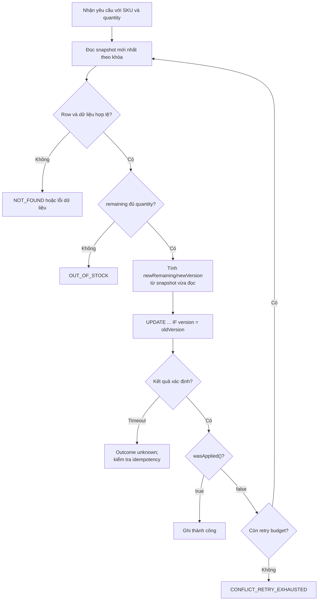

# Đọc lại, tính lại và thử lại khi có xung đột

## Mục tiêu học tập

Trong Spring Data Cassandra, một lệnh cập nhật có điều kiện như `UPDATE ... IF version = ?` có thể thất bại **dù Cassandra không gặp lỗi mạng**. Đây là kết quả bình thường khi một tiến trình khác đã thay đổi dữ liệu trước. Lỗi thiết kế thường gặp là thử lại câu ghi cũ mà không đọc trạng thái mới, hoặc coi mọi thất bại đều giống nhau.

Bài này thuộc chương **LWT và khóa lạc quan** của module `SPRING_DATA_CASSANDRA`. Nội dung tập trung vào vòng xử lý khi nhiều request cạnh tranh trên một trạng thái: **đọc phiên bản hiện tại → tính thay đổi từ phiên bản ấy → ghi có điều kiện → nếu xung đột thì đọc lại, tính lại và thử lại trong giới hạn**. Cách truy cập qua repository, `CassandraTemplate`, `CqlTemplate` và CQL vẫn cần tuân thủ thiết kế partition key, consistency, paging và kiểm soát hiệu năng phân tán.

Sau bài học, bạn có thể:

- Giải thích vì sao chỉ đọc và ghi với `QUORUM` vẫn không bảo vệ được thao tác **read-modify-write**.
- Hiểu LWT với `IF`, kết quả `[applied]`/`wasApplied()` và vai trò của phiên bản dữ liệu.
- Viết đúng vòng **re-read → recompute → conditional write**, không gửi lại giá trị từ snapshot cũ.
- Phân biệt **xung đột phiên bản**, **không đủ điều kiện nghiệp vụ**, **timeout chưa rõ kết quả** và **lỗi không thể thử lại**.
- Thiết kế số lần thử, deadline, backoff, jitter, idempotency và giới hạn điểm nóng.
- Viết prepared CQL với `CqlSession` do Spring quản lý; cân nhắc `@Version` theo phiên bản Spring Data.
- Kiểm thử nhiều writer đồng thời, dữ liệu bị xóa, version thiếu, consistency đa datacenter và lỗi giữa nhiều bảng.

## 1. Vì sao read-modify-write có thể mất cập nhật?

Giả sử có sản phẩm `SKU-001` với **5 đơn vị tồn kho**. Hai request đồng thời muốn giữ hàng:

- Request A giữ 2 đơn vị.
- Request B giữ 3 đơn vị.

Nếu mỗi request đọc, tính toán rồi ghi lại mà **không kiểm tra phiên bản**, lịch sử có thể là:

```text
Thời gian -------------------------------------------------------->

Request A                 Cassandra                 Request B
   |                         |                         |
   |--- SELECT remaining --->|<--- SELECT remaining ---|
   |<------ 5 --------------|-------------- 5 -------->|
   |                         |                         |
   |  tính: 5 - 2 = 3        |           tính: 5 - 3 = 2
   |                         |                         |
   |--- UPDATE remaining=3 ->|<-- UPDATE remaining=2 ---|
   |                         |                         |
   |     ghi thành công      |          ghi thành công  |
```

Giá trị cuối có thể là 3 hoặc 2 theo timestamp/quy tắc xung đột của Cassandra. Trong khi đó hai request đều có thể báo giữ hàng thành công. Nghiệp vụ đúng phải trừ **tổng cộng 5 đơn vị**, tức `remaining = 0`.

Đây là **lost update/read-modify-write race**. Chọn `LOCAL_QUORUM` cho cả SELECT và UPDATE thay đổi số replica cần phản hồi; nó **không** biến hai câu lệnh riêng thành một thao tác nguyên tử.

| Cơ chế | Câu hỏi nó giải quyết |
| --- | --- |
| Consistency level, ví dụ `ONE`, `LOCAL_QUORUM`, `QUORUM` | Bao nhiêu replica cần phản hồi theo topology và replication? |
| LWT `UPDATE ... IF ...` | Có được áp dụng thay đổi **nếu điều kiện ở trạng thái hiện tại thỏa** không? |
| Version/optimistic locking | Snapshot client đã đọc có còn phù hợp để cập nhật không? |
| Idempotency cấp nghiệp vụ | Một ý định giữ hàng bị gửi lại có làm giữ thêm lần nữa không? |

Quorum, CAS và idempotency bổ sung nhau, nhưng **không thay thế nhau**.

## 2. Bảng CQL có version làm điều kiện bảo vệ

Ví dụ dùng một bảng nhỏ với mỗi SKU là một partition:

```sql
CREATE TABLE stock_by_sku (
    sku text PRIMARY KEY,
    remaining int,
    version bigint,
    updated_at timestamp
);
```

Ý nghĩa:

- `sku`: partition key và định danh trạng thái tồn kho.
- `remaining`: số lượng còn có thể giữ.
- `version`: số phiên bản nghiệp vụ tăng sau **mỗi thay đổi được chấp nhận**.
- `updated_at`: thời điểm nghiệp vụ, **không phải** bộ thay thế cho version.

Khởi tạo hàng bằng CQL có điều kiện:

```sql
INSERT INTO stock_by_sku (sku, remaining, version, updated_at)
VALUES ('SKU-001', 5, 10, '2026-11-25T09:00:00Z')
IF NOT EXISTS;
```

Kết quả LWT có `[applied]`: chỉ khi true mới được nói thao tác tạo mới đã được áp dụng. Khi false, ứng dụng cần đọc hoặc quyết định cách xử lý hàng hiện có.

**Thiết kế theo truy vấn:** ví dụ dùng khóa đơn để tập trung vào CAS. Trong hệ thống multi-tenant, khóa thường phải gồm tenant hoặc namespace có thể cách ly sản phẩm. Tất cả CAS phải định vị đúng partition; không được để hai tenant cùng sửa một `sku` do thiếu tenant trong khóa.

## 3. Conditional update: IF version = ?

Giả sử client đọc được:

```text
sku       = SKU-001
remaining = 5
version   = 10
```

Request A giữ 2 đơn vị, tính:

```text
newRemaining = 5 - 2 = 3
newVersion   = 10 + 1 = 11
```

Thay vì ghi thông thường, A gửi:

```sql
UPDATE stock_by_sku
SET remaining = 3,
    version = 11,
    updated_at = '2026-11-25T09:01:00Z'
WHERE sku = 'SKU-001'
IF version = 10;
```

Về ý nghĩa, câu này yêu cầu: **chỉ cập nhật nếu version hiện tại vẫn là 10**. Cassandra dùng cơ chế LWT/Paxos để quyết định conditional operation trong phạm vi được hỗ trợ.

Sau khi A thành công, trạng thái là:

```text
remaining = 3
version   = 11
```

Request B trước đó cũng đọc `(5,10)`, muốn giữ 3 và định gửi:

```sql
UPDATE stock_by_sku
SET remaining = 2,
    version = 11
WHERE sku = 'SKU-001'
IF version = 10;
```

Lúc này B nhận **`[applied]=false`**, vì version hiện tại không còn là 10. Đây là **kết quả xung đột dữ liệu**, không phải lỗi kết nối.

### Đừng bỏ qua [applied]

| Kết quả | Có biết lệnh được áp dụng không? | Bước tiếp |
| --- | --- | --- |
| `[applied]=true` | Có, thay đổi điều kiện đã được chấp nhận. | Hoàn tất bước ghi và xử lý kết quả nghiệp vụ. |
| `[applied]=false` | Có, **lần CAS này** không được áp dụng. | Đọc lại, tính lại, có thể thử lại. |
| Timeout/không nhận response | **Không chắc** lệnh đã áp dụng hay chưa. | Kiểm tra idempotency/outcome, không retry mù quáng. |
| Lỗi schema, thiếu quyền, kiểu bind sai | Query không hợp lệ. | Sửa lỗi, không gọi đó là optimistic conflict. |

Response `[applied]=false` của conditional statement có thể kèm một số giá trị hiện tại, tùy cú pháp và phiên bản. **Không mặc định response là một entity snapshot đầy đủ**. Trong quy trình minh họa, cách đơn giản và rõ nhất là SELECT lại những cột cần cho phép tính.

## 4. Vòng đúng: đọc lại → tính lại → thử lại

Nếu B chỉ gửi lại CQL cũ:

```sql
-- Sai: snapshot remaining=5, version=10 đã cũ.
UPDATE stock_by_sku
SET remaining = 2, version = 11
WHERE sku = 'SKU-001'
IF version = 10;
```

thì điều kiện tiếp tục không khớp. Nhưng **chỉ sửa** `IF version=11` rồi giữ `remaining=2` còn nguy hiểm hơn:

```sql
-- Sai nghiệp vụ: đổi version trong IF nhưng không tính lại remaining.
UPDATE stock_by_sku
SET remaining = 2, version = 12
WHERE sku = 'SKU-001'
IF version = 11;
```

B muốn giữ 3 đơn vị, và sau A còn 3. Kết quả đúng phải là **0**, không phải 2. Vòng xử lý cần có ba bước:

1. **Đọc lại:** `remaining=3, version=11`.
2. **Tính lại:** `3-3=0` và `11+1=12`.
3. **Thử lại:** CAS `IF version=11` với giá trị mới.

```sql
UPDATE stock_by_sku
SET remaining = 0,
    version = 12
WHERE sku = 'SKU-001'
IF version = 11;
```

Nếu không có writer mới chen vào và CAS được áp dụng, hai reservation độc lập hoàn tất chính xác:

```text
Ban đầu: remaining=5, version=10
A giữ 2 -> remaining=3, version=11 -> applied=true
B đọc lại (3,11), giữ 3
         -> remaining=0, version=12 -> applied=true
```

### Khi đọc lại thấy không đủ hàng

Nếu B muốn giữ **4** thay vì 3, sau khi A giữ 2 thì `remaining=3`. B phải **trả OUT_OF_STOCK**, không tìm cách “nâng version cho đến khi thành công”.

**Retry không có nghĩa phải thành công bằng mọi giá.** Trạng thái mới có thể khiến điều kiện nghiệp vụ không còn hợp lệ.

### Sơ đồ quyết định



**Nhánh `applied=false` khác hoàn toàn nhánh timeout**: một nhánh xác nhận điều kiện không được áp dụng, nhánh kia chưa cho biết outcome.

## 5. Recompute là thực hiện lại quy tắc nghiệp vụ

“Tính lại” không đơn giản là tăng `version`. Nó nghĩa là **kiểm tra lại toàn bộ tiền đề** của ý định trên snapshot mới.

| Bài toán | Cần đọc lại | Cần tính/kiểm tra lại |
| --- | --- | --- |
| Giữ hàng | `remaining`, `version`, trạng thái SKU | Có đủ hàng? SKU còn bán? Số lượng mới? |
| Áp mã giảm giá | Quota, số lượt đã dùng, version | Có vượt giới hạn? Mã còn hợp lệ? |
| Đổi trạng thái đơn | Status và version | Chuyển tiếp trạng thái còn hợp lệ? |
| Sửa hồ sơ người dùng | Các field liên quan và version | Merge hay báo conflict khi field khác đã đổi? |
| Hạn mức API | Quota, cửa sổ thời gian, version | Request có còn được phép thực hiện? |

Ví dụ:

```text
Ban đầu: order.status=PENDING, version=7
A xác nhận thanh toán -> PAID, version=8
B muốn hủy, đã đọc PENDING/v7

B CAS bị conflict.
B đọc lại thấy PAID/v8.

Quy tắc nghiệp vụ có thể:
  - cho phép PAID -> CANCELLATION_REQUESTED;
  - từ chối hủy trực tiếp;
  - hoặc yêu cầu một quy trình hoàn tiền.

B không được tự ép status=CANCELLED
chỉ vì version mới là 8.
```

Đọc lại nhằm xác định **quyết định mới đúng là gì**, không phải để tìm một version dễ thắng.

## 6. Kết quả không áp dụng là dữ liệu, không nhất thiết là exception

Java Driver 4.x cung cấp `ResultSet.wasApplied()` cho câu lệnh điều kiện:

```java
ResultSet resultSet = session.execute(boundConditionalUpdate);

if (resultSet.wasApplied()) {
    // LWT được áp dụng.
} else {
    // Điều kiện IF không thỏa: đọc lại và tính lại.
}
```

Không viết:

```java
// Sai vì bỏ qua kết quả điều kiện:
session.execute(boundConditionalUpdate);
return true;
```

Trong API HTTP, `409 Conflict` khi hết retry budget là một lựa chọn thường hợp lý. Nhưng không nên biến “không đủ hàng” thành lỗi hạ tầng, cũng không coi timeout là phiên bản khác của `409`. Hợp đồng API nên có mã lỗi máy đọc được cho từng nhánh.

## 7. Triển khai Java với CqlSession và retry có giới hạn

Ví dụ sau dùng **Java 17+**, **Java Driver 4.x** và `CqlSession` được Spring inject. Nó tập trung vào việc xử lý xung đột **đã có kết quả xác định**, không tự retry timeout.

### 7.1. Snapshot và kết quả

```java
public record StockSnapshot(int remaining, long version) {
}

public enum ReservationResult {
    RESERVED,
    OUT_OF_STOCK,
    NOT_FOUND,
    CONFLICT_RETRY_EXHAUSTED
}
```

### 7.2. Gateway với prepared statements

```java
import com.datastax.oss.driver.api.core.CqlSession;
import com.datastax.oss.driver.api.core.DefaultConsistencyLevel;
import com.datastax.oss.driver.api.core.cql.BoundStatement;
import com.datastax.oss.driver.api.core.cql.PreparedStatement;
import com.datastax.oss.driver.api.core.cql.ResultSet;
import com.datastax.oss.driver.api.core.cql.Row;

import org.springframework.stereotype.Repository;

@Repository
public final class StockCasGateway {

    private static final int MAX_CONFLICT_ATTEMPTS = 5;

    private final CqlSession session;
    private final PreparedStatement readCurrent;
    private final PreparedStatement conditionalUpdate;

    public StockCasGateway(CqlSession session) {
        this.session = session;
        this.readCurrent = session.prepare("""
            SELECT remaining, version
            FROM stock_by_sku
            WHERE sku = ?
            """);

        this.conditionalUpdate = session.prepare("""
            UPDATE stock_by_sku
            SET remaining = ?, version = ?
            WHERE sku = ?
            IF version = ?
            """);
    }

    public ReservationResult reserve(String sku, int quantity) {
        if (sku == null || sku.isBlank() || quantity <= 0) {
            throw new IllegalArgumentException(
                    "sku is required and quantity must be positive");
        }

        for (int attempt = 1;
                attempt <= MAX_CONFLICT_ATTEMPTS; attempt++) {

            StockSnapshot snapshot = readStock(sku);
            if (snapshot == null) {
                return ReservationResult.NOT_FOUND;
            }

            if (snapshot.remaining() < quantity) {
                return ReservationResult.OUT_OF_STOCK;
            }

            int newRemaining =
                    Math.subtractExact(snapshot.remaining(), quantity);
            long newVersion = Math.addExact(snapshot.version(), 1L);

            BoundStatement write = conditionalUpdate.bind(
                    newRemaining,
                    newVersion,
                    sku,
                    snapshot.version()
                )
                .setConsistencyLevel(DefaultConsistencyLevel.LOCAL_QUORUM)
                .setSerialConsistencyLevel(
                        DefaultConsistencyLevel.LOCAL_SERIAL);

            ResultSet resultSet = session.execute(write);
            if (resultSet.wasApplied()) {
                return ReservationResult.RESERVED;
            }

            // Conflict: vòng tiếp theo đọc lại trạng thái và tính lại.
        }

        return ReservationResult.CONFLICT_RETRY_EXHAUSTED;
    }

    private StockSnapshot readStock(String sku) {
        BoundStatement query = readCurrent.bind(sku)
                .setConsistencyLevel(
                        DefaultConsistencyLevel.LOCAL_QUORUM);

        Row row = session.execute(query).one();
        if (row == null) {
            return null;
        }
        if (row.isNull("remaining") || row.isNull("version")) {
            throw new IllegalStateException(
                    "Stock row must have remaining and version");
        }

        return new StockSnapshot(
                row.getInt("remaining"),
                row.getLong("version"));
    }
}
```

**Giả định cần xác nhận khi triển khai:**

- Bảng `stock_by_sku` đã được tạo trước khi gateway prepare CQL.
- Các row tồn kho được khởi tạo với `remaining >= 0` và version khác null.
- Mọi writer thay đổi tồn kho đều dùng cùng protocol version/CAS.
- Lựa chọn `LOCAL_QUORUM + LOCAL_SERIAL` phù hợp với kiến trúc **một local DC được điều phối** trong ví dụ. Đây **không phải khuyến nghị mặc định cho mọi triển khai đa DC**.
- Client có trách nhiệm idempotency khi retry một yêu cầu nghiệp vụ bị timeout.

Mỗi lượt đều tạo `BoundStatement` từ tham số riêng, trong khi `PreparedStatement` và `CqlSession` được tái sử dụng. **Không tự tạo hoặc đóng một session cho mỗi HTTP request**.

### Vì sao ví dụ không catch và retry mọi exception?

LWT có thể **đã được áp dụng** trước khi một timeout khiến client không nhận phản hồi. Nếu catch mọi exception rồi đọc lại và trừ tiếp, một request giữ hàng có thể trừ hàng **hai lần**. Gateway trên chỉ tự retry khi có kết quả xác định `wasApplied()==false`; lỗi không chắc outcome phải được xử lý theo quy trình idempotency riêng.

## 8. Phân loại kết quả trước khi quyết định hành động

| Tình huống | Đã biết lần ghi áp dụng chưa? | Hướng xử lý |
| --- | --- | --- |
| `wasApplied()==true` | Có. | Kết thúc lần ghi, không lặp lại ý định. |
| `wasApplied()==false` | Có, lần CAS này **không** được áp dụng. | SELECT lại, chạy lại luật nghiệp vụ, retry có giới hạn. |
| SELECT lại thấy hàng không đủ | Có kết quả quan sát về điều kiện nghiệp vụ. | OUT_OF_STOCK, không CAS tiếp. |
| SELECT không có row | Có kết quả đọc tại thời điểm ấy. | NOT_FOUND hoặc luồng tạo mới riêng với `IF NOT EXISTS`. |
| Timeout ở câu CAS | **Không chắc**. | Xác minh outcome bằng operation ID/thiết kế idempotent. |
| Lỗi schema, quyền, bind type | Lỗi không thuộc version conflict. | Sửa schema/config/code, không retry mù quáng. |
| Không đủ replica đáp ứng CL | Không thể thực hiện theo yêu cầu consistency. | Trả lỗi khả dụng/điều tra topology, không tự hạ CL. |

**Không biến timeout thành `applied=false`.** Xung đột và sự cố truyền thông có ngữ nghĩa khác nhau, dù đều khiến client chưa thể trả “thành công”.

## 9. Timeout có thể khiến giữ hàng hai lần

Giả sử A gửi:

```text
Đã đọc: remaining=5, version=10
CAS:     remaining=3, version=11 IF version=10
```

Cassandra có thể đã áp dụng LWT, nhưng response bị mất. Client nhận timeout. Nếu ứng dụng coi timeout như conflict:

```text
Timeout
  ↓
Đọc lại thấy remaining=3, version=11
  ↓
Không có operation ID để nhận diện request cũ
  ↓
Lại trừ thêm 2
  ↓
CAS còn remaining=1, version=12
```

Thế là **một ý định giữ 2 đơn vị đã làm trừ 4**. Đây là lỗi ở tầng nghiệp vụ, không phải lỗi so sánh version của từng CAS.

Sau timeout có nhiều khả năng:

- CAS chưa được áp dụng.
- CAS đã được áp dụng nhưng phản hồi mất.
- Quyết định có thể đang được hoàn tất và client thiếu thông tin.

Muốn xử lý đúng, hệ thống phải có một **cách xác định ý định nghiệp vụ đã được thực hiện chưa** hoặc một protocol khiến retry cùng ý định trở nên idempotent. Đọc `remaining/version` mới **không đủ** để phân biệt “request A đã thành công” với “một request khác đã trừ số lượng tương tự”.

## 10. Idempotency key và sổ ghi nhận thao tác

Một API giữ hàng có thể yêu cầu `operationId` ổn định:

```text
POST /reservations
Idempotency-Key: 0b6f2d13-5e2f-4c46-9641-8d3896b1f4ba

Body:
{
  "sku": "SKU-001",
  "quantity": 2
}
```

Client phải gửi **cùng operation ID** khi thử lại cùng ý định. Nếu mỗi lần retry sinh ID mới, backend khó phân biệt retry với yêu cầu giữ hàng độc lập.

### Chỉ lưu last_operation_id chưa đủ

```text
Request A thành công -> last_operation_id=A
Request B thành công -> last_operation_id=B
Client A retry sau đó:
  last_operation_id đã là B
  không biết A đã từng thành công
```

Một thiết kế bền vững cần **sổ ghi các operation ID đã xử lý**, trạng thái/kết quả của chúng và giao thức gắn việc ghi trạng thái với dấu đã thực hiện. Bởi Cassandra không cung cấp ACID transaction tùy ý qua mọi partition, viết operation record ở một partition rồi CAS stock ở partition khác **không tự động trở thành một giao dịch nguyên tử**.

| Hướng tiếp cận | Điểm mạnh | Giới hạn |
| --- | --- | --- |
| Tạo operation record bằng `IF NOT EXISTS` | Phát hiện ID được gửi lại. | Không tự đảm bảo thay đổi stock ở partition khác đồng thời commit. |
| Phối hợp dấu operation và state trong phạm vi có CAS nhất quán | Có thể xây protocol ghi nhận kết quả chặt hơn. | Cần thiết kế khóa, hot partition, giới hạn LWT đúng phiên bản. |
| State machine `PENDING/APPLIED/FAILED` kèm reconciliation | Hỗ trợ partial failure và tiếp tục sau restart. | Tăng độ phức tạp, cần worker/monitoring. |
| Dịch vụ đặt chỗ chuyên trách | Tập trung điều phối cạnh tranh. | Thêm tầng failover, hàng đợi, điểm nghẽn cần quản lý. |

**Không hứa exactly-once** chỉ từ hai lệnh CQL có consistency level mạnh; phải phân tích mọi đường lỗi và thử lại trong workflow.

## 11. Retry budget: phải biết dừng

Một vòng `while(true)` với LWT trên partition nóng có thể tạo:

- Nhiều Paxos rounds và lưu lượng phối hợp.
- Hàng loạt request cùng đọc một version, xung đột rồi đồng loạt thử lại.
- Latency dài vượt HTTP deadline.
- Tiêu thụ CPU, kết nối và thread cho những request cuối cùng sẽ bị từ chối.

Nên giới hạn đồng thời:

1. **Số lượt CAS:** ví dụ 3–5 lần cho một request, tùy workload.
2. **Deadline:** không thử lại khi ngân sách thời gian sắp hết.
3. **Backoff và jitter:** tránh toàn bộ request retry đúng cùng một thời điểm.
4. **Rate limit/contending-key controls:** giảm bão truy cập lên cùng partition.

Ví dụ chính sách **chỉ minh họa**, không phải thông số khuyến nghị cố định:

```text
Max attempts = 4
Max elapsed  = 800 ms
Sau conflict:
  retry 2: ngẫu nhiên 15..35 ms
  retry 3: ngẫu nhiên 35..80 ms
  retry 4: ngẫu nhiên 80..160 ms

Hết ngân sách:
  trả CONFLICT_RETRY_EXHAUSTED
```

Nếu dùng reactive/nonblocking execution, không chặn event loop bằng `Thread.sleep`. Dùng cơ chế scheduling phù hợp với kiến trúc. Ngay cả khi mã đồng bộ, phải giữ giới hạn thời gian hợp lý.

## 12. Serial consistency và regular consistency

Java Driver cho phép cấu hình trên conditional statement:

```java
BoundStatement write = conditionalUpdate
        .bind(newRemaining, newVersion, sku, observedVersion)
        .setConsistencyLevel(DefaultConsistencyLevel.LOCAL_QUORUM)
        .setSerialConsistencyLevel(
                DefaultConsistencyLevel.LOCAL_SERIAL);
```

**Regular CL** (như `QUORUM`, `LOCAL_QUORUM`) là ngưỡng phản hồi cho đọc/ghi; **serial CL** (như `SERIAL`, `LOCAL_SERIAL`) liên quan tới giai đoạn LWT/Paxos. Dùng `LOCAL_QUORUM` cho một UPDATE **không có IF** không biến nó thành CAS.

### Cần lưu ý trong hệ nhiều datacenter

Hai quorum cục bộ ở các DC khác nhau không nhất thiết giao nhau. Khi cần thứ tự điều phối mạnh xuyên vùng, phải chọn serial consistency và client routing được thiết kế, kiểm chứng theo topology/phiên bản. **Không trộn tùy tiện `SERIAL` với `LOCAL_SERIAL` cho những writer trên cùng state** rồi khẳng định có một quy tắc tuần tự hóa toàn cụm.

Kết quả `applied=false` không được “sửa” bằng hạ consistency level; điều kiện vẫn sai, còn ngưỡng phản hồi yếu hơn có thể làm thay đổi hợp đồng nhất quán mà ứng dụng cần.

## 13. Mọi writer phải tuân theo cùng một giao thức version

Gateway CAS ở phần trước chỉ an toàn theo các giả định **về tất cả writer cùng thay đổi trạng thái**. Xét trường hợp một service cũ hoặc script vận hành vẫn ghi:

```sql
-- Phản ví dụ: ghi thường, bỏ qua version.
UPDATE stock_by_sku
SET remaining = 100
WHERE sku = 'SKU-001';
```

Nếu script thay `remaining` nhưng **không tăng version**, một gateway đã đọc `version=11` trước đó có thể tiếp tục thực hiện `IF version=11` như thể snapshot chưa bị thay đổi. Khi ấy kiểm tra version không còn đủ đại diện cho mọi thay đổi trạng thái nghiệp vụ.

Quy tắc triển khai:

1. Liệt kê **mọi** đường ghi vào trạng thái được bảo vệ: REST, job nền, nhập dữ liệu, công cụ quản trị, migration, retry và service cũ.
2. Buộc mỗi đường ghi liên quan phải dùng cùng chiến lược bảo vệ trạng thái hoặc một protocol tương thích đã được chứng minh.
3. Không để một luồng dùng CAS, luồng khác dùng `UPDATE` thường trên cùng dữ liệu cần bảo vệ.
4. Giữ cách khởi tạo `version` nhất quán.
5. Kiểm thử cạnh tranh **qua nhiều service** chứ không chỉ hai lời gọi cùng một method.

### Tại sao optimistic locking là một quy ước toàn hệ thống?

Optimistic locking không phải “một tính năng tự bật trên cột `version`”. Nó là **giao thức**: mọi thay đổi có liên quan đều phải kiểm tra snapshot phù hợp và tiến version đúng cách.

Không tuân thủ giao thức có thể tạo lỗi âm thầm: mỗi CAS riêng lẻ vẫn trả applied=true đúng điều kiện được đưa ra, nhưng điều kiện ấy không còn đại diện cho trạng thái thực tế của nghiệp vụ.

## 14. Repository và @Version trong Spring Data Cassandra

Spring Data Cassandra cho phép ánh xạ entity theo `@Table` và `@PrimaryKey`. Các phiên bản hỗ trợ optimistic locking có thể dùng `@Version` để quản lý phiên bản khi ghi entity qua những đường API tương ứng.

Entity minh họa:

```java
import org.springframework.data.annotation.Version;
import org.springframework.data.cassandra.core.mapping.Column;
import org.springframework.data.cassandra.core.mapping.PrimaryKey;
import org.springframework.data.cassandra.core.mapping.Table;

@Table("stock_by_sku")
public class Stock {

    @PrimaryKey
    private String sku;

    @Column("remaining")
    private Integer remaining;

    @Version
    @Column("version")
    private Long version;

    // Constructor, getters/setters theo quy ước dự án.
}
```

Repository:

```java
import org.springframework.data.cassandra.repository.CassandraRepository;

public interface StockRepository
        extends CassandraRepository<Stock, String> {
}
```

**Cần kiểm chứng phiên bản:** khả năng và hành vi cụ thể của `@Version` phụ thuộc phiên bản Spring Data Cassandra, đường ghi repository/template, cách khởi tạo entity mới, điều kiện CQL được tạo ra và loại exception khi conflict. Không được mặc định rằng chỉ đặt tên property là `version` sẽ kích hoạt CAS; cũng không tự coi mọi `save(entity)` là LWT nếu không cấu hình hợp lệ.

### Service cần đọc lại entity sau conflict

Một mẫu sai:

```java
// Sai: giữ cùng object đã bị conflict.
Stock stock = repository.findById(sku).orElseThrow();
stock.setRemaining(stock.getRemaining() - quantity);

while (true) {
    try {
        repository.save(stock);
        break;
    } catch (OptimisticLockingFailureException ex) {
        // Không tải lại: vẫn lưu snapshot cũ!
    }
}
```

Đây là phản ví dụ. Nó vừa có vòng lặp vô hạn, vừa giữ `remaining/version` từ ảnh chụp cũ.

Một hướng pseudocode đúng hơn:

```java
// Pseudocode: chỉ đúng khi đã xác nhận optimistic locking
// của repository trên phiên bản đang dùng.
for (int attempt = 0; attempt < MAX_ATTEMPTS; attempt++) {
    Stock fresh = repository.findById(sku).orElseThrow();
    if (fresh.getRemaining() < quantity) {
        return OUT_OF_STOCK;
    }

    fresh.setRemaining(fresh.getRemaining() - quantity);

    try {
        repository.save(fresh);
        return RESERVED;
    } catch (OptimisticLockingFailureException conflict) {
        // Vòng tiếp theo bắt buộc findById() và tính lại.
    }
}
return CONFLICT_RETRY_EXHAUSTED;
```

Pseudocode này bỏ qua khai báo import/enum, timeout policy và idempotency nhằm làm rõ **điểm bắt buộc đọc lại**. Trong dự án thật, cần xác nhận exception cụ thể thuộc optimistic locking, phân biệt với timeout và không catch tổng quát mọi `RuntimeException` thành conflict.

### Khi nào chọn prepared CQL thay vì @Version?

| Nhu cầu | Hướng phù hợp hơn |
| --- | --- |
| CRUD entity có version với support được xác nhận | Repository/`CassandraTemplate` có optimistic locking. |
| Muốn điều kiện `IF status = 'PENDING'` hoặc guard tùy chỉnh | Conditional CQL tường minh qua driver/template thích hợp. |
| Phải kiểm soát regular/serial consistency cho từng request | `CqlSession` và statement options cụ thể. |
| Muốn phân biệt rõ `[applied]` và giữ nguyên kiểu kết quả | Prepared CQL rồi đọc `wasApplied()`. |
| Muốn cập nhật đúng một vài cột mà không ghi lại entity thiếu dữ liệu | Lệnh `UPDATE` mục tiêu với khóa/điều kiện đầy đủ. |

Không có API Java nào thay thế được việc hiểu CQL sẽ được sinh như thế nào.

## 15. CassandraTemplate, CqlTemplate và CqlSession: ranh giới trách nhiệm

Một ứng dụng có thể dùng nhiều abstraction:

```text
HTTP / Business Service
   |
   +-- SELECT snapshot ------------------------+
   |       Repository / CassandraTemplate      |
   |                                           |
   +-- Tính và kiểm tra luật nghiệp vụ ---------+
   |                                           |
   +-- UPDATE ... IF version ------------------+
   |       CqlTemplate / CqlSession            |
   |                                           |
   +-- Nếu applied=false: SELECT lại ----------+
```

`CassandraTemplate` dùng metadata entity mapping; `CqlTemplate` làm việc gần CQL và RowMapper; `CqlSession` là API của Java Driver. Chúng có thể dùng **hạ tầng kết nối Spring quản lý** trong cùng ứng dụng.

Nếu kết hợp nhiều API, hãy xác nhận:

- Cùng **keyspace, bảng và khóa**.
- Cùng kiểu dữ liệu CQL, converters và semantics của `version`.
- Không có một repository path khác `save()` mà vô tình ghi thường bỏ qua CAS.
- Regular/serial CL được chọn có chủ đích.
- Thứ tự bind parameters chính xác.
- Không đóng `CqlSession` được Spring inject sau từng request.

**Dùng cùng session không gộp SELECT và UPDATE thành transaction.** Lệnh `IF` mới thực hiện điều kiện bảo vệ trạng thái trong đường ghi.

## 16. Bản ghi chưa tồn tại, bị xóa và dữ liệu legacy

Không phải mọi conflict đều đơn giản là “version đã tăng”.

### Row chưa tồn tại

Nếu `SELECT` trả không có hàng, service nên quyết định:

- Trả `NOT_FOUND`.
- Hoặc khởi tạo bằng quy trình tạo mới với `INSERT ... IF NOT EXISTS`, khi nghiệp vụ cho phép.

Không thay mọi nhánh không tồn tại bằng `UPDATE` thường. Trong Cassandra, `UPDATE` có semantics upsert; không có điều kiện bảo vệ, nó có thể tạo giá trị mới trên khóa chưa được khởi tạo đầy đủ.

### Row bị xóa trong lúc cạnh tranh

```text
A đọc row (remaining=3, version=11)
B xóa row theo quy trình hợp lệ
A gửi UPDATE ... IF version=11
```

Ứng dụng cần dựa trên **kết quả LWT thực** và xử lý trường hợp hàng biến mất; không mặc định ảnh chụp cũ cho phép cập nhật thành công. Khi xóa và tạo lại cùng khóa, cũng phải thiết kế cách tránh một yêu cầu cũ ghi vào thế hệ mới của đối tượng; version tăng theo vòng đời hoặc một **generation ID** có thể cần thiết.

### Version bị null hoặc chưa có

Dữ liệu legacy/import có thể thiếu `version`:

```text
remaining = 5
version   = null
```

Không nên đọc bằng getter primitive rồi coi `null` thành 0. Gateway ví dụ ở trên **chặn** trường hợp này và yêu cầu migration/khởi tạo version có chủ đích. Nếu ứng dụng cần hỗ trợ nâng cấp dữ liệu dần, phải thiết kế điều kiện chuyển đổi an toàn và kiểm thử khi nhiều writer cùng migration.

### Tràn số

`version` có kiểu `bigint`, mapping thành `long` Java. Khi tăng version, dùng `Math.addExact(...)` để không âm thầm overflow. Với hệ thống có lưu lượng cực lớn, còn cần chiến lược version/generation phù hợp theo vòng đời dữ liệu.

## 17. TTL và tombstone ảnh hưởng đến tính hợp lệ của version

Cassandra hỗ trợ TTL theo cell, xóa logic bằng tombstone và dọn dẹp vật lý qua compaction/repair theo điều kiện tương ứng. Nếu version và dữ liệu nghiệp vụ có **thời hạn sống khác nhau**, có thể xuất hiện:

```text
remaining còn sống
version đã hết TTL

hoặc:

row đã hết hạn logic
tombstone còn trong cơ chế lưu trữ
```

Nếu `version` là guard của CAS, không được xem việc version hết TTL như chi tiết không đáng kể. Một hàng có remaining còn sống nhưng version null làm protocol không còn xác định rõ.

Hướng kiểm soát:

1. Quy định trạng thái nào được phép có TTL và TTL áp dụng cho **những cell nào**.
2. Đừng để cột guard/version biến mất độc lập trong khi dữ liệu mà nó bảo vệ vẫn sống.
3. Kiểm tra ảnh hưởng của `default_time_to_live` và các lần update.
4. Xác định hành vi khi một row hết hạn/xóa rồi được tạo lại.
5. Thử cạnh tranh giữa expiration và conditional update.

Tombstone còn có thể làm query chậm. Dù một truy vấn có đủ partition key, **nhiều dữ liệu hết hạn trong partition lớn vẫn ảnh hưởng chi phí đọc và LWT**. Không chữa bằng retry vô hạn.

## 18. Invariant trên nhiều partition không được bảo vệ bởi một CAS

Một thao tác giữ hàng thực tế có thể gồm:

```text
1) Trừ tồn kho ở stock_by_sku.
2) Ghi reservation_by_id.
3) Ghi reservation_by_customer.
4) Phát sự kiện cho thanh toán/vận chuyển.
```

Lịch sử có thể xảy ra:

```text
CAS stock                 -> applied=true
INSERT reservation_by_id  -> timeout
INSERT reservation_by_customer -> chưa chạy
Send event                -> chưa biết đã phát hay chưa
```

CAS giúp bảo vệ trạng thái **một khóa/partition trong phạm vi được hỗ trợ**, nhưng không làm tất cả các bước khác trở thành một transaction ACID tự rollback.

Với hệ thống denormalized theo truy vấn Cassandra:

- Xác định **nguồn sự thật** của trạng thái reservation.
- Sử dụng **operation ID ổn định** ở các bước.
- Có state machine và cơ chế tiếp tục/đối soát sau partial failure.
- Không báo hoàn thành toàn bộ workflow khi mới có một bước CAS thành công.
- Thiết kế phát sự kiện/retry phù hợp để downstream không xử lý trùng.

`BATCH` của Cassandra có những ngữ nghĩa riêng, **không** được coi là transaction RDBMS với isolation và rollback tùy ý qua nhiều partition. Chọn consistency mạnh hơn cho mỗi bước không tự gộp các bước thành một transaction.

## 19. Tranh chấp cao và partition nóng

Giả sử 10.000 người cùng giữ một SKU số lượng rất ít. Cả 10.000 request đồng thời làm:

```text
SELECT cùng một stock row
CAS cùng version
Nhiều request applied=false
Đọc lại
CAS version mới
...
```

Đây là một **điểm tranh chấp tập trung**. Nếu mọi request retry quá nhiều, số LWT/Paxos rounds có thể tăng, làm độ trễ nặng hơn và tạo vòng xoáy contention.

| Phương án | Khi có thể hữu ích | Đánh đổi |
| --- | --- | --- |
| Bounded retry + jitter | Tranh chấp ngắn hạn ở mức vừa. | Không loại bỏ bottleneck trên một partition. |
| Rate limit/hạn mức theo key | Chặn bão request vào cùng SKU. | Có thể từ chối một số request hợp lệ khi quá tải. |
| Queue/serializing worker theo SKU | Nghiệp vụ chấp nhận xếp hàng. | Cần thiết kế failover, ordering và idempotency. |
| Phân bổ tồn kho theo shard | Có đủ dữ liệu và quy tắc phân bổ quota đúng. | Invariant tổng phức tạp; chia ngẫu nhiên có thể oversell. |
| Service reservation chuyên trách | Nhiều bước hoặc tác dụng phụ cần điều phối. | Tăng độ phức tạp và chi phí vận hành. |

Không tách một số lượng tồn chung thành các partition độc lập rồi cho **mỗi shard bán toàn bộ số lượng ban đầu**. Đó là cách làm mất invariant; phân vùng phải đi cùng kế hoạch phân bổ số lượng.

### Chỉ số nên đo

| Chỉ số | Ý nghĩa |
| --- | --- |
| Tỷ lệ `wasApplied=false` | Mức cạnh tranh trên version/guard. |
| Số attempt trung bình và p95 | Chi phí retry ở tầng ứng dụng. |
| LWT p95/p99 latency | Chi phí đồng thuận và tác động contention. |
| Tỷ lệ `CONFLICT_RETRY_EXHAUSTED` | Có cần giảm tải hoặc thay thiết kế không? |
| Timeout có outcome unknown | Rủi ro idempotency và quy trình đối soát. |
| Request trùng operation ID | Đánh giá hành vi client retry và chống xử lý lặp. |
| QPS theo SKU/partition | Nhận diện key nóng. |
| Partial failure nhiều bảng | Rủi ro lệch trạng thái denormalized. |

## 20. Kiểm thử cạnh tranh: không chỉ mock repository

Unit test có thể kiểm tra phép tính và retry policy, nhưng không chứng minh server áp dụng Paxos/consistency đúng như mong đợi. Cần **integration test với Cassandra phiên bản triển khai thực tế** để xác nhận đường LWT, driver và mapping.

### 20.1. Hai CAS cùng một version

Chuẩn bị:

```text
remaining=5, version=10
A muốn 2
B muốn 3
```

Cho A và B cùng đọc version 10, sau đó cùng gửi:

```sql
-- Câu A:
UPDATE stock_by_sku
SET remaining = 3, version = 11
WHERE sku = 'SKU-001'
IF version = 10;

-- Câu B:
UPDATE stock_by_sku
SET remaining = 2, version = 11
WHERE sku = 'SKU-001'
IF version = 10;
```

Kỳ vọng với protocol LWT đồng nhất: **không thể cả hai cùng được áp dụng trên cùng version ban đầu**. Request nhận false phải đọc lại và tính lại. Nếu A thắng trước, B sẽ tiếp tục với `remaining=3, version=11`, tính `newRemaining=0` và CAS version 11.

Kết quả cuối khi cả hai ý định độc lập được chấp nhận là `remaining=0, version=12`.

### 20.2. Sau conflict trở thành hết hàng

Chuẩn bị `remaining=5`, A giữ 2, B muốn 4. Nếu A thành công trước, B đọc lại thấy 3 và phải trả `OUT_OF_STOCK`, không ghi `remaining=-1`.

### 20.3. Conflict lặp lại nhiều lần

Tạo nhiều writer cạnh tranh cùng key. Kiểm tra:

- Không có vòng retry vô hạn.
- Mỗi lần áp dụng tính toán từ snapshot mới.
- Retry budget/deadline được tôn trọng.
- Không gửi email, trừ tiền hoặc tạo reservation bên ngoài trước khi chắc bước cần thiết đã được chấp nhận.

### 20.4. Timeout sau khi CAS thực sự đã được áp dụng

Trong môi trường fault injection, làm cho request CAS được server chấp nhận nhưng response không đến client. Kiểm tra:

1. Service **không** quy timeout thành `applied=false`.
2. Service không tự trừ lượng tồn lần nữa chỉ vì version mới đã xuất hiện.
3. Operation ID cho phép đối soát kết quả của ý định ban đầu.
4. API có trạng thái phù hợp khi outcome còn chưa xác định.

### 20.5. Writer ngoài protocol

Cho một code path ghi thường, không tăng version, rồi gọi gateway CAS. Test này cần chứng minh **giao thức toàn hệ thống bị vi phạm**, thay vì kỳ vọng tăng số retry ở gateway sẽ sửa được.

### 20.6. Dữ liệu legacy, TTL và xóa

Thử các trường hợp `version=null`, version overflow, row bị xóa giữa SELECT và CAS, dữ liệu hết TTL và row được tạo lại cùng ID. Mỗi trường hợp phải có kết quả xác định hoặc được chặn rõ ràng.

### 20.7. Multi-DC

Nếu production chạy nhiều datacenter, cần test regular/serial consistency đúng cấu hình, routing từ những DC khác nhau và sự cố liên vùng. Không suy ra bảo đảm đa DC từ unit test hoặc Cassandra một node.

## 21. Lỗi thường gặp và hướng khắc phục

| Triệu chứng | Nguyên nhân khả dĩ | Cách xử lý |
| --- | --- | --- |
| CAS liên tục `applied=false` | Code vẫn dùng old version hoặc nhiều writer tranh chấp. | SELECT lại, tính lại, giới hạn retry và đo contention. |
| Bản ghi cuối có lượng tồn sai | Đã sửa IF version nhưng giữ remaining tính từ snapshot cũ. | Recompute toàn bộ giá trị `SET` từ snapshot mới. |
| Hai đơn cùng được xác nhận dù chỉ còn một đơn vị | Read-modify-write không có điều kiện hoặc writer bypass CAS. | Áp CAS nhất quán, kiểm tra mọi đường ghi. |
| Một request bị trừ hàng hai lần | Timeout bị coi là conflict, retry không có idempotency. | Gắn operation ID và đối soát outcome. |
| Có `@Version` nhưng vẫn ghi đè | Chưa kiểm chứng hỗ trợ/đường ghi optimistic locking hoặc writer khác bỏ qua. | Kiểm tra CQL thực, cấu hình Spring Data và test cạnh tranh. |
| Version không có giá trị | Import/migration/TTL tạo row không đủ metadata. | Chặn dữ liệu bất hợp lệ và có quy trình khởi tạo version. |
| CAS timeout nhiều khi flash sale | Hot partition/LWT contention hoặc node chậm. | Giới hạn tải, backoff, phân tích topology/latency. |
| LOCAL_SERIAL hoạt động khác giữa các DC | Phạm vi serial consistency/routing không thống nhất. | Xác định bảo đảm cần thiết và cấu hình thống nhất. |
| Row bị xóa rồi lại “xuất hiện” | Upsert thường, dữ liệu cũ, retry, TTL/tombstone hoặc tái tạo khóa. | Kiểm tra toàn bộ lifecycle dữ liệu và operation semantics. |
| Stock CAS thành công nhưng thiếu reservation record | Partial failure giữa nhiều partition. | Workflow và reconciliation, không hứa atomicity ngoài phạm vi CAS. |

### Checklist trước khi phát hành

1. Primary key có xác định **đúng partition** và ranh giới tenant không?
2. Dữ liệu nào cần đọc để tính kết quả và kiểm tra luật nghiệp vụ?
3. Có version/guard bảo vệ **toàn bộ** những thay đổi liên quan không?
4. Mọi writer có thống nhất protocol và cách tăng version không?
5. Khi `applied=false`, code **đọc lại và tính lại** hay chỉ retry CQL cũ?
6. Khi timeout, có operation ID/idempotency hoặc khả năng xác minh outcome không?
7. Có side effect nào chạy trước khi biết CAS thành công không?
8. Retry có attempt limit, deadline và backoff/jitter không?
9. Regular và serial consistency có phù hợp phạm vi cluster/DC không?
10. Có integration test cho contention, partial failure, TTL/xóa và retry không?

## 22. Bài tập vận dụng

**Câu 1 — Tính lại số lượng.** A và B đọc `remaining=8, version=3`. A giữ 2 và CAS thành công; B muốn giữ 3, nhận `applied=false`. B nên gửi giá trị nào sau khi đọc lại?

**Gợi ý:** Trạng thái mới là `remaining=6, version=4`. B tính `6-3=3`, `newVersion=5`, dùng `IF version=4`; không dùng `8-3=5` từ snapshot cũ.

**Câu 2 — Hết hàng.** B muốn 4 đơn vị; sau conflict đọc lại chỉ còn 2. Có nên tiếp tục tăng version và retry không?

**Gợi ý:** Không. Đây là kết quả `OUT_OF_STOCK`; nghiệp vụ không còn thỏa.

**Câu 3 — Applied false.** `wasApplied()==false` có nghĩa server bị timeout không?

**Gợi ý:** Không. Cassandra đã trả kết quả xác định rằng điều kiện của lệnh không được áp dụng. Đọc lại và tính lại, thay vì retry nguyên CQL cũ.

**Câu 4 — Timeout.** LWT có thể đã trừ 2 đơn vị nhưng response bị mất. Tại sao đọc lại và trừ thêm 2 là sai?

**Gợi ý:** Có thể thực hiện cùng một ý định hai lần. Cần idempotency key và cơ chế xác định outcome.

**Câu 5 — Quorum.** SELECT và UPDATE đều dùng `LOCAL_QUORUM`. Vì sao vẫn có lost update?

**Gợi ý:** Cặp read-write là hai thao tác riêng. Consistency level không thay thế `IF`/CAS.

**Câu 6 — @Version.** Field entity có tên `version`. Có được mặc định mọi `repository.save()` đã dùng LWT không?

**Gợi ý:** Không. Cần annotation/cơ chế đúng phiên bản, xác nhận CQL có điều kiện và không có writer bypass.

**Câu 7 — Chuyển trạng thái.** Sau conflict, đơn đã `DELIVERED`, trong khi yêu cầu muốn `CANCELLED`. Chỉ nâng version là đủ?

**Gợi ý:** Không. Phải chạy lại quy tắc trạng thái; có thể cần từ chối hủy hoặc đi qua quy trình hoàn hàng.

**Câu 8 — Version thiếu.** Một row cũ có `remaining=5` nhưng `version=null`. Gateway có nên coi nó mặc định là phiên bản 0 không?

**Gợi ý:** Không. Cần quy trình migration/khởi tạo version rõ ràng và kiểm thử cạnh tranh.

**Câu 9 — Nhiều bảng.** CAS stock thành công nhưng insert reservation bị lỗi. Có thể coi giao dịch đã rollback tự động không?

**Gợi ý:** Không. Cần workflow, idempotency và đối soát trạng thái giữa các bảng.

**Câu 10 — Hot partition.** 10.000 request cùng tranh một SKU. Tăng retry tối đa lên 100 có chắc tốt hơn không?

**Gợi ý:** Không. Có thể tạo bão LWT, tăng latency và contention; cần retry budget, rate limit hoặc điều phối khác.

## Tổng kết

Khi dùng **LWT/optimistic locking** trong Spring Data Cassandra, `UPDATE ... IF version = ?` trả **`[applied]=false`** là dấu hiệu rõ ràng rằng snapshot cũ không còn hợp lệ cho lần thử đó. Cách xử lý đúng là **đọc lại trạng thái → kiểm tra và tính lại điều kiện/nghiệp vụ → gửi CAS mới với phiên bản mới**, trong giới hạn số lần thử và deadline. Không được chỉ đổi phiên bản ở điều kiện `IF` mà giữ những giá trị `SET` đã tính từ dữ liệu cũ.

Điều quan trọng không kém là **phân biệt xung đột với timeout**. Một LWT timeout có thể đã được áp dụng; retry cùng ý định mà thiếu idempotency có thể gây tác dụng phụ hai lần. Quorum quy định ngưỡng replica phản hồi, còn `IF`/LWT mới bảo vệ điều kiện cập nhật trong phạm vi thích hợp. Khi invariant trải nhiều partition, nhiều bảng hoặc dịch vụ ngoài Cassandra, cần bổ sung workflow và cơ chế đối soát.

Hãy thiết kế **giao thức version thống nhất cho mọi writer**, dùng đúng partition key, regular/serial consistency, kiểm tra `wasApplied()`, thử nghiệm concurrency và quan sát hot partition. Repository, `CassandraTemplate`, `CqlTemplate` và `CqlSession` là các tầng truy cập khác nhau; tính đúng đắn đến từ **thao tác có điều kiện và quyết định được tính lại trên dữ liệu mới**, không đến từ độ dài hay vẻ đơn giản của câu lệnh Java.
