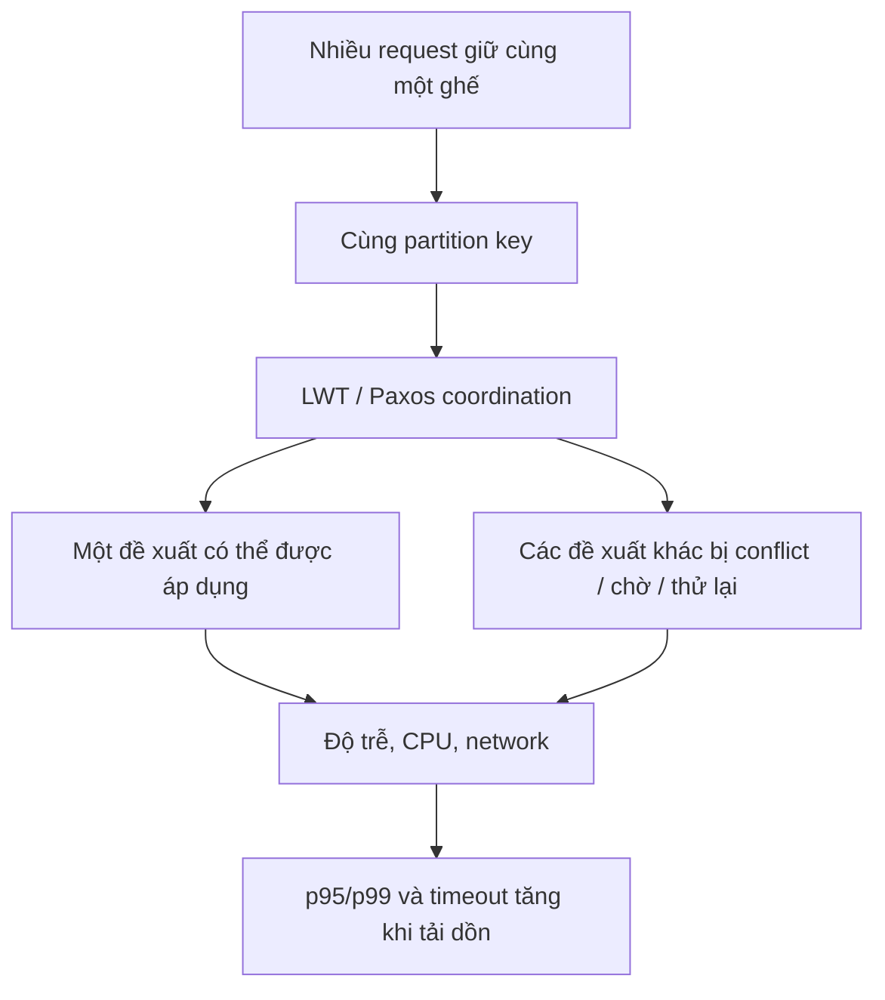
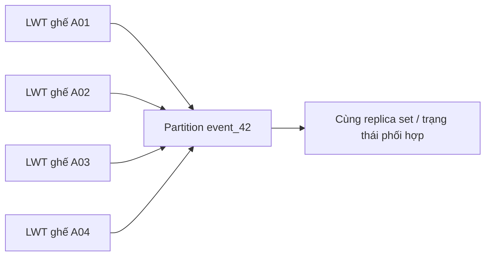
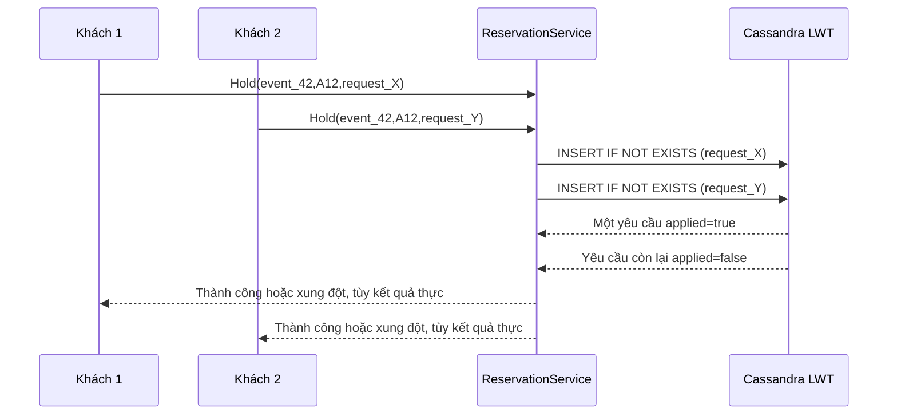
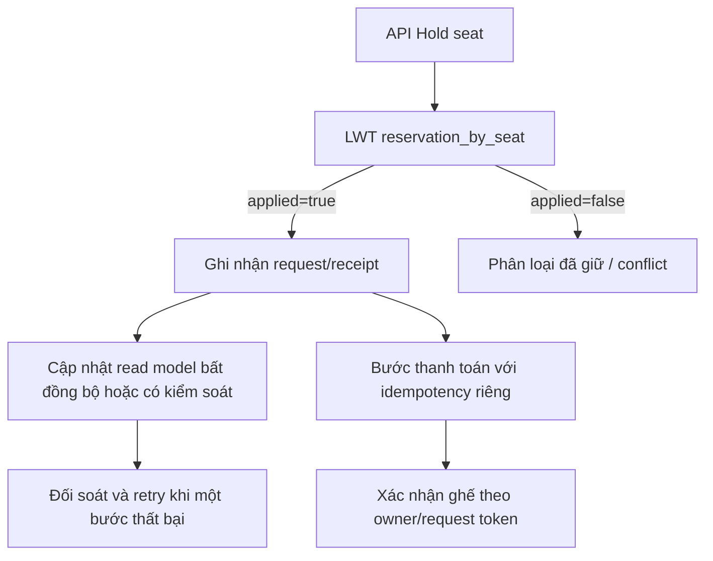

# Chi phí đồng thuận và mức tranh chấp trên cùng partition

## 1. Khi tính đúng phải trả giá bằng phối hợp phân tán

**Spring Data Cassandra** cho phép ứng dụng thao tác với Apache Cassandra qua `CassandraRepository`, `CassandraTemplate`, `CqlTemplate` và Java Driver. Phần lớn `INSERT`/`UPDATE` thông thường trong Cassandra có ngữ nghĩa **upsert** và hòa giải theo write timestamp; chúng không tự kiểm tra rằng giá trị trong database vẫn giống lúc ứng dụng đọc. Khi nghiệp vụ cần thao tác **chỉ thành công nếu một điều kiện còn đúng**, Cassandra cung cấp **lightweight transaction (LWT)** với câu CQL `IF`.

Ví dụ một ghế của buổi biểu diễn chỉ được giữ cho **một** khách:

```text
Ghế A12 đang trống.
Khách 1: muốn giữ A12.
Khách 2: cũng muốn giữ A12.

Chỉ một yêu cầu được quyền tạo bản ghi giữ chỗ đầu tiên.
Yêu cầu còn lại phải biết ghế đã có chủ, thay vì âm thầm ghi đè.
```

Với `INSERT ... IF NOT EXISTS`, Cassandra sử dụng một cơ chế đồng thuận thuộc họ **Paxos** trên các replica liên quan. Đây là khác biệt căn bản so với ghi thường: coordinator không chỉ phát mutation để nhận số lượng ACK phù hợp, mà còn phải **phối hợp trạng thái điều kiện và đề xuất ghi**.

Chi phí của lựa chọn đó thể hiện ở:

- Thêm công việc phối hợp và trao đổi mạng so với mutation không điều kiện.
- Cần phản hồi từ một tập replica theo **serial consistency** trong pha điều kiện và normal consistency cho phần tương ứng của thao tác.
- Có thể phát sinh vòng phối hợp bổ sung hoặc retry khi các LWT cạnh tranh.
- Một partition được nhiều client liên tục thực hiện LWT trở thành **điểm nóng đồng thuận**.
- Timeout khi LWT không đồng nghĩa với `applied=false`; client có thể không biết kết quả cuối của đề xuất.



**Ý chính:** không có một mức consistency, annotation Spring hay chỉ số timeout nào biến một **điểm tranh chấp có thật** thành một thao tác rẻ. Cần hiểu chính xác **miền đồng thuận (contention domain)**, rồi kiểm soát khóa dữ liệu, số writer đồng thời, retry và hợp đồng nghiệp vụ.

## 2. Hai lớp chi phí: thực thi LWT và tranh chấp LWT

### 2.1. Chi phí ngay cả khi không có đối thủ cạnh tranh

Một lệnh ghi thường:

```sql
UPDATE shop_lab.orders_by_id
SET status = 'PAID'
WHERE order_id = ?;
```

khác với lệnh:

```sql
UPDATE shop_lab.orders_by_id
SET status = 'PAID'
WHERE order_id = ?
IF status = 'PENDING';
```

Lệnh thứ hai không chỉ ghi `PAID`: nó phải kiểm tra trạng thái `PENDING` theo cơ chế điều kiện của Cassandra. Do đó, ngay cả khi chỉ có một writer, nó có thêm coordination overhead.

| Thành phần | Ghi không điều kiện | Ghi với `IF` / LWT |
| --- | --- | --- |
| Điều kiện giá trị cũ | Không được kiểm tra atomically | Được kiểm tra trong giao thức điều kiện |
| Đồng thuận Paxos | Không dùng cho mutation CQL thường | Có cơ chế phối hợp đồng thuận |
| Số round trip | Thường ít hơn | Thường nhiều hơn, còn tùy phiên bản/đường tối ưu |
| Kết quả xác nhận | Mutation thành công hoặc lỗi thực thi | Có `[applied] = true/false` khi nhận phản hồi hợp lệ |
| Độ trễ | Phụ thuộc replicas, tải và topology | Thêm độ trễ điều kiện/đồng thuận, có thể tăng vì cạnh tranh |
| Giá trị đem lại | Ghi nhanh theo mô hình Cassandra | Giữ bất biến “chỉ ghi nếu điều kiện đúng” |

**Không gán cứng** LWT luôn tốn đúng một số vòng mạng, ví dụ “bốn round trip”. Phiên bản Cassandra và những tối ưu Paxos có thể thay đổi đường đi thực tế; cách duy nhất để biết latency trên hệ thống của mình là **đo theo đúng Cassandra distribution/version, RF, datacenter và workload**.

### 2.2. Chi phí tăng thêm khi nhiều đề xuất cùng tranh một partition

Giả sử 100 request đồng thời đều gửi:

```sql
INSERT INTO reservations_by_seat (...)
VALUES (...)
IF NOT EXISTS;
```

trên **cùng một primary key**. Cơ chế điều kiện chỉ có thể áp dụng yêu cầu tạo mới phù hợp; các yêu cầu còn lại có thể thấy `[applied]=false`, có thể phải đợi, hoặc gặp lỗi/timeout khi tải cao.

Điểm dễ nhầm:

- `applied=false` là **kết quả điều kiện hợp lệ**, không phải nhất thiết lỗi Paxos.
- Một **contention timeout/error** phản ánh khó hoàn thành coordination, khác với điều kiện sai có kết quả xác nhận.
- Trong trường hợp timeout, **không được tự suy** đề xuất chưa được áp dụng.
- Retry mù quáng của cả 99 request thua cuộc có thể làm tải lớn hơn dù ghế chắc chắn đã có người giữ.
- Việc tăng request timeout chỉ làm client chờ lâu hơn, **không làm giảm số người đang tranh cùng khóa**.

## 3. Miền tranh chấp: primary key, partition key và replica

Trong Cassandra, **partition key** quyết định nơi dữ liệu được phân phối; cùng partition được quản lý bởi một tập replica. LWT phối hợp trạng thái đồng thuận trong phạm vi partition liên quan. Vì thế, không chỉ hai cập nhật cùng một cell mới có thể tranh chấp: **nhiều LWT trên các hàng khác nhau nhưng cùng partition** cũng có thể gây contention trên miền phối hợp đó.

Xét bảng gom mọi ghế của một sự kiện vào một partition:

```sql
-- Schema ví dụ local một node; production cần replication phù hợp.
CREATE KEYSPACE IF NOT EXISTS tickets_lab
WITH replication = {
    'class': 'SimpleStrategy',
    'replication_factor': 1
};

CREATE TABLE IF NOT EXISTS tickets_lab.seats_by_event (
    event_id uuid,
    seat_id text,
    holder_id uuid,
    state text,
    PRIMARY KEY ((event_id), seat_id)
);
```

Ở bảng này:

```text
Partition key: event_id
Clustering key: seat_id

(event_42, A01) -> cùng partition event_42
(event_42, A02) -> cùng partition event_42
(event_42, A03) -> cùng partition event_42
...
```

Ngay cả khi 1.000 khách đang giữ **1.000 ghế khác nhau**, chúng vẫn chạm vào **một partition** của sự kiện. Với ghi thông thường, partition lớn/nóng đã là nguy cơ. Nếu mỗi ghế đều dùng LWT, **miền đồng thuận tập trung trên cùng partition** làm tình hình khó hơn.



> **Không đồng nhất hai khái niệm:** *cùng partition key* là vấn đề phân bố và miền phối hợp; *cùng hàng/cùng điều kiện* còn gây cạnh tranh logic vì tất cả muốn sở hữu cùng tài nguyên. Việc thiết kế lại partition có thể giảm tranh chấp **giữa các ghế khác nhau**, nhưng không thể loại bỏ cạnh tranh **giữa các khách cùng muốn ghế A12**.

### 3.1. Tách partition theo tài nguyên có bất biến độc lập

Nếu bất biến thật sự là “mỗi `(event_id, seat_id)` chỉ có một người giữ”, schema có thể dùng cả hai trường làm **composite partition key**:

```sql
CREATE TABLE IF NOT EXISTS tickets_lab.reservation_by_seat (
    event_id uuid,
    seat_id text,
    holder_id uuid,
    request_id uuid,
    state text,
    created_at timestamp,
    PRIMARY KEY ((event_id, seat_id))
);
```

Lúc này mỗi ghế của mỗi sự kiện có **một partition riêng**, giúp các LWT cho `A01`, `A02`, `A03` không dồn vào cùng một partition chỉ vì chung `event_id`. Hash partition key cũng phân bố tải giữa các token ranges/replica sets tùy cluster.

**Đánh đổi:** nếu UI muốn liệt kê cả sơ đồ ghế của một sự kiện, bảng tra cứu từng ghế không phải read model tối ưu cho việc đọc **tất cả ghế của một event**. Có thể cần bảng `seats_by_event_section` được cập nhật/đối soát riêng, cache read-side hoặc nguồn dữ liệu tổng hợp; không dùng truy vấn tìm toàn cluster để ghép sơ đồ ghế trong mỗi request.

### 3.2. “Sharding khóa giữ chỗ” có thể phá tính duy nhất

Giả sử cùng ghế A12 được ghi ngẫu nhiên vào 8 shard:

```text
reserve(event_42, A12, shard=2) -> IF NOT EXISTS: true
reserve(event_42, A12, shard=6) -> IF NOT EXISTS: true
```

Nếu shard là một phần của partition key và mỗi client chọn ngẫu nhiên, hai LWT ở **hai partition khác nhau** đều có thể thành công. **Tính duy nhất bị phá vỡ.**

Chỉ phân shard khi vẫn giữ được quy tắc: **mọi yêu cầu cạnh tranh cho cùng một invariant phải định vị đến đúng cùng một khóa điều kiện**, chẳng hạn shard được tính **ổn định từ cùng resource ID**. Với bài toán một ghế, dùng partition key trực tiếp `(event_id, seat_id)` thường dễ chứng minh hơn.

## 4. Thực hành: CQL tạo giữ chỗ bằng LWT

### 4.1. Vì sao không chỉ dùng upsert?

Với câu:

```sql
INSERT INTO tickets_lab.reservation_by_seat
    (event_id, seat_id, holder_id, request_id, state)
VALUES (?, ?, ?, ?, 'HELD');
```

hai client ghi cùng `(event_id, seat_id)` có thể đều nhận xác nhận ghi; dữ liệu cuối được hòa giải theo timestamp thay vì tuân thủ yêu cầu chỉ một người sở hữu.

Thêm điều kiện:

```sql
INSERT INTO tickets_lab.reservation_by_seat
    (event_id, seat_id, holder_id, request_id, state)
VALUES (?, ?, ?, ?, 'HELD')
IF NOT EXISTS;
```

Kết quả có `[applied]`: nếu hàng chưa tồn tại, một lần giữ chỗ được chấp nhận; những lần sau với cùng key sẽ không thể tạo lại hàng bằng `IF NOT EXISTS` khi bản ghi hiện hữu.

`IF NOT EXISTS` **chỉ bảo vệ khóa đang ghi**, không chứng minh còn đủ vé cho một **toàn sự kiện**, không kiểm tra người dùng đã mua bao nhiêu vé, và không tạo transaction nguyên tử giữa thanh toán và giữ ghế.

### 4.2. Một quy trình đơn giản



Thứ tự trong sơ đồ chỉ minh họa **hai yêu cầu cạnh tranh**, không bảo đảm khách gửi HTTP trước sẽ thắng. Hợp đồng fairness, queue theo thời điểm hoặc ưu tiên người dùng là **trách nhiệm của ứng dụng**, không tự phát sinh từ Paxos.

### 4.3. Giữ chỗ có thời hạn: TTL không phải cơ chế lock đầy đủ

Có thể dùng TTL cho những cột giữ chỗ phù hợp:

```sql
INSERT INTO tickets_lab.reservation_by_seat
    (event_id, seat_id, holder_id, request_id, state)
VALUES (?, ?, ?, ?, 'HELD')
IF NOT EXISTS
USING TTL 300;
```

Ví dụ này có mục đích minh họa **thời gian sống khoảng 300 giây** cho các giá trị được ghi. TTL không thay thế việc xử lý thanh toán, xác nhận ghế hay quyền sở hữu; khi hết hạn, Cassandra sử dụng cơ chế expiry/tombstone, không phải xóa ngay bytes khỏi mọi replica.

Nếu tiến trình thanh toán gửi **request cũ sau khi hold hết hạn và ghế đã được người khác giữ**, ứng dụng phải có **request/owner/version token** và điều kiện tương ứng để tránh xác nhận nhầm chủ. Với những workflow cần lease/fencing mạnh, phải thiết kế cơ chế version/token có điều kiện và kiểm soát thời gian thực tế; **không coi TTL là distributed lock toàn năng**.

## 5. Normal consistency và serial consistency

LWT có hai cấu hình thường bị nhầm:

| Loại | Ví dụ | Ý nghĩa |
| --- | --- | --- |
| **Normal consistency** | `LOCAL_ONE`, `LOCAL_QUORUM` | Điều kiện phản hồi của thao tác đọc/ghi theo cơ chế Cassandra |
| **Serial consistency** | `SERIAL`, `LOCAL_SERIAL` | Phạm vi phối hợp serial/Paxos cho thao tác có điều kiện |

Với một keyspace có RF=3 trong DC local, `LOCAL_QUORUM` là đa số **2/3** replica trong DC đó; `LOCAL_SERIAL` điều khiển phần serial của LWT trong phạm vi local. Phải chọn theo topology và yêu cầu consistency, đặc biệt ở môi trường nhiều datacenter.

Ví dụ dùng Java Driver:

```java
BoundStatement statement = prepared.bind(
    eventId, seatId, holderId, requestId
).setConsistencyLevel(DefaultConsistencyLevel.LOCAL_QUORUM)
 .setSerialConsistencyLevel(DefaultConsistencyLevel.LOCAL_SERIAL);
```

Hai setter này có **vai trò khác nhau**. Không truyền `LOCAL_SERIAL` vào setter normal CL như thể nó là phiên bản mạnh hơn của `LOCAL_QUORUM`.

### 5.1. RF=1 không kiểm thử chi phí đồng thuận của cluster nhiều node

Trong môi trường local một node RF=1, các thao tác điều kiện vẫn có ngữ nghĩa LWT, nhưng không có đường mạng giữa ba replica như cluster RF=3. Benchmark trên laptop có thể **đánh giá sai latency** và các tình huống thiếu replica, Paxos contention hay failover.

Để xác nhận SLO production, cần test tối thiểu trên **topology đại diện**, cùng driver config, network latency, RF, DC, workload và mức tranh chấp dự kiến.

### 5.2. LWT không bảo vệ writer không đi qua LWT

Nếu đường giữ ghế dùng `IF NOT EXISTS` nhưng một job quản trị vẫn chạy:

```sql
UPDATE tickets_lab.reservation_by_seat
SET holder_id = ?
WHERE event_id = ? AND seat_id = ?;
```

thì job đã **bỏ qua điều kiện bảo vệ sở hữu**. Normal write với timestamp có thể tác động vào giá trị sau đó. Không thể chỉ đặt LWT tại một endpoint rồi tuyên bố cả hệ thống bảo vệ bất biến.

Mọi đường ghi cùng tài nguyên phải có **chính sách thống nhất**: tạo, xác nhận, hủy, hết hạn, import/backfill và tác vụ quản trị. LWT là cơ chế; **domain invariant** phải được duy trì bởi kiến trúc.

## 6. Java Driver và Spring Data Cassandra: đo đúng LWT

### 6.1. Adapter dùng `PreparedStatement` và `ResultSet.wasApplied()`

Ví dụ Java 17+, Java Driver 4.x, service inject `CqlSession` do Spring quản lý:

```java
import java.util.UUID;

import com.datastax.oss.driver.api.core.CqlSession;
import com.datastax.oss.driver.api.core.DefaultConsistencyLevel;
import com.datastax.oss.driver.api.core.cql.BoundStatement;
import com.datastax.oss.driver.api.core.cql.PreparedStatement;
import com.datastax.oss.driver.api.core.cql.ResultSet;
import com.datastax.oss.driver.api.core.cql.Row;
import org.springframework.stereotype.Repository;

@Repository
public class SeatReservationDao {

    private final CqlSession session;
    private final PreparedStatement createHold;
    private final PreparedStatement findHold;

    public SeatReservationDao(CqlSession session) {
        this.session = session;
        this.createHold = session.prepare("""
            INSERT INTO tickets_lab.reservation_by_seat
                (event_id, seat_id, holder_id, request_id, state)
            VALUES (?, ?, ?, ?, 'HELD')
            IF NOT EXISTS
            """);
        this.findHold = session.prepare("""
            SELECT holder_id, request_id, state
            FROM tickets_lab.reservation_by_seat
            WHERE event_id = ? AND seat_id = ?
            """);
    }

    public HoldResult tryHold(
            UUID eventId, String seatId, UUID holderId, UUID requestId) {

        BoundStatement statement = createHold.bind(
            eventId, seatId, holderId, requestId
        ).setConsistencyLevel(DefaultConsistencyLevel.LOCAL_QUORUM)
         .setSerialConsistencyLevel(DefaultConsistencyLevel.LOCAL_SERIAL);

        ResultSet result = session.execute(statement);
        if (result.wasApplied()) {
            return HoldResult.CREATED;
        }

        // Chỉ chạy khi thực sự nhận applied=false.
        // Một lần đọc riêng sau LWT không phải snapshot nguyên tử.
        Row current = session.execute(
            findHold.bind(eventId, seatId)
                .setConsistencyLevel(DefaultConsistencyLevel.LOCAL_QUORUM)
        ).one();

        if (current != null
                && requestId.equals(current.getUuid("request_id"))
                && holderId.equals(current.getUuid("holder_id"))) {
            return HoldResult.ALREADY_HELD_BY_THIS_REQUEST;
        }
        return HoldResult.CONFLICT;
    }
}

enum HoldResult {
    CREATED,
    ALREADY_HELD_BY_THIS_REQUEST,
    CONFLICT
}
```

Đặc điểm quan trọng:

1. Hai câu CQL là **templates cố định**; `PreparedStatement` được reuse, mỗi request tạo `BoundStatement` mới.
2. `tryHold(...)` kiểm tra **phản hồi LWT thật** bằng `wasApplied()`.
3. `applied=false` dẫn đến một lần đọc để phân loại *cùng request* hay *xung đột với request khác*. Giá trị có thể thay đổi sau kết quả LWT vì đọc lại không phải transaction kéo dài.
4. Nếu `session.execute(...)` **ném timeout/exception**, phương thức **không tự chuyển thành `CONFLICT`**; service phải xử lý outcome chưa rõ.
5. `LOCAL_QUORUM`/`LOCAL_SERIAL` chỉ là **policy minh họa**, cần thay bằng policy có bằng chứng theo topology thực.

`ResultSet.wasApplied()` là cách làm rõ kết quả điều kiện khi dùng Java Driver. Với `@Query`/`@Modifying` trên repository, không nên ngầm giả định một method `void` cung cấp đầy đủ kết quả `[applied]` hoặc các giá trị hiện tại; phải kiểm tra contract của phiên bản Spring Data Cassandra. Khi cần phân biệt chính xác `applied=false`, timeout và dữ liệu hiện tại, adapter Driver như trên thường dễ kiểm soát hơn.

### 6.2. Phân biệt thành công, xung đột và outcome không rõ

| Kết quả `execute` | Phân loại kỹ thuật | Ứng xử tầng nghiệp vụ |
| --- | --- | --- |
| `wasApplied() == true` | Điều kiện đã được áp dụng | Xác nhận giữ chỗ, bắt đầu bước tiếp theo |
| `wasApplied() == false` | Điều kiện không thỏa | Đọc trạng thái hiện tại, trả held-by-self hoặc conflict |
| Request timed out / response mất | **UNKNOWN**: không chắc applied hay chưa | Đối soát theo `requestId`, không tự đặt là false |
| Không đủ replica theo consistency | `Unavailable`/lỗi khả dụng | Kiểm tra cluster, có thể trả lỗi tạm thời hoặc đưa vào hàng đợi |
| Driver/client bị quá tải | Lỗi tài nguyên hoặc bị giới hạn tải | Admission control, deadline, bảo vệ hệ thống |

Nếu lần đầu áp dụng thành công nhưng response mất, lần retry cùng `IF NOT EXISTS` có thể nhận `applied=false` **vì request đầu tiên đã tạo hàng**. Ứng dụng cần `requestId` để nhận diện *đã giữ thành công bởi chính lần gửi trước*, không trả nhầm “khách khác đã lấy ghế”.

## 7. Optimistic locking và `@Version` cũng chịu contention

Spring Data Cassandra có thể hỗ trợ optimistic locking cho entity thông qua `org.springframework.data.annotation.Version` trên các API/phiên bản phù hợp. Khi sửa entity có version, framework sử dụng điều kiện để tránh silent overwrite; về bản chất đường ghi điều kiện này cũng có **chi phí và tranh chấp của LWT**.

```java
import java.util.UUID;
import org.springframework.data.annotation.Version;
import org.springframework.data.cassandra.core.mapping.PrimaryKey;
import org.springframework.data.cassandra.core.mapping.Table;

@Table("inventory_by_sku")
public class Inventory {
    @PrimaryKey("sku")
    private String sku;

    private long available;

    @Version
    private Long version;

    protected Inventory() {}
    // Getter/setter/constructor của entity.
}
```

Giả sử 500 checkout requests cùng sửa **một SKU**:

```text
Tất cả đọc version = 12
   ↓
Tất cả muốn save(version = 12)
   ↓
Một lần thay đổi phiên bản có thể được áp dụng
Các request còn lại gặp optimistic-lock conflict
   ↓
Nếu tất cả đọc lại rồi retry ngay: conflict storm
```

Một thiết kế `inventory_by_sku` có primary key `sku` **có thể là hotspot** nếu cả traffic toàn hệ thống cùng tranh số tồn kho của một SKU cực kỳ phổ biến. `@Version` giúp **không âm thầm mất cập nhật**, chứ không làm throughput của hàng hot tăng vô hạn.

**Điểm cần phân biệt:** lỗi optimistic lock từ framework (chẳng hạn `OptimisticLockingFailureException` theo API hỗ trợ) có thể phản ánh một **conflict hợp lệ**, không phải lỗi cluster. Không retry tự động vô hạn trong một `catch` bao quanh mọi `save`.

Với tài nguyên có tổng số lượng phải bảo đảm nghiêm ngặt, tách inventory thành nhiều bucket ngẫu nhiên mà không có quy tắc cấp phát có thể gây **oversell**. Nếu chọn allocation/escrow/bucketed capacity, cần chứng minh tổng số đã cấp không vượt năng lực thật và cách chuyển quota giữa bucket; sharding không tự giải quyết bất biến toàn cục.

## 8. Nhìn chi phí qua ba loại tải

Để đánh giá LWT, không chỉ đo requests/giây. Phải hỏi **bao nhiêu request cùng chia sẻ partition** và **bao nhiêu request thực sự tranh cùng điều kiện**.

| Workload giả định | Partition phân bố | Kết quả tiềm năng |
| --- | --- | --- |
| 1.000 requests/s cho 1.000 ghế khác nhau, mỗi ghế partition riêng | Rộng, ít va chạm | LWT vẫn có coordination cost nhưng contention trên mỗi partition thấp |
| 1.000 requests/s cho 1.000 ghế khác nhau, cùng partition `event_id` | Một partition hot | Coordination/partition pressure tăng dù không tranh cùng một ghế |
| 1.000 requests/s cùng muốn ghế A12, một partition duy nhất | Cùng key/cùng điều kiện | Nhiều lần `applied=false`, chờ/timeout hoặc retry; tài nguyên không thể có 1.000 chủ |
| 1.000 requests/s cho 10 SKU, một SKU chiếm 90% | Phân bố lệch mạnh | Một SKU quyết định p99, không thể chỉ nhìn số SKU tổng |

Các mức RPS trên **chỉ là workload minh họa**, không phải throughput benchmark của Cassandra. Cùng số lượng request nhưng **phân bố khóa** khác nhau có thể tạo độ trễ và tỉ lệ conflict rất khác.

### 8.1. Mối quan hệ giữa arrival rate và latency

Một chỉ báo trực giác: nếu một hot key nhận 200 LWT/s và mỗi request giữ tài nguyên điều phối trong khoảng thời gian đáng kể, số request **đồng thời** có thể tăng rất nhanh; cạnh tranh lại kéo dài thời gian phục vụ, gây tích tụ tiếp.

Có thể dùng Little's law ở mức hệ thống ổn định:

```text
L = λ × W

L : số request trung bình đang trong hệ
λ : throughput được phục vụ trung bình (request/s)
W : thời gian trung bình của request (s)
```

Ví dụ `λ = 200/s` và `W = 0,05 s` thì trung bình có khoảng `L = 10` request in-flight. Đây là **quan hệ trung bình của một hệ ổn định**, không phải công thức dự đoán lock wait, số pha Paxos, số đề xuất thắng hoặc khả năng tối đa của một partition. Hệ đã quá tải/đang tăng hàng đợi không thể suy từ công thức một cách máy móc.

**Tail latency p99** và thời gian chờ ở client thường nhạy hơn p50 khi có hot partition. Một benchmark chỉ có 1 thread chạy `INSERT IF NOT EXISTS` với nhiều key ngẫu nhiên sẽ không phát hiện conflict storm của ngày mở bán.

## 9. Các nguyên nhân làm contention xấu thêm

### 9.1. Tất cả client retry cùng một lúc

Khi bắt đầu mở bán, nhiều request đồng thời gặp conflict hoặc timeout. Nếu gateway, service và driver **đều retry tự động** mà không phối hợp deadline, tải có thể nhân lên:

```text
1 request gốc
 -> gateway retry 3 lần
 -> mỗi lần service retry 3 lần
 -> driver retry/coordination bên dưới

Tổng request thực có thể lớn hơn rất nhiều request gốc.
```

Biện pháp:

- Phân biệt **business conflict** (`applied=false`) với **lỗi tạm thời**.
- Không retry `applied=false` nếu điều kiện thật sự đã sai và nghiệp vụ không có trạng thái mới để thử.
- Dùng **exponential backoff có jitter**, số lần thử tối đa và deadline tổng khi retry là phù hợp.
- Không đồng thời áp nhiều tầng retry vô hạn; xác định **retry owner** cho từng loại lỗi.
- Với timeout LWT, ưu tiên **truy vấn receipt theo request ID / reconciliation** trước khi gửi lại các tác dụng phụ.

Backoff giúp bớt đồng bộ thời điểm cạnh tranh; nó **không tạo thêm ghế A12**. Nếu invariant đã bị một người khác chiếm, nên trả conflict rõ ràng.

### 9.2. Hot partition vì schema, không chỉ vì LWT

Một partition chứa hàng trăm nghìn/millions clustering rows có thể có chi phí đọc/ghi, compaction và tombstone riêng. Nếu thêm nhiều LWT vào đó, cả **data-model hotspot** và **consensus hotspot** cùng xuất hiện.

Không nhất thiết mỗi partition nhỏ đều rẻ nếu toàn bộ throughput tập trung vào đúng một key; ngược lại, một partition có ít dữ liệu nhưng bị cập nhật bằng LWT hàng nghìn lần/s vẫn có thể nóng. Vì vậy cần đo **lưu lượng/partition và kích thước/partition** như hai chiều độc lập.

### 9.3. Ghi điều kiện lên một bảng global singleton

Ví dụ phản mẫu:

```sql
CREATE TABLE global_counters (
    counter_name text PRIMARY KEY,
    value bigint,
    version bigint
);
```

Nếu tất cả request của hệ thống `UPDATE ... IF version = ?` trên khóa `counter_name='orders_total'`, mọi request đều tranh một partition. Đây là **điểm đồng thuận toàn cục** và có thể chặn throughput.

Đối với dashboard count gần thời gian thực, nên cân nhắc **event aggregation**, số liệu theo bucket hoặc tính nhất quán cuối cùng. Nếu đòi tính chính xác tức thời tuyệt đối cho một giới hạn toàn cục, cần lựa chọn kiến trúc quản lý quota/cấp phát có đủ khả năng chứng minh invariant, thay vì kỳ vọng Cassandra LWT tự scale theo số node.

### 9.4. Multiple coordinators không tự loại bỏ contention

Client có thể gửi request tới nhiều coordinator; những coordinator này vẫn phải phối hợp với **replica set của cùng partition**. Không có chuyện chia tải qua 10 coordinator là tạo 10 khóa độc lập trên cùng một seat/SKU.

Load balancing vẫn cần cho hệ thống, nhưng không thay thế **thiết kế key** và **admission control** ở tầng ứng dụng.

## 10. Giảm contention bằng thiết kế khóa và kiến trúc API

### 10.1. Thiết kế theo bất biến nhỏ nhất có thể

Hãy hỏi: **điều kiện thực sự cần nguyên tử ở phạm vi nào?**

- “Một ghế chỉ có một người giữ” → partition theo **một ghế trong một event**.
- “Một idempotency key chỉ thuộc một yêu cầu” → partition theo **request ID**.
- “Một coupon code chỉ được phát cho một khách” → partition theo **coupon code**.
- “Mỗi khách chỉ được mua tối đa 2 vé” → bất biến theo **khách + event**; khác với bất biến theo ghế, có thể cần nguồn sự thật/quota riêng.
- “Cả sự kiện chỉ bán 10.000 vé” → bất biến **toàn cục theo event**; không thể chỉ tách từng ghế rồi suy tổng chắc chắn được bảo vệ trong mọi bước.

Một partition key tốt giúp **các quyết định độc lập** không phải tranh cùng miền đồng thuận. Nhưng nếu một bất biến đòi một quyết định toàn cục thật, phải thừa nhận chi phí serialization và thiết kế quota/escrow/preallocation hoặc dịch vụ điều phối chuyên trách khi thích hợp.

### 10.2. Tránh hot key ở bước không cần đồng thuận

Không nên thực hiện LWT cho mọi hành động chỉ để “an toàn hơn”:

| Nhu cầu | Có cần LWT không? | Hướng thường cân nhắc |
| --- | --- | --- |
| Ghi telemetry bất biến với ID ổn định | Thường không | Upsert/idempotent write theo key |
| Thêm trạng thái hiển thị dạng read model | Không nhất thiết | Async projection + retry/đối soát |
| Tạo duy nhất một claim cho seat | **Có thể cần** | `INSERT IF NOT EXISTS` theo seat key |
| Cập nhật text mô tả không cạnh tranh | Tùy invariant | Partial update thông thường |
| Chuyển trạng thái `PENDING → PAID` có cạnh tranh | **Có thể cần** | `UPDATE ... IF` hoặc `@Version` phù hợp |
| Đếm lượt xem trên một hot item | Không dùng LWT cho mỗi view như default | Event stream, aggregation, phân bucket |

### 10.3. Admission control và backpressure

Ngay cả schema chuẩn, khi hàng nghìn khách tranh một ghế, số lần LWT thua cuộc vẫn có thể rất lớn. Một API có thể hạn chế từ sớm:

1. **Rate limit** theo account, request ID, event và resource.
2. **Deduplicate in-flight** các request trùng `(event, seat, requestId)` trong phạm vi một instance; phải nhớ cache local không là nguồn sự thật trên nhiều instance.
3. **Queue/waiting room** cho đợt mở bán có traffic burst; công bố chính sách fairness rõ ràng.
4. **Giới hạn concurrency** đến những hot keys hoặc một event.
5. **Fast reject** khi ứng dụng đã có thông tin rất mới rằng resource bị chiếm, nhưng vẫn coi Cassandra LWT là nguồn kiểm tra cuối khi cần đảm bảo uniqueness.
6. **Load shedding** có mã phản hồi rõ khi vượt năng lực, thay vì để hàng đợi tích tụ vô hạn.

Cache chỉ dùng để **giảm request chắc chắn vô ích** và cải thiện trải nghiệm; cache có thể stale nên không được thay thế kiểm tra LWT khi cấp quyền sở hữu.

## 11. Xử lý retries và kết quả không xác định theo request ID

Một nguy cơ quan trọng của LWT là:

```text
Client A:
  INSERT seat A12 IF NOT EXISTS
       ↓
  Cassandra đã applied=true
       ↓
  response timeout/mất

Client A retry:
  INSERT seat A12 IF NOT EXISTS
       ↓
  applied=false
```

Nếu API trả “ghế đã bị người khác giữ” dựa vào false, nó sai: chủ ghế có thể chính là request A.

### 11.1. Giữ request ID ổn định

Schema `reservation_by_seat` có cột `request_id`. Sau timeout:

- Không sinh `request_id` mới.
- Đọc trạng thái theo chính seat key với consistency phù hợp.
- Nếu `request_id` và `holder_id` trùng, có thể coi request đã có kết quả giữ chỗ theo hợp đồng.
- Nếu khác, trả conflict; lưu ý read ngay sau timeout vẫn có thể chịu race/độ mới tùy consistency.
- Nếu không thể xác định chắc, trả trạng thái **pending/unknown** và đối soát; không tạo thêm các side effects bên ngoài.

### 11.2. Retry có giới hạn, không “mưa LWT”

Một policy minh họa:

```text
if applied == true:
    return CREATED
if applied == false:
    verify ownership / return CONFLICT
if timeout:
    check receipt by stable requestId
    if still unknown:
        bounded retry with jitter OR return PROCESSING
if unavailable/overloaded:
    honor deadline, backpressure, surface transient error
```

Đây là **nguyên tắc điều phối**, không phải một retry loop an toàn để sao chép nguyên xi. Đường retry cần hiểu rõ version Cassandra, driver retry policy, tính idempotent của lệnh và các tác dụng phụ nghiệp vụ. Một lệnh conditional retry với ID ổn định có thể có **kết quả khác nhau** (`true` rồi `false`), dù mục tiêu “chỉ tạo một hold” được bảo vệ; cần kiểm tra request identity trước khi suy kết quả cuối.

### 11.3. Tránh “idempotent” giả

Không nên gắn `.setIdempotent(true)` cho mọi câu LWT chỉ để Driver thử lại nhiều hơn. Cờ idempotent là **tuyên bố** về tính an toàn khi lặp lại, không chứng minh mọi business side effect đã được bảo vệ.

Đặc biệt nguy hiểm khi flow có:

```text
Hold seat -> charge payment -> send email -> write audit event
```

LWT chỉ bảo vệ claim tại partition của ghế; charge/payment/email/audit phải có **idempotency và trạng thái riêng**. Nếu crash giữa các bước, service cần outbox/workflow hoặc reconciliation phù hợp, không dùng “LWT applied=true” như bằng chứng đã hoàn thành toàn bộ giao dịch.

## 12. Đếm và đo contention cho đúng

Nên phân tích ba nhóm tách biệt: **request có điều kiện sai**, **request bị contention ở coordination**, và **request thất bại do hạ tầng**. Chỉ nhìn tổng `errors` hoặc `applied=false` là không đủ.

### 12.1. Bộ metric tối thiểu

| Metric/nhóm đo | Diễn giải | Tín hiệu cần chú ý |
| --- | --- | --- |
| LWT request rate theo query family | Số điều kiện đang thực hiện | Burst vào một loại khóa |
| Applied true/false | Kết quả nghiệp vụ của điều kiện khi có response | False tăng khi nhiều người tranh tài nguyên |
| p50/p95/p99 end-to-end LWT latency | Tail latency thực tế của API | p99 tăng mạnh hơn p50 |
| Timeout/Unavailable/overload | Không nhận kết quả hợp lệ hoặc thiếu replica/tải | UNKNOWN tăng; nguy cơ retry storm |
| Coordination/Paxos metrics nếu phiên bản cung cấp | Tình trạng phối hợp | Retry/contention và backlog |
| Top partition keys / key-frequency skew | Lưu lượng dồn vào đâu? | Một event/SKU/seat chiếm phần lớn traffic |
| In-flight requests và queue depth | Có tích tụ request không? | Admission control cần siết |
| Retry count theo tầng | Amplification từ client/gateway/driver | Một request gốc sinh nhiều tác vụ |
| Normal write vs LWT latency | Chi phí thêm của điều kiện | Đo dưới cùng topology/dữ liệu |
| Divergence giữa read models | LWT nguồn sự thật đúng nhưng view cũ | Reconciliation backlog |

**Tên metric thực tế khác nhau theo Cassandra version/distribution, Driver, Spring Boot và hệ thống giám sát.** Một số phiên bản cung cấp chỉ số CAS contention, latency hoặc Paxos cụ thể; cần kiểm tra chính hệ thống đang chạy thay vì giả định mọi metric trong bảng đều có sẵn với tên cố định.

### 12.2. Đừng nhầm `applied=false` với lỗi hạ tầng

Một ngày mở bán có 50.000 khách cùng muốn 1.000 ghế thì hàng nghìn `applied=false` có thể là **kết quả đúng** — nhiều khách thực sự không lấy được ghế. Nhưng nếu p99 tăng gấp nhiều lần, timeout cũng tăng và replica bị quá tải, đó mới là dấu hiệu hệ thống **không xử lý burst hiệu quả**.

Tỷ lệ `applied=false` cần được phân tích cùng:

- Độ cạnh tranh thực tế: một key hay nhiều key?
- Tỷ lệ idempotent replay của **cùng request ID**.
- `applied=false` do ghế có chủ **trước khi request đến** hay bị cạnh tranh trong lúc xử lý.
- Timeout và latency ở **cả hai nhánh true/false**.
- Tác động của cache/fast reject/admission control.

Không cố tối ưu “để mọi LWT đều applied=true” nếu bài toán nghiệp vụ bản chất có tài nguyên hữu hạn.

### 12.3. Bảo vệ thông tin nhạy cảm khi quan sát

Để nhóm theo hot partition, đừng đưa raw email, số điện thoại hoặc token bí mật vào logs/metrics labels. Dùng resource key phù hợp hoặc hash có kiểm soát, và giới hạn cardinality labels để tránh hệ metrics trở thành một hotspot khác. Tracing chỉ bật có chọn lọc vì có overhead.

## 13. Benchmark: phải có trục contention, không chỉ throughput

Một benchmark hữu ích so sánh:

1. Ghi thường theo primary key, nhiều key phân tán.
2. LWT theo nhiều key phân tán, gần như không có tranh chấp.
3. LWT theo nhiều hàng **cùng partition**.
4. LWT theo **cùng một hàng**.
5. LWT cùng hàng, có retry/burst theo chính sách production.

**Khóa, RF, cluster topology, consistency, payload, page size và tỷ lệ đọc/ghi phải được kiểm soát** để kết quả phản ánh khác biệt bạn đang nghiên cứu.

### 13.1. Ma trận workload minh họa

| Kịch bản | Số keys | Cách phân bố | Mục đích |
| --- | ---: | --- | --- |
| A | 100.000 | Uniform, mỗi key partition riêng | Đo baseline LWT coordination khi ít contention |
| B | 1.000 | Uniform, mỗi key partition riêng | Đo ảnh hưởng tăng mật độ request/key |
| C | 1.000 clustering rows | Cùng một partition | Đo contention domain theo partition |
| D | 1 | Tất cả cùng một key | Stress test conflict và hot key |
| E | 1.000 | Zipfian, 1% key nhận phần lớn traffic | Mô phỏng hotspot thực tế |

Không chạy cùng một key với `INSERT IF NOT EXISTS` duy nhất suốt benchmark rồi kết luận “Cassandra không chịu nổi write contention” từ các `applied=false`: sau lần tạo đầu, tất cả request còn lại chỉ **thấy điều kiện đã sai**. Muốn đo **tranh chấp cập nhật thật**, cần xây test với các chuyển trạng thái/version thay đổi có chủ đích hoặc tạo các đợt claim mới có kiểm soát, đồng thời phân biệt false hợp lệ và coordination error.

### 13.2. Quy trình thử

1. Chuẩn bị Cassandra cluster đại diện RF/partitioning/DC, dữ liệu seed và chính sách replication/consistency thực.
2. Warm up connection pools, prepared CQL và JVM; không tính chi phí khởi động vào latency steady-state nếu SLO không yêu cầu.
3. Tăng RPS từng mức **với số request đồng thời có kiểm soát**, không chỉ bắn vô hạn.
4. Thu thập `applied=true`, `applied=false`, timeouts, latency và retry amplification.
5. Thử **burst** ở đầu đợt mở bán thay vì chỉ tải đều trong nhiều phút.
6. So sánh schema partition-by-event với partition-by-seat, với **cùng logic invariant**.
7. Thử load shedding, rate limit, queue và backoff có jitter; đo tỉ lệ request hoàn thành trong deadline.
8. Ghi nhận p99, CPU/network, số replica tham gia, queue và tombstone/compaction khi liên quan.
9. Kiểm thử failure mode: một replica down, packet delay, timeout, rolling restart và recovery.
10. Quyết định theo **SLO và business correctness**, không chỉ RPS lớn nhất đạt được ở client.

### 13.3. Kết quả nào là tốt?

Với một sự kiện chỉ có 1.000 ghế, “tối đa 1.000 claim hợp lệ, không double booking, trả conflict rõ và duy trì latency trong SLO” là mục tiêu đúng hơn “mọi yêu cầu đều thành công”. Hệ thống bán vé cần chịu burst bằng điều phối/queue và trải nghiệm người dùng, chứ không cố tăng số LWT trên cùng một ghế.

## 14. Kiểm thử Spring Data và LWT dưới cạnh tranh

### 14.1. Test logic đơn giản trên Cassandra local

Với một seat key mới:

1. Gọi `INSERT IF NOT EXISTS` lần đầu, kỳ vọng `applied=true`.
2. Gọi lần hai với **request ID khác**, kỳ vọng `applied=false`.
3. Gọi lại với **request ID cũ**, kỳ vọng có thể phát hiện cùng chủ sau khi đọc receipt.
4. Kiểm tra final `holder_id`/`request_id` không bị ghi đè bởi request thua.
5. Xóa hoặc reset dữ liệu test với phạm vi key rõ ràng giữa các lần chạy.

Một Cassandra node RF=1 đủ để kiểm tra **ngữ nghĩa cơ bản**, nhưng không kiểm tra được latency coordination giữa nhiều replica hay failure mode Paxos.

### 14.2. Test đồng thời: cùng partition và khác partition

Ví dụ giả mã:

```text
barrier = tất cả worker bắt đầu cùng lúc
for each worker:
    result = INSERT seat A12 IF NOT EXISTS
collect:
    applied_true_count
    applied_false_count
    timeout_or_error_count
read final ownership
```

Trong điều kiện tất cả response hợp lệ, hàng ban đầu trống và không có delete/TTL chen vào, kỳ vọng **đúng một** request tạo mới thành công, các request khác không tạo thêm chủ. Nếu có timeout, số `applied=true` mà **client quan sát** có thể khác số mutation thực sự đã được áp dụng; kết quả cần được đối soát bằng trạng thái cuối/`requestId`.

Đổi sang 100 ghế khác nhau:

- Schema `PRIMARY KEY ((event_id), seat_id)` để tất cả 100 ghế thuộc một partition.
- Schema `PRIMARY KEY ((event_id, seat_id))` để các ghế nằm trên các partition độc lập.

Thống kê latency/timeout và kiểm tra sự khác nhau về contention, không chỉ đếm số dòng cuối cùng.

### 14.3. Test optimistic locking với `@Version`

Nếu dùng entity `@Version` trên API được Spring Data Cassandra hỗ trợ:

1. Đọc hai bản entity cùng key, cùng version.
2. Cho cả hai writer cố save đồng thời.
3. Kiểm tra chỉ một thay đổi dựa trên version cũ được chấp nhận; writer kia phải được coi là conflict/optimistic locking failure theo contract.
4. Cho writer thua đọc lại, kiểm tra domain rule rồi quyết định có được thử tiếp hay không.
5. Tăng số concurrent writers trên **một SKU** rồi chuyển sang **nhiều SKU** để quan sát contention.
6. Đảm bảo các writer khác không bypass `@Version` bằng CQL thường.

Đừng tự suy cụ thể số version khởi tạo hoặc exception class cho mọi phiên bản; kiểm thử trên đúng dependency BOM và schema ứng dụng.

### 14.4. Test fault injection và unknown outcome

Ở môi trường nhiều replica:

- Cố ý làm mất response **sau khi mutation có thể đã được áp dụng**.
- Xác nhận client không coi timeout là applied=false.
- Retry giữ **request ID ổn định** và không tạo thanh toán/giữ chỗ thứ hai.
- Kiểm tra service trả trạng thái pending/unknown khi chưa xác minh được.
- Test `LOCAL_QUORUM`/`LOCAL_SERIAL` với replica down hoặc mạng chậm.
- Sau khi cluster hồi phục, đối soát state và read models.

Không tắt replica hoặc thử network faults trên production; các test này cần môi trường có thể phục hồi, và phải được tách khỏi lab RF=1.

## 15. Ranh giới nhiều bảng và nhiều bất biến

Một luồng đặt vé thực tế thường có:

```text
reservation_by_seat   -> ai đang giữ ghế?
seats_by_event_view   -> sơ đồ ghế hiển thị cho khách
payment_by_request    -> thanh toán của request
inventory_by_event    -> thống kê số ghế còn lại
```

LWT ở `reservation_by_seat` chỉ bảo vệ điều kiện của **seat key**. Nó không tự:

- Cập nhật `seats_by_event_view` đồng thời trên mọi replica.
- Chuyển tiền hoặc rollback một request tới payment provider.
- Đếm tổng ghế còn lại của event một cách nguyên tử trên bảng khác.
- Bảo đảm quota mua của khách nếu quota được lưu ở partition khác.
- Gỡ ghế khỏi index/search/cache và mọi read model ngay lập tức.

Do đó, application service cần **nguồn sự thật rõ ràng** và workflow:



`@Transactional` của Spring không tự chuyển các bảng Cassandra này thành một transaction ACID quan hệ. Logged batch và conditional batch có ngữ nghĩa/giới hạn riêng; không gom các partition/bảng độc lập vào một batch rồi suy ra đã có **một khóa đồng thuận toàn cục**.

Nếu yêu cầu là bất biến tài chính đa tài khoản hoặc tổng quota chính xác tức thời xuyên nhiều partition, cần **đánh giá kiến trúc tổng thể**, có thể là dịch vụ điều phối chuyên biệt hoặc hệ lưu trữ hỗ trợ loại transaction cần thiết; không ép LWT thành giải pháp ngoài phạm vi nó bảo đảm.

## 16. Lỗi thường gặp và cách điều tra

| Triệu chứng / suy nghĩ sai | Nguyên nhân có thể | Hướng xử lý |
| --- | --- | --- |
| “Tăng số node sẽ tăng vô hạn TPS một seat” | Cùng seat vẫn cùng miền replica/đồng thuận | Giới hạn writers, queue và tách bất biến độc lập |
| “Hai ghế khác nhau không thể contention” | Cùng partition key `event_id` | Xem xét partition key theo seat hoặc bucket hợp lệ |
| “Sharding ngẫu nhiên sẽ giảm mọi lock” | Cùng seat bị chia nhiều partition, phá uniqueness | Ánh xạ deterministic một resource vào một key |
| `applied=false` bị tính vào hạ tầng lỗi | Điều kiện thật sự không còn đúng | Phân loại business conflict và timeout |
| Timeout LWT bị coi là không ghi gì | Response mất sau khi applied | Đối soát theo request ID, trả outcome unknown |
| Retry ngay hàng loạt sau conflict | Retry storm trên cùng partition | Không retry false vô ích, jitter/bounded budget |
| `@Version` trên hot SKU bị conflict nhiều | Nhiều writer cùng đọc version cũ | Giới hạn concurrency, đọc lại theo domain rule |
| LWT p99 cao dù RF1 lab nhanh | Benchmark không đúng topology/network | Test RF3/multi-DC theo production |
| `LOCAL_SERIAL` bị coi là CL đọc thường | Nhầm serial và normal consistency | Chọn setter/chính sách đúng |
| Dùng LWT cho mọi telemetry write | Trả chi phí consensus không cần thiết | Upsert/append theo key với idempotency |
| Dùng cache trả “ghế trống” như quyết định cuối | Cache có thể stale | LWT là bước phân xử quyền sở hữu |
| Read model cho thấy ghế trống sau claim | Đồng bộ hai bảng không nguyên tử | Source-of-truth lookup/đối soát/projection |
| Nhận `applied=true` rồi payment fail | Hai hệ thống không transaction chung | Receipt/workflow + compensation phù hợp |
| Driver retry khiến số request thực quá lớn | Nhiều tầng retry trùng nhau | Xác định retry owner, metrics và deadline |

**Quy trình chẩn đoán gợi ý:**

1. Xác nhận **câu CQL thực sự có `IF`**, partition key và `CqlSession`/profile dùng đúng.
2. Phân tách **false** với timeout/unavailable; không gộp một metric “failures”.
3. Nhìn **phân bố request theo partition key**, không chỉ traffic tổng.
4. Kiểm tra retry ở gateway, service, client và driver; thu thập `requestId`.
5. Đo p95/p99 theo **cùng-key** và **nhiều-key** dưới cùng môi trường.
6. Xem replica health, local DC, RF, normal/serial consistency, coordination metrics.
7. Nếu data model đang gom các quyết định độc lập vào một partition, sửa khóa và kế hoạch migrate/backfill đọc.
8. Nếu tất cả client phải tranh một invariant duy nhất, **kiểm soát lượng yêu cầu vào** và xem lại kiến trúc cấp phát.

## 17. Bài tập thực hành

**Bài 1 — Nhận diện miền tranh chấp.** Bảng `seats_by_event` có khóa `PRIMARY KEY ((event_id), seat_id)`. Một nghìn khách giữ một nghìn ghế khác nhau của cùng event; một nghìn khách khác tranh chỉ một ghế A12. Phân biệt contention trên partition và conflict trên cùng điều kiện ở hai tình huống.

**Bài 2 — Thiết kế khóa.** Đổi bảng giữ ghế thành `reservation_by_seat` với `PRIMARY KEY ((event_id, seat_id))`. Vì sao mỗi ghế có một partition giúp phân tán LWT? Nếu UI cần sơ đồ 20.000 ghế của event, nên thiết kế read model nào và chấp nhận đánh đổi gì?

**Bài 3 — Shard và uniqueness.** Một developer thêm `randomShard(0..7)` vào khóa của lệnh `INSERT ... IF NOT EXISTS` nhằm tăng throughput. Chứng minh bằng hai request vì sao cùng một ghế có thể được hai chủ giữ. Viết cách ánh xạ khóa ổn định.

**Bài 4 — Viết DAO Java.** Viết `PreparedStatement` cho `INSERT IF NOT EXISTS`, bind `eventId`, `seatId`, `holderId`, `requestId`, cấu hình normal/serial CL và dùng `wasApplied()`. Phân biệt `CREATED`, `CONFLICT` và `UNKNOWN` do timeout.

**Bài 5 — Idempotency sau timeout.** Lần đầu client giữ ghế thành công nhưng response mất. Lần retry nhận `applied=false`. Thiết kế cách nhận diện một request đã thành công bằng `requestId` và đọc trạng thái hiện tại.

**Bài 6 — So sánh benchmark.** Thiết kế ma trận thử 1.000 LWT/s trên (a) 1.000 partition phân tán, (b) 1.000 hàng cùng một partition, (c) một hàng. Đo những chỉ số nào để xác định chi phí coordination và mức tranh chấp?

**Bài 7 — Retry storm.** Gateway retry 2 lần, service retry 3 lần và client retry 2 lần cho một timeout. Phân tích cách một request gốc gây amplification; đề xuất retry owner, deadline tổng, backoff có jitter và admission control.

**Bài 8 — Inventory hot SKU.** Một SKU được 500 khách cùng mua, có `@Version` trên entity tồn kho. Vì sao optimistic locking đúng vẫn gây nhiều conflict? Đề xuất một giải pháp giảm contention mà vẫn cần chứng minh không oversell.

**Bài 9 — TTL và xác nhận muộn.** Hold ghế có TTL 300 giây. Request thanh toán đến sau khi hold hết hạn và người khác đã giữ ghế. Vì sao chỉ kiểm tra `state='HELD'` là chưa đủ? Hãy thêm owner/request/version token có điều kiện.

**Bài 10 — Nhiều read models.** LWT giữ ghế thành công, nhưng `seats_by_event_view` cập nhật thất bại. Mô tả response, retry/idempotency, sự khác biệt giữa source-of-truth và màn hình stale, và quy trình reconciliation.

### Câu hỏi tự kiểm tra

1. Ghi thường và LWT khác nhau ở phần phối hợp dữ liệu nào?
2. Vì sao LWT có overhead ngay cả khi không có writer cạnh tranh?
3. Thế nào là contention domain theo partition key?
4. Các hàng clustering khác nhau trong cùng một partition có thể cùng tạo áp lực LWT không?
5. Vì sao nhiều coordinator không loại bỏ hotspot của cùng một key?
6. Một LWT trả `applied=false` có nghĩa là Cassandra lỗi không?
7. Timeout LWT có thể xảy ra sau khi mutation đã áp dụng không?
8. Vì sao retry `IF NOT EXISTS` lần hai có thể false dù chính request này đã giữ được ghế?
9. `LOCAL_QUORUM` và `LOCAL_SERIAL` thuộc hai loại consistency nào?
10. Làm thế nào để sharding không phá invariant uniqueness?
11. Khi nào cần queue/waiting room thay vì tăng parallel writers?
12. `@Version` phát hiện conflict nhưng có tự làm hot SKU cập nhật nhanh hơn không?
13. Vì sao đo throughput tổng mà không đo key-frequency skew có thể dẫn tới kết luận sai?
14. LWT ở bảng nguồn sự thật có tự đồng bộ payment và bảng hiển thị không?
15. Bài test nào phải chạy trên cluster nhiều replica, thay vì local RF=1?

## Kết luận

Trong **Spring Data Cassandra**, LWT giúp thực thi **điều kiện nguyên tử trong phạm vi khóa/partition được thiết kế đúng** nhờ cơ chế phối hợp kiểu Paxos. Chi phí của nó không chỉ là một vài thao tác kiểm tra thêm, mà còn gồm **round trips, normal/serial consistency, trạng thái đồng thuận giữa replica và tranh chấp khi nhiều request cùng partition**. Số request/giây không đủ để dự đoán hiệu năng: workload dàn đều trên nhiều partition khác hẳn workload dồn vào một event, một SKU hoặc một ghế. Hãy thiết kế **partition key theo invariant nhỏ nhất có thể**, không chia ngẫu nhiên cùng một tài nguyên ra nhiều khóa gây mất tính duy nhất, và dùng **rate limit, bounded concurrency, queue, backpressure, request ID ổn định cùng retry có kiểm soát** khi có hot key. Theo dõi `[applied]` riêng với timeout, đo p95/p99 theo phân bố khóa và kiểm thử trên cluster có RF/topology thực. LWT bảo vệ điều kiện ghi, **không tự tạo transaction xuyên các read models và dịch vụ bên ngoài**; điều phối nghiệp vụ, idempotency và reconciliation vẫn thuộc về application service.
