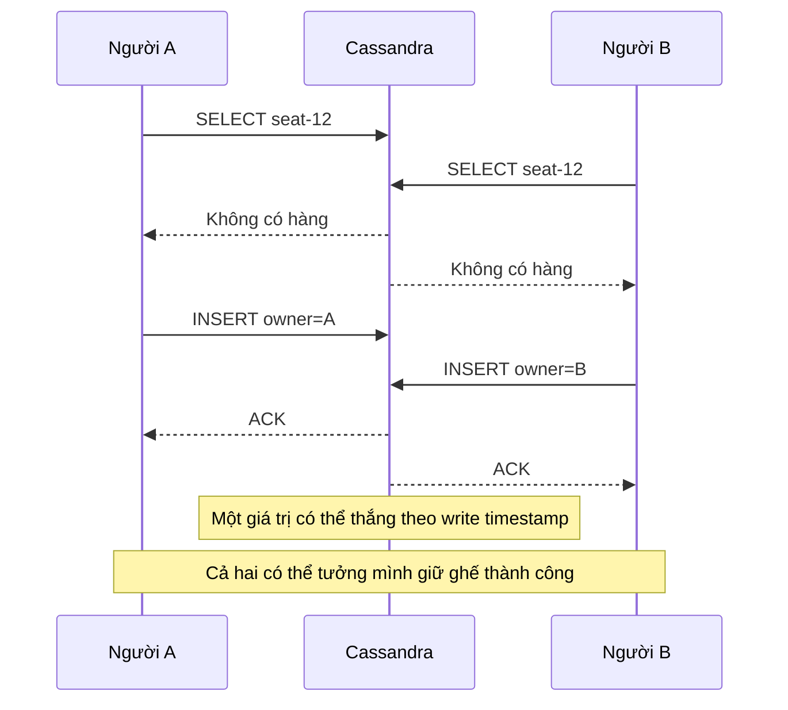
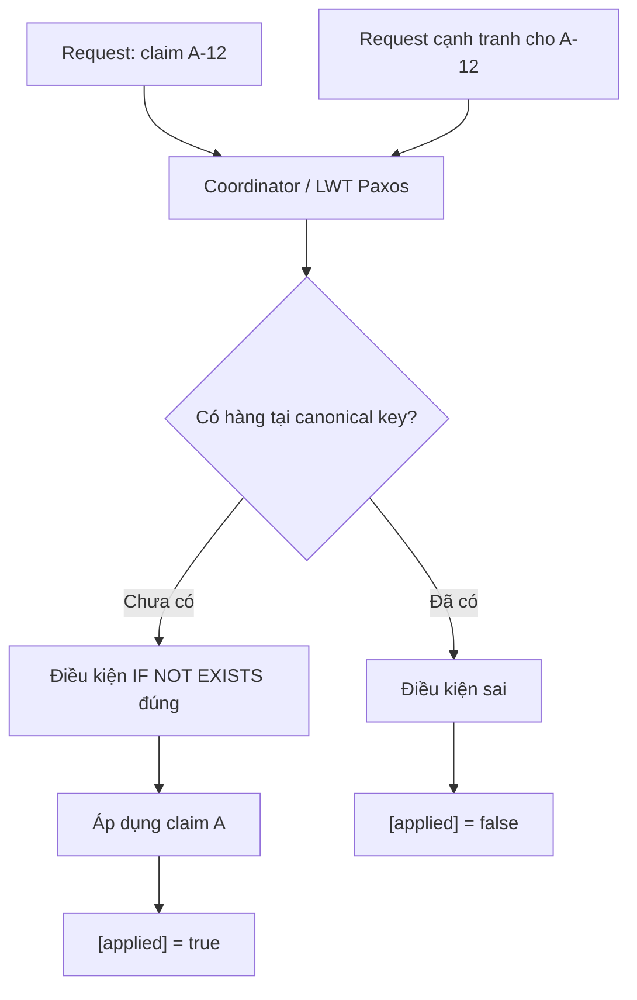
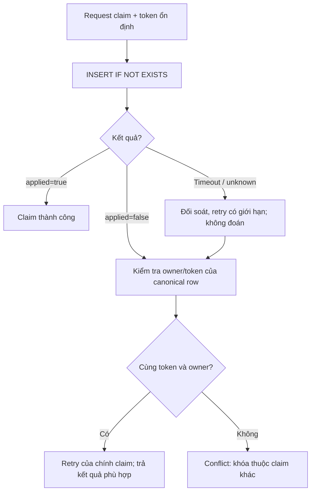

# Thiết kế giữ chỗ hoặc đăng ký duy nhất theo khóa

Trong **Spring Data Cassandra**, việc lưu một entity bằng `repository.save(...)` hoặc `CassandraTemplate.insert(...)` không tương đương với ràng buộc `UNIQUE` của cơ sở dữ liệu quan hệ. Apache Cassandra thường có ngữ nghĩa **upsert**: khi nhiều writer ghi cùng primary key, các mutation được hòa giải bằng timestamp và quy tắc của Cassandra. Vì vậy, nếu hai khách cùng đặt một ghế hoặc hai người cùng đăng ký một tên tài khoản, thao tác ghi thường **không đủ để quyết định ai được quyền sở hữu khóa**.

**Lightweight transaction (LWT)** với `IF NOT EXISTS` và các điều kiện `IF ...` cho phép thực hiện một **conditional write** trên dữ liệu được định danh rõ. Đây là công cụ để xây dựng *claim* — giữ chỗ, đăng ký duy nhất, tạo mã định danh nghiệp vụ — có kiểm soát tranh chấp giữa các writer. Nhưng LWT có chi phí và phạm vi bảo đảm riêng: nó không biến Cassandra thành cơ sở dữ liệu quan hệ với giao dịch ACID tùy ý trên nhiều partition.

Bài học thuộc chương **LWT và khóa lạc quan** của module `SPRING_DATA_CASSANDRA`. Nội dung sẽ đi từ **thiết kế canonical key** tới câu CQL `INSERT ... IF NOT EXISTS`, xử lý kết quả `[applied]`, xác nhận/giải phóng giữ chỗ, hạn sử dụng (*lease*), idempotency, nhất quán nhiều datacenter và cách đưa các thao tác đó vào ứng dụng Spring.

## 1. Bản chất bài toán: duy nhất theo khóa nào?

Trước khi chọn API, phải xác định chính xác **khóa mà hai request được coi là cạnh tranh**. Một số ví dụ:

| Nhu cầu nghiệp vụ | Canonical key cần bảo vệ | Điều không được bỏ sót |
| --- | --- | --- |
| Hai khách không thể giữ cùng ghế trong một sự kiện | `(tenant_id, event_id, seat_id)` | Cùng ghế ở **sự kiện khác** không bị coi là trùng |
| Một username duy nhất trong một tenant | `(tenant_id, normalized_username)` | Chuẩn hóa chữ hoa/thường, Unicode nhất quán |
| Một mã voucher chỉ được một chủ sở hữu claim | `(campaign_id, voucher_code)` | Không lấy `owner_id` làm khóa duy nhất |
| Một resource được đặt trong ô thời gian cố định | `(resource_id, slot_start_utc)` | Tất cả writer phải dùng cùng quy tắc chia slot |
| Một idempotency key cho một API tạo đơn | `(tenant_id, request_key)` | Cùng khóa phải được gắn với **cùng nội dung yêu cầu** |

**Quy tắc:** mọi writer cạnh tranh phải đi tới **cùng một full primary key** trong một bảng được chọn làm nguồn quyết định. Nếu writer A ghi `seat=07` còn writer B ghi `seat=7` nhưng nghiệp vụ coi là cùng ghế, LWT của hai khóa khác nhau **không phát hiện xung đột**.

Tương tự, nếu cần duy nhất trong cả hệ thống nhưng lại đưa `tenant_id` vào khóa, bạn đã định nghĩa **duy nhất trong tenant**, không phải duy nhất toàn cầu. Phạm vi uniqueness phải được viết thành hợp đồng nghiệp vụ và phản ánh đúng trong schema.

## 2. Vì sao `SELECT` trước rồi `INSERT` là sai?

Một đoạn code trực giác:

```java
if (repository.findById(key).isEmpty()) {
    repository.save(new SeatClaim(...));
}
```

không tạo ra thao tác nguyên tử. Hai request có thể xen kẽ như sau:



Đây là **race condition giữa hai thao tác độc lập**. Việc tăng consistency của hai câu `SELECT` và `INSERT` lên `LOCAL_QUORUM` không tự nối chúng thành một transaction. Một `INSERT` thông thường cũng không có nghĩa “chỉ tạo nếu chưa tồn tại”.

Giải pháp là đưa điều kiện vào **chính mutation cần áp dụng**:

```sql
INSERT INTO seat_claim_by_key (...)
VALUES (...)
IF NOT EXISTS;
```

Với cùng khóa được bảo vệ và cơ chế LWT được sử dụng nhất quán, chỉ một claim có thể giành được trạng thái chưa tồn tại tại thời điểm được tuần tự hóa; các claim cạnh tranh sẽ nhận **`[applied] = false`** hoặc gặp lỗi cần xử lý.

## 3. Thiết kế bảng canonical claim cho một ghế

Giả sử một sự kiện có nhiều ghế cố định. Mỗi ghế chỉ được một khách giữ hoặc xác nhận tại một thời điểm.

```sql
CREATE TABLE seat_claim_by_key (
    tenant_id     text,
    event_id      uuid,
    seat_id       text,
    owner_id      uuid,
    claim_token   uuid,
    status_code   text,
    held_until    timestamp,
    claimed_at    timestamp,
    PRIMARY KEY ((tenant_id, event_id, seat_id))
);
```

Ở đây **toàn bộ bộ ba** `(tenant_id, event_id, seat_id)` là **composite partition key** và cũng là **full primary key** (không có clustering column). Các yêu cầu giữ cùng ghế trong cùng sự kiện chắc chắn cùng nhắm tới **một partition/hàng logic**, phù hợp với điều kiện `IF NOT EXISTS`.

Các trường khác không quyết định uniqueness:

- `owner_id`: người đang giữ ghế.
- `claim_token`: định danh riêng của **lần giữ chỗ**, hỗ trợ idempotency và chống hủy nhầm claim mới.
- `status_code`: `HELD` hoặc `CONFIRMED`; đây là giá trị nghiệp vụ, không phải primary key.
- `held_until`: hạn giữ chỗ do server quy định, không được lấy tùy ý từ đồng hồ client.
- `claimed_at`: thời điểm phục vụ quan sát/audit, **không phải write timestamp Cassandra**.

Không đặt `owner_id` vào primary key của bảng quyết định ghế. Nếu khóa là `(event_id, seat_id, owner_id)`, hai khách khác nhau có **hai khóa khác nhau**, nên mỗi người có thể `INSERT IF NOT EXISTS` thành công và uniqueness thực tế bị phá.

### Vì sao không chỉ tạo secondary index?

Một index trên `seat_id` hỗ trợ một số đường **đọc** nhưng **không tự tạo constraint UNIQUE**. Điều kiện duy nhất phải được bảo vệ bằng mutation được đồng thuận trên **canonical key**, không bằng việc “đã tìm thấy/không tìm thấy” qua một truy vấn index.

## 4. Claim ghế bằng `INSERT IF NOT EXISTS`

CQL minh họa:

```sql
INSERT INTO seat_claim_by_key
    (tenant_id, event_id, seat_id, owner_id,
     claim_token, status_code, held_until, claimed_at)
VALUES (?, ?, ?, ?, ?, 'HELD', ?, ?)
IF NOT EXISTS;
```

Khi thực thi:

| Kết quả | Diễn giải | Hành động phù hợp |
| --- | --- | --- |
| `[applied] = true` | Claim đã được chấp nhận trên khóa đang trống | Trả thông tin giữ chỗ thành công |
| `[applied] = false` | Điều kiện không còn đúng; hàng đã tồn tại theo trạng thái nhìn thấy của LWT | Không chiếm quyền; cân nhắc trả `409 Conflict` hoặc kiểm tra idempotency |
| Timeout/unavailable/error | Không xác định an toàn rằng claim đã thành công hay thất bại | Phân loại lỗi, tra cứu/đối soát bằng token và retry có kiểm soát |

**Không coi tất cả lỗi là `[applied]=false`.** Khi một request hết thời gian chờ, Cassandra vẫn có thể đã hoàn thành Paxos/commit. Nếu service lập tức tạo claim khác hoặc thu tiền lại, lỗi không xác định kết quả có thể gây phát sinh hiệu ứng nghiệp vụ trùng lặp.

Một ví dụ CQL dạng giá trị cụ thể:

```sql
INSERT INTO seat_claim_by_key
    (tenant_id, event_id, seat_id, owner_id, claim_token,
     status_code, held_until, claimed_at)
VALUES (
    'tenant-a',
    550e8400-e29b-41d4-a716-446655440000,
    'A-12',
    7f8d5b42-a9de-4bf6-a2a1-72b391e9a4d0,
    0b4ceaf2-30a8-40c2-8be9-4cbd6c7a8b14,
    'HELD', '2026-11-25T11:15:00Z', '2026-11-25T11:05:00Z'
)
IF NOT EXISTS;
```

Hai request cùng `tenant-a`, cùng `event_id` và cùng `seat_id='A-12'` cạnh tranh tại cùng canonical key. Hai request khác seat hoặc khác event không bị chặn một cách không cần thiết.

## 5. LWT xử lý tranh chấp bằng cơ chế gì?

LWT sử dụng giao thức đồng thuận dựa trên **Paxos** để điều phối một conditional mutation. Nó phải bảo đảm quyết định về điều kiện và việc áp dụng mutation được phối hợp giữa các replica tham gia phù hợp, thay vì chỉ làm một `SELECT` rồi một `INSERT` thông thường.



LWT thường đắt hơn thao tác upsert bình thường vì có **nhiều pha/round trip liên quan đến đồng thuận**, thêm công việc replica và có thể tạo contention khi cùng key được claim dồn dập. Số pha cụ thể và tối ưu có thể khác nhau theo phiên bản Cassandra; không dùng một con số latency cố định cho mọi cluster.

**Phạm vi bảo đảm quan trọng:** trong thiết kế này, LWT bảo vệ **một canonical key/partition**. Nó không tạo transaction ACID xuyên mọi bảng, mọi partition hoặc một tập ghế tùy ý. Nếu hàng giữ ghế được phản chiếu sang bảng đọc theo sự kiện, thao tác ghi bảng phụ cần được thiết kế với cơ chế đối soát riêng.

## 6. `SERIAL`, `LOCAL_SERIAL` và consistency thông thường

Một conditional statement có hai nhóm tùy chọn cần phân biệt:

1. **Serial consistency** (`SERIAL`, `LOCAL_SERIAL`): liên quan phạm vi đồng thuận/đọc trạng thái đang được quyết định của LWT.
2. **Regular consistency** (`LOCAL_QUORUM`, `QUORUM`...): liên quan điều kiện phản hồi cho pha ghi/đọc thông thường theo topology.

| Tùy chọn | Ý nghĩa ở mức khái quát | Cần chú ý |
| --- | --- | --- |
| `SERIAL` | Serial consistency của LWT theo phạm vi replica áp dụng | Có thể phát sinh phụ thuộc liên DC khi keyspace nhiều DC |
| `LOCAL_SERIAL` | Serial consistency giới hạn trong DC local trong điều kiện được hỗ trợ | Không nên giả định đủ để bảo đảm uniqueness toàn cầu qua nhiều DC với writer phân tán |
| `LOCAL_QUORUM` | Đa số replica ở DC của coordinator trong phần regular consistency | Không tự thay thế serial consistency |
| `LOCAL_ONE` | Một replica local cho phần regular consistency | Không giải quyết tranh chấp `IF NOT EXISTS` nếu bỏ cơ chế LWT |

Nếu một username phải duy nhất **toàn hệ thống đa DC**, không thể tùy tiện cho mỗi DC dùng `LOCAL_SERIAL` độc lập rồi khẳng định có một tổng thứ tự chung. Thiết kế cần làm rõ **phạm vi nhất quán thực sự, DC điều phối writer và phương án SERIAL phù hợp**; kiểm thử fault scenario trên topology đa DC.

Đối với ví dụ Java ở phần sau, giả định ứng dụng đã chọn `SERIAL` cho LWT và `LOCAL_QUORUM` cho regular consistency trên topology đã kiểm chứng. Cấu hình thực tế phải đi cùng replication factor, version, DC routing, latency và yêu cầu khả dụng.

## 7. Java Driver 4: kiểm tra `[applied]` thay vì đoán từ ACK

Trong Spring Boot, `CqlSession` thường được quản lý và chia sẻ; Java Driver 4 cung cấp `PreparedStatement` và `BoundStatement` để thực thi LWT rõ ràng.

```java
import java.time.Instant;
import java.util.UUID;
import com.datastax.oss.driver.api.core.CqlSession;
import com.datastax.oss.driver.api.core.DefaultConsistencyLevel;
import com.datastax.oss.driver.api.core.cql.BoundStatement;
import com.datastax.oss.driver.api.core.cql.PreparedStatement;
import com.datastax.oss.driver.api.core.cql.ResultSet;
import com.datastax.oss.driver.api.core.cql.Row;

public final class SeatClaimWriter {

    private final CqlSession session;
    private final PreparedStatement insertIfAbsent;

    public SeatClaimWriter(CqlSession session) {
        this.session = session;
        this.insertIfAbsent = session.prepare(
                "INSERT INTO seat_claim_by_key " +
                "(tenant_id, event_id, seat_id, owner_id, claim_token, " +
                " status_code, held_until, claimed_at) " +
                "VALUES (?, ?, ?, ?, ?, 'HELD', ?, ?) " +
                "IF NOT EXISTS");
    }

    public boolean tryHold(
            String tenantId, UUID eventId, String seatId,
            UUID ownerId, UUID claimToken, Instant heldUntil,
            Instant claimedAt) {

        if (tenantId == null || tenantId.isBlank()
                || eventId == null || seatId == null || seatId.isBlank()
                || ownerId == null || claimToken == null
                || heldUntil == null || claimedAt == null
                || !heldUntil.isAfter(claimedAt)) {
            throw new IllegalArgumentException("Claim input không hợp lệ");
        }

        BoundStatement statement = insertIfAbsent.bind(
                tenantId, eventId, seatId, ownerId, claimToken,
                heldUntil, claimedAt)
                .setConsistencyLevel(DefaultConsistencyLevel.LOCAL_QUORUM)
                .setSerialConsistencyLevel(DefaultConsistencyLevel.SERIAL);

        ResultSet result = session.execute(statement);
        Row outcome = result.one();
        if (outcome == null) {
            throw new IllegalStateException("LWT không trả kết quả áp dụng");
        }
        return outcome.getBoolean("[applied]");
    }
}
```

**Chú ý:**

- `true` chỉ có nghĩa Cassandra đã **áp dụng conditional claim**, không phải ghế đã được thanh toán hay đã có ticket phát hành.
- `false` là kết quả điều kiện; với cùng `claimToken` gửi lại, có thể hàng đã được chính request trước tạo. Service cần phân biệt **thất bại vì đối thủ** với **retry của chính claim**.
- Khi exception xảy ra, không được suy ra `false` và cũng không được khẳng định `true`. Cần quy trình xử lý *unknown outcome*.
- `PreparedStatement` được chuẩn bị một lần và tái sử dụng. Đừng `prepare` lại trên mỗi HTTP request.
- Đặt `LOCAL_QUORUM`/`SERIAL` là quyết định kiến trúc, **không phải default bắt buộc** cho mọi môi trường.

`[applied]` là cột đặc biệt của kết quả **conditional statement**. Tên có dấu ngoặc vuông phải được truy cập đúng; không tự xây mapper của entity thông thường để suy ra trạng thái claim.

## 8. Confirm và release: kiểm tra chủ sở hữu bằng điều kiện

Sau khi giữ ghế thành công, hệ thống có thể cần:

- **Confirm:** chuyển `HELD → CONFIRMED` sau khi nghiệp vụ thanh toán/đặt vé được hoàn tất.
- **Release:** giải phóng ghế khi khách hủy giữ chỗ hoặc lease hết hạn.

Nếu chỉ gọi `UPDATE ... SET status_code='CONFIRMED'` mà không có `IF`, một request cũ có thể vô tình xác nhận **claim mới của người khác** nếu ghế đã được release rồi claim lại.

### 8.1. Confirm bằng CAS trên cùng khóa

```sql
UPDATE seat_claim_by_key
SET status_code = 'CONFIRMED'
WHERE tenant_id = ?
  AND event_id = ?
  AND seat_id = ?
IF owner_id = ?
   AND claim_token = ?
   AND status_code = 'HELD';
```

Điều kiện kiểm tra **owner**, **token của thế hệ giữ chỗ** và **trạng thái hiện hành**. Nếu ghế đã bị trả rồi một người khác giữ, token mới khác, nên confirm cũ không được phép thắng.

Ví dụ thực thi:

```java
PreparedStatement confirm = session.prepare(
        "UPDATE seat_claim_by_key SET status_code = 'CONFIRMED' " +
        "WHERE tenant_id = ? AND event_id = ? AND seat_id = ? " +
        "IF owner_id = ? AND claim_token = ? " +
        "AND status_code = 'HELD'");

BoundStatement bound = confirm.bind(
        tenantId, eventId, seatId, ownerId, claimToken)
        .setConsistencyLevel(DefaultConsistencyLevel.LOCAL_QUORUM)
        .setSerialConsistencyLevel(DefaultConsistencyLevel.SERIAL);

Row outcome = session.execute(bound).one();
boolean applied = outcome != null && outcome.getBoolean("[applied]");
```

Đoạn code giả định `session` và các biến đầu vào đã được kiểm tra. Trong ứng dụng thật, nên giữ `PreparedStatement confirm` như một field được tái sử dụng, **không prepare lại ở mỗi confirm**.

**Điều kiện CAS không tự kiểm tra thời điểm hết hạn lease.** Nếu nghiệp vụ cấm confirm sau `held_until`, service phải có quy tắc thời gian đáng tin và phối hợp với quá trình expiry; phần 9 bàn sâu hơn.

### 8.2. Release đúng thế hệ giữ chỗ

```sql
DELETE FROM seat_claim_by_key
WHERE tenant_id = ?
  AND event_id = ?
  AND seat_id = ?
IF owner_id = ?
   AND claim_token = ?
   AND status_code = 'HELD';
```

Điều kiện giúp một tiến trình timeout cũ không xóa nhầm một claim mới. Đặc biệt quan trọng khi `seat_id` được **tái sử dụng** nhiều lần giữa các khách.

**DELETE tạo tombstone**, không đồng nghĩa giải phóng dung lượng vật lý ngay lập tức. Hệ thống có tốc độ hold/cancel cao cần theo dõi write contention, tombstone, compaction và repair; nếu giữ chỗ bằng create/delete liên tục quá lớn, chính canonical key trở thành hot spot.

## 9. Lease, `held_until` và TTL: không nên đánh đồng

Một hệ thống giữ chỗ thường có thời hạn, ví dụ **10 phút**. Có hai hướng thiết kế thường được cân nhắc:

### A. Hạn sử dụng do ứng dụng quản lý

`held_until` là một trường timestamp. Một **expiry worker** đọc claim `HELD` đã quá hạn, sau đó giải phóng bằng **conditional delete** có đầy đủ token/trạng thái và, nếu hỗ trợ trong query contract, kiểm tra cả phiên bản `held_until` đã quan sát.

Ưu điểm: dễ kiểm soát việc gia hạn lease, audit và chính sách release. Đánh đổi: phải có worker và **cách tìm các claim đến hạn**. Một bảng primary key theo `(tenant_id,event_id,seat_id)` **không hỗ trợ scan hiệu quả mọi lease hết hạn** bằng `WHERE held_until < ?` nếu không có read model/index phù hợp.

Ví dụ read model `expiring_claims_by_bucket` có thể lưu `(expiration_bucket, held_until, claim_token, canonical_key)` để expiry worker tìm được các claim đến hạn theo bucket. Dữ liệu này là **chỉ mục công việc**, không được dùng thay bảng `seat_claim_by_key` để quyết định ownership. Các bản ghi của read model có thể đến muộn hoặc trùng; expiry worker phải kiểm tra lại canonical claim bằng LWT.

### B. Dùng TTL cho dữ liệu giữ chỗ

Cassandra có thể làm dữ liệu hết hạn sau TTL, nhưng TTL là **ngữ nghĩa hết hạn của cell**, không phải khóa phân tán tự động với timer chính xác từng mili giây.

Các rủi ro cần xét:

1. **TTL theo từng cell:** nếu chỉ một số cột có TTL, những cell khác còn sống có thể khiến hàng vẫn tồn tại và `IF NOT EXISTS` tiếp tục không áp dụng. Không mặc định “TTL status” nghĩa là “toàn bộ claim đã biến mất”.
2. **Confirm:** một claim `HELD` có TTL mà sau đó chuyển `CONFIRMED` cần quy tắc rõ cho **toàn bộ dữ liệu phải được giữ lâu dài**. Update một cột mà quên TTL còn lại có thể làm mất ownership bất ngờ.
3. **Race khi hết hạn:** TTL và một confirm đến gần deadline có thể cạnh tranh; đọc một giá trị TTL rồi mới xác nhận không tạo giao thức nguyên tử với đồng hồ.
4. **Clock skew:** writer/coordinator lệch đồng hồ ảnh hưởng timestamp/expiration theo cơ chế và phiên bản; không lấy giờ thiết bị người dùng làm nguồn đáng tin.
5. **Tombstone/compaction:** TTL hết hạn không có nghĩa bytes được purge ngay; dùng TTL rất ngắn trên khối lượng lớn có thể tạo tombstone pressure.

**Lời khuyên thiết kế:** đối với ghế có giá trị cao hoặc trạng thái `CONFIRMED` cần lưu bền vững, nên xác định rõ state machine và release có điều kiện; không dựa duy nhất vào TTL như “đồng hồ giao dịch”. TTL phù hợp hơn khi semantics expiry đã được chấp thuận, dữ liệu đọc/ghi tương thích và đã kiểm thử những race quanh deadline.

### 9.1. Không để expiry worker xóa claim đã gia hạn

Giả sử worker đọc `HELD` với `held_until = 11:10`, nhưng khách gia hạn tới `11:20` trước khi worker xóa. Nếu worker chỉ so `status_code='HELD'`, nó có thể xóa nhầm claim đã gia hạn.

Một chiến lược là tăng **version/lease generation** khi gia hạn, và dùng CAS khi release:

```sql
-- Ví dụ khi schema có thêm lease_version bigint.
DELETE FROM seat_claim_by_key
WHERE tenant_id = ?
  AND event_id = ?
  AND seat_id = ?
IF status_code = 'HELD'
   AND claim_token = ?
   AND lease_version = ?;
```

Worker phải dùng `lease_version` **đã quan sát khi đánh giá deadline**. Nếu khách gia hạn và version đổi, điều kiện cũ thất bại. Thêm cột/version cần migration và mọi đường gia hạn phải cập nhật nó bằng conditional write tương ứng; đây là một **mở rộng thiết kế**, không phải cột có sẵn trong DDL mục 3.

## 10. Idempotency: timeout không cho biết ai đang giữ chỗ

Trong mạng phân tán, một LWT có thể đã áp dụng nhưng **response bị mất**. Client chỉ nhận timeout, rồi retry cùng yêu cầu. Lần retry sẽ thấy hàng đã có, do đó `IF NOT EXISTS` thường trả `[applied]=false`. Nếu service luôn diễn giải `false` là “người khác giữ rồi”, nó báo sai cho chính request vừa thành công.

Vì vậy nên gắn **`claim_token` ổn định cho một ý định giữ chỗ**:

1. API nhận hoặc tạo idempotency key; service ánh xạ nó sang token có thể kiểm chứng.
2. Retry **cùng ý định** phải dùng cùng `claim_token`, `owner_id`, canonical key và cùng semantics nghiệp vụ.
3. Nếu `INSERT IF NOT EXISTS` trả `false`, truy vấn kiểm tra canonical row với consistency/cơ chế đọc được phê duyệt.
4. Nếu row có cùng owner/token và trạng thái phù hợp, có thể trả kết quả **đã sở hữu**; nếu khác token/owner thì là xung đột.
5. Nếu kết quả vẫn không xác định do lỗi đọc/timeout, trả trạng thái cần retry/đối soát; không thu tiền, cấp vé hoặc release ghế dựa vào suy đoán.



**Không tạo token mới mỗi lần retry HTTP** nếu đó là cùng một yêu cầu nghiệp vụ. Token mới biến một request lặp thành một ý định claim khác và làm logic khôi phục khó hơn.

Đồng thời, không được tin owner/token do người dùng tùy ý khai báo mà không đối chiếu với principal đã xác thực. Nếu `[applied]=false`, response Cassandra có thể chứa thông tin row tồn tại; **không trả dữ liệu chủ sở hữu đối thủ ra API** chỉ vì driver nhận được nó.

## 11. Uniqueness theo username: một biến thể cùng nguyên lý

Đối với đăng ký username duy nhất trong từng tenant, thiết kế một bảng **claim theo tên đã chuẩn hóa**:

```sql
CREATE TABLE username_claim_by_key (
    tenant_id    text,
    username_key text,
    user_id      uuid,
    request_key  uuid,
    created_at   timestamp,
    PRIMARY KEY ((tenant_id, username_key))
);
```

Thao tác quyết định:

```sql
INSERT INTO username_claim_by_key
    (tenant_id, username_key, user_id, request_key, created_at)
VALUES (?, ?, ?, ?, ?)
IF NOT EXISTS;
```

`username_key` phải được tạo theo **một chính sách chuẩn hóa nhất quán** trước khi đến Cassandra: trim/ký tự hợp lệ, case-folding, xử lý Unicode/canonicalization, các tên dành riêng và phạm vi tenant. Ví dụ `"Alice"`, `"alice"` và các biến thể Unicode phải được phân loại theo **quy tắc sản phẩm xác định**, không chỉ gọi `toLowerCase()` tùy locale rồi hy vọng không có trùng.

Khi claim thành công, có thể ghi profile vào `users_by_id` phục vụ truy vấn theo `user_id`. **LWT chỉ quyết định uniqueness trên username key**, không tạo một transaction nguyên tử giữa `username_claim_by_key` và `users_by_id`. Nếu ghi profile thất bại sau claim, cần trạng thái `PENDING`, retry idempotent, reconciliation hoặc giải phóng claim an toàn theo token.

### Cẩn thận với thay đổi username

Đổi username đụng **hai khóa khác nhau**: claim tên mới và release tên cũ. Không thể giả định một `BATCH` tùy ý tạo atomic compare-and-swap xuyên cả hai partition. Một luồng an toàn hơn có thể là:

1. Claim tên mới bằng `IF NOT EXISTS`, có token và trạng thái chuyển đổi.
2. Cập nhật profile theo quy tắc version/expected state.
3. Release tên cũ chỉ khi profile đã chuyển sang tên mới và ownership của claim cũ được chứng minh.
4. Nếu bước nào lỗi, retry/compensate có kiểm soát; không xóa bừa claim mới đã thuộc người khác.

Trình tự cụ thể còn phụ thuộc yêu cầu “không bao giờ đồng thời có hai username” hay “có thể tạm giữ hai tên trong lúc chuyển đổi”. Cần viết rõ **invariant** và các trạng thái trung gian được phép.

## 12. Giữ nhiều ghế hoặc khoảng thời gian: giới hạn rất quan trọng

LWT theo **một khóa** không có nghĩa đặt một nhóm ghế được bảo đảm **all-or-nothing**.

### 12.1. Đặt ba ghế trong cùng một đơn

Giả sử cần A-12, A-13, A-14, mỗi ghế có canonical key riêng. Nếu claim A-12 và A-13 thành công nhưng A-14 đang thuộc khách khác, hệ thống ở trạng thái **giữ một phần**.

Chiến lược có thể là *saga*:

1. Tạo `reservation_id`/token ổn định và giữ ghế theo một thứ tự nhất quán.
2. Thực hiện từng LWT với giới hạn đồng thời, timeout và retry.
3. Nếu bất kỳ ghế nào không claim được, **compensate** bằng conditional release những ghế đã claim với đúng token.
4. Ghi nhận và đối soát những release không thành công; không tự động báo “hoàn tất rollback” nếu chưa kiểm chứng.
5. Chỉ chuyển reservation sang trạng thái sẵn sàng thanh toán khi tất cả claim đã xác nhận.

Đây là **quy trình nghiệp vụ nhiều bước**, không phải một transaction Cassandra nguyên tử trên nhiều partition. Nếu sản phẩm đòi bảo đảm atomic group reservation cực chặt, cần xem xét thiết kế một **canonical aggregate duy nhất** phù hợp giới hạn partition/row hoặc một hệ thống điều phối giao dịch khác, có đánh giá contention và throughput.

### 12.2. Đặt phòng theo thời gian liên tục

Nếu hai khoảng `[10:00,11:00)` và `[10:30,11:30)` được lưu theo **hai khóa `slot_start` khác nhau**, `INSERT IF NOT EXISTS` trên từng start không phát hiện chúng **giao nhau**.

Muốn bảo vệ không chồng lịch, có thể:

- Ràng buộc thời gian thành các **slot cố định** và claim đủ mọi slot mà một đặt chỗ chiếm, xử lý partial claim/compensation; hoặc
- Dùng **một aggregate/canonical key** để kiểm tra danh sách khoảng thời gian có điều kiện, nếu kích thước và contention cho phép; hoặc
- Dùng bộ điều phối lịch/transaction chuyên biệt.

**Uniqueness theo một full key khác với kiểm tra điều kiện “hai khoảng thời gian không giao nhau”.** Cần chọn mô hình đúng trước khi viết CQL.

## 13. Tích hợp Spring Data Cassandra: đâu là ranh giới của framework?

Spring Data Cassandra có `@Table`, `@PrimaryKeyClass`, repository và `CassandraTemplate` để ánh xạ entity và chạy truy vấn thường. Chúng giúp giảm mã boilerplate, nhưng không tự tạo constraint UNIQUE trên arbitrary column.

Ví dụ một entity cho claim:

```java
import java.io.Serializable;
import java.util.UUID;
import org.springframework.data.cassandra.core.mapping.PrimaryKeyClass;
import org.springframework.data.cassandra.core.mapping.PrimaryKeyColumn;
import org.springframework.data.cassandra.core.mapping.PrimaryKeyType;

@PrimaryKeyClass
public class SeatClaimKey implements Serializable {
    @PrimaryKeyColumn(name = "tenant_id", ordinal = 0,
            type = PrimaryKeyType.PARTITIONED)
    private String tenantId;

    @PrimaryKeyColumn(name = "event_id", ordinal = 1,
            type = PrimaryKeyType.PARTITIONED)
    private UUID eventId;

    @PrimaryKeyColumn(name = "seat_id", ordinal = 2,
            type = PrimaryKeyType.PARTITIONED)
    private String seatId;

    public SeatClaimKey() {}
    // Bổ sung constructor, getters/setters, equals() và hashCode().
}
```

```java
import java.time.Instant;
import java.util.UUID;
import org.springframework.data.cassandra.core.mapping.Column;
import org.springframework.data.cassandra.core.mapping.PrimaryKey;
import org.springframework.data.cassandra.core.mapping.Table;

@Table("seat_claim_by_key")
public class SeatClaim {
    @PrimaryKey
    private SeatClaimKey key;

    @Column("owner_id")
    private UUID ownerId;

    @Column("claim_token")
    private UUID claimToken;

    @Column("status_code")
    private String statusCode;

    @Column("held_until")
    private Instant heldUntil;

    public SeatClaim() {}
    // Bổ sung constructor, getters/setters và chính sách xác thực owner.
}
```

Các đoạn trên là **khung ánh xạ**, chưa phải toàn bộ Java source độc lập. Mapping giúp đọc/trả entity, còn thao tác **ra quyết định quyền sở hữu** nên nằm ở một service có conditional CQL/LWT và kiểm tra `[applied]`. Không dùng `repository.save(claim)` thay cho `INSERT IF NOT EXISTS` chỉ vì entity có composite key đúng.

Nếu chọn tính năng optimistic locking của Spring Data bằng `@Version`, cần hiểu rõ hành vi và phiên bản hỗ trợ: version check giúp bảo vệ **cập nhật một entity** khỏi lost update, nhưng không tự bảo đảm duy nhất theo username/seat nếu các writer đang ghi vào **những primary key khác nhau**. Chọn canonical key và conditional claim vẫn là quyết định schema/nghiệp vụ.

## 14. Hiệu năng, contention và vận hành

LWT phù hợp để bảo vệ một **invariant quan trọng**, nhưng cần chừa ngân sách độ trễ và tải.

### 14.1. Hot key và contention

Một ghế nổi tiếng mở bán đồng thời cho hàng nghìn khách tạo ra **hàng nghìn LWT trên cùng canonical key**. Paxos cần điều phối tranh chấp, vì thế p95/p99 và tỷ lệ lỗi có thể tăng mạnh. Không thể tăng throughput của **một khóa duy nhất** chỉ bằng cách thêm shard vào primary key mà vẫn giữ invariant “một ghế duy nhất”: shard tạo nhiều khóa độc lập và đánh mất uniqueness.

Giải pháp ở tầng ứng dụng có thể gồm hàng chờ/điều phối, rate limiting, random backoff có giới hạn, cache trạng thái chỉ để **giảm tải** (không quyết định ownership), và thông báo ghế đã được giữ sau khi có kết quả LWT rõ ràng.

### 14.2. Các chỉ số nên quan sát

| Tín hiệu | Điều cần hiểu |
| --- | --- |
| LWT apply rate / conflict rate | Số claim thành công so với các request cạnh tranh hợp lệ |
| P50/P95/P99 latency của conditional statements | Paxos contention, replica/nền tảng network |
| Timeout, unavailable, retry count | Có request **unknown outcome** hay không |
| Số lần hold/release mỗi canonical key | Hot key, tombstone pressure |
| Claim `HELD` quá hạn | Expiry worker hoặc workflow bị kẹt |
| Số claim có owner/token không khớp yêu cầu | Lỗi idempotency, normalization hoặc phối hợp nhiều writer |
| Trạng thái payment/ticket không khớp claim | Cần reconciliation cho workflow nhiều bước |
| Replica/repair/compaction/clock offset | Bảo vệ deletion, TTL và timestamp, tránh sự cố dữ liệu sống lại |

Đối với request thất bại, phân biệt **`[applied]=false` do xung đột** với **unavailable/timeout**. Không nên retry vô hạn một `IF NOT EXISTS` đang bị người khác giữ ghế, cũng không nên đưa thông tin claim của đối thủ vào log công khai.

### 14.3. Multi-DC và quy trình failover

Một ứng dụng active-active ở nhiều DC phải xác định **DC nào được phép ra quyết định về cùng canonical key**. Cùng một key với serial consistency không được cấu hình/điều phối nhất quán có thể khiến kỳ vọng về uniqueness bị sai khi mất kết nối liên vùng. Thử các trường hợp writer ở hai DC cùng claim, lỗi mạng, coordinator failover, retry và khôi phục.

Consistency level cao hơn không tự biến một workflow **LWT claim → thanh toán → ghi profile/ticket → release** thành một transaction toàn hệ. Rủi ro chính của workflow thường nằm ở các **bước phụ trợ** sau khi claim thành công; chúng cần idempotency, outbox/event log hoặc cơ chế bù trừ thích hợp.

## 15. Những sai lầm thường gặp

| Sai lầm | Hậu quả | Cách xử lý |
| --- | --- | --- |
| `SELECT` không thấy rồi `INSERT` | Race giữa nhiều writer | `INSERT IF NOT EXISTS` trên cùng canonical key |
| Dùng `save` như một ràng buộc UNIQUE | Upsert có thể ghi đè theo timestamp | Conditional write và kiểm tra `[applied]` |
| Khóa chứa `owner_id` cho bài toán giữ ghế | Hai owner tạo hai khóa khác nhau | Khóa phải định danh **ghế cần bảo vệ** |
| `[applied]=false` luôn là người khác thắng | Retry của chính request bị báo sai | `claim_token` ổn định, kiểm tra owner và idempotency |
| Timeout được coi là thất bại chắc chắn | Có thể tạo double charge hoặc retry lệch trạng thái | Unknown outcome → read/reconcile/retry an toàn |
| Release ghế chỉ theo `seat_id` | Hủy nhầm claim thế hệ sau | CAS với owner, token, trạng thái và version khi cần |
| Chỉ đặt TTL cho một cột của claim | Hàng khác vẫn sống, `IF NOT EXISTS` không hoạt động như kỳ vọng | Thiết kế TTL toàn bộ dữ liệu hoặc expiry worker có kiểm soát |
| Gia hạn lease nhưng expiry worker không kiểm tra version | Xóa nhầm claim đã gia hạn | Version/lease generation và conditional release |
| Dùng `LOCAL_SERIAL` tùy tiện ở nhiều DC | Phạm vi uniqueness có thể không như kỳ vọng | Xác định serial policy/định tuyến DC theo invariant |
| Dùng LWT cho từng ghế rồi coi nhóm ba ghế đã atomic | Giữ một phần, cần bù trừ | Saga hoặc canonical aggregate phù hợp |
| Dùng LWT theo `slot_start` để cấm mọi khoảng thời gian giao nhau | Khoảng khác start vẫn chồng lịch | Chuẩn hóa slot hoặc mô hình kiểm tra interval phù hợp |
| Đánh đổi correctness bằng cache/secondary index | Quyền sở hữu không được quyết định nguyên tử | Cache chỉ giảm tải, LWT trên canonical key quyết định |

## 16. Checklist thiết kế trước khi triển khai

1. **Định nghĩa invariant:** ghế duy nhất theo event, username theo tenant hay theo toàn hệ?
2. **Canonicalize input:** mọi writer biến cùng đối tượng nghiệp vụ thành **cùng full primary key**.
3. **Dùng một nguồn quyết định:** claim table định danh key rõ ràng; bảng read model chỉ là projection.
4. **Chọn conditional write:** `IF NOT EXISTS` cho claim, `IF ...` cho confirm/release/version.
5. **Chọn serial/regular consistency:** thiết kế theo RF, local DC và yêu cầu global/local uniqueness.
6. **Kiểm tra `[applied]` và exception:** xung đột là kết quả nghiệp vụ, timeout là trạng thái cần đối soát.
7. **Có idempotency token ổn định:** retry không tạo ý định mới; ownership luôn được kiểm chứng.
8. **Định nghĩa expiration:** lease/TTL, clock, worker và race quanh deadline, không xóa nhầm claim mới.
9. **Không mặc định multi-key atomicity:** nếu giữ nhiều ghế hoặc nhiều slot, có saga/compensation hoặc giải pháp khác.
10. **Kiểm thử cluster thật:** cạnh tranh đồng thời, mất response, node lỗi, đa DC, retry, TTL và tombstone.
11. **Quan sát hot keys và latency:** LWT có chi phí lớn hơn upsert và có thể bị contention.
12. **Bảo vệ quyền/riêng tư:** chủ sở hữu xuất phát từ principal đã xác thực, không lộ metadata của claim đối thủ.

## 17. Bài tập tình huống

**Tình huống A — Hai khách một ghế.** Hai request đồng thời gọi `SELECT` rồi `repository.save` cho ghế A-12. Cả hai đều thấy ghế trống. Có thể cam kết chỉ một người được giữ không?

**Gợi ý:** Không. Đây là read-then-write race. Tạo canonical key `(tenant,event,seat)`, dùng `INSERT IF NOT EXISTS`, kiểm tra `[applied]`.

**Tình huống B — Timeout sau claim.** `INSERT IF NOT EXISTS` timeout, client retry cùng `claim_token`, lần sau được `[applied]=false`. Có nên trả ngay `409`?

**Gợi ý:** Chưa. Có thể request đầu đã tạo hàng. Kiểm tra claim theo token/owner và đường đọc nhất quán được phê duyệt; phân loại unknown outcome thay vì coi retry là đối thủ.

**Tình huống C — Hủy nhầm ghế.** Claim token T1 đã hết hạn và được release; cùng ghế được giữ lại với token T2. Một worker cũ gửi `DELETE` theo full key nhưng không kiểm tra token. Vấn đề?

**Gợi ý:** Nó có thể xóa T2. Phải dùng `DELETE ... IF claim_token = T1 AND status_code='HELD'` và kiểm tra kết quả.

**Tình huống D — Đăng ký username.** `Alice` và `alice` bị coi là cùng tên theo quy định sản phẩm, nhưng hai service chuẩn hóa khác nhau và ghi vào hai partition. LWT có cứu được không?

**Gợi ý:** Không. Hai canonical keys khác nhau nên cả hai có thể claim. Phải chuẩn hóa nhất quán **trước** khi thao tác LWT.

**Tình huống E — Ba ghế cùng đơn.** A-12 và A-13 claim thành công, A-14 thất bại. Có thể mặc nhiên xem nhóm ba ghế đã rollback?

**Gợi ý:** Không. Các partition độc lập. Cần release có điều kiện các claim đã có, theo dõi kết quả và đối soát; hoặc thiết kế aggregate/transaction ngoài phù hợp.

**Tình huống F — Lease được gia hạn.** Worker đọc lease hết hạn tại 11:10. Khách gia hạn đến 11:20 nhưng worker vẫn xóa chỉ vì status `HELD`. Cách tránh?

**Gợi ý:** Gia hạn tăng version/lease generation bằng CAS; expiry worker chỉ release nếu token, status **và version đã quan sát** còn khớp, không dựa vào kết quả đọc cũ.

**Tình huống G — Hai datacenter.** Writer ở east và west đều có thể claim cùng username. Mỗi nơi chọn `LOCAL_SERIAL` và coi đó là bảo đảm duy nhất toàn cầu. Thiết kế có an toàn mặc định không?

**Gợi ý:** Không. Phải làm rõ phạm vi serial consistency và định tuyến, áp dụng chính sách đồng thuận phù hợp với global invariant, kiểm thử khi mất kết nối liên DC.

## Kết luận

Để **giữ chỗ hoặc đăng ký duy nhất theo khóa** trong Cassandra, bước quan trọng nhất là xác định **canonical key mà mọi request cạnh tranh đều dùng chung**. Trên khóa đó, `INSERT IF NOT EXISTS` và các lệnh `UPDATE`/`DELETE ... IF` của **LWT** giúp quyết định claim, confirm và release có điều kiện. `[applied]` thể hiện kết quả điều kiện; **timeout không chứng minh thành công hay thất bại**.

Trong Spring Data Cassandra, repository, entity mapping và template giúp xây dựng ứng dụng, nhưng **không tự tạo uniqueness trên các cột tùy ý hoặc atomic transaction nhiều partition**. Một thiết kế bền vững cần đi theo trình tự **định nghĩa invariant → chuẩn hóa khóa → LWT trên canonical partition → serial consistency phù hợp → token/idempotency → lease và release an toàn → workflow bù trừ → kiểm thử contention/timeout/đa DC**. Khi làm đúng, hệ thống vừa tránh hai khách cùng sở hữu một khóa, vừa hiểu được chi phí và giới hạn của việc đặt chỗ trong môi trường dữ liệu phân tán.
