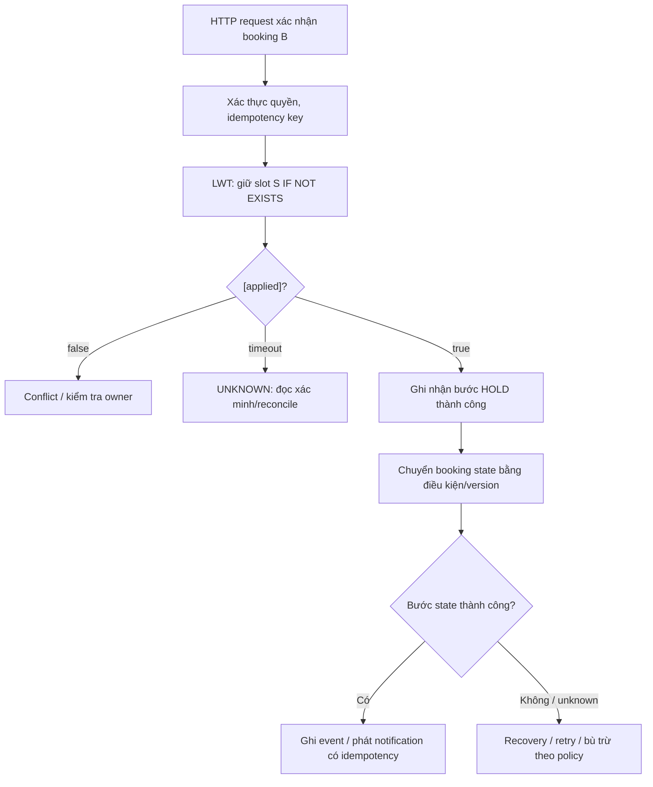

# Phân biệt LWT, batch và giao dịch quan hệ nhiều thao tác

Trong ứng dụng đặt chỗ, một yêu cầu “xác nhận booking” có thể phải thực hiện nhiều việc: **giữ một slot**, **đổi trạng thái booking**, **ghi lịch sử**, **cập nhật bảng phục vụ truy vấn** và **gửi thông báo**. Người quen với cơ sở dữ liệu quan hệ có thể muốn bọc tất cả bằng một transaction. Nhưng trên **Apache Cassandra**, ba khái niệm **lightweight transaction (LWT)**, **CQL BATCH** và **giao dịch quan hệ nhiều thao tác** có những bảo đảm rất khác nhau.

- **LWT** sử dụng cơ chế đồng thuận Paxos để đánh giá điều kiện như `IF NOT EXISTS` hoặc `IF state = ?`, thường phục vụ **compare-and-set/optimistic locking** trong phạm vi partition được hỗ trợ.
- **CQL BATCH** gom những mutation để gửi và thực thi như một nhóm; loại **LOGGED**, **UNLOGGED**, **COUNTER** có semantics và chi phí khác nhau. BATCH thông thường **không tự kiểm tra điều kiện**, **không phải SQL transaction đa partition** và **không tạo rollback nghiệp vụ tùy ý**.
- **Transaction của RDBMS** có thể bao nhiều câu lệnh SQL, áp dụng các mức isolation, commit/rollback trong phạm vi transaction mà hệ quản trị hỗ trợ. Cassandra không cung cấp tương đương tổng quát cho mọi bước cập nhật trên nhiều partition/bảng, càng không bao trùm một lời gọi cổng thanh toán hoặc email.

Bài thuộc chương **LWT và khóa lạc quan** trong module **`SPRING_DATA_CASSANDRA`**. Module hướng dẫn truy cập Cassandra bằng entity mapping, repository, `CassandraTemplate` và CQL, đồng thời thiết kế bảng theo truy vấn, partition key, consistency, paging và hiệu năng để làm việc đúng với hệ thống phân tán.

**Mục tiêu học tập:**

1. Phân biệt **điều kiện CAS**, **atomicity**, **isolation**, **durability**, **rollback** và **consistency level**.
2. Hiểu sự khác biệt giữa `UPDATE` thông thường, `UPDATE ... IF`, `BEGIN LOGGED BATCH` và transaction SQL `BEGIN/COMMIT`.
3. Chọn **LOGGED/UNLOGGED/COUNTER batch** đúng mục đích, tránh dùng batch như công cụ tăng tốc mọi ghi.
4. Nắm giới hạn của **conditional batch** và vì sao nhiều partition không thể được coi như một LWT transaction toàn cục.
5. Xử lý `[applied]`, timeout và kết quả không rõ theo đúng semantics.
6. Phân chia quy trình nhiều bước thành state machine, idempotency, outbox/retry/reconciliation hoặc saga phù hợp.
7. Viết ví dụ bằng Java Driver/Spring Data Cassandra và thiết kế integration test cho failure giữa các bước.

## 1. Trước tiên: “giao dịch” đang yêu cầu bảo đảm nào?

Một yêu cầu có thể chứa nhiều loại bảo đảm:

| Yêu cầu | Ví dụ booking | Cơ chế liên quan |
| --- | --- | --- |
| **Atomicity** | Hai thay đổi trong cùng phạm vi phải cùng có hiệu lực theo bảo đảm được công bố | Mutation trong partition, batch theo phạm vi |
| **Isolation** | Người đọc không quan sát một trạng thái trung gian không được phép | Isolation của hệ quản trị/partition/transaction |
| **Conditional write/CAS** | Chỉ đổi `PENDING` sang `CONFIRMED` nếu version vẫn là 3 | LWT `IF` |
| **Durability** | Dữ liệu đã được xác nhận phải có khả năng phục hồi theo thiết kế | Replication, commit log, consistency, batchlog |
| **Rollback** | Nếu bước 3 lỗi, quay lại những cập nhật trước khi commit | Transaction engine hoặc bù trừ nghiệp vụ |
| **Global ordering** | Hai vùng địa lý phải thống nhất booking nào giành slot | Paxos scope/writer ownership |
| **Cross-system atomicity** | Đã giữ slot thì thanh toán cũng được thu hoặc tất cả hủy | Không tự có nhờ Cassandra; cần workflow phối hợp |

**Không nên dùng một từ “atomic” để thay thế mọi yêu cầu trên.** Một logged batch có thể có cơ chế bảo đảm **các mutation cuối cùng được áp dụng**, nhưng điều đó **không đồng nghĩa** với transaction có isolation tổng quát và rollback tức thì như ứng dụng mong ở RDBMS.

### Câu hỏi thực tế trước khi chọn công cụ

- Điều kiện phải được bảo vệ trên **một partition/key** hay trên hàng chục khóa độc lập?
- Có cần người đọc không thấy dữ liệu một phần khi ghi nhiều bảng hay không?
- Nếu request timeout, ứng dụng có thể **reconcile** được không?
- Một yêu cầu gồm những thao tác **trong Cassandra** hay cả thanh toán/email/search index?
- Có thể chấp nhận **eventual consistency** giữa các bảng chuyên phục vụ truy vấn không?

Trả lời các câu đó trước khi chọn `LWT`, `BATCH` hoặc một kiến trúc workflow.

## 2. Một ví dụ xuyên suốt: xác nhận booking

Giả sử ứng dụng cần làm các bước:

1. Giữ slot `S` cho booking `B` nếu chưa có ai giữ.
2. Đổi trạng thái booking `B` từ `PENDING` sang `CONFIRMED`.
3. Ghi một sự kiện `BOOKING_CONFIRMED` cho lịch sử và phát thông báo.

Các bảng được tối ưu theo đường đọc:

```sql
CREATE TABLE IF NOT EXISTS reservations_by_slot (
    slot_id uuid PRIMARY KEY,
    booking_id uuid,
    state text,
    updated_at timestamp
);

CREATE TABLE IF NOT EXISTS bookings_by_id (
    booking_id uuid PRIMARY KEY,
    slot_id uuid,
    status text,
    business_version bigint,
    last_event_id uuid
);

CREATE TABLE IF NOT EXISTS booking_events_by_booking (
    booking_id uuid,
    event_sequence bigint,
    event_id uuid,
    event_type text,
    occurred_at timestamp,
    PRIMARY KEY (booking_id, event_sequence)
);
```

**Phạm vi partition không giống nhau:**

| Bảng | Partition key | Bảo vệ/đọc điều gì? |
| --- | --- | --- |
| `reservations_by_slot` | `slot_id` | Ai đang giữ một slot |
| `bookings_by_id` | `booking_id` | Trạng thái hiện tại của booking |
| `booking_events_by_booking` | `booking_id` | Lịch sử sự kiện của booking |

Vì slot và booking là **những đối tượng có partition key khác nhau**, một LWT trên `slot_id` **không tự tạo transaction** cùng LWT trên `booking_id`. Ghi cùng `booking_id` ở hai bảng cũng không mặc nhiên biến chúng thành một phạm vi giao dịch SQL liên bảng.

Trong bảng lịch sử, `event_sequence` phải được ứng dụng cấp **có kiểm soát**. Cassandra không tự sinh sequence duy nhất tăng tuần tự toàn cục cho nhiều writer.

## 3. Bảng so sánh nhanh ba cơ chế

| Tính chất | LWT/`IF` | CQL BATCH thông thường | Transaction nhiều câu lệnh trong RDBMS |
| --- | --- | --- | --- |
| Mục tiêu | CAS/conditional mutation | Nhóm các mutation ghi | Đơn vị nhiều thao tác cùng commit/rollback |
| Cách kích hoạt | `IF NOT EXISTS`, `IF column = ...` | `BEGIN [LOGGED/UNLOGGED/COUNTER] BATCH` | `BEGIN`/`START TRANSACTION`, `COMMIT`/`ROLLBACK` |
| Có tự kiểm tra version trước khi ghi? | **Có**, khi đặt điều kiện thích hợp | **Không**, trừ conditional batch có `IF` được hỗ trợ | Có thể thực hiện qua `WHERE`, locks, constraints/isolation |
| Trả `[applied]`? | **Có** với conditional statement | Batch thường **không** | Không có cột Cassandra này |
| Phạm vi | Theo partition/điều kiện CQL được hỗ trợ | Mutation trong batch; phụ thuộc LOGGED/UNLOGGED và partition | Các bảng/hàng nằm trong transaction của RDBMS |
| Isolation tổng quát đa partition | **Không** | **Không** | Có theo engine và isolation level |
| Rollback nhiều bước tùy ý | Không | Không | Có trong phạm vi transaction chưa commit |
| Có bảo vệ side effect HTTP/email? | Không | Không | Thường cũng không, nếu ngoài transaction DB |
| Độ trễ/chi phí | Paxos; contention có thể cao | LOGGED có batchlog/coordination; multi-partition có overhead | Tùy locks, logs, isolation và workload |

**Không có lựa chọn nào là “RDBMS transaction nhưng nhanh hơn” theo nghĩa tổng quát.** Mỗi cơ chế trả lời một yêu cầu nhất quán khác nhau.

## 4. Ghi thông thường và last-write-wins

Đầu tiên, xét câu lệnh không có `IF`:

```sql
UPDATE bookings_by_id
SET status = 'CONFIRMED',
    business_version = 4
WHERE booking_id = ?;
```

Đây là **mutation thông thường**. Nếu writer A và B cùng cập nhật một cell, Cassandra hòa giải giá trị theo **write timestamp** (last-write-wins), không theo version nghiệp vụ:

```text
Ban đầu: status=PENDING, version=3

Worker A: SET status=CONFIRMED, version=4
Worker B: SET status=CANCELLED, version=4

Hai UPDATE thường đều có thể được xác nhận.
Giá trị thắng được xác định theo metadata timestamp của cell.
Không có kết quả "B đã thua điều kiện" vì không hề có IF.
```

Kể cả một lệnh dùng `ConsistencyLevel.ALL`, nó **không tự trở thành compare-and-set**. Regular consistency quyết định mức phản hồi của replica, không kiểm tra rằng `business_version` vẫn là 3.

**Suy ra:** nếu hai worker đều có thể phát side effect “đã xác nhận” và “đã hủy”, **ghi thường + quorum** không đủ để bảo vệ invariant.

## 5. LWT: kiểm tra và ghi có điều kiện

LWT thêm điều kiện vào mutation:

```sql
UPDATE bookings_by_id
SET status = 'CONFIRMED',
    business_version = 4
WHERE booking_id = ?
IF status = 'PENDING' AND business_version = 3;
```

Ở đây Cassandra phải xử lý điều kiện thông qua **Paxos**, theo phạm vi serial consistency tương ứng, trước khi coi yêu cầu là đã được áp dụng. Trong các yêu cầu cạnh tranh trên cùng key:

- Một yêu cầu có thể nhận `[applied] = true`.
- Yêu cầu khác có thể nhận `[applied] = false` vì trạng thái/version đã đổi.
- Có thể xuất hiện **timeout, unavailable hoặc contention**, nên không phải mọi request đều nhận chắc một trong hai boolean.

### Thông điệp của [applied]

| Kết quả | Cách hiểu |
| --- | --- |
| `[applied] = true` | Điều kiện LWT đạt và mutation được áp dụng |
| `[applied] = false` | Điều kiện **không** đạt; không phải lỗi network |
| Không có phản hồi đáng tin do timeout | Kết quả **có thể chưa xác định từ phía client** |

Phản hồi false đôi khi chứa giá trị hiện có của các cột điều kiện hoặc hàng đã tồn tại (ví dụ `INSERT IF NOT EXISTS`). **Không giả định mọi loại LWT đều trả toàn bộ hàng**. Khi cần dữ liệu hiện tại để phân loại conflict, kiểm tra metadata cột hoặc SELECT lại theo key.

## 6. LWT dùng Paxos nhưng không biến toàn bộ workflow thành transaction

LWT là công cụ phù hợp để bảo vệ **một điều kiện trên dữ liệu được Cassandra hỗ trợ**, ví dụ:

```sql
INSERT INTO reservations_by_slot (
    slot_id, booking_id, state, updated_at
) VALUES (?, ?, 'HELD', ?)
IF NOT EXISTS;
```

Nó hữu ích cho invariant “mỗi slot chỉ được một booking nhận quyền giữ” **nếu tất cả writer của cùng slot tuân đúng đường LWT và cùng chính sách đồng thuận**.

Nhưng sau khi LWT giữ slot thành công, ứng dụng còn muốn:

```sql
UPDATE bookings_by_id
SET status = 'CONFIRMED'
WHERE booking_id = ?;
```

Hai câu lệnh tác động lên hai partition khác nhau. **LWT thứ nhất thành công không bảo đảm câu thứ hai cũng thành công**; nếu bước hai timeout, Cassandra không tự rollback slot đã giữ.

### Giới hạn quan trọng

1. LWT không bao **nhiều thao tác độc lập** thành một transaction ACID tổng quát.
2. Không bảo đảm constraint quan hệ như foreign key xuyên các bảng.
3. Không tự giải quyết việc ghi bản sao denormalized vào bảng khác.
4. Không tự bảo đảm một email được gửi đúng một lần.
5. Không bảo vệ invariant nếu một writer khác cập nhật cùng dữ liệu bằng **unconditional write** bỏ qua quy tắc CAS.

LWT nên được xem là **một bước nguyên tử có điều kiện của workflow**, không phải toàn bộ workflow.

## 7. Serial consistency khác regular consistency

Một conditional statement thường liên quan **hai loại mức nhất quán**:

| Nhóm | Ví dụ | Dùng vào đâu? |
| --- | --- | --- |
| Regular consistency | `ONE`, `LOCAL_QUORUM`, `QUORUM` | Mức replica phản hồi cho đọc/ghi và giai đoạn thực thi thông thường |
| Serial consistency | `SERIAL`, `LOCAL_SERIAL` | Phạm vi phối hợp **Paxos/LWT** |

Ví dụ Java Driver 4.x:

```java
BoundStatement request = prepared.bind(slotId, bookingId, now)
    .setConsistencyLevel(DefaultConsistencyLevel.LOCAL_QUORUM)
    .setSerialConsistencyLevel(
            DefaultConsistencyLevel.LOCAL_SERIAL);
```

Ở cụm có **một datacenter**, `LOCAL_SERIAL` thường phù hợp khi chính sách triển khai cho phép. Trong **multi-DC**, nếu writer tại nhiều DC có thể cạnh tranh cùng slot, không mặc định `LOCAL_SERIAL` độc lập ở mỗi DC sẽ bảo vệ invariant toàn cục. Cần xem xét `SERIAL` hoặc **single-writer ownership** cho mỗi key.

**Đừng nhầm:** regular quorum lớn không tạo CAS, và chỉ đặt serial level trên một `UPDATE` không có `IF` cũng không tự biến nó thành LWT.

## 8. Java Driver: một lần CAS tường minh

Một gateway rõ contract:

```java
package example.booking.data;

import java.time.Instant;
import java.util.UUID;
import com.datastax.oss.driver.api.core.CqlSession;
import com.datastax.oss.driver.api.core.DefaultConsistencyLevel;
import com.datastax.oss.driver.api.core.cql.BoundStatement;
import com.datastax.oss.driver.api.core.cql.PreparedStatement;
import com.datastax.oss.driver.api.core.cql.ResultSet;
import com.datastax.oss.driver.api.core.cql.Row;

public final class SlotReservationGateway {
    private final CqlSession session;
    private final PreparedStatement reserve;

    public SlotReservationGateway(CqlSession session) {
        this.session = session;
        this.reserve = session.prepare("""
            INSERT INTO reservations_by_slot
                (slot_id, booking_id, state, updated_at)
            VALUES (?, ?, 'HELD', ?)
            IF NOT EXISTS
            """);
    }

    public boolean tryReserve(
            UUID slotId, UUID bookingId, Instant now) {
        BoundStatement statement = reserve.bind(
                slotId, bookingId, now)
            .setConsistencyLevel(
                    DefaultConsistencyLevel.LOCAL_QUORUM)
            .setSerialConsistencyLevel(
                    DefaultConsistencyLevel.LOCAL_SERIAL);

        ResultSet result = session.execute(statement);
        Row row = result.one();
        if (row == null) {
            throw new IllegalStateException(
                    "Missing LWT result row");
        }
        return row.getBoolean("[applied]");
    }
}
```

Đây là ví dụ **một bước CAS**; boolean return không chứa thông tin về timeout vì timeout được xử lý ở đường exception. Service production nên phân biệt **APPLIED**, **NOT_APPLIED**, **UNKNOWN/RECONCILE** và lỗi hạ tầng, thay vì `catch(Exception) { return false; }`.

**Vòng đời:** `CqlSession` do Spring quản lý và dùng chung; `PreparedStatement` được chuẩn bị theo query shape để tái sử dụng; mỗi request tạo `BoundStatement` riêng với tham số và options phù hợp.

## 9. CQL BATCH thực sự làm gì?

`BEGIN BATCH ... APPLY BATCH` cho phép nhóm **INSERT, UPDATE và DELETE** thành một batch. Mục tiêu chính là **tính chất ghi nhóm/bảo đảm áp dụng của mutation** trong phạm vi Cassandra hỗ trợ, không phải một giao diện cho hàng chục câu lệnh tùy ý như transaction SQL.

Ví dụ minh họa **hai bản sao denormalized**:

```sql
CREATE TABLE IF NOT EXISTS booking_summary_by_id (
    booking_id uuid PRIMARY KEY,
    tenant_id uuid,
    status text
);

CREATE TABLE IF NOT EXISTS booking_summary_by_tenant (
    tenant_id uuid,
    booking_id uuid,
    status text,
    PRIMARY KEY (tenant_id, booking_id)
);

BEGIN LOGGED BATCH
    INSERT INTO booking_summary_by_id
        (booking_id, tenant_id, status)
    VALUES (?, ?, ?);

    INSERT INTO booking_summary_by_tenant
        (tenant_id, booking_id, status)
    VALUES (?, ?, ?);
APPLY BATCH;
```

Hai bảng có partition key khác nhau, nên đây là **batch nhiều partition/bảng**. `LOGGED` có **batchlog** hỗ trợ hồi phục mutation khi coordinator gặp sự cố. Nhưng một reader truy vấn hai bảng trong lúc batch đang được áp dụng **không được bảo đảm** quan sát một snapshot nhất quán đa bảng giống RDBMS.

### BATCH không phải tăng tốc tổng quát

`BATCH` **không** biến nhiều partition thành một partition duy nhất hoặc giảm số replica phải ghi. Batch nhiều partition có thể tăng tải coordinator, batchlog, network và độ trễ. Cassandra thường khuyến khích thiết kế batch **nhỏ, có chủ đích** thay vì nhóm các mutation không liên quan chỉ để giảm số lời gọi từ client.

## 10. LOGGED, UNLOGGED và COUNTER BATCH

| Loại | Ý nghĩa chính | Cảnh báo |
| --- | --- | --- |
| `LOGGED BATCH` | Dùng batchlog cho khả năng khôi phục nhóm mutations theo semantics Cassandra | Không tạo isolation SQL trên nhiều partition; overhead với multi-partition |
| `UNLOGGED BATCH` | Không sử dụng batchlog để bảo vệ nhóm mutation đa partition | Với nhiều partition, lỗi/sự cố có thể để lại các mutation chỉ được áp dụng một phần |
| `COUNTER BATCH` | Dành riêng cho thao tác cập nhật counter | Không trộn counter và non-counter; không thay thế CAS cho tồn kho |

Ví dụ cú pháp:

```sql
BEGIN LOGGED BATCH
    INSERT INTO booking_summary_by_id
        (booking_id, tenant_id, status)
    VALUES (?, ?, ?);
    INSERT INTO booking_summary_by_tenant
        (tenant_id, booking_id, status)
    VALUES (?, ?, ?);
APPLY BATCH;

-- Chỉ dùng UNLOGGED khi hiểu rõ phạm vi/chi phí.
BEGIN UNLOGGED BATCH
    UPDATE booking_summary_by_id
    SET status = ? WHERE booking_id = ?;
APPLY BATCH;
```

Ví dụ `UNLOGGED` một statement **không phải đề xuất tạo batch cho một UPDATE**; chỉ để nhận diện cú pháp. Với một mutation đơn, thực thi statement thông thường sẽ rõ ràng hơn.

### COUNTER không dùng cho invariant “số chỗ còn lại phải >= 0”

Cassandra counter có các giới hạn và semantics riêng. Không nên dùng `COUNTER BATCH` như thể nó là:

```sql
UPDATE inventory SET available = available - 1
WHERE available > 0;
```

Câu SQL có điều kiện đó **không phải** CQL counter CAS hợp lệ. Nếu cần bảo đảm không bán quá số chỗ, hãy định nghĩa **đối tượng phân bổ** và chiến lược concurrency riêng (ví dụ một slot/key được giữ bằng LWT), thay vì mặc định phép giảm counter là transaction.

## 11. Atomicity của BATCH không đồng nghĩa isolation đa partition

Đây là điểm dễ gây nhầm vì từ **atomic** đôi khi được dùng khi mô tả logged batch.

Một logged batch có batchlog để giúp Cassandra **hoàn tất các mutation của batch** ngay cả khi coordinator gặp sự cố sau khi ghi nhận batch. Tuy nhiên:

1. Mutation của các partition **có thể được áp dụng/quan sát tại những thời điểm khác nhau**.
2. Một reader đọc từng bảng/partition riêng có thể thấy **trạng thái trung gian**.
3. Nếu một client timeout, **không kết luận batch chưa thực hiện**; một phần/đầy đủ các mutation có thể đã được áp dụng hoặc sẽ được replay.
4. Không có cơ chế `ROLLBACK` tùy ý cho mọi ghi đã được batchlog phục hồi.
5. Bảo đảm durability, visibility và failure handling còn phụ thuộc replication, consistency, schema và hoạt động cluster.

```mermaid
sequenceDiagram
    participant A as Application
    participant C as Coordinator
    participant L as Batchlog/replicas
    participant P as Partition A
    participant Q as Partition B
    A->>C: BEGIN LOGGED BATCH (A, B)
    C->>L: Ghi nhận batchlog theo protocol
    C->>P: Mutation A
    P-->>C: Ack A
    Note over Q: Mutation B có thể chưa khả kiến lúc này
    C->>Q: Mutation B
    Q-->>C: Ack B
    C-->>A: Kết quả theo consistency/failure
    Note over L,Q: Nếu cần, batchlog hỗ trợ replay; không phải rollback SQL
```

Sơ đồ minh họa **khả năng quan sát không đồng thời** của nhiều partition; thứ tự network/wire-level thực tế và điều kiện ghi batchlog có thể khác theo phiên bản, topology và failure mode.

### Khi nào có isolation tốt hơn?

Trong **một partition**, Cassandra có các bảo đảm atomicity/isolation cho mutation và những batch thuộc phạm vi đó theo mô hình hỗ trợ. Không được mở rộng bảo đảm này thành **isolation toàn cluster cho nhiều partition** chỉ vì tất cả statement nằm giữa `BEGIN BATCH` và `APPLY BATCH`.

## 12. Batch trong cùng partition khác batch nhiều partition

Giả sử một booking có nhiều dòng chi tiết cùng partition:

```sql
CREATE TABLE IF NOT EXISTS booking_items_by_booking (
    booking_id uuid,
    item_no int,
    item_state text,
    note text,
    PRIMARY KEY (booking_id, item_no)
);
```

Các item của một booking có **cùng `booking_id`**, tức cùng partition của bảng:

```sql
BEGIN UNLOGGED BATCH
    UPDATE booking_items_by_booking
    SET item_state = 'CONFIRMED'
    WHERE booking_id = ? AND item_no = 1;

    UPDATE booking_items_by_booking
    SET item_state = 'CONFIRMED'
    WHERE booking_id = ? AND item_no = 2;
APPLY BATCH;
```

Đây là ví dụ nhóm mutation cùng partition. Cả hai marker `booking_id` phải được bind thành **cùng một giá trị** theo contract của caller.

**Điều nó không làm:** batch trên không kiểm tra rằng cả hai item trước đó đều `PENDING`. Nếu một writer khác đang chuyển item sang `CANCELLED`, write không điều kiện vẫn chịu quy tắc conflict resolution của Cassandra.

### Không nên thiết kế partition khổng lồ chỉ để batch được một partition

Gom mọi booking của một tenant vào một partition để tận dụng single-partition batch có thể gây **hot partition**, kích thước partition lớn, compaction/tombstone cost và áp lực replica. Thiết kế partition key trước hết phải phù hợp **query shape và giới hạn dữ liệu/tải**, sau đó mới cân nhắc batch.

## 13. Conditional batch: BATCH có IF thì sao?

CQL còn hỗ trợ **conditional batch** trong những phạm vi/ràng buộc được Cassandra cho phép. Với **các mutation có `IF`** trong cùng partition hợp lệ, batch có thể dùng **Paxos/LWT** để kiểm tra điều kiện thay vì chỉ gom mutation ghi.

Ví dụ về ý định “cùng xác nhận hai item đang PENDING” trong **một partition**:

```sql
BEGIN BATCH
    UPDATE booking_items_by_booking
    SET item_state = 'CONFIRMED'
    WHERE booking_id = ? AND item_no = 1
    IF item_state = 'PENDING';

    UPDATE booking_items_by_booking
    SET item_state = 'CONFIRMED'
    WHERE booking_id = ? AND item_no = 2
    IF item_state = 'PENDING';
APPLY BATCH;
```

**Cảnh báo cần thiết:** Đây là **mẫu minh họa conditional batch**, phải kiểm tra cú pháp/giới hạn của **phiên bản Cassandra server thực tế** và bảo đảm các câu lệnh thuộc **cùng partition** theo yêu cầu của conditional batch. Không suy ra rằng có thể đưa hai partition bất kỳ, nhiều bảng bất kỳ hay mọi dạng điều kiện vào một conditional batch rồi nhận global ACID transaction.

### Conditional batch không phải logged batch “mạnh hơn”

| Điều kiện | BATCH thông thường | Conditional BATCH |
| --- | --- | --- |
| Có `IF` | Không | Có, theo cú pháp được hỗ trợ |
| Kiểm tra trạng thái/version cũ | Không | Có, qua Paxos |
| Phạm vi điều kiện | Không có CAS | Bị ràng buộc bởi partition/statement được hỗ trợ |
| Kết quả `[applied]` | Không phải contract của batch thường | Có theo conditional outcome |
| Có rollback RDBMS đa partition | Không | Không |
| Tải/latency | Overhead batch, phụ thuộc loại | Thêm overhead đồng thuận LWT |

**Không gọi một batch thông thường là LWT**, và cũng không gọi một conditional batch hợp lệ là giao dịch SQL đa bảng/mọi partition.

## 14. Vì sao không bọc 3 bước booking trong một logged batch?

Một anti-pattern thường gặp:

```sql
-- PHẢN VÍ DỤ: không có điều kiện sở hữu slot.
BEGIN LOGGED BATCH
    INSERT INTO reservations_by_slot (
        slot_id, booking_id, state
    ) VALUES (?, ?, 'HELD');

    UPDATE bookings_by_id
    SET status = 'CONFIRMED'
    WHERE booking_id = ?;
APPLY BATCH;
```

Nếu hai khách cùng gửi batch với **cùng `slot_id` nhưng `booking_id` khác nhau**, hai batch có thể cùng được chấp nhận như mutation thông thường; giá trị cuối của slot sẽ chịu quy tắc last-write-wins, **không bảo đảm chỉ một request được chấp nhận giữ slot**.

Thêm `LOGGED` không tạo điều kiện `IF NOT EXISTS`. Thêm `LOCAL_QUORUM` cũng không làm slot uniqueness trở thành CAS.

**Phương án đúng về mặt ý tưởng** là dùng một LWT có điều kiện để xác lập quyền giữ slot, **sau đó** điều phối các bước còn lại bằng workflow có idempotency và xử lý lỗi từng bước.

## 15. Transaction quan hệ: khác biệt quan trọng

Một RDBMS như PostgreSQL có thể hỗ trợ:

```sql
-- Ví dụ SQL kiểu PostgreSQL, không phải CQL.
BEGIN;

UPDATE inventory
SET available = available - 1
WHERE sku = 'ROOM-101' AND available > 0;

-- Ứng dụng kiểm tra số hàng được UPDATE; nếu = 0 thì ROLLBACK.
INSERT INTO bookings (booking_id, sku, status)
VALUES ('booking-123', 'ROOM-101', 'CONFIRMED');

COMMIT;
```

Nếu ứng dụng quyết định không tiếp tục trước `COMMIT`, nó có thể `ROLLBACK` để hủy các thay đổi **trong transaction DB đó**. RDBMS còn có constraints, locks, isolation levels và cơ chế kiểm tra cạnh tranh tùy engine.

Trong Cassandra, không có tương đương tổng quát của:

```text
BEGIN TRANSACTION;
  LWT giữ slot S;
  UPDATE booking B;
  INSERT event E;
  gọi Payment API;
  gửi email;
ROLLBACK tất cả nếu bước cuối lỗi;
```

**Ngay cả RDBMS transaction cũng không tự rollback payment API hoặc email ngoài database.** Muốn nhất quán xuyên hệ thống vẫn cần outbox, saga, idempotency hay cơ chế phối hợp phù hợp.

### ACID khác consistency level của Cassandra

“Consistency” trong ACID nói về **ràng buộc/invariant của transaction**; “consistency level” trong Cassandra nói về **replica phản hồi/pha đồng thuận**. Hai từ giống nhau nhưng không thể đánh tráo.

## 16. So sánh ACID theo từng chữ

| Chữ | RDBMS transaction (trong phạm vi engine) | Cassandra LWT | Cassandra BATCH |
| --- | --- | --- | --- |
| **A — Atomicity** | Commit/rollback toàn transaction được engine hỗ trợ | Atomic conditional decision theo phạm vi được hỗ trợ | Bảo đảm ghi nhóm theo loại batch/phạm vi; **không có rollback tùy ý** |
| **C — Consistency** | Constraints/invariant trước và sau transaction được bảo vệ trong phạm vi engine | Bảo vệ **điều kiện CQL cụ thể**; không biết mọi luật nghiệp vụ | Không tự kiểm tra version/invariant |
| **I — Isolation** | Có các mức isolation như READ COMMITTED, REPEATABLE READ, SERIALIZABLE tùy engine | Đồng thuận LWT, **không là isolation SQL cho nhiều thao tác tự do** | Single-partition có bảo đảm riêng; **đa partition không isolation tổng quát** |
| **D — Durability** | WAL/storage và cấu hình engine | Dựa vào Cassandra replication/durability và kết quả điều kiện | LOGGED có batchlog phục hồi; còn tùy replication/CL/cluster |

Không nên đọc bảng này như thể mọi RDBMS luôn chạy `SERIALIZABLE` hay mọi Cassandra write có một mức bảo đảm duy nhất. **Cấu hình, phiên bản, topology và query shape luôn quan trọng.**

## 17. @Transactional trong Spring có biến Cassandra thành RDBMS không?

Trong dự án Spring, annotation `@Transactional` thường gợi nhớ transaction manager của JPA/JDBC. Nhưng **annotation chỉ có tác dụng khi một transaction manager hỗ trợ những thao tác đang chạy** được cấu hình và áp dụng đúng phạm vi.

```java
@Transactional
public void confirmBooking(UUID slotId, UUID bookingId) {
    reserveSlotUsingCassandra(slotId, bookingId);
    updateBookingUsingCassandra(bookingId);
    sendEmail(bookingId);
}
```

**Không được kết luận** từ annotation trên rằng Cassandra sẽ tự rollback bước giữ slot nếu `updateBookingUsingCassandra` hoặc `sendEmail` thất bại.

Cần phân biệt:

1. `@Transactional` của Spring là một **declarative programming model**.
2. Một `PlatformTransactionManager`/`ReactiveTransactionManager` có phạm vi tài nguyên cụ thể; không thể tự biến mọi connector thành một global transaction.
3. **Spring Data Cassandra không cung cấp transaction ACID đa câu lệnh/bảng như JPA/JDBC** chỉ nhờ Repository/`CassandraTemplate`.
4. Nếu không có transaction manager thích hợp, annotation có thể không tạo ngữ nghĩa mong đợi hoặc gây lỗi cấu hình; nếu có transaction manager của **một nguồn khác**, nó cũng không tự enlist Cassandra và email.

**Cách làm đúng:** thiết kế workflow và kiểm thử failure/recovery cụ thể, không dùng annotation như lời hứa rollback xuyên mọi bước.

## 18. Spring Data Cassandra: abstraction không thay đổi semantics

Một ứng dụng có thể có:

- `CassandraRepository`: CRUD, query method, `@Query`.
- `CassandraTemplate`: entity mapping, `Query`/`Update` và API thao tác theo version.
- `CqlOperations`/`CqlTemplate`: CQL, callback, `RowMapper`.
- `CqlSession`: Java Driver trực tiếp, `PreparedStatement`/`BatchStatement`/`ResultSet`.

**Chọn abstraction không biến đổi bảo đảm của database.**

| API | Thao tác phù hợp | Điều cần kiểm tra |
| --- | --- | --- |
| Repository `save(...)` | Ghi entity thông thường | Có `@Version` hay điều kiện nào không? Có đang dùng optimistic locking? |
| Repository entity `@Version` | Optimistic locking được Spring Data hỗ trợ | Version mapping, conditional outcome/exception |
| `CassandraTemplate` | Mapping, query, options và các operation được module hỗ trợ | CQL phát sinh, điều kiện, consistency, behavior theo version |
| `CqlOperations` | CQL và binding/callback | Có đọc được `[applied]`/current fields nếu cần không? |
| Java Driver `CqlSession` | LWT, batch, options đặc biệt | Gọi đúng loại statement, CL, serial CL, xử lý timeout |

Nếu bài toán chỉ yêu cầu CRUD theo khóa, Repository là hợp lý. Nếu yêu cầu **“chỉ giữ slot khi chưa có”** hoặc **“hiểu chính xác kết quả LWT”**, dùng API hỗ trợ CAS rõ ràng; nếu cần cả `[applied]` và metadata, custom gateway với driver thường minh bạch hơn.

## 19. @Version không giống BATCH

Spring Data Cassandra hỗ trợ cơ chế optimistic locking cho entity sử dụng `@Version` trên các phiên bản phù hợp. Ví dụ:

```java
import java.util.UUID;
import org.springframework.data.annotation.Version;
import org.springframework.data.cassandra.core.mapping.Column;
import org.springframework.data.cassandra.core.mapping.PrimaryKey;
import org.springframework.data.cassandra.core.mapping.Table;

@Table("bookings_by_id")
public class BookingState {
    @PrimaryKey("booking_id")
    private UUID bookingId;

    private String status;

    @Version
    @Column("business_version")
    private Long businessVersion;

    // Constructor, getters/setters theo quy ước Spring Data.
}
```

Với framework/mapper được cấu hình đúng, optimistic locking theo `@Version` có thể sử dụng điều kiện LWT để kiểm tra version và báo `OptimisticLockingFailureException` nếu bản ghi đã bị writer khác sửa.

Nhưng:

- `@Version` **bảo vệ cập nhật entity theo version**, không tạo transaction nhiều partition.
- Nó không thay thế quy tắc state machine như “không chuyển CANCELLED về PENDING”.
- Nó không tự ghi event log cùng với state trong một transaction SQL đa bảng.
- Nếu một writer khác dùng `UPDATE` không điều kiện, nó có thể làm suy yếu invariant.
- Không giả định exception optimistic lock luôn chứa current row; có thể cần đọc lại.

**Đặt cả hai câu trong code review:** “Có optimistic locking trên entity này không?” và “Toàn bộ workflow nhiều bảng được phục hồi như thế nào nếu bước sau thất bại?” Đây là hai câu hỏi khác nhau.

## 20. Java Driver: viết một LOGGED batch

Driver 4.x cung cấp `BatchStatement` và `DefaultBatchType`. Một ví dụ ghi **hai bảng projection** với các prepared statements:

```java
import java.util.UUID;
import com.datastax.oss.driver.api.core.CqlSession;
import com.datastax.oss.driver.api.core.DefaultConsistencyLevel;
import com.datastax.oss.driver.api.core.cql.BatchStatement;
import com.datastax.oss.driver.api.core.cql.DefaultBatchType;
import com.datastax.oss.driver.api.core.cql.PreparedStatement;

public final class ProjectionBatchGateway {
    private final CqlSession session;
    private final PreparedStatement byId;
    private final PreparedStatement byTenant;

    public ProjectionBatchGateway(CqlSession session) {
        this.session = session;
        this.byId = session.prepare("""
            INSERT INTO booking_summary_by_id
                (booking_id, tenant_id, status)
            VALUES (?, ?, ?)
            """);
        this.byTenant = session.prepare("""
            INSERT INTO booking_summary_by_tenant
                (tenant_id, booking_id, status)
            VALUES (?, ?, ?)
            """);
    }

    public void writeProjections(
            UUID bookingId, UUID tenantId, String status) {
        BatchStatement batch = BatchStatement
            .builder(DefaultBatchType.LOGGED)
            .addStatement(byId.bind(bookingId, tenantId, status))
            .addStatement(byTenant.bind(tenantId, bookingId, status))
            .setConsistencyLevel(
                    DefaultConsistencyLevel.LOCAL_QUORUM)
            .build();

        session.execute(batch);
    }
}
```

**Điều code trên bảo đảm và không bảo đảm:**

- Là một **logged batch CQL**, không phải một chuỗi SQL có transaction manager.
- Không có `IF` nên không kiểm tra booking/version trước khi ghi.
- Có thể tác động **hai partition khác nhau** và chịu overhead batchlog.
- Không hứa rằng một reader sẽ thấy **cả hai bảng cập nhật đồng thời**.
- Nếu timeout, caller không được giả định “cả hai đã rollback”.

Đây là ví dụ về lựa chọn API, **không mặc định khuyến nghị logged multi-partition batch cho mọi lần cập nhật projection**. Với workload lớn, thường cần benchmark và cân nhắc event-driven update/reconciliation.

## 21. Khi nào nên dùng BatchStatement?

Một số trường hợp phù hợp:

1. Nhóm một số mutation có liên quan rõ ràng, đặc biệt **cùng partition** và trong phạm vi được Cassandra hỗ trợ.
2. Có yêu cầu về khả năng khôi phục nhóm mutation và đã chấp nhận **overhead logged batch**.
3. Một công việc cần áp dụng **nhiều cột/hàng cùng partition** theo một đơn vị cập nhật, và không cần CAS ngoài phạm vi đó.
4. Một nhu cầu conditional batch **cùng partition** được tài liệu/version server hỗ trợ và đã qua integration test.

Trường hợp không nên mặc định dùng batch:

- Gửi 10.000 mutations thuộc hàng nghìn partition chỉ vì muốn ít lời gọi network.
- Dùng logged batch như một giải pháp tăng throughput ghi phân tán.
- Trộn counter updates và non-counter updates.
- Coi batch là khóa phân tán cho nhiều partition.
- Dùng batch để mô phỏng business rollback sau khi gọi một external API.
- Gộp mutation không liên quan chỉ vì nằm trong cùng HTTP request.

**Batch kích thước lớn** có thể tăng memory/network/CPU, gây cảnh báo ở server và làm tail latency cao. Hãy giữ batch nhỏ, đo p95/p99, số partition, bytes và cân nhắc async writes có concurrency cap thay vì batch khổng lồ.

## 22. LWT và BATCH có ngăn lost update như nhau không?

Không. So sánh hai cách cập nhật:

**A. Batch không có điều kiện:**

```sql
BEGIN LOGGED BATCH
    UPDATE bookings_by_id
    SET status = 'CONFIRMED'
    WHERE booking_id = ?;
APPLY BATCH;
```

Đây vẫn là **ghi thông thường**. Một writer khác có thể ghi `CANCELLED` với timestamp lớn hơn và thắng; caller không nhận một `[applied] = false` cho version lỗi thời.

**B. LWT có điều kiện:**

```sql
UPDATE bookings_by_id
SET status = 'CONFIRMED',
    business_version = 4
WHERE booking_id = ?
IF status = 'PENDING' AND business_version = 3;
```

LWT B kiểm tra version/state trong giao thức CAS. Nó có **thêm chi phí đồng thuận**, nhưng đổi lại thực hiện điều kiện mà A không có.

**Kết luận:** chọn LWT khi cần **kiểm tra điều kiện tại thời điểm ghi**, không phải vì muốn “gộp lệnh”. Chọn BATCH khi cần **nhóm mutation theo semantics đã hiểu**, không phải vì muốn một transaction quan hệ.

## 23. Không trộn write có điều kiện và write thường vào invariant

Giả sử dịch vụ A chỉ dùng:

```sql
INSERT INTO reservations_by_slot (
    slot_id, booking_id, state
) VALUES (?, ?, 'HELD')
IF NOT EXISTS;
```

Nhưng job backfill B dùng:

```sql
UPDATE reservations_by_slot
SET booking_id = ?, state = 'HELD'
WHERE slot_id = ?;
```

B có thể **bỏ qua điều kiện LWT** và thay đổi trạng thái được bảo vệ. Hệ thống không thể tuyên bố “slot luôn duy nhất theo policy CAS” nếu mọi writer không cùng tuân policy.

Tương tự, một logged batch chứa write thông thường tới `reservations_by_slot` không tự tham gia Paxos với LWT khác chỉ vì cùng bảng.

**Các đường ghi phải được kiểm soát:** API, background workers, data migration, admin UI, retry/reconciliation jobs, failover scripts và các service ở DC khác.

## 24. Multi-DC: serial consistency và batchlog không thay thế nhau

Trong Cassandra nhiều datacenter:

- `SERIAL`/`LOCAL_SERIAL` liên quan đến **phạm vi đồng thuận Paxos** của LWT.
- `QUORUM`/`LOCAL_QUORUM` liên quan đến **regular consistency**.
- Batchlog của `LOGGED BATCH` liên quan đến **khả năng hoàn tất nhóm mutation**, **không phải** cơ chế Paxos CAS.

Chọn `LOCAL_SERIAL` có thể giảm chi phí liên DC trong mô hình **single-DC writer ownership**. Nhưng nếu nhiều DC cùng được phép tạo reservation cạnh tranh trên cùng `slot_id`, cần cân nhắc `SERIAL`/ownership toàn cục; không coi mỗi DC dùng `LOCAL_SERIAL` là cùng một transaction toàn cầu.

Logged batch multi-DC **không bảo đảm read-your-writes đa bảng** ngay lập tức tại mọi DC, và không làm các bảng projection trở thành snapshot đồng nhất xuyên vùng.

## 25. Workflow nhiều bước: đặt kết quả LWT vào state machine

Một cách thiết kế có kiểm soát là tách **quyết định giữ slot** khỏi các **hành động sau đó**:



### Một state machine minh họa

```text
REQUESTED
    -> SLOT_HELD
    -> CONFIRMED
    -> EVENT_PUBLISHED

Nếu thất bại:
    SLOT_HELD -> RELEASE_PENDING -> RELEASED
hoặc
    SLOT_HELD -> RECONCILIATION_REQUIRED
```

**Chú ý:** release slot là **một thao tác mới**, không phải rollback nguyên tử của LWT đã thành công. Release nên có điều kiện **chỉ xóa/đổi khi owner vẫn là booking B**, tránh giải phóng slot đã được chuyển cho booking khác.

## 26. Compensating action không tương đương rollback

Giả sử slot đã được giữ bằng LWT nhưng ghi booking state thất bại. Một lựa chọn là **bù trừ** bằng thao tác giải phóng slot:

```sql
DELETE FROM reservations_by_slot
WHERE slot_id = ?
IF booking_id = ?;
```

Đây là một **conditional DELETE** nhằm tránh xóa reservation của chủ sở hữu khác. Tuy nhiên cần xem xét:

- Nếu booking vẫn đang được xác nhận ở worker khác, bù trừ có thể xung đột với workflow.
- Timeout của DELETE lại có outcome chưa xác định, cần kiểm chứng.
- Nếu slot được giữ trong một khoảng thời gian có TTL, expiry và release có thể tương tác; không dùng TTL như transaction rollback.
- Phải có một **state machine** quy định chính xác khi nào được phép release.

**Bù trừ (compensation)** là một business operation mới, có thể thất bại và có thể được quan sát. Nó **không xóa lịch sử** các thao tác trước như rollback chưa commit của RDBMS.

## 27. Outbox và saga: khi có bước ngoài Cassandra

Nếu quy trình gồm:

```text
Giữ slot trong Cassandra
    -> Thu tiền ở payment provider
    -> Ghi booking state
    -> Gửi email
```

không thể yêu cầu một `BEGIN BATCH` làm cho **cả payment provider và email** cùng commit hoặc rollback.

Các thành phần workflow thường cần:

1. **Idempotency key** ổn định cho cùng ý định đặt chỗ.
2. **Trạng thái bền vững** cho từng bước (PENDING, HELD, CHARGED, CONFIRMED, COMPENSATING...).
3. **Retry có giới hạn** với backoff và phân loại lỗi.
4. **Outbox/event publishing** hoặc hàng đợi tin cậy để phát thông báo, với cơ chế chống xử lý lặp ở consumer.
5. **Reconciliation** cho request timeout/unknown.
6. **Compensation/saga** cho bước đã hoàn tất nhưng các bước sau thất bại.

### Thận trọng với outbox trên Cassandra

“Ghi state và outbox trong cùng transaction” là pattern rất quen thuộc ở RDBMS. Trên Cassandra, **đừng mặc định hai bảng state/outbox ở hai partition đã thành một transaction có isolation như RDBMS** chỉ vì chúng được ghi bằng logged batch. Cần xem xét mô hình lưu cùng partition, guarantee cụ thể, idempotent publisher và recovery.

Không gọi một hệ thống là “exactly once end-to-end” chỉ vì Cassandra có logged batch hoặc LWT; external API và message broker có failure mode riêng.

## 28. Idempotency và kết quả không xác định sau timeout

Một lỗi thường gặp:

```java
try {
    return gateway.tryReserve(slotId, bookingId, now);
} catch (RuntimeException e) {
    return false; // SAI: timeout không đồng nghĩa điều kiện không đạt.
}
```

Phân loại đúng:

| Outcome | Ý nghĩa | Recovery |
| --- | --- | --- |
| LWT `[applied] = true` | Slot đã được giữ theo điều kiện | Tiến hành bước sau |
| LWT `[applied] = false` | Slot đã tồn tại/điều kiện không đạt | Kiểm tra owner và request ID; có thể là retry của chính mình |
| LWT timeout | Có thể đã commit | Đọc xác minh và so booking ID/idempotency key |
| LOGGED BATCH timeout | Không chắc các mutation đã được áp dụng/đã được replay tới đâu | Reconcile cả hai bảng, không vội rollback giả |
| UNLOGGED BATCH multi-partition lỗi | Có thể chỉ một số mutation được áp dụng | Reconcile từng partition |
| Payment HTTP timeout | Không rõ payment đã charge chưa | Query provider với idempotency key/reference ID |

**Không tạo một booking ID mới mỗi lần retry cùng request** nếu bạn muốn nhận diện một lần giữ slot đã thành công. Phải quy định ID ổn định và trạng thái reconciliation.

## 29. Recovery khi hai bảng denormalized lệch nhau

Giả sử `booking_summary_by_id` đã có status `CONFIRMED`, nhưng `booking_summary_by_tenant` còn `PENDING`.

Thay vì cố “rollback cả hai bảng”, một workflow event-driven thường:

1. Xác định **nguồn sự thật** cho trạng thái booking (ví dụ bảng state với version).
2. Phát hiện projection lệch bằng audit/event/version hoặc job đối soát.
3. Ghi lại projection theo **version đã biết**, tránh event cũ ghi đè event mới.
4. Áp dụng retry/idempotency theo từng projection.
5. Quan sát độ trễ hội tụ và trạng thái lâu không sửa được.

Nếu kết quả phản hồi cho người dùng phải nhất quán mạnh trong một bước nghiệp vụ, có thể phải **đọc từ bảng nguồn sự thật** thay vì dựa vào một projection eventual ở thời điểm vừa ghi.

### Lưu ý về version

Một cột `business_version` được ghi bằng UPDATE thường **không tự là optimistic lock**. Muốn ngăn worker cũ ghi đè projection mới, phải thiết kế điều kiện CAS/version hoặc mô hình lưu trữ phù hợp. Đừng coi một con số tăng dần trong payload là bảo đảm Cassandra sẽ ưu tiên phiên bản đó theo LWW.

## 30. Performance: chọn phạm vi partition trước chọn batch

Đo hiệu năng theo query shape và topology:

| Cơ chế | Chỉ số cần theo dõi |
| --- | --- |
| LWT | p50/p95/p99, CAS contention, applied false rate, serial consistency, timeout |
| LOGGED BATCH | Batchlog overhead, bytes/batch, partitions/batch, coordinator load, timeout |
| UNLOGGED BATCH | Failure partial, số partition, latency, recovery cost |
| Single-partition operations | Partition size, hot keys, tombstones, compaction, replica health |
| Workflow | Time-to-confirm, pending compensation, retry count, message lag |
| Multi-DC | Cross-DC RTT, replication lag, writer ownership, failover |

**Không benchmark chỉ dựa vào “một batch nhanh hơn 10 lệnh riêng”** nếu batch gom những partition khác nhau, trong khi các lệnh riêng có thể được driver thực thi bất đồng bộ với concurrency hợp lý.

### Một phép thử công bằng

1. Giữ cùng RF/topology, regular CL, payload, số mutation và số partition.
2. So sánh single-partition writes, logged multi-partition batch và bounded async writes.
3. Với LWT, thử **cùng key có contention** và **nhiều key độc lập**.
4. Ghi cả timeout/unknown outcome và chi phí reconciliation, không chỉ throughput.
5. Kiểm tra schema, data distribution, tombstone và compaction khi p99 tăng.

LWT và batch khác semantics, nên **không chọn “nhanh nhất” rồi bỏ qua invariant**.

## 31. Những ngộ nhận thường gặp

| Ngộ nhận | Sửa lại |
| --- | --- |
| “`BEGIN LOGGED BATCH` tương đương `BEGIN TRANSACTION`.” | Không; không có isolation/rollback SQL tổng quát cho nhiều partition. |
| “LOGGED nghĩa là mọi reader cùng lúc thấy tất cả bảng đã đổi.” | Không; cross-partition isolation không được bảo đảm. |
| “UNLOGGED batch rẻ hơn nên luôn nên dùng.” | Sai; cần đánh giá phạm vi, partial failure và workload. |
| “COUNTER BATCH là cách bảo đảm không bán quá số ghế.” | Không; counter không phải CAS điều kiện tồn kho. |
| “`LOCAL_QUORUM` đã đủ chống lost update.” | Không; cần điều kiện LWT/version. |
| “`IF NOT EXISTS` sẽ rollback một UPDATE ở partition khác.” | Không; LWT chỉ bảo vệ phạm vi của nó. |
| “`@Transactional` trên Spring service bao Cassandra + email.” | Không có transaction manager/semantics nào tự bảo đảm như vậy. |
| “Đổi Repository sang CassandraTemplate sẽ có transaction đa bước.” | Không; abstraction không thay đổi mô hình DB. |
| “Batch fail có nghĩa không có mutation nào xảy ra.” | Không; có thể đã áp dụng một phần/tiếp tục replay tùy loại và failure. |
| “Timeout LWT là `[applied] = false`.” | Không; timeout có thể để lại outcome chưa xác định. |
| “`@Version` bảo vệ mọi bảng denormalized.” | Không; optimistic locking bảo vệ operation/entity theo phạm vi được dùng. |
| “LWT sửa được hot partition và query thiếu khóa.” | Không; phải thiết kế bảng theo query và phân bố tải. |
| “Compensation là rollback hoàn hảo.” | Không; là một thao tác nghiệp vụ mới, có thể thất bại. |
| “Outbox trong một LOGGED BATCH là exactly-once end-to-end.” | Không; cần thiết kế publisher/consumer/recovery và isolation phù hợp. |

## 32. Bài thực hành A: so sánh UPDATE thường và LWT

Thực hành trong **keyspace test**, không dùng booking/slot thật.

**Bước 1 — Tạo bảng:**

```sql
CREATE TABLE IF NOT EXISTS bookings_by_id (
    booking_id uuid PRIMARY KEY,
    slot_id uuid,
    status text,
    business_version bigint,
    last_event_id uuid
);
```

**Bước 2 — Tạo một booking:**

```sql
INSERT INTO bookings_by_id
    (booking_id, status, business_version)
VALUES
    (d3ca3220-2216-48ea-b58e-425e77744cc4, 'PENDING', 3);
```

**Bước 3 — Thử UPDATE thường bằng hai worker:** một worker ghi `CONFIRMED`, một worker ghi `CANCELLED`. Quan sát cả hai có thể nhận write acknowledgement, nhưng giá trị cuối phụ thuộc timestamp.

**Bước 4 — Khởi tạo lại data test với ID khác**, cùng trạng thái `PENDING`/version 3, sau đó để hai worker chạy:

```sql
UPDATE bookings_by_id
SET status = 'CONFIRMED', business_version = 4
WHERE booking_id = ?
IF status = 'PENDING' AND business_version = 3;

-- Writer thứ hai dùng cùng expected state/version nhưng SET CANCELLED.
```

**Bước 5 — Đọc `[applied]`:** trong điều kiện cùng phạm vi LWT, không có writer bypass và cả hai có response hợp lệ, **không thể cả hai chuyển cùng version 3 thành version 4 bằng CAS thành công**.

**Bước 6 — Test timeout:** chủ động mô phỏng client mất response ở môi trường test. Viết logic `UNKNOWN_RECONCILE`, không diễn giải mọi exception thành false.

## 33. Bài thực hành B: batch nhiều partition và partial visibility

**Bước 1 — Tạo hai bảng projection** như mục 9 và chèn một booking test.

**Bước 2 — Viết LOGGED BATCH** cập nhật hai projection cùng status. Ghi nhận câu lệnh **không có điều kiện version**, và không tự kết luận batch là CAS.

**Bước 3 — Cho reader đọc hai bảng độc lập** trong khi writer lặp lại các update có kiểm soát. Quan sát rằng không có contract snapshot atomic toàn hai bảng; kết quả thực nghiệm có thể thay đổi theo timing.

**Bước 4 — Trong một môi trường tích hợp có kiểm soát**, mô phỏng coordinator/network failure. Kiểm tra cách ứng dụng phân loại timeout và **đọc lại cả hai bảng** trước khi quyết định retry.

**Bước 5 — So sánh với UNLOGGED multi-partition batch**, ghi lại rủi ro partial application và nhu cầu reconciliation. Không giả định câu lệnh batch có thể rollback về trạng thái ban đầu.

**Bước 6 — Thử single-partition batch** trên `booking_items_by_booking`, bảo đảm mọi update dùng cùng `booking_id`. So sánh phạm vi isolation với trường hợp hai partition.

**Bước 7 — Nếu phiên bản Cassandra hỗ trợ conditional batch mẫu ở mục 13**, kiểm tra một lần tất cả điều kiện đúng và một lần có item không còn `PENDING`. Đọc `[applied]`, xác minh không nhầm với batch ghi thường.

## 34. Bài thực hành C: thiết kế workflow phục hồi

Từ bài toán booking:

1. Chọn **nguồn sự thật**: slot ownership theo `reservations_by_slot` và booking state theo một bảng state có version.
2. Thiết kế `requestId`/`bookingId` ổn định khi retry.
3. Viết **LWT giữ slot**, trả ba loại outcome **APPLIED**, **NOT_APPLIED**, **UNKNOWN**.
4. Sau khi giữ slot thành công, chuyển booking state bằng **CAS/version check**.
5. Giả lập bước state thất bại sau khi đã giữ slot.
6. Quyết định chính sách: **retry idempotent**, **reconcile**, hoặc **conditional release** có kiểm tra owner.
7. Mô tả đường phát `BOOKING_CONFIRMED` với consumer idempotent.
8. Viết test ngắt giữa từng bước, không chỉ happy path.
9. Vẽ bảng trạng thái cuối cho từng failure mode: slot held/not held, booking confirmed/pending, event published/not published.
10. Đo thời gian để hệ thống từ trạng thái trung gian quay về trạng thái hợp lệ.

**Tiêu chí đạt:** người học giải thích được vì sao **không có một `BEGIN BATCH` duy nhất** giải quyết toàn bộ workflow, và bảo vệ invariant bằng cơ chế đúng ở từng bước.

## 35. Câu hỏi tự kiểm tra

**Câu 1.** CQL `BEGIN LOGGED BATCH` có tạo transaction SQL đa partition với rollback không?

<details>
<summary>Gợi ý trả lời</summary>

Không. Logged batch có batchlog phục hồi nhóm mutation theo semantics Cassandra; nó không cung cấp isolation/rollback SQL tổng quát xuyên nhiều partition và side effects bên ngoài.
</details>

**Câu 2.** Có phải đặt `LOCAL_QUORUM` lên UPDATE thường là đủ bảo vệ `IF status = 'PENDING'` không?

<details>
<summary>Gợi ý trả lời</summary>

Không. Regular consistency chỉ quyết định mức replica phản hồi; phải có điều kiện `IF`/LWT hoặc cơ chế CAS hợp lệ để kiểm tra trạng thái cũ.
</details>

**Câu 3.** Sự khác nhau giữa `LOGGED` và `UNLOGGED` khi batch trải nhiều partition là gì?

<details>
<summary>Gợi ý trả lời</summary>

LOGGED dùng batchlog để hỗ trợ hoàn tất/replay nhóm mutation khi có sự cố; UNLOGGED không có bảo đảm đó cho multi-partition batch, nên có rủi ro chỉ một số mutation được áp dụng nếu lỗi. Cả hai không có isolation RDBMS đa partition tổng quát.
</details>

**Câu 4.** Conditional batch có thể đưa vào nhiều partition bất kỳ và bảo đảm global CAS không?

<details>
<summary>Gợi ý trả lời</summary>

Không. Conditional batch có ràng buộc chặt về cùng partition và CQL/version được hỗ trợ; nó không phải transaction phân tán đa bảng/partition tùy ý.
</details>

**Câu 5.** Khi một LWT trả `[applied] = false`, điều đó nghĩa là gì?

<details>
<summary>Gợi ý trả lời</summary>

Điều kiện không đạt, nên mutation có điều kiện không được áp dụng. Đây là kết quả hợp lệ, không phải timeout. Nếu cần có thể kiểm tra current fields hoặc đọc lại.
</details>

**Câu 6.** LWT giữ slot thành công, sau đó cập nhật booking state thất bại. Cassandra có tự rollback slot không?

<details>
<summary>Gợi ý trả lời</summary>

Không. Hai bước trên các partition độc lập không thuộc một RDBMS transaction. Cần retry, reconciliation hoặc một conditional compensation được thiết kế an toàn.
</details>

**Câu 7.** `@Transactional` có làm Cassandra và Payment API cùng rollback không?

<details>
<summary>Gợi ý trả lời</summary>

Không. Một Spring transaction manager có phạm vi tài nguyên cụ thể; Cassandra không tự có transaction ACID nhiều bước như JDBC/JPA, và Payment API ngoài database càng không nằm trong rollback đó.
</details>

**Câu 8.** Vì sao LWT timeout khác `[applied] = false`?

<details>
<summary>Gợi ý trả lời</summary>

Timeout không cho client biết chắc kết quả; mutation có thể đã được áp dụng. `false` là phản hồi xác nhận điều kiện không đạt. Cần idempotency/reconciliation cho timeout.
</details>

**Câu 9.** Vì sao không nên gộp hàng nghìn partition vào một LOGGED batch để tăng tốc?

<details>
<summary>Gợi ý trả lời</summary>

Batch lớn có overhead batchlog/coordinator/network, không tự giảm số replica/partition cần ghi; có thể làm latency/heap và rủi ro vận hành tăng. Cần batch nhỏ và benchmark với async writes có concurrency cap.
</details>

**Câu 10.** Compensation có giống `ROLLBACK` trước `COMMIT` trong RDBMS không?

<details>
<summary>Gợi ý trả lời</summary>

Không. Compensation là một mutation/business step mới, có thể bị quan sát và cũng có thể thất bại; cần điều kiện owner/version, idempotency và theo dõi kết quả.
</details>

**Câu 11.** `@Version` có biến mọi bảng denormalized thành cùng một transaction không?

<details>
<summary>Gợi ý trả lời</summary>

Không. Nó hỗ trợ optimistic locking cho operation/entity được framework quản lý, không tự gộp các partition/bảng khác hoặc side effects ngoài Cassandra.
</details>

**Câu 12.** Nếu muốn bảo đảm người dùng không thấy projection thiếu dữ liệu ngay sau confirm, nên làm gì?

<details>
<summary>Gợi ý trả lời</summary>

Xác định nguồn sự thật, cân nhắc đọc trực tiếp bảng state đã được xác nhận, hoặc thiết kế publication/reconciliation/cursor trạng thái rõ ràng. LOGGED batch không cung cấp snapshot toàn bộ projection đa partition cho mọi reader.
</details>

## 36. Checklist thiết kế và review

Trước khi dùng LWT hoặc BATCH trong production:

1. **Invariant chính xác** là gì? “Slot chỉ có một owner”, “version tăng một”, hay “ba bảng luôn đồng nhất tại mọi thời điểm”?
2. Các mutation nằm trong **cùng partition** hay nhiều partition/bảng khác nhau?
3. Nếu cần điều kiện, đã dùng `IF`/CAS hoặc `@Version` đúng chưa?
4. Nếu dùng conditional batch, đã xác nhận **ràng buộc partition và phiên bản CQL/server** chưa?
5. Nếu dùng logged batch, đã hiểu **batchlog, partial visibility và recovery** chưa?
6. Có đang tạo **batch khổng lồ** vì muốn throughput mà không benchmark không?
7. Nếu dùng unlogged multi-partition batch, có plan xử lý **partial failure** chưa?
8. Có trộn counter với non-counter hoặc kỳ vọng counter CAS không?
9. Có writer/job nào bypass LWT bằng unconditional update không?
10. Đã cấu hình **regular và serial consistency** phù hợp RF/multi-DC chưa?
11. Đã phân biệt `[applied] = false`, timeout và lỗi schema/permission chưa?
12. Có **idempotency key** ổn định khi retry không?
13. Có state machine và chính sách **compensation** an toàn khi bước sau thất bại không?
14. Có outbox/consumer idempotent và reconciliation cho projection/event không?
15. Có hiểu `@Transactional` đang dùng **transaction manager nào** và tài nguyên nào thực sự được bảo vệ không?
16. Có test ngắt giữa từng bước và test multi-writer/failover không?
17. Có metrics conflict, batch size, p95/p99, unknown outcome, hot partition và recovery lag không?
18. Có tài liệu rõ cho support/ops biết xử lý **booking HELD nhưng chưa CONFIRMED** không?

## 37. Ghi nhớ

- **LWT** là cơ chế Cassandra dùng **Paxos** để thực hiện **conditional write/CAS** theo phạm vi được hỗ trợ. Nó phản hồi `[applied]` và có chi phí đồng thuận.
- **CQL BATCH thông thường** gom các mutation; **LOGGED** dùng batchlog để phục hồi nhóm ghi, **UNLOGGED** không bảo vệ multi-partition như vậy, **COUNTER** dành riêng cho counter semantics.
- **BATCH không tự tạo CAS**, và **LOGGED không có isolation/rollback RDBMS đa partition**.
- **Conditional BATCH** là trường hợp có `IF` và ràng buộc partition/CQL cụ thể; nó không phải global transaction tùy ý.
- **Transaction quan hệ** có thể bao nhiều câu lệnh với commit/rollback và isolation theo engine; Cassandra không cung cấp tương đương tổng quát qua `@Transactional`/Repository/`CassandraTemplate`.
- **Regular consistency khác serial consistency**: `LOCAL_QUORUM` không tự thay `LOCAL_SERIAL`, và `ALL` không tự biến UPDATE thành CAS.
- **Timeout không đồng nghĩa “chưa ghi”**: LWT, logged batch và external APIs có các trạng thái unknown cần reconciliation.
- Với quy trình nhiều bảng/ngoài Cassandra, dùng **state machine, idempotency, retry có giới hạn, outbox, saga/compensation và reconciliation**.
- Chọn **partition key và query shape** đúng trước; tránh hot partition, batch lớn, writer bypass CAS và kỳ vọng rollback không có thật.
- Đánh giá đúng cả **semantics, khả năng khôi phục và p95/p99**, không chỉ số round trip hay throughput danh nghĩa.

### Tài liệu tham khảo

- [Apache Cassandra – CQL data manipulation: batch and conditional statements](https://cassandra.apache.org/doc/stable/cassandra/developing/cql/dml.html)
- [Apache Cassandra – CQL consistency levels](https://cassandra.apache.org/doc/stable/cassandra/developing/cql/consistency.html)
- [Apache Cassandra – Architecture overview](https://cassandra.apache.org/doc/stable/cassandra/architecture/overview.html)
- [Apache Cassandra – Data modeling](https://cassandra.apache.org/doc/stable/cassandra/developing/data-modeling/intro.html)
- [Apache Cassandra Java Driver – Batches](https://apache.github.io/cassandra-java-driver/4.18.0/core/statements/batch/)
- [Apache Cassandra Java Driver – Prepared statements](https://apache.github.io/cassandra-java-driver/4.18.0/core/statements/prepared/)
- [Apache Cassandra Java Driver – Consistency](https://apache.github.io/cassandra-java-driver/4.18.0/core/consistency/)
- [Spring Data Cassandra – CassandraTemplate](https://docs.spring.io/spring-data/cassandra/reference/cassandra/template.html)
- [Spring Data Cassandra – Repository query methods](https://docs.spring.io/spring-data/cassandra/reference/cassandra/repositories/query-methods.html)
- [Spring Data Cassandra – CqlTemplate](https://docs.spring.io/spring-data/cassandra/reference/cassandra/cql-template.html)
