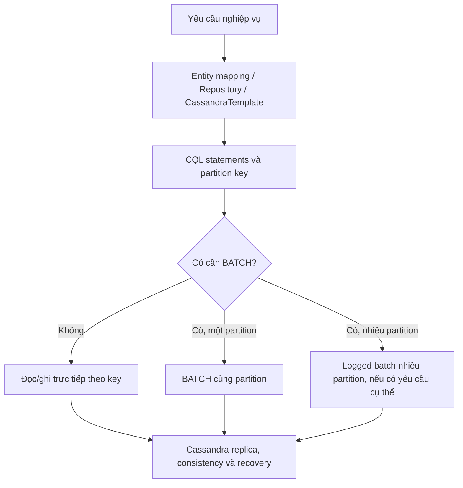
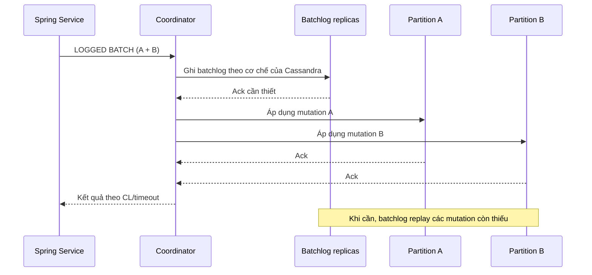
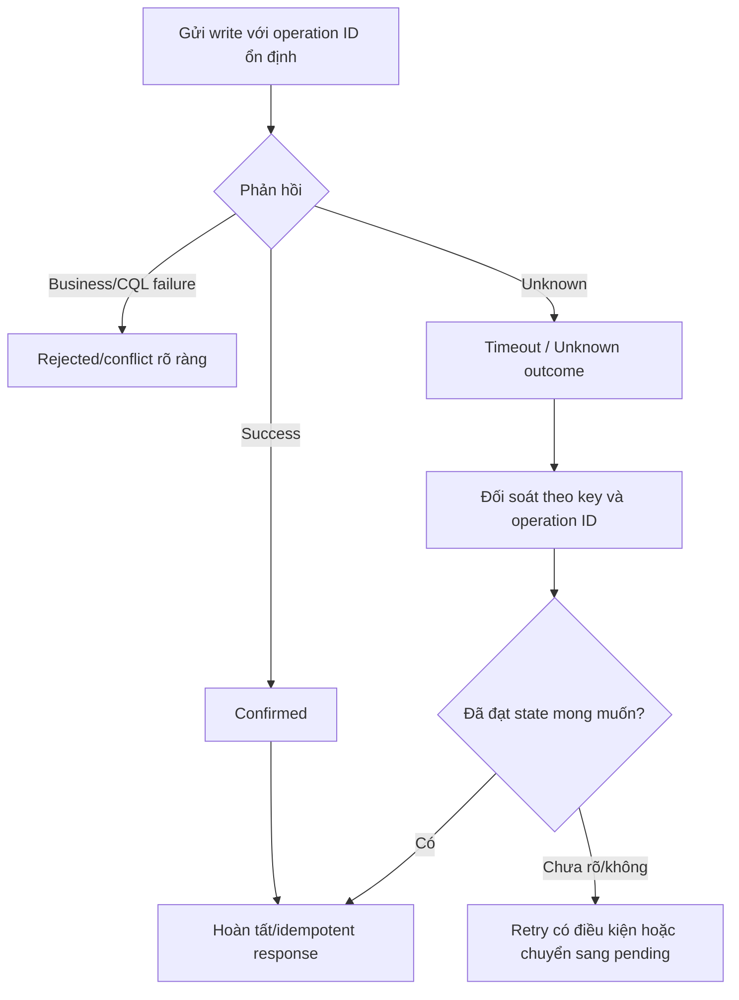

# Mục đích của CQL BATCH và ranh giới bảo đảm

Trong **Apache Cassandra**, từ `BATCH` dễ khiến lập trình viên quen SQL nghĩ đến một transaction gom nhiều câu lệnh, chạy nhanh hơn và có thể rollback khi xảy ra lỗi. Cách hiểu đó **không đúng** cho mọi trường hợp. **CQL BATCH** gom các thao tác `INSERT`, `UPDATE` và `DELETE` để thực thi cùng một yêu cầu, có những bảo đảm nhất định về atomicity theo **loại batch** và **phạm vi partition**, nhưng **không phải giao dịch SQL tổng quát** với rollback và isolation xuyên nhiều partition.

Khi làm việc với **Spring Data Cassandra**, bạn có thể ghi entity qua repository, `CassandraTemplate` hoặc dùng `CqlSession` với prepared statements. Dù đi qua API nào, nguyên lý Cassandra vẫn giữ nguyên: **partition key định vị dữ liệu**, **consistency level (CL)** điều khiển mức xác nhận từ replica, còn **CQL BATCH** giải quyết một vấn đề khác. Chọn sai kiểu batch có thể làm chậm hệ thống, tạo cảnh báo batch quá lớn hoặc khiến ứng dụng tưởng nhầm rằng các bảng read model đã được cập nhật đồng thời với transaction isolation.

Bài thuộc chương **Batch** của module **SPRING_DATA_CASSANDRA**. Chúng ta sẽ phân tích mục đích và ranh giới của `LOGGED`, `UNLOGGED`, `COUNTER` batch; cách batchlog hỗ trợ hoàn tất các mutation; sự khác biệt giữa **atomicity**, **isolation**, **durability** và **consistency**; tác động hiệu năng của batch xuyên partition; các ví dụ CQL, Java Driver 4 và cách kết hợp Spring Data Cassandra; cuối cùng là kiểm thử, xử lý lỗi và checklist trước production.

> **Nguyên tắc quan trọng:** **BATCH không phải công cụ tăng tốc bulk insert mặc định.** Nó chủ yếu phục vụ nhóm mutation có quan hệ nghiệp vụ hoặc yêu cầu ghi trong cùng partition. Đặc biệt, **logged batch xuyên nhiều partition có tính nguyên tử theo cơ chế thực thi/hồi phục của Cassandra, nhưng không có isolation tổng quát và không có rollback kiểu SQL**.

## 1. Trước khi dùng BATCH: nắm bốn câu hỏi

Mỗi khi chuẩn bị gom vài lệnh CQL vào `BEGIN BATCH`, hãy trả lời:

1. **Các mutation có chung partition thực sự không?** Cùng giá trị `tenant_id` chưa đủ khi partition key gồm nhiều cột hoặc khi thao tác nằm trên **hai bảng khác nhau**.
2. **Bạn cần tính chất gì?** Chỉ muốn giảm round trip? Muốn các thay đổi cùng một partition được xử lý như một đơn vị? Hay muốn bảo đảm tất cả mutation nhiều partition **cuối cùng** được áp dụng sau một lần ghi thành công?
3. **Nếu lỗi giữa chừng thì ứng dụng cần làm gì?** Có cho phép kết quả chưa rõ, replay, đối soát và side effect trùng hay không?
4. **Tải ghi và kích thước batch là bao nhiêu?** Một batch hàng nghìn partition khác nhau có thể gây áp lực lớn lên coordinator, batchlog, mạng và replica.

Nếu chưa trả lời được, **không nên thêm `BEGIN BATCH` chỉ để thay một vòng lặp `save(...)`**.

### Đặt BATCH vào đúng tầng



`BATCH` không thay schema hay định tuyến query. Câu `UPDATE` không có primary key hợp lệ vẫn sai trong batch; một bảng thiết kế kém theo mẫu đọc vẫn chậm dù được ghi bằng batch.

## 2. Mục đích thực sự của CQL BATCH

Trong Cassandra, `BATCH` là một nhóm **data modification statements (DML)**:

```sql
BEGIN BATCH
    INSERT INTO ...;
    UPDATE ...;
    DELETE ...;
APPLY BATCH;
```

Đây chỉ là **khung cú pháp**, không phải đoạn CQL hoàn chỉnh vì `...` là ký hiệu minh họa.

Ba nhóm mục tiêu chính:

- **Gom mutation trên cùng partition:** Có thể hưởng atomicity/isolation ở phạm vi partition và giảm số lần giao tiếp cho một số thao tác.
- **Nhóm mutation nhiều partition với logged batch:** Cassandra có cơ chế **batchlog** để hỗ trợ các mutation cuối cùng được áp dụng, trong những điều kiện thành công/khôi phục thích hợp.
- **Xác định đơn vị xử lý mutation:** Phục vụ một yêu cầu ghi có liên quan, nhưng **không tự tạo hợp đồng transaction SQL** hay bảo đảm kết quả được quan sát cùng lúc ở mọi partition.

Những mục tiêu **không phải** vai trò mặc định của BATCH:

- Bulk load dữ liệu cực lớn nhanh hơn các prepared statements độc lập có concurrency được giới hạn.
- Thực hiện `SELECT` rồi kiểm tra và quyết định mutation như một transaction read–write bất kỳ.
- Rollback mọi mutation nếu một statement đã thực thi nhưng statement khác gặp timeout.
- Cấp isolation xuyên nhiều bảng/partition.
- Thay thế idempotency của thanh toán, xuất hóa đơn hoặc publish message.
- Biến nhiều row từ các partition khác nhau thành một partition chung.

## 3. Hai bảng minh họa và ý nghĩa partition

Để tránh nhầm “cùng business object” với “cùng partition”, ta dùng các bảng sau.

### 3.1. Nhiều dòng hàng trong cùng partition của một đơn

```sql
CREATE TABLE IF NOT EXISTS commerce_ks.order_items_by_order (
    tenant_id uuid,
    order_id uuid,
    line_no int,
    sku text,
    quantity int,
    unit_price decimal,
    PRIMARY KEY ((tenant_id, order_id), line_no)
) WITH CLUSTERING ORDER BY (line_no ASC);
```

Phân tích:

| Thành phần | Cột | Vai trò |
| --- | --- | --- |
| Composite partition key | `tenant_id`, `order_id` | Mỗi cặp định vị partition của một đơn |
| Clustering column | `line_no` | Phân biệt dòng hàng trong partition |
| Regular columns | `sku`, `quantity`, `unit_price` | Dữ liệu của từng dòng |

Hai dòng có cùng `tenant_id` và `order_id`, nhưng `line_no` khác nhau, thuộc **cùng partition trong cùng bảng**.

### 3.2. Bảng tra đơn theo ID

```sql
CREATE TABLE IF NOT EXISTS commerce_ks.orders_by_id (
    tenant_id uuid,
    order_id uuid,
    customer_id uuid,
    status text,
    total_amount decimal,
    created_at timestamp,
    PRIMARY KEY ((tenant_id, order_id))
);
```

Cặp `(tenant_id, order_id)` ở đây cũng là partition key, **nhưng nó thuộc một bảng khác**. Dù giá trị khóa trùng với `order_items_by_order`, đây vẫn là **hai partition thuộc hai bảng khác nhau** về mặt xử lý storage/isolation.

### 3.3. Bảng read model theo khách/ngày

```sql
CREATE TABLE IF NOT EXISTS commerce_ks.orders_by_customer_day (
    tenant_id uuid,
    customer_id uuid,
    bucket_day date,
    created_at timestamp,
    order_id uuid,
    status text,
    total_amount decimal,
    PRIMARY KEY (
        (tenant_id, customer_id, bucket_day),
        created_at,
        order_id
    )
) WITH CLUSTERING ORDER BY (
    created_at DESC,
    order_id DESC
);
```

Bảng này được thiết kế cho query “các đơn mới nhất của khách trong một ngày”. Nó **không có cùng partition key** với bảng `orders_by_id`.

> **Phân biệt bắt buộc:** Hai mutation đều nói về `order_id = X` hoặc dùng cùng `tenant_id` **không có nghĩa** chúng cùng partition. Phải xét **bảng** và **toàn bộ partition key**.

## 4. Ba loại CQL BATCH

Cassandra phân biệt các loại batch quan trọng sau:

| Loại | Cú pháp | Mục tiêu | Lưu ý |
| --- | --- | --- | --- |
| **LOGGED** | `BEGIN BATCH` hoặc `BEGIN LOGGED BATCH` | Hỗ trợ atomicity cho các mutation nhiều partition bằng batchlog | Thêm chi phí; không có isolation xuyên partition |
| **UNLOGGED** | `BEGIN UNLOGGED BATCH` | Không dùng batchlog; phù hợp để gom mutation cùng partition trong trường hợp cần | Nhiều partition có thể áp dụng một phần khi lỗi |
| **COUNTER** | `BEGIN COUNTER BATCH` | Gom các mutation counter hợp lệ | Không trộn counter với regular mutations; retry counter cần cực kỳ thận trọng |

Đây là ba loại với các quy tắc riêng, **không phải ba “mức tốc độ” chỉ cần chọn loại nhanh nhất**.

### Mặc định BEGIN BATCH là gì?

```sql
BEGIN BATCH
    -- Các INSERT/UPDATE/DELETE hợp lệ.
APPLY BATCH;
```

Không ghi `UNLOGGED` hay `COUNTER` thì đó là **logged batch**. Một logged batch thường sử dụng **batchlog** để bảo đảm phục hồi các mutation khi coordinator gặp lỗi trong các điều kiện áp dụng.

Không nên đánh đồng một batch có kích thước nhỏ với một transaction có thể commit/rollback như PostgreSQL.

## 5. Ví dụ UNLOGGED BATCH trong cùng partition

Nhu cầu: thêm hai dòng hàng cho **cùng một đơn**. Dùng bảng `order_items_by_order`:

```sql
BEGIN UNLOGGED BATCH
    INSERT INTO commerce_ks.order_items_by_order (
        tenant_id, order_id, line_no, sku, quantity, unit_price
    ) VALUES (
        11111111-1111-1111-1111-111111111111,
        22222222-2222-2222-2222-222222222222,
        1, 'SKU-A', 2, 125000.00
    );

    INSERT INTO commerce_ks.order_items_by_order (
        tenant_id, order_id, line_no, sku, quantity, unit_price
    ) VALUES (
        11111111-1111-1111-1111-111111111111,
        22222222-2222-2222-2222-222222222222,
        2, 'SKU-B', 1, 75000.00
    );
APPLY BATCH;
```

Hai statement có:

```text
Bảng: order_items_by_order
Partition key: (tenant_id, order_id) giống nhau
Clustering keys: line_no = 1 và line_no = 2
```

Đây là tình huống **single-partition batch**. Với các mutation không điều kiện thông thường trong một partition, Cassandra có bảo đảm atomicity/isolation ở phạm vi partition theo mô hình lưu trữ của nó. Không cần batchlog xuyên partition chỉ để nhóm hai row thuộc cùng partition này.

### “Atomic trong một partition” nghĩa là gì?

Khi những mutation được xử lý thành một đơn vị trong cùng partition, Cassandra có các bảo đảm về việc áp dụng và quan sát theo partition mà batch nhiều partition không có. Điều đó **không cấp transaction toàn hệ thống**:

- Reader của một partition khác không được đưa vào cùng snapshot.
- Hai bảng khác nhau không trở thành cùng partition chỉ vì cùng tenant/order ID.
- Không thể đưa thêm câu `SELECT` rồi if/else vào batch để tạo transaction.
- CL của request vẫn là một vấn đề riêng với lỗi replica/timeout.
- Ghi đồng thời với timestamp và mutation semantics khác vẫn cần hiểu conflict resolution.

**Không dùng UNLOGGED BATCH để “tiết kiệm batchlog” khi các mutation thực sự thuộc nhiều partition mà nghiệp vụ đòi all-or-eventual completion.**

## 6. LOGGED BATCH nhiều partition: công cụ có chi phí

Giả sử service muốn đồng thời:

1. Cập nhật `status` ở bảng tra đơn theo ID.
2. Thêm/cập nhật một row ở bảng read model cho khách trong ngày.

```sql
BEGIN LOGGED BATCH
    UPDATE commerce_ks.orders_by_id
    SET status = 'PAID'
    WHERE tenant_id = 11111111-1111-1111-1111-111111111111
      AND order_id = 22222222-2222-2222-2222-222222222222;

    INSERT INTO commerce_ks.orders_by_customer_day (
        tenant_id, customer_id, bucket_day,
        created_at, order_id, status, total_amount
    ) VALUES (
        11111111-1111-1111-1111-111111111111,
        33333333-3333-3333-3333-333333333333,
        '2026-11-25',
        '2026-11-25T03:00:00Z',
        22222222-2222-2222-2222-222222222222,
        'PAID', 325000.00
    );
APPLY BATCH;
```

Hai statement đụng tới **hai bảng/partition khác nhau**. Logged batch tạo cơ chế hồi phục bằng batchlog để các mutation trong batch có thể được **hoàn tất về sau** nếu coordinator gặp sự cố sau giai đoạn log cần thiết.

### Batchlog hoạt động theo ý tưởng nào?



Đây là **mô hình giản lược**, không phải mô tả số replica batchlog hoặc chi tiết message của mọi phiên bản Cassandra. Việc xử lý, ack, xóa batchlog và replay phụ thuộc phiên bản/topology và trạng thái hệ thống.

### “Atomic” ở đây không có nghĩa nhìn thấy đồng thời

Trong logged batch **nhiều partition**, một reader có thể đọc thấy thay đổi A trước khi B đã được áp dụng/hiển thị. Ví dụ:

```text
T1: A (orders_by_id) đã cập nhật PAID
T2: Reader tra A -> thấy PAID
T3: Reader đọc B (orders_by_customer_day) -> vẫn thấy dữ liệu cũ
T4: B nhận mutation, rồi được đọc thấy PAID
```

Điều này **không mâu thuẫn** với bảo đảm eventual completion của logged batch, vì **atomicity theo cơ chế batchlog không đồng nghĩa isolation xuyên partition hoặc linearizable multi-table transaction**.

### Nếu application nhận timeout thì sao?

**Outcome có thể chưa rõ.** Tùy nơi xảy ra timeout, batchlog có thể đã được lưu, một hay nhiều mutation đã thực hiện, hoặc request chưa được chấp nhận theo các điều kiện cần thiết. Ứng dụng không nên suy “timeout = Cassandra đã rollback cả hai bảng”.

Thiết kế recovery phải có **idempotent writes, operation ID và reconciliation** nếu các bảng đóng vai trò quan trọng.

## 7. UNLOGGED BATCH nhiều partition: giới hạn rất rõ

Cassandra cho phép biểu diễn unlogged batch chứa nhiều partition trong những tình huống phù hợp với CQL, ví dụ:

```sql
BEGIN UNLOGGED BATCH
    INSERT INTO commerce_ks.order_items_by_order (
        tenant_id, order_id, line_no, sku, quantity, unit_price
    ) VALUES (
        11111111-1111-1111-1111-111111111111,
        22222222-2222-2222-2222-222222222222,
        1, 'SKU-A', 2, 125000.00
    );

    INSERT INTO commerce_ks.order_items_by_order (
        tenant_id, order_id, line_no, sku, quantity, unit_price
    ) VALUES (
        11111111-1111-1111-1111-111111111111,
        99999999-9999-9999-9999-999999999999,
        1, 'SKU-C', 1, 45000.00
    );
APPLY BATCH;
```

Hai `order_id` khác nhau làm đây là **hai partition** của cùng bảng.

Nếu coordinator/lỗi mạng làm batch chỉ được áp dụng một phần, **unlogged batch nhiều partition không có batchlog để đảm bảo hoàn tất những mutation còn lại**. Các cảnh báo của Cassandra về unlogged batch nhiều partition là tín hiệu để điều tra thiết kế, không phải “spam log vô hại”.

### Khi nào vẫn có thể dùng?

Chỉ cân nhắc nếu ứng dụng **chấp nhận kết quả từng phần**, hiểu rõ retry/reconciliation và có lý do thực tế để gom statement. Nhưng nếu đã chấp nhận từng phần và mục tiêu chỉ là throughput, **các writes độc lập được điều khiển concurrency** thường hợp lý hơn một unlogged batch trải nhiều partition.

Đừng dùng unlogged batch xuyên partition vì “đã thử thấy nhanh hơn trên laptop”. Benchmark phải dùng dữ liệu, network và replica topology đại diện.

## 8. Atomicity, isolation, durability, consistency: bốn khái niệm khác nhau

| Khái niệm | Câu hỏi | CQL BATCH bảo đảm tới đâu? |
| --- | --- | --- |
| **Atomicity** | Nhóm mutation có được áp dụng như một đơn vị theo cơ chế được hỗ trợ? | Single-partition batch có bảo đảm ở phạm vi partition; logged multi-partition dùng batchlog để eventual completion; unlogged multi-partition không có bảo đảm tương đương |
| **Isolation** | Reader có thể quan sát một phần kết quả khi batch đang thực hiện? | **Không có isolation xuyên nhiều partition**; same-partition có bảo đảm theo phạm vi partition |
| **Durability** | Dữ liệu/nhật ký ghi có vượt qua các lỗi thích hợp không? | Phụ thuộc commit path, batchlog, RF, CL, node/disk và recovery; không có lời hứa tuyệt đối cho mọi lỗi |
| **Consistency (CL)** | Cần bao nhiêu replica phản hồi để request thành công? | Là request-level policy, **không** đồng nghĩa atomicity/isolation của batch |

### Khác biệt với transaction trong RDBMS

Trong một SQL transaction điển hình:

```sql
BEGIN;
UPDATE orders SET status = 'PAID' WHERE id = 101;
INSERT INTO order_history (...) VALUES (...);
COMMIT;
```

Developer có thể kỳ vọng isolation/rollback theo transaction model của RDBMS. Cassandra **không cung cấp cùng mô hình** chỉ bằng cách thay `BEGIN; ... COMMIT;` bằng `BEGIN BATCH; ... APPLY BATCH;`.

**Đặc biệt:** Không có `ROLLBACK BATCH` tương đương để khôi phục mọi mutation đã nhìn thấy trong những partition khác nhau khi một bước nghiệp vụ sai.

### Khi nào logged batch thật sự có ích?

Khi một số mutation nhiều partition **cần được Cassandra eventual-apply cùng một nhóm** và chi phí/logged semantics được chấp nhận, logged batch có thể phù hợp. Nhưng nếu nghiệp vụ yêu cầu **không bao giờ có cửa sổ mà A mới, B cũ**, logged batch là **chưa đủ**. Cần thiết kế nguồn dữ liệu có thẩm quyền, read model đồng bộ theo event, version/gating hoặc workflow phù hợp.

## 9. Một batch có làm các câu lệnh chạy tuần tự không?

Không được hiểu batch như một script có thứ tự thực thi tuần tự được bảo đảm cho mọi statement.

Ví dụ:

```sql
BEGIN BATCH
    UPDATE commerce_ks.orders_by_id
    SET status = 'PAID'
    WHERE tenant_id = 11111111-1111-1111-1111-111111111111
      AND order_id = 22222222-2222-2222-2222-222222222222;

    UPDATE commerce_ks.orders_by_id
    SET status = 'CANCELLED'
    WHERE tenant_id = 11111111-1111-1111-1111-111111111111
      AND order_id = 22222222-2222-2222-2222-222222222222;
APPLY BATCH;
```

Đây là **thiết kế cần tránh**: hai write cạnh tranh trên cùng cell trong cùng batch. Nếu dùng cùng timestamp, kết quả có thể bị chi phối bởi quy tắc tie-breaking/conflict resolution của Cassandra, không phải do dòng `CANCELLED` được đặt phía dưới. Nếu timestamp khác nhau, Cassandra lại so sánh timestamp.

**Quy tắc:** Mỗi batch nên có mutation rõ ràng, không dùng thứ tự câu lệnh trong batch để viết state machine hoặc thay `IF ...`.

### Batch không cho phép đọc trung gian

Không có một lệnh CQL BATCH theo kiểu:

```text
BEGIN BATCH
    SELECT stock ...
    IF stock > 0 THEN UPDATE ...
APPLY BATCH;
```

Khối này là **giả mã không hợp lệ**, chỉ để minh họa điều **không được phép**. Muốn kiểm tra điều kiện trước cập nhật, cần đánh giá LWT/conditional mutation hoặc workflow khác; không thể nhét một câu `SELECT` vào batch.

## 10. Batchlog không phải write-ahead log chung của ứng dụng

Batchlog phục vụ **recovery của logged batches** theo cơ chế Cassandra, không phải:

- Message queue để giữ mọi event doanh nghiệp.
- Outbox có API đọc/replay tùy ý cho service.
- Transaction log cung cấp snapshot của nhiều bảng.
- Dịch vụ bảo đảm exactly-once cho email/payment.
- Thay thế anti-entropy repair giữa replica.
- Bằng chứng rằng request HTTP nhận timeout đã chắc chắn thất bại.
- Cơ chế phục hồi dữ liệu sau mọi kịch bản mất toàn cluster hoặc mất disk.

Nếu nghiệp vụ muốn publish sự kiện sau khi một đơn được thanh toán, phải thiết kế **event/outbox/idempotency** rõ ràng. Một logged CQL batch không tự động gửi event sang Kafka hay thực thi các side effects bên ngoài Cassandra.

## 11. Consistency level của một batch

Một batch có thể được gửi cùng **consistency level**, ví dụ `LOCAL_QUORUM`, theo request options và phiên bản driver. CL quy định yêu cầu xác nhận đối với mutation trong phạm vi replica thích hợp; nó **không tự tạo isolation giữa những partition trong batch**.

Giả sử keyspace RF3 trong một datacenter:

| CL | Điều kiện số lượng thường gặp | Ý nghĩa với batch |
| --- | --- | --- |
| `LOCAL_ONE` | 1 replica local cho mỗi mutation tương ứng | Dễ đạt ngưỡng hơn khi replica lỗi, nhưng không bảo đảm mọi replica đã hội tụ |
| `LOCAL_QUORUM` | 2 replica local khi RF local = 3 | Ràng buộc xác nhận mạnh hơn trong DC |
| `ALL` | Mọi replica của partition | Nhạy với replica lỗi hoặc chậm |

Ví dụ **logged batch nhiều partition** với CL `LOCAL_QUORUM` vẫn có thể được quan sát theo kiểu:

```text
Partition A: đã có mutation mới
Partition B: đang chờ apply/replay hoặc read chưa thấy mới
```

**CL không loại bỏ cửa sổ thiếu isolation xuyên partition.** Khi read-after-write tại DC khác, local quorum của hai DC không tự giao nhau; cần xét replication và routing.

### Nếu một replica chết giữa batch?

Tùy loại batch, điểm lỗi, batchlog state, CL, timeout và các bản sao khả dụng, client có thể nhận:

- Success sau khi đủ xác nhận.
- `WriteTimeout`.
- `Unavailable`.
- Transport error.
- Kết quả/chi tiết lỗi của conditional mutation.

**Không tự suy từ loại lỗi rằng tất cả mutations đều đã rollback.** Recovery cần dựa trên key/operation và hành vi cụ thể.

## 12. Tại sao BATCH thường không làm bulk insert nhanh hơn?

Một vòng lặp lập trình viên hay thử:

```java
// Dạng ý tưởng dễ dẫn tới batch quá lớn:
for (OrderEvent event : thousandsOfEvents) {
    batch.addStatement(insert.bind(...));
}
session.execute(batch.build());
```

Nếu `thousandsOfEvents` trải qua hàng nghìn partition, một batch lớn khiến coordinator xử lý một lượng lớn mutation để phân phối, tăng network fan-out, memory footprint, kích thước batchlog với LOGGED và nguy cơ timeout.

**Cassandra được tối ưu cho các writes độc lập, phân tán theo partition key**. Một chiến lược ingest tốt thường là:

1. Prepare statement một lần.
2. Gửi nhiều bound statements **độc lập**, bất đồng bộ khi phù hợp.
3. **Giới hạn số in-flight writes** và kiểm soát rate/backpressure.
4. Dùng token-aware routing và local DC policy.
5. Chia dữ liệu vào các partition được thiết kế đúng.
6. Retry có giới hạn và theo idempotency.
7. Theo dõi p95/p99, overload, pending requests và disk.

Như vậy nhiều node có thể xử lý request song song mà không ép một coordinator nhận batch khổng lồ.

### Batch lớn có cảnh báo và giới hạn

Cassandra có các thiết lập cảnh báo/lỗi về kích thước batch (ví dụ những nhóm cấu hình như `batch_size_warn_threshold_in_kb` và `batch_size_fail_threshold_in_kb`), với giá trị/khả năng khác nhau theo phiên bản và phân phối.

Đừng nhầm **số statement** với **kích thước mutation bytes**: 10 statements chứa payload lớn có thể nặng hơn 100 statements nhỏ. Không đưa ra một số “50 statements/batch luôn an toàn” mà chưa đo.

### Bao nhiêu statement là hợp lý?

Không có con số chung cho mọi hệ thống. Mỗi batch cần nhỏ, có **lý do nghiệp vụ thật**, và được đo theo số partition, bytes, mutation type, CL, cluster topology và latency SLA. Tránh batch động tăng không giới hạn theo số bản ghi trả về từ một API.

## 13. Counter BATCH: đường ghi chuyên biệt

Counter trong Cassandra không được xử lý giống regular columns. Một bảng counter minh họa:

```sql
CREATE TABLE IF NOT EXISTS commerce_ks.views_by_content (
    tenant_id uuid,
    content_id uuid,
    view_count counter,
    PRIMARY KEY ((tenant_id, content_id))
);
```

Increment bằng counter batch:

```sql
BEGIN COUNTER BATCH
    UPDATE commerce_ks.views_by_content
    SET view_count = view_count + 1
    WHERE tenant_id = 11111111-1111-1111-1111-111111111111
      AND content_id = aaaaaaaa-aaaa-aaaa-aaaa-aaaaaaaaaaaa;

    UPDATE commerce_ks.views_by_content
    SET view_count = view_count + 1
    WHERE tenant_id = 11111111-1111-1111-1111-111111111111
      AND content_id = bbbbbbbb-bbbb-bbbb-bbbb-bbbbbbbbbbbb;
APPLY BATCH;
```

Hai `content_id` khác nhau dẫn tới **hai partition khác nhau**.

Những quy tắc cần hiểu:

- Counter batch chỉ chứa những mutation counter hợp lệ, không trộn regular `INSERT`/`UPDATE` tùy ý.
- Một phép `count = count + 1` **không idempotent**: retry sau timeout có thể cộng hai lần.
- Không mặc định counter batch cung cấp atomic transaction xuyên hai bộ đếm.
- Nếu nghiệp vụ cần số đếm chính xác theo event id, phải thiết kế deduplication hoặc mô hình tổng hợp từ event có khóa duy nhất, không dựa vào retry counter vô điều kiện.
- Counter có hạn chế riêng với TTL, timestamp và một số thao tác conditional theo phiên bản; không sao chép policy của regular table.

### Có cần dùng COUNTER BATCH nếu chỉ tăng một counter?

Thông thường một `UPDATE ... SET counter = counter + 1` đơn lẻ là đủ để diễn đạt phép tăng. Batch không giúp một mutation đơn có thêm tính chất nghiệp vụ đặc biệt, trong khi làm phức tạp retry/giám sát.


## 14. Conditional BATCH và LWT: phải phân biệt với batch thông thường

Khi cần một điều kiện nghiệp vụ như “chỉ chuyển đơn từ `PENDING` sang `PAID` nếu trạng thái hiện tại vẫn là `PENDING`”, Cassandra cung cấp **lightweight transaction (LWT)** với `IF`, không phải atomicity thông thường của `BEGIN BATCH`.

Một update có điều kiện:

```sql
UPDATE commerce_ks.orders_by_id
SET status = 'PAID'
WHERE tenant_id = 11111111-1111-1111-1111-111111111111
  AND order_id = 22222222-2222-2222-2222-222222222222
IF status = 'PENDING';
```

Ứng dụng phải kiểm tra kết quả `[applied]`; một request CQL được chấp nhận ở mức cú pháp không đồng nghĩa điều kiện `IF` đã đúng.

### BATCH có IF có trở thành transaction SQL?

Không. Cassandra hỗ trợ **conditional mutation/batch** trong những phạm vi/giới hạn được quy định, thường gắn với việc áp dụng các điều kiện cùng partition. Không thể tự do đưa nhiều conditional writes trên các partition khác nhau vào một batch rồi đòi Paxos khóa toàn hệ thống như một transaction cơ sở dữ liệu quan hệ.

Đặc biệt:

- LWT có cơ chế **Paxos/serial consistency**, riêng với regular read/write CL.
- Điều kiện `IF`, phạm vi partition và các loại statement có ràng buộc CQL, phụ thuộc phiên bản.
- LWT tốn coordination và round trips hơn ordinary write.
- **Logged multi-partition batch không biến thành multi-partition CAS** chỉ nhờ thêm `IF`.
- Với nhiều read model, một LWT trên bảng chính không tự khóa/commit nguyên tử các bảng còn lại.

### Ví dụ single-partition conditional update

Đối với yêu cầu đổi status có điều kiện, **một câu lệnh `UPDATE ... IF ...` đơn** thường đã diễn đạt rõ và tránh batch không cần thiết:

```java
PreparedStatement conditional = session.prepare("""
    UPDATE commerce_ks.orders_by_id
    SET status = ?
    WHERE tenant_id = ? AND order_id = ?
    IF status = ?
    """);

BoundStatement statement = conditional.bind(
        "PAID", tenantId, orderId, "PENDING")
    .setConsistencyLevel(
        DefaultConsistencyLevel.LOCAL_QUORUM
    )
    .setSerialConsistencyLevel(
        DefaultConsistencyLevel.LOCAL_SERIAL
    );

Row result = session.execute(statement).one();
boolean applied = result != null && result.getBoolean("[applied]");

if (!applied) {
    // Xử lý conflict theo nghiệp vụ; không coi là batch rollback.
}
```

Đây là đoạn mã **bên trong một service có session và các imports phù hợp**. Chính sách `LOCAL_SERIAL` chỉ minh họa cách đặt serial CL; với writers ở nhiều datacenter cần đánh giá phạm vi Paxos, routing và policy đồng nhất.

## 15. TTL, timestamp, tombstone và thứ tự mutation trong BATCH

Một batch gồm nhiều mutations, mỗi mutation vẫn chịu quy tắc **write timestamp**, **TTL**, null/UNSET và **tombstone** của Cassandra.

### TTL được áp dụng theo mutation, không phải “batch hết hạn”

Ví dụ:

```sql
BEGIN UNLOGGED BATCH
    INSERT INTO commerce_ks.order_items_by_order (
        tenant_id, order_id, line_no, sku, quantity, unit_price
    ) VALUES (
        11111111-1111-1111-1111-111111111111,
        22222222-2222-2222-2222-222222222222,
        3, 'SKU-TEMP', 1, 9000.00
    ) USING TTL 3600;

    UPDATE commerce_ks.order_items_by_order
    SET quantity = 2
    WHERE tenant_id = 11111111-1111-1111-1111-111111111111
      AND order_id = 22222222-2222-2222-2222-222222222222
      AND line_no = 1;
APPLY BATCH;
```

TTL của dòng mới có hiệu lực với các cell được ghi qua statement đầu theo semantics Cassandra. **Không có một TTL toàn batch tự áp dụng cho mọi statement**, và update ở dòng thứ hai không vì ở cùng batch mà nhận TTL 3600.

### Tombstone không bị BATCH loại bỏ

Một `DELETE` trong batch vẫn tạo thông tin xóa khi cần. Tombstone phải tuân theo cơ chế reconciliation/repair và compaction; logged batch không xóa SSTable vật lý ngay, cũng không làm `gc_grace_seconds` vô hiệu.

Nếu ứng dụng dùng `UPDATE col = null` cho nhiều hàng vì nhầm field vắng mặt với explicit null, đưa các update đó vào batch **không loại bỏ write amplification hoặc tombstone pressure**.

### Timestamp của batch: đừng dựa vào thứ tự dòng CQL

CQL hỗ trợ điều khiển timestamp trên một số mutation/batch theo cú pháp phiên bản. Khi các mutation cùng chạm một cell, timestamp và quy tắc tie-breaking quyết định kết quả, **không phải “lệnh đứng cuối thắng” một cách đương nhiên**.

Nguyên tắc:

- Không viết hai giá trị cạnh tranh cho cùng cell trong một batch để làm state machine.
- Không dùng batch như script có thứ tự tuần tự bảo đảm.
- Không cấp explicit timestamp tùy ý khi không kiểm soát clock skew/conflict resolution.
- Không sử dụng BATCH để tránh thiết kế optimistic locking/LWT.
- Nếu dùng TTL, test riêng việc ghi lại cùng giá trị có làm mới thời gian sống hay không.

### UNSET so với null trong prepared statement của batch

Một bound regular column ở trạng thái **UNSET** sẽ bị bỏ qua trong mutation phù hợp; **null** thường biểu thị xóa cột. Batch không thay đổi hai semantics này. API PATCH nên giữ thông tin field **absent/null/value** từ JSON đến các bound statements.

## 16. Java Driver 4: tạo UNLOGGED BATCH cùng partition

Thay vì ghép CQL string từ dữ liệu người dùng, nên dùng **prepared statements** và bind giá trị. Java Driver 4 cung cấp `BatchStatement` và `DefaultBatchType`.

```java
import java.math.BigDecimal;
import java.util.Objects;
import java.util.UUID;

import com.datastax.oss.driver.api.core.CqlSession;
import com.datastax.oss.driver.api.core.DefaultConsistencyLevel;
import com.datastax.oss.driver.api.core.cql.BatchStatement;
import com.datastax.oss.driver.api.core.cql.BatchStatementBuilder;
import com.datastax.oss.driver.api.core.cql.DefaultBatchType;
import com.datastax.oss.driver.api.core.cql.PreparedStatement;

public final class OrderItemBatchWriter {

    private final CqlSession session;
    private final PreparedStatement insertItem;

    public OrderItemBatchWriter(CqlSession session) {
        this.session = Objects.requireNonNull(session);
        this.insertItem = session.prepare("""
            INSERT INTO commerce_ks.order_items_by_order (
                tenant_id, order_id, line_no,
                sku, quantity, unit_price
            ) VALUES (?, ?, ?, ?, ?, ?)
            """);
    }

    public void createTwoLines(UUID tenantId, UUID orderId) {
        Objects.requireNonNull(tenantId);
        Objects.requireNonNull(orderId);

        BatchStatementBuilder builder =
            BatchStatement.builder(DefaultBatchType.UNLOGGED);

        builder.addStatement(insertItem.bind(
            tenantId, orderId, 1,
            "SKU-A", 2, new BigDecimal("125000.00")
        ));

        builder.addStatement(insertItem.bind(
            tenantId, orderId, 2,
            "SKU-B", 1, new BigDecimal("75000.00")
        ));

        BatchStatement batch = builder.build()
            .setConsistencyLevel(
                DefaultConsistencyLevel.LOCAL_QUORUM
            );

        session.execute(batch);
    }
}
```

Ở ví dụ:

1. Hai `BoundStatement` có **cùng bảng và cùng partition key**.
2. `line_no` khác nhau nên đại diện hai clustering rows trong partition.
3. `DefaultBatchType.UNLOGGED` tránh yêu cầu batchlog nhiều partition không cần thiết.
4. `LOCAL_QUORUM` chỉ là policy minh họa; RF và local DC phải được thiết kế đúng.
5. Một `BatchStatementBuilder` được tạo cho mỗi yêu cầu; **không chia sẻ builder mutable giữa nhiều luồng**.
6. Không tạo `CqlSession` hay chuẩn bị lại CQL cho từng HTTP request.
7. Code không kiểm tra tình trạng “đơn đã tồn tại” hay “SKU có hợp lệ”; đó là logic nghiệp vụ riêng.

### Khi có N dòng trong một đơn

Có thể lập batch từ danh sách nhỏ **đã được validate**:

```java
BatchStatementBuilder builder =
    BatchStatement.builder(DefaultBatchType.UNLOGGED);

for (OrderItemInput item : items) {
    builder.addStatement(insertItem.bind(
        tenantId,
        orderId,
        item.lineNo(),
        item.sku(),
        item.quantity(),
        item.unitPrice()
    ));
}

session.execute(builder.build());
```

`OrderItemInput` là DTO do dự án định nghĩa, không phải class thư viện. **Phải giới hạn** số dòng, tổng bytes và độ lớn partition; không dùng vòng lặp này để nhét cả triệu sự kiện vào một batch.

### Vì sao không truyền cả entity trực tiếp vào BatchStatement?

Driver thao tác với bound CQL statements. Entity mapping của Spring Data là một tầng riêng; nó không tự chuyển bất kỳ entity tùy ý thành `BatchableStatement` mà bạn có thể thêm vào batch bằng một lời gọi giả định. Khi cần mapping tự động, dùng đúng batch operations của Spring Data version; khi cần kiểm soát đầy đủ, bind các cột và khóa tường minh như trên.

## 17. Java Driver: LOGGED BATCH hai read model

Ví dụ ứng dụng có hai bảng:

- `orders_by_id` — tra trạng thái theo `(tenant_id,order_id)`.
- `orders_by_customer_day` — đọc đơn theo khách/ngày và clustering time.

Hai bảng khác nhau nên đây là **multi-partition/cross-table batch**, kể cả khi chứa cùng `order_id`.

```java
import java.math.BigDecimal;
import java.time.Instant;
import java.time.LocalDate;
import java.util.UUID;

import com.datastax.oss.driver.api.core.CqlSession;
import com.datastax.oss.driver.api.core.DefaultConsistencyLevel;
import com.datastax.oss.driver.api.core.cql.BatchStatement;
import com.datastax.oss.driver.api.core.cql.DefaultBatchType;
import com.datastax.oss.driver.api.core.cql.PreparedStatement;

public final class OrderReadModelWriter {

    private final CqlSession session;
    private final PreparedStatement updateStatus;
    private final PreparedStatement insertDaily;

    public OrderReadModelWriter(CqlSession session) {
        this.session = session;

        this.updateStatus = session.prepare("""
            UPDATE commerce_ks.orders_by_id
            SET status = ?
            WHERE tenant_id = ? AND order_id = ?
            """);

        this.insertDaily = session.prepare("""
            INSERT INTO commerce_ks.orders_by_customer_day (
                tenant_id, customer_id, bucket_day,
                created_at, order_id, status, total_amount
            ) VALUES (?, ?, ?, ?, ?, ?, ?)
            """);
    }

    public void writePaidToBothViews(
            UUID tenantId,
            UUID customerId,
            UUID orderId,
            LocalDate bucketDay,
            Instant createdAt,
            BigDecimal totalAmount) {

        BatchStatement batch =
            BatchStatement.builder(DefaultBatchType.LOGGED)
                .addStatement(updateStatus.bind(
                    "PAID", tenantId, orderId
                ))
                .addStatement(insertDaily.bind(
                    tenantId, customerId, bucketDay,
                    createdAt, orderId, "PAID", totalAmount
                ))
                .build()
                .setConsistencyLevel(
                    DefaultConsistencyLevel.LOCAL_QUORUM
                );

        session.execute(batch);
    }
}
```

Đây là ví dụ **cách tạo batch**, không phải giải pháp nghiệp vụ thanh toán đầy đủ. Nó không có CAS, authorization, operation ID, reconciliation hay xử lý khi status đổi từ một giá trị cũ khác. Phần update trên bảng `orders_by_id` và insert vào bảng `orders_by_customer_day` có thể được quan sát không đồng thời.

**Lưu ý:** Java Driver date/time codec và mapping từ `LocalDate`/`Instant` cần tương thích với phiên bản driver được dự án khóa. Về mặt CQL, `bucket_day` là `date` và `created_at` là `timestamp`.

### Có nên dùng logged batch cho mọi lần đổi status?

Không nhất thiết. Nếu đường đọc chính cần trạng thái mới trước, còn bảng read model có thể hội tụ sau vài giây, một workflow event-driven với idempotency/reconciliation có thể tốt hơn logged batch nhiều partition trong hot path.

## 18. Dùng Spring Data Cassandra Repository và CassandraTemplate

Repository:

```java
public interface OrderItemRepository
        extends CassandraRepository<OrderItemEntity, OrderItemKey> {
}
```

có thể ghi entity qua `save(...)` hoặc `saveAll(...)`. Nhưng **không nên mặc định `saveAll(entities)` tương đương một CQL BATCH có tất cả bảo đảm của LOGGED/UNLOGGED**. Cách Spring Data thực thi CRUD hàng loạt phụ thuộc API, phiên bản và driver. Ngay cả khi có batching ở tầng framework, cần biết loại batch, partition scope và CL thực.

### CassandraTemplate có những lựa chọn nào?

`CassandraTemplate` cho phép mapping entity và thực hiện các operation CQL. Một số phiên bản Spring Data Cassandra cung cấp API batch operations; nhưng **tên method, cách tạo batch, giới hạn statement và options có thể thay đổi theo release**.

Khi cần dùng batch qua template:

1. Đối chiếu API `CassandraOperations`/`CassandraTemplate` của phiên bản dự án.
2. Kiểm tra nó có hỗ trợ LOGGED/UNLOGGED/COUNTER theo nhu cầu không.
3. Xác minh generated CQL, partition keys và cách bind TTL/null.
4. Đặt CL theo request options/driver configuration được hỗ trợ.
5. Test lỗi, readback và mutation count trên Cassandra test.
6. Không tạo một lệnh `cassandraTemplate.beginTransaction()` giả định nếu framework không có transaction SQL tương đương.

**Khi semantics batch quan trọng**, `CqlSession` với `BatchStatement` tường minh thường dễ review hơn một abstraction mà team chưa xác minh.

### Không cần từ bỏ repository cho mọi thao tác

Có thể dùng repository cho point read/write đơn giản, và tạo một **writer riêng** dùng driver cho một mutation group cần batch. Service vẫn chia sẻ session/connection, auth, TLS, DC policy, metrics và cấu hình timeout của ứng dụng Spring.

## 19. Atomicity khác idempotency như thế nào?

**Atomicity** mô tả bảo đảm về việc áp dụng nhóm mutations theo cơ chế Cassandra. **Idempotency** mô tả điều gì xảy ra nếu cùng một thao tác được gửi **hơn một lần**.

Ví dụ:

```text
Operation ID: pay-2026-001
Mutation: SET status = PAID
Side effect ngoài DB: yêu cầu gateway thu tiền
```

Nếu service gọi payment gateway trước, rồi ghi logged batch vào Cassandra nhưng nhận timeout, retry **toàn bộ workflow** mà không kiểm tra operation ID có thể thu tiền hai lần. BATCH không có quan hệ transaction với gateway.

Ngay cả khi các mutations CQL dùng cùng giá trị:

- Retry có thể gắn timestamp mới làm thay đổi conflict resolution.
- TTL của cell được ghi lại có thể được làm mới.
- Có writer khác đã chuyển status sau request trước.
- Counter increments và các side effects ngoài Cassandra không idempotent.
- LWT có thể trả not-applied sau khi lần trước thực tế đã applied.

### Mẫu recovery có operation ID



Sơ đồ yêu cầu **operation ID được ghi nhận ở một nguồn dữ liệu phù hợp** và quy trình đối soát đáng tin; nếu hệ thống không lưu operation ID, không thể suy từ một `status=PAID` rằng request hiện tại là request đã gây ra thay đổi đó.

## 20. Điều gì xảy ra khi logged batch gặp lỗi từng bước?

Một mô hình **có thể** xảy ra, không phải lịch thực thi cố định:

```text
T0: Coordinator nhận logged batch (mutations A, B)
T1: Batchlog được lưu theo yêu cầu
T2: Mutation A được gửi đến partition A và một số replica xác nhận
T3: Mutation B bị chậm do replica B gặp sự cố
T4: Client timeout hoặc không nhận đủ xác nhận
T5: Batchlog replay/tiếp tục áp dụng B khi hệ thống phục hồi
T6: Cả A và B có thể dần được quan sát theo policy CL
```

**Một reader tại T3 có thể nhìn thấy A nhưng chưa thấy B.** Một service tại T4 không nên giả định dữ liệu ở A đã được rollback.

Không nên mô tả logged batch là **“all-or-nothing visibility at every instant”**. Lời hứa mạnh nhất của nó trong trường hợp multi-partition là **tính nguyên tử theo cơ chế batchlog/eventual application**, với các tiền đề về batchlog được chấp nhận/bền vững và khả năng khôi phục hệ thống.

### Nếu một phần mutation lỗi vì schema hoặc validation?

Lỗi cú pháp, sai type, primary key null, vi phạm ràng buộc conditional hoặc permission có thể khiến batch bị từ chối. Không dùng batch để che **lỗi lập trình hoặc lỗi mapping**: validate statement/type/key và quyền trước khi gửi. Với lỗi ở giữa quá trình phân tán, outcome có thể không chắc chắn; cần xử lý theo loại lỗi thay vì suy mọi lỗi giống nhau.

## 21. Sự khác nhau giữa logged batch và dual-write ứng dụng

Nếu hai read model được cập nhật bằng hai lời gọi độc lập:

```text
WRITE A -> success
WRITE B -> failure
```

ứng dụng phải tự khôi phục B, thông qua retry, event log, outbox hoặc reconciliation. Với logged batch nhiều partition, Cassandra có **batchlog** hỗ trợ eventual application của một nhóm mutations theo semantics tương ứng.

Nhưng cả hai phương án đều cần:

- **Idempotency** cho retry sau outcome unknown.
- **Đường đọc** hiểu khả năng A đã mới, B còn cũ.
- **Consistency policy** theo replica/DC.
- **Monitoring** để phát hiện trạng thái lệch.
- **Business compensation** nếu có side effects ngoài Cassandra.
- **Data repair/reconciliation** ở tầng read model nếu ghi dữ liệu sai, thiếu migration hoặc có update nghiệp vụ tới sau.

**Logged batch không đồng bộ Kafka, Redis hoặc Elasticsearch**. Các hệ thống ấy nằm ngoài giao dịch CQL; cần workflow riêng.

### Khi nào event-driven có thể phù hợp hơn?

Khi read model cần cập nhật bất đồng bộ, khối lượng ghi lớn và một nguồn dữ liệu có thẩm quyền có thể phát event theo cơ chế bền vững, pipeline với consumer idempotent cho phép:

- Giảm fan-out đồng bộ trong request hot path.
- Retry và xử lý dead-letter rõ ràng.
- Theo dõi lag từng projection/read model.
- Backfill/rebuild read model mà không sửa transaction ghi chính.
- Đặt SLA eventual consistency theo use case.

Đổi lại hệ thống phải vận hành event pipeline, idempotency và reconciliation. Không nên nói một phương án luôn tốt hơn; hãy chọn theo yêu cầu atomicity, latency và operations.

## 22. Batch nhiều bảng và yêu cầu nhất quán khi đọc

Một số code sau khi gửi logged batch lập tức gọi:

```java
OrderById order = orderRepository.findById(key).orElseThrow();
List<OrderByCustomerDay> list = dayRepository
    .findByKey_TenantIdAndKey_CustomerIdAndKey_BucketDay(
        tenantId, customerId, day
    );
```

Đây là hai query vào **hai bảng/partition khác nhau**. Dù writer đã dùng logged batch và mỗi reader dùng `LOCAL_QUORUM`, không có một **snapshot chung hai bảng** được cung cấp cho hai lời gọi.

Nếu màn hình yêu cầu một trạng thái tuyệt đối đồng bộ, thiết kế có thể:

1. Chọn **một bảng authoritative** cho quyết định nghiệp vụ.
2. Chấp nhận read model hiển thị chậm hơn và có chỉ báo freshness.
3. Dùng version/operation ID và chỉ hiển thị khi projection đã tới version yêu cầu.
4. Xây materialization theo event ở một pipeline có trạng thái tiến độ.
5. Tránh dùng dữ liệu từ projection chưa hội tụ để xác thực thanh toán hoặc quyền truy cập.

**Consistency level của Cassandra không tạo transaction isolation trên hai query độc lập.**

## 23. Batch với dữ liệu và partition không cân bằng

Một multi-partition batch có thể đụng:

- Nhiều partition nhỏ trên nhiều node.
- Một partition cực nóng với hàng trăm mutation.
- Một vài hàng chứa payload lớn.
- Nhiều datacenter với replication factor khác nhau.

Chi phí không chỉ phụ thuộc số lệnh CQL, mà phụ thuộc:

| Biến số | Tại sao ảnh hưởng |
| --- | --- |
| **Số partition** | Tăng số tập replica/coordinator fan-out |
| **Số bảng** | Dữ liệu/compaction và read model có vòng đời khác nhau |
| **Bytes/mutation** | Tăng network, bộ nhớ và kích thước batchlog |
| **Replica RF/CL** | Quyết định mức xác nhận, tác động latency/failure |
| **Cross-DC traffic** | Có thể làm tail latency lớn và tăng failure surface |
| **Hot partition** | Cùng replica chịu tải cao dù ít partition |
| **TTL/tombstones** | Ghi/xóa tạo overhead đọc và compaction về sau |
| **Batchlog load** | Logged batches lớn gây chi phí ở batchlog path |
| **Retry load** | Timeout hàng loạt dễ tạo retry storm |
| **Compaction/disk** | Mutation fan-out làm tăng áp lực storage |

Giới hạn batch size là **biện pháp phòng vệ**, không phải cơ chế tự tối ưu schema.

## 24. Kịch bản thực tế: cập nhật trạng thái đơn hàng

Một hệ thống có:

- `orders_by_id` — nguồn tra cứu trạng thái đơn.
- `orders_by_customer_day` — màn hình lịch sử đơn theo khách/ngày.
- Payment gateway — hệ thống ngoài Cassandra.
- Event bus — chuyển trạng thái tới các dịch vụ khác.

### Phương án A: một logged batch cho hai bảng Cassandra

Đường xử lý có thể:

1. Payment gateway xác nhận operation.
2. Service gửi logged batch cập nhật hai bảng.
3. Khi success, service xác nhận trạng thái ứng dụng.
4. Khi timeout, service đối soát theo operation ID.
5. Event bus vẫn cần publish riêng, với idempotency.

**Ưu:** Cassandra có batchlog hỗ trợ eventual application của nhóm hai mutations sau khi được chấp nhận theo cơ chế batch. **Giới hạn:** Không có isolation hai bảng, không có transaction với payment gateway/event bus.

### Phương án B: write nguồn chính rồi cập nhật projection bất đồng bộ

Đường xử lý:

1. Payment gateway xác nhận operation.
2. Ghi authoritative state theo key, có CAS/idempotency nếu cần.
3. Phát event qua cơ chế đáng tin.
4. Consumer cập nhật `orders_by_customer_day`, có retry/dedup.
5. Đối soát projection lag; UI có thể hiển thị trạng thái đang đồng bộ.

**Ưu:** Hot path có thể giảm ghi đồng bộ nhiều partition và có cơ chế khôi phục projection rõ. **Giới hạn:** Projection có thể chậm, pipeline phức tạp, cần outbox/đảm bảo phát event phù hợp.

### Phương án C: dùng BATCH như transaction SQL

Sai lầm:

```text
BEGIN BATCH
  chargePaymentGateway()
  updateCassandra()
  publishKafka()
APPLY BATCH
```

Khối trên là **giả mã KHÔNG hợp lệ**. CQL BATCH chỉ chứa những DML được Cassandra hỗ trợ, không gọi API bên ngoài hay có rollback toàn workflow. Nếu nghiệp vụ muốn nhất quán xuyên hệ thống, phải thiết kế saga/transaction orchestration hoặc cơ chế phù hợp.

## 25. Bảo mật, tenant isolation và BATCH

Một batch có thể chứa nhiều partition với tenant IDs khác nhau. **Cassandra BATCH không tự giới hạn dữ liệu về một tenant**.

Với API multi-tenant:

- Lấy tenant từ authentication/authorization context, không tin input client tự do.
- Validate **mọi** statement có partition key/tenant phù hợp.
- Đảm bảo một batch không trộn dữ liệu từ tenant khác do lỗi xây danh sách.
- Không nhận raw CQL hoặc tên bảng/column tự do từ user.
- Dùng prepared statements để bind values; tên bảng phải được kiểm soát bởi code.
- Có giới hạn kích thước request và số mutation/bytes.
- Không log toàn bộ batch payload, customer IDs, payment refs hoặc thông tin nhạy cảm.
- Chạy migration/index/schema DDL bằng role phù hợp, không thông qua batch request runtime.

**Batch là nhóm thao tác, không phải ranh giới authorization.** Một statement sai tenant trong batch vẫn có thể gây lộ/ghi sai dữ liệu nếu quyền tầng ứng dụng không được thực hiện đúng.

## 26. Kiểm thử tích hợp cho những ranh giới bảo đảm

Unit test của method tạo `BatchStatement` chỉ xác minh logic Java. Để chứng minh hành vi CQL, cần **Cassandra test cluster** có schema/RF/topology phù hợp.

### Test A — single-partition UNLOGGED BATCH

1. Tạo bảng `order_items_by_order` trong keyspace test.
2. Seed hoặc dùng một `order_id` mới.
3. Gửi unlogged batch thêm hai `line_no` với **cùng** `tenant_id, order_id`.
4. Đọc toàn partition theo key.
5. Assert có hai dòng, mỗi dòng có SKU/quantity đúng.
6. Test điều kiện trùng line number hoặc ghi cạnh tranh để hiểu timestamp/overwrite semantics.

**Không coi test happy path là bằng chứng cho mọi kịch bản node failure/isolation.**

### Test B — UNLOGGED BATCH nhiều partition

1. Chuẩn bị hai `order_id` khác nhau.
2. Gửi unlogged batch cho hai partition.
3. Xác minh Cassandra có thể cảnh báo unlogged multi-partition batch tùy phiên bản.
4. Trên môi trường fault injection cô lập, tạo điều kiện lỗi một phần.
5. Quan sát đường recovery của ứng dụng.

**Mục tiêu:** Nhận biết không có batchlog để bảo đảm eventual completion của nhóm khi lỗi; không khẳng định một kiểu lỗi sẽ xảy ra tất định ở mọi lần chạy.

### Test C — LOGGED BATCH nhiều partition

1. Gửi logged batch ghi hai read model đã định nghĩa.
2. Xác minh cả hai mutations khi request success.
3. Kiểm tra CL và payload/latency của request.
4. Mô phỏng coordinator/replica failure trên test cluster.
5. Đo khả năng quan sát partial state giữa hai partition nếu dựng được kịch bản.
6. Theo dõi batchlog/replay bằng cơ chế quan sát phù hợp phiên bản.

**Đừng suy từ một test “success” rằng đã có isolation xuyên partition**; muốn chứng minh giới hạn, phải thiết kế fault/visibility test phù hợp.

### Test D — Counter retry

1. Seed counter hoặc dùng key mới.
2. Increment bằng `COUNTER BATCH`.
3. Mô phỏng timeout ở request phía client.
4. Kiểm tra tại sao retry vô điều kiện có thể đếm trùng.
5. Thiết kế giải pháp event ID/dedup nếu cần số đếm chính xác theo nghiệp vụ.

### Test E — Conditional mutation

1. Seed `status=PENDING`.
2. Gửi `UPDATE ... IF status='PENDING'`.
3. Assert `[applied]=true`.
4. Gửi lại với cùng điều kiện.
5. Assert lần tiếp theo không applied, trừ khi có write khác thay đổi state.
6. Kiểm tra serial CL/regular CL theo policy.

### Test F — Size/throughput

Tạo các nhóm dữ liệu test:

| Kịch bản | Số partition | Mục tiêu đo |
| --- | --- | --- |
| 5 items của cùng đơn | 1 | Small single-partition batch |
| 5 items của 5 đơn | 5 | Sự khác biệt fan-out |
| Nhiều writes độc lập async | N | Throughput với bounded concurrency |
| Một logged batch lớn | N | Batchlog/latency/memory/error |
| Một mutation lớn | 1 | Bytes, timeout, partition pressure |
| Nhiều batches ngắn có retry | Tùy | Khả năng chịu lỗi và idempotency |

Đo p50/p95/p99, total throughput, coordinator load, batch warnings, pending requests và resource consumption. Benchmark với cluster một node không phản ánh chi phí RF3/multi-DC thực.

## 27. Lỗi thường gặp và cách chẩn đoán

| Triệu chứng | Nguyên nhân có thể | Hướng xử lý |
| --- | --- | --- |
| Batch chậm hơn các writes đơn | Fan-out, batchlog, mutation lớn | Dùng statements độc lập có concurrency giới hạn nếu không cần batch |
| Cassandra cảnh báo unlogged batch nhiều partition | Không có single-partition scope | Xem đầy đủ partition key/bảng; chọn thiết kế khác |
| Batch exceeds warning/fail size | Quá nhiều statements hoặc payload lớn | Giới hạn bytes/số partition; không dùng batch cho bulk load |
| Client thấy A mới, B cũ sau logged batch | Không có isolation xuyên partition | Thiết kế authoritative read/version gating hoặc eventual UI |
| Batch timeout nhưng vài row đã đổi | Outcome không rõ, partial observation | Reconcile theo operation ID, retry idempotent |
| Lần retry counter làm count tăng hai | Counter increment không idempotent | Tránh retry mù, dùng dedup/event aggregation |
| Hai UPDATE cùng cell trong batch cho kết quả bất ngờ | Cùng timestamp/tie-breaking | Không dựa vào thứ tự câu lệnh; dùng một mutation/CAS |
| Repository `saveAll` không có semantics mong muốn | Nhầm API tiện lợi với CQL logged batch | Kiểm tra generated statements và version |
| BATCH không giúp khớp hai read models ngay | Không có cross-partition isolation | Dùng version, reconciliation và thiết kế đọc |
| `IF` trong batch nhiều partition bị từ chối | Hạn chế LWT/conditional batch | Đọc CQL constraints và gom điều kiện trong phạm vi phù hợp |
| Read-after-write ở DC khác thấy cũ | LOCAL_QUORUM không giao nhau giữa DC | Xem routing, replication lag và global consistency |
| Nhiều tombstones sau batch | Bind null/DELETE/TTL nhiều | Sửa PATCH semantics, retention và compaction policy |
| Bulk job làm coordinator quá tải | Tất cả mutation vào một giant batch | Phân tán writes, bounded concurrency/backpressure |
| Batch có item của tenant khác | Thiếu validate scope khi build | Xác thực toàn bộ khóa/tenant trước execute |
| Thông báo thanh toán được gửi hai lần | Retry workflow có side effects | Idempotency key, outbox/saga và reconciliation |
| Query có `SELECT` trong batch bị lỗi | Batch không hỗ trợ đọc trung gian | Dùng read ngoài batch hoặc LWT cho điều kiện |
| Lỗi `Unavailable` dù batch nhỏ | Replica không đủ CL, không phải batch size | Kiểm tra RF/topology/CL/node health |

### Trình tự điều tra thực tế

1. Xem **CQL/BatchStatement type** thật sự đã được gửi.
2. Ghi nhận **số partition distinct**, không chỉ số statement.
3. Kiểm tra mỗi partition key đầy đủ và thuộc bảng nào.
4. Đo **bytes/batch**, timeout, retry và batch warnings.
5. Xem batchlog/replica health cùng CL đang dùng.
6. Xem mutation nào đã được quan sát trên từng bảng/partition sau lỗi.
7. Đối chiếu yêu cầu nghiệp vụ: atomic eventual apply hay isolation đồng thời?
8. Kiểm tra side effects, idempotency, TTL/counter và các write cạnh tranh.
9. Nếu cần, thay giant batch bằng bounded async writes hoặc kiến trúc read model khác.

## 28. Bài tập tự kiểm tra

### Bài 1 — cùng partition hay không?

Hai `INSERT` vào `order_items_by_order` có cùng `tenant_id` và `order_id`, khác `line_no`. Chúng có thuộc một partition không, và loại batch nào đáng cân nhắc?

<details>
<summary>Đáp án gợi ý</summary>

Có. Partition key là tổ hợp `(tenant_id, order_id)`; `line_no` chỉ là clustering column. Một `UNLOGGED BATCH` nhỏ có thể phù hợp để gom các mutations cùng partition. Vẫn cần giới hạn size và phân tích nghiệp vụ.

</details>

### Bài 2 — hai bảng có cùng order ID

Một mutation vào `orders_by_id` và một mutation vào `order_items_by_order` có cùng `tenant_id` và `order_id`. Có thể coi là single-partition batch không?

<details>
<summary>Đáp án gợi ý</summary>

Không. Partition được xét trong từng bảng; hai bảng khác nhau không tạo một partition chung chỉ vì khóa trùng. Đây là cross-table/multi-partition batch, với ranh giới isolation tương ứng.

</details>

### Bài 3 — logged batch có isolation không?

Một logged batch cập nhật A và B ở hai partition. Reader quan sát A mới nhưng B cũ trong khoảng thời gian ngắn. Có nhất thiết Cassandra vi phạm bảo đảm của logged batch không?

<details>
<summary>Đáp án gợi ý</summary>

Không. Logged batch có cơ chế batchlog hỗ trợ eventual application của nhóm mutations, nhưng không có isolation tổng quát xuyên partition. Reader có thể thấy trạng thái trung gian.

</details>

### Bài 4 — unlogged multi-partition khi lỗi

Một unlogged batch ghi vào 10 partition, sau đó coordinator gặp lỗi. Ứng dụng có thể coi toàn bộ batch chưa ghi và gửi lại không?

<details>
<summary>Đáp án gợi ý</summary>

Không. Một số mutation có thể đã áp dụng, và unlogged batch không có batchlog để bảo đảm hoàn tất nhóm xuyên partition. Cần đối soát và retry có idempotency, hoặc chọn logged batch/kiến trúc khác nếu nghiệp vụ cần atomic eventual application.

</details>

### Bài 5 — batch để ingest hàng triệu row

Một job import chia 1 triệu row vào một `BEGIN BATCH` rồi gửi một lần. Đây có phải phương án throughput tốt theo mặc định không?

<details>
<summary>Đáp án gợi ý</summary>

Không. Giant multi-partition batch làm coordinator/batchlog, memory/network và replica chịu tải nặng. Nên dùng prepared statements độc lập bất đồng bộ với bounded concurrency, rate limiting và thiết kế partition key phù hợp.

</details>

### Bài 6 — counter và retry

Client gửi `COUNTER BATCH` tăng lượt xem hai bài viết, nhận timeout rồi retry nguyên batch. Có chắc counter chỉ tăng một lần?

<details>
<summary>Đáp án gợi ý</summary>

Không. Counter increment không idempotent; request đầu có thể đã áp dụng một phần hoặc toàn bộ dù client timeout. Retry có thể tăng thêm. Nếu cần exactly-once theo sự kiện, dùng event ID/dedup hoặc tổng hợp có đối soát.

</details>

### Bài 7 — thứ tự lệnh trong batch

Batch cập nhật cùng cột `status` hai lần, lần đầu `PAID`, lần sau `CANCELLED`. Có chắc giá trị cuối là `CANCELLED` không?

<details>
<summary>Đáp án gợi ý</summary>

Không được dựa vào vị trí dòng lệnh. Cassandra dùng timestamp và tie-breaking/conflict semantics. Thiết kế batch không nên có mutations cạnh tranh trên cùng cell; cần một mutation xác định hoặc LWT.

</details>

### Bài 8 — một trạng thái thanh toán có điều kiện

Service cần “đổi sang PAID chỉ nếu còn PENDING”. Liệu logged batch không có `IF` có đủ không?

<details>
<summary>Đáp án gợi ý</summary>

Không. Logged batch không tự làm compare-and-set. Dùng `UPDATE ... IF status = 'PENDING'` hoặc thiết kế điều phối concurrency phù hợp, kiểm tra `[applied]` và lựa chọn serial consistency nhất quán.

</details>

### Bài 9 — logged batch và payment gateway

Sau khi gateway thu tiền, service gửi logged batch rồi nhận timeout. Có được gọi gateway thu tiền thêm một lần không?

<details>
<summary>Đáp án gợi ý</summary>

Không được retry side effect một cách mù quáng. Cassandra batch và gateway nằm ở hai hệ thống khác nhau. Phải dùng payment/operation idempotency key và đối soát outcome trước khi tiếp tục.

</details>

### Bài 10 — chia một batch theo kích thước

Một batch có 5 statements nhưng mỗi statement chứa payload 2 MB. Team cho rằng batch chắc chắn nhỏ vì chỉ có 5 câu. Nhận định đúng không?

<details>
<summary>Đáp án gợi ý</summary>

Không. Kích thước batch phụ thuộc mutation bytes, không chỉ số statements. Cần đo payload, limit và cảnh báo theo Cassandra version; lưu dữ liệu lớn còn phải xét schema/blob storage phù hợp.

</details>

## 29. Checklist trước khi dùng CQL BATCH trong production

- [ ] Đã mô tả yêu cầu nghiệp vụ: atomicity, isolation, độ trễ hay throughput.
- [ ] Đã kiểm tra **cùng bảng và đầy đủ partition key** khi nói “single partition”.
- [ ] Không coi cùng tenant/order ID ở **hai bảng** là cùng partition.
- [ ] Biết loại `LOGGED`, `UNLOGGED` và `COUNTER` được sử dụng.
- [ ] Hiểu `BEGIN BATCH` mặc định là LOGGED.
- [ ] Không dùng BATCH chỉ để làm bulk ingest nhiều partition nhanh hơn.
- [ ] Với same-partition mutations, cân nhắc UNLOGGED BATCH nhỏ nếu thật sự cần.
- [ ] Với multi-partition UNLOGGED BATCH, chấp nhận nguy cơ kết quả từng phần hoặc thay kiến trúc.
- [ ] Với LOGGED BATCH nhiều partition, hiểu batchlog và **eventual completion khác isolation**.
- [ ] Không kỳ vọng rollback kiểu SQL khi xảy ra timeout/hỏng một bước.
- [ ] Không dùng BATCH để gộp `SELECT`, logic if/else hoặc gọi API ngoài Cassandra.
- [ ] Không dựa vào thứ tự hai mutations trên cùng cell trong một batch.
- [ ] Dùng LWT/conditional mutation khi cần compare-and-set, với phạm vi partition hợp lệ.
- [ ] Đã phân biệt regular CL và serial consistency của LWT.
- [ ] Có operation ID/idempotency và reconciliation khi write outcome unknown.
- [ ] Không retry counter increment hoặc side effects tài chính không điều kiện.
- [ ] Có giới hạn **bytes, số statements và số distinct partitions** trên một batch.
- [ ] Đã xem cảnh báo batch quá lớn và multi-partition unlogged theo phiên bản Cassandra.
- [ ] Đã benchmark so với prepared statements độc lập có bounded concurrency.
- [ ] Cấu hình CL, timeout và local datacenter phù hợp RF/topology.
- [ ] Không kỳ vọng LOCAL_QUORUM ở hai DC khác nhau tự tạo read-after-write toàn cầu.
- [ ] Không dùng BATCH để sửa partition key, clustering schema hay query path sai.
- [ ] Đã kiểm soát null/UNSET, TTL, timestamp và tombstones trong mỗi mutation.
- [ ] Đã xác minh semantics của repository `saveAll`/`CassandraTemplate` trên phiên bản dự án.
- [ ] Có integration tests cho same-partition, multi-partition và fault/timeout cases.
- [ ] Có monitoring P95/P99, batch size, batchlog, retry, unavailable/timeout và coordinator load.
- [ ] Đã kiểm tra authorization theo tenant cho **mọi statement** trong batch.
- [ ] Đã thiết kế read model consistency/version gating nếu cần UI không nhìn thấy dữ liệu lệch.
- [ ] Không thực hiện fault injection hay batch benchmark phá tải trên production ngoài quy trình được duyệt.

**Kết luận:** **CQL BATCH** là công cụ **nhóm các mutation** với bảo đảm khác nhau theo loại batch và phạm vi partition. **Single-partition batch** thích hợp khi một nhóm thay đổi thuộc cùng partition cần được xử lý như một đơn vị; **logged batch nhiều partition** dùng **batchlog** để hỗ trợ hoàn tất nhóm mutation trong cơ chế hồi phục của Cassandra nhưng **không cung cấp isolation đồng thời hoặc rollback SQL**; **unlogged batch nhiều partition** không có bảo đảm tương đương khi lỗi; **counter batch** cần đặc biệt cẩn thận với retry. Trong **Spring Data Cassandra**, hãy bắt đầu từ partition key và query-driven design, chọn đúng semantics của CQL, giới hạn batch size, và xây idempotency/đối soát cho các quy trình nghiệp vụ quan trọng.

