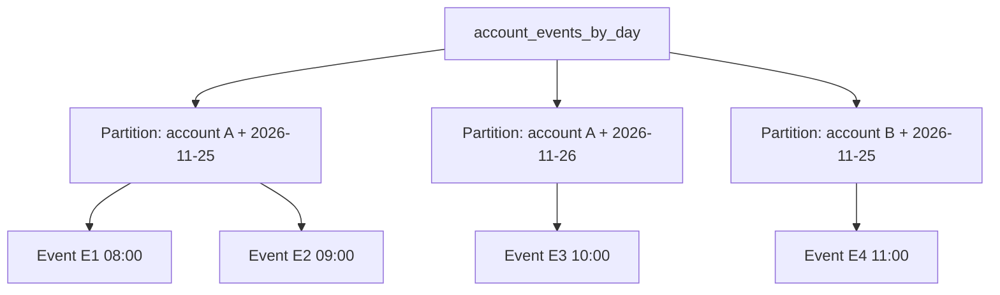
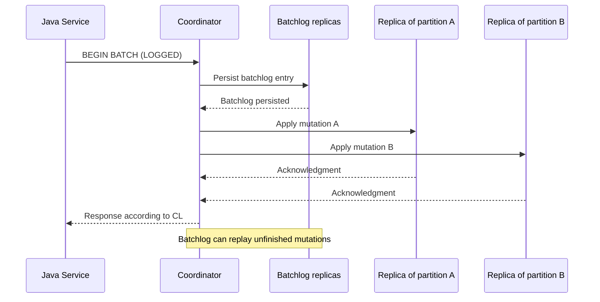

# Logged batch, unlogged batch và counter batch trong Spring Data Cassandra

Trong **Apache Cassandra**, một câu lệnh `BATCH` gộp nhiều mutation CQL (`INSERT`, `UPDATE`, `DELETE`) vào một request. Tên “batch” dễ khiến lập trình viên quen với SQL hoặc JDBC hiểu rằng đây là cách **tăng tốc insert hàng loạt**, **chạy mọi thao tác theo thứ tự** hoặc **thực hiện một transaction ACID**. Cả ba suy luận đó đều có thể sai.

Cassandra có ba lựa chọn cần phân biệt: **logged batch**, **unlogged batch** và **counter batch**. Chúng khác nhau ở **batchlog**, khả năng hoàn tất khi có lỗi, loại dữ liệu được cập nhật, tính idempotent và chi phí khi các mutation phân tán trên nhiều partition. Với **Spring Data Cassandra**, lập trình viên còn cần hiểu cách dùng `CassandraTemplate`/`CassandraOperations.batchOps(...)`, Java Driver `BatchStatement`, repository và CQL trực tiếp, trong bối cảnh mô hình entity, khóa phân vùng, tính nhất quán, paging và hiệu năng.

Bài này thuộc chương **Batch** của module `SPRING_DATA_CASSANDRA`. Mục tiêu là chọn đúng kiểu batch cho từng access pattern, giải thích chính xác “atomicity” và “isolation” trong Cassandra, nhận diện anti-pattern “batch để tăng throughput”, và viết những phép kiểm thử có ý nghĩa khi timeout hoặc replica gặp sự cố.

> **Quy tắc ngắn:** **UNLOGGED** thường phù hợp khi cần nhóm một số mutation nhỏ thuộc **cùng partition**; **LOGGED** dành cho một số ít mutation **nhiều partition** cần cơ chế hoàn tất qua batchlog; **COUNTER** chỉ dành cho cập nhật counter và **không an toàn để retry tùy tiện**. Nếu mục tiêu chỉ là ghi rất nhiều row độc lập thật nhanh, hãy cân nhắc **prepared statements + thực thi bất đồng bộ có giới hạn concurrency**, không mặc định dùng BATCH.

## 1. BATCH là gì, và không phải là gì?

Cú pháp chung trong CQL:

```sql
BEGIN [ UNLOGGED | COUNTER ] BATCH
    INSERT INTO ...;
    UPDATE ...;
    DELETE ...;
APPLY BATCH;
```

Dạng `BEGIN BATCH` không chỉ định loại được hiểu là **logged batch** theo mặc định. Phần thân là các mutation; không dùng để gói các truy vấn `SELECT` lấy dữ liệu rồi quyết định cập nhật như trong một transaction SQL nhiều câu lệnh.

Một batch có thể giảm một số lượt trao đổi giữa ứng dụng và coordinator, nhưng **tập hợp nhiều CQL trong một message không đồng nghĩa giảm số replica, số partition hoặc I/O cần thực hiện**. Khi batch chạm đến nhiều partition hoặc nhiều node, coordinator còn phải phân phối mutation đến các replica tương ứng.

Những điều **không** được mặc nhiên suy ra từ một batch:

- Không có `COMMIT`/`ROLLBACK` giao dịch SQL tổng quát.
- Không mặc định có **snapshot cô lập giữa nhiều partition**.
- Không mặc định thực thi `UPDATE` đầu tiên rồi mới áp dụng `UPDATE` thứ hai theo đúng thứ tự văn bản.
- Không tự kiểm tra điều kiện nghiệp vụ “chỉ cập nhật nếu trạng thái còn NEW”; việc đó cần CQL có `IF`/LWT phù hợp.
- Không làm một truy vấn thiếu partition key trở nên hiệu quả.
- Không biến mọi counter update thành idempotent.
- Không đảm bảo ghi hàng nghìn partition nhanh hơn gửi nhiều mutation độc lập có kiểm soát.

**Định nghĩa quan trọng:** “Batch được xác nhận” và “mọi replica đã hội tụ” không phải một điều. Consistency level và quá trình replication vẫn quyết định phản hồi của request; batchlog còn có vai trò khác khi logged batch gặp lỗi.

## 2. Bảng so sánh ba loại batch

| Đặc điểm | LOGGED | UNLOGGED | COUNTER |
|---|---|---|---|
| CQL | `BEGIN BATCH` hoặc `BEGIN LOGGED BATCH` trong bản hỗ trợ | `BEGIN UNLOGGED BATCH` | `BEGIN COUNTER BATCH` |
| Mục đích | Đảm bảo nhóm mutation có thể được hoàn tất khi có sự cố nhờ batchlog | Nhóm mutation không cần distributed batchlog | Nhóm các phép cộng/trừ cột `counter` |
| Distributed batchlog | Có với batch đa partition; cùng partition có thể được tối ưu bỏ log | Không | Cơ chế counter riêng, không trộn với batch dữ liệu thường |
| Atomicity khi nhiều partition | Bảo đảm theo nghĩa **eventual completion**, không phải cùng lúc hiển thị | Không có bảo đảm batchlog; có thể thực hiện một phần | Không nên áp dụng kỳ vọng transaction của dữ liệu thường; phải tuân counter semantics |
| Isolation qua nhiều partition | **Không** | **Không** | Không được suy ra có snapshot transaction |
| Khi cùng partition | Cassandra hỗ trợ isolation của các mutation thuộc partition | Có thể dùng cho nhóm mutation nhỏ cùng partition | Chỉ dùng khi thực sự cần nhóm counter |
| Loại mutation | INSERT/UPDATE/DELETE dữ liệu thường, theo ràng buộc CQL | INSERT/UPDATE/DELETE dữ liệu thường | Chỉ các counter updates hợp lệ |
| Retry sau timeout | Phải xem mutation và business idempotency | Phải xem mutation và khả năng partial apply | **Rủi ro đếm trùng**, không retry mù quáng |
| Dùng để tăng tốc bulk write đa partition? | **Không khuyến nghị** | **Không khuyến nghị** | **Không khuyến nghị** |

Các chi tiết về khả năng trộn LWT, timestamp, kiểu statement và giới hạn batch phụ thuộc phiên bản Cassandra. Bảng mô tả những nguyên tắc cốt lõi cần áp dụng trước khi kiểm tra API cụ thể.

### Atomicity và isolation cần được hiểu khác nhau

- **Atomicity của logged multi-partition batch** chủ yếu là cơ chế **tất cả mutation sẽ có thể được hoàn tất** nhờ batchlog khi một phần đã được áp dụng, hoặc không mutation nào được áp dụng nếu batch không được chấp nhận ở pha phù hợp. Đây **không phải rollback tức thì**.
- **Isolation** là việc một reader khác có quan sát được trạng thái trung gian không. Với batch nhiều partition, **có thể** nhìn thấy mutation ở partition A trước khi mutation ở partition B trở nên nhìn thấy được.
- **Single-partition batch** có semantics atomicity và isolation trong phạm vi partition theo CQL, nhưng **không tạo transaction toàn bảng hoặc toàn cluster**.

Không gọi một logged multi-partition batch là “transaction ACID như PostgreSQL” trong tài liệu kỹ thuật.

## 3. Bắt đầu từ partition key, không phải từ số lượng statement

Giả sử ứng dụng ghi các sự kiện tài khoản theo ngày:

```sql
CREATE TABLE account_events_by_day (
    account_id uuid,
    bucket_day date,
    occurred_at timestamp,
    event_id uuid,
    event_type text,
    amount_minor bigint,
    PRIMARY KEY ((account_id, bucket_day), occurred_at, event_id)
) WITH CLUSTERING ORDER BY (
    occurred_at DESC,
    event_id DESC
);
```

Tại đây:

- `(account_id, bucket_day)` là **composite partition key**.
- `occurred_at` và `event_id` là clustering columns.
- Cùng một account nhưng **khác ngày** là **hai partition khác nhau**.
- Hai event khác `event_id` và `occurred_at` nhưng cùng account/ngày là **hai row của cùng một partition**.

Sơ đồ:



**Hai INSERT E1 và E2** có thể được nhóm thành single-partition batch. **INSERT E1 và E3** chạm hai partition ngày khác nhau, dù cùng account. **INSERT E1 và E4** chạm hai account khác nhau. CQL không quyết định “cùng partition” từ tên bảng hoặc cùng user đang gọi API; nó căn cứ vào **toàn bộ partition key**.

Đường đọc xác định partition:

```sql
SELECT occurred_at, event_id, event_type, amount_minor
FROM account_events_by_day
WHERE account_id = ?
  AND bucket_day = ?
LIMIT 20;
```

Việc chọn đúng batch không thay thế thiết kế bảng để có đường đọc hiệu quả.

## 4. UNLOGGED batch: nhóm mutation cùng partition

Với mục tiêu ghi hai sự kiện trong cùng account và cùng ngày:

```sql
BEGIN UNLOGGED BATCH
    INSERT INTO account_events_by_day (
        account_id, bucket_day, occurred_at, event_id,
        event_type, amount_minor
    ) VALUES (
        11111111-1111-1111-1111-111111111111,
        '2026-11-25',
        '2026-11-25T08:00:00Z',
        aaaaaaaa-aaaa-aaaa-aaaa-aaaaaaaaaaa1,
        'DEBIT',
        120000
    );

    INSERT INTO account_events_by_day (
        account_id, bucket_day, occurred_at, event_id,
        event_type, amount_minor
    ) VALUES (
        11111111-1111-1111-1111-111111111111,
        '2026-11-25',
        '2026-11-25T09:00:00Z',
        aaaaaaaa-aaaa-aaaa-aaaa-aaaaaaaaaaa2,
        'CREDIT',
        80000
    );
APPLY BATCH;
```

Cả hai INSERT có cùng `(account_id, bucket_day)`. Cassandra xử lý các mutation thuộc partition đó với đặc tính atomicity/isolation của một batch cùng partition; **không phải** lấy một guaranteed transaction isolation cho một tập row ở nhiều partition.

### Khi nào cách này hợp lý?

- Cần viết một nhóm **nhỏ, hữu hạn** các row của cùng partition như một bước ghi logic.
- Cần tránh reader thấy một phần nhóm mutation **bên trong cùng partition**.
- Số mutation và tổng payload được giới hạn chặt, không biến thành hàng chục MB.
- Có mô hình retry an toàn cho những lệnh gán giá trị có ID cố định.

### Khi nào không nên?

- Gộp 5000 event của hàng trăm account chỉ vì “một request sẽ nhanh hơn”.
- Một single-partition batch nhưng row quá lớn hoặc partition cực rộng/hot.
- Batch chỉ để thay thế logic queue/bulk ingest đã có concurrency và backpressure.
- Lẫn regular table với counter table.

**Lưu ý:** Một logged batch chỉ chạm **một partition** có thể được Cassandra tối ưu thành unlogged batch. Vì vậy dùng `UNLOGGED` cho một partition thường phản ánh ý đồ rõ, nhưng nếu code đã dùng `BEGIN BATCH`, không nên suy ra nó luôn tốn distributed batchlog như batch nhiều partition.

## 5. LOGGED batch: vì sao cần batchlog ở nhiều partition?

Giả sử hệ thống duy trì hai bảng tra cứu đã phi chuẩn hóa:

```sql
CREATE TABLE transfers_by_id (
    transfer_id uuid PRIMARY KEY,
    account_id uuid,
    bucket_day date,
    amount_minor bigint,
    status text
);

CREATE TABLE transfers_by_account_day (
    account_id uuid,
    bucket_day date,
    occurred_at timestamp,
    transfer_id uuid,
    amount_minor bigint,
    status text,
    PRIMARY KEY ((account_id, bucket_day), occurred_at, transfer_id)
) WITH CLUSTERING ORDER BY (
    occurred_at DESC,
    transfer_id DESC
);
```

Một chuyển khoản phải xuất hiện trong bảng lookup theo `transfer_id` và bảng danh sách theo account/ngày. Hai mutation này **không nằm trong cùng một partition**, vì chúng thuộc hai bảng có primary key khác nhau.

Ví dụ logged batch:

```sql
BEGIN BATCH
    INSERT INTO transfers_by_id (
        transfer_id, account_id, bucket_day, amount_minor, status
    ) VALUES (
        99999999-9999-9999-9999-999999999999,
        11111111-1111-1111-1111-111111111111,
        '2026-11-25',
        250000,
        'PENDING'
    );

    INSERT INTO transfers_by_account_day (
        account_id, bucket_day, occurred_at,
        transfer_id, amount_minor, status
    ) VALUES (
        11111111-1111-1111-1111-111111111111,
        '2026-11-25',
        '2026-11-25T10:00:00Z',
        99999999-9999-9999-9999-999999999999,
        250000,
        'PENDING'
    );
APPLY BATCH;
```

Cassandra sử dụng **distributed batchlog** để lưu thông tin về những mutation cần hoàn tất. Batchlog phục vụ phục hồi khi coordinator bị lỗi sau khi bắt đầu xử lý. Nếu một phần các mutation đã được áp dụng, cơ chế replay có thể tiếp tục gửi những phần còn thiếu.

Nhưng trong lúc thực thi hoặc replay, một client khác có thể đọc thấy bản ghi ở `transfers_by_id` **trước** khi bản ghi tương ứng xuất hiện ở `transfers_by_account_day`. **Không có isolation đa partition**.

### Logged batch có nên dùng cho tiền chuyển khoản?

Ví dụ trên chỉ mô tả **duy trì hai projection của một bản ghi chuyển khoản**, không phải thuật toán chuyển tiền nguyên tử giữa hai số dư. Ghi debit vào tài khoản A và credit vào tài khoản B trong một logged batch **không tự** tạo nghiệp vụ chuyển tiền ACID, kiểm tra số dư, chống double-spend, rollback hoặc thứ tự giao dịch.

Nếu hệ thống thực sự cần một invariant tài chính xuyên nhiều tài khoản, phải có thiết kế transactional/ledger hoặc cơ chế điều phối phù hợp; không nên dựa vào logged batch làm bằng chứng an toàn nghiệp vụ.

## 6. Batchlog là gì, và không phải commit log?

Trong Cassandra, **commit log** là cơ chế phục hồi mutation ở node lưu dữ liệu. **Batchlog** là thành phần riêng phục vụ việc hoàn tất **logged batch** khi một nhóm mutation được gửi đến nhiều partition/replica.

Một luồng đơn giản:



Đây là sơ đồ **khái niệm**, không phải số lượng chính xác các message trong mọi Cassandra version. Server có thể tối ưu cùng-partition batch và các hành vi theo topology/CL. Điều quan trọng là **batchlog làm tăng I/O và network** cho multi-partition logged batch, nên phải dùng cho **tính chất phục hồi của một nhóm ghi nhỏ**, không phải như công cụ tăng throughput.

Batchlog không phải Kafka, không phải event log kinh doanh và không phải kho lịch sử có thể query để audit. Không dựa vào việc “có batchlog” để thay thế reconciliation và monitoring của các bảng phi chuẩn hóa.

## 7. Atomicity không đồng nghĩa rollback và visibility đồng thời

Một trạng thái sự cố:

```text
Client gửi LOGGED batch gồm A và B.

T0  Batchlog được lưu.
T1  Mutation A đã tới replica phù hợp.
T2  Replica B / network lỗi.
T3  Client timeout hoặc nhận lỗi.
T4  Cơ chế xử lý/replay cố hoàn tất mutation còn thiếu.

Trong khoảng T1...T4, có thể đọc thấy A nhưng chưa thấy B.
```

Những điều phải hiểu:

1. **Logged multi-partition batch không có rollback tức thì** khi một mutation fail.
2. Batchlog hướng tới **hoàn tất eventual** của một nhóm mutation đã được chấp nhận ở giai đoạn phù hợp.
3. Không đọc toàn bộ hai bảng như một snapshot nhất quán trong một transaction.
4. **Timeout không nói chắc rằng chưa có mutation nào được áp dụng**.
5. Read consistency level như `LOCAL_QUORUM` không biến nhiều partition thành một transaction cô lập.

Đây là lý do các service quan trọng thường cần **trạng thái PENDING/COMPLETED**, ID yêu cầu ổn định, cơ chế reconciliation, retry idempotent và xử lý thông báo sai lệch tạm thời. Logged batch hỗ trợ một phần mục tiêu hoàn tất dữ liệu, không thay hợp đồng nghiệp vụ.

### Single-partition isolation là phạm vi khác

Nếu hai mutation cùng partition, Cassandra có thể bảo đảm isolation của các cập nhật trong partition đó. Nhưng những thao tác ngoài partition ấy, hoặc tác động đến bảng thứ hai với partition khác, không được hưởng “transaction isolation xuyên nhiều bảng” chỉ vì nằm trong cùng CQL BATCH.

## 8. UNLOGGED batch trên nhiều partition: anti-pattern cần nhận diện

Ví dụ tưởng như tiết kiệm network:

```sql
BEGIN UNLOGGED BATCH
    INSERT INTO transfers_by_id (
        transfer_id, account_id, bucket_day, amount_minor, status
    ) VALUES (
        88888888-8888-8888-8888-888888888888,
        11111111-1111-1111-1111-111111111111,
        '2026-11-25', 120000, 'NEW'
    );

    INSERT INTO transfers_by_id (
        transfer_id, account_id, bucket_day, amount_minor, status
    ) VALUES (
        77777777-7777-7777-7777-777777777777,
        22222222-2222-2222-2222-222222222222,
        '2026-11-25', 80000, 'NEW'
    );
APPLY BATCH;
```

Hai giá trị `transfer_id` khác nhau tạo **hai partition** trong `transfers_by_id`. Nếu coordinator hoặc replica gặp sự cố, **không có distributed batchlog** bảo đảm các mutation của batch đều được hoàn tất. Một transfer có thể tồn tại trong khi transfer kia chưa được ghi thành công.

Cassandra có thể cảnh báo khi **unlogged batch chứa nhiều partition** theo ngưỡng cấu hình. Nhưng ngay cả khi không thấy warning, điều đó **không chứng minh** multi-partition UNLOGGED batch là chiến lược ghi tốt.

**Thường nên thay bằng:** hai prepared statements độc lập (hoặc nhiều statement có bounded async concurrency) nếu chúng không có yêu cầu hoàn tất theo nhóm. Khi nhóm mutation phải liên kết chặt, cân nhắc logged batch nhỏ kết hợp trạng thái nghiệp vụ/reconciliation.

## 9. COUNTER batch dùng cho cột counter

Counter trong Cassandra không phải kiểu số nguyên bình thường. Nó được cập nhật bằng **phép tăng/giảm**:

```sql
CREATE TABLE page_views_by_day (
    page_id uuid,
    bucket_day date,
    views counter,
    errors counter,
    PRIMARY KEY (page_id, bucket_day)
);
```

Ví dụ counter batch:

```sql
BEGIN COUNTER BATCH
    UPDATE page_views_by_day
    SET views = views + 1
    WHERE page_id = 11111111-1111-1111-1111-111111111111
      AND bucket_day = '2026-11-25';

    UPDATE page_views_by_day
    SET errors = errors + 1
    WHERE page_id = 11111111-1111-1111-1111-111111111111
      AND bucket_day = '2026-11-25';
APPLY BATCH;
```

Cả hai update là **counter updates**. Với bảng này `(page_id, bucket_day)` là partition key; ví dụ cùng một partition nhưng counter semantics vẫn khác ghi cell kiểu `int`, `bigint`.

### Vì sao COUNTER batch nguy hiểm khi retry?

Một câu `UPDATE ... SET views = views + 1` **không idempotent**:

- Thực thi một lần: `views` tăng 1.
- Thực thi hai lần: `views` có thể tăng 2.
- Nếu client timeout sau khi mutation đã được áp dụng mà retry nguyên batch, cả `views` lẫn `errors` có thể tăng **lần nữa**.

**Counter batch không tạo exactly-once counting.** Nếu một sự kiện nghiệp vụ phải được tính chính xác một lần, cần deduplication ở tầng domain, durable event IDs, hoặc mô hình dữ liệu/tính toán khác. Không chỉ bật retry policy tích cực và hy vọng Cassandra tự nhận ra một sự kiện đã đếm.

### Không trộn counter và non-counter mutations

Ví dụ không hợp lệ về mặt loại batch:

```sql
-- KHÔNG dùng: trộn counter update và regular INSERT.
BEGIN COUNTER BATCH
    UPDATE page_views_by_day
    SET views = views + 1
    WHERE page_id = 11111111-1111-1111-1111-111111111111
      AND bucket_day = '2026-11-25';

    INSERT INTO transfers_by_id (
        transfer_id, account_id, bucket_day, amount_minor, status
    ) VALUES (
        88888888-8888-8888-8888-888888888888,
        11111111-1111-1111-1111-111111111111,
        '2026-11-25', 100, 'NEW'
    );
APPLY BATCH;
```

Counter batch **chỉ chứa những thao tác counter được Cassandra chấp nhận**. Không sử dụng `COUNTER` như cách đặt tên khác cho logged hoặc unlogged batch. Counter cũng có các hạn chế riêng về TTL, write timestamp và conditional update; kiểm tra phiên bản server trước khi đề xuất một câu CQL bất thường.

## 10. Logged, unlogged và counter: chọn kiểu nào?

Một bảng quyết định theo yêu cầu:

| Yêu cầu | Lựa chọn thường phù hợp | Điều kiện |
|---|---|---|
| Ghi hai regular rows của **cùng partition** và cần isolation | **UNLOGGED** cùng partition | Nhỏ, hữu hạn, đúng partition key |
| Ghi hai bảng projection khác partition, cần cơ chế eventual completion theo nhóm | **LOGGED** | Ít mutation, chấp nhận không có cross-partition isolation |
| Tăng `counter`/giảm `counter` | **COUNTER** | Chấp nhận rủi ro retry và quy tắc counter |
| Bulk import hàng triệu rows ở hàng nghìn partition | **Không dùng một batch lớn** | Prepared statements + bounded concurrency / pipeline |
| Ghi độc lập không cần atomic group | **Statement riêng** | Dễ đo throughput, retry từng mutation |
| Cần compare-and-set trên trạng thái đơn hàng | **LWT/conditional CQL**, không phải batch thường | Đánh giá contention/latency |
| Cần giao dịch tài chính nhiều tài khoản với rollback/isolation | **Thiết kế transactional/ledger phù hợp** | Logged batch không đáp ứng yêu cầu đó |
| Cần đọc nhiều partition có snapshot nhất quán | **Không được giải quyết bằng BATCH** | Dùng mô hình truy cập/đồng bộ khác |

Đừng chọn kiểu batch bằng quy tắc “càng nhiều row thì càng nên LOGGED”. Quyết định xuất phát từ **phạm vi partition**, **yêu cầu phục hồi khi lỗi**, **kiểu dữ liệu** và **mức rủi ro nghiệp vụ chấp nhận được**.

## 11. Giới hạn CQL của BATCH

BATCH có cấu trúc DML riêng, không phải container cho mọi câu SQL:

- Chỉ có các loại `INSERT`, `UPDATE`, `DELETE` hợp lệ (không gói `SELECT` để đọc rồi quyết định ghi).
- Không dùng batch như một chuỗi thao tác có thứ tự quyết định kết quả khi cùng cell bị ghi nhiều lần.
- Không tùy ý dùng tên bảng/column từ HTTP input để xây CQL; tên identifier phải nằm trong query constants/allowlist.
- Không trộn counter và non-counter mutation.
- Không mặc định hỗ trợ mọi kết hợp của `IF`, `USING TIMESTAMP`, `TTL` và batch type. Conditional batches có ràng buộc riêng và không phải một cách tổng quát để giao dịch nhiều partition.
- Batch payload và số statement chịu các giới hạn của driver, native protocol và cấu hình server.

### Chú ý các thao tác có điều kiện (LWT)

`INSERT ... IF NOT EXISTS` hoặc `UPDATE ... IF ...` dùng cơ chế **lightweight transaction**. Cassandra có hỗ trợ các dạng conditional batch với điều kiện hạn chế, nhưng **không cho phép biến mọi multi-partition LOGGED batch thành một transaction LWT có điều kiện chung**. Hãy tra CQL theo phiên bản và giữ bài toán điều kiện trên partition/row phù hợp.

Không đặt tên method `transferAtomically` chỉ vì nó chạy `BEGIN BATCH`. Tên API nên phản ánh khả năng thật sự: ví dụ `persistTransferProjections` và một quy trình đối soát nếu các projection phải hội tụ.

## 12. Timestamp của các mutation trong BATCH

Cassandra gắn **write timestamp** cho dữ liệu để giải quyết xung đột cell. Theo CQL, nếu không chỉ định timestamp riêng cho mutation, các thao tác trong một batch có thể dùng **cùng write timestamp** được sinh hoặc truyền ở batch level.

Ví dụ:

```sql
BEGIN UNLOGGED BATCH USING TIMESTAMP 1760000000000100
    UPDATE account_events_by_day
    SET event_type = 'PROCESSED'
    WHERE account_id = 11111111-1111-1111-1111-111111111111
      AND bucket_day = '2026-11-25'
      AND occurred_at = '2026-11-25T08:00:00Z'
      AND event_id = aaaaaaaa-aaaa-aaaa-aaaa-aaaaaaaaaaa1;

    UPDATE account_events_by_day
    SET amount_minor = 120000
    WHERE account_id = 11111111-1111-1111-1111-111111111111
      AND bucket_day = '2026-11-25'
      AND occurred_at = '2026-11-25T09:00:00Z'
      AND event_id = aaaaaaaa-aaaa-aaaa-aaaa-aaaaaaaaaaa2;
APPLY BATCH;
```

`USING TIMESTAMP` dùng **microsecond kể từ Unix epoch**, khác `timestamp` CQL của cột `occurred_at`. Đoạn này chỉ minh họa cấu hình timestamp cho các update ở hai row cùng partition; trên production phải có nguồn timestamp đồng bộ và quy tắc tránh ghi dữ liệu tương lai.

**Không dùng nhiều UPDATE cùng một cell với cùng timestamp trong một batch rồi mong statement xuất hiện sau thắng.** Khi timestamp trùng nhau, Cassandra dùng quy tắc conflict resolution của cell, không phải thứ tự của các dòng CQL.

Tùy phiên bản và statement type, việc kết hợp **batch-level timestamp** với **per-statement timestamp** có các giới hạn cụ thể; không áp cả hai một cách tùy ý. Counter updates không dùng timestamp/TTL như regular cells.

## 13. Consistency level và replication factor khi chạy BATCH

Giả sử keyspace có RF=3 trong một datacenter. `LOCAL_QUORUM` yêu cầu ngưỡng phù hợp trong DC; `LOCAL_ONE` thường cho latency thấp hơn nhưng yếu hơn về xác nhận replica. Khi batch chứa nhiều partition:

- Mỗi partition có tập replica theo token của khóa đó.
- Coordinator và batchlog có những công việc điều phối riêng.
- Consistency level vẫn ảnh hưởng điều kiện xác nhận và khả năng nhận timeout.
- `LOCAL_QUORUM` **không thêm isolation giữa partition**.
- Batchlog **không thay** RF, repair hoặc các chính sách backup/retention.
- Một request bị timeout có thể đã áp dụng một phần mutation hoặc đang được replay.

Nếu keyspace có hai datacenter, chọn `QUORUM` và `LOCAL_QUORUM` khác nhau về phạm vi replica phải xác nhận. Một logged batch có thể có latency chịu ảnh hưởng topology liên vùng dù dùng local consistency, do hệ thống vẫn phải thực hiện những công việc replication cần thiết.

**Không gộp batch của hàng trăm partition vào một coordinator rồi kỳ vọng token-aware routing đưa request đến tất cả replica “gần nhất”.** Một batch chạm nhiều partition không có một routing key đại diện hữu ích cho toàn bộ mutation.

## 14. Batch không làm tăng throughput của bulk ingestion một cách tự động

Một phản ví dụ phổ biến: muốn import 200.000 sự kiện thuộc 5.000 account, lập trình viên chia thành 200 batch, mỗi batch 1.000 INSERT. Cách này có thể tạo:

1. Tập mutation lớn cần coordinator parse/phân phát.
2. Distributed batchlog nếu dùng LOGGED, thêm I/O và network.
3. Fan-out đến nhiều replica/token ranges.
4. Tail latency và timeout khi một số node bận.
5. Warning/failure do kích thước batch vượt ngưỡng.
6. Retry khó đoán: một batch có nhiều mutation không cùng trạng thái áp dụng tại thời điểm lỗi.
7. Hot partition nếu nhóm theo một khóa quá lớn hoặc nhiều mutation cùng bucket.

Giải pháp thường phù hợp hơn là **prepare một hoặc vài CQL templates, bind từng row và gửi nhiều statement độc lập bất đồng bộ với concurrency hữu hạn**. Ví dụ target không phải “tối đa throughput trong mọi điều kiện”, mà là throughput ổn định không làm queue, timeout và compaction tích tụ vô hạn.

### Batch sizing: hai giới hạn khác nhau

| Khái niệm | Cần kiểm soát |
|---|---|
| **Số statement** trong batch | Không vượt giới hạn driver/protocol; trong Java Driver 4.x có giới hạn số lượng cụ thể |
| **Kích thước payload** sau serialization | Phụ thuộc số byte của row/cell, không chỉ số statement |
| **Số partition khác nhau** | Fan-out, hiệu năng coordinator, phân phối replica |
| **Thời gian thực thi** | Timeout và tail latency |
| **Mức concurrency** | Số batch/statement chạy đồng thời; không được thả vô hạn |
| **Trạng thái tombstone/compaction** | Chi phí ghi và đọc về sau |

Cassandra có các cấu hình warning/failure cho kích thước batch, chẳng hạn `batch_size_warn_threshold`, `batch_size_fail_threshold`, và cảnh báo unlogged batch nhiều partition theo phiên bản. **Không coi ngưỡng server là mục tiêu tối ưu**: batch nhỏ hơn threshold vẫn có thể tạo độ trễ kém.

Trong mọi benchmark, đo **p95/p99 latency, throughput, timeout, pending requests, queue depth, coordinator load, replica write latency, compaction backlog**, không chỉ số câu CQL gửi mỗi giây.

## 15. Spring Data Cassandra: CassandraBatchOperations

Spring Data Cassandra có API gộp thao tác mapped entity thông qua `CassandraOperations.batchOps(...)` và `CassandraBatchOperations`. Nó hỗ trợ thêm entity insert/update/delete, gắn options và cuối cùng gọi `execute()`.

Ví dụ một service ghi hai entity cùng partition:

```java
import com.datastax.oss.driver.api.core.cql.DefaultBatchType;
import org.springframework.data.cassandra.core.CassandraOperations;
import org.springframework.data.cassandra.core.CassandraBatchOperations;
import org.springframework.stereotype.Service;

@Service
public class EventBatchService {

    private final CassandraOperations operations;

    public EventBatchService(CassandraOperations operations) {
        this.operations = operations;
    }

    public void savePair(DeviceEvent first, DeviceEvent second) {
        // Phải validate full partition key, không chỉ accountId.
        if (!first.getAccountId().equals(second.getAccountId())
                || !first.getBucketDay().equals(second.getBucketDay())) {
            throw new IllegalArgumentException(
                "Both rows must belong to the same partition"
            );
        }

        CassandraBatchOperations batch =
            operations.batchOps(DefaultBatchType.UNLOGGED);

        batch.insert(first, second);
        batch.execute();
    }
}
```

Giả định `DeviceEvent` là một entity `@Table("account_events_by_day")` hoàn chỉnh, có `getAccountId()` và `getBucketDay()` được ánh xạ vào partition key; cả hai ID không null. Các method validation và entity này là kiểu ứng dụng, không phải lớp sẵn có của Spring Data. Khi dùng composite primary key class, validation nên so toàn bộ các component partition key trong ID, không dựa vào getter minh họa nếu project không có.

**Không dùng một instance `CassandraBatchOperations` sau `execute()`.** Tài liệu API nêu mỗi instance chỉ thực thi một lần. Tạo batch mới cho request mới.

### LOGGED với hai entity của hai bảng

Trong use case projection `transfers_by_id` và `transfers_by_account_day`, có thể lựa chọn:

```java
CassandraBatchOperations batch =
    operations.batchOps(DefaultBatchType.LOGGED);

batch.insert(transferById);
batch.insert(transferByAccountDay);
batch.execute();
```

Hai entity cần mapping `@Table` riêng phù hợp. Bài toán vẫn **không có isolation giữa hai partition**; API mapping của Spring không thay semantics server.

### QueryOptions cấp batch

Ở các bản Spring Data Cassandra hỗ trợ `withQueryOptions`, có thể cấu hình CL:

```java
import com.datastax.oss.driver.api.core.DefaultConsistencyLevel;
import org.springframework.data.cassandra.core.cql.QueryOptions;

QueryOptions options = QueryOptions.builder()
    .consistencyLevel(DefaultConsistencyLevel.LOCAL_QUORUM)
    .build();

operations.batchOps(DefaultBatchType.LOGGED)
    .withQueryOptions(options)
    .insert(transferById, transferByAccountDay)
    .execute();
```

`withQueryOptions` có mặt ở các bản cụ thể (Javadoc hiện đại ghi nhận hỗ trợ từ Spring Data 4.4), nên phải kiểm tra dependency đã resolve. `QueryOptions` điều chỉnh cách thực thi batch, **không biến nó thành LWT**.

### withTimestamp không phải withTtl

`CassandraBatchOperations.withTimestamp(long)` đặt **write timestamp**, là metadata microsecond của mutation, **không phải TTL**. Không nhập số giây TTL vào API này. Nếu từng entity cần TTL riêng hoặc lựa chọn ghi đặc biệt, dùng `WriteOptions`/CQL phù hợp và test đúng phiên bản.

## 16. Spring Data repository không có nghĩa mọi save đều nằm cùng batch

Một service gọi:

```java
repositoryA.save(transferA);
repositoryB.save(transferB);
```

đang thực hiện **hai lời gọi riêng**. Spring Data repository không mặc nhiên gộp thành Cassandra logged batch vì hai dòng nằm trong một Java method, cũng không tạo transaction RDBMS chỉ vì có `@Transactional` theo kỳ vọng của developer quen JPA.

Tương tự, `saveAll(entities)` hoặc API bulk repository cần được kiểm tra implementation của Spring Data version: **không nên giả định** nó sử dụng loại batch/atomicity theo ý muốn mà không xem mã thực thi và integration tests. Khi cần ghi batch với semantics cụ thể, hãy dùng **`CassandraOperations.batchOps(DefaultBatchType...)` hoặc Java Driver BatchStatement** để thể hiện loại batch rõ ràng.

### Tránh dựa vào entity mapping sai partition

Nếu entity có composite key `((account_id, bucket_day), occurred_at, event_id)`, method chỉ so `accountId` giữa hai entity chưa đủ xác nhận chúng cùng partition. `bucketDay` cũng phải bằng nhau. Đây là nguyên nhân thường gặp khiến một batch tưởng là single-partition thực chất là multi-partition, dẫn đến warning/fan-out và thay đổi semantics khi failure.

## 17. Java Driver 4.x: BatchStatement, DefaultBatchType

Ở tầng Java Driver, `BatchStatement` có thể được tạo từ các prepared/bound statements. Ví dụ **UNLOGGED** hai row thuộc cùng partition:

```java
import java.time.Instant;
import java.time.LocalDate;
import java.util.UUID;

import com.datastax.oss.driver.api.core.CqlSession;
import com.datastax.oss.driver.api.core.DefaultConsistencyLevel;
import com.datastax.oss.driver.api.core.cql.BatchStatement;
import com.datastax.oss.driver.api.core.cql.DefaultBatchType;
import com.datastax.oss.driver.api.core.cql.PreparedStatement;

public final class EventDriverBatchDao {
    private final CqlSession session;
    private final PreparedStatement insert;

    public EventDriverBatchDao(CqlSession session) {
        this.session = session;
        this.insert = session.prepare(
            "INSERT INTO account_events_by_day " +
            "(account_id, bucket_day, occurred_at, event_id, " +
            " event_type, amount_minor) VALUES (?, ?, ?, ?, ?, ?)"
        );
    }

    public void writeTwoEvents(
            UUID accountId, LocalDate day,
            Instant timeA, UUID eventA,
            Instant timeB, UUID eventB) {

        BatchStatement batch =
            BatchStatement.builder(DefaultBatchType.UNLOGGED)
                .addStatement(insert.bind(
                    accountId, day, timeA, eventA, "DEBIT", 120000L
                ))
                .addStatement(insert.bind(
                    accountId, day, timeB, eventB, "CREDIT", 80000L
                ))
                .build()
                .setConsistencyLevel(DefaultConsistencyLevel.LOCAL_QUORUM);

        session.execute(batch);
    }
}
```

Các giá trị `accountId` và `day` được dùng cho **cả hai** row; đó là điều kiện xác định chúng cùng partition. Nếu dùng counter batch, thay `DefaultBatchType.UNLOGGED` bằng `COUNTER` và dùng **chỉ counter statements**; không chỉ thay enum trong code trên vì hai INSERT regular columns sẽ không còn đúng loại batch.

Driver 4.x có built-in statements theo kiểu **immutable**: các setter trên `BatchStatement` trả về instance mới. Đoạn code giữ kết quả của `setConsistencyLevel(...)`; không gọi setter rồi bỏ qua return value.

**PreparedStatement** có thể dùng lại, **BoundStatement** mang dữ liệu của từng mutation. Không cần tạo session/prepare lại mỗi request trong Spring Boot; inject `CqlSession` được quản lý vòng đời.

## 18. Java Driver COUNTER batch: code minh họa và điều cần tránh

Một mẫu cập nhật counter bằng prepared statement:

```java
import java.time.LocalDate;
import java.util.UUID;

import com.datastax.oss.driver.api.core.cql.BatchStatement;
import com.datastax.oss.driver.api.core.cql.DefaultBatchType;
import com.datastax.oss.driver.api.core.cql.PreparedStatement;

PreparedStatement incrementViews = session.prepare(
    "UPDATE page_views_by_day SET views = views + 1 " +
    "WHERE page_id = ? AND bucket_day = ?"
);

PreparedStatement incrementErrors = session.prepare(
    "UPDATE page_views_by_day SET errors = errors + 1 " +
    "WHERE page_id = ? AND bucket_day = ?"
);

BatchStatement counterBatch =
    BatchStatement.builder(DefaultBatchType.COUNTER)
        .addStatement(incrementViews.bind(pageId, day))
        .addStatement(incrementErrors.bind(pageId, day))
        .build();

session.execute(counterBatch);
```

Đây là đoạn đặt **bên trong method** đã có `session`, `pageId` và `day`. Cần dùng đúng keyspace/table và bảo đảm cả hai statement là counter mutations. Không tự đặt `setIdempotent(true)` cho kiểu batch này: retry có thể làm tăng số đếm thêm lần nữa sau một timeout không rõ trạng thái.

Với ứng dụng có yêu cầu exactly-once event counting, hãy xem đây là **ví dụ không đáp ứng yêu cầu đó** nếu không có cơ chế chống trùng độc lập.

## 19. Async writes có giới hạn: giải pháp thay cho batch bulk

Khi cần ingest hàng trăm nghìn row độc lập, chiến lược phổ biến là tạo prepared statement một lần, bind từng row, gọi `executeAsync` và điều tiết số request đang bay (*in flight*).

Pseudo-code khái niệm:

```java
// PSEUDOCODE - không phải đoạn Java chạy độc lập.
PreparedStatement insert = session.prepare(INSERT_CQL);

Semaphore permits = new Semaphore(MAX_IN_FLIGHT);

for (Event event : source) {
    permits.acquire();

    session.executeAsync(insert.bind(
        event.accountId(),
        event.bucketDay(),
        event.occurredAt(),
        event.eventId(),
        event.type(),
        event.amountMinor()
    )).whenComplete((result, failure) -> {
        try {
            recordSuccessOrFailure(event, failure);
        } finally {
            permits.release();
        }
    });
}

// Cuối pipeline phải đợi các request in-flight hoàn tất,
// có chính sách retry/backoff và shutdown phù hợp.
```

Đoạn trên **cố ý là pseudocode**: code production còn phải xử lý `InterruptedException`, backpressure, callback không block I/O threads, quản lý lifecycle, completion barrier và retry. Không copy vòng lặp vô hạn không chờ completion lên production.

Điểm chính: tăng throughput bằng **đồng thời có giới hạn** và phân phối write workload theo partition/token, chứ không đổ tất cả mutation vào một coordinator dưới một giant batch. Với nhiều writer, các retry phải giữ primary key ổn định và xác định tính idempotent của từng mutation.

## 20. Retry, timeout và idempotency

Một logged batch có thể bị timeout dù batchlog đã ghi thành công hoặc một số mutation đã áp dụng. Một unlogged batch nhiều partition có thể chỉ hoàn thành một phần. Counter batch có thể đã increment dù client nhận timeout.

| Loại batch | Khi timeout, client có thể biết chắc gì? | Chính sách an toàn hơn |
|---|---|---|
| LOGGED | Không thể chỉ từ timeout suy ra toàn bộ nhóm chưa làm | Giữ ID/mutation ổn định, đối soát eventual completion, retry khi an toàn |
| UNLOGGED một partition | Không mặc định “không mutation nào tới server” | Đọc/kiểm chứng kết quả, retry idempotent nếu phù hợp |
| UNLOGGED nhiều partition | Có nguy cơ chỉ một phần thực hiện | Tránh thiết kế này cho nhóm cần completion |
| COUNTER | Không biết increment đã được áp dụng chưa | Tránh retry tự động không kiểm soát; dùng dedup/event model nếu cần |

Một batch regular với các `INSERT` gán giá trị cố định trên cùng primary key thường **dễ thiết kế retry an toàn hơn** counter hoặc mutation cập nhật collection không idempotent. Tuy vậy, TTL, write timestamp, null/tombstone, LWT và side effect ở service vẫn ảnh hưởng tính an toàn.

**Không đổi UUID của từng row sau timeout** nếu request gốc có thể đã thành công: điều này có thể tạo dữ liệu trùng. Tương tự, ghi một batch chứa giá trị thời gian mới mỗi lần retry có thể vô tình tạo phiên bản cell khác.

Nếu driver có tùy chọn `idempotent` ở mức statement/batch, đó là **khai báo để driver quyết định retry/speculative behavior**, không biến mutation thực tế thành idempotent.

## 21. Kiểm thử ba loại batch: tách correctness khỏi failure simulation

Bài lab nên chạy trên **keyspace test riêng**, không làm ảnh hưởng production. Với một node RF=1, có thể kiểm tra cú pháp và kết quả cơ bản, nhưng **không đủ để chứng minh batchlog replay hoặc replica failure**. Muốn kiểm chứng phân tán, cần cluster test nhiều node với RF phù hợp, logging/metrics và cơ chế fault injection có kiểm soát.

### 21.1. Tạo keyspace và bảng

```sql
CREATE KEYSPACE IF NOT EXISTS batch_lab
WITH replication = {
    'class': 'NetworkTopologyStrategy',
    'dc1': 1
};

CREATE TABLE IF NOT EXISTS batch_lab.account_events_by_day (
    account_id uuid,
    bucket_day date,
    occurred_at timestamp,
    event_id uuid,
    event_type text,
    amount_minor bigint,
    PRIMARY KEY ((account_id, bucket_day), occurred_at, event_id)
) WITH CLUSTERING ORDER BY (occurred_at DESC, event_id DESC);

CREATE TABLE IF NOT EXISTS batch_lab.transfers_by_id (
    transfer_id uuid PRIMARY KEY,
    account_id uuid,
    bucket_day date,
    amount_minor bigint,
    status text
);

CREATE TABLE IF NOT EXISTS batch_lab.transfers_by_account_day (
    account_id uuid,
    bucket_day date,
    occurred_at timestamp,
    transfer_id uuid,
    amount_minor bigint,
    status text,
    PRIMARY KEY ((account_id, bucket_day), occurred_at, transfer_id)
) WITH CLUSTERING ORDER BY (occurred_at DESC, transfer_id DESC);

CREATE TABLE IF NOT EXISTS batch_lab.page_views_by_day (
    page_id uuid,
    bucket_day date,
    views counter,
    errors counter,
    PRIMARY KEY (page_id, bucket_day)
);
```

Tên DC `dc1` chỉ đúng nếu node test thật sự thuộc DC ấy. Trong RF=1, nhiều level như `QUORUM` không có ý nghĩa mô phỏng chịu lỗi nhiều replica.

### 21.2. UNLOGGED cùng partition

```sql
USE batch_lab;

BEGIN UNLOGGED BATCH
    INSERT INTO account_events_by_day (
        account_id, bucket_day, occurred_at, event_id, event_type, amount_minor
    ) VALUES (
        11111111-1111-1111-1111-111111111111, '2026-11-25',
        '2026-11-25T08:00:00Z', aaaaaaaa-aaaa-aaaa-aaaa-aaaaaaaaaaa1,
        'DEBIT', 120000
    );

    INSERT INTO account_events_by_day (
        account_id, bucket_day, occurred_at, event_id, event_type, amount_minor
    ) VALUES (
        11111111-1111-1111-1111-111111111111, '2026-11-25',
        '2026-11-25T09:00:00Z', aaaaaaaa-aaaa-aaaa-aaaa-aaaaaaaaaaa2,
        'CREDIT', 80000
    );
APPLY BATCH;

SELECT occurred_at, event_id, event_type, amount_minor
FROM account_events_by_day
WHERE account_id = 11111111-1111-1111-1111-111111111111
  AND bucket_day = '2026-11-25';
```

**Kỳ vọng:** có hai sự kiện của cùng partition, được đọc theo clustering order đã khai báo. Kết quả đúng trên lab một node chứng minh CQL hoạt động, **chưa chứng minh isolation trong mọi tình huống lỗi**.

### 21.3. LOGGED multi-partition

```sql
BEGIN BATCH
    INSERT INTO transfers_by_id (
        transfer_id, account_id, bucket_day, amount_minor, status
    ) VALUES (
        99999999-9999-9999-9999-999999999999,
        11111111-1111-1111-1111-111111111111,
        '2026-11-25', 250000, 'PENDING'
    );

    INSERT INTO transfers_by_account_day (
        account_id, bucket_day, occurred_at, transfer_id, amount_minor, status
    ) VALUES (
        11111111-1111-1111-1111-111111111111,
        '2026-11-25', '2026-11-25T10:00:00Z',
        99999999-9999-9999-9999-999999999999,
        250000, 'PENDING'
    );
APPLY BATCH;

SELECT * FROM transfers_by_id
WHERE transfer_id = 99999999-9999-9999-9999-999999999999;

SELECT * FROM transfers_by_account_day
WHERE account_id = 11111111-1111-1111-1111-111111111111
  AND bucket_day = '2026-11-25';
```

**Kỳ vọng ở trạng thái ổn định:** cả hai bảng có một projection của transfer. Để test replay/partial visibility, cần fault-injection trong cluster lab nhiều node, không chỉ chạy hai SELECT sau khi mọi thứ ổn định.

### 21.4. COUNTER batch

```sql
BEGIN COUNTER BATCH
    UPDATE page_views_by_day
    SET views = views + 1
    WHERE page_id = 11111111-1111-1111-1111-111111111111
      AND bucket_day = '2026-11-25';

    UPDATE page_views_by_day
    SET errors = errors + 1
    WHERE page_id = 11111111-1111-1111-1111-111111111111
      AND bucket_day = '2026-11-25';
APPLY BATCH;

SELECT views, errors
FROM page_views_by_day
WHERE page_id = 11111111-1111-1111-1111-111111111111
  AND bucket_day = '2026-11-25';
```

**Kỳ vọng khi bảng test/partition mới:** `views=1` và `errors=1`. Nếu chạy lại cùng batch, counter có thể thành 2/2 — đây là minh họa tính **không idempotent**, không phải Cassandra đã thực thi sai.

Không dùng DELETE/TRUNCATE ở production để “reset counters” trong bài học; counter table có quy tắc mutation riêng, nên lab phải cách ly và dùng key mới.

## 22. Integration tests với Spring Data và Java Driver

Một khung integration test Java (rút gọn cho mục tiêu học tập):

```java
import static org.junit.jupiter.api.Assertions.*;

import com.datastax.oss.driver.api.core.cql.DefaultBatchType;
import org.junit.jupiter.api.Test;
import org.springframework.beans.factory.annotation.Autowired;
import org.springframework.boot.test.context.SpringBootTest;
import org.springframework.data.cassandra.core.CassandraOperations;

@SpringBootTest
class EventBatchIntegrationTest {

    @Autowired CassandraOperations operations;

    @Test
    void savesTwoEventsInSamePartition() {
        DeviceEvent a = testEvent("DEBIT");
        DeviceEvent b = testEvent("CREDIT");

        assertEquals(a.getAccountId(), b.getAccountId());
        assertEquals(a.getBucketDay(), b.getBucketDay());

        operations.batchOps(DefaultBatchType.UNLOGGED)
            .insert(a, b)
            .execute();

        // Query theo đầy đủ composite partition key, assert 2 event mới.
        // Mỗi test dùng partition UUID mới và seed dữ liệu độc lập.
    }
}
```

Đây là **khung**, không phải file Java độc lập: `DeviceEvent`, `testEvent` và config Cassandra/test fixtures cần triển khai; thư viện Spring Boot/JUnit, driver và schema phải khớp. Nên dùng key mới cho mỗi test để tránh dữ liệu cũ hoặc timestamp/tombstone của lần chạy trước.

### Cần những ca nào?

| Ca | Kỳ vọng kiểm chứng |
|---|---|
| UNLOGGED hai row một partition | Cả hai row tồn tại sau khi execute thành công; dùng full partition key đọc |
| LOGGED hai projection | Ở trạng thái ổn định, hai bảng chứa bản ghi phù hợp |
| COUNTER update một lần | Giá trị tăng đúng theo delta |
| COUNTER chạy lại cùng batch | Có thể tăng thêm; ghi rõ non-idempotent |
| Ghi nhiều partition ở UNLOGGED | Không được thiết kế kỳ vọng all-or-nothing khi failure |
| Batch trộn counter và regular | Cassandra từ chối theo quy tắc batch type |
| Batch chứa SELECT | CQL không chấp nhận trong batch DML |
| Batch quá lớn | Có cảnh báo/lỗi/latency theo ngưỡng server; không chạy production |
| Lỗi timeout | Không suy ra tất cả mutation chưa áp dụng; kiểm tra khả năng retry |
| LWT IF với multi partition | Không coi như transaction SQL; xác minh ràng buộc CQL |
| Batch timestamp trùng | Không dựa vào thứ tự statement để quyết định winner |
| Batch và CL khác nhau | Chọn ngưỡng replica, không tạo cross-partition isolation |

**Fault injection:** chỉ làm trên cluster test riêng. Tắt node hoặc chặn network sai cách có thể gây mất dữ liệu/ảnh hưởng hoạt động thực tế; cần kiểm soát RF, DC, trạng thái repair và cách phục hồi. Một integration test sạch không tự chứng minh hệ thống an toàn khi coordinator chết đúng thời điểm giữa một batch.

## 23. Metrics, warning và các dấu hiệu batch đang bị lạm dụng

Nên theo dõi:

- Server logs về **batch size warnings/failures**.
- Số lượng **unlogged batch nhiều partition** và các warning theo cấu hình.
- Batchlog pending/replay hoặc metrics liên quan trong phiên bản đang dùng.
- Coordinator CPU, network, request latency p50/p95/p99.
- Replica write latency, timeout, failure, unavailable.
- Kích thước serialized batch và số partition mỗi batch theo mã query.
- Compaction backlog, tombstone, disk utilization.
- Concurrency in-flight, queue depth, retry rate và backpressure phía driver.

Ví dụ log vận hành theo query type:

```text
operation=PERSIST_TRANSFER_PROJECTIONS
batch_type=LOGGED
table_count=2
partition_count=2
mutation_count=2
consistency=LOCAL_QUORUM
duration_ms=21
```

Các số trên **chỉ là minh họa**, không phải kết quả đo thực tế. Đừng ghi toàn bộ bind values hoặc thông tin khách hàng vào log.

Một batch có kích thước dưới ngưỡng warning **không đồng nghĩa tối ưu**: vẫn cần xét tải node, độ phân tán partition và tail latency. Nếu batchlog trở thành điểm nóng, không nên chỉ tăng timeout để che việc dùng logged batch sai mục đích.

## 24. Tình huống tự kiểm

**Câu 1.** Hai entity cùng `account_id` nhưng khác `bucket_day` có phải hai row của một partition không?

**Đáp án:** không. Với primary key `((account_id, bucket_day), occurred_at, event_id)`, cần **cả account và ngày** trùng nhau mới là một partition.

**Câu 2.** Logged batch gồm hai INSERT vào hai bảng đã thành công, nhưng một reader ngay lúc đó thấy chỉ một bảng có dữ liệu. Có mâu thuẫn với semantics của Cassandra không?

**Đáp án:** không nhất thiết. Multi-partition logged batch **không có isolation xuyên partition**; thời điểm đọc, replica lag và CL có thể ảnh hưởng quan sát.

**Câu 3.** Có nên gộp 10.000 INSERT thuộc 1.000 partition thành một logged batch để tăng throughput?

**Đáp án:** không nên. Đây là anti-pattern thường làm tăng chi phí batchlog và coordinator. Dùng prepared statements và concurrency/backpressure có giới hạn là điểm xuất phát phù hợp hơn.

**Câu 4.** Một `COUNTER BATCH` timeout. Có thể retry không cần kiểm tra vì counter batch là atomic không?

**Đáp án:** không. Counter increments không idempotent; một phép tăng có thể đã áp dụng trước timeout, và retry gây overcount. Cần mô hình dedup/event counting nếu mục tiêu là exactly-once.

**Câu 5.** `LOCAL_QUORUM` có làm logged batch đa partition trở thành transaction cô lập không?

**Đáp án:** không. CL quy định ngưỡng replica, không thay khả năng quan sát trạng thái trung gian giữa partition.

**Câu 6.** Tại sao hai UPDATE trên cùng cell trong một batch có thể không tuân theo thứ tự xuất hiện trong CQL?

**Đáp án:** vì Cassandra sử dụng write timestamp và quy tắc tie-break để giải quyết xung đột. BATCH không phải một chương trình tuần tự chạy từng update.

**Câu 7.** `CassandraRepository.saveAll(...)` có bảo đảm chạy logged batch không?

**Đáp án:** không nên giả định từ tên API. Muốn xác định loại batch phải kiểm tra implementation/version, hoặc dùng `CassandraOperations.batchOps(DefaultBatchType...)` tường minh.

## 25. Checklist trước khi dùng BATCH trong production

1. **Mục đích:** cần isolation trong cùng partition, eventual completion nhiều partition, hay chỉ muốn tăng throughput?
2. **Loại dữ liệu:** regular mutation hay counter? Tuyệt đối không trộn tùy ý.
3. **Partition key:** đã xác minh *tất cả thành phần* của composite partition key cho từng row?
4. **Số partition:** một partition hay nhiều? Có multi-table khác partition không?
5. **Loại batch:** LOGGED, UNLOGGED hoặc COUNTER được chọn tường minh theo semantics?
6. **Phạm vi batch:** số mutation và tổng serialized bytes nhỏ, có trần tại API?
7. **Atomicity/isolation:** có đang nhầm logged multi-partition với transaction SQL?
8. **Khi lỗi:** có trạng thái trung gian, cơ chế reconciliation và hợp đồng retry rõ ràng?
9. **Idempotency:** mutation có an toàn khi lặp lại? Counter/collection append có cần xử lý riêng?
10. **Timeout:** phân biệt response timeout với chắc chắn chưa apply.
11. **Timestamp:** không dựa vào thứ tự statement; có quản lý clock skew và retry timestamps?
12. **Consistency/RF:** CL phù hợp local DC, không tự tạo cross-partition isolation.
13. **LWT:** có cần điều kiện IF, optimistic locking hay một cơ chế transaction khác?
14. **Spring API:** phiên bản hỗ trợ `batchOps(BatchType)`, `withQueryOptions`, `withTimestamp` đúng chưa?
15. **Driver API:** prepared statements và `BatchStatement` đúng kiểu, không bỏ return value của immutable setter?
16. **Bulk ingest:** nếu cần throughput, đã benchmark prepared async writes có bounded concurrency chưa?
17. **Monitoring:** có batch size warnings, batchlog metrics, queue depth, p95/p99, retry rate chưa?
18. **Schema:** primary key/clustering columns được thiết kế theo access pattern, không bị batch che đi?
19. **Test:** có test ba kiểu batch, negative tests và lab lỗi coordinator trên cluster test chưa?
20. **Phạm vi an toàn:** không chạy batch fault-injection hay destructive DDL trên production.

**Kết luận:** `LOGGED`, `UNLOGGED` và `COUNTER` giải quyết **những vấn đề khác nhau**. Logged batch dùng batchlog để hỗ trợ hoàn tất nhóm mutation khi chạm nhiều partition nhưng **không cung cấp isolation xuyên partition**; unlogged batch hữu ích cho nhóm ghi nhỏ cùng partition và không bảo đảm hoàn tất nhóm nhiều partition khi có lỗi; counter batch xử lý phép tăng/giảm và mang rủi ro **non-idempotent** khi retry. Với Spring Data Cassandra, hãy chọn loại batch rõ ràng qua `CassandraOperations.batchOps(...)` hoặc Java Driver `BatchStatement`, kết hợp thiết kế partition đúng, consistency phù hợp, giới hạn batch, retry có chủ đích và đo đạc thật. **Batch không phải cách mặc định để tăng tốc ghi dữ liệu lớn và không thay thế transaction nghiệp vụ**.

## Tài liệu tham khảo

- [Apache Cassandra — CQL DML / BATCH](https://cassandra.apache.org/doc/latest/cassandra/developing/cql/dml.html): cú pháp, logged/unlogged/counter, isolation theo partition và timestamp.
- [Apache Cassandra — CQL Single File](https://cassandra.apache.org/doc/latest/cassandra/developing/cql/cql_singlefile.html): ràng buộc và ví dụ batch trong CQL.
- [Spring Data Cassandra — Persisting Entities, Batch](https://docs.spring.io/spring-data/cassandra/reference/cassandra/template.html): `CassandraTemplate` và `CassandraBatchOperations`.
- [Spring Data Cassandra — CassandraOperations API](https://docs.spring.io/spring-data/cassandra/docs/current/api/org/springframework/data/cassandra/core/CassandraOperations.html): `batchOps()`, `batchOps(BatchType)`.
- [Spring Data Cassandra — CassandraBatchOperations API](https://docs.spring.io/spring-data/cassandra/docs/current/api/org/springframework/data/cassandra/core/CassandraBatchOperations.html): `insert`, `update`, `delete`, `withTimestamp`, `withQueryOptions`, `execute`.
- [Apache Cassandra Java Driver — Batch Statements](https://apache.github.io/cassandra-java-driver/4.18.0/core/statements/batch/): `BatchStatement`, builder và immutable statement.
- [Apache Cassandra Java Driver — DefaultBatchType](https://apache.github.io/cassandra-java-driver/4.18.1/api/com/datastax/oss/driver/api/core/cql/DefaultBatchType.html): các loại LOGGED, UNLOGGED, COUNTER.
