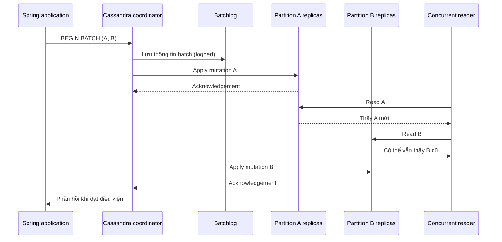
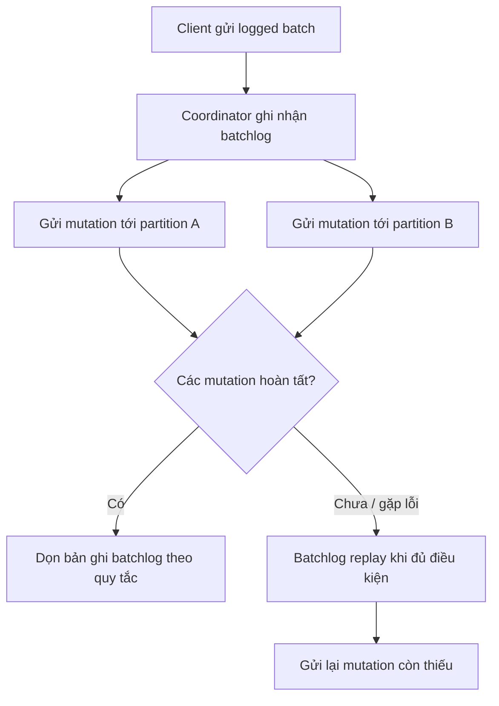
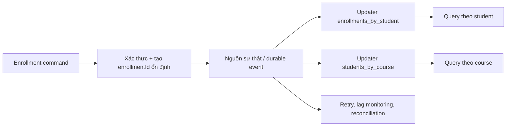

# Thay đổi trong một partition và thay đổi qua nhiều partition

Trong **Spring Data Cassandra**, một thao tác nghiệp vụ có thể cần sửa nhiều hàng hoặc nhiều bảng. Ví dụ, khi học viên hoàn thành một bài học, ứng dụng phải cập nhật tiến độ của các khóa học; khi học viên đăng ký khóa học, hệ thống cần ghi dữ liệu ở cả bảng “đăng ký theo học viên” lẫn bảng “học viên theo khóa học”.

Ở những hệ cơ sở dữ liệu quan hệ, lập trình viên thường nghĩ đến một transaction có khả năng commit hoặc rollback cùng lúc. Nhưng với **Apache Cassandra**, từ khóa **`BATCH`** có ý nghĩa và giới hạn khác. Nó là cơ chế **gom nhiều mutation CQL**, có thể hỗ trợ atomicity theo điều kiện cụ thể, **không mặc nhiên là transaction ACID có isolation và rollback như RDBMS**.

Điểm quan trọng nhất là phân biệt:

- **Thay đổi trong cùng một partition:** các mutation nhắm tới các hàng/cột trong một logical partition, có thể hưởng những đặc tính atomicity và isolation ở phạm vi partition.
- **Thay đổi qua nhiều partition:** Cassandra phải định tuyến mutation đến nhiều nhóm replica, có thể dùng **logged batch** để bảo đảm các mutation đã được ghi nhận sẽ được tiếp tục áp dụng khi có sự cố, nhưng **người đọc vẫn có thể thấy trạng thái cập nhật một phần** trong lúc batch đang được xử lý.

Bài học này thuộc chương **Batch** của module **SPRING_DATA_CASSANDRA**: truy cập Cassandra qua entity mapping, repository, `CassandraTemplate`, `CqlTemplate`, CQL và Java Driver. Bên cạnh cú pháp, bài giải thích thiết kế bảng theo truy vấn, partition key, consistency, retry, paging và chi phí vận hành trong hệ dữ liệu phân tán.

## 1. Mục tiêu học tập

Sau bài này, bạn có thể:

1. Xác định **partition boundary** của một thao tác CQL từ `PRIMARY KEY`.
2. Phân biệt **single-partition batch** và **multi-partition batch**, ngay cả khi các statement cùng dùng một `tenant_id`.
3. Giải thích sự khác nhau giữa **atomicity**, **isolation**, **durability** và **consistency level** trong Cassandra.
4. Phân biệt `BEGIN BATCH`/`LOGGED`, `BEGIN UNLOGGED BATCH` và `BEGIN COUNTER BATCH`.
5. Chọn logged/unlogged theo yêu cầu đúng đắn, không dùng batch như công cụ bulk import hoặc tăng tốc mặc định.
6. Tạo batch bằng Java Driver 4.x, dùng `PreparedStatement`, `BoundStatement` và `BatchStatement`.
7. Hiểu vì sao `saveAll(...)` ở repository không mặc nhiên là một Cassandra transaction/batch có bảo đảm cụ thể.
8. Thiết kế retry, idempotency và xử lý timeout cho cập nhật nhiều bảng phi chuẩn hóa.
9. Phân tích quan hệ giữa batch, LWT, write timestamp và consistency.
10. Đo chi phí batch bằng tracing, cảnh báo, latency, throughput và integration test trên Cassandra thật.

## 2. Nền tảng: partition quyết định phạm vi thay đổi

Cassandra phân phối dữ liệu dựa trên **partition key**. Trong một bảng có `PRIMARY KEY ((tenant_id, student_id), course_id)`, hai giá trị `tenant_id` và `student_id` cùng nhau xác định logical partition; `course_id` là **clustering column** xác định hàng trong partition đó.

Giả sử bảng tiến độ học tập:

```sql
CREATE TABLE IF NOT EXISTS learning.progress_by_student (
    tenant_id uuid,
    student_id uuid,
    course_id uuid,
    completed_lessons int,
    progress_status text,
    last_activity_at timestamp,
    PRIMARY KEY ((tenant_id, student_id), course_id)
);
```

Các hàng sau thuộc **cùng partition**:

```text
Partition key: (tenant=T1, student=S1)

course_id = COURSE_A | completed_lessons = 8
course_id = COURSE_B | completed_lessons = 3
course_id = COURSE_C | completed_lessons = 0
```

Còn hàng sau thuộc **partition khác**:

```text
Partition key: (tenant=T1, student=S2)

course_id = COURSE_A | completed_lessons = 12
```

Cassandra thường có thể định tuyến các thao tác trong cùng partition đến cùng tập replica. Khi một batch chạm nhiều partition khác nhau, coordinator phải phối hợp các đường ghi rộng hơn, với chi phí và khả năng quan sát dữ liệu khác.

### 2.1. Partition không đồng nghĩa bảng, tenant hoặc hàng

Ba nhầm lẫn phổ biến:

- **Một bảng có nhiều partition.** Hai học viên ở cùng bảng không mặc định cùng partition.
- **Một partition có thể có nhiều hàng.** Các khóa học khác nhau của cùng học viên trong ví dụ nằm ở một partition.
- **Cùng giá trị `tenant_id` không nghĩa là cùng partition.** Nếu partition key ghép có thêm `student_id` hoặc `course_id`, thay các trường đó làm thay đổi partition.

Thậm chí **hai bảng khác nhau cùng có giá trị partition key giống nhau** vẫn là những cấu trúc lưu trữ riêng. Không được xem cập nhật hai bảng chỉ vì cùng `tenant_id=T1` là single-partition transaction.

### 2.2. Kiểm tra partition trước khi chọn batch

Khi review một tập mutation, hãy lập bảng:

| Statement | Table | Partition key được bind | Cùng partition không? |
| --- | --- | --- | --- |
| Sửa `COURSE_A` của S1 | `progress_by_student` | `(T1, S1)` | Có với hàng tiếp theo |
| Sửa `COURSE_B` của S1 | `progress_by_student` | `(T1, S1)` | Có |
| Sửa `COURSE_A` của S2 | `progress_by_student` | `(T1, S2)` | **Không** |
| Ghi `enrollments_by_student` của S1 | Bảng khác | `(T1, S1)` | Không tự coi là cùng partition với bảng tiến độ |

**Nếu không nêu được partition key của từng statement, chưa nên quyết định logged hay unlogged batch.**

## 3. Ba khái niệm hay bị trộn lẫn

| Khái niệm | Câu hỏi | Cassandra batch giải quyết đến đâu? |
| --- | --- | --- |
| **Atomicity** | Các mutation trong batch có được áp dụng thành một đơn vị logic trong điều kiện lỗi không? | Có những bảo đảm theo **loại batch và phạm vi partition**; logged batch hỗ trợ atomic delivery |
| **Isolation** | Người đọc đồng thời có thấy trạng thái chỉ một phần thay đổi không? | **Không bảo đảm xuyên nhiều partition** cho batch thông thường |
| **Durability** | Một mutation đã được chấp nhận có thể được lưu/khôi phục ra sao? | Phụ thuộc write path, commit log, batchlog và replica policy |
| **Consistency level** | Cần bao nhiêu replica xác nhận theo topology? | Tùy `ONE`/`LOCAL_QUORUM`/...; **không phải transaction isolation** |

Một cách diễn đạt hữu ích:

> **Logged batch đa partition hỗ trợ atomicity trong quá trình hoàn tất các mutation, không có nghĩa mọi người đọc cùng lúc sẽ nhìn thấy toàn bộ batch như một lần chuyển trạng thái duy nhất.**

Khi sự cố xảy ra sau khi batchlog được ghi bền vững, Cassandra có cơ chế **replay** các mutation chưa hoàn tất. Điều này khác với rollback tức thì từng statement theo isolation cấp transaction của RDBMS.

### 3.1. "Đã nhận ACK" không nói điều gì?

Một lệnh batch thành công vẫn không đồng nghĩa:

- Mọi endpoint đọc ở mọi replica sẽ nhìn thấy dữ liệu mới ngay lập tức.
- Mọi truy vấn trên hai bảng sẽ thấy một snapshot nguyên tử chung.
- Không có concurrent writer khác có thể ghi đè bằng write timestamp lớn hơn.
- Có thể tự động rollback toàn bộ nếu business rule ở ứng dụng phát hiện lỗi sau đó.
- Tất cả phần dữ liệu phi chuẩn hóa của ứng dụng ngoài batch này đều đã đồng bộ.

Các đặc tính trên cần được thiết kế bằng mô hình dữ liệu, consistency, business version, LWT hoặc cơ chế workflow tương ứng.

## 4. Batch trong cùng một partition

Giả sử học viên S1 vừa hoàn thành một loạt bài và ứng dụng muốn cập nhật tiến độ của **hai khóa học** đang lưu trong cùng partition `(T1,S1)`.

CQL có thể là:

```sql
BEGIN UNLOGGED BATCH
    UPDATE learning.progress_by_student
    SET completed_lessons = ?
    WHERE tenant_id = ? AND student_id = ? AND course_id = ?;

    UPDATE learning.progress_by_student
    SET completed_lessons = ?
    WHERE tenant_id = ? AND student_id = ? AND course_id = ?;
APPLY BATCH;
```

Cả hai statement phải bind **cùng** `tenant_id` và `student_id`, dù `course_id` khác nhau.

Trong phạm vi một partition, Cassandra có các bảo đảm atomicity/isolation dành cho việc cập nhật partition đó. Single-partition batch không cần batchlog phân tán như logged batch nhiều partition; do vậy **`UNLOGGED BATCH` có thể phù hợp** khi tất cả mutation thực sự thuộc cùng logical partition.

### 4.1. Tại sao UNLOGGED có thể hợp lý ở đây?

- Không cần thêm batchlog để bảo đảm atomic delivery qua nhiều partition.
- Các mutation cùng đi tới một logical partition.
- Ứng dụng vẫn chỉ gửi một request batch.
- Mục đích chính là **thay đổi có liên quan trong cùng partition**, không phải gom hàng nghìn write độc lập để “tăng tốc”.

**Không kết luận rằng mọi unlogged batch đều atomic xuyên nhiều partition**. Khi phạm vi vượt ra nhiều partition, đặc tính bảo đảm thay đổi đáng kể.

### 4.2. Không dùng batch khi chỉ có một UPDATE

Một câu:

```sql
UPDATE learning.progress_by_student
SET completed_lessons = ?
WHERE tenant_id = ? AND student_id = ? AND course_id = ?;
```

đã là một mutation theo khóa. Không cần gói nó trong `BEGIN BATCH` chỉ để trông giống transaction. Batch thêm độ phức tạp, request size và có thể thêm overhead.

### 4.3. UPDATE của Cassandra thường là upsert

`UPDATE` theo primary key của Cassandra có thể tạo hàng chưa tồn tại. Ví dụ cập nhật `completed_lessons` cho một `course_id` không có từ trước không mặc định trả lỗi “row not found”.

Batch **không biến UPDATE thành kiểm tra tồn tại**. Nếu nghiệp vụ cần “chỉ cập nhật khi khóa học đã đăng ký”, phải xác định rule thông qua dữ liệu và cơ chế điều kiện thích hợp, có thể cần LWT với giới hạn của nó.

### 4.4. Hai hàng khác nhau trong một partition không phải hai partition

Việc `COURSE_A` và `COURSE_B` có clustering key khác nhau không làm chúng thành partition riêng. Đây là lý do việc học đúng `PRIMARY KEY ((...partition...), clustering...)` quan trọng hơn chỉ nhìn số lượng row được sửa.

## 5. Batch qua nhiều partition

Bây giờ xét hai học viên khác nhau:

```sql
BEGIN BATCH
    UPDATE learning.progress_by_student
    SET progress_status = 'ACTIVE'
    WHERE tenant_id = ?
      AND student_id = ?
      AND course_id = ?;

    UPDATE learning.progress_by_student
    SET progress_status = 'ACTIVE'
    WHERE tenant_id = ?
      AND student_id = ?
      AND course_id = ?;
APPLY BATCH;
```

Nếu tham số thứ nhất thuộc `(T1,S1)` còn tham số thứ hai thuộc `(T1,S2)`, batch đi qua **hai partition**.

`BEGIN BATCH` mặc định dùng **logged batch**, trừ khi cú pháp chỉ định `UNLOGGED` hoặc `COUNTER`. Với logged batch nhiều partition, Cassandra sử dụng **batchlog** để hỗ trợ bảo đảm các mutation được áp dụng khi có sự cố trong quá trình thực thi.

### 5.1. Logged batch không phải transaction có snapshot chung

Giả sử batch cập nhật A và B:



Sơ đồ chỉ minh họa **khả năng quan sát một phần** ở lúc ghi đang diễn ra; thứ tự phối hợp chi tiết, ACK của replicas và batchlog có thể khác theo phiên bản/đường thực thi.

**Không được hiểu logged batch là “hai bảng thay đổi cùng một nanosecond cho mọi reader”.** Batchlog hỗ trợ durability/atomic delivery; nó không tạo isolation xuyên các partition.

### 5.2. Điều gì xảy ra nếu coordinator gặp lỗi?

Một kịch bản:

1. Coordinator ghi nhận batch vào batchlog theo quy tắc Cassandra.
2. Mutation A được gửi thành công.
3. Coordinator chết hoặc mất mạng trước khi hoàn tất mutation B.
4. Cơ chế batchlog/replay có thể tiếp tục gửi những mutation còn thiếu.
5. Trong khoảng trễ, các reader có thể thấy A mới nhưng B cũ.

Khi yêu cầu logged batch đã đạt bước ghi nhận bền vững, Cassandra có cơ chế để **cuối cùng đưa những mutation thuộc batch đến các đích**, với giả định cluster vận hành/khôi phục đúng và không có các lỗi dữ liệu độc lập. Điều này khác với cam kết **mọi truy vấn nhìn thấy tất cả thay đổi tức thì**.

Nếu client nhận timeout, **không biết chắc** mutation nào đã được áp dụng hoặc batchlog đã được ghi thành công chỉ từ exception. Hành vi retry phải được thiết kế theo idempotency và trạng thái thực tế, không chỉ theo mong muốn all-or-none của caller.

### 5.3. UNLOGGED nhiều partition khác gì?

Ví dụ:

```sql
BEGIN UNLOGGED BATCH
    INSERT INTO learning.progress_by_student
        (tenant_id, student_id, course_id, completed_lessons)
    VALUES (?, ?, ?, ?);

    INSERT INTO learning.progress_by_student
        (tenant_id, student_id, course_id, completed_lessons)
    VALUES (?, ?, ?, ?);
APPLY BATCH;
```

Nếu hai cặp `(tenant_id, student_id)` khác nhau, đây là **unlogged batch đa partition**. Nó không có lớp batchlog bảo vệ atomic delivery giống logged batch; lỗi giữa các mutation có thể để lại trạng thái cập nhật một phần mà **không có cùng cơ chế replay batchlog**.

Cassandra có thể phát cảnh báo khi phát hiện unlogged batch đi qua nhiều partition (tùy phiên bản/cấu hình). **Không dùng UNLOGGED để đổi lấy tốc độ nếu nghiệp vụ đòi mọi projection phải được áp dụng theo bảo đảm của logged batch.**

## 6. Logged, UNLOGGED và COUNTER BATCH

| Loại | Cú pháp | Đặc tính chính | Điểm dễ sai |
| --- | --- | --- | --- |
| **Logged** | `BEGIN BATCH ... APPLY BATCH` hoặc `BEGIN LOGGED BATCH` | Có batchlog khi cần để hỗ trợ atomic delivery nhiều partition | Không có isolation xuyên partition; overhead cao |
| **Unlogged** | `BEGIN UNLOGGED BATCH ... APPLY BATCH` | Không dùng batchlog bảo vệ nhiều partition | Chỉ nên dùng khi semantics chấp nhận, đặc biệt cùng partition |
| **Counter** | `BEGIN COUNTER BATCH ... APPLY BATCH` | Dành riêng cho các mutation của counter columns | Không trộn counter và non-counter; retry không idempotent |

### 6.1. Chọn loại batch bằng câu hỏi nghiệp vụ

**Nếu tất cả mutation thuộc một partition:** cân nhắc một batch nhỏ theo cùng partition; thường không cần logged batch nhiều partition.

**Nếu mutation thuộc nhiều partition và ứng dụng cần bảo đảm chúng sẽ cùng được hoàn tất sau lỗi:** logged batch là công cụ cần cân nhắc, với hiểu biết đúng về việc reader vẫn có thể thấy trạng thái một phần.

**Nếu mutation thuộc nhiều partition nhưng hoàn toàn độc lập:** thường tốt hơn là **các prepared statements riêng**, thực thi với concurrency có giới hạn, thay vì một logged batch lớn.

**Nếu dùng counter:** phải tuân theo quy tắc COUNTER BATCH và thận trọng với retry vì cộng counter không giống set giá trị thông thường.

### 6.2. Counter batch không phải giải pháp exactly-once

Ví dụ bảng đếm số lượt xem khóa học:

```sql
CREATE TABLE IF NOT EXISTS learning.course_view_counter (
    tenant_id uuid,
    course_id uuid,
    view_count counter,
    PRIMARY KEY (tenant_id, course_id)
);
```

Cú pháp minh họa:

```sql
BEGIN COUNTER BATCH
    UPDATE learning.course_view_counter
    SET view_count = view_count + 1
    WHERE tenant_id = ? AND course_id = ?;
APPLY BATCH;
```

Counter mutation là phép tăng, **không idempotent** theo nghĩa ghi cùng giá trị. Nếu request timeout và được retry, có thể đếm tăng nhiều lần. Counter batch không biến một sự kiện “view” thành transaction exactly-once.

Không đưa một `INSERT` thông thường vào `COUNTER BATCH`. Nếu bài toán là thống kê có độ chính xác hoặc idempotency bắt buộc, cân nhắc event ID, bảng ghi nhận sự kiện/aggregation pipeline và chính sách đối soát.

## 7. Tình huống thật: ghi hai bảng phi chuẩn hóa

Trong Cassandra, bảng thường được thiết kế **theo hướng truy vấn**. Một enrollment có thể cần truy vấn theo:

- Học viên → danh sách khóa học đã đăng ký.
- Khóa học → danh sách học viên đang đăng ký.

Ta lưu hai **read models** khác nhau.

### 7.1. Bảng theo học viên

```sql
CREATE TABLE IF NOT EXISTS learning.enrollments_by_student (
    tenant_id uuid,
    student_id uuid,
    enrollment_id uuid,
    course_id uuid,
    enrolled_at timestamp,
    enrollment_status text,
    PRIMARY KEY ((tenant_id, student_id), enrollment_id)
);
```

Query hợp lệ:

```sql
SELECT enrollment_id, course_id, enrolled_at, enrollment_status
FROM learning.enrollments_by_student
WHERE tenant_id = ? AND student_id = ?;
```

Partition key: `(tenant_id, student_id)`.

### 7.2. Bảng theo khóa học

```sql
CREATE TABLE IF NOT EXISTS learning.students_by_course (
    tenant_id uuid,
    course_id uuid,
    enrollment_id uuid,
    student_id uuid,
    enrolled_at timestamp,
    enrollment_status text,
    PRIMARY KEY ((tenant_id, course_id), enrollment_id)
);
```

Query hợp lệ:

```sql
SELECT enrollment_id, student_id, enrolled_at, enrollment_status
FROM learning.students_by_course
WHERE tenant_id = ? AND course_id = ?;
```

Partition key: `(tenant_id, course_id)`.

Hai bảng chia sẻ `tenant_id` và cùng một `enrollment_id` nghiệp vụ, **nhưng chúng là hai physical table/partition paths khác nhau**.

### 7.3. Ghi cả hai trong logged batch

```sql
BEGIN BATCH
    INSERT INTO learning.enrollments_by_student
        (tenant_id, student_id, enrollment_id,
         course_id, enrolled_at, enrollment_status)
    VALUES (?, ?, ?, ?, ?, ?);

    INSERT INTO learning.students_by_course
        (tenant_id, course_id, enrollment_id,
         student_id, enrolled_at, enrollment_status)
    VALUES (?, ?, ?, ?, ?, ?);
APPLY BATCH;
```

Đây là **hai mutation ở hai bảng**. Một logged batch có thể hỗ trợ việc hoàn tất cả hai khi có lỗi giữa chừng, nhưng không làm bảng A và bảng B trở thành một transaction có isolation xuyên partition.

**Không dùng batch để thay thế mọi cơ chế đồng bộ projection.** Vẫn cần xử lý sự kiện đổi trạng thái, delete, retry, concurrent writes, backfill và đối soát.

### 7.4. Đảm bảo khóa nghiệp vụ ổn định

Khi enrollment được tạo, hãy phát sinh `enrollment_id` **một lần** và dùng cùng ID khi ghi vào cả hai bảng. Cùng `enrolled_at` cũng cần ổn định nếu nó là một phần contract dữ liệu.

Nếu retry lại sinh `UUID.randomUUID()`, Cassandra xem đó là **enrollment khác**, và logged batch không giúp hợp nhất hai sự kiện có khóa khác nhau.

### 7.5. Bảng mới giúp đọc, nhưng tăng chi phí ghi

Nếu có thêm bảng `enrollments_by_status_month` để phục vụ màn hình theo trạng thái, một sự kiện có thể cần ba mutation hoặc hơn. Gói tất cả vào logged batch lớn không tự giải quyết bài toán mở rộng kiến trúc.

Cần đánh giá:

- Bao nhiêu read models cần cập nhật đồng bộ?
- Chi phí write amplification và disk/compaction là bao nhiêu?
- Endpoint nào chấp nhận eventual consistency?
- Có thể dùng sự kiện bền vững và updater độc lập không?
- Có hệ thống reconciliation kiểm tra các bảng đọc không?
- Một batch có đang phát triển thành “transaction phân tán” quá lớn không?

**Khi số bảng/projection tăng, một workflow idempotent và có thể đối soát thường quan trọng hơn việc cố gom mọi mutation vào một batch.**

## 8. Cách đọc đúng atomicity và isolation

### 8.1. Single-partition changes

Trong một partition, Cassandra cung cấp các đặc tính atomicity/isolation cho mutation của partition đó; single-partition batch tận dụng ranh giới này.

Ví dụ cập nhật hai course của cùng student:

```text
Table: progress_by_student
Partition: (T1,S1)

UPDATE course=A, completed_lessons=5
UPDATE course=B, completed_lessons=7
```

Tất cả thuộc một partition; đó là phạm vi phù hợp để cân nhắc một batch nhỏ.

Tuy nhiên, đừng suy ra điều này tạo **serializable transaction** cho mọi quy tắc nghiệp vụ với concurrent writers. Một request khác có thể đồng thời ghi cùng cell với timestamp lớn hơn và thắng theo cơ chế hòa giải LWW; nếu cần compare-and-set, có thể cần LWT và business version.

### 8.2. Multi-partition changes

Với batch qua `(T1,S1)` và `(T1,S2)`, hai nhóm replica có thể hoàn tất mutation ở những thời điểm khác nhau. Một reader đọc A rồi B có thể nhìn thấy một trạng thái hỗn hợp.

Sự khác biệt này vẫn tồn tại dù dùng:

- `BEGIN BATCH` mặc định logged;
- consistency level `LOCAL_QUORUM`;
- một HTTP request duy nhất;
- một method Java có annotation transaction;
- một lớp service tự gọi hai repository.

**Atomic delivery không phải atomic visibility trên toàn cluster.**

### 8.3. Một batch có nhiều statement không đồng nghĩa một snapshot đọc

Một batch gồm `INSERT` và `UPDATE` không tạo một “thời điểm commit” mà mọi query khác buộc phải quan sát như một snapshot duy nhất. Nếu product cần thông tin đọc xuyên hai bảng **luôn đồng bộ tức thời**, phải xem lại dữ liệu nguồn, phạm vi partition và khả năng Cassandra đáp ứng yêu cầu đó.

Ví dụ khi user vừa enroll một course, UI đồng thời đọc `enrollments_by_student` và `students_by_course` có thể cần **read-your-writes strategy**, chờ cập nhật projection hoặc đọc từ nguồn sự thật, chứ không chỉ dựa vào logged batch.

## 9. Viết single-partition batch bằng Java Driver 4.x

Trong Spring Boot, `CqlSession` thường được cấu hình như một bean có lifecycle dài. DAO có thể inject session đó và chuẩn bị statements một lần.

### 9.1. Ví dụ hai UPDATE cùng partition

```java
import java.util.Objects;
import java.util.UUID;

import com.datastax.oss.driver.api.core.CqlSession;
import com.datastax.oss.driver.api.core.cql.BatchStatement;
import com.datastax.oss.driver.api.core.cql.BoundStatement;
import com.datastax.oss.driver.api.core.cql.DefaultBatchType;
import com.datastax.oss.driver.api.core.cql.PreparedStatement;

public class StudentProgressBatchDao {

    private final CqlSession session;
    private final PreparedStatement updateProgress;

    public StudentProgressBatchDao(CqlSession session) {
        this.session = Objects.requireNonNull(session);

        this.updateProgress = session.prepare("""
            UPDATE learning.progress_by_student
            SET completed_lessons = ?
            WHERE tenant_id = ? AND student_id = ? AND course_id = ?
            """);
    }

    public void updateTwoCourses(
            UUID tenantId,
            UUID studentId,
            UUID courseA, int lessonsA,
            UUID courseB, int lessonsB) {

        Objects.requireNonNull(tenantId, "tenantId");
        Objects.requireNonNull(studentId, "studentId");
        Objects.requireNonNull(courseA, "courseA");
        Objects.requireNonNull(courseB, "courseB");

        if (lessonsA < 0 || lessonsB < 0) {
            throw new IllegalArgumentException(
                "completed lessons must not be negative");
        }

        BoundStatement first = updateProgress.bind(
            lessonsA, tenantId, studentId, courseA);

        BoundStatement second = updateProgress.bind(
            lessonsB, tenantId, studentId, courseB);

        BatchStatement batch = BatchStatement
            .builder(DefaultBatchType.UNLOGGED)
            .addStatement(first)
            .addStatement(second)
            .build();

        session.execute(batch);
    }
}
```

Điểm chính:

1. Cả hai `BoundStatement` dùng **cùng `tenantId` và `studentId`**.
2. `courseA` và `courseB` chỉ thay đổi clustering key.
3. Batch thuộc một partition của **cùng bảng**.
4. `DefaultBatchType.UNLOGGED` được chọn có chủ đích.
5. `PreparedStatement` được reuse, tránh ghép input vào chuỗi CQL.
6. Không tạo `CqlSession` trong từng lời gọi.
7. Validation phải xảy ra **trước** khi gửi batch, không phải sau khi một số mutation đã chạy.

**Chú ý nghiệp vụ:** trong ví dụ này, “số bài đã hoàn thành không được giảm” chưa được bảo đảm bởi validation `lessonsA >= 0`. Một concurrent writer vẫn có thể ghi giá trị thấp hơn sau đó. Batch chỉ tập trung vào phạm vi mutation; để đảm bảo tiến độ tăng đơn điệu phải thiết kế quy tắc đồng thời/version riêng.

### 9.2. Nếu caller vô tình truyền hai student IDs?

Để tạo được single-partition batch, API đã nhận **một studentId dùng chung**. Đó là cách thiết kế chữ ký method giúp giảm nguy cơ batch bị biến thành multi-partition ngoài ý muốn.

Nếu nhận một danh sách object mỗi object có `studentId` khác nhau, phải kiểm tra tất cả partition keys hoặc thay API; không đặt tên method `singlePartitionBatch(...)` rồi hy vọng caller luôn truyền đúng dữ liệu.

## 10. Viết logged batch cho hai bảng đọc

Đường ghi sau sử dụng hai prepared statements và **logged batch**.

```java
import java.time.Instant;
import java.util.Objects;
import java.util.UUID;

import com.datastax.oss.driver.api.core.CqlSession;
import com.datastax.oss.driver.api.core.cql.BatchStatement;
import com.datastax.oss.driver.api.core.cql.BoundStatement;
import com.datastax.oss.driver.api.core.cql.DefaultBatchType;
import com.datastax.oss.driver.api.core.cql.PreparedStatement;

public class EnrollmentProjectionBatchDao {

    private final CqlSession session;
    private final PreparedStatement insertByStudent;
    private final PreparedStatement insertByCourse;

    public EnrollmentProjectionBatchDao(CqlSession session) {
        this.session = Objects.requireNonNull(session);

        insertByStudent = session.prepare("""
            INSERT INTO learning.enrollments_by_student
                (tenant_id, student_id, enrollment_id,
                 course_id, enrolled_at, enrollment_status)
            VALUES (?, ?, ?, ?, ?, ?)
            """);

        insertByCourse = session.prepare("""
            INSERT INTO learning.students_by_course
                (tenant_id, course_id, enrollment_id,
                 student_id, enrolled_at, enrollment_status)
            VALUES (?, ?, ?, ?, ?, ?)
            """);
    }

    public void enroll(
            UUID tenantId,
            UUID studentId,
            UUID courseId,
            UUID enrollmentId,
            Instant enrolledAt) {

        Objects.requireNonNull(tenantId);
        Objects.requireNonNull(studentId);
        Objects.requireNonNull(courseId);
        Objects.requireNonNull(enrollmentId);
        Objects.requireNonNull(enrolledAt);

        BoundStatement first = insertByStudent.bind(
            tenantId, studentId, enrollmentId,
            courseId, enrolledAt, "ACTIVE");

        BoundStatement second = insertByCourse.bind(
            tenantId, courseId, enrollmentId,
            studentId, enrolledAt, "ACTIVE");

        BatchStatement batch = BatchStatement
            .builder(DefaultBatchType.LOGGED)
            .addStatement(first)
            .addStatement(second)
            .build();

        session.execute(batch);
    }
}
```

Hai bảng có partition keys khác nhau, nên đây là **cross-partition/cross-table batch**. `LOGGED` được chọn vì ví dụ muốn hỗ trợ việc áp dụng đủ hai mutation trong điều kiện lỗi.

### 10.1. Những điều code không tự bảo đảm

- Không kiểm tra học viên/course có tồn tại hoặc người gọi có quyền.
- Không bảo đảm hai bảng được đọc như một snapshot chung.
- Không chống tất cả concurrent enrollment race; cùng khóa/cột vẫn theo write timestamps.
- Không đồng bộ những projection khác nằm ngoài batch.
- Không thực hiện rollback nghiệp vụ nếu một bước downstream ngoài Cassandra thất bại.
- Không tự tạo exactly-once nếu caller sinh `enrollmentId` mới sau timeout.

Cần có service validation, authorization, ID generation ổn định, retry có kiểm soát và theo dõi bất thường.

### 10.2. Đừng để caller tự gán một timestamp quá cao

Java Driver có `setQueryTimestamp(...)` và Cassandra CQL có `USING TIMESTAMP`. Khi nhiều mutation trong batch có write timestamps khác nhau, các xung đột với concurrent writer vẫn được hòa giải theo timestamp.

Đặt timestamp rất xa tương lai để “ép hai bảng đồng bộ” có thể làm các cập nhật hợp lệ sau đó thua LWW. Timestamp policy phải được thiết kế theo toàn hệ thống, không dùng như khóa transaction.

## 11. Repository, CassandraTemplate và CqlTemplate có tạo batch tự động không?

Spring Data Cassandra có nhiều abstraction:

| API | Công dụng | Điều cần nhớ về batch |
| --- | --- | --- |
| `CassandraRepository` | CRUD/entity query methods | **`saveAll` không phải bằng chứng có logged batch/transaction**; xem implementation/version |
| `CassandraTemplate` / `CassandraOperations` | Mapping entity và query/update operations | Có những API batch/options tùy phiên bản; kiểm tra contract và phạm vi mutation |
| `CqlTemplate` / `CqlOperations` | Execute CQL trực tiếp, callbacks | Có thể thực thi CQL BATCH tường minh; vẫn áp dụng ngữ nghĩa Cassandra |
| `CqlSession` / Java Driver | Prepared/BoundStatement và BatchStatement | Kiểm soát rõ `LOGGED`, `UNLOGGED`, `COUNTER` và options |

### 11.1. saveAll không đồng nghĩa transaction xuyên partition

Ví dụ:

```java
repository.saveAll(List.of(entityA, entityB));
```

Không được khẳng định lời gọi này:

- Luôn được phát dưới dạng `BEGIN BATCH`;
- Luôn là logged batch;
- Có cùng partition key;
- Có thể rollback khi một phần thất bại;
- Cung cấp isolation giữa các bảng khác nhau.

`saveAll` là API lưu một tập entities. Hành vi câu CQL thực tế phụ thuộc Spring Data Cassandra version, repository implementation và cấu hình. Nếu yêu cầu phải chọn **logged vs unlogged batch**, hãy sử dụng abstraction batch được tài liệu phiên bản xác nhận hoặc Java Driver như ví dụ trên.

### 11.2. @Transactional không biến Cassandra thành RDBMS

Không nên viết:

```java
// Anti-pattern về kỳ vọng, không dùng làm cam kết ACID multi-partition.
@Transactional
public void writeTwoProjections() {
    studentRepository.save(studentProjection);
    courseRepository.save(courseProjection);
}
```

rồi mặc định hệ thống có transaction isolation/rollback xuyên nhiều partition. Hỗ trợ transaction và semantics của các abstraction Spring Data phải được xác nhận theo store/driver; Cassandra không cung cấp transaction tổng quát giống cơ sở dữ liệu quan hệ.

Nếu business requirement đòi multi-step commit với rollback trên nhiều entity/table, cần thiết kế lại ranh giới dữ liệu hoặc dùng workflow/outbox/saga và cơ chế đối soát, không chỉ thêm annotation.

### 11.3. Batch API cần kiểm soát CQL thực

Một class DAO dùng trực tiếp `CqlSession` rõ ràng về:

- Số mutation trong batch.
- Partition keys của từng mutation.
- Batch type logged/unlogged/counter.
- Consistency và execution profile.
- Error/timeout behavior.

Tuy nhiên, điều đó đánh đổi bằng việc phải tự quản lý statement và mapper; Spring Data repository vẫn hữu ích với các CRUD/entity reads thông thường. **Không cần loại bỏ repository để sử dụng batch đúng cách.**

## 12. Consistency level và batchlog

**Consistency level** (ví dụ `LOCAL_ONE`, `LOCAL_QUORUM`) quy định mức xác nhận từ replica theo replication factor và datacenter. Nó là thành phần của đường read/write, không đồng nghĩa **isolation của batch**.

Ví dụ với một batch logged gồm hai partition:

- `LOCAL_QUORUM` có thể yêu cầu nhóm replica địa phương xác nhận theo quy tắc của mỗi mutation/operation.
- Các partition vẫn có thể hoàn tất ở những thời điểm khác nhau.
- Một reader thực hiện hai query liên tiếp không được bảo đảm nhìn thấy snapshot nguyên tử chung.
- Nếu một request timeout, caller không biết chắc mutation nào đã được áp dụng chỉ dựa trên response.
- Batchlog hỗ trợ replay khi batch đã được ghi nhận, nhưng không là một coordinator transaction log với rollback/isolation như RDBMS.

### 12.1. Batchlog tồn tại để làm gì?

Với logged multi-partition batch, coordinator dùng **batchlog** để lưu thông tin cần thiết phục vụ replay khi ghi chưa hoàn tất. Nó hỗ trợ bảo đảm atomicity theo ngữ nghĩa Cassandra khi có node/process failure.



Sơ đồ là **khái quát**, không mô tả thuật toán quorum/replication của batchlog từng phiên bản. Điểm chính: batchlog giúp khôi phục các mutation cần hoàn tất, **không khóa toàn bộ các partition khỏi reader trong lúc batch chạy**.

### 12.2. Tại sao logged batch lớn dễ chậm?

Một logged batch qua nhiều partition có thể gây:

1. Ghi thông tin batchlog bổ sung.
2. Coordinator phải phân phối mutation tới nhiều partition/replica.
3. Nhiều request được gom thành một công việc lớn khó cân bằng tải.
4. Chi phí memory, CPU, network và tracing cao hơn.
5. Tăng nguy cơ timeout và tail latency khi một nhóm replica chậm.
6. Áp lực replay/khôi phục khi batch không hoàn tất.

**Không được suy ra một logged batch 2.000 mutations luôn nhanh hơn 2.000 statements nhỏ có concurrency phù hợp.** Cassandra không sử dụng batch như công cụ bulk loading tốc độ cao mặc định.

## 13. Batch size: số statement và byte đều quan trọng

Một batch 10 statement rất nhỏ khác đáng kể một batch 10 statement mỗi statement chứa payload hàng megabyte. Khi đánh giá chi phí, cần nhìn cả **số partition**, **số statement** và **tổng kích thước dữ liệu**.

| Yếu tố | Tại sao quan trọng? |
| --- | --- |
| Tổng số mutations | Ảnh hưởng parsing, coordinator CPU và retry |
| Số partition đích | Quyết định fan-out qua replica groups |
| Tổng số byte | Ảnh hưởng batchlog, network, memory và I/O |
| Giá trị CQL của payload | Row/cell lớn làm update/read/compaction đắt |
| Batch logged hay unlogged | Quyết định có batchlog và bảo đảm liên quan |
| Consistency level | Ảnh hưởng số replica cần phản hồi |
| Concurrent batch count | Hàng đợi và áp lực trên coordinator/replica |
| Hot partitions | Có thể gây quá tải một nhóm replica dù batch nhỏ |
| Write timestamp, TTL, tombstone | Ảnh hưởng conflict resolution và storage cleanup |

### 13.1. Cassandra có cảnh báo cho batch không phù hợp

Một số bản Cassandra có các cấu hình/cảnh báo như:

- `batch_size_warn_threshold`: cảnh báo batch lớn.
- `batch_size_fail_threshold`: giới hạn bảo vệ có thể từ chối batch quá lớn.
- `unlogged_batch_across_partitions_warn_threshold`: cảnh báo unlogged batch trải nhiều partition.

Tên, giá trị mặc định, phép đo byte và cách phân loại partition có thể khác theo Cassandra version/distribution. **Phải kiểm tra cấu hình thực tế của cluster** trước khi đặt dashboard và rule.

Tăng `batch_size_fail_threshold` không biến batch lớn thành chiến lược tốt; có thể chuyển một lỗi dễ phát hiện thành latency và áp lực memory khó dự đoán hơn.

### 13.2. Khi nhiều write độc lập, dùng cách nào?

Nếu cần nhập 100.000 enrollment thuộc nhiều student/course khác nhau:

- Tách thành các prepared statements độc lập theo partition.
- Giới hạn số request đồng thời; theo dõi error/latency/backpressure.
- Dùng cơ chế ingestion/bulk loading phù hợp hệ thống khi cần.
- Giữ event ID/primary key ổn định để retry idempotent.
- Không tạo một `BEGIN BATCH` khổng lồ chỉ để giảm số lần gọi method Java.
- Không cố gộp nhiều partition trong UNLOGGED BATCH rồi coi đó là tối ưu.

Batch nên diễn đạt **một đơn vị mutation có liên quan** và đã được đánh giá đúng về bảo đảm dữ liệu.

## 14. Retry, timeout và tính idempotent

### 14.1. Timeout tạo kết quả không chắc chắn

Giả sử gọi logged batch hai bảng và client nhận `WriteTimeoutException`.

**Không được kết luận**:

- “Cả hai mutation chắc chắn thất bại.”
- “Cả hai mutation chắc chắn đã hoàn thành.”
- “Batchlog chưa được ghi.”
- “Có thể tạo một enrollment ID mới và thử lại mà không thay đổi kết quả.”

Có thể đã có mutation được áp dụng hoặc batchlog đã ghi để replay; việc retry cần dựa vào contract và idempotency.

### 14.2. Hai loại thao tác khác nhau khi retry

| Thao tác | Idempotency cơ bản | Điều cần kiểm tra |
| --- | --- | --- |
| `INSERT`/`UPDATE` đặt cùng giá trị vào cùng khóa | Thường dễ làm idempotent hơn | Write timestamp, TTL, concurrent versions, side effects |
| `DELETE` cùng khóa | Thường có thể lặp theo khóa ổn định | Timestamp của tombstone, TTL, các writer concurrent |
| `counter = counter + 1` | **Không idempotent** | Retry có thể tăng lại |
| Batch tạo UUID mới ở mỗi lần retry | **Không idempotent về nghiệp vụ** | Sinh thêm hàng khác primary key |
| Batch có nhiều bảng phi chuẩn hóa | Cần thiết kế theo từng mutation | Đồng bộ projection, backfill, đối soát |
| Conditional batch/LWT | Có semantics riêng | Điều kiện, Paxos, kết quả khi timeout |

**Idempotency** có nghĩa lặp lại cùng thao tác với cùng event/key không gây thay đổi nghiệp vụ ngoài ý muốn. Với Cassandra, cần phân biệt idempotency của giá trị và sự khác biệt do **timestamp/TTL** khi gửi lại mutation.

### 14.3. TTL khi retry

Nếu `INSERT ... USING TTL 3600` được thực thi lại muộn hơn một giờ, expiration time có thể thay đổi theo thời điểm ghi lại và chính sách timestamp tương ứng. Vậy **ghi cùng giá trị và cùng primary key** không luôn idempotent về **thời điểm hết hạn**.

Nếu TTL là một phần hợp đồng nghiệp vụ, có thể phải tính remaining TTL từ expiration deadline ổn định hoặc dùng event policy rõ ràng. Đừng tự động retry vô hạn một batch chứa TTL rồi mặc định dữ liệu vẫn hết hạn đúng lúc ban đầu.

### 14.4. Concurrent writers và last-write-wins

Hai writer có thể cập nhật cùng một cell trong khi batch đang chạy. Cassandra dùng write timestamps để hòa giải; **batch không tự cấp global sequence** cho nghiệp vụ.

Ví dụ:

```text
Batch A: status = ACTIVE
Batch B: status = CANCELLED

Nếu hai writer không phối hợp version/condition:
  Winner phụ thuộc timestamp và quy tắc hòa giải,
  không mặc định theo request đến cuối.
```

Khi nghiệp vụ cần compare-and-set hoặc state transition hợp lệ, cân nhắc **LWT/conditional statements** hoặc event ordering có chủ đích.

## 15. LWT và conditional batch: phạm vi khác với logged batch

**Lightweight Transaction (LWT)** là cơ chế điều kiện dùng Paxos cho những câu như `IF NOT EXISTS` hoặc `IF status = 'ACTIVE'`. Nó có thể được dùng để bảo vệ một state transition trong phạm vi mà Cassandra hỗ trợ, nhưng không phải một cách bật “ACID toàn cluster”.

Ví dụ conditional update của một enrollment theo đầy đủ primary key:

```sql
UPDATE learning.enrollments_by_student
SET enrollment_status = 'CANCELLED'
WHERE tenant_id = ?
  AND student_id = ?
  AND enrollment_id = ?
IF enrollment_status = 'ACTIVE';
```

Khi cần nhiều conditional statements trong một batch, Cassandra áp dụng **giới hạn phạm vi partition và cú pháp**; không xem một conditional batch là công cụ compare-and-set trên hai partition tùy ý. Kiểm tra tài liệu CQL của phiên bản và test trên cluster thật trước khi sử dụng.

### 15.1. Conditional batch và logged batch giải quyết hai câu hỏi khác nhau

| Câu hỏi | Công cụ cần cân nhắc |
| --- | --- |
| Khi có sự cố, làm sao nhiều mutation đã nhận có thể được tiếp tục áp dụng? | Logged batch, trong phạm vi bảo đảm Cassandra |
| Có được chuyển status ACTIVE → CANCELLED nếu hiện tại là ACTIVE? | LWT/conditional update |
| Có thể làm hai bảng ở hai partition xuất hiện đồng thời với mọi reader? | **Không mặc nhiên** bằng logged batch |
| Có thể tránh concurrent updates sai thứ tự nghiệp vụ? | Business version, LWT hoặc event processing |
| Có thể cộng counter exactly once sau timeout? | Không chỉ bằng counter batch |

Không trộn `USING TIMESTAMP` tùy ý với conditional writes: Cassandra có quy tắc riêng cho timestamp của LWT, và explicit timestamp không được dùng như write thường trong conditional statement.

### 15.2. Đừng dùng LWT cho mọi batch chỉ vì sợ race

LWT có chi phí về phối hợp replica, throughput và latency. Chỉ dùng khi **điều kiện đồng thời** thực sự là yêu cầu nghiệp vụ; không thay một thiết kế thiếu partition key bằng LWT và không dùng nó như tối ưu bulk writes.

## 16. Batch không thay thiết kế bảng theo truy vấn

Một logged batch ghi vào hai bảng không sửa được vấn đề đọc thiếu partition key.

Ví dụ bảng `enrollments_by_student` được thiết kế cho:

```sql
SELECT *
FROM learning.enrollments_by_student
WHERE tenant_id = ? AND student_id = ?;
```

Nếu product cần danh sách theo course, bảng `students_by_course` cung cấp hướng đọc đó. **Batch chỉ liên quan cách ghi các read models**, không tự tạo index hay cho phép query regular columns tùy ý trên bảng cũ.

Tương tự:

- `ALLOW FILTERING` có thể làm read path tốn tài nguyên.
- Secondary index/SAI có giới hạn về phiên bản, selectivity và workload.
- Paging state gắn với câu CQL và tham số.
- Partition quá lớn vẫn có thể làm query chậm dù update batch đúng.
- TTL/DELETE tạo tombstone, batch không làm tombstone miễn phí.

Sự đúng đắn của Spring Data Cassandra phụ thuộc **cả write path và read model**.

## 17. Mô hình thay thế khi thay đổi trải nhiều partition

Khi business operation đi qua nhiều partition/table hoặc cả hệ thống khác Cassandra, một logged batch không nên là phương án kiến trúc duy nhất.

### 17.1. Nguồn sự thật và projection updater

Một hướng thiết kế:



Mô hình này chấp nhận **eventual consistency** giữa các bảng đọc nhưng có cơ chế khôi phục và đối soát. Nó phù hợp khi số projection tăng hoặc khi một mutation kéo theo email, analytics và các hệ thống ngoài Cassandra.

**Lưu ý:** việc ghi một bảng rồi gửi event **không tự atomic** giữa database và message broker. Khi cần bảo đảm sự kiện không mất, dùng một cơ chế event/outbox/workflow bền vững có thiết kế cụ thể; đừng chỉ “try gửi message rồi nếu lỗi thì log”.

### 17.2. Khi nào logged batch vẫn hợp lý?

Logged batch nhỏ, gồm một vài mutation có liên quan và cần atomic delivery theo bảo đảm Cassandra, có thể phù hợp khi:

- Cùng một yêu cầu phải ghi hai read models.
- Tập mutation nhỏ, đã biết rõ.
- Không cần isolation xuyên partition.
- Retry/idempotency và reconciliation đã được thiết kế.
- Benchmark cho thấy latency và tải chấp nhận được.

### 17.3. Khi nào nên tránh logged batch?

- Batch gồm hàng trăm/hàng nghìn partition.
- Mỗi mutation là một công việc độc lập không cần cùng atomic delivery.
- Mục tiêu chỉ là tăng tốc bulk ingestion.
- UI/business yêu cầu serializable read xuyên nhiều bảng.
- Workload đã có nhiều hotspots, timeouts và batchlog pressure.
- Số bảng projection thay đổi liên tục và workflow cần theo dõi/compensate từng bước.

Cách thay thế có thể là prepared statements độc lập, async processing có giới hạn, event-driven projection updates và reconciliation.

## 18. Quan sát và kiểm soát hiệu năng batch

Một hệ thống production cần đo:

| Chỉ số | Ý nghĩa |
| --- | --- |
| p50/p95/p99 **batch write latency** | Tác động tail latency khi gom nhiều mutation |
| Number of statements per batch | Phát hiện batch đang tăng quy mô |
| **Distinct partition count** | Phát hiện fan-out dù số statement ít |
| Serialized batch bytes | Theo dõi payload/batchlog/memory cost |
| Server batch warnings/failures | Nhận diện vượt thresholds |
| WriteTimeout/Unavailable exceptions | Nhận diện cluster/consistency pressure |
| Coordinator CPU/network | Batch phân tán có tạo hotspot không? |
| Pending batchlog replay / replay errors | Cảnh báo khôi phục chưa hoàn tất theo metrics phiên bản |
| Compaction/tombstone indicators | Tác động của nhiều mutation/update/delete |
| Projection lag/mismatch | Kiểm tra đúng đắn sau ghi cross-table |

Tên metric/JMX/Prometheus và ngưỡng **phụ thuộc phiên bản** Cassandra, driver, exporter. Không tạo dashboard dựa vào tên metric không có thật trên cluster; kiểm tra sản phẩm và cấu hình trước.

### 18.1. Query tracing

Trong môi trường test, có thể bật tracing cho một batch nhỏ, rồi tắt ngay:

```sql
TRACING ON;

BEGIN BATCH
    INSERT INTO learning.progress_by_student
        (tenant_id, student_id, course_id, completed_lessons)
    VALUES (
        11111111-1111-1111-1111-111111111111,
        22222222-2222-2222-2222-222222222222,
        33333333-3333-3333-3333-333333333333,
        4
    );

    INSERT INTO learning.progress_by_student
        (tenant_id, student_id, course_id, completed_lessons)
    VALUES (
        11111111-1111-1111-1111-111111111111,
        22222222-2222-2222-2222-222222222222,
        44444444-4444-4444-4444-444444444444,
        2
    );
APPLY BATCH;

TRACING OFF;
```

Hai row này thuộc **cùng partition**. Trong production, không bật tracing trên toàn bộ requests khi node đang quá tải; tracing tạo thêm chi phí.

### 18.2. Đừng tối ưu bằng cách tăng batch thresholds

Nếu `batch_size_warn_threshold` cảnh báo, câu hỏi đúng là:

- Tại sao batch có nhiều partition?
- Tại sao có nhiều statement/byte?
- Có thật sự cần atomic delivery của tất cả mutation không?
- Có thể nhóm theo partition hoặc tách thành requests độc lập không?
- Dữ liệu có bị skew/hot partition không?
- Thời gian xử lý và trạng thái retry có được kiểm soát không?

Đổi warning/failure thresholds chỉ nên thực hiện sau khi hiểu tải thực tế và tác động lên cluster, không phải cách sửa từ gốc.

## 19. Kiểm thử single- và multi-partition batch

Một unit test chỉ kiểm tra repository mock không thể chứng minh các giới hạn về batchlog, replica hoặc query consistency. Nên có **integration test với Cassandra thật** bằng Testcontainers hoặc cluster kiểm thử.

### 19.1. Ca kiểm thử single partition

1. Tạo keyspace `learning` và bảng `progress_by_student`.
2. Seed hai hàng với cùng `(tenantId, studentId)` và hai `courseId` khác nhau.
3. Tạo `StudentProgressBatchDao` với `CqlSession` test.
4. Gọi `updateTwoCourses(...)`, xác minh cả hai row có giá trị dự kiến.
5. Gọi với `lessonsA < 0`, xác minh validation ngăn gửi request.
6. Gọi với partition khác, xác minh không ảnh hưởng học viên cũ.
7. Kiểm tra query không vô tình thay cả partition khi chỉ muốn hai rows.

### 19.2. Khung assertion sau khi thực thi batch

Ví dụ đoạn thân integration test giả định đã có `session`, `dao` và UUID fixtures:

```java
dao.updateTwoCourses(
    tenantId, studentId,
    courseA, 8,
    courseB, 3
);

Row rowA = session.execute(
    SimpleStatement.newInstance(
        """
        SELECT completed_lessons
        FROM learning.progress_by_student
        WHERE tenant_id = ? AND student_id = ? AND course_id = ?
        """,
        tenantId, studentId, courseA
    )
).one();

Row rowB = session.execute(
    SimpleStatement.newInstance(
        """
        SELECT completed_lessons
        FROM learning.progress_by_student
        WHERE tenant_id = ? AND student_id = ? AND course_id = ?
        """,
        tenantId, studentId, courseB
    )
).one();

assertThat(rowA).isNotNull();
assertThat(rowB).isNotNull();
assertThat(rowA.getInt("completed_lessons")).isEqualTo(8);
assertThat(rowB.getInt("completed_lessons")).isEqualTo(3);
```

Đoạn test cần imports cho `Row`, `SimpleStatement`, `assertThat` và fixture setup; đây không phải một source file hoàn chỉnh.

### 19.3. Ca kiểm thử multi-partition logged

1. Dựng cả hai bảng `enrollments_by_student` và `students_by_course`.
2. Tạo `enrollmentId` ổn định.
3. Gọi `EnrollmentProjectionBatchDao.enroll(...)`.
4. Đọc theo `(tenantId, studentId)` và `(tenantId, courseId)`, xác nhận cùng enrollment ID/status.
5. Retry bằng **cùng enrollment ID**; không được xuất hiện row mới do khóa đổi.
6. Kiểm tra dữ liệu của tenant/course khác không bị tác động.
7. Nếu cluster test nhiều node hỗ trợ fault injection, thử coordinator failure/timeout có kiểm soát và quan sát batchlog replay.
8. Kiểm tra error handling và reconciliation khi client không biết chắc kết quả.
9. Không kết luận isolation cross-partition từ việc hai bảng cuối cùng có dữ liệu bằng nhau.

### 19.4. Giới hạn của Testcontainers một node

Testcontainers Cassandra một node giúp xác minh cú pháp CQL, primary keys, bound statement mapping và kết quả sau khi batch thành công. Nhưng một node **không tái hiện đầy đủ**:

- Replication factor >1, replica outages hoặc network partitions.
- Coordinator failure và batchlog replay trên nhiều node.
- Concurrent readers quan sát partial visibility giữa nhiều partition.
- Tail latency trong cluster có hàng triệu partitions.
- Consistency policies theo datacenter.

Những cam kết về recovery, SLA và topology phải được kiểm thử ở môi trường phù hợp. Không cố gắng gây lỗi mạng/fault injection trên production chỉ để xem batchlog hoạt động ra sao.

## 20. Tình huống lựa chọn batch trong thực tế

### Tình huống A: cập nhật tiến độ hai khóa học của cùng học viên

Hai rows trong cùng `progress_by_student` partition `(T1,S1)`.

**Phương án phù hợp:** batch nhỏ trong cùng partition, có thể dùng `UNLOGGED` nếu đúng semantics; hoặc xem có thể mô hình hóa thành một mutation đơn giản hơn không.

### Tình huống B: cập nhật hai học viên khác nhau

Hai rows ở `(T1,S1)` và `(T1,S2)`, không có yêu cầu business cần cùng atomic delivery.

**Phương án phù hợp:** prepared statements riêng, concurrency có giới hạn. Không dùng logged batch chỉ vì có hai dòng code.

### Tình huống C: enrollment ghi hai read models

Ghi `enrollments_by_student` và `students_by_course` trong cùng một business event.

**Phương án cần cân nhắc:** logged batch **nhỏ** nếu yêu cầu atomic delivery theo Cassandra, nhưng thiết kế sẵn eventual visibility, idempotency và reconciliation. Với pipeline phức tạp/đa hệ thống, cân nhắc sự kiện bền vững và projection updater.

### Tình huống D: nhập 100.000 enrollment qua nhiều partition

Mục tiêu là throughput và dữ liệu không cần atomicity của toàn file.

**Phương án phù hợp:** bulk/async ingestion với backpressure và partition-aware batching nhỏ nếu thật sự cần. Tránh một logged batch khổng lồ.

### Tình huống E: bảo đảm không có enrollment trùng

Yêu cầu “chỉ tạo nếu chưa tồn tại” cho một khóa.

**Phương án cần cân nhắc:** `INSERT ... IF NOT EXISTS` / LWT phù hợp, cùng business key ổn định. Một `INSERT` trong logged batch không mặc nhiên biến thành kiểm tra uniqueness.

### Tình huống F: tăng counter view_count

Một view event tăng counter một lần, timeout có thể dẫn đến retry.

**Phương án cần cân nhắc:** counter semantics và chính sách idempotency ở tầng sự kiện. `COUNTER BATCH` không đảm bảo exactly-once cho retry.

## 21. Những lỗi thường gặp

| Triệu chứng | Nguyên nhân khả dĩ | Hướng xử lý |
| --- | --- | --- |
| Batch được gọi một lần nhưng hai bảng đọc tạm khác nhau | Không có isolation xuyên partition | Thiết kế read path/eventual visibility và reconciliation |
| `UNLOGGED BATCH` ghi nhiều partition bị warning | Batch vượt ranh giới một partition | Xem lại loại batch hoặc tách statements |
| Logged batch lớn làm p99 tăng | Batchlog, fan-out coordinator và I/O | Giảm batch size, nhóm theo partition, benchmark |
| Batch fail nhưng một số rows đã được ghi | Lỗi/timeout giữa mutations; client không chắc kết quả | Không suy diễn rollback, kiểm tra idempotency/retry |
| `repository.saveAll(...)` được kỳ vọng atomic | Hiểu sai abstraction | Dùng API batch được xác nhận hoặc driver trực tiếp |
| `@Transactional` không rollback hai bảng | Cassandra không cung cấp RDBMS transaction tổng quát | Workflow/outbox/reconciliation |
| Dữ liệu retry bị nhân đôi | Sinh enrollmentId/cluster key mới mỗi retry | Tạo ID ổn định trước lần gửi đầu |
| Counter tăng hai lần | Retry một increment không idempotent | Thiết kế event ID/aggregation riêng |
| Đổi consistency nhưng vẫn thấy partial visibility | Consistency không tạo isolation xuyên partition | Xem lại contract đọc |
| UPDATE thành công nhưng không thay giá trị | LWW timestamp lớn hơn từ writer khác | Kiểm tra `WRITETIME`, conflict/version |
| Conditional batch multi-partition bị từ chối | LWT có giới hạn partition | Thiết kế lại phạm vi điều kiện |
| Batch warning biến mất sau khi tăng threshold | Chỉ che triệu chứng | Đo coordinator, batchlog, latency và sửa root cause |
| Viết nhiều bảng cùng tenant nhưng gọi là one partition | Nhầm logical tenant với physical partition | Đối chiếu table và partition keys của từng statement |
| Batch có TTL bị kéo dài vòng đời khi retry | TTL/write timestamp policy chưa đúng | Dùng expiration deadline và retries có kiểm soát |
| Test một node pass, production vẫn timeout | Không mô phỏng replication/fan-out thực | Benchmark nhiều node và fault injection test riêng |

### Quy trình debug nhanh

1. Liệt kê **mọi statement** trong batch.
2. Xác định **table + partition key** của từng statement bằng giá trị bind thực tế (ẩn PII khi log).
3. Kiểm tra **batch type** và lý do chọn loại đó.
4. Đọc CQL/driver errors và server warnings của phiên bản hiện hành.
5. Đo **batch byte size, distinct partitions, p95/p99, timeout, coordinator CPU**.
6. Nếu thấy kết quả một phần, phân biệt **partial visibility tạm thời** với **failure chưa được replay/đối soát**.
7. Kiểm tra timestamp/LWT/retry cùng event ID.
8. Thử phương án ít partition hơn hoặc statements độc lập.
9. Đưa regression test vào integration suite trước release.

## 22. Bài tập thực hành

Cho hai bảng:

```sql
CREATE TABLE learning.orders_by_customer (
    tenant_id uuid,
    customer_id uuid,
    order_id uuid,
    total_amount decimal,
    order_status text,
    PRIMARY KEY ((tenant_id, customer_id), order_id)
);

CREATE TABLE learning.orders_by_status (
    tenant_id uuid,
    order_status text,
    order_id uuid,
    customer_id uuid,
    total_amount decimal,
    PRIMARY KEY ((tenant_id, order_status), order_id)
);
```

Một dịch vụ xử lý đơn hàng của tenant T1.

**Yêu cầu nghiệp vụ:**

- **R1:** Cập nhật hai đơn hàng của customer C1 trong `orders_by_customer`.
- **R2:** Cập nhật một đơn của C1 và một đơn của C2 trong `orders_by_customer`.
- **R3:** Tạo một đơn mới ở cả `orders_by_customer` và `orders_by_status`.
- **R4:** Thay `order_status` từ PENDING sang PAID trong bảng có status là partition key.
- **R5:** Nhập hàng chục nghìn đơn hàng lịch sử.
- **R6:** Đếm số lần đơn hàng được xem bằng một counter.
- **R7:** Chỉ cho phép chuyển PENDING → PAID nếu trạng thái đang là PENDING.

Hãy trả lời:

1. Partition key của mỗi bảng là gì?
2. Hai dòng R1 có thuộc cùng partition không? Những điều kiện nào cần được bind?
3. Vì sao R2 không phải single-partition batch dù cùng tenant?
4. Trong R3, có thể khẳng định hai bảng cùng physical partition vì `tenant_id=T1` không?
5. Khi nào logged batch nhỏ có thể hợp lý cho R3?
6. Logged batch R3 có đảm bảo một reader đọc hai bảng luôn thấy cùng trạng thái ở mọi thời điểm không?
7. Trong R4, vì sao cập nhật `order_status` có thể cần xóa khóa cũ và ghi khóa mới?
8. Nếu R4 có lỗi giữa hai mutation, hệ thống cần cơ chế phục hồi nào?
9. Vì sao `BEGIN UNLOGGED BATCH` R2 không có cùng bảo đảm recovery như logged batch?
10. Tại sao R5 không nên là một logged batch chứa 50.000 statements?
11. Retry sau timeout có thể gây lỗi gì nếu mỗi lần tạo một `order_id` khác?
12. Counter trong R6 có idempotent khi retry không?
13. R7 nên cân nhắc cơ chế nào khác với ghi thường?
14. `@Transactional` có tự tạo transaction ACID đa partition trên Cassandra không?
15. `LOCAL_QUORUM` có đảm bảo snapshot đọc hai bảng không?
16. `batch_size_warn_threshold` đo ngữ cảnh gì? Vì sao không nên chỉ tăng ngưỡng?
17. Nếu một logged batch gặp coordinator failure giữa chừng, batchlog có vai trò gì?
18. Unit test với Mockito có kiểm chứng được behavior multi-node batchlog không?
19. Khi nào nên chọn workflow/event-driven projection thay vì logged batch?
20. Những thông số cần benchmark khi quyết định logged/unlogged batch là gì?

**Gợi ý:** R1 nằm trong `(T1,C1)` của một bảng; R2 chạm `(T1,C1)` và `(T1,C2)`. R3 chạm hai bảng khác nhau. Logged batch hỗ trợ atomic delivery nhưng không có isolation đa partition. R4 thay partition key trong bảng `orders_by_status` nên cần quản lý chuyển từ partition PENDING sang PAID. R5 cần ingestion có giới hạn tải; R6 cần policy counter/idempotency; R7 có thể dùng LWT trong phạm vi mà Cassandra hỗ trợ.

## 23. Checklist thiết kế batch trong Spring Data Cassandra

- [ ] Đã xác định chính xác **table + partition key** của từng mutation.
- [ ] Phân biệt **same partition**, **different partitions** và **different tables**.
- [ ] Chỉ dùng batch khi các mutation có quan hệ nghiệp vụ rõ ràng.
- [ ] Không mặc định batch là transaction ACID có rollback/isolation.
- [ ] Với single-partition batch, đã đánh giá `UNLOGGED` phù hợp hay không.
- [ ] Với multi-partition logged batch, hiểu **batchlog/replay** và partial visibility.
- [ ] Không dùng unlogged multi-partition khi cần atomic delivery giữa mutations.
- [ ] Không dùng batch lớn để thay thế bulk ingestion.
- [ ] Batch có giới hạn số statement, số partition và payload bytes.
- [ ] Đã kiểm tra server warning/failure thresholds theo phiên bản.
- [ ] Prepared statements được bind, không ghép input người dùng vào CQL.
- [ ] `enrollmentId`/business IDs ổn định giữa các lần retry.
- [ ] Timeout được xem là **kết quả chưa chắc chắn**, không tự suy diễn rollback.
- [ ] Counter mutations không được coi là idempotent.
- [ ] TTL/write timestamp/DELETE được xem xét trong retry và xung đột.
- [ ] Conditional statements/LWT chỉ dùng trong phạm vi được hỗ trợ.
- [ ] Không dựa vào `repository.saveAll(...)`/`@Transactional` làm bằng chứng có transaction nhiều partition.
- [ ] Tách trách nhiệm nguồn sự thật, projection updates và reconciliation.
- [ ] Có integration test Cassandra thật cho cú pháp và dữ liệu.
- [ ] Có kiểm thử nhiều node khi cần xác minh failure/replay/consistency.
- [ ] Đo p95/p99, coordinator load, batchlog, timeouts và projection mismatch.

## 24. Ghi nhớ

**Ranh giới partition quyết định ý nghĩa của batch.** Với các mutation trong cùng một partition, Cassandra có đặc tính atomicity/isolation ở phạm vi partition và có thể dùng batch nhỏ không logging phân tán. Với nhiều partition hoặc nhiều bảng, coordinator phải phân phối write tới các đích khác nhau.

**Logged batch nhiều partition hỗ trợ hoàn tất các mutation thông qua batchlog/replay, nhưng không tạo isolation hoặc rollback ACID xuyên partition.** Một reader vẫn có thể thấy cập nhật một phần trong khi batch đang xử lý. `UNLOGGED` nhiều partition không có cùng bảo đảm atomic delivery; `COUNTER BATCH` dành riêng cho counter và không làm increment trở thành exactly-once.

**Đừng dùng BATCH như công cụ tăng tốc mặc định**. Cần thiết kế bảng theo truy vấn, giữ batch nhỏ, dùng prepared statements, đo coordinator/replica load, bảo vệ retry bằng khóa ổn định và xây cơ chế đối soát cho dữ liệu phi chuẩn hóa. Chọn API Spring Data Cassandra hay Java Driver là quyết định ở tầng Java; quy tắc phân tán bên dưới không thay đổi.

### Tài liệu tham khảo

- [Apache Cassandra — BATCH statement](https://cassandra.apache.org/doc/stable/cassandra/developing/cql/dml.html#batch)
- [Apache Cassandra — Data Modeling](https://cassandra.apache.org/doc/stable/cassandra/developing/data-modeling/)
- [Apache Cassandra — Lightweight Transactions](https://cassandra.apache.org/doc/stable/cassandra/developing/cql/dml.html#lightweight-transactions)
- [Apache Cassandra Java Driver 4 — Batch Statements](https://docs.datastax.com/en/developer/java-driver/4.17/manual/core/statements/batch/)
- [Apache Cassandra Java Driver 4 — Prepared Statements](https://docs.datastax.com/en/developer/java-driver/4.17/manual/core/statements/prepared/)
- [Spring Data Cassandra — Repositories](https://docs.spring.io/spring-data/cassandra/reference/repositories.html)
- [Spring Data Cassandra — CassandraTemplate](https://docs.spring.io/spring-data/cassandra/reference/cassandra/template.html)
- [Spring Data Cassandra — CQL Template](https://docs.spring.io/spring-data/cassandra/reference/cassandra/cql-template.html)
