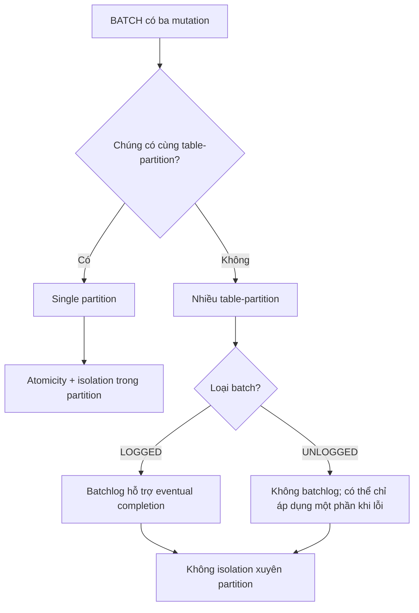
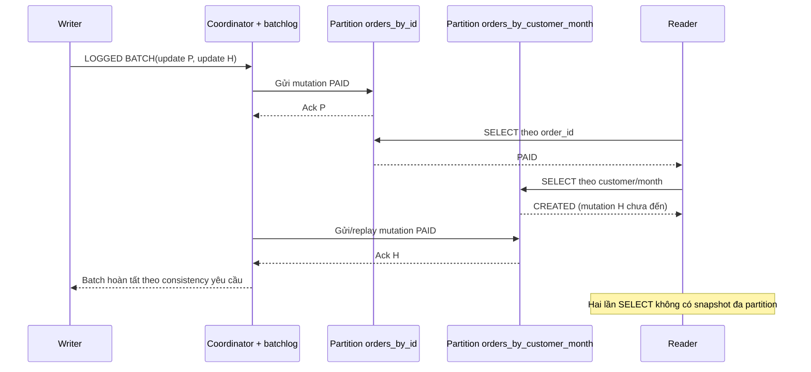

# Tính nguyên tử của việc ghi và phạm vi cô lập quan sát

Khi một ứng dụng **Spring Data Cassandra** phải sửa nhiều giá trị cùng lúc, ta dễ nghĩ: “Đưa tất cả `INSERT`, `UPDATE` và `DELETE` vào một `BATCH` là đã có transaction”. Cách hiểu này nguy hiểm, đặc biệt trong hệ thống phân tán lưu dữ liệu ở nhiều **partition**, trên nhiều **replica**, với các lượt đọc có **consistency level** khác nhau.

Cassandra có hai khái niệm cần tách bạch:

- **Tính nguyên tử khi ghi (atomicity)**: một nhóm mutation được thực hiện theo một đơn vị bảo đảm phù hợp với loại batch; với **LOGGED batch** trải nhiều partition, trọng tâm là **cuối cùng các mutation sẽ được hoàn tất nhờ batchlog**, không phải mọi nơi cùng nhìn thấy chúng ngay một thời điểm.
- **Phạm vi cô lập quan sát (isolation/visibility)**: một lần đọc có thể nhìn thấy **một phần** của batch hay không. Cassandra bảo đảm cô lập các mutation trong batch **thuộc cùng một partition**; không cung cấp snapshot cô lập **xuyên nhiều partition** chỉ vì có `BEGIN BATCH`.

Đây là nội dung của chương **Batch** trong module **SPRING_DATA_CASSANDRA**: truy cập Apache Cassandra qua entity mapping, repository, `CassandraTemplate`, CQL; thiết kế bảng theo truy vấn, hiểu partition key, consistency và paging để làm việc đúng với mô hình phân tán.

Bài sẽ dùng cùng một bộ dữ liệu đơn hàng để chứng minh **một partition khác với hai partition**, đối chiếu `LOGGED`/`UNLOGGED`, rồi viết code Spring Data Cassandra và Java driver. Các API Java lấy **Spring Data Cassandra 4.5.x**, **Java driver 4.19** và Java 17 làm mốc. Semantics CQL tập trung vào Cassandra 4.x/5.0; các tính năng transaction mới hoặc extension của nhà cung cấp không được tự suy ra là thuộc `BATCH` thông thường.

## 1. Mục tiêu học tập

Sau bài này, bạn có thể:

1. Giải thích đúng **atomicity**, **isolation**, **consistency** và **durability** — bốn khái niệm liên quan nhưng không đồng nhất.
2. Phân biệt **single-partition batch** và **multi-partition batch** dựa trên **primary key thực của từng bảng**.
3. Dự đoán điều một reader có thể thấy khi **LOGGED batch trải hai partition đang được áp dụng**.
4. Mô tả lý do Cassandra dùng **batchlog** và vì sao batchlog không tạo **isolation đa partition**.
5. Giải thích khi nào **UNLOGGED batch** vẫn phù hợp và khi nào nó có nguy cơ **chỉ áp dụng một phần**.
6. Dùng CQL `BEGIN BATCH ... APPLY BATCH` để xây dựng ví dụ đúng partition.
7. Gửi batch qua `CassandraTemplate.batchOps()` và `BatchStatement` của Java driver; không nhầm `execute()` với thao tác thêm mutation.
8. Nhận biết giới hạn của **`@Version`**, **LWT**, **write timestamp**, **TTL** và **retry** đối với batch.
9. Thiết kế bài kiểm thử cho **trạng thái cuối** và **phạm vi quan sát**, biết giới hạn của stress test.
10. Chọn một read model hoặc transaction/workflow khác khi nghiệp vụ cần **đọc nhất quán xuyên nhiều partition**.

## 2. Bốn khái niệm thường bị đánh đồng

| Khái niệm | Câu hỏi mà nó trả lời | Với Cassandra BATCH |
|---|---|---|
| **Atomicity** | Một nhóm mutation có được hoàn tất cùng nhau theo loại bảo đảm nào? | Trong một partition có bảo đảm atomic; LOGGED nhiều partition dùng batchlog để thúc đẩy hoàn tất toàn bộ về sau |
| **Isolation** | Reader có thấy kết quả **một phần** của nhóm ghi không? | Có cô lập **trong cùng partition**; không có snapshot cô lập xuyên partition |
| **Consistency level** | Bao nhiêu replica phải phản hồi hoặc tham gia để đạt một mức consistency? | `ONE`, `LOCAL_QUORUM`... không đổi phạm vi isolation của `BATCH` |
| **Durability** | Dữ liệu được ghi/ghi nhận và phục hồi theo cơ chế lưu trữ ra sao? | Liên quan commit log, replica, batchlog, failure recovery; không đồng nghĩa “reader ở mọi nơi lập tức thấy dữ liệu” |

### 2.1. “Atomic” có hai cách dùng dễ nhầm

Trong tài liệu Cassandra, một **LOGGED multi-partition batch** thường được gọi là **atomic** theo nghĩa:

> Nếu một phần mutation của logged batch được thực hiện, cơ chế batchlog giúp các phần còn lại cuối cùng cũng được thực hiện.

Đây là bảo đảm **eventual completion** dưới giả định cluster có thể phục hồi/tiếp tục xử lý. Nó **không** đồng nghĩa việc tất cả partition đổi trạng thái **đúng một thời điểm chung** như một snapshot ACID duy nhất mà reader có thể đọc trên mọi bảng.

Vì vậy, khi trao đổi về thiết kế, hãy nói rõ:

- **Atomic trong một partition**: reader truy vấn partition đó không thấy một nửa của cùng batch.
- **Atomic completion của LOGGED batch đa partition**: server có cơ chế hoàn tất những mutation còn thiếu.
- **Không có cross-partition isolation**: một reader đọc từng partition có thể quan sát trạng thái chưa đồng bộ ở giữa.

Sự phân biệt này phù hợp cả tài liệu CQL của Apache Cassandra và JavaDoc `CassandraBatchOperations` của Spring Data. Không nên dùng một câu ngắn “batch luôn all-or-nothing” để kết luận mọi tính chất giao dịch.

### 2.2. “Isolation” cũng có phạm vi

Giả sử bảng có partition `order_id = X`, gồm ba dòng hàng. Một batch sửa cả ba dòng. **Một query đọc partition X** được bảo vệ khỏi việc nhìn một tổ hợp trung gian do chính batch đó tạo ra.

Nhưng nếu ứng dụng thực hiện:

```text
SELECT line A ... ;    // Lượt đọc thứ nhất
... batch được áp dụng ở giữa ...
SELECT line B ... ;    // Lượt đọc thứ hai
```

hai lượt đọc **không hình thành một read transaction** và có thể thấy dữ liệu ở hai thời điểm khác nhau. Cô lập ở đây **không** bao gồm mọi chuỗi nhiều `SELECT` trong ứng dụng.

### 2.3. Sơ đồ phạm vi



**Table-partition** nghĩa là một partition **trong một bảng cụ thể**. Hai bảng có cùng giá trị `order_id` không thể mặc định là cùng một partition chỉ vì UUID giống nhau.

## 3. Partition key quyết định ranh giới cô lập

Cassandra tổ chức dữ liệu theo:

- **Partition key**: xác định partition logic và token placement.
- **Clustering columns**: sắp xếp, định danh row **bên trong partition**.
- **Regular columns**: giá trị của row, không tự làm thay đổi partition.
- **Replication**: một partition có thể có bản sao trên nhiều node; đó là **nhiều replica của cùng partition**, không phải nhiều partition khác nhau.

### 3.1. Một partition với nhiều row

Ví dụ bảng:

```sql
CREATE TABLE order_lines_by_order (
    order_id uuid,
    line_id uuid,
    sku text,
    quantity int,
    line_status text,
    PRIMARY KEY ((order_id), line_id)
);
```

Ở đây:

- `order_id` là partition key.
- `line_id` là clustering column.
- Ba dòng có cùng `order_id` nhưng khác `line_id` vẫn nằm trong **một partition**.
- Một `BATCH` sửa ba dòng này có phạm vi cô lập **trong partition order đó**.

### 3.2. Hai partition trong cùng bảng

Nếu hai row có `order_id = X` và `order_id = Y`, chúng là **hai partition** khác nhau, dù cùng bảng `order_lines_by_order`.

Một batch sửa X và Y không được gọi là single-partition batch. Phạm vi bảo đảm phải được đánh giá theo loại `LOGGED` hoặc `UNLOGGED` và không có cross-partition isolation.

### 3.3. Hai bảng cũng không tự thành một partition

Giả sử:

```text
orders_by_id:
  PRIMARY KEY (order_id)

orders_by_customer_month:
  PRIMARY KEY ((customer_id, order_month), created_at, order_id)
```

Một thao tác cập nhật `orders_by_id` và một thao tác cập nhật `orders_by_customer_month` là mutation ở **hai table-partition riêng**, dù cả hai mô tả **cùng một đơn hàng**. Đây là tình huống rất phổ biến trong Cassandra vì hệ thống thường **phi chuẩn hóa thành nhiều bảng đọc** theo access pattern.

### 3.4. Consistency không phải partition key

Một client có thể đọc `LOCAL_QUORUM` trên partition X, rồi đọc `LOCAL_QUORUM` trên partition Y. **Hai câu SELECT vẫn không có snapshot chung.** Chọn consistency cao hơn có thể giúp từng lần đọc đáp ứng yêu cầu replica, nhưng không tự tạo transaction xuyên hai partition.

## 4. Chuẩn bị keyspace và dữ liệu thực hành

Chúng ta dùng một keyspace/bảng dành riêng cho ví dụ. Hãy chạy ở `cqlsh` của **Cassandra test cluster**, không sử dụng môi trường production.

### 4.1. Keyspace cho một node lab

```sql
CREATE KEYSPACE IF NOT EXISTS sdc_batch_visibility_lab
WITH replication = {
    'class': 'SimpleStrategy',
    'replication_factor': 1
};

CREATE TABLE IF NOT EXISTS sdc_batch_visibility_lab.order_lines_by_order (
    order_id uuid,
    line_id uuid,
    sku text,
    quantity int,
    line_status text,
    PRIMARY KEY ((order_id), line_id)
);
```

`SimpleStrategy` với replication factor 1 chỉ để đơn giản hóa lab. Một cluster production thường sử dụng `NetworkTopologyStrategy`, RF và consistency theo topology; **bảo đảm isolation của batch không đồng nghĩa RF=1 là an toàn**.

### 4.2. Nạp ba dòng cho cùng một đơn

```sql
INSERT INTO sdc_batch_visibility_lab.order_lines_by_order
(order_id, line_id, sku, quantity, line_status)
VALUES (
    11111111-1111-1111-1111-111111111111,
    00000000-0000-0000-0000-000000000001,
    'SKU-A', 1, 'PENDING'
);

INSERT INTO sdc_batch_visibility_lab.order_lines_by_order
(order_id, line_id, sku, quantity, line_status)
VALUES (
    11111111-1111-1111-1111-111111111111,
    00000000-0000-0000-0000-000000000002,
    'SKU-B', 2, 'PENDING'
);

INSERT INTO sdc_batch_visibility_lab.order_lines_by_order
(order_id, line_id, sku, quantity, line_status)
VALUES (
    11111111-1111-1111-1111-111111111111,
    00000000-0000-0000-0000-000000000003,
    'SKU-C', 3, 'PENDING'
);
```

Kiểm tra:

```sql
SELECT order_id, line_id, sku, quantity, line_status
FROM sdc_batch_visibility_lab.order_lines_by_order
WHERE order_id = 11111111-1111-1111-1111-111111111111;
```

Giả định không có mutation khác trên cùng UUID, query này trả **ba row PENDING**, lần lượt có quantity 1, 2, 3. Cassandra sắp xếp theo clustering `line_id`, không theo thứ tự các câu INSERT thực thi.

### 4.3. Không thay đổi partition key trong bài

Các ví dụ bên dưới luôn ghi cùng `order_id` và dùng `line_id` khác nhau. Nếu bạn thay `order_id` ở **một** câu UPDATE/DELETE, ví dụ sẽ lập tức trở thành **multi-partition batch**; không thể giữ kết luận về single-partition isolation.

## 5. CQL: single-partition batch và điều một reader quan sát

### 5.1. Cập nhật ba dòng bằng một batch

Giả sử cần chuyển tất cả dòng của đơn sang `RESERVED` và cập nhật số lượng:

```sql
BEGIN UNLOGGED BATCH

    UPDATE sdc_batch_visibility_lab.order_lines_by_order
    SET quantity = 4,
        line_status = 'RESERVED'
    WHERE order_id = 11111111-1111-1111-1111-111111111111
      AND line_id = 00000000-0000-0000-0000-000000000001;

    UPDATE sdc_batch_visibility_lab.order_lines_by_order
    SET quantity = 5,
        line_status = 'RESERVED'
    WHERE order_id = 11111111-1111-1111-1111-111111111111
      AND line_id = 00000000-0000-0000-0000-000000000002;

    UPDATE sdc_batch_visibility_lab.order_lines_by_order
    SET quantity = 6,
        line_status = 'RESERVED'
    WHERE order_id = 11111111-1111-1111-1111-111111111111
      AND line_id = 00000000-0000-0000-0000-000000000003;

APPLY BATCH;
```

Đây là **một batch chỉ tác động một table-partition**. `UNLOGGED` được chọn có chủ đích: không cần distributed batchlog khi các mutation chỉ thuộc cùng partition, và vẫn có tính chất atomic/isolation ở phạm vi đó.

### 5.2. Một truy vấn đọc toàn partition

```sql
SELECT line_id, sku, quantity, line_status
FROM sdc_batch_visibility_lab.order_lines_by_order
WHERE order_id = 11111111-1111-1111-1111-111111111111;
```

Nếu có một reader chạy **một lần SELECT trên cùng partition** trong lúc batch được áp dụng, bảo đảm single-partition isolation có nghĩa reader không được nhìn một **tổ hợp chỉ do batch đang áp dụng dở** như:

```text
SKU-A: RESERVED, quantity=4
SKU-B: PENDING,  quantity=2
SKU-C: PENDING,  quantity=3
```

Reader có thể nhìn **phiên bản trước** hoặc **phiên bản sau** của nhóm mutation, tùy thời điểm đọc và trạng thái replica phù hợp với consistency của truy vấn. Đó là phạm vi cam kết; không phải mọi lượt đọc ở mọi node đều tức thời thấy phiên bản mới.

**Cần nói chính xác:** ta đang xét một query đọc **cùng partition** và giả định không có writer khác đụng vào các cell đó. Nếu có mutation độc lập cạnh tranh, TTL hết hạn hoặc giá trị bị LWW che khuất, trạng thái nhìn thấy có thể khác hai bảng “trước/sau” lý tưởng; không được gán mọi khác biệt cho isolation failure.

### 5.3. Minh họa hai trạng thái được phép trong ví dụ không cạnh tranh

| Trước khi batch được áp dụng | Sau khi batch được áp dụng |
|---|---|
| `SKU-A: PENDING, 1` | `SKU-A: RESERVED, 4` |
| `SKU-B: PENDING, 2` | `SKU-B: RESERVED, 5` |
| `SKU-C: PENDING, 3` | `SKU-C: RESERVED, 6` |

Bảo đảm không có “trạng thái trung gian của chính batch” cho một lần đọc partition phù hợp. Điều này **khác** chuyện ứng dụng đọc nhiều lần qua nhiều request.

### 5.4. Hai SELECT tách rời vẫn có thể thấy hai thời điểm

Ví dụ:

```text
T1: SELECT dòng A -> PENDING
T2: Writer thực thi batch và hoàn tất
T3: SELECT dòng B -> RESERVED
```

Đây **không phải vi phạm** single-partition isolation vì T1 và T3 là **hai lần đọc riêng**, ở hai thời điểm khác nhau. Cassandra không biến chúng thành một snapshot transaction chỉ vì cùng một HTTP request.

Nếu nghiệp vụ cần hiển thị một danh sách dòng hàng nhất quán tại **một thời điểm quan sát logic**, ưu tiên đọc **cả partition bằng một query phù hợp**, thay vì N lần `findById(lineId)` rồi ghép trong Java.

### 5.5. Đọc một partition khác không nằm trong bảo đảm này

Khi batch sửa `order_id = X`, reader của `order_id = Y` là một partition khác. Cô lập của X không ngụ ý có quan hệ thời gian/snapshot giữa X và Y, dù `ORDER BY` hoặc thứ tự các CQL statement có trông liên tiếp.

## 6. LOGGED so với UNLOGGED: điều gì thực sự thay đổi?

| Loại | Cùng một table-partition | Nhiều table-partition | Về quan sát |
|---|---|---|---|
| **LOGGED** | Có atomicity và isolation; Cassandra có thể tối ưu thành unlogged internally | **Batchlog** giúp eventual completion những mutation chưa áp dụng | Không có isolation đa partition |
| **UNLOGGED** | Có atomicity/isolation trong partition | **Không** có batchlog; khi lỗi có thể chỉ áp dụng một phần | Không có isolation đa partition |
| **COUNTER** | Dành riêng mutation counter, semantics đặc biệt | Có ràng buộc và nguy cơ retry/overcount riêng | Không dùng như batch regular hay transaction toàn hệ thống |

### 6.1. LOGGED batch làm gì?

Cassandra ghi thông tin cần thiết vào **distributed batchlog**, rồi gửi mutation tới các replica tương ứng. Khi có sự cố giữa chừng, batchlog hỗ trợ replay các mutation còn thiếu. Vì vậy LOGGED batch được dùng khi **một số ít write trên nhiều table-partition** thực sự cần bảo đảm eventual completion cùng nhóm.

Nhưng batchlog không:

- Đặt tất cả row của nhiều bảng vào cùng một partition.
- Tạo một **điểm commit/snapshot chung** cho mọi reader.
- Cho phép ứng dụng **ROLLBACK** một batch đã hoàn thành.
- Đảm bảo một request đã timeout chắc chắn chưa được áp dụng.
- Chuyển các thao tác read-before-write thành transaction ACID.

### 6.2. Single-partition LOGGED được tối ưu

Tài liệu CQL mô tả LOGGED batch chỉ tác động một partition có thể được server chuyển thành **UNLOGGED** nội bộ. Mục đích là tránh batchlog không cần thiết trong trường hợp partition đã cung cấp atomicity/isolation.

Điều đó **không** có nghĩa `UNLOGGED` trên **nhiều partition** được bảo đảm như single-partition. Điểm phân biệt vẫn là **tập partition thực tế** mà batch chạm tới.

### 6.3. UNLOGGED nhiều partition có thể áp dụng dở

Giả sử một UNLOGGED batch chứa:

```text
Mutation A -> partition X
Mutation B -> partition Y
Mutation C -> partition Z
```

Coordinator gửi được A và B, nhưng xảy ra lỗi trước khi C được ghi. Vì **không có batchlog**, Cassandra không cung cấp bảo đảm cùng hoàn tất như LOGGED batch nhiều partition. Kết quả có thể là **A và B mới, C cũ** sau lỗi.

**Không xem UNLOGGED như tùy chọn “LOGGED nhưng nhanh hơn, bảo đảm giống hệt”**. Nó phù hợp khi cùng partition hoặc khi ứng dụng tự chấp nhận/giải quyết một phần thất bại của các mutation độc lập.

### 6.4. Atomicity khác “người dùng nhận HTTP 200”

Một LOGGED batch có thể được coordinator tiếp nhận, rồi response bị mất và client thấy timeout. Mutation có thể đang tiếp tục được áp dụng nhờ batchlog. “Có HTTP response” là một mốc quan sát **trên đường client**, không phải định nghĩa atomicity của storage.

## 7. Tình huống multi-partition: hai bảng đọc của cùng một đơn

Trong Cassandra, một đơn hàng có thể được ghi vào:

1. `orders_by_id` — tra cứu theo ID.
2. `orders_by_customer_month` — hiển thị lịch sử khách hàng theo tháng.

Hai bảng có **partition key khác nhau**, nên một logged batch cập nhật cả hai **không có isolation xuyên bảng**.

### 7.1. Tạo hai bảng

```sql
CREATE TABLE IF NOT EXISTS sdc_batch_visibility_lab.orders_by_id (
    order_id uuid PRIMARY KEY,
    customer_id uuid,
    status text
);

CREATE TABLE IF NOT EXISTS sdc_batch_visibility_lab.orders_by_customer_month (
    customer_id uuid,
    order_month text,
    created_at timestamp,
    order_id uuid,
    status text,
    PRIMARY KEY (
        (customer_id, order_month),
        created_at,
        order_id
    )
) WITH CLUSTERING ORDER BY (created_at DESC, order_id ASC);
```

Lược đồ thứ hai hướng tới query:

```sql
SELECT created_at, order_id, status
FROM sdc_batch_visibility_lab.orders_by_customer_month
WHERE customer_id = 22222222-2222-2222-2222-222222222222
  AND order_month = '2026-11';
```

Đường đọc này biết đủ composite partition key; không cần `ALLOW FILTERING`.

### 7.2. Seed trạng thái CREATED ở hai bảng

```sql
INSERT INTO sdc_batch_visibility_lab.orders_by_id
(order_id, customer_id, status)
VALUES (
    99999999-9999-9999-9999-999999999999,
    22222222-2222-2222-2222-222222222222,
    'CREATED'
);

INSERT INTO sdc_batch_visibility_lab.orders_by_customer_month
(customer_id, order_month, created_at, order_id, status)
VALUES (
    22222222-2222-2222-2222-222222222222,
    '2026-11',
    '2026-11-25T08:00:00Z',
    99999999-9999-9999-9999-999999999999,
    'CREATED'
);
```

Ta có một order có **hai bản sao để đọc theo hai access pattern**. Trách nhiệm giữ các read model đồng bộ thuộc ứng dụng.

### 7.3. LOGGED batch cập nhật cả hai

```sql
BEGIN BATCH

    UPDATE sdc_batch_visibility_lab.orders_by_id
    SET status = 'PAID'
    WHERE order_id = 99999999-9999-9999-9999-999999999999;

    UPDATE sdc_batch_visibility_lab.orders_by_customer_month
    SET status = 'PAID'
    WHERE customer_id = 22222222-2222-2222-2222-222222222222
      AND order_month = '2026-11'
      AND created_at = '2026-11-25T08:00:00Z'
      AND order_id = 99999999-9999-9999-9999-999999999999;

APPLY BATCH;
```

Hai mutation có thể được batchlog hỗ trợ để cuối cùng đều được áp dụng, nhưng reader có thể quan sát trạng thái **khác nhau** ở hai bảng trong quá trình xử lý hoặc replica propagation.

### 7.4. Quan sát nào có thể xảy ra?

| Thời điểm minh họa | `orders_by_id` | `orders_by_customer_month` |
|---|---|---|
| Trước khi batch tiến triển | `CREATED` | `CREATED` |
| Đang áp dụng/đang hội tụ | **`PAID`** | **`CREATED`** |
| Sau khi các mutation đã hoàn tất và replica liên quan hội tụ | `PAID` | `PAID` |

Có thể ngược lại — bảng lịch sử hiển thị `PAID` trước bảng ID — vì thứ tự đến replica và giao thức không tạo một snapshot toàn cluster.

Đây là **bảo đảm và giới hạn** cần hiểu: logged batch giúp **hoàn tất** mutation, **không cô lập đồng thời** các thay đổi ở hai bảng cho mọi reader.

### 7.5. Minh họa trình tự



Thứ tự trên chỉ để thể hiện **một khả năng**, không phải khẳng định Cassandra luôn gửi P trước H. Tùy consistency và replica, thời điểm ACK có thể khác. Sau khi batch đã báo thành công, những lần đọc ở consistency yếu hoặc từ replica chưa cập nhật vẫn cần được xem theo semantics consistency.

### 7.6. Hai SELECT không có tính nguyên tử chung

Giả sử frontend thực hiện:

```text
GET /orders/{id}              -> đọc orders_by_id
GET /customers/{id}/orders    -> đọc orders_by_customer_month
```

Không thể dựa vào `BEGIN BATCH` để cam kết hai endpoint trả cùng version/status ở mọi thời điểm. Nếu nghiệp vụ yêu cầu điều đó, phải có **cơ chế ứng dụng hoặc transactional model** phù hợp, chứ không giải quyết bằng cách chỉ thêm `LOGGED` vào batch.

## 8. Phân biệt đọc trong một partition và đọc nhiều partition

### 8.1. Một query không phải mọi query

Một `SELECT` đọc tất cả order lines của `order_id=X` có thể quan sát một trạng thái partition đã được apply theo isolation của single-partition batch.

Nhưng hai query nối tiếp (`SELECT line A` rồi `SELECT line B`), kể cả cùng partition, có thể nằm trước và sau batch. Chúng **không** là cùng một snapshot chỉ vì được thực hiện trong một service method.

### 8.2. Một entity mapping không tạo snapshot

Spring Data Cassandra ánh xạ kết quả thành Java object. `CassandraRepository.findById` hoặc `CassandraTemplate.select` không “mở transaction” trên Cassandra theo kiểu RDBMS chỉ vì phương thức Spring có tên repository.

Ví dụ:

```java
OrderLine a = repository.findById(keyA).orElseThrow();
OrderLine b = repository.findById(keyB).orElseThrow();
```

Hai lần gọi là hai operation. Nếu batch khác hoàn tất **giữa chúng**, Java code có thể giữ hai entity đến từ hai thời điểm quan sát.

Nếu cần trạng thái các dòng hàng tại cùng một lần quan sát partition, query toàn partition bằng một `SELECT` theo `order_id` là mô hình phù hợp hơn. Tuy nhiên đây **không** phải snapshot bất biến cho mọi lượt đọc sau này.

### 8.3. Paging không tạo snapshot dài hạn

Một query phân trang qua `Slice`/`CassandraPageRequest` hoặc driver paging state có thể trải qua nhiều request mạng và nhiều thời điểm. Cassandra paging state chủ yếu là vị trí tiếp tục truy vấn, **không phải transaction snapshot giữ nguyên dữ liệu**.

Nếu mutation xảy ra giữa page 1 và page 2, nội dung các trang có thể thay đổi hoặc lặp/thiếu theo kiểu dữ liệu và query. Single-partition batch isolation cho một thao tác đọc partition **không** nên được suy rộng thành “toàn bộ chuỗi nhiều trang là snapshot ACID”.

### 8.4. Replica nhất quán không phải instant consistency ở mọi nơi

Cassandra dùng replica và consistency levels. Với các mức đọc yếu, ngay cả sau một write được xác nhận theo consistency tương ứng, reader trên replica khác có thể chưa thấy dữ liệu mới; đây là vấn đề **replica visibility** khác với việc một batch được áp dụng dở trên **cùng partition**.

Vì vậy khi debug, hãy tách:

1. Query có đang đọc **cùng partition** không?
2. Ghi có phải **cùng một batch** không?
3. Đọc có phải **một SELECT** hay nhiều SELECT/paging requests?
4. Consistency level của từng read/write là gì?
5. Có writer cạnh tranh hoặc TTL/tombstone nào khác tác động không?

## 9. Cùng một partition: tác động của INSERT, UPDATE, DELETE

Bảo đảm isolation không chỉ áp dụng cho ba `UPDATE`. Một batch có thể:

- **INSERT** thêm dòng mới.
- **UPDATE** dòng đã có.
- **DELETE** một dòng khác.

### 9.1. Batch ba mutation trên cùng partition

Giả sử bạn có các dòng `SKU-A`, `SKU-B`, `SKU-C` trong `order_id=1111...`. Ta thực hiện:

```sql
BEGIN UNLOGGED BATCH

    INSERT INTO sdc_batch_visibility_lab.order_lines_by_order
    (order_id, line_id, sku, quantity, line_status)
    VALUES (
        11111111-1111-1111-1111-111111111111,
        00000000-0000-0000-0000-000000000004,
        'SKU-D', 1, 'RESERVED'
    );

    UPDATE sdc_batch_visibility_lab.order_lines_by_order
    SET quantity = 8
    WHERE order_id = 11111111-1111-1111-1111-111111111111
      AND line_id = 00000000-0000-0000-0000-000000000001;

    DELETE FROM sdc_batch_visibility_lab.order_lines_by_order
    WHERE order_id = 11111111-1111-1111-1111-111111111111
      AND line_id = 00000000-0000-0000-0000-000000000003;

APPLY BATCH;
```

Sau batch thành công, trong partition:

- Dòng D xuất hiện.
- Dòng A có quantity 8 nếu mutation thắng những write cạnh tranh.
- Dòng C không còn là row sống.
- Dòng B vẫn không đổi.

**Phạm vi bảo đảm:** các mutation của batch trong partition không bị lộ dưới dạng nửa đã áp dụng qua một lần đọc partition. Nó không biến chúng thành một **workflow có kiểm tra điều kiện**: nếu SKU-A đã đổi quantity từ service khác, batch thường vẫn sử dụng quy tắc write timestamp.

### 9.2. DELETE tạo tombstone

`DELETE` không xóa vật lý ngay một cách bảo đảm. Nó tạo **tombstone** và dữ liệu được dọn an toàn theo compaction/repair. Single-partition isolation liên quan **giá trị logic quan sát**, không có nghĩa sau khi batch thành công disk lập tức giảm.

### 9.3. INSERT thường là upsert

`INSERT` vào một primary key đã tồn tại có thể viết lại regular columns thay vì báo lỗi “duplicate key” như RDBMS. Batch atomicity **không** bổ sung `IF NOT EXISTS`. Nếu cần ngăn tạo trùng hoặc cập nhật sai trạng thái, phải dùng conditional mutation/LWT hoặc idempotency theo nghiệp vụ.

## 10. Ví dụ Java Spring Data: batch và ranh giới quan sát

Trong Spring Data Cassandra 4.5, `CassandraTemplate.batchOps()` trả `CassandraBatchOperations`. Phương thức `insert`/`update`/`delete` **thêm statement**, còn **`execute()` mới thực thi**.

### 10.1. Ánh xạ composite primary key

`OrderLineKey.java`:

```java
import java.io.Serializable;
import java.util.Objects;
import java.util.UUID;

import org.springframework.data.cassandra.core.cql.PrimaryKeyType;
import org.springframework.data.cassandra.core.mapping.PrimaryKeyClass;
import org.springframework.data.cassandra.core.mapping.PrimaryKeyColumn;

@PrimaryKeyClass
public class OrderLineKey implements Serializable {

    @PrimaryKeyColumn(
        name = "order_id",
        ordinal = 0,
        type = PrimaryKeyType.PARTITIONED
    )
    private UUID orderId;

    @PrimaryKeyColumn(
        name = "line_id",
        ordinal = 1,
        type = PrimaryKeyType.CLUSTERED
    )
    private UUID lineId;

    public OrderLineKey() {}

    public OrderLineKey(UUID orderId, UUID lineId) {
        this.orderId = orderId;
        this.lineId = lineId;
    }

    public UUID getOrderId() { return orderId; }
    public void setOrderId(UUID value) { orderId = value; }

    public UUID getLineId() { return lineId; }
    public void setLineId(UUID value) { lineId = value; }

    @Override
    public boolean equals(Object other) {
        if (this == other) return true;
        if (!(other instanceof OrderLineKey key)) return false;
        return Objects.equals(orderId, key.orderId)
            && Objects.equals(lineId, key.lineId);
    }

    @Override
    public int hashCode() {
        return Objects.hash(orderId, lineId);
    }
}
```

Với `PRIMARY KEY ((order_id), line_id)`, `orderId` là **partition key**, `lineId` là **clustering key**. Không nhầm `lineId` là một partition key thứ hai.

### 10.2. Entity OrderLine.java

```java
import org.springframework.data.cassandra.core.mapping.Column;
import org.springframework.data.cassandra.core.mapping.PrimaryKey;
import org.springframework.data.cassandra.core.mapping.Table;

@Table("order_lines_by_order")
public class OrderLine {

    @PrimaryKey
    private OrderLineKey key;

    @Column("sku")
    private String sku;

    @Column("quantity")
    private Integer quantity;

    @Column("line_status")
    private String lineStatus;

    public OrderLine() {}

    public OrderLine(
        OrderLineKey key,
        String sku,
        Integer quantity,
        String lineStatus
    ) {
        this.key = key;
        this.sku = sku;
        this.quantity = quantity;
        this.lineStatus = lineStatus;
    }

    public OrderLineKey getKey() { return key; }
    public void setKey(OrderLineKey value) { key = value; }

    public String getSku() { return sku; }
    public void setSku(String value) { sku = value; }

    public Integer getQuantity() { return quantity; }
    public void setQuantity(Integer value) { quantity = value; }

    public String getLineStatus() { return lineStatus; }
    public void setLineStatus(String value) { lineStatus = value; }
}
```

Giả định Spring Boot/`CqlSession` đã đặt keyspace mặc định `sdc_batch_visibility_lab`. `@Table` chỉ chỉ định tên bảng, không tự tạo keyspace hay đảm bảo schema đã được migrate.

### 10.3. Service tạo một batch cho một partition

```java
import java.util.UUID;

import com.datastax.oss.driver.api.core.cql.DefaultBatchType;
import org.springframework.data.cassandra.core.CassandraBatchOperations;
import org.springframework.data.cassandra.core.CassandraTemplate;
import org.springframework.data.cassandra.core.WriteResult;
import org.springframework.stereotype.Service;

@Service
public class OrderLineCommandService {

    private final CassandraTemplate template;

    public OrderLineCommandService(CassandraTemplate template) {
        this.template = template;
    }

    public WriteResult applyLineChanges(
        UUID orderId, UUID newLineId, UUID updateLineId, UUID deleteLineId
    ) {
        if (orderId == null || newLineId == null ||
            updateLineId == null || deleteLineId == null) {
            throw new IllegalArgumentException("Primary key khong hop le");
        }

        // Tất cả entity mang cùng orderId.
        OrderLine created = new OrderLine(
            new OrderLineKey(orderId, newLineId),
            "SKU-NEW", 1, "RESERVED"
        );

        OrderLine changed = new OrderLine(
            new OrderLineKey(orderId, updateLineId),
            "SKU-A", 8, "RESERVED"
        );

        OrderLine removed = new OrderLine();
        removed.setKey(new OrderLineKey(orderId, deleteLineId));

        CassandraBatchOperations batch =
            template.batchOps(DefaultBatchType.UNLOGGED);

        batch.insert(created);
        batch.update(changed);
        batch.delete(removed);

        return batch.execute();
    }
}
```

**Giải thích contract:**

1. Code chủ động dùng **cùng `orderId`** cho ba entity. Đây là điều kiện để bài tập thuộc một partition.
2. `template.batchOps(DefaultBatchType.UNLOGGED)` phù hợp **vì** cả ba mutation là cùng partition — không phải vì UNLOGGED luôn nhanh/atomic trên mọi dữ liệu.
3. Các lời gọi `insert`/`update`/`delete` chỉ **tích lũy** statement cho một batch.
4. `execute()` thực thi batch. `CassandraBatchOperations` chỉ được **execute một lần**.
5. `WriteResult` phản ánh kết quả statement; `wasApplied()` của **batch không điều kiện** thường là true, **không** chứng minh các row là mới hoặc không có write cạnh tranh.
6. Entity update có thể ghi **nhiều field** theo mapping, không chỉ field vừa thay đổi. Nếu cần UPDATE có mục tiêu một cột, dùng prepared CQL `SET quantity = ?` như mục tiếp theo.

**Không chia sẻ một `CassandraBatchOperations` giữa nhiều request.** Hãy tạo batch mới cho mỗi lần gọi method.

### 10.4. Java reader đọc đúng một partition

Một query template theo `order_id`:

```java
import java.util.List;
import java.util.UUID;

import org.springframework.data.cassandra.core.CassandraTemplate;
import org.springframework.data.cassandra.core.query.Criteria;
import org.springframework.data.cassandra.core.query.Query;

public class OrderLineReader {

    private final CassandraTemplate template;

    public OrderLineReader(CassandraTemplate template) {
        this.template = template;
    }

    public List<OrderLine> getAllLines(UUID orderId) {
        Query query = Query.query(
            Criteria.where("order_id").is(orderId)
        );
        return template.select(query, OrderLine.class);
    }
}
```

Phương thức này tạo **một CQL SELECT theo partition key** rồi ánh xạ các row. Khi muốn kiểm thử isolation của một batch trong partition, đây là hình thức đọc phù hợp hơn ba lần `findById` riêng.

**Nhưng:** nếu partition rất lớn, `template.select` trả `List` có thể materialize nhiều row; paging, clustering range và giới hạn response vẫn quan trọng. Nhiều trang mạng/queries không tạo snapshot bất biến dài hạn.

## 11. Java driver BatchStatement và cách giữ cùng partition

`BatchStatement` của Java driver 4.x cho phép gom các `BoundStatement`. Có thể sử dụng nó bên dưới Spring Data nếu cần CQL riêng.

### 11.1. Chuẩn bị statement

```java
import java.util.UUID;

import com.datastax.oss.driver.api.core.CqlSession;
import com.datastax.oss.driver.api.core.cql.BatchStatement;
import com.datastax.oss.driver.api.core.cql.BoundStatement;
import com.datastax.oss.driver.api.core.cql.DefaultBatchType;
import com.datastax.oss.driver.api.core.cql.PreparedStatement;
import com.datastax.oss.driver.api.core.cql.ResultSet;

public class OrderLineDriverBatch {

    private final CqlSession session;
    private final PreparedStatement insert;
    private final PreparedStatement update;
    private final PreparedStatement delete;

    public OrderLineDriverBatch(CqlSession session) {
        this.session = session;

        insert = session.prepare("""
            INSERT INTO sdc_batch_visibility_lab.order_lines_by_order
            (order_id, line_id, sku, quantity, line_status)
            VALUES (?, ?, ?, ?, ?)
            """);

        update = session.prepare("""
            UPDATE sdc_batch_visibility_lab.order_lines_by_order
            SET quantity = ?
            WHERE order_id = ? AND line_id = ?
            """);

        delete = session.prepare("""
            DELETE FROM sdc_batch_visibility_lab.order_lines_by_order
            WHERE order_id = ? AND line_id = ?
            """);
    }

    public ResultSet run(
        UUID orderId, UUID lineToInsert,
        UUID lineToUpdate, UUID lineToDelete
    ) {
        BoundStatement insertBound = insert.bind(
            orderId, lineToInsert, "SKU-NEW", 1, "RESERVED"
        );

        BoundStatement updateBound = update.bind(
            8, orderId, lineToUpdate
        );

        BoundStatement deleteBound = delete.bind(
            orderId, lineToDelete
        );

        BatchStatement batch = BatchStatement.builder(
                DefaultBatchType.UNLOGGED
            )
            .addStatement(insertBound)
            .addStatement(updateBound)
            .addStatement(deleteBound)
            .build();

        return session.execute(batch);
    }
}
```

Cả ba statement được bind bằng **một `orderId`**. Đây là cách kiểm soát partitioning dễ kiểm tra nhất ở tầng driver. Java driver **không suy ra** business invariant rằng mọi UUID phải giống nhau; trách nhiệm thuộc code tạo batch.

### 11.2. LOGGED batch ở driver

Để tạo logged batch:

```java
BatchStatement logged = BatchStatement.builder(DefaultBatchType.LOGGED)
    .addStatement(insertBound)
    .addStatement(updateBound)
    .build();
```

`insertBound`/`updateBound` ở ví dụ này là những `BoundStatement` đã chuẩn bị trong cùng method/khối code. Batch type chỉ đổi semantics logging; nếu chúng cùng partition, Cassandra có thể tối ưu LOGGED thành UNLOGGED. Nếu khác partition, batchlog được dùng theo thiết kế.

### 11.3. Immutable batch statement

Java driver `BatchStatement` built-in là **immutable**. Các setter trả **object mới**:

```java
BatchStatement batch = BatchStatement.newInstance(
    DefaultBatchType.UNLOGGED, insertBound, updateBound
);

// ĐÚNG: giữ statement mới.
batch = batch.setIdempotent(true);
```

Không bỏ qua giá trị trả về, và **không** đánh dấu idempotent nếu thao tác thật không idempotent (đặc biệt counter/side effect ngoài Cassandra). Batch builder là mutable trong quá trình xây dựng; không chia sẻ builder giữa threads.

### 11.4. Batch statement không tạo transaction cho nhiều SELECT

`session.execute(batch)` gửi một **write batch**. Ngay sau đó, nếu gọi hai `session.execute(selectA)`/`session.execute(selectB)` thì đây vẫn là **hai lần đọc độc lập**. Driver không có một “transaction context” tự mở để giữ snapshot của tất cả bảng.

## 12. Consistency level không mở rộng isolation của batch

Một quan niệm sai là “cứ đặt `LOCAL_QUORUM` cho cả batch và hai SELECT thì chắc chắn có transaction đa bảng”. Không đúng.

### 12.1. Hai chiều độc lập

- **Write consistency**: coordinator cần điều kiện phản hồi replica nào để xác nhận write.
- **Read consistency**: reader cần bao nhiêu phản hồi replica để hoàn thành read.
- **Batch isolation**: phạm vi read có thể thấy atomic mutation **bên trong partition**.
- **Batchlog**: cơ chế hỗ trợ eventual completion cho LOGGED multi-partition batch.

Thay đổi consistency level **không tạo một snapshot commit chung** cho hai partition.

### 12.2. Cấu hình ở Java driver

```java
import com.datastax.oss.driver.api.core.DefaultConsistencyLevel;
import com.datastax.oss.driver.api.core.cql.BatchStatement;

BatchStatement withConsistency = batch
    .setConsistencyLevel(DefaultConsistencyLevel.LOCAL_QUORUM);

session.execute(withConsistency);
```

Ví dụ giả định `batch` và `session` đã được tạo, đồng thời cluster có topology/replication factor phù hợp. Với RF=1 trong lab, đoạn code chỉ minh họa API, **không** phải khuyến nghị vận hành production.

### 12.3. Read-after-write còn phụ thuộc replica

Một batch hoàn tất theo consistency của write vẫn không đồng nghĩa mọi replica trên cluster ngay lập tức trả giá trị mới. Read ở mức consistency yếu có thể gặp replica chưa đồng bộ. Cần thiết kế consistency strategy theo yêu cầu nghiệp vụ.

**Tuy nhiên:** dù chỉnh consistency thế nào, **multi-partition isolation vẫn không xuất hiện**. Đừng trộn hai vấn đề khi phân tích incident.

## 13. LWT và @Version: khác batch atomicity

### 13.1. Batch thông thường không kiểm tra điều kiện nghiệp vụ

Hai service cùng đọc trạng thái `CREATED`, rồi gửi mutation `status=PAID` và `status=CANCELLED`:

- `BEGIN BATCH` thông thường không tự kiểm tra `status` hiện tại.
- Cả hai write có thể được nhận.
- Cassandra giải quyết những giá trị cạnh tranh theo **write timestamp**, không theo quy tắc “không hủy sau thanh toán”.

Nếu phải từ chối một request đã stale, cần **compare-and-set**:

```sql
UPDATE sdc_batch_visibility_lab.orders_by_id
SET status = 'PAID'
WHERE order_id = 99999999-9999-9999-9999-999999999999
IF status = 'CREATED';
```

Đây là **LWT** dùng `IF`. Nó khác LOGGED batch: **batchlog phục vụ eventual completion**, còn **LWT phục vụ kiểm tra điều kiện tại write**.

### 13.2. Conditional batches có ràng buộc

Cassandra hỗ trợ conditional mutation/batch bằng LWT trong phạm vi ràng buộc của CQL. Không được suy diễn có thể gắn `IF` tùy ý lên mọi statement trải nhiều bảng/partition rồi có transaction phân tán.

Với các dạng conditional batch được hỗ trợ, điều kiện thường phải thuộc **cùng partition, cùng bảng** theo quy tắc server. Cần xác nhận schema/CQL version và viết integration test thật trước khi dựa vào tính chất CAS đó.

### 13.3. @Version của Spring Data không hỗ trợ batch

Theo tài liệu Spring Data Cassandra, optimistic locking dựa trên **`@Version`** chỉ hỗ trợ **single-entity operations**, **không hỗ trợ batch operations**.

Vì thế:

```java
// KHÔNG suy ra framework tự thực hiện CAS riêng cho mỗi entity:
template.batchOps()
    .update(versionedEntityA)
    .update(versionedEntityB)
    .execute();
```

không thay thế được `repository.save(versionedEntity)` có phiên bản/CAS theo contract phù hợp.

Nếu invariant chỉ liên quan **một order aggregate**, cân nhắc CAS trên một row/version rồi ghi các read model khác theo luồng có idempotency/reconciliation. Đừng xem batch thường như optimistic locking.

### 13.4. Custom write timestamp không được dùng tùy tiện với LWT

Cassandra không cho client đặt `USING TIMESTAMP` tùy ý cho conditional mutation. Nếu ứng dụng dùng custom timestamp với batch thường, **không sao chép y nguyên cơ chế ấy sang LWT**; dùng timestamp semantics của conditional protocol.

## 14. Timestamp và thứ tự statement không phải isolation

### 14.1. BATCH không bảo đảm thực thi lệnh theo thứ tự viết

Ví dụ:

```sql
BEGIN BATCH

    UPDATE sdc_batch_visibility_lab.order_lines_by_order
    SET line_status = 'CREATED'
    WHERE order_id = 11111111-1111-1111-1111-111111111111
      AND line_id = 00000000-0000-0000-0000-000000000001;

    UPDATE sdc_batch_visibility_lab.order_lines_by_order
    SET line_status = 'PAID'
    WHERE order_id = 11111111-1111-1111-1111-111111111111
      AND line_id = 00000000-0000-0000-0000-000000000001;

APPLY BATCH;
```

Không thể tuyên bố `PAID` thắng chỉ vì câu thứ hai đứng sau. Cassandra có thể áp một **write timestamp chung** cho các mutation trong batch. Khi hai mutation ghi **cùng cell và cùng timestamp**, quy tắc tie-break, tombstone và bytes quyết định giá trị sau hòa giải.

Nếu muốn `line_status=PAID` là giá trị cuối, **gửi một UPDATE rõ ràng**. Nếu muốn chuyển trạng thái theo điều kiện, dùng **LWT/version check** thay vì dựa vào thứ tự statement.

### 14.2. Write timestamp khác timestamp column

- `USING TIMESTAMP 1700000000000100`: write timestamp **microsecond** từ Unix epoch.
- Cột `created_at timestamp`: giá trị thời điểm nghiệp vụ, biểu diễn ở mức **millisecond** từ epoch.
- `TTL 60`: số giây sống của một giá trị được ghi.

Thứ tự statement trong batch không phải thứ tự `created_at`, không phải thứ tự nhận HTTP và không phải một event sequence đáng tin cậy.

### 14.3. TTL và tombstone không thay bảo đảm quan sát

Một batch có `DELETE` tạo tombstone. Một mutation khác cùng row với timestamp lớn hơn có thể thắng; TTL hết hạn cũng có thể làm cột biến mất sau này. Nếu đọc thấy dữ liệu khác dự kiến, hãy kiểm tra **timestamp, TTL, delete marker và cạnh tranh**, không kết luận ngay batch đã vi phạm isolation.

## 15. Timeout, failure recovery và “kết quả không xác định”

### 15.1. Các tình huống phải phân biệt

| Tình huống | Điều có thể khẳng định | Điều không được suy ra |
|---|---|---|
| Batch CQL bị từ chối vì syntax/schema trước khi thực thi | Có lỗi request cần sửa | Không được tự đổi retry chính sách mà không sửa lỗi |
| Single-partition batch hoàn tất | Áp dụng theo atomicity/isolation trong partition | Không bảo đảm không có writer khác hoặc mọi replica tức thời thấy mới |
| LOGGED multi-partition batch được nhận rồi client timeout | Có thể vẫn đang được áp dụng/replay | **Không** coi tất cả mutation chắc chắn chưa xảy ra |
| UNLOGGED multi-partition batch lỗi giữa chừng | Có thể chỉ một số mutation được ghi | Không suy ra all-or-nothing |
| Batch không có `IF` và `wasApplied() == true` | Statement đã được chấp nhận theo semantics không điều kiện | Không chứng minh từng row trước đó tồn tại hoặc mỗi giá trị đã thắng LWW |
| LWT/conditional mutation trả `[applied]=false` | Điều kiện không thỏa cho thao tác đó | Không đánh đồng với timeout chưa rõ kết quả |

### 15.2. Tại sao timeout không đồng nghĩa rollback?

Client có thể bị timeout sau khi coordinator đã xử lý mutation hoặc lưu batchlog. Khi mạng phục hồi, logged batch có thể được replay và hoàn tất. Vì vậy, code sau không an toàn:

```java
try {
    session.execute(batch);
} catch (Exception ex) {
    // SAI: không thể tuyên bố toàn bộ mutation chưa xảy ra.
    retryForever(batch);
}
```

Đây là **anti-pattern minh họa**, không phải đoạn Java hoàn chỉnh. Cách xử lý production cần phân loại lỗi, **operation ID**, kiểm tra idempotency và đối soát theo primary key.

### 15.3. Retry có thể gây tác dụng ngoài ý muốn

Mutation như `SET status = 'PAID'` có thể được thiết kế idempotent ở mức giá trị, nhưng:

- Retry với timestamp mới có thể thay đổi kết quả LWW khi có writer cạnh tranh.
- Retry `INSERT/UPDATE USING TTL` có thể làm thời hạn mới trôi đi.
- `DELETE` và `INSERT` cùng key có thể tạo race với tombstone/write timestamp.
- **Counter increment** không phải idempotent: retry có thể tăng hai lần.
- Email, payment, Kafka message bên ngoài Cassandra **không** được bao trong Cassandra batch.

Do đó, idempotency phải được đánh giá cho **toàn command nghiệp vụ**, không chỉ cho một `BatchStatement`.

### 15.4. LOGGED batch không cung cấp rollback ứng dụng

Một khi batch được áp dụng, không có API `rollback()` chung để phục hồi đồng thời mọi partition như SQL transaction. Cần **compensating mutation**, reconciliation hoặc một transactional workflow khác; những mutation bù trừ này cũng có thể gặp cạnh tranh và lỗi.

## 16. Thiết kế theo mức nhất quán cần quan sát

Không phải mọi API đều cần cross-partition isolation. Hãy xác định rõ **invariant**.

### 16.1. Tình huống A — Giỏ hàng: nhiều dòng trong một order partition

Yêu cầu: “Một lần đọc giỏ hàng của order X không được nhìn một nửa việc đổi ba dòng”.

Cách tiếp cận phù hợp:

- Đặt các dòng cùng `order_id` trong một partition.
- Dùng một single-partition batch cho nhiều row cần cập nhật cùng nhóm.
- Đọc bằng một `SELECT ... WHERE order_id = ?`.
- Dùng LWT riêng nếu còn yêu cầu “chỉ cập nhật khi version chưa đổi”.

Đây là ứng dụng của **single-partition isolation**.

### 16.2. Tình huống B — Hai read model hiển thị có thể lệch ngắn

Yêu cầu: “`orders_by_id` và `orders_by_customer_month` cuối cùng phải cùng trạng thái; chấp nhận hiển thị lệch ngắn”.

Có thể cân nhắc **LOGGED batch nhỏ** khi thật sự cần eventual completion nhóm mutation, hoặc ghi read model bằng workflow idempotent có reconciliation. Phải đo chi phí, chuẩn bị retry và chấp nhận **không có isolation đa bảng**.

### 16.3. Tình huống C — Hai tài khoản phải chuyển tiền nhất quán tức thời

Yêu cầu: “Không bao giờ được nhìn số dư tài khoản A đã trừ mà B chưa cộng; phải kiểm tra đủ tiền và bảo toàn tổng”.

**Cassandra `BEGIN BATCH` thông thường không đáp ứng đầy đủ**:

- Hai tài khoản thường là hai partition.
- LOGGED batch có thể hoàn tất cuối cùng, nhưng reader có thể thấy một phía đổi trước.
- Batch không có read-before-write/constraint checking kiểu transaction SQL.
- Chỉ tăng `LOCAL_QUORUM` không giải quyết cả hai điểm trên.

Với hệ thống tài chính, chọn transaction ledger/transactional database hoặc công nghệ giao dịch phù hợp, có kiểm thử invariant và kiến trúc vận hành rõ ràng. Không dùng batch thường như chuyển tiền ACID.

### 16.4. Tình huống D — Event streaming, log bất biến

Nếu mỗi event có ID riêng và được ghi độc lập vào các partition theo bucket, nhiều mutation **không cần atomicity chung**. Thường nên dùng **prepared async writes** với concurrency được giới hạn thay vì LOGGED batch rất lớn.

### 16.5. Ma trận lựa chọn

| Nhu cầu quan sát | Hướng phù hợp để bắt đầu |
|---|---|
| Nhiều mutation cùng partition, reader cần không thấy trạng thái trung gian | Single-partition batch, đọc theo partition |
| Cập nhật một row có nhiều cột | Một `INSERT/UPDATE` thường có thể đủ |
| Vài mutation đa partition phải hoàn tất cuối cùng, không cần snapshot chung | LOGGED batch nhỏ hoặc workflow idempotent |
| Nhiều partition độc lập, ưu tiên throughput | Async/prepared writes riêng có kiểm soát concurrency |
| Chặn writer cũ khi entity thay đổi | LWT/`@Version` trên single entity, không trông chờ batch thường |
| Cross-partition snapshot/transaction với invariant tài chính | Transaction model/store phù hợp; không chỉ `BATCH` |
| Dashboard số liệu cuối cùng nhất quán | Read model, version marker hoặc reconciliation có thiết kế |

## 17. Hiệu năng và guardrails: atomicity không miễn phí

### 17.1. Tại sao multi-partition LOGGED batch đắt?

Cassandra phải ghi batchlog và gửi mutation tới nhiều vùng token/replica. Thêm một layer để bảo đảm eventual completion làm tăng latency, network I/O, disk/memory và công xử lý failure.

Dù mỗi mutation chỉ có vài dòng Java, một batch đi qua **nhiều partition** có thể gây fan-out lớn. Một batch LOGGED chứa hàng nghìn write độc lập thường tệ hơn các prepared statements riêng chạy bất đồng bộ đúng tải.

### 17.2. Kích thước batch không chỉ là số statement

Khi đánh giá một batch, cần đo:

- **Distinct table-partitions** mà batch tác động.
- **Serialized bytes** của mutation.
- **Số lượng statement** và kích thước mỗi row/collection.
- Số replica/datacenter liên quan.
- Batch type `LOGGED` hay `UNLOGGED`.
- P95/P99 write latency, timeout/retry, batchlog replay.
- Mức contention khi nhiều batch sửa **cùng partition**.

Các cấu hình guardrail như `batch_size_warn_threshold`, `batch_size_fail_threshold` và `unlogged_batch_across_partitions_warn_threshold` có thể cảnh báo/giới hạn batch rộng. **Không tăng threshold chỉ để dập cảnh báo** nếu vấn đề là thiết kế nhiều partition.

### 17.3. Đừng tự gom mọi save vào một batch

`repository.saveAll(entities)` không phải lời cam kết “tất cả entity dùng một Cassandra BATCH” chỉ vì API nhận một collection. Nếu cần semantics CQL batch, dùng API `CassandraBatchOperations` hoặc `BatchStatement` và kiểm tra số partition/batch type.

Ngược lại, không đổi mọi save độc lập thành một logged batch khi không cần atomicity chung.

## 18. Kiểm chứng trong ứng dụng: loại test nào chứng minh điều gì?

### 18.1. Test trạng thái cuối trên Cassandra thật

Một test đơn giản:

1. Seed ba `OrderLine` trong cùng `order_id`.
2. Gọi `OrderLineCommandService.applyLineChanges(...)`.
3. Đọc bằng một query theo `order_id`.
4. Assert dòng được insert/update/delete đúng.
5. Kiểm tra không có mutation ngoài partition mục tiêu.

Test này xác minh **mapping, CQL batch, dữ liệu cuối**. Nó **không tự chứng minh** cơ chế isolation dưới crash/retry/concurrent reader.

### 18.2. Integration test JUnit 5 minh họa

Giả sử đã có Spring Boot, Cassandra test instance và schema ở mục 4:

```java
import static org.assertj.core.api.Assertions.assertThat;

import java.util.UUID;

import org.junit.jupiter.api.Test;
import org.springframework.beans.factory.annotation.Autowired;
import org.springframework.boot.test.context.SpringBootTest;

@SpringBootTest
class OrderLineBatchVisibilityIT {

    @Autowired
    private org.springframework.data.cassandra.core.CassandraTemplate template;

    @Autowired
    private OrderLineCommandService service;

    @Test
    void batchShouldApplyAllThreeChangesWithinOnePartition() {
        UUID orderId = UUID.randomUUID();

        UUID a = UUID.fromString(
            "00000000-0000-0000-0000-000000000001"
        );
        UUID b = UUID.fromString(
            "00000000-0000-0000-0000-000000000002"
        );
        UUID c = UUID.fromString(
            "00000000-0000-0000-0000-000000000003"
        );
        UUID d = UUID.fromString(
            "00000000-0000-0000-0000-000000000004"
        );

        template.insert(new OrderLine(
            new OrderLineKey(orderId, a), "SKU-A", 1, "PENDING"
        ));
        template.insert(new OrderLine(
            new OrderLineKey(orderId, b), "SKU-B", 2, "PENDING"
        ));
        template.insert(new OrderLine(
            new OrderLineKey(orderId, c), "SKU-C", 3, "PENDING"
        ));

        service.applyLineChanges(orderId, d, a, c);

        var query = org.springframework.data.cassandra.core.query.Query.query(
            org.springframework.data.cassandra.core.query.Criteria
                .where("order_id").is(orderId)
        );

        var lines = template.select(query, OrderLine.class);

        assertThat(lines).hasSize(3); // A, B, D
        assertThat(lines)
            .extracting(line -> line.getKey().getLineId())
            .containsExactlyInAnyOrder(a, b, d);

        var lineA = lines.stream()
            .filter(line -> line.getKey().getLineId().equals(a))
            .findFirst()
            .orElseThrow();

        assertThat(lineA.getQuantity()).isEqualTo(8);
    }
}
```

**Điều kiện:** Test chỉ chạy khi `sdc_batch_visibility_lab` và bảng đã được tạo, Spring Boot trỏ đúng keyspace và không có writer khác cùng `orderId`. `@SpringBootTest` tự nó **không khởi động Cassandra server**; dùng Testcontainers hoặc cluster test riêng khi cần.

### 18.3. Test quan sát đồng thời cần kiểm tra phạm vi đọc

Một thí nghiệm có thể chạy writer batch **cùng một partition** và reader liên tục thực hiện **một query đọc toàn partition**. Mỗi kết quả đọc được phân loại theo:

- **Trước batch**: tất cả field ở trạng thái cũ.
- **Sau batch**: tất cả field của batch ở trạng thái mới.
- **Lẫn trạng thái**: cần điều tra dữ liệu, writer khác, query/paging và giới hạn bài test.

Với **single-partition isolation**, thí nghiệm được thiết kế để kiểm tra không xuất hiện “lẫn” chỉ do batch. Nhưng test kiểu concurrency **không thể tự chứng minh hoàn toàn** một bảo đảm phân tán, vì timing có thể bỏ qua giai đoạn tranh chấp. Lấy contract từ tài liệu server làm chuẩn, test để phát hiện regression/triển khai sai.

### 18.4. Test multi-partition visibility không nên đòi luôn nhìn thấy lệch

Nếu chạy logged batch trên hai bảng và reader cố tìm trạng thái `PAID/CREATED`, test **có thể không bao giờ bắt được thời điểm lệch** trên một máy/lab nhỏ. Điều đó **không chứng minh cross-partition isolation**; chỉ là chưa quan sát được khoảng trung gian.

Muốn nghiên cứu lỗi/timeout, cần fault injection hoặc mô phỏng network/node failure trong cluster test có kiểm soát. Không dừng node production để “chứng minh batchlog”.

### 18.5. Test nhiều SELECT không phải một snapshot

Một test đọc dòng A, tạm dừng, thực thi batch, rồi đọc dòng B có thể cố ý quan sát hai version khác nhau. Điều này **không** phản bác single-partition isolation, vì hai lần đọc nằm ở hai thời điểm.

Khi thiết kế assertions, phải ghi rõ: “**một SELECT theo partition**” hay “**chuỗi SELECT trên nhiều request**”.

## 19. Checklist chẩn đoán khi người dùng nói “batch bị ghi dở”

| Triệu chứng | Giải thích cần kiểm tra | Cách xử lý ban đầu |
|---|---|---|
| Hai bảng có trạng thái khác nhau trong lúc LOGGED batch | **Không isolation đa partition** | Xác định SLA đọc và read-model synchronization |
| UNLOGGED batch nhiều partition chỉ ghi vài row sau lỗi | **Không batchlog** cho eventual completion | Chỉ dùng unlogged cùng partition hoặc chấp nhận repair nghiệp vụ |
| Reader đọc dòng A cũ, dòng B mới | Có thể là **hai SELECT** khác thời điểm | Đọc toàn partition bằng một query nếu cần snapshot trong phạm vi đó |
| `LOCAL_QUORUM` nhưng vẫn có lệch giữa hai bảng | Consistency không tạo snapshot đa partition | Sửa data modeling/workflow, không chỉ tăng CL |
| Batch báo success nhưng một cell không đổi | LWW/timestamp hoặc mutation không đúng key | Xem CQL, `WRITETIME` và cạnh tranh |
| Cùng cell được update hai lần trong batch | Timestamp tie, không phải thứ tự dòng | Chỉ gửi một mutation hoặc CAS phù hợp |
| DELETE rồi SELECT không thấy row nhưng disk chưa giảm | Tombstone/compaction | Kiểm tra TTL, gc grace và SSTable |
| Client timeout; đọc lại thấy mutation đã có | Server tiếp tục áp dụng/replay | Idempotency và đối soát, không kết luận rollback |
| Đặt `@Version` nhưng batch không chặn stale write | Optimistic locking không hỗ trợ batch | Dùng single-entity CAS hoặc conditional CQL đúng phạm vi |
| Batch lớn chậm và có warnings | Nhiều partition/bytes, coordinator/batchlog quá tải | Chia nhỏ theo truy vấn, async writes có điều tiết |
| Một batch ở hai bảng “cùng order_id” vẫn thiếu isolation | Đó là hai table-partitions | Phân biệt PK mỗi bảng thay vì so UUID |
| Partial entity update tạo null/tombstone | Mapper ghi cột ngoài dự kiến | Dùng prepared UPDATE có mục tiêu và test |

### 19.1. Quy trình điều tra

1. Ghi lại **CQL thực** hoặc entity/statement được thêm vào batch.
2. Từ **schema thật**, tính **số table-partitions** mà batch chạm tới.
3. Xác định batch type `LOGGED`/`UNLOGGED`/`COUNTER`.
4. Kiểm tra query đọc có **một SELECT** hay nhiều SELECT/HTTP requests.
5. Đối chiếu read/write consistency và replica status.
6. Phân loại lỗi: invalid query, timeout, unavailable, LWT not applied.
7. Kiểm tra write timestamp, TTL, tombstone và writer cạnh tranh.
8. Đánh giá batchlog/compaction/repair và những node có vấn đề.
9. Nếu nghiệp vụ đòi snapshot đa partition, thay đổi **thiết kế**, không chỉ sửa configuration.

## 20. Bài tập thực hành

### Bài 1 — Xác định phạm vi partition

Với schema:

```sql
PRIMARY KEY ((order_id), line_id)
```

Batch A cập nhật dòng 1, 2, 3 của cùng `order_id`; batch B cập nhật dòng 1 của `order_id=X` và dòng 2 của `order_id=Y`.

**Câu hỏi:** Batch nào thuộc một partition?

**Đáp án:** A một partition; B hai partition. `line_id` chỉ là clustering key.

### Bài 2 — Đọc một lần và đọc hai lần

Writer cập nhật ba row cùng partition trong một batch. Reader R1 gọi **một SELECT** đọc toàn partition; reader R2 gọi `SELECT` dòng A, rồi sau một khoảng trễ gọi `SELECT` dòng B.

**Câu hỏi:** Reader nào nằm trong phạm vi bảo đảm cô lập của **một lần quan sát partition**?

**Đáp án:** R1. R2 có hai lượt đọc ở hai thời điểm và có thể giữ hai trạng thái khác nhau mà không vi phạm single-partition isolation.

### Bài 3 — Dự đoán LOGGED multi-partition

Một logged batch cập nhật `orders_by_id` và `orders_by_customer_month` từ `CREATED` sang `PAID`.

**Hỏi:** Trong lúc batch diễn ra, một reader có thể đọc bảng 1 là `PAID` nhưng bảng 2 là `CREATED` không?

**Đáp án:** Có. Batchlog hỗ trợ eventual completion, không bảo đảm snapshot đồng thời đa partition.

### Bài 4 — UNLOGGED với lỗi giữa chừng

Một unlogged batch ghi vào 10 partition. Coordinator mất kết nối khi chỉ một số mutation được gửi/ghi.

**Hỏi:** Có thể chỉ một phần xuất hiện không?

**Đáp án:** Có. Không có batchlog bảo đảm mọi phần còn lại sẽ hoàn tất.

### Bài 5 — Consistency có mở rộng isolation?

Ứng dụng đặt read/write `LOCAL_QUORUM`, nhưng vẫn dùng hai table-partitions. Có thể coi hai SELECT đã được cô lập như transaction không?

**Đáp án:** Không. Consistency và batch isolation là hai khía cạnh khác nhau.

### Bài 6 — LWT và version

Một row đang `status='CREATED'`, hai request cùng muốn cập nhật theo điều kiện trạng thái.

**Yêu cầu:** Viết câu `UPDATE ... IF status='CREATED'`. Giải thích vì sao batch thường không chặn được stale writer và Spring Data `@Version` chỉ hỗ trợ đường single-entity phù hợp.

### Bài 7 — Timestamp bằng nhau

Một batch có hai `UPDATE` cùng cell, cùng timestamp, giá trị `alpha` và `zulu`.

**Hỏi:** Có thể coi câu viết sau là câu thắng không?

**Đáp án:** Không. Cassandra dùng tie-break và LWW, không phải thứ tự dòng CQL.

### Bài 8 — Timeout và retry

Client gửi LOGGED batch hai partition, gặp timeout nhưng server vẫn có thể hoàn tất qua batchlog.

**Yêu cầu:** Đề xuất contract retry có `operationId`/idempotency và cách đối soát theo primary keys. Giải thích vì sao không thể trả “rollback thành công” chỉ từ timeout.

### Bài 9 — Đơn hàng và hai bảng đọc

Đề xuất mô hình bảng để giao diện luôn lấy cả trạng thái và dòng hàng bằng **một partition query** nếu invariant cho phép. Nếu vẫn cần `orders_by_id` và `orders_by_customer_month`, nêu cách chấp nhận read-model lag, gửi version marker hoặc reconciliation.

### Bài 10 — Thử nghiệm đồng thời

Viết một test với writer chạy batch 3 mutation và reader liên tục đọc một partition. Vì sao thiếu quan sát trạng thái trung gian trong test **không chứng minh** isolation toàn hệ thống? Điều gì thay đổi nếu reader dùng **hai SELECT**?

### Bài 11 — Chọn phương án ghi

Một job import 100.000 event ở các partition độc lập. Có nên dùng một logged batch lớn để “đảm bảo tất cả cùng thành công”?

**Đáp án:** Thường không. Cân nhắc prepared async writes với concurrency có giới hạn, idempotency và retry theo event, thay vì logged batch đa partition quá lớn.

### Bài 12 — Kiểm chứng cùng partition trong Java

Trong `OrderLineCommandService`, một refactor vô tình gán `newLine.key.orderId = otherOrderId`.

**Hỏi:** Điều gì thay đổi?

**Đáp án:** Batch trở thành multi-partition. `UNLOGGED` không còn bảo đảm eventual completion tất cả mutation khi xảy ra lỗi; cũng không có isolation xuyên hai partition.

## 21. Câu hỏi tự kiểm tra

1. **Atomicity và isolation có cùng ý nghĩa không?** Không. Một khái niệm về hoàn tất mutation, một khái niệm về điều reader nhìn thấy.
2. **Đơn vị phạm vi isolation của CQL batch là gì?** Các mutation **thuộc cùng một partition**.
3. **Single-partition batch có thể chứa nhiều clustering rows không?** Có.
4. **Hai bảng cùng order ID có tự là cùng một partition không?** Không.
5. **LOGGED batch nhiều partition bảo đảm gì?** Batchlog giúp eventual completion nhóm mutation, không snapshot cô lập đa partition.
6. **LOGGED batch nhiều partition có cung cấp SQL ACID isolation không?** Không.
7. **UNLOGGED batch nhiều partition có thể chỉ áp dụng một phần khi lỗi không?** Có.
8. **UNLOGGED batch một partition có thể có atomicity/isolation không?** Có, theo bảo đảm trong partition.
9. **Single-partition LOGGED batch có thể được tối ưu như UNLOGGED không?** Có.
10. **Hai SELECT liên tiếp trên cùng partition có tự cùng snapshot không?** Không.
11. **Paging state có cố định snapshot xuyên nhiều page không?** Không.
12. **`LOCAL_QUORUM` có tự thêm isolation đa partition không?** Không.
13. **Cassandra BATCH có thể chứa SELECT không?** Không.
14. **`@Version` optimistic locking có được hỗ trợ tự động cho Spring Data batch không?** Không.
15. **LWT khác LOGGED batch ở đâu?** LWT kiểm tra điều kiện CAS; LOGGED batch dùng batchlog cho eventual completion.
16. **Thứ tự câu UPDATE trong batch quyết định giá trị thắng khi timestamp bằng nhau không?** Không.
17. **`WriteResult.wasApplied()` của nonconditional batch có xác nhận từng row mới/sửa không?** Không.
18. **Timeout có chắc nghĩa batch chưa áp dụng không?** Không.
19. **Tại sao multi-partition logged batch thường đắt?** Batchlog và fan-out giữa các token range/replica.
20. **Một SELECT theo partition có thể đảm bảo toàn bộ chuỗi HTTP requests cùng snapshot không?** Không.
21. **Một nhóm ghi qua Cassandra và Kafka có được bảo vệ bởi Cassandra BATCH không?** Không.
22. **Khi nào ưu tiên prepared async writes?** Khi nhiều mutation độc lập ở các partition khác nhau.
23. **Tại sao phải đo số table-partitions?** Vì partition là ranh giới isolation và ảnh hưởng fan-out/cost.
24. **Nếu phải bảo toàn bất biến giữa hai tài khoản tài chính, chỉ dùng BATCH có đủ không?** Không; cần transaction/workflow phù hợp.
25. **Bài test tốt cần phân biệt điều gì?** Trạng thái cuối, quan sát một partition, nhiều SELECT, multi-partition và failure/timeout.

## 22. Tổng kết

- **Batch atomicity không đồng nghĩa cross-partition isolation.** Cassandra bảo đảm isolation cho mutation của batch **bên trong một partition**, không cung cấp snapshot đồng thời của mọi partition.
- **Single-partition batch** là trường hợp phù hợp để nhóm nhiều mutation của cùng một đơn/aggregate và đọc lại qua một SELECT theo partition.
- **LOGGED multi-partition batch** dùng batchlog giúp các mutation **cuối cùng hoàn tất**, nhưng reader có thể thấy partition A mới, partition B cũ trong giai đoạn áp dụng/hội tụ.
- **UNLOGGED multi-partition batch** không có batchlog, nên khi lỗi có thể **chỉ ghi được một phần**. Đừng chọn UNLOGGED chỉ vì trông nhanh hơn.
- **Hai lần SELECT, nhiều HTTP requests hoặc nhiều page** không được hợp nhất thành một snapshot transaction do batch.
- **Consistency level** điều chỉnh yêu cầu replica, **không** thay đổi phạm vi cô lập. **LWT/`@Version`** phục vụ kiểm tra phiên bản/điều kiện, không thay thế bằng LOGGED batch thường.
- **Thứ tự statement không quyết định business ordering** khi nhiều mutation chạm cùng cell/timestamp; cần hiểu LWW/tombstone/TTL.
- **Timeout không chứng minh rollback**. Dùng idempotency, operation ID, reconciliation và thiết kế retry phù hợp.
- Khi nghiệp vụ cần **transaction đa partition có snapshot và invariant mạnh**, hãy đổi mô hình dữ liệu/transaction layer thay vì chỉ gom nhiều CQL mutation thành một batch.

## Tài liệu tham khảo

1. [Apache Cassandra — CQL Data Manipulation: BATCH](https://cassandra.apache.org/doc/stable/cassandra/developing/cql/dml.html): isolation trong partition, LOGGED/UNLOGGED/COUNTER, timestamp và giới hạn so với SQL transactions.
2. [Apache Cassandra — CQL Single File Reference](https://cassandra.apache.org/doc/stable/cassandra/developing/cql/cql_singlefile.html): cú pháp `BEGIN BATCH`, `APPLY BATCH`, eventual completion và timestamp tie.
3. [Spring Data Cassandra 4.5 — CassandraBatchOperations JavaDoc](https://docs.spring.io/spring-data/cassandra/docs/4.5.x/api/org/springframework/data/cassandra/core/CassandraBatchOperations.html): định nghĩa atomicity, isolation, batch one-shot, `execute`, `insert`/`update`/`delete`.
4. [Spring Data Cassandra 4.5 — CassandraOperations JavaDoc](https://docs.spring.io/spring-data/cassandra/docs/4.5.x/api/org/springframework/data/cassandra/core/CassandraOperations.html): `batchOps()`, `batchOps(BatchType)`.
5. [Spring Data Cassandra — Persisting Entities](https://docs.spring.io/spring-data/cassandra/reference/4.5/cassandra/template.html): batch operations, optimistic locking chỉ hỗ trợ single entity.
6. [Apache Cassandra Java Driver 4.19 — Batch Statements](https://apache.github.io/cassandra-java-driver/4.19.0/core/statements/batch/): `BatchStatement`, `DefaultBatchType`, immutable statements và prepared batch.
7. [Apache Cassandra Java Driver 4.19 — WriteType](https://apache.github.io/cassandra-java-driver/4.19.0/api/com/datastax/oss/driver/api/core/servererrors/DefaultWriteType.html): `SIMPLE`/`BATCH`/`UNLOGGED_BATCH`/`BATCH_LOG` và phân biệt atomicity.
8. [Apache Cassandra Java Driver 4.19 — Consistency](https://apache.github.io/cassandra-java-driver/4.19.0/core/consistency/): read/write consistency vs serial consistency.
9. [Apache Cassandra — Data Modeling](https://cassandra.apache.org/doc/stable/cassandra/developing/data-modeling/): partition key, clustering columns và bảng theo access patterns.
10. [Apache Cassandra — Configuration](https://cassandra.apache.org/doc/stable/cassandra/managing/configuration/cass_yaml_file.html): các batch size thresholds/guardrails.
11. [Spring Data Cassandra — Repositories](https://docs.spring.io/spring-data/cassandra/reference/cassandra/repositories/repositories.html): repository CRUD, mapping và giới hạn phân trang/quan sát.
