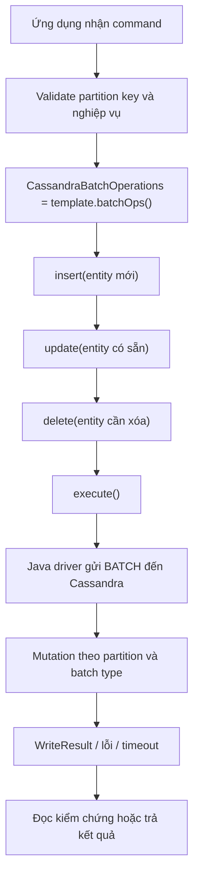
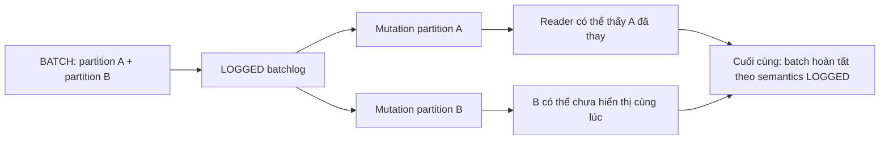

# Thêm insert, update, delete rồi thực hiện batch

Một yêu cầu nghiệp vụ đôi khi phải thay đổi **nhiều hàng trong cùng một partition**: thêm một dòng hàng mới, sửa số lượng của dòng đã có và xóa dòng không còn cần thiết. Nếu gửi riêng ba câu `INSERT`, `UPDATE` và `DELETE`, ứng dụng thực hiện ba lượt gọi driver và có thể có khoảng thời gian mà reader nhìn thấy dữ liệu chưa cập nhật đầy đủ.

**Cassandra batch** cho phép **tập hợp các mutation** (`INSERT`, `UPDATE`, `DELETE`) thành **một lệnh `BATCH`**, sau đó gửi tới Apache Cassandra để thực thi. Trong **Spring Data Cassandra**, ta thường dùng `CassandraTemplate.batchOps()` rồi lần lượt `insert(...)`, `update(...)`, `delete(...)` và kết thúc bằng **`execute()`**. Nếu cần kiểm soát chi tiết CQL, Java driver cung cấp `BatchStatement` và `BatchStatementBuilder`.

**Điều cần nắm trước khi viết code:** Cassandra batch **không phải** cơ chế tăng tốc hàng loạt dữ liệu bất kỳ và **không phải** giao dịch SQL đa partition với đầy đủ isolation/rollback. Batch đặc biệt hợp lý khi các mutation thuộc **một partition** hoặc khi một **số ít mutation khác partition** thực sự phải có tính chất atomic của *logged batch*. Dùng batch để gom hàng nghìn INSERT ngẫu nhiên trên nhiều partition thường khiến hệ thống **chậm hơn**.

Bài thuộc chương **Batch** của module **SPRING_DATA_CASSANDRA**. Nội dung nối với entity mapping, repository, `CassandraTemplate`, CQL, partition key, consistency, paging và vận hành hệ dữ liệu phân tán. Ví dụ Java lấy **Spring Data Cassandra 4.5.x**, **Apache Cassandra Java driver 4.19** và Java 17 làm mốc tham chiếu.

## 1. Mục tiêu học tập

Sau bài này, bạn có thể:

1. Phân biệt **thêm mutation vào batch** với **gửi batch đi thực thi**.
2. Viết `BEGIN BATCH ... INSERT ... UPDATE ... DELETE ... APPLY BATCH` bằng CQL.
3. Tạo và chạy batch qua `CassandraTemplate.batchOps()`/`CassandraBatchOperations`.
4. Sử dụng đúng `insert(...)`, `update(...)`, `delete(...)` và `execute()` với entity mapping.
5. Tạo `BatchStatement` bằng Java driver, thêm các `BoundStatement` đã bind tham số và gọi `session.execute(batch)`.
6. Chọn **LOGGED**, **UNLOGGED** hay **COUNTER** batch trong hoàn cảnh phù hợp.
7. Giải thích **atomicity**, **isolation theo partition**, batchlog và giới hạn khi trải nhiều partition.
8. Nhận ra ảnh hưởng của **write timestamp giống nhau**, TTL, tombstone, LWT, `@Version` và retry.
9. Đọc `WriteResult`, nhận diện lỗi và viết integration test chứng minh đúng dữ liệu sau batch.
10. Quyết định khi nào **không nên dùng batch**: nhiều partition độc lập, import lớn hoặc thao tác có thể gửi bất đồng bộ riêng.

## 2. Batch là một nhóm mutation, không phải một danh sách SELECT

Trong CQL, batch gồm các câu lệnh **ghi**:

```sql
BEGIN BATCH
    INSERT INTO ... ;
    UPDATE ... ;
    DELETE FROM ... ;
APPLY BATCH;
```

Bên trong `BEGIN BATCH` có thể chứa `INSERT`, `UPDATE` và `DELETE` hợp lệ. Nó **không** chứa `SELECT`, `CREATE TABLE`, `ALTER TABLE` hay một batch lồng bên trong.

| Thao tác | Có thể đưa vào batch? | Ghi chú |
|---|---|---|
| `INSERT` | **Có** | Cassandra INSERT thường là upsert, trừ khi dùng điều kiện phù hợp |
| `UPDATE` | **Có** | Phải cung cấp khóa đúng theo CQL, không cập nhật toàn bảng tùy ý |
| `DELETE` | **Có** | Ghi tombstone theo khóa/cột bị xóa |
| `SELECT` | **Không** | Đọc dữ liệu **trước/sau** batch bằng query riêng |
| `TRUNCATE`, `CREATE INDEX` | **Không** | Lệnh quản trị/schema không phải DML trong batch |
| `COUNTER UPDATE` | **Có nhưng là COUNTER batch riêng** | Không trộn counter với mutation thường |
| `INSERT IF NOT EXISTS`/`UPDATE IF ...` | **Có ràng buộc conditional batch riêng** | Không tự suy rộng từ batch thông thường; xem mục LWT |

### 2.1. Batch không tự thực thi khi thêm statement

Trong Spring Data:

```java
CassandraBatchOperations batch = template.batchOps();

batch.insert(newLine);
batch.update(existingLine);
batch.delete(removedLine);

// Chưa gọi execute(): các mutation mới chỉ được thêm vào batch.
WriteResult result = batch.execute(); // Tới đây mới gửi batch.
```

Các lời gọi `insert`, `update`, `delete` ở đây **xây dựng batch**; không có nghĩa ba statement đã được chạy ngay khi gọi từng method.

Điều này khác với:

```java
template.insert(newLine);
template.update(existingLine);
template.delete(removedLine);
```

Ba lệnh trên là **ba thao tác ghi độc lập**, mỗi lệnh có vòng đời thực thi/exception riêng. Không gom chúng vào một batch chỉ nhờ đặt cùng một method Java hoặc `@Transactional`.

### 2.2. Sơ đồ luồng xử lý



Không có bước `SELECT` **nằm trong BATCH** ở sơ đồ. Nếu phải kiểm tra business condition trước khi ghi, ứng dụng có thể đọc trước, nhưng **đọc trước rồi batch thường không tự là một transaction khóa dữ liệu**; cần LWT/CAS khi invariant đòi hỏi điều đó.

## 3. Thiết kế bài lab: tất cả mutation thuộc một partition

Ta dùng bảng `order_lines_by_order`, phục vụ truy vấn “liệt kê các dòng hàng của một đơn”. Partition key là **`order_id`**; mỗi dòng hàng có clustering key **`line_id`**.

### 3.1. Tạo keyspace và bảng

Chỉ chạy trong môi trường thực hành, **không dùng RF=1 cho production nhiều node/datacenter**:

```sql
CREATE KEYSPACE IF NOT EXISTS sdc_batch_lab
WITH replication = {
    'class': 'SimpleStrategy',
    'replication_factor': 1
};

CREATE TABLE IF NOT EXISTS sdc_batch_lab.order_lines_by_order (
    order_id uuid,
    line_id uuid,
    sku text,
    quantity int,
    line_status text,
    PRIMARY KEY ((order_id), line_id)
);
```

Đọc schema:

```sql
DESCRIBE TABLE sdc_batch_lab.order_lines_by_order;
```

Phân tích:

- `order_id` là **partition key**. Mọi dòng thuộc cùng đơn sẽ ở cùng **partition logic**.
- `line_id` là **clustering column**, phân biệt từng dòng trong partition.
- `sku`, `quantity`, `line_status` là các cột dữ liệu thông thường.
- Một mutation ghi/xóa dòng phải xác định **đúng cả `order_id` và `line_id`**.
- Các thao tác trong batch mẫu đều có **cùng `order_id`** nên không tạo fan-out trên nhiều partition.

### 3.2. Nạp hai dòng sẵn có

Dùng cùng `order_id` trong hai lệnh:

```sql
INSERT INTO sdc_batch_lab.order_lines_by_order
(order_id, line_id, sku, quantity, line_status)
VALUES (
    11111111-1111-1111-1111-111111111111,
    00000000-0000-0000-0000-000000000001,
    'SKU-A', 1, 'CREATED'
);

INSERT INTO sdc_batch_lab.order_lines_by_order
(order_id, line_id, sku, quantity, line_status)
VALUES (
    11111111-1111-1111-1111-111111111111,
    00000000-0000-0000-0000-000000000002,
    'SKU-B', 2, 'CREATED'
);
```

Xác minh:

```sql
SELECT order_id, line_id, sku, quantity, line_status
FROM sdc_batch_lab.order_lines_by_order
WHERE order_id = 11111111-1111-1111-1111-111111111111;
```

Kỳ vọng có **hai row** `SKU-A` và `SKU-B`, nếu chưa có thao tác trước trên cùng UUID. Trong lab nên dùng keyspace mới hoặc UUID đơn khác cho mỗi lần làm bài để tránh kết quả bị ảnh hưởng bởi những mutation cũ.

### 3.3. Yêu cầu nghiệp vụ của batch

Trong **một yêu cầu**:

1. **INSERT** thêm dòng `SKU-C` với `line_id ...0003`.
2. **UPDATE** số lượng `SKU-A` từ `1` lên `4`, trạng thái thành `RESERVED`.
3. **DELETE** dòng `SKU-B` có `line_id ...0002`.

Cả ba mutation cùng tác động tới partition có `order_id = 1111...`.

| Trước batch | Thao tác | Sau batch thành công |
|---|---|---|
| `SKU-A, quantity=1, CREATED` | `UPDATE` | `SKU-A, quantity=4, RESERVED` |
| `SKU-B, quantity=2, CREATED` | `DELETE` | Không còn row sống `SKU-B` |
| Chưa có `SKU-C` | `INSERT` | `SKU-C, quantity=1, CREATED` |

Trường hợp này **phù hợp để học** về atomicity/isolation theo partition vì không trải nhiều partition hay cần distributed transaction đa bảng.

## 4. Thực hiện CQL: BEGIN BATCH và APPLY BATCH

### 4.1. Một logged batch với đủ ba thao tác

```sql
BEGIN BATCH

    INSERT INTO sdc_batch_lab.order_lines_by_order
    (order_id, line_id, sku, quantity, line_status)
    VALUES (
        11111111-1111-1111-1111-111111111111,
        00000000-0000-0000-0000-000000000003,
        'SKU-C', 1, 'CREATED'
    );

    UPDATE sdc_batch_lab.order_lines_by_order
    SET quantity = 4,
        line_status = 'RESERVED'
    WHERE order_id = 11111111-1111-1111-1111-111111111111
      AND line_id = 00000000-0000-0000-0000-000000000001;

    DELETE FROM sdc_batch_lab.order_lines_by_order
    WHERE order_id = 11111111-1111-1111-1111-111111111111
      AND line_id = 00000000-0000-0000-0000-000000000002;

APPLY BATCH;
```

**`BEGIN BATCH` mặc định là LOGGED**, nhưng vì cả ba mutation dùng cùng một partition, Cassandra có thể tối ưu bỏ batchlog như một single-partition unlogged operation. Truy vấn vẫn giữ semantics atomicity/isolation phù hợp **trong partition đó**.

Các dấu `;` bên trong kết thúc từng mutation. **`APPLY BATCH;`** kết thúc và phát lệnh thực thi cả nhóm. Không đặt `SELECT` vào giữa.

### 4.2. Đọc kết quả sau batch

```sql
SELECT order_id, line_id, sku, quantity, line_status
FROM sdc_batch_lab.order_lines_by_order
WHERE order_id = 11111111-1111-1111-1111-111111111111;
```

Kỳ vọng trong lab:

| `line_id` | `sku` | `quantity` | `line_status` |
|---|---|---:|---|
| `...0001` | `SKU-A` | 4 | `RESERVED` |
| `...0003` | `SKU-C` | 1 | `CREATED` |

`SKU-B` không còn đọc được vì `DELETE` đã tạo tombstone cho row đó. **Tombstone không đồng nghĩa bytes biến mất ngay khỏi SSTable**; compaction mới thu hồi khi an toàn.

### 4.3. Nếu dùng UNLOGGED trong cùng partition

Cùng nhóm mutation có thể viết:

```sql
BEGIN UNLOGGED BATCH
    INSERT INTO sdc_batch_lab.order_lines_by_order
    (order_id, line_id, sku, quantity, line_status)
    VALUES (
        11111111-1111-1111-1111-111111111111,
        00000000-0000-0000-0000-000000000004,
        'SKU-D', 1, 'CREATED'
    );

    UPDATE sdc_batch_lab.order_lines_by_order
    SET quantity = 5
    WHERE order_id = 11111111-1111-1111-1111-111111111111
      AND line_id = 00000000-0000-0000-0000-000000000001;

APPLY BATCH;
```

Đây cũng là **single-partition batch** vì cả hai mutation trỏ về cùng `order_id`. Single-partition unlogged batch là trường hợp được tài liệu Cassandra khuyến khích khi cần nhóm mutation.

**Không suy ra “UNLOGGED luôn an toàn và nhanh hơn LOGGED”** với nhiều partition: unlogged multi-partition có thể **chỉ áp dụng được một phần** khi xảy ra lỗi.

### 4.4. CQL chạy tuần tự theo thứ tự viết?

Không. Cassandra batch không được thiết kế như:

```text
Bước 1 INSERT xong và được đọc thấy
Bước 2 UPDATE dựa trên giá trị vừa INSERT
Bước 3 DELETE dựa trên kết quả UPDATE
```

Các mutation trong batch thường dùng **cùng write timestamp** (trừ khi bạn đặt timestamp tường minh hợp lệ cho từng statement). Nếu hai câu cùng ghi **cùng một cell** với cùng timestamp, Cassandra dùng tie-break, **không dùng thứ tự câu lệnh** làm business ordering.

Ví dụ nên tránh:

```sql
BEGIN BATCH
    UPDATE sdc_batch_lab.order_lines_by_order
    SET line_status = 'PENDING'
    WHERE order_id = 11111111-1111-1111-1111-111111111111
      AND line_id = 00000000-0000-0000-0000-000000000001;

    UPDATE sdc_batch_lab.order_lines_by_order
    SET line_status = 'PAID'
    WHERE order_id = 11111111-1111-1111-1111-111111111111
      AND line_id = 00000000-0000-0000-0000-000000000001;
APPLY BATCH;
```

**Không bảo đảm** kết quả cuối là `PAID` chỉ vì dòng `PAID` nằm sau. Nếu chỉ cần một trạng thái cuối, hãy gửi **một mutation**. Nếu yêu cầu chuyển trạng thái có điều kiện, dùng LWT/CAS và không tự biến batch thành workflow engine.

## 5. Hiểu đúng logged, unlogged và counter batch

### 5.1. So sánh ba loại

| Batch type | Cơ chế | Phù hợp | Không nên dùng |
|---|---|---|---|
| **LOGGED** | Có batchlog để hỗ trợ atomicity khi nhiều partition | **Một số ít** mutation ở các bảng/partition khác nhau bắt buộc cùng được áp dụng cuối cùng | Gom hàng nghìn row khác partition chỉ để tăng throughput |
| **UNLOGGED** | Không dùng batchlog; giảm một phần overhead | Nhóm mutation trong **cùng một partition**, các thao tác có kiểm soát | Multi-partition cần bảo đảm atomicity |
| **COUNTER** | Batch riêng cho counter mutations | Các thao tác tăng/giảm cột CQL `counter` | Trộn counter với `INSERT/UPDATE` regular; giả định idempotent |

Trong **Spring Data Cassandra 4.5**, `template.batchOps()` tạo **LOGGED batch** theo mặc định; có thể chọn loại qua `template.batchOps(DefaultBatchType.UNLOGGED)`. Java driver tương ứng dùng `BatchStatement.builder(DefaultBatchType.LOGGED/UNLOGGED/COUNTER)`.

### 5.2. Atomicity nghĩa là gì?

Với một **logged batch** chứa mutation trên nhiều partition, batchlog giúp Cassandra bảo đảm tính chất **cuối cùng tất cả mutation được áp dụng hoặc không mutation nào được áp dụng** theo giao thức của nó, kể cả khi một node gặp lỗi trong quá trình ghi.

**Tuy nhiên**, atomicity không đồng nghĩa với:

- Một **rollback SQL** mà ứng dụng có thể tự gọi khi lỗi business sau commit.
- Mức **isolation** giống transaction RDBMS trên nhiều partition.
- Bảo đảm client luôn nhận một kết quả xác định khi timeout.
- Một transaction atomic cùng lúc với PostgreSQL, Kafka, HTTP API hoặc payment gateway.
- Tự khóa dữ liệu để ngăn stale update hay đảm bảo mọi điều kiện nghiệp vụ.

Một logged batch đã bắt đầu có thể **tiếp tục được replay/hoàn tất sau khi client timeout**. Vì vậy không được coi timeout là “batch chắc chắn chưa có thay đổi”.

### 5.3. Isolation chỉ rõ ràng khi cùng partition

Với **single-partition batch**, Cassandra xử lý các mutation trong partition như một nhóm có **atomicity và isolation** theo semantics batch.

Với **multi-partition logged batch**, người đọc ở nơi khác có thể nhìn thấy những partition đã cập nhật trước, trong khi các partition khác chưa được cập nhật xong. Batchlog bảo đảm hoàn tất cuối cùng, **không tạo snapshot đồng thời cho mọi partition**.



Do đó, nếu nghiệp vụ “không thể có một thời điểm người đọc thấy A mà chưa thấy B” trên **hai partition**, logged batch **chưa đủ**. Cần thiết kế dữ liệu/workflow hoặc một hệ thống transaction khác theo invariant.

### 5.4. Single-partition batch thường đã được tối ưu

Tài liệu Cassandra ghi rõ logged batch chỉ chạm một partition có thể được xử lý như unlogged batch, tránh batchlog không cần thiết. Vì thế **không nên mặc định chuyển mọi batch sang UNLOGGED** nếu chưa hiểu số partition thực sự chạm tới.

Phải xác định partition theo **table và partition key**, không chỉ theo việc các row có cùng một trường nghiệp vụ như `customer_id`. Hai bảng khác nhau với cùng giá trị `order_id` **không có nghĩa là cùng một partition của cùng bảng**.

## 6. Spring Data Cassandra: ánh xạ composite primary key

Để gọi `batch.insert(entity).update(entity).delete(entity)`, cần entity mapping đúng với bảng `order_lines_by_order`.

### 6.1. OrderLineKey.java

```java
import java.io.Serializable;
import java.util.Objects;
import java.util.UUID;

import org.springframework.data.cassandra.core.cql.PrimaryKeyType;
import org.springframework.data.cassandra.core.mapping.PrimaryKeyClass;
import org.springframework.data.cassandra.core.mapping.PrimaryKeyColumn;

@PrimaryKeyClass
public class OrderLineKey implements Serializable {

    @PrimaryKeyColumn(
        name = "order_id", ordinal = 0,
        type = PrimaryKeyType.PARTITIONED
    )
    private UUID orderId;

    @PrimaryKeyColumn(
        name = "line_id", ordinal = 1,
        type = PrimaryKeyType.CLUSTERED
    )
    private UUID lineId;

    public OrderLineKey() {
    }

    public OrderLineKey(UUID orderId, UUID lineId) {
        this.orderId = orderId;
        this.lineId = lineId;
    }

    public UUID getOrderId() {
        return orderId;
    }

    public void setOrderId(UUID orderId) {
        this.orderId = orderId;
    }

    public UUID getLineId() {
        return lineId;
    }

    public void setLineId(UUID lineId) {
        this.lineId = lineId;
    }

    @Override
    public boolean equals(Object value) {
        if (this == value) return true;
        if (!(value instanceof OrderLineKey other)) return false;

        return Objects.equals(orderId, other.orderId)
            && Objects.equals(lineId, other.lineId);
    }

    @Override
    public int hashCode() {
        return Objects.hash(orderId, lineId);
    }
}
```

`@PrimaryKeyClass` gom hai cột khóa. `order_id` là **partition key**, `line_id` là **clustering key**. Chúng không phải hai partition key độc lập.

### 6.2. OrderLine.java

```java
import org.springframework.data.cassandra.core.mapping.Column;
import org.springframework.data.cassandra.core.mapping.PrimaryKey;
import org.springframework.data.cassandra.core.mapping.Table;

@Table("order_lines_by_order")
public class OrderLine {

    @PrimaryKey
    private OrderLineKey key;

    @Column("sku")
    private String sku;

    @Column("quantity")
    private Integer quantity;

    @Column("line_status")
    private String lineStatus;

    public OrderLine() {
    }

    public OrderLine(
        OrderLineKey key, String sku,
        Integer quantity, String lineStatus
    ) {
        this.key = key;
        this.sku = sku;
        this.quantity = quantity;
        this.lineStatus = lineStatus;
    }

    public OrderLineKey getKey() {
        return key;
    }

    public void setKey(OrderLineKey key) {
        this.key = key;
    }

    public String getSku() {
        return sku;
    }

    public void setSku(String sku) {
        this.sku = sku;
    }

    public Integer getQuantity() {
        return quantity;
    }

    public void setQuantity(Integer quantity) {
        this.quantity = quantity;
    }

    public String getLineStatus() {
        return lineStatus;
    }

    public void setLineStatus(String lineStatus) {
        this.lineStatus = lineStatus;
    }
}
```

Giả định Spring Boot/`CqlSession` kết nối keyspace **`sdc_batch_lab`**. `@Table("order_lines_by_order")` chỉ chọn tên bảng; nó không tự thay schema trên production.

### 6.3. Chú ý entity update/delete

- `batch.insert(entity)` sinh mutation INSERT từ mapping; theo CQL thường là **upsert**, không phải “create-if-absent”.
- `batch.update(entity)` có thể ghi nhiều cột được mapper ánh xạ, **không chỉ một field Java vừa sửa**. Nếu chỉ muốn đổi `quantity`, có thể dùng prepared CQL có mục tiêu (mục 9).
- `batch.delete(entity)` xóa theo **primary key** trong entity; phải có `OrderLineKey` hợp lệ.
- Không truyền entity thiếu khóa hoặc **partial projection** vừa SELECT thiếu cột vào update nếu chưa kiểm chứng null handling.
- Không dùng entity có `@Version` và trông chờ batch tự giữ optimistic locking; Spring Data giới hạn optimistic locking cho **single-entity operations**.

## 7. CassandraTemplate.batchOps(): thêm INSERT, UPDATE, DELETE rồi execute

Đây là đường đi gần nhất với đề bài.

### 7.1. Service đầy đủ

```java
import java.util.UUID;

import org.springframework.data.cassandra.core.CassandraBatchOperations;
import org.springframework.data.cassandra.core.CassandraTemplate;
import org.springframework.data.cassandra.core.WriteResult;
import org.springframework.stereotype.Service;

@Service
public class OrderLineBatchService {

    private final CassandraTemplate template;

    public OrderLineBatchService(CassandraTemplate template) {
        this.template = template;
    }

    public WriteResult applyChanges(UUID orderId) {
        // UUID chỉ dùng làm line ID minh họa.
        UUID lineA = UUID.fromString(
            "00000000-0000-0000-0000-000000000001"
        );
        UUID lineB = UUID.fromString(
            "00000000-0000-0000-0000-000000000002"
        );
        UUID lineC = UUID.fromString(
            "00000000-0000-0000-0000-000000000003"
        );

        OrderLine newLine = new OrderLine(
            new OrderLineKey(orderId, lineC),
            "SKU-C", 1, "CREATED"
        );

        OrderLine changedLine = new OrderLine(
            new OrderLineKey(orderId, lineA),
            "SKU-A", 4, "RESERVED"
        );

        // Với DELETE, cần đầy đủ primary key.
        OrderLine removedLine = new OrderLine();
        removedLine.setKey(new OrderLineKey(orderId, lineB));

        CassandraBatchOperations batch = template.batchOps();

        batch.insert(newLine);
        batch.update(changedLine);
        batch.delete(removedLine);

        // Chỉ một lần gọi execute().
        return batch.execute();
    }
}
```

Giải thích:

1. `template.batchOps()` tạo **một builder/trạng thái batch mới**, mặc định **LOGGED**.
2. `insert(newLine)` **thêm** INSERT cho dòng C.
3. `update(changedLine)` **thêm** UPDATE/ghi từ mapping cho dòng A.
4. `delete(removedLine)` **thêm** DELETE cho dòng B theo key.
5. `execute()` **thực hiện** batch và trả `WriteResult`.
6. Tất cả khóa đều có cùng `orderId` nên các mutation chạm **một partition**.

**Không gọi `execute()` ba lần** và không tái sử dụng một `CassandraBatchOperations` sau khi đã execute. API 4.5 nêu rõ **mỗi batch instance chỉ được thực thi một lần**.

### 7.2. Viết theo phong cách chain

`CassandraBatchOperations` trả lại chính đối tượng batch khi thêm các thao tác. Vì vậy có thể viết ngắn:

```java
WriteResult result = template.batchOps()
    .insert(newLine)
    .update(changedLine)
    .delete(removedLine)
    .execute();
```

Cần lưu ý ngữ cảnh: ba biến `newLine`/`changedLine`/`removedLine` phải được khởi tạo và cùng partition theo mục 7.1.

**Phân biệt với Java driver:** `CassandraBatchOperations` là đối tượng **tích lũy có trạng thái** và không dùng được sau `execute`; `BatchStatement` của Java driver 4.x lại là **immutable**, setter trả object mới. Đừng nhầm hai API.

### 7.3. Dùng cho một danh sách entity

Có thể thêm nhiều entity bằng varargs hoặc `Iterable`:

```java
CassandraBatchOperations batch = template.batchOps();

batch.insert(line1, line2);
batch.update(line3, line4);
batch.delete(line5);

WriteResult result = batch.execute();
```

**Không tạo batch khổng lồ** chỉ vì API nhận `Iterable<?>`. Kiểm soát số mutation, số partition, kích thước serialized batch và SLA; nếu hàng nghìn entity thuộc nhiều partition, xem phương án thực thi độc lập/bất đồng bộ.

### 7.4. Không dùng một batch instance chung cho mọi request

Cách không nên làm:

```java
// KHÔNG NÊN: builder batch là state của một lần thực thi.
@Service
public class UnsafeService {
    private final CassandraBatchOperations sharedBatch;

    public UnsafeService(CassandraTemplate template) {
        this.sharedBatch = template.batchOps();
    }
}
```

Nếu dùng shared instance, nhiều request có thể cùng thêm statement vào một batch hoặc gọi `execute` trên object đã được thực thi. Hãy tạo **batch mới trong từng method call**, còn `CassandraTemplate`/`CqlSession` là bean dùng chung theo vòng đời ứng dụng.

## 8. Chọn batch type trong Spring Data Cassandra

### 8.1. Mặc định LOGGED

```java
CassandraBatchOperations batch = template.batchOps();
```

Theo JavaDoc Spring Data Cassandra 4.5, `batchOps()` tạo **LOGGED** batch. Dùng mặc định khi cần semantics logged và đã đánh giá loại mutation.

### 8.2. Chọn UNLOGGED cho cùng partition

```java
import com.datastax.oss.driver.api.core.cql.DefaultBatchType;

import org.springframework.data.cassandra.core.CassandraBatchOperations;
import org.springframework.data.cassandra.core.WriteResult;

CassandraBatchOperations batch =
    template.batchOps(DefaultBatchType.UNLOGGED);

batch.insert(newLine);
batch.update(changedLine);
batch.delete(removedLine);

WriteResult result = batch.execute();
```

Đoạn code chỉ nên dùng khi **đã xác minh cả ba statement cùng một partition**. `UNLOGGED` không phải chế độ an toàn để “tăng tốc tất cả INSERT trên hệ thống”.

### 8.3. Có thể thêm driver statement vào batch của Spring

Từ Spring Data Cassandra 4.4, interface có `addStatement(...)`/`addStatements(...)` nhận `BatchableStatement<?>` của driver.

```java
import com.datastax.oss.driver.api.core.cql.BoundStatement;
import com.datastax.oss.driver.api.core.cql.PreparedStatement;

PreparedStatement p = session.prepare("""
    UPDATE sdc_batch_lab.order_lines_by_order
    SET quantity = ?
    WHERE order_id = ? AND line_id = ?
    """);

BoundStatement quantityUpdate = p.bind(4, orderId, lineA);

WriteResult result = template.batchOps(DefaultBatchType.UNLOGGED)
    .addStatement(quantityUpdate)
    .execute();
```

`session` ở đây là `CqlSession` được Spring cấu hình, `orderId` và `lineA` là UUID đã xác định. Ví dụ nhằm giới thiệu **khả năng trộn statement API**; chỉ dùng khi thật sự cần CQL tự kiểm soát. Nếu chuyển qua `CassandraTemplate` nhưng sử dụng `CqlSession` từ cluster/keyspace khác, batch có thể không còn đúng mục tiêu; cấu hình session phải nhất quán.

### 8.4. QueryOptions và timestamp của batch

`CassandraBatchOperations` còn có:

```java
batch.withQueryOptions(options);
batch.withTimestamp(writeTimestampMicros);
```

Trong đó:

- `withQueryOptions(QueryOptions)` cấu hình statement options (ví dụ consistency) ở cấp batch theo API hỗ trợ.
- `withTimestamp(long)` đặt **write timestamp microsecond từ epoch** cho batch; **không phải TTL**.
- Những mutation có timestamp trùng nhau trên **cùng cell** có thể xung đột tie-break.
- Đừng đặt timestamp tương lai lớn tùy tiện, vì có thể che khuất những write sau này.

Nếu muốn TTL riêng cho một INSERT:

```java
import org.springframework.data.cassandra.core.InsertOptions;

batch.insert(
    newLine,
    InsertOptions.builder().ttl(600).build()
);
```

`ttl(600)` là **600 giây** cho các giá trị được ghi bởi mutation INSERT phù hợp; khác hoàn toàn với `withTimestamp(long)` của batch. Đừng biến `withTimestamp(600)` thành cách đặt TTL mười phút.

## 9. Java driver 4.19: BatchStatement và PreparedStatement

Khi muốn kiểm soát CQL chính xác — ví dụ update **chỉ một cột** thay vì update cả entity — Java driver là lựa chọn tốt.

### 9.1. Chuẩn bị riêng ba câu CQL

```java
import java.util.UUID;

import com.datastax.oss.driver.api.core.CqlSession;
import com.datastax.oss.driver.api.core.cql.BatchStatement;
import com.datastax.oss.driver.api.core.cql.BoundStatement;
import com.datastax.oss.driver.api.core.cql.DefaultBatchType;
import com.datastax.oss.driver.api.core.cql.PreparedStatement;
import com.datastax.oss.driver.api.core.cql.ResultSet;

public class OrderLineDriverBatch {

    private final CqlSession session;
    private final PreparedStatement insertLine;
    private final PreparedStatement updateQuantity;
    private final PreparedStatement deleteLine;

    public OrderLineDriverBatch(CqlSession session) {
        this.session = session;

        this.insertLine = session.prepare("""
            INSERT INTO sdc_batch_lab.order_lines_by_order
            (order_id, line_id, sku, quantity, line_status)
            VALUES (?, ?, ?, ?, ?)
            """);

        this.updateQuantity = session.prepare("""
            UPDATE sdc_batch_lab.order_lines_by_order
            SET quantity = ?, line_status = ?
            WHERE order_id = ? AND line_id = ?
            """);

        this.deleteLine = session.prepare("""
            DELETE FROM sdc_batch_lab.order_lines_by_order
            WHERE order_id = ? AND line_id = ?
            """);
    }

    public ResultSet executeThreeChanges(
        UUID orderId, UUID lineA, UUID lineB, UUID lineC
    ) {
        BoundStatement insert = insertLine.bind(
            orderId, lineC, "SKU-C", 1, "CREATED"
        );

        BoundStatement update = updateQuantity.bind(
            4, "RESERVED", orderId, lineA
        );

        BoundStatement delete = deleteLine.bind(
            orderId, lineB
        );

        BatchStatement batch =
            BatchStatement.builder(DefaultBatchType.UNLOGGED)
                .addStatement(insert)
                .addStatement(update)
                .addStatement(delete)
                .build();

        return session.execute(batch);
    }
}
```

Cần hiểu:

- Mỗi `PreparedStatement` có **CQL cố định** với bind markers.
- `BoundStatement` chứa **giá trị của một request**.
- `BatchStatement.builder(...)` thêm lần lượt ba mutation rồi `build()`.
- `session.execute(batch)` thực thi **một batch statement**, không phải ba lần `session.execute(...)`.
- Với `DefaultBatchType.UNLOGGED`, đoạn code hợp lý khi **cả ba mutation cùng partition**.
- Các `PreparedStatement` có thể dùng lại nhiều request; **không chia sẻ mutable builder** giữa request.
- Không tạo `CqlSession` mới cho mỗi batch; dùng session bean/connection pool đã cấu hình.

### 9.2. BatchStatement.newInstance(...) có thể tạo nhanh

```java
BatchStatement batch = BatchStatement.newInstance(
    DefaultBatchType.LOGGED,
    insert,
    update,
    delete
);

session.execute(batch);
```

Ví dụ này tiếp tục sử dụng ba biến `BoundStatement` có sẵn từ mục 9.1. `newInstance` chỉ là cách khác để dựng batch; còn `builder` tiện khi muốn thêm statement theo điều kiện hoặc lấy từ một collection đã validate.

### 9.3. BatchStatement là immutable

Đừng bỏ qua giá trị trả về của setter:

```java
BatchStatement batch = BatchStatement.newInstance(
    DefaultBatchType.UNLOGGED, insert, update, delete
);

// Sai: trả về một BatchStatement mới nhưng bị bỏ qua.
batch.setIdempotent(true);

// Đúng: nhận object mới.
batch = batch.setIdempotent(true);
```

**Quan trọng:** chỉ đánh dấu idempotent khi **mutation nghiệp vụ thật sự idempotent**, không phải vì muốn driver retry nhanh hơn. Ví dụ counter increment hoặc thao tác có side effect ngoài Cassandra có thể không idempotent.

### 9.4. Giới hạn kích thước không phải mục tiêu tối ưu

Java driver có giới hạn kỹ thuật số statement trong một `BatchStatement` (API tài liệu nêu tối đa **65.536**). **Không coi đó là khuyến nghị số mutation cho một batch**: Cassandra có thể cảnh báo hoặc từ chối batch lớn ở ngưỡng byte thấp hơn rất nhiều.

Đừng làm:

```java
// KHÔNG NÊN: gom toàn bộ hàng trăm nghìn record nhiều partition.
BatchStatementBuilder huge =
    BatchStatement.builder(DefaultBatchType.LOGGED);

for (OrderLine line : millionsOfLines) {
    huge.addStatement(prepareInsert.bind(/* values */));
}
```

Đoạn trên là ví dụ tư duy **không hoàn chỉnh**: nếu chạy thật còn phải có `prepareInsert`/`millionsOfLines`. Điểm chính là giới hạn **65.536 statement** không biến việc gom hàng nghìn partition thành một giải pháp phù hợp.

## 10. Chọn cách thực thi: batch hay nhiều asynchronous writes?

### 10.1. Nếu các mutation độc lập và khác partition

Giả sử import 10.000 order, mỗi order có `order_id` khác nhau, và **không có điều kiện nghiệp vụ bắt buộc tất cả cùng thành công**. Dồn thành một logged batch lớn sẽ:

- Tạo áp lực batchlog/coordinator.
- Gửi mutation qua nhiều token range/replica.
- Tăng chi phí serialization/network.
- Gặp batch size warnings/failures.
- Làm lỗi/retry khó theo dõi ở mức từng record.

Một lựa chọn tốt hơn là **các prepared statements riêng**, gửi với mức concurrency giới hạn, quản lý retry/idempotency ở mức từng record hoặc từng nhóm nhỏ. Có thể dùng `CqlSession.executeAsync(...)` hoặc luồng ingest phù hợp, **không cần BATCH**.

### 10.2. Nếu cùng một partition

Với ba thay đổi dòng hàng của một order, batch có ý nghĩa rõ ràng:

- Ít round-trip hơn so với gọi riêng từng statement.
- Mutation trong một partition có **atomicity/isolation** theo semantics của Cassandra.
- Có thể dùng unlogged batch phù hợp/được tối ưu.
- Có thể kiểm thử trạng thái cuối bằng query theo một partition key.

**Không phải mọi update cùng partition đều cần batch**. Một `UPDATE` ghi nhiều cột của **một row** vốn đã là mutation đơn thích hợp. Nếu có thể biểu diễn yêu cầu bằng một CQL statement, không cần ép thành batch.

### 10.3. Nếu nhiều partition cần cùng tồn tại cuối cùng

Ví dụ duy trì:

```text
orders_by_id
orders_by_customer_month
```

Hai bảng có partition khác nhau, kể cả khi cùng chứa order ID. Một **logged batch nhỏ** có thể bảo đảm các mutation cuối cùng được áp dụng theo semantics atomic của Cassandra. Nhưng trong quá trình hoàn tất:

- Reader ở bảng thứ nhất có thể thấy dữ liệu mới trước reader ở bảng thứ hai.
- Không có isolation đa partition như transaction RDBMS.
- Không có rollback ứng dụng tùy ý.
- Nếu batch timeout, phải **đối soát**; server có thể đã nhận và tiếp tục hoàn thành.

Nếu invariant yêu cầu **đọc đồng thời nhất quán tuyệt đối trên hai bảng**, cần thiết kế lại workflow hoặc chọn transactional store phù hợp — không chỉ bật LOGGED.

### 10.4. Ma trận quyết định

| Bài toán | Cách bắt đầu |
|---|---|
| Thêm/sửa/xóa nhiều row **cùng partition** | `UNLOGGED` batch nhỏ hoặc `batchOps()`; test yêu cầu |
| Ghi nhiều cột cùng **một row** | Một `INSERT/UPDATE` bình thường |
| Nhập 100.000 row **khác partition**, độc lập | Prepared async writes có giới hạn concurrency |
| Ghi hai read model, yêu cầu atomic eventual completion | LOGGED batch **nhỏ** nếu chấp nhận thiếu isolation |
| Cập nhật trạng thái chỉ khi version khớp | LWT/CAS hoặc `@Version` trên single entity |
| Tăng counters | COUNTER batch riêng nếu có lý do nhóm counter |
| Đọc và quyết định rồi ghi theo điều kiện | Không dùng batch thường thay cho transaction; dùng CAS/workflow |
| Cần transaction qua Cassandra + payment + Kafka | Idempotency, outbox/saga hoặc hệ transactional phù hợp |

## 11. Timestamp: các statement trong batch không phải một chuỗi lệnh có thứ tự

### 11.1. Cùng timestamp cho các mutation

CQL `BATCH` mặc định dùng **cùng write timestamp cho các mutation** nếu không chỉ định riêng theo cú pháp hỗ trợ. `CassandraBatchOperations` cũng có `withTimestamp(long)` để chọn timestamp cho cả batch.

Nếu `INSERT`, `UPDATE`, `DELETE` chạm **ba dòng khác nhau** như bài lab thì không có tranh chấp cùng một cell. Nhưng nếu chạm **cùng cột của cùng primary key**, timestamp bằng nhau khiến kết quả phụ thuộc vào quy tắc hòa giải của Cassandra:

- Write timestamp lớn hơn thắng.
- Tombstone có thể thắng khi timestamp bằng với giá trị sống.
- Hai giá trị sống cùng timestamp có tie-break deterministic theo bytes, **không theo vị trí statement trong batch**.

### 11.2. Tránh INSERT rồi DELETE cùng primary key trong một batch

```sql
-- Cố ý minh họa anti-pattern:
BEGIN BATCH
    INSERT INTO sdc_batch_lab.order_lines_by_order
    (order_id, line_id, sku, quantity, line_status)
    VALUES (
        11111111-1111-1111-1111-111111111111,
        00000000-0000-0000-0000-000000000009,
        'SKU-Z', 1, 'CREATED'
    );

    DELETE FROM sdc_batch_lab.order_lines_by_order
    WHERE order_id = 11111111-1111-1111-1111-111111111111
      AND line_id = 00000000-0000-0000-0000-000000000009;
APPLY BATCH;
```

Không suy ra “cứ chạy INSERT rồi DELETE nên chắc chắn DB lưu một lịch sử tuần tự”; nếu hai mutation cùng timestamp, tombstone và quy tắc hòa giải mới quyết định trạng thái. Khi nghiệp vụ muốn “xóa dòng này” thì chỉ gửi **một DELETE**; muốn “thay dòng” thì chọn CQL mutation rõ ràng.

### 11.3. Custom timestamp, đơn vị microsecond

```sql
BEGIN BATCH USING TIMESTAMP 1700000000000500

    UPDATE sdc_batch_lab.order_lines_by_order
    SET line_status = 'RESERVED'
    WHERE order_id = 11111111-1111-1111-1111-111111111111
      AND line_id = 00000000-0000-0000-0000-000000000001;

    UPDATE sdc_batch_lab.order_lines_by_order
    SET quantity = 5
    WHERE order_id = 11111111-1111-1111-1111-111111111111
      AND line_id = 00000000-0000-0000-0000-000000000001;

APPLY BATCH;
```

`TIMESTAMP` là **write timestamp microsecond**, không phải TTL. Ví dụ không cố ghi cùng một cột hai lần. Nếu bạn dùng timestamp **quá cũ**, mutation có thể được chấp nhận nhưng thua dữ liệu đã có timestamp mới hơn. Không áp dụng một mốc cố định cho production.

### 11.4. TTL cũng có thể đặt theo từng mutation

```sql
BEGIN BATCH
    INSERT INTO sdc_batch_lab.order_lines_by_order
    (order_id, line_id, sku, quantity, line_status)
    VALUES (
        11111111-1111-1111-1111-111111111111,
        00000000-0000-0000-0000-000000000010,
        'SKU-TEMP', 1, 'CREATED'
    ) USING TTL 3600;

    UPDATE sdc_batch_lab.order_lines_by_order
    USING TTL 120
    SET line_status = 'RESERVED'
    WHERE order_id = 11111111-1111-1111-1111-111111111111
      AND line_id = 00000000-0000-0000-0000-000000000001;

APPLY BATCH;
```

Hãy hiểu TTL theo **các giá trị được ghi bởi mutation**, không phải “toàn bộ bảng hết hạn sau 120 giây”. Nếu đọc `TTL(line_status)` và `TTL(quantity)` của dòng A, hai cột có thể có TTL khác nhau. TTL hết hạn tạo tombstone và không tự xóa disk ngay.

## 12. LWT, conditional batches và @Version

### 12.1. Batch thường không kiểm tra “người khác vừa sửa chưa”

Một `UPDATE` trong batch như:

```sql
UPDATE sdc_batch_lab.order_lines_by_order
SET quantity = 4
WHERE order_id = ... AND line_id = ...;
```

vẫn theo semantics **last-write-wins** nếu không có `IF`. Batch không tự bổ sung optimistic locking. Hai client cùng gửi batch sửa số lượng vẫn có thể ghi đè nhau theo timestamp.

### 12.2. @Version không được Spring Data hỗ trợ trong batch

Theo tài liệu **Spring Data Cassandra**, **optimistic locking với `@Version` chỉ hỗ trợ thao tác trên một entity riêng lẻ, không hỗ trợ batch operations**.

Không viết:

```java
// KHÔNG NÊN suy luận thao tác này tự bảo đảm
// @Version optimistic locking cho từng entity.
template.batchOps()
    .update(versionedEntityA)
    .update(versionedEntityB)
    .execute();
```

rồi kỳ vọng framework thực hiện `IF version = ...` và tự tăng version cho từng entity như `repository.save(entity)`.

Nếu yêu cầu nghiệp vụ phải từ chối stale write:

1. Dùng đường **single-entity CAS** hỗ trợ `@Version` hoặc
2. Thiết kế **conditional CQL batch** nếu tất cả điều kiện của Cassandra được đáp ứng, và test rõ kết quả `[applied]`.
3. Với nhiều partition/bảng, đừng suy rằng conditional batch tạo được transaction tùy ý.

### 12.3. Conditional batch có ràng buộc riêng

Cassandra hỗ trợ một số **conditional batch** dùng LWT/Paxos, nhưng chúng có ràng buộc **cùng partition và cùng bảng** theo semantics/server version. Không trộn tự do nhiều bảng, nhiều partition hay counter mutations và hy vọng có CAS toàn hệ thống.

Ví dụ một conditional mutation đơn giản:

```sql
UPDATE sdc_batch_lab.order_lines_by_order
SET line_status = 'PAID'
WHERE order_id = 11111111-1111-1111-1111-111111111111
  AND line_id = 00000000-0000-0000-0000-000000000001
IF line_status = 'RESERVED';
```

Nếu `IF` đúng thì `[applied] = true`, sai thì `[applied] = false`. LWT phải được xử lý như CAS, có **chi phí coordination riêng**. Trong bài tập batch thường, nên thực hành **không có IF** trước để không trộn hai cơ chế khó phân biệt.

### 12.4. Không dùng custom timestamp với conditional batch

Cassandra không cho phép **`USING TIMESTAMP` do client tự đặt** khi dùng LWT/conditional mutation. Cần để cơ chế giao thức đặt timestamp phù hợp; không ghép `BEGIN BATCH USING TIMESTAMP ...` với một `IF` rồi trông chờ hoạt động như mutation thường.

## 13. Kết quả execute(): WriteResult và wasApplied()

### 13.1. Spring Data trả WriteResult

`CassandraBatchOperations.execute()` trả **`WriteResult`**:

```java
import org.springframework.data.cassandra.core.WriteResult;

WriteResult result = template.batchOps()
    .insert(newLine)
    .update(changedLine)
    .delete(removedLine)
    .execute();

boolean applied = result.wasApplied();
```

**Cảnh báo:** với batch **không điều kiện**, `wasApplied()` thường là **true** theo semantics của driver cho statements không dùng `IF`. Nó **không** chứng minh:

- Dòng `UPDATE` đã tồn tại trước đó.
- Dòng `DELETE` có tồn tại và thực sự bị xóa lúc đó.
- Dòng `INSERT` là row mới chứ không phải upsert.
- Write timestamp của một mutation đã thắng mọi giá trị cạnh tranh.
- Kết quả đã trở thành một snapshot nhất quán của các bảng khác nhau.

Trong logged batch thông thường, ý nghĩa thực tế của việc `execute()` hoàn thành là lệnh được xử lý với các bảo đảm **Cassandra batch**, **không** phải một bảng phản hồi riêng cho từng câu bên trong.

### 13.2. Metadata và lỗi

`WriteResult` có thể chứa:

```java
result.getExecutionInfo();
result.getRows();
```

Đây là metadata/kết quả CQL của batch, **không** phải danh sách `OrderLine` đã được lưu. Nếu muốn xác nhận trạng thái nghiệp vụ, thực hiện `SELECT` riêng theo primary key và consistency phù hợp.

### 13.3. Nếu Java driver trực tiếp

```java
ResultSet resultSet = session.execute(batch);

boolean applied = resultSet.wasApplied();
```

Với batch không có `IF`, `wasApplied()` không phân biệt được “INSERT mới” hay “UPDATE không thay đổi dữ liệu” theo nghĩa nghiệp vụ. Nếu cần precondition, dùng LWT phù hợp hoặc đối soát trên dữ liệu thực.

### 13.4. Không có rollback cho batch đã commit

Nếu ứng dụng đã thực hiện batch rồi phát hiện business rule sai, Cassandra không có API `rollback(batch)` chung để khôi phục đồng thời trạng thái trước đó. Muốn bù trừ phải **tạo mutation mới** theo một workflow có kiểm soát; không đảm bảo sẽ chống được mọi write cạnh tranh chỉ bằng một lệnh sửa.

## 14. Retry, timeout, idempotency và consistency

### 14.1. Timeout không đồng nghĩa batch thất bại

Một request có thể:

1. Gửi batch tới coordinator.
2. Một phần hoặc toàn bộ mutation đã được xử lý/ghi nhận.
3. Mất phản hồi trên đường về hoặc hết deadline ở client.
4. Ứng dụng nhận timeout.

Với logged batch, Cassandra có thể tiếp tục hoàn tất thông qua batchlog. Vì vậy **không tái gửi vô hạn** hay tự trả “chắc chắn chưa áp dụng” khi timeout.

### 14.2. Idempotency từng mutation

| Mutation | Idempotent khi nào? | Rủi ro retry |
|---|---|---|
| Ghi một giá trị cố định vào cùng khóa với timestamp/điều kiện ổn định | Thường có thể thiết kế idempotent | Timestamp mới có thể đổi thứ tự LWW; TTL có thể được gia hạn |
| `DELETE` cùng khóa theo chính sách phù hợp | Thường có thể retry có kiểm soát | Timestamp/tombstone, race với INSERT mới |
| `INSERT` cùng primary key với cùng dữ liệu | Cassandra upsert có thể retry | Không bảo đảm “create exactly once” nếu có side effect khác |
| `counter = counter + 1` | **Không idempotent** | Retry có thể tăng hai lần |
| Ghi kèm email/payment/webhook ngoài Cassandra | **Không tự idempotent** | Side effect bị lặp nếu không có operation ID |

Với các write quan trọng, nên dùng **operation ID**, idempotency key và đối soát trạng thái theo khóa. Tính idempotent là thuộc tính nghiệp vụ của toàn thao tác, không chỉ một flag Java driver.

### 14.3. Consistency level

Có thể cấu hình consistency cho batch ở driver:

```java
import com.datastax.oss.driver.api.core.DefaultConsistencyLevel;

BatchStatement statement = BatchStatement.newInstance(
    DefaultBatchType.UNLOGGED, insert, update, delete
).setConsistencyLevel(DefaultConsistencyLevel.LOCAL_QUORUM);

session.execute(statement);
```

Đây chỉ là ví dụ khi cluster có replication strategy/phạm vi datacenter thích hợp. Trên lab `SimpleStrategy` RF=1, không suy rộng `LOCAL_QUORUM` thành đề xuất triển khai production.

**Consistency level không tự thêm LWT hay cô lập mọi partition**. Nó xác định điều kiện phản hồi replica cho operation, còn batch type/partitioning quyết định các bảo đảm khác.

### 14.4. Bắt lỗi trong service

```java
import org.springframework.dao.DataAccessException;

public void runBatchSafely(
    OrderLine newLine,
    OrderLine changedLine,
    OrderLine removedLine
) {
    try {
        template.batchOps()
            .insert(newLine)
            .update(changedLine)
            .delete(removedLine)
            .execute();

    } catch (DataAccessException exception) {
        // Không mặc định rằng batch chưa áp dụng gì.
        // Phân loại: timeout, unavailable, invalid CQL, mapper...
        // Dựa trên operation ID/key để đối soát và quyết định retry.
        throw exception;
    }
}
```

Đây là fragment method đặt trong một service có `template` đã inject. Không gom mọi exception thành `409 Conflict`; timeout không phải xung đột phiên bản.

## 15. Batch size, số partition và quan sát hiệu năng

### 15.1. Guardrails thường gặp

Cassandra có các cấu hình theo phiên bản như:

| Cấu hình | Giá trị mặc định được tài liệu Cassandra nêu | Ý nghĩa |
|---|---|---|
| `batch_size_warn_threshold` | Khoảng **5 KiB** | Cảnh báo batch **nhiều partition** có payload lớn |
| `batch_size_fail_threshold` | Khoảng **50 KiB** | Có thể từ chối batch **nhiều partition** vượt ngưỡng |
| `unlogged_batch_across_partitions_warn_threshold` | **10 partition** | Cảnh báo unlogged batch trải quá nhiều partition |

Đây là **mốc cấu hình tham khảo**, không phải “mọi Cassandra đều chỉ cho batch 50 KiB” hay “10 partition là an toàn”. Hệ thống thực có thể thay đổi default/guardrail theo server version/distribution. Kiểm tra `cassandra.yaml` và metrics thực tế.

Một batch với 10 mutation nhưng mỗi mutation chứa payload lớn có thể nặng hơn batch 100 mutation chỉ cập nhật vài byte. Đo **bytes và số partition**, không chỉ số lượng entity Java.

### 15.2. Batch lớn gây áp lực ở đâu?

- **Coordinator** phải nhận, parse/serialize và phân phối mutation.
- **Batchlog** thêm công việc cho logged multi-partition batch.
- **Mạng** chuyển mutation tới nhiều replica/token range.
- **Memtable/SSTable** vẫn phải xử lý từng mutation và compaction/tombstone.
- **Heap/direct memory** và thread pool chịu tải khi hàng nghìn statement bị gom một lần.
- **Retries** có thể lặp lại một công việc rất lớn sau timeout.
- **p95/p99 latency** trở nên khó dự đoán nếu một batch chậm khóa tiến độ của cả request.

Đừng chữa một câu batch quá rộng bằng cách chỉ tăng threshold warning/failure. Mục tiêu guardrail là cảnh báo thiết kế nguy hiểm; tăng cấu hình có thể làm node mất ổn định.

### 15.3. Metrics nên theo dõi

- Request latency p50/p95/p99 của endpoint dùng batch.
- Driver `in-flight`, timeout, retry và connection pool.
- Logged batchlog pending/replay và số batch failure.
- Kích thước serialized batch, số mutation và **distinct partitions**.
- Coordinator/node CPU, network và disk I/O.
- Tombstone/read latency ở bảng có nhiều DELETE.
- Tỷ lệ conflict nếu dùng LWT ngoài batch.
- Độ trễ read-model propagation sau logged batch đa bảng.

Tạo trace có chọn lọc ở môi trường test; không bật toàn cluster hoặc in toàn bộ giá trị nhạy cảm vào log.

## 16. Các lỗi thường gặp

| Dấu hiệu | Nguyên nhân | Cách sửa |
|---|---|---|
| Có INSERT/UPDATE/DELETE nhưng không thấy thay đổi | Quên gọi `execute()` | Gọi `batch.execute()` đúng một lần |
| `IllegalStateException` sau khi gọi execute lần nữa | Một batch instance chỉ được chạy một lần | Tạo `template.batchOps()` mới cho mỗi operation |
| Các request lẫn mutation với nhau | Chia sẻ mutable `CassandraBatchOperations` | Tạo batch trong từng service call |
| LOGGED batch import hàng nghìn row rất chậm | Nhiều partition, batchlog/fan-out | Dùng prepared async writes có concurrency giới hạn |
| Chuyển sang UNLOGGED rồi chỉ thấy một phần kết quả | Multi-partition unlogged không bảo đảm atomicity | Dùng cùng partition hoặc logged batch nhỏ đúng mục tiêu |
| Có `[applied] = true` nhưng UPDATE “không đổi” | Nonconditional `wasApplied()` không chứng minh cell thắng | Kiểm tra write timestamp/SELECT và concurrency |
| Dòng vừa INSERT rồi DELETE vẫn khó dự đoán | Timestamp tie trên cùng cell/row | Không gửi mutation xung đột trong cùng batch |
| Dùng `@Version` nhưng batch vẫn ghi đè | Optimistic locking không hỗ trợ batch | Single-entity CAS hoặc conditional CQL có kiểm soát |
| `DELETE` không xóa đúng dòng | Sai `order_id`/`line_id` hoặc mapper thiếu key | Kiểm tra composite primary key và CQL |
| `UPDATE` vô tình thay giá trị khác | Entity update ghi nhiều field | Prepared UPDATE chỉ SET các cột cần thiết |
| Counter bị trộn vào regular batch | COUNTER batch có luật riêng | Tách batch counter, không trộn regular |
| `SELECT` trong batch gây lỗi cú pháp | Batch chỉ nhận DML ghi | SELECT trước hoặc sau ngoài batch |
| Query batch bị lỗi khi thiếu partition key | CQL UPDATE/DELETE phải đúng key | Thiết kế schema và bind đủ khóa |
| LWT với nhiều bảng/partition bị từ chối | Conditional batch có ràng buộc hẹp | Dùng single-row CAS và workflow |
| Cài `withTimestamp(600)` để đặt TTL 10 phút | Nhầm microsecond timestamp và TTL giây | Dùng `InsertOptions.ttl(600)` hoặc CQL `USING TTL 600` |
| Sau batch không có dữ liệu mong đợi | Ghi đè do LWW, TTL, tombstone hoặc concurrent update | Đọc theo key, kiểm tra `WRITETIME`/`TTL` |
| Timeout nhưng retry làm dữ liệu sai | Không có idempotency/đối soát | Operation ID, retry policy và reconciliation |
| Batch fail do quá lớn | Vượt warn/fail thresholds hoặc giới hạn driver | Chia nhỏ theo partition, chuyển async, đo payload |
| Cùng UUID ở hai bảng nhưng mất isolation | Hai **table-partitions** khác nhau | Không coi logged multi-table batch là isolated transaction |

### 16.1. Quy trình điều tra có thứ tự

1. **Kiểm tra có gọi `execute()` chưa.** Thêm statement chưa thực thi là nguyên nhân cơ bản.
2. **Đọc schema thật**, xác nhận table, keyspace và partition/clustering columns.
3. **Đếm distinct partitions**, không chỉ số câu lệnh.
4. **Xem batch type**: logged, unlogged hay counter?
5. **Đối chiếu entity mapping** cho INSERT/UPDATE/DELETE, đặc biệt primary key.
6. **Kiểm tra lỗi từ driver/Spring** và phân loại syntax, timeout, unavailable hoặc invalid request.
7. **Đọc dữ liệu sau batch** bằng SELECT cùng partition key và consistency hợp lý.
8. **Kiểm tra timestamp/TTL/tombstone** nếu write hoàn tất nhưng giá trị không như mong muốn.
9. **Đo batch size, p95/p99 và coordinator** trước khi điều chỉnh cấu hình.
10. **Bổ sung integration test** tái hiện lỗi và kiểm tra batch được tạo mới mỗi lần gọi.

## 17. Integration test: INSERT, UPDATE, DELETE được áp dụng đúng

Một integration test chạy với Cassandra thật có thể chứng minh phần quan trọng của bài: **đúng ba mutation được gửi trong một batch**, và trạng thái cuối đúng.

### 17.1. Repository để kiểm tra dữ liệu

```java
import org.springframework.data.cassandra.repository.CassandraRepository;

public interface OrderLineRepository
        extends CassandraRepository<OrderLine, OrderLineKey> {
}
```

`OrderLineRepository` ở đây chỉ dùng `save`/`findById` để seed và xác minh. Không cần dùng repository `saveAll` để tạo batch: **`saveAll` không đồng nghĩa Cassandra `BATCH`** chỉ vì nhận nhiều entity.

### 17.2. Test JUnit 5 minh họa

```java
import static org.assertj.core.api.Assertions.assertThat;

import java.util.UUID;

import org.junit.jupiter.api.Test;
import org.springframework.beans.factory.annotation.Autowired;
import org.springframework.boot.test.context.SpringBootTest;

@SpringBootTest
class OrderLineBatchIT {

    @Autowired
    private OrderLineRepository repository;

    @Autowired
    private OrderLineBatchService batchService;

    @Test
    void shouldInsertUpdateAndDeleteWithinOnePartition() {
        UUID orderId = UUID.randomUUID();

        UUID a = UUID.fromString(
            "00000000-0000-0000-0000-000000000001"
        );
        UUID b = UUID.fromString(
            "00000000-0000-0000-0000-000000000002"
        );
        UUID c = UUID.fromString(
            "00000000-0000-0000-0000-000000000003"
        );

        OrderLineKey keyA = new OrderLineKey(orderId, a);
        OrderLineKey keyB = new OrderLineKey(orderId, b);
        OrderLineKey keyC = new OrderLineKey(orderId, c);

        repository.save(new OrderLine(keyA, "SKU-A", 1, "CREATED"));
        repository.save(new OrderLine(keyB, "SKU-B", 2, "CREATED"));

        assertThat(repository.findById(keyA)).isPresent();
        assertThat(repository.findById(keyB)).isPresent();
        assertThat(repository.findById(keyC)).isEmpty();

        batchService.applyChanges(orderId);

        OrderLine changed = repository.findById(keyA).orElseThrow();
        OrderLine created = repository.findById(keyC).orElseThrow();

        assertThat(changed.getQuantity()).isEqualTo(4);
        assertThat(changed.getLineStatus()).isEqualTo("RESERVED");

        assertThat(created.getSku()).isEqualTo("SKU-C");
        assertThat(created.getQuantity()).isEqualTo(1);

        assertThat(repository.findById(keyB)).isEmpty();
    }
}
```

**Điều kiện chạy:** Cassandra test cluster đã bật, `sdc_batch_lab`/bảng được tạo trước, Spring Boot đúng keyspace, test không ghi chung partition với workload khác. `@SpringBootTest` đơn lẻ không khởi động một Cassandra server; trong CI có thể dùng Testcontainers hoặc cluster riêng.

### 17.3. Test những trường hợp lỗi

Nên thêm các ca:

- **Không gọi execute:** xác minh chỉ tạo builder không làm thay đổi DB.
- **Gọi execute hai lần:** xác minh nhận `IllegalStateException`.
- **Sai partition key:** kiểm tra batch update/delete được phát hiện bằng validation/test.
- **Hai mutation xung đột cùng cell:** minh họa timestamp tie, không kỳ vọng statement thứ hai thắng.
- **Lỗi timeout:** dùng fault injection/test môi trường riêng để thực hành đối soát, không giả định chắc chắn không áp dụng.
- **Multi-partition unlogged:** chứng minh không thể dùng làm transaction nghiệp vụ; không nên cố gây failure lên production.

Test trạng thái cuối không chứng minh tất cả bảo đảm distributed under failure; cần test tài nguyên/network tương ứng và tin vào contract của Cassandra Server.

## 18. Bài tập thực hành

### Bài 1 — Viết batch CQL ba thao tác

Từ bảng `order_lines_by_order`, viết `BEGIN BATCH ... APPLY BATCH` để:

1. INSERT một dòng mới `SKU-X`.
2. UPDATE `quantity` của `SKU-A`.
3. DELETE `SKU-B`.

Cả ba có cùng `order_id`. Sau batch, SELECT lại theo `order_id` và giải thích vì sao đây là **single-partition batch**.

### Bài 2 — Tìm lỗi quên execute

```java
CassandraBatchOperations batch = template.batchOps();

batch.insert(newLine);
batch.update(changedLine);
batch.delete(removedLine);

// Method return, không có execute().
```

**Hỏi:** Có mutation nào đã được gửi đi chưa?

**Đáp án:** Chưa có do `CassandraBatchOperations` chỉ tích lũy statement; cần `batch.execute()`.

### Bài 3 — Chọn LOGGED hay UNLOGGED

Một service thêm ba dòng thuộc cùng `order_id`. Một service khác cập nhật 500 order có `order_id` khác nhau, mỗi mutation độc lập.

**Yêu cầu:** Chọn batch type/cách thực thi phù hợp cho từng trường hợp.

**Đáp án định hướng:** Với cùng partition, batch nhỏ (có thể UNLOGGED) phù hợp. Với 500 partition độc lập, chuẩn bị mutation rồi gửi async có concurrency giới hạn thường phù hợp hơn logged batch lớn.

### Bài 4 — Viết CassandraBatchOperations

Viết service:

```java
WriteResult result = template.batchOps()
    .insert(newLine)
    .update(changedLine)
    .delete(removedLine)
    .execute();
```

Giải thích `result.wasApplied()` của **nonconditional** batch. Vì sao nó **không** chứng minh UPDATE đã đổi một giá trị mới hơn?

### Bài 5 — Java driver BatchStatement

Chuẩn bị ba câu CQL có marker, bind `orderId`/`lineId`, dùng:

```java
BatchStatement.builder(DefaultBatchType.UNLOGGED)
    .addStatement(insert)
    .addStatement(update)
    .addStatement(delete)
    .build();
```

Sau đó gọi `session.execute(batch)`. Tại sao chỉ nên dùng `UNLOGGED` khi các partition đã được xác minh?

### Bài 6 — Phân biệt atomicity và isolation

Một **LOGGED batch** cập nhật hai bảng `orders_by_id` và `orders_by_customer_month`. Một reader đọc bảng thứ nhất ngay khi mutation tới, rồi đọc bảng thứ hai.

**Hỏi:** Có thể thấy dữ liệu mới ở bảng thứ nhất và dữ liệu cũ ở bảng thứ hai không?

**Đáp án:** Có. LOGGED batch đa partition có atomicity cuối cùng nhưng **không isolation đa partition** như SQL transaction.

### Bài 7 — Thứ tự trong batch

Một batch ghi `line_status='CREATED'` rồi `line_status='PAID'` trên cùng cell, cả hai cùng timestamp.

**Hỏi:** Có bảo đảm `PAID` thắng do statement thứ hai không? Nếu không, sửa thế nào?

**Đáp án:** Không. Gửi một mutation cuối cùng hoặc dùng CAS phù hợp cho yêu cầu chuyển trạng thái.

### Bài 8 — @Version trong batch

Hai entity mang `@Version`, bạn gọi `template.batchOps().update(a).update(b).execute()`.

**Hỏi:** Có đảm bảo optimistic locking riêng từng entity không?

**Đáp án:** Không. Spring Data Cassandra chỉ hỗ trợ optimistic locking ở single-entity operations; không dùng batch như một transaction CAS đa entity.

### Bài 9 — TTL trong batch

Chỉ dòng `SKU-TEMP` cần hết hạn sau 10 phút, các dòng khác giữ vĩnh viễn. Hãy viết:

```java
batch.insert(
    temporaryLine,
    InsertOptions.builder().ttl(600).build()
);
```

**Câu hỏi:** `withTimestamp(600)` có thay `ttl(600)` được không?

**Đáp án:** Không. `withTimestamp` là write timestamp **microsecond**, còn TTL là số giây tồn tại của các giá trị ghi.

### Bài 10 — Batch lớn

Log cảnh báo `batch_size_warn_threshold` khi import 50.000 order từ CSV. Hãy mô tả nguyên nhân và đề xuất chia theo partition/async writes, kiểm soát concurrency, idempotency, retry và metrics.

### Bài 11 — Retry và timeout

Client gửi logged batch nhỏ tới Cassandra, timeout trước khi nhận response. Sau đó người dùng bấm “Lưu” lần nữa.

**Hỏi:** Có chắc batch đầu chưa chạy? Cần biện pháp gì?

**Đáp án:** Không chắc. Cần operation ID/idempotency và đối soát, không tự retry vô hạn.

### Bài 12 — Kiểm thử theo key

Viết integration test tương tự mục 17: seed hai dòng, thực thi batch ba thay đổi, xác minh dòng mới/tồn tại và dòng bị xóa. Vì sao mock `CassandraTemplate` không chứng minh semantics batch thực?

**Đáp án:** Mock không chạy CQL, batchlog, isolation hoặc reconciliation của Cassandra Server; cần integration test trên cluster test.

## 19. Câu hỏi tự kiểm tra

1. **Cassandra BATCH chứa những loại statement nào?** `INSERT`, `UPDATE`, `DELETE` (với ràng buộc CQL tương ứng).
2. **Có thể có SELECT trong BATCH không?** Không.
3. **Phương thức Spring Data nào tạo batch?** `CassandraTemplate.batchOps()` hoặc `CassandraOperations.batchOps(...)`.
4. **Những method nào thêm mutation entity?** `insert`, `update`, `delete`.
5. **Method nào gửi batch đi thực thi?** `execute()`.
6. **`batchOps()` mặc định loại gì?** LOGGED.
7. **Có thể thực thi lại cùng CassandraBatchOperations sau execute không?** Không.
8. **Làm sao chọn UNLOGGED trong Spring Data?** `template.batchOps(DefaultBatchType.UNLOGGED)`.
9. **Java driver tạo batch bằng API nào?** `BatchStatement.builder(...)` hoặc `newInstance(...)`.
10. **BatchStatement 4.x có mutable không?** Built-in immutable; các setter trả object mới, builder mutable.
11. **Vì sao single-partition batch thường phù hợp?** Các mutation cùng partition, có atomicity/isolation theo semantics và có thể tối ưu tránh batchlog.
12. **LOGGED batch đa partition có isolation không?** Không theo nghĩa transaction SQL đa partition.
13. **UNLOGGED multi-partition có bảo đảm tất cả hoặc không có gì không?** Không; lỗi có thể khiến một phần được áp dụng.
14. **Batch có thay thế transaction qua Cassandra và hệ thống payment không?** Không.
15. **Statement thứ hai trong batch có chắc thắng statement thứ nhất trên cùng cell không?** Không; có write timestamp/tie-break.
16. **Batch có tự thêm optimistic locking cho entity @Version không?** Không.
17. **`wasApplied()` của batch không điều kiện có thể chứng minh một row được tạo mới không?** Không.
18. **BATCH có phải cách tốt nhất để import hàng chục nghìn partition độc lập?** Thường không; async writes có giới hạn concurrency phù hợp hơn.
19. **`withTimestamp(long)` có phải TTL không?** Không, là write timestamp microsecond.
20. **DELETE trong batch có xóa bytes khỏi SSTable ngay không?** Không; tạo tombstone và phụ thuộc compaction.
21. **Counter có trộn với regular mutations được không?** Không; COUNTER batch riêng.
22. **Một batch có thể bị timeout nhưng server vẫn hoàn tất không?** Có.
23. **Giới hạn hiệu năng nào quan trọng hơn số method Java?** Số distinct partition, payload bytes, replication/coordinator và SLA.
24. **Dùng cùng orderId ở hai bảng khác nhau có chắc là một partition duy nhất không?** Không; partition gắn với table và key.
25. **Bài test quan trọng nhất là gì?** Chứng minh INSERT, UPDATE, DELETE cho đúng primary key được thực hiện và reader thấy kết quả theo contract.

## 20. Tổng kết

- **Cassandra batch** nhóm các thao tác **INSERT, UPDATE, DELETE** thành một lệnh gửi qua CQL/driver; nó **không chứa SELECT**.
- Với Spring Data Cassandra, dùng **`template.batchOps()` → `insert(...)` → `update(...)` → `delete(...)` → `execute()`**. Chỉ **`execute()`** thực sự gửi batch, và **mỗi instance chỉ dùng một lần**.
- Java driver cung cấp **`BatchStatement.builder(DefaultBatchType.LOGGED/UNLOGGED)`**, `addStatement(BoundStatement)` và `session.execute(batch)`.
- Batch **một partition** là tình huống dễ hiểu và phù hợp nhất để học atomicity/isolation. **LOGGED multi-partition** giúp hoàn tất atomic cuối cùng nhưng **không isolation đa partition**; **UNLOGGED multi-partition** có thể áp dụng một phần khi lỗi.
- Batch không phải công cụ bulk import mọi partition, không tạo rollback SQL, không tự xử lý read-before-write race hay optimistic locking.
- **Thứ tự statement trong batch không phải business execution order** khi cùng cell/timestamp; tránh mutation xung đột và kiểm soát TTL/tombstone.
- `WriteResult.wasApplied()` của **nonconditional batch** không xác nhận từng row “được tạo/sửa thành công theo nghiệp vụ”. Hãy đọc lại theo primary key khi cần đối soát, và phân biệt conflict với timeout.
- Với batch lớn, đo **số partition, bytes, batchlog, p95/p99 và tải coordinator**. Khi các mutation độc lập khác partition, cân nhắc **prepared asynchronous writes có concurrency giới hạn**.
- Kiểm chứng bằng **integration test Cassandra thật**, vì unit test mock không chứng minh cơ chế atomicity hay batch execution của server.

## Tài liệu tham khảo

1. [Spring Data Cassandra 4.5 — CassandraBatchOperations API](https://docs.spring.io/spring-data/cassandra/docs/4.5.x/api/org/springframework/data/cassandra/core/CassandraBatchOperations.html): `insert`, `update`, `delete`, `addStatement`, `execute`, `withTimestamp`, atomicity/isolation và lifecycle.
2. [Spring Data Cassandra 4.5 — CassandraOperations API](https://docs.spring.io/spring-data/cassandra/docs/4.5.x/api/org/springframework/data/cassandra/core/CassandraOperations.html): `batchOps()` mặc định LOGGED và `batchOps(BatchType)`.
3. [Spring Data Cassandra — Persisting Entities: Batch Operations](https://docs.spring.io/spring-data/cassandra/reference/4.5/cassandra/template.html): template batch support và so sánh với CRUD operations.
4. [Spring Data Cassandra — Optimistic Locking](https://docs.spring.io/spring-data/cassandra/reference/4.5/cassandra/template.html): giới hạn `@Version` với single-entity operations, không hỗ trợ batch.
5. [Apache Cassandra Java Driver 4.19 — Batch Statements](https://apache.github.io/cassandra-java-driver/4.19.0/core/statements/batch/): `BatchStatement`, `DefaultBatchType`, builder và giới hạn statement.
6. [Apache Cassandra Java Driver 4.19 — Statements Overview](https://apache.github.io/cassandra-java-driver/4.19.0/core/statements/): immutable statement, query timestamp, idempotence, consistency.
7. [Apache Cassandra — CQL DML: BATCH](https://cassandra.apache.org/doc/stable/cassandra/developing/cql/dml.html): logged/unlogged/counter, atomicity/isolation và timestamp tie.
8. [Apache Cassandra — Configuration](https://cassandra.apache.org/doc/stable/cassandra/managing/configuration/cass_yaml_file.html): `batch_size_warn_threshold`, `batch_size_fail_threshold` và `unlogged_batch_across_partitions_warn_threshold`.
9. [Apache Cassandra — Data Modeling](https://cassandra.apache.org/doc/stable/cassandra/developing/data-modeling/): thiết kế bảng theo truy vấn/partition key và tránh fan-out.
10. [Spring Data Cassandra 4.5 — WriteResult API](https://docs.spring.io/spring-data/cassandra/docs/4.5.x/api/org/springframework/data/cassandra/core/WriteResult.html): `wasApplied`, execution info và kết quả ghi.
11. [Apache Cassandra Java Driver 4.19 — Prepared Statements](https://apache.github.io/cassandra-java-driver/4.19.0/core/statements/prepared/): bind tham số CQL an toàn và tái sử dụng statement.
