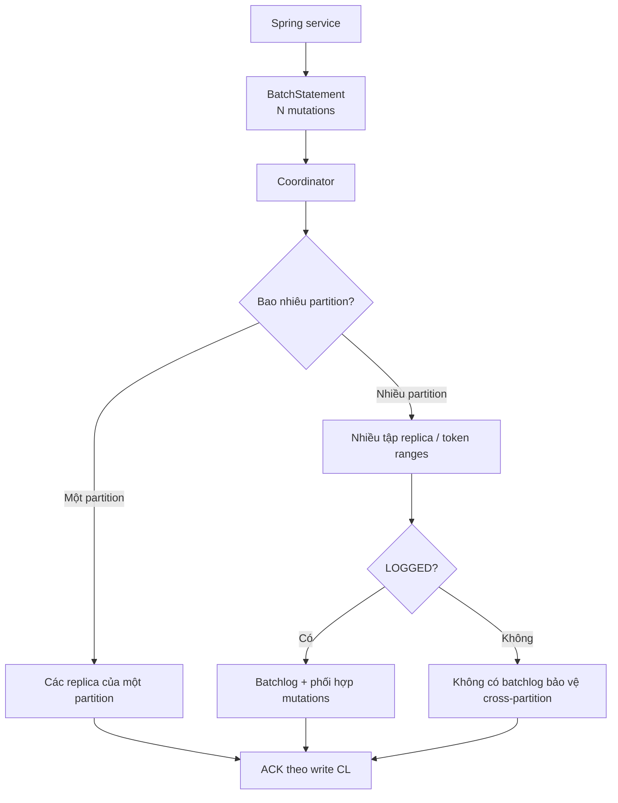
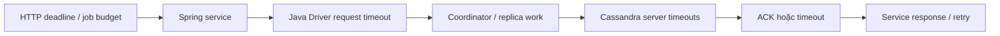
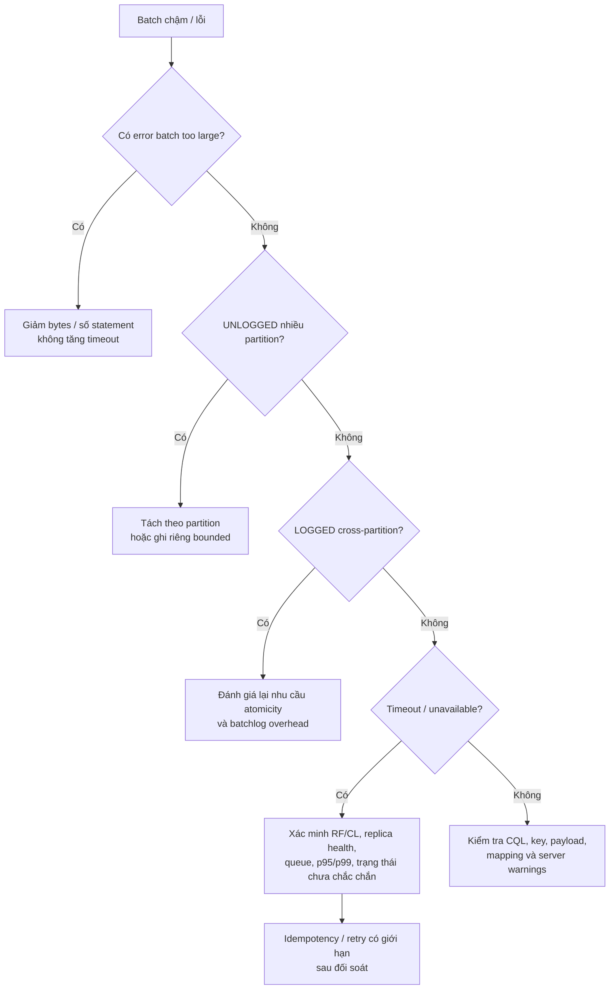

# Giới hạn kích thước, số statement và thời gian chờ

## 1. Vì sao batch lớn trong Cassandra có thể chậm hơn ghi riêng lẻ?

Trong Spring Data Cassandra, ứng dụng có thể cần ghi nhiều mutation liên quan: tạo một nhóm sự kiện cho cùng khách hàng, cập nhật vài cột của một partition, hoặc lưu những thay đổi cần được phối hợp. Apache Cassandra cung cấp câu lệnh CQL `BATCH` và Java Driver có `BatchStatement`, nhưng từ “batch” rất dễ gây hiểu nhầm.

Một lập trình viên quen với JDBC có thể suy luận: “Thay vì gửi 1.000 lần `INSERT`, ta gói hết vào một batch để tiết kiệm network và chạy nhanh hơn”. Với Cassandra, cách đó **thường sai nếu 1.000 hàng nằm ở nhiều partition**. Coordinator cần định tuyến mutations đến các replica tương ứng; nếu dùng **logged batch**, nó còn phải phối hợp batchlog. Một request rất lớn gây áp lực bộ nhớ, network, latency và timeout; một batch qua nhiều partition cũng không có isolation giống transaction SQL.

Bài học này tập trung vào ba nhóm giới hạn:

1. **Kích thước batch**: tổng khối lượng mutations (byte) mà Cassandra phải nhận, phân tích và áp dụng.
2. **Số statement và số partition**: số phép ghi và phạm vi phân tán mà coordinator phải xử lý.
3. **Thời gian chờ (timeout)**: ngân sách thời gian tại API, Java Driver và coordinator/replica; timeout không nhất thiết đồng nghĩa với rollback.

Mục tiêu không phải tìm một “con số ma thuật” áp dụng cho mọi cluster, mà thiết kế **chính sách giới hạn có thể đo lường**, phù hợp kiểu batch, RF/CL, kích thước hàng và tải thực tế.

Trong module `SPRING_DATA_CASSANDRA`, ta sẽ dùng CQL, `CqlSession`, `BatchStatement`, entity mapping và repository trong bối cảnh thiết kế bảng **theo truy vấn**, partition key, consistency level, paging và hiệu năng phân tán.

### Kết quả học tập

Sau bài, bạn có thể:

- Giải thích khác biệt `LOGGED`, `UNLOGGED` và `COUNTER` batch.
- Phân biệt giới hạn byte, statement count và distinct partition count; biết vì sao chỉ đếm `INSERT` là chưa đủ.
- Đọc, hiểu và đánh giá những cảnh báo/cấu hình batch-size của Cassandra mà không nhầm với kích thước request HTTP.
- Đặt các guardrail ở service trước khi xây `BatchStatement` bằng Java Driver.
- Chọn timeout, consistency và chính sách retry theo ngữ nghĩa lỗi **không chắc chắn**.
- Viết integration/load tests đo số statement, payload, partition và p95/p99 latency.
- Biết khi nào **không dùng batch** mà dùng các ghi bất đồng bộ có concurrency giới hạn.

> **Phạm vi phiên bản:** Ví dụ sử dụng Spring Boot 3.x, Spring Data Cassandra hiện đại và Java Driver 4.x. Những thuộc tính `cassandra.yaml`, mặc định ngưỡng cảnh báo hoặc API builder có thể khác theo phiên bản Cassandra/Driver; luôn xác nhận trên cluster thực tế. Số `8 statement`, `4 KiB` hay `2 giây` trong các ví dụ là **giới hạn ứng dụng minh họa**, không phải hạn mức chuẩn của Cassandra.

## 2. BATCH là một nhóm mutations, không phải bulk-loader tổng quát

### 2.1. CQL cơ bản

Ví dụ hai insert cho cùng partition:

```sql
BEGIN UNLOGGED BATCH

  INSERT INTO learning.events_by_tenant_day (
    tenant_id, event_day, event_at, event_id, event_type, payload
  ) VALUES (
    11111111-1111-1111-1111-111111111111,
    '2026-11-25',
    '2026-11-25T09:00:00Z',
    22222222-2222-2222-2222-222222222222,
    'VIEW', 'Xem sản phẩm'
  );

  INSERT INTO learning.events_by_tenant_day (
    tenant_id, event_day, event_at, event_id, event_type, payload
  ) VALUES (
    11111111-1111-1111-1111-111111111111,
    '2026-11-25',
    '2026-11-25T09:01:00Z',
    33333333-3333-3333-3333-333333333333,
    'CART', 'Thêm vào giỏ'
  );

APPLY BATCH;
```

Đây là **một CQL batch request** chứa **hai mutation statements**. Chúng cùng partition key `(tenant_id, event_day)` nhưng có clustering keys khác nhau.

Không thể tùy tiện đưa `SELECT`, câu lệnh DDL hoặc mọi loại CQL khác vào `BATCH`: cơ chế này dành cho các mutation statements được CQL hỗ trợ.

### 2.2. Coordinator vẫn phải làm việc



**Độ lớn của CQL batch không phải phép cộng số round-trip tiết kiệm được.** Một coordinator có thể phải làm nhiều công việc hơn khi batch được gói quá lớn hoặc trải trên nhiều partition.

### 2.3. Bốn đại lượng phải theo dõi độc lập

| Đại lượng | Ví dụ | Vì sao quan trọng? |
| --- | --- | --- |
| **Statement count** | 8 câu `INSERT` | Nhiều mutation làm tăng công việc parse/coordination và số đối tượng cần xử lý. |
| **Serialized mutation bytes** | 3 KiB hoặc 300 KiB | Có thể kích hoạt cảnh báo/từ chối batch lớn; không tỷ lệ tuyến tính với số dòng CQL. |
| **Distinct partition count** | 1 hay 8 partition | Quyết định phạm vi replica/coordinator; batch cross-partition tốn kém hơn. |
| **Execution time** | p95 20 ms hoặc 2 s | Phụ thuộc replica, CL, batchlog, contention, payload và tải cluster. |

Đừng kiểm soát chỉ một đại lượng. Batch **2 statements** nhưng mỗi hàng chứa payload 2 MiB có thể tệ hơn batch **10 statements** với payload 100 byte; batch **8 statements ở tám partition** lại khác batch tám statements chung một partition.

## 3. Thiết kế schema phục vụ một partition rõ ràng

### 3.1. Keyspace lab

```sql
-- RF=1 chỉ dùng trong lab một node tại DC dc1.
CREATE KEYSPACE IF NOT EXISTS learning
WITH replication = {
    'class': 'NetworkTopologyStrategy',
    'dc1': 1
};
```

**RF=1 không kiểm thử được quorum 2/3 hoặc hành vi mất replica.** Khi triển khai nhiều node, RF và DC phải lấy từ topology/keyspace thật.

### 3.2. Bảng lưu sự kiện theo tenant/ngày

```sql
CREATE TABLE IF NOT EXISTS learning.events_by_tenant_day (
    tenant_id uuid,
    event_day date,
    event_at timestamp,
    event_id uuid,
    event_type text,
    payload text,
    PRIMARY KEY ((tenant_id, event_day), event_at, event_id)
) WITH CLUSTERING ORDER BY (
    event_at DESC,
    event_id ASC
);
```

| Thành phần | Vai trò |
| --- | --- |
| `(tenant_id, event_day)` | Composite partition key: các sự kiện của tenant trong cùng ngày nằm trong một partition. |
| `event_at` | Clustering column đầu tiên: đọc theo thời gian trong partition. |
| `event_id` | Clustering column thứ hai: phân biệt các sự kiện cùng timestamp. |
| `event_type`, `payload` | Cột thường; độ dài payload góp phần trực tiếp vào kích thước mutation. |

Batch hai hàng trong cùng ngày/tenant là **single-partition batch**. Nếu thay `event_day` hoặc `tenant_id`, ta có **multi-partition batch**, dù tất cả lệnh cùng một bảng.

### 3.3. Câu đọc phù hợp query pattern

```sql
SELECT event_at, event_id, event_type, payload
FROM learning.events_by_tenant_day
WHERE tenant_id = 11111111-1111-1111-1111-111111111111
  AND event_day = '2026-11-25'
  AND event_at >= '2026-11-25T00:00:00Z'
  AND event_at < '2026-11-26T00:00:00Z'
LIMIT 50;
```

Đây là ví dụ truy vấn **một partition**, có range trên clustering key. Batch không cần thiết cho truy vấn `SELECT`; quyền năng của batch nằm ở **ghi mutations**.

**Quy ước ngày:** Nếu `event_day` được tính theo `Asia/Ho_Chi_Minh`, phải chuyển hai đầu khoảng từ ngày nghiệp vụ sang UTC tương ứng. Đừng dùng ranh giới `00:00Z` chỉ vì ví dụ seed dùng thời gian UTC.

## 4. LOGGED, UNLOGGED và COUNTER: chọn đúng trước khi đo kích thước

### 4.1. LOGGED batch

```sql
BEGIN BATCH
  INSERT INTO learning.events_by_tenant_day (...) VALUES (...);
  INSERT INTO learning.events_by_tenant_day (...) VALUES (...);
APPLY BATCH;
```

Đoạn trên dùng dấu `...` để biểu diễn **cấu trúc minh họa**, không phải CQL hoàn chỉnh chạy trực tiếp.

`BEGIN BATCH` mặc định thường là **logged batch**. Cassandra ghi thông tin batch vào **batchlog** để hỗ trợ bảo đảm các mutations của batch đã được chấp nhận sẽ **cuối cùng được áp dụng** nếu có sự cố ở đường phối hợp. Nó có ý nghĩa khi cần atomicity của một nhóm mutations, nhưng:

- **Không có isolation kiểu transaction SQL giữa nhiều partition.** Reader có thể quan sát một phần thay đổi ở thời điểm trung gian.
- **Không có rollback tự động** cho những mutation đã áp dụng khi client báo timeout.
- **Batchlog không biến batch cross-partition thành bulk insert nhanh hơn**; nó bổ sung coordination và I/O.
- **Không cung cấp exactly-once ở tầng nghiệp vụ.** Retry sau timeout phải xét ID, write timestamp, TTL và các tác động ghi đi kèm.
- Không thay cho LWT khi cần điều kiện `IF version = ?` để chống lost update.

### 4.2. UNLOGGED batch

```sql
BEGIN UNLOGGED BATCH
  UPDATE learning.events_by_tenant_day
  SET event_type = 'VIEW'
  WHERE tenant_id = 11111111-1111-1111-1111-111111111111
    AND event_day = '2026-11-25'
    AND event_at = '2026-11-25T09:00:00Z'
    AND event_id = 22222222-2222-2222-2222-222222222222;

  UPDATE learning.events_by_tenant_day
  SET event_type = 'CART'
  WHERE tenant_id = 11111111-1111-1111-1111-111111111111
    AND event_day = '2026-11-25'
    AND event_at = '2026-11-25T09:01:00Z'
    AND event_id = 33333333-3333-3333-3333-333333333333;
APPLY BATCH;
```

`UNLOGGED` không dùng batchlog bảo vệ atomicity across partitions. Với **các mutations trong cùng partition**, đây thường là lựa chọn hợp lý nếu ứng dụng thật sự cần phối hợp một nhóm ghi nhỏ.

**Không gói nhiều partition vào UNLOGGED chỉ vì nhanh hơn LOGGED.** Nếu một replica/partition thất bại, ứng dụng có thể gặp trạng thái chỉ một phần nhóm được áp dụng; ngay cả khi mọi operation có cùng payload nhỏ, coordinator vẫn phải định tuyến tới nhiều replica sets.

### 4.3. COUNTER batch

Counter có semantics khác cột `bigint` thông thường:

```sql
CREATE TABLE IF NOT EXISTS learning.event_counts_by_tenant (
    tenant_id uuid,
    event_day date,
    event_type text,
    total counter,
    PRIMARY KEY ((tenant_id, event_day), event_type)
);

BEGIN COUNTER BATCH
  UPDATE learning.event_counts_by_tenant
  SET total = total + 1
  WHERE tenant_id = 11111111-1111-1111-1111-111111111111
    AND event_day = '2026-11-25'
    AND event_type = 'VIEW';
APPLY BATCH;
```

Không trộn counter mutations với non-counter mutations trong cùng batch. Counter increment **không idempotent**: nếu timeout rồi retry không kiểm soát, giá trị có thể bị tăng nhiều lần.

Nếu mục tiêu là cập nhật count của mỗi event trong luồng ingestion cần exactly-once, một counter batch tự nó **không** giải quyết việc deduplication.

### 4.4. Bảng so sánh nhanh

| Loại | Khi phù hợp | Khi nên tránh |
| --- | --- | --- |
| **LOGGED** | Nhóm mutations nhỏ thật sự cần bảo đảm eventual batch atomicity theo phạm vi Cassandra hỗ trợ. | Gói hàng trăm/thousands bản ghi nhiều partition chỉ để “tăng throughput”. |
| **UNLOGGED** | Nhóm mutations nhỏ **cùng partition** và cần một request có ngữ nghĩa phù hợp. | Nhiều partition khi ứng dụng cần bảo đảm all-or-nothing. |
| **COUNTER** | Một số counter mutations phù hợp; không trộn cột thường. | Ghi có retry thiếu idempotency hoặc muốn transaction với bảng thường. |
| **Không dùng batch** | Các ghi độc lập trên nhiều partition. | Khi thực sự cần điều kiện atomicity phối hợp đã được chứng minh. |

## 5. Giới hạn kích thước batch: đếm byte, không đếm dòng code

### 5.1. Cassandra có ngưỡng cảnh báo và ngưỡng từ chối

Trong nhiều phiên bản Cassandra, file `cassandra.yaml` có những cấu hình như:

- `batch_size_warn_threshold_in_kb` — ngưỡng phát cảnh báo batch lớn.
- `batch_size_fail_threshold_in_kb` — ngưỡng batch lớn đến mức request có thể bị từ chối.
- `unlogged_batch_across_partitions_warn_threshold` — ngưỡng cảnh báo khi một **unlogged batch trải quá nhiều partition**, không phải số statement toàn cầu.

Một số phiên bản/cấu hình phổ biến có các mốc tham khảo gần **5 KiB cảnh báo** và **50 KiB từ chối** cho batch size, nhưng **không dùng các con số ấy làm quy định bất biến**. Ngưỡng có thể thay đổi theo phiên bản, cấu hình cluster hoặc sản phẩm Cassandra tương thích.

Với một bài hướng dẫn không được phép đọc `cassandra.yaml` dự án, cách đúng là **nêu tên thuộc tính, ý nghĩa và cách xác minh**, không tuyên bố đã đọc được cấu hình production.

### 5.2. Kích thước đo ở server khác độ dài câu CQL

Ví dụ hai truy vấn có cùng số statement:

```text
Batch A: 2 INSERT, mỗi payload khoảng 100 byte
Batch B: 2 INSERT, mỗi payload khoảng 200 KiB

Statement count bằng nhau, nhưng batch size khác rất xa.
```

Cassandra quan tâm tới kích thước mutations được truyền/serialize và xử lý; **không** đơn giản lấy độ dài câu string `BEGIN BATCH...APPLY BATCH` hoặc `payload.length()` của Java (UTF-16 chars) làm giá trị chính thức.

Những thành phần ảnh hưởng:

- Số và kích thước partition/clustering keys.
- Độ dài và cách encode của các cột `text`, `blob`, collection, UDT.
- Metadata/overhead của mutation, timestamp, TTL/tombstone.
- Số statements, số cột được ghi lại và kiểu mutation.
- Encoding thực tế ở native protocol/storage engine.

**Client guard tính byte UTF-8 chỉ là ước lượng bảo thủ**, không thay thế ngưỡng đo của coordinator. Đo thực tế khi test tải mới xác nhận được một batch cụ thể có vượt cảnh báo hay không.

### 5.3. Ngưỡng riêng cho một statement lớn

Một INSERT có payload vài trăm KiB vẫn là **một mutation lớn**. Tách batch 2 câu thành hai câu đơn không tự khiến thiết kế hàng lớn trở nên tốt; phải xét mô hình payload, kích thước cell, partition, native frame và giới hạn server/driver.

Nếu dữ liệu là nội dung lớn hoặc file nhị phân, thường nên cân nhắc lưu blob ở object storage và chỉ giữ metadata/URI trong Cassandra, tùy yêu cầu sản phẩm.

### 5.4. Mức giới hạn ứng dụng

Một policy **ví dụ, không phải cấu hình mặc định của Cassandra**:

| Chỉ số | Mức minh họa ở service | Cách hiểu |
| --- | --- | --- |
| Statements/batch | Tối đa **8** | Giữ nhóm mutation nhỏ và dễ phân tích. |
| Distinct partitions/batch | **1** cho đường UNLOGGED | Không dùng coordinator như bulk distributor. |
| Ước lượng bytes/batch | Tối đa **4 KiB** | Guard trước khi gửi, vẫn phải quan sát server warnings. |
| Timeout Driver | **2 giây** | Chọn theo SLO; không hứa mỗi request hoàn tất trong 2 giây. |
| Số batch đồng thời | Ví dụ **8–16** cho một worker | Áp dụng backpressure; điều chỉnh sau benchmark. |

Các số trên được chọn để **minh họa guardrail**. Production cần lấy phân bố payload, kích thước partition, CL, số node, latency SLO và lượng request làm căn cứ. Không sao chép mọi số vào hệ thống có throughput khác nhau.

## 6. Giới hạn số statement và distinct partition count

### 6.1. Vì sao “batch tối đa 100 INSERT” chưa đủ?

Giả sử API cho phép tới 100 mutation:

- 100 INSERT vào **một partition**, payload rất nhỏ → một nhóm tương đối tập trung, nhưng vẫn có thể quá lớn.
- 100 INSERT vào **100 partition khác nhau** → coordinator phải phân tán workload tới nhiều replica sets, dễ tăng latency và batchlog work nếu LOGGED.
- 1 INSERT ghi collection cực lớn → vẫn có thể vượt budget bytes.

Vậy statement count là **giới hạn bổ sung**, không thay cho bytes hoặc partition count.

### 6.2. Số statement không có một ngưỡng an toàn cố định toàn cầu

Không có quy tắc “Cassandra cho phép tối đa đúng N statements trong mọi batch” thích hợp cho mọi workload/phiên bản. Các cảnh báo server có thể tập trung vào **serialized batch size** và **số partition của unlogged batch**, trong khi ứng dụng vẫn nên có **max statements** để tránh request bất thường.

Các yếu tố khi chọn N:

1. Kích thước mutation ở p50/p95/p99.
2. Số distinct partitions và replication placement.
3. Số cột được ghi/size collection.
4. CL/serial CL, có LWT hay không.
5. Timeout và ngân sách latency end-to-end.
6. Số batch cùng chạy ở coordinator.
7. Khả năng retry an toàn sau lỗi.
8. Mục tiêu throughput so với độ trễ p99.

### 6.3. Nhóm đúng partition trước khi cân nhắc batch

Với key `(tenant_id,event_day)`, grouping phải dựa trên **cả hai thành phần**, không chỉ `tenant_id`.

```text
Input 6 events:
  tenant A, day 25: 3 events  -> group 1
  tenant A, day 26: 2 events  -> group 2
  tenant B, day 25: 1 event   -> group 3
```

Một thuật toán ingestion hợp lý có thể tách theo partition và chỉ batch các nhóm nhỏ thực sự cần atomicity; các ghi độc lập còn lại có thể được gửi riêng với concurrency bounded.

**Không gom mọi group thành một LOGGED batch khổng lồ** chỉ để có một lần gọi Java method.

### 6.4. Kiểm soát số partition quan trọng với UNLOGGED

Cassandra có thể cảnh báo một unlogged batch trải trên nhiều partition. Một warning như vậy không phải yêu cầu “đổi UNLOGGED thành LOGGED cho mọi bulk ingest”. Với các ghi độc lập, hành động đúng thường là **tách request** hoặc giảm concurrency/size, không thêm batchlog overhead.

## 7. Thời gian chờ có nhiều lớp: API, Driver và server

### 7.1. Sơ đồ ngân sách thời gian



Các lớp có thể có deadline/timeout khác nhau:

| Lớp | Ví dụ | Hậu quả nếu chạm hạn |
| --- | --- | --- |
| **HTTP/gateway deadline** | 5 giây | Client có thể ngắt kết nối dù Cassandra vẫn tiếp tục xử lý. |
| **Service/job budget** | 4 giây cho mọi bước | Không đủ thời gian cho các retry nối tiếp. |
| **Java Driver request timeout** | `setTimeout(Duration.ofSeconds(2))` | Client kết thúc chờ request theo policy của driver. |
| **Cassandra write timeout** | Cấu hình server liên quan write request | Coordinator có thể không nhận đủ ACK kịp thời. |
| **Batchlog, replica, network** | Tải, contention, RTT và disk | Tăng latency, có thể gây deadline vượt hoặc timeout. |

Đừng hiểu `setTimeout(2s)` là cam kết **“batch chưa áp dụng nếu quá 2 giây”**. Timeout chỉ thể hiện **không nhận được câu trả lời hoàn tất theo điều kiện/hạn định**, không phải cơ chế rollback.

### 7.2. Request timeout của Java Driver 4.x

Với `BatchStatement`, có thể đặt timeout trực tiếp trên statement/builder (tùy API version). Về mặt ý nghĩa:

```java
BatchStatement batch = BatchStatement
    .builder(DefaultBatchType.UNLOGGED)
    .addStatement(firstBoundStatement)
    .addStatement(secondBoundStatement)
    .setTimeout(Duration.ofSeconds(2))
    .build();

session.execute(batch);
```

Đoạn trên giả sử `firstBoundStatement` và `secondBoundStatement` đã được chuẩn bị và bind hợp lệ; đây không phải chương trình độc lập chạy ngay.

Không đặt timeout tùy ý quá lớn để “không bao giờ timeout”: request chậm có thể giữ tài nguyên của client, coordinator và worker. Ngược lại, quá ngắn làm tăng lỗi giả do timeout và rủi ro retry khi cluster đang bận.

### 7.3. Write CL ảnh hưởng latency và khả dụng

Với keyspace một DC, RF=3:

| CL | ACK thường cần trong local DC | Đánh đổi |
| --- | ---: | --- |
| `LOCAL_ONE` | 1 replica | Có thể phản hồi nhanh hơn, nhưng ít replica ACK hơn. |
| `LOCAL_QUORUM` | 2 replica | Tăng điều kiện phản hồi, có thể tăng latency và unavailable khi node lỗi. |
| `ALL` | 3 replica | Nhạy với một replica chậm hoặc không khả dụng. |

Những con số chỉ minh họa **local RF=3**. Với RF=1 trong lab, `LOCAL_QUORUM` chỉ cần một replica.

Batch vẫn tuân theo CL của request/mutations theo quy tắc Cassandra; **đặt CL cao không làm batch lớn trở nên tốt hơn**, cũng không làm các ghi khác partition có isolation.

### 7.4. Timeout của LOGGED batch và retry

Một LOGGED batch có thêm công việc liên quan batchlog. Khi client timeout, có khả năng một số mutations đã áp dụng, batchlog đang chờ replay, hoặc operation hoàn tất nhưng response không tới client kịp. Hệ thống cần **đối soát trạng thái**, không suy diễn một rollback.

Có sự khác nhau giữa:

- **Quá hạn driver**: client quyết định ngừng chờ.
- **Write timeout từ coordinator**: coordinator không nhận đủ phản hồi đúng hạn.
- **Unavailable**: không đủ replica sẵn sàng theo CL.
- **Invalid query / batch too large**: statement không hợp lệ hoặc bị từ chối do giới hạn, cần sửa request/chính sách.

Không bắt tất cả thành `RuntimeException("Batch failed")` rồi retry vô hạn.

## 8. Ví dụ Java Driver 4.x: batch nhỏ, cùng partition và có guardrail

### 8.1. DTO dành cho write

```java
package com.example.events.write;

import java.time.Instant;
import java.time.LocalDate;
import java.util.UUID;

public record EventWrite(
    UUID tenantId,
    LocalDate eventDay,
    Instant eventAt,
    UUID eventId,
    String eventType,
    String payload
) {
}
```

Mỗi event có **khóa chính xác định được**; không tạo UUID mới trong mỗi lần retry nếu muốn cùng một sự kiện không bị ghi thành nhiều hàng.

### 8.2. Gateway dùng prepared statement

Ví dụ bên dưới chủ động:

- Chỉ nhận **1–8 statements** trong một lần gọi.
- Chỉ chấp nhận **cùng `tenantId` và `eventDay`**.
- Ước lượng bytes từ UTF-8 payload và thêm overhead bảo thủ; đây **không phải giá trị serialized mutation size thật**.
- Dùng `UNLOGGED` cho nhóm nhỏ cùng partition.
- Đặt CL và timeout theo **chính sách ví dụ**.
- Không tự đánh dấu idempotent trước khi chứng minh mutation có thể retry an toàn.

```java
package com.example.events.write;

import java.nio.charset.StandardCharsets;
import java.time.Duration;
import java.time.LocalDate;
import java.util.HashSet;
import java.util.List;
import java.util.Objects;
import java.util.Set;
import java.util.UUID;

import com.datastax.oss.driver.api.core.CqlSession;
import com.datastax.oss.driver.api.core.DefaultConsistencyLevel;
import com.datastax.oss.driver.api.core.cql.BatchStatement;
import com.datastax.oss.driver.api.core.cql.BatchStatementBuilder;
import com.datastax.oss.driver.api.core.cql.DefaultBatchType;
import com.datastax.oss.driver.api.core.cql.PreparedStatement;

public final class EventBatchGateway {

    private static final int MAX_STATEMENTS = 8;
    private static final long MAX_ESTIMATED_BYTES = 4 * 1024;
    private static final long ESTIMATED_OVERHEAD_PER_ROW = 128;

    private final CqlSession session;
    private final PreparedStatement insertEvent;

    public EventBatchGateway(CqlSession session) {
        this.session = session;
        this.insertEvent = session.prepare(
            "INSERT INTO learning.events_by_tenant_day " +
            "(tenant_id, event_day, event_at, event_id, " +
            "event_type, payload) VALUES (?, ?, ?, ?, ?, ?)"
        );
    }

    public void writeSmallSamePartitionBatch(List<EventWrite> events) {
        Objects.requireNonNull(events, "events");

        if (events.isEmpty()) {
            return;
        }

        if (events.size() > MAX_STATEMENTS) {
            throw new IllegalArgumentException(
                "Qua gioi han so statement cua ung dung"
            );
        }

        EventWrite first = events.get(0);
        if (first == null) {
            throw new IllegalArgumentException("Event dau tien la null");
        }

        UUID tenantId = first.tenantId();
        LocalDate eventDay = first.eventDay();

        if (tenantId == null || eventDay == null) {
            throw new IllegalArgumentException("Partition key bat buoc");
        }

        long estimatedBytes = 0;
        Set<String> seenKeys = new HashSet<>();

        for (EventWrite event : events) {
            if (event == null
                    || event.eventAt() == null
                    || event.eventId() == null
                    || event.eventType() == null
                    || event.payload() == null) {
                throw new IllegalArgumentException("Event khong hop le");
            }

            if (!tenantId.equals(event.tenantId())
                    || !eventDay.equals(event.eventDay())) {
                throw new IllegalArgumentException(
                    "UNLOGGED batch phai cung mot partition"
                );
            }

            // Bắt duplicate primary key trong chính input batch.
            // CQL timestamp co do chinh xac mili giay.
            String key = event.eventAt().toEpochMilli()
                + "/" + event.eventId();
            if (!seenKeys.add(key)) {
                throw new IllegalArgumentException(
                    "Trung clustering key trong batch"
                );
            }

            estimatedBytes +=
                event.eventType().getBytes(
                    StandardCharsets.UTF_8).length
                + event.payload().getBytes(
                    StandardCharsets.UTF_8).length
                + ESTIMATED_OVERHEAD_PER_ROW;

            if (estimatedBytes > MAX_ESTIMATED_BYTES) {
                throw new IllegalArgumentException(
                    "Batch vuot budget bytes uoc luong"
                );
            }
        }

        BatchStatementBuilder builder =
            BatchStatement.builder(DefaultBatchType.UNLOGGED);

        for (EventWrite event : events) {
            builder.addStatement(insertEvent.bind(
                event.tenantId(),
                event.eventDay(),
                event.eventAt(),
                event.eventId(),
                event.eventType(),
                event.payload()
            ));
        }

        BatchStatement batch = builder
            .setConsistencyLevel(DefaultConsistencyLevel.LOCAL_QUORUM)
            .setTimeout(Duration.ofSeconds(2))
            .setIdempotent(false)
            .build();

        session.execute(batch);
    }
}
```

Đọc code theo luồng:

1. **Validate input** trước khi tạo BatchStatement.
2. **Kiểm soát distinct partition count** bằng việc yêu cầu mọi event có cùng composite partition key.
3. **Giới hạn statements**; không để caller gửi 10.000 event thành một batch.
4. **Ước lượng bytes** theo UTF-8; overhead `128` byte/row chỉ là giả định mang tính phòng ngừa và **không chứng nhận** phù hợp ngưỡng của Cassandra.
5. **Prepared/bound statement** giúp bind kiểu `UUID`, `LocalDate`, `Instant`, `String`, tránh ghép input thành CQL.
6. **Không auto-retry** vì `setIdempotent(false)`; nếu thiết kế của ứng dụng chứng minh retry an toàn, mới đánh dấu và chọn retry policy thích hợp.
7. **Timeout 2 giây** chỉ là budget mẫu; không bảo đảm batch chưa được áp dụng nếu mất phản hồi.
8. **Không tự động chunk mọi input** thành các batch liên tiếp khi caller tưởng operation phải all-or-nothing trên toàn danh sách.

### 8.3. Quy tắc về estimatedBytes

Ước lượng ở gateway giúp phát hiện **các payload rõ ràng quá lớn**, nhưng không phải phép đo chính thức của driver/coordinator:

```text
estimatedBytes =
  sum(UTF8(eventType) + UTF8(payload) + roughOverhead)

serializedMutationSize != estimatedBytes
```

Lý do gồm khóa/timestamps/protocol metadata, dữ liệu column và representation internal. Do đó phải kết hợp **client guard + server logs/warnings + integration/load test**.

Nếu cần tính chính xác bytes của một mutation, không nên tự xây hàm bắt chước nội bộ Cassandra rồi dùng thay server threshold vì codec/phiên bản có thể thay đổi.

### 8.4. Nếu batch không còn cùng partition?

Gateway trên **cố ý từ chối**. Đây là điểm an toàn thiết kế, không phải thiếu tính năng. Nếu thực sự cần ghi nhiều partition, xem xét mục tiêu nghiệp vụ:

- Các ghi **độc lập**: gửi riêng bất đồng bộ với concurrency giới hạn.
- Cần phối hợp eventual application của một nhóm: đánh giá logged batch thật nhỏ cùng giới hạn/semantics rõ ràng.
- Cần điều kiện giao dịch nhiều bước: thiết kế workflow/idempotency/outbox/reconciliation, không giả định LOGGED batch có isolation ACID.

## 9. Giới hạn ở tầng Spring Data Cassandra: đừng nhầm saveAll với batch

Spring Data Cassandra cung cấp entity mapping, `CassandraRepository` và `CassandraTemplate` để ghi dữ liệu.

Ví dụ entity cho bảng `events_by_tenant_day`:

```java
package com.example.events.domain;

import java.time.Instant;
import java.time.LocalDate;
import java.util.UUID;

import org.springframework.data.cassandra.core.cql.Ordering;
import org.springframework.data.cassandra.core.mapping.Column;
import org.springframework.data.cassandra.core.mapping.PrimaryKeyColumn;
import org.springframework.data.cassandra.core.mapping.PrimaryKeyType;
import org.springframework.data.cassandra.core.mapping.Table;

@Table("events_by_tenant_day")
public class EventEntity {

    @PrimaryKeyColumn(
        name = "tenant_id",
        type = PrimaryKeyType.PARTITIONED,
        ordinal = 0
    )
    private UUID tenantId;

    @PrimaryKeyColumn(
        name = "event_day",
        type = PrimaryKeyType.PARTITIONED,
        ordinal = 1
    )
    private LocalDate eventDay;

    @PrimaryKeyColumn(
        name = "event_at",
        type = PrimaryKeyType.CLUSTERED,
        ordinal = 0,
        ordering = Ordering.DESCENDING
    )
    private Instant eventAt;

    @PrimaryKeyColumn(
        name = "event_id",
        type = PrimaryKeyType.CLUSTERED,
        ordinal = 1,
        ordering = Ordering.ASCENDING
    )
    private UUID eventId;

    @Column("event_type")
    private String eventType;

    private String payload;

    protected EventEntity() {
    }

    // Bổ sung constructor/factory, getters/setters và validation
    // nếu dùng entity này để ghi thông qua template/repository.
}
```

**Cần phân biệt:**

- `repository.save(entity)` là API lưu đối tượng Spring Data.
- `repository.saveAll(entities)` là API lưu nhiều entity; **không được mặc định** nó luôn sinh ra **một CQL BEGIN BATCH** với đúng semantics LOGGED/UNLOGGED mà bạn muốn.
- `CassandraTemplate` có những API ghi và batch operations tùy phiên bản. Cần đọc đúng API của Spring Data Cassandra phiên bản dự án trước khi quyết định giới hạn statement và CL.
- `CqlSession` / Java Driver `BatchStatement` là cách minh bạch khi cần **kiểm soát loại batch và từng statement**.

### 9.1. Không vô tình gọi saveAll cho hàng chục nghìn entity trong một request

Dù `saveAll` không được xem là một CQL batch mặc định, việc gom quá nhiều dữ liệu vào một method call vẫn có thể gây:

- Materialize danh sách lớn trong RAM.
- Tăng thời gian HTTP request và bất định khi timeout.
- Khó kiểm soát backpressure hoặc rate limit.
- Khó đối soát trạng thái từng mutation khi có lỗi.
- Gây tải bất ngờ lên nhiều coordinator/replica.

Đối với bulk ingestion thật sự, nên thiết kế **pipeline streaming/chunking/bounded concurrency** phù hợp API mà repository/template hỗ trợ, thay vì coi “một method Java” tương đương một thao tác Cassandra nguyên tử.

### 9.2. Chọn đường ghi theo yêu cầu

| Yêu cầu | API nên cân nhắc | Cần kiểm soát |
| --- | --- | --- |
| Lưu một entity | Repository `save` / `CassandraTemplate` | Partition key, CL, mapping, TTL/version. |
| Ghi nhóm nhỏ cùng partition | Java Driver `UNLOGGED BatchStatement` hoặc batch API phù hợp | Statement/byte limits, cùng key, timeout. |
| Ghi nhóm nhỏ cross-partition cần batchlog semantics | `LOGGED BatchStatement` với review nghiêm ngặt | Batchlog, isolation thiếu, retry, coordinator. |
| Nhập hàng triệu event độc lập | Async/reactive writes riêng với backpressure | Concurrency, chunking, throughput, token-aware routing. |
| Ghi CAS theo version | `@Version` / LWT phù hợp | Serial consistency, conflict và timeout; không tự gộp nhiều partition. |
| Tăng counter | Counter update/counter batch | Không idempotent; retry cực kỳ thận trọng. |

## 10. Batch và truy vấn theo partition: cùng một request không có nghĩa cùng dữ liệu

Với bảng ví dụ, tất cả event của `tenant A, event_day 25` có cùng partition key, nhưng các event ngày 26 là partition khác.

```text
Group A:
  (tenant=A, day=25) -> events e1, e2, e3

Group B:
  (tenant=A, day=26) -> events e4, e5

Group C:
  (tenant=B, day=25) -> events e6, e7
```

Nếu cần chia nhóm theo query pattern, có thể phân theo `(tenantId, eventDay)`, nhưng không được tạo một batch chứa tất cả nhóm chỉ vì cùng tenant.

### 10.1. Dễ mắc lỗi với time bucket

Ví dụ timestamp `2026-11-24T18:30:00Z` là **ngày 25/11** theo giờ Việt Nam:

```java
import java.time.Instant;
import java.time.ZoneId;

var day = Instant.parse("2026-11-24T18:30:00Z")
    .atZone(ZoneId.of("Asia/Ho_Chi_Minh"))
    .toLocalDate();
```

Nếu writer A tính ngày theo UTC còn writer B theo `Asia/Ho_Chi_Minh`, cùng sự kiện có thể được ghi vào **hai partition khác nhau**. BATCH không sửa sai partition key; guard cùng partition dựa trên dữ liệu đầu vào có thể không phát hiện mâu thuẫn business nếu nguồn tính bucket không thống nhất.

Nên tập trung logic tính `event_day` ở một nơi và test timezone. Với ngày có DST ở vùng khác, dùng `LocalDate` + `ZoneId`, không cộng cứng 24 giờ.

### 10.2. Hot partition vẫn là nguy cơ

Single-partition batch thường tránh chi phí multi-partition coordinator, nhưng nếu một tenant có hàng triệu event/ngày, partition đó vẫn rất lớn/hot. Cần xem xét bucket theo giờ, shard có kiểm soát hoặc query table khác, dựa trên đo kích thước partition và patterns đọc.

**Không tăng kích thước batch để “chữa” hot partition.** Nó có thể làm một coordinator/replica chịu burst lớn hơn.

## 11. Chọn timeout và concurrency theo ngân sách thực tế

### 11.1. Một bài toán cụ thể

Giả sử API có deadline **5 giây**, gồm validation 100 ms, xác thực và truy cập cache 200 ms, còn khoảng 4,7 giây cho logic data.

Nếu đặt batch timeout 4,5 giây rồi tự retry thêm hai lần 4,5 giây, tổng thời gian **vượt xa deadline API**. Retry dù có idempotency cũng không giúp client đúng hạn.

Cách nghĩ phù hợp:

```text
HTTP deadline           5.0 s
  - auth + parse         0.3 s
  - business validation  0.2 s
  - data budget          4.0 s
  - response margin      0.5 s
```

Trong data budget, quyết định số request, timeout mỗi request và retry có giới hạn. Đặt timeout phù hợp **p95/p99 quan sát được**, không chỉ một lần thử nhanh khi cluster nhàn rỗi.

### 11.2. Bounded concurrency

Nếu muốn lưu 50.000 sự kiện độc lập:

- **Không** xây một batch 50.000 statements.
- Chia input thành các đơn vị phù hợp với partition/group nếu cần.
- Gửi một số request đồng thời có giới hạn, ví dụ `8–16` worker tasks **chỉ là điểm khởi đầu để benchmark**.
- Dùng cơ chế backpressure khi hàng đợi đầy, thay vì cấp vô hạn futures.
- Theo dõi **in-flight requests**, queue depth, p95/p99, timeout và retry.
- Giảm concurrency khi coordinator/replica quá tải, thay vì tăng batch size.
- Ưu tiên prepared statements, tránh parse query lặp lại.
- Có checkpoint/idempotency key để retry ingestion sau lỗi mà không nhân bản event.

### 11.3. Vì sao tăng timeout có thể che vấn đề?

Một batch lớn chạm timeout ở 2 giây. Tăng lên 30 giây có thể làm lỗi ít lộ ra trong log, nhưng:

- Client giữ request lâu hơn.
- Coordinator còn phải xử lý bytes/partition cũ.
- Batchlog có thể bị chậm trong hệ thống đã quá tải.
- Số in-flight requests tích tụ khi arrival rate lớn hơn capacity.
- Vẫn không giải quyết risk retry sau trạng thái không chắc chắn.

Do đó, đánh giá đầu tiên nên là **giảm kích thước/phạm vi batch**, xem metrics, rồi mới điều chỉnh timeout nếu còn đủ ngân sách latency.

## 12. Timeout, partial application và retry: xử lý thật chính xác

### 12.1. Bảng ý nghĩa kết quả

| Tình huống | Có kết luận toàn bộ mutation đã applied? | Cách phản ứng |
| --- | --- | --- |
| Batch thành công tại CL yêu cầu | Operation đạt điều kiện ACK đã chọn; với logged batch có semantics batchlog tương ứng. | Tiếp tục nghiệp vụ, nhưng không suy ra mọi replica đã đồng bộ. |
| Request timeout | **Chưa chắc chắn**; một số mutations có thể đã applied. | Kiểm tra trạng thái, retry chỉ khi semantics phù hợp. |
| `UnavailableException` | Không đủ replica khả dụng theo CL; không suy diễn dữ liệu hiện trạng chỉ từ exception. | Quan sát topology/CL, fail/backoff, điều tra. |
| Batch bị từ chối vì quá lớn | Batch vượt policy server hoặc lỗi statement. | **Thu nhỏ/thiết kế lại**, không tăng timeout để né. |
| `InvalidQueryException` | Statement/schema/CQL không hợp lệ. | Sửa query/mapping, không retry nguyên xi. |
| Counter batch timeout | Không thể biết increment có áp dụng rồi không chỉ từ timeout. | Cần chiến lược counter/reconciliation; không retry mù. |
| Conditional batch LWT failure | `[applied]=false` hoặc conflict theo API được hỗ trợ. | Xử lý conflict, không coi là transport retry. |

### 12.2. Không hứa all-or-nothing theo cách hiểu SQL

Ví dụ LOGGED batch có hai partition `P1` và `P2`:

```text
T0: coordinator nhận batch
T1: batchlog đủ điều kiện, bắt đầu áp dụng mutations
T2: P1 đã nhận mutation; P2 đang chậm
T3: client timeout
T4: batchlog/recovery có thể tiếp tục áp dụng P2
```

Một consumer đọc dữ liệu ở `T2/T3` có thể thấy **P1 mới, P2 cũ**; logged batch **không có isolation** trên nhiều partition. Client không có cơ sở tự suy ra rollback khi timeout.

Nếu nghiệp vụ cần chuyển tiền, ghi hai tài khoản và audit như một transaction nhiều bảng, một `BEGIN BATCH` không tự tạo được bảo đảm ACID tương ứng. Cần mô hình điều phối, idempotency, reconciliation hoặc hệ thống transaction phù hợp.

### 12.3. Idempotency của batch phải xét từng mutation

Một batch chứa:

```text
INSERT event_id=X với payload ổn định
UPDATE account_counter SET count = count + 1
```

không thể được đánh dấu idempotent toàn bộ chỉ vì INSERT dùng một UUID cố định. Counter increment có thể được thực thi lại và tăng hai lần.

Ngay cả INSERT cùng primary key cũng cần đánh giá:

- Write timestamp do client/server cấp có thay đổi khi retry không?
- Có TTL hay không? Retry có làm gia hạn retention không?
- Có writer cạnh tranh hoặc LWT condition không?
- ID nghiệp vụ có ổn định hay bị cấp lại?
- Có downstream side effects ngoài Cassandra không?

Nếu không chứng minh được toàn batch có thể retry, **không gắn `idempotent(true)` bừa bãi** vào BatchStatement.

### 12.4. Retry an toàn hơn

Cho write command có ID ổn định và ngữ nghĩa xác định:

1. Ghi nhận command ID/partition key và kết quả từng giai đoạn ở tầng nghiệp vụ.
2. Khi timeout, thực hiện readback/đối soát theo policy CL nếu cần.
3. Phân loại unknown, conflict, rejected-too-large và transient availability.
4. Chỉ retry statement đã được chứng minh idempotent, với backoff/jitter và giới hạn tổng deadline.
5. Không dùng retry để che batch cross-partition quá lớn.
6. Với counter/LWT, xây chiến lược retry theo semantics riêng.

Không lưu toàn bộ giá trị `payload` nhạy cảm trong log chỉ để debug.

## 13. LWT và conditional batch: giới hạn khác batch thông thường

Một số bài toán cần điều kiện `IF` chứ không chỉ nhóm mutations:

```sql
-- Ví dụ cập nhật một hàng với điều kiện version:
UPDATE learning.preferences_by_id
SET value = 'new', version = 2
WHERE id = 11111111-1111-1111-1111-111111111111
IF version = 1;
```

Đây là CQL minh họa conditional update (bảng `preferences_by_id` phải được tạo phù hợp trước khi chạy), không phải ví dụ sử dụng bảng events của bài.

**Conditional batches/LWT có các ràng buộc riêng**, bao gồm phạm vi partition và quy tắc kết hợp điều kiện. Không cố gộp các conditional updates ở hàng loạt partition vào một batch rồi mong có transaction CAS toàn cluster.

Khác biệt:

- `@Version` của Spring Data Cassandra và LWT được dùng để phát hiện stale write.
- Normal consistency và serial consistency có vai trò riêng.
- `[applied]=false` là điều kiện không thỏa, không đồng nghĩa timeout.
- LWT contention có thể làm latency cao; đổi `UNLOGGED` không biến CAS thành ghi rẻ.
- Với workflow nhiều bảng/partition, cần thiết kế orchestration và compensation/reconciliation.

Bài này tập trung các giới hạn batch thường, nhưng khi thấy `IF NOT EXISTS` hoặc `IF version = ?`, phải chuyển sang phân tích **LWT** thay vì áp dụng máy móc policy throughput của batch không điều kiện.

## 14. Quan sát cảnh báo batch quá lớn và latency

### 14.1. Dấu hiệu từ cluster

Khi điều chỉnh workload batch, hãy xem:

- Cảnh báo batch vượt `batch_size_warn_threshold_in_kb`.
- Lỗi từ chối batch quá lớn theo ngưỡng server.
- Warning unlogged batch đi qua nhiều partition.
- Coordinator write latency p95/p99 và timeout rate.
- Batchlog activity/replay backlog nếu dùng LOGGED.
- Hints/replica health và số request không đáp ứng CL.
- GC pressure, pending compaction, disk I/O và network saturation.
- Tombstone/TTL nếu batch ghi đi ghi lại/DELETE nhiều dữ liệu.
- Application in-flight requests, queue depth và retry counts.

Thông báo log/metrics có thể khác giữa các phiên bản Cassandra, nên tập trung vào **ý nghĩa**, không phụ thuộc vào một chuỗi log cố định.

### 14.2. Mẫu thông tin ứng dụng nên đo

```text
batch_kind          = UNLOGGED
statement_count     = 6
distinct_partitions = 1
estimated_bytes     = 2_940
write_cl            = LOCAL_QUORUM
request_timeout_ms  = 2000
elapsed_ms          = 41
result              = success
```

Các con số chỉ là **một mẫu log minh họa**, không phải benchmark hay khẳng định đã chạy cluster. Với bất kỳ production telemetry nào, nên bổ sung service/operation name và một ID ẩn danh thay vì log raw tenant ID, nội dung payload hoặc credentials.

### 14.3. Lấy số liệu để điều chỉnh giới hạn

Một thí nghiệm thay vì đoán:

1. Chọn các nhóm payload `small/medium/large` từ phân phối thực, dùng dữ liệu ẩn danh.
2. Với mỗi nhóm, thử 1, 2, 4, 8 statements, giữ **distinct partitions = 1** để cô lập tác động statement count.
3. Sau đó giữ byte size tương đối và tăng distinct partition count trên **môi trường thử nghiệm**, đánh giá coordinator/batchlog cost.
4. So sánh LOGGED/UNLOGGED đúng trường hợp được phép; **đừng** dùng UNLOGGED cross-partition như một thử nghiệm an toàn trong production.
5. Đo throughput, p50/p95/p99, timeout/retry rate, server warnings, heap/network và compaction.
6. Từ dữ liệu đó chọn guardrails có headroom; nếu chạm warning ngưỡng, giảm batch/payload trước khi nghĩ tới sửa threshold Cassandra.

Đánh giá cả **steady-state** lẫn **burst load**; một batch chạy nhanh khi cluster nhàn rỗi chưa đủ chứng minh chạy tốt lúc peak traffic.

## 15. Những anti-pattern điển hình

| Anti-pattern | Vì sao sai/đắt? | Thay bằng |
| --- | --- | --- |
| Gói 10.000 INSERT nhiều partition vào LOGGED batch để bulk load | Coordinator/batchlog chịu request lớn, độ trễ và timeout cao. | Async prepared writes với concurrency bounded. |
| Dùng UNLOGGED cross-partition và tưởng atomic | Không có batchlog bảo vệ cross-partition; có thể partial application. | Single-partition batch hoặc thiết kế workflow phù hợp. |
| Chỉ giới hạn số statements, không đo payload | Hai statements có thể chứa payload rất lớn. | Đo/ước lượng bytes và dùng server warnings. |
| Chỉ nhìn bytes, bỏ qua số partition | Cùng số byte nhưng partition fanout rất khác. | Guard distinct partition count. |
| Tăng timeout 2s lên 30s khi batch vượt ngưỡng server | Request bị reject do size, không do hết thời gian. | Thu nhỏ batch/chỉnh mô hình dữ liệu. |
| Retry vô hạn mọi timeout của LOGGED batch | Operation có thể đang được replay; duplicate effects/overload. | Phân loại lỗi, idempotency, readback và retry bounded. |
| Retry counter batch sau timeout như INSERT thường | Counter increments không idempotent. | Thiết kế counter/reconciliation đặc thù. |
| Coi `repository.saveAll` là một CQL batch atomic | API repository không có cùng contract với `BEGIN BATCH`. | Kiểm tra API thực tế; dùng BatchStatement khi cần semantics CQL. |
| Batch như transaction ACID nhiều partition | Logged batch không tạo isolation/rollback như RDBMS. | Sagas/outbox/reconciliation hoặc hệ thống transaction khác. |
| Batch update liên tục một partition khổng lồ | Hot partition, tombstones, p99 latency xấu. | Bucket/shard theo query pattern, đo partition size. |
| Đặt `idempotent(true)` cho mọi batch | Một mutation trong nhóm có thể không an toàn khi retry. | Chỉ bật khi toàn bộ mutations được chứng minh idempotent. |
| Ghép CQL string từ input HTTP | Rủi ro sai kiểu/cú pháp và khó caching prepared statements. | Dùng prepare/bind typed values. |

## 16. Ma trận kiểm thử và lab có kiểm soát

### 16.1. Lab chức năng với hai statements, một partition

Chuẩn bị keyspace và bảng ở phần 3. Dùng `BEGIN UNLOGGED BATCH` với hai hàng có cùng tenant/day, rồi đọc theo partition.

Mong đợi:

- Cả hai mutation được xử lý thành công khi môi trường sẵn sàng.
- Query đúng partition tìm thấy hai hàng với `event_id` riêng.
- Clustering order giảm dần theo `event_at`.
- Không có kết luận nào về quorum nhiều replica từ lab RF=1.

### 16.2. Guardrail test trên gateway Java

| Input | Kết quả kỳ vọng trước khi gửi Cassandra |
| --- | --- |
| `events = null` | Bị từ chối bởi validation. |
| `events = []` | Trả về, không gửi batch. |
| 1–8 event nhỏ, cùng partition, ID khác nhau | Được phép xây BatchStatement. |
| 9 events | Báo lỗi statement count. |
| 2 events khác `eventDay` | Báo lỗi distinct partition. |
| 2 events khác `tenantId` | Báo lỗi distinct partition. |
| Một payload vượt budget 4 KiB ước lượng | Báo lỗi bytes trước khi gửi. |
| Cùng `eventAt` và `eventId` trong một partition | Từ chối duplicate primary key trong input. |
| Cùng `eventAt` nhưng `eventId` khác nhau | Hợp lệ; hai clustering keys khác nhau. |
| `eventId=null` hoặc payload null | Bị từ chối bởi validation. |

Gateway minh họa dùng `toEpochMilli()` khi phát hiện khóa trùng, để hai `Instant` có nanosecond khác nhau nhưng cùng mili giây không được xem là hai khóa CQL khác nhau. Production nên **chuẩn hóa thời gian tới mili giây ở ranh giới ghi**, dùng chính quy ước ấy cho ID, deduplication và truy vấn, rồi kiểm tra CQL round-trip; không chỉ dựa vào phép ghép chuỗi làm lớp bảo vệ duy nhất.

### 16.3. Tải thử size và partition fanout

Chỉ trên cluster thử nghiệm được phép:

1. Giữ một partition, tăng byte payload theo 1 KiB, 2 KiB, 4 KiB, 8 KiB và đo warnings/latency.
2. Giữ payload nhỏ, tăng statements 1, 2, 4, 8, 16. Ghi nhận ngưỡng policy app riêng với ngưỡng Cassandra server.
3. Dùng số partition khác nhau (1, 2, 4, 8) và so sánh LOGGED/UNLOGGED **khi hiểu rõ semantics**.
4. Khi server phát cảnh báo hoặc từ chối do batch size, ghi nhận type/message và điều chỉnh kích thước; không thay cấu hình production vì một bài lab.
5. Đo p95/p99, timeout rate, server CPU, heap, I/O, batchlog và in-flight concurrency.
6. Lặp lại với CL phù hợp RF=3 ở lab nhiều node nếu có; đừng suy luận dựa vào RF=1.

### 16.4. Fault-injection với timeout

Trong môi trường lab được kiểm soát:

- Tạo một LOGGED batch nhỏ với các mutations mang ID ổn định.
- Gây chậm/mất phản hồi có kiểm soát.
- Quan sát trạng thái client timeout **không đồng nghĩa** server đã rollback.
- Đọc lại các partition bằng CL thích hợp và theo dõi hội tụ khi hệ thống ổn định.
- Thử retry **chỉ** với mutation đã được xác định an toàn.
- Với COUNTER batch, ghi nhận rủi ro double increment thay vì retry trực tiếp.

Nếu không có cluster nhiều node, dùng unit test mô phỏng exception chỉ để kiểm tra **luồng xử lý ứng dụng**, không tuyên bố đã xác minh batchlog/replay của Cassandra.

### 16.5. Test thời gian chờ ở tầng API

Giả sử HTTP deadline là 5s. Test rằng tổng thời gian gồm validation, request, retry/backoff và response **không vượt ngân sách có chủ đích**. Khi Driver timeout, service phải trả trạng thái phù hợp thay vì mặc định 404 hoặc ghi lại thành công.

Không nhất thiết thử những lỗi bằng cách làm sập node chung; dùng môi trường được cấp phép và fault injection có điều phối.

## 17. Quy trình chẩn đoán batch chậm hoặc lỗi



Các câu hỏi theo thứ tự:

1. **Loại batch là gì?** LOGGED, UNLOGGED hay COUNTER? Có LWT condition không?
2. **Bao nhiêu statement?** Và có bao nhiêu distinct partition keys sau khi xét đủ các thành phần partition?
3. **Độ lớn mutation là bao nhiêu?** Có cột text/blob/collection quá lớn không?
4. **Server có warning/fail threshold nào?** Cần kiểm tra cấu hình cluster/phiên bản thực tế.
5. **CL và topology?** RF, local DC, số replica sẵn sàng, coordinator health.
6. **Timeout ở lớp nào?** HTTP, Driver hay Cassandra coordinator; còn deadline cho retry không?
7. **Đã có một phần mutation được applied?** Đặc biệt nếu response timeout hoặc cross-partition.
8. **Toàn nhóm có idempotent không?** Hay có counter, TTL, LWT và side effects?
9. **Có overload?** In-flight count, batchlog, GC, compaction và p99.
10. **Có thể bỏ batch?** Nếu các ghi độc lập, nhiều khi giải pháp đơn giản nhất là ghi riêng có backpressure.

## 18. Checklist review trước khi đưa vào production

- [ ] Mục đích dùng CQL BATCH được viết rõ: single-partition atomicity hay nhu cầu LOGGED batch cụ thể; không dùng vì muốn bulk insert chung chung.
- [ ] Đã chọn LOGGED/UNLOGGED/COUNTER đúng semantics, không trộn counter với dữ liệu thường.
- [ ] Bảng và partition key được thiết kế **theo truy vấn**; grouping dùng **đầy đủ composite partition key**.
- [ ] Có giới hạn **số statement** của ứng dụng và validation cho input rỗng/null/trùng khóa.
- [ ] Có giới hạn **ước lượng bytes**, dựa trên UTF-8 và overhead; không xem client estimate là serialized mutation size thật.
- [ ] Có guard **distinct partition count**; UNLOGGED batch đường thường mặc định cùng partition.
- [ ] Đã đối chiếu ngưỡng warning/fail batch size và unlogged cross-partition của Cassandra đang chạy.
- [ ] Payload/cell lớn được đánh giá riêng, kể cả khi batch chỉ một statement.
- [ ] Không mặc định `saveAll` của Spring Data Cassandra tạo một CQL batch với semantics mong muốn.
- [ ] Prepared statements được tái sử dụng, bind values đúng CQL type; không nối string từ input.
- [ ] CL và local DC phù hợp RF/topology; không lấy lab RF=1 chứng minh độ chịu lỗi của RF=3.
- [ ] Timeout Java Driver, coordinator và HTTP deadline phù hợp SLO end-to-end.
- [ ] Có chính sách **unknown outcome** khi timeout, không giả định rollback.
- [ ] Retry/backoff có giới hạn, chỉ gắn `idempotent(true)` khi toàn bộ mutations thật sự an toàn.
- [ ] Counter/LWT có chiến lược xử lý timeout/conflict riêng.
- [ ] Giới hạn concurrency và backpressure cho ingestion; không sinh vô hạn batch/futures.
- [ ] Đã đo p50/p95/p99, throughput, warnings, timeouts, batchlog và replica load trên workload thật.
- [ ] Không coi LOGGED batch cross-partition là transaction ACID có isolation.
- [ ] Đã kiểm thử single/multi-partition, payload lớn, fail threshold, CL/timeout và retry trên môi trường được phép.
- [ ] Có runbook xử lý batch lớn, partial/unknown writes, đối soát và bảo vệ dữ liệu nhạy cảm trong log.

## 19. Tài liệu tham khảo và hướng học tiếp

Khi áp dụng vào dự án, ưu tiên tài liệu **đúng phiên bản**:

- [Apache Cassandra — CQL Batch Statement](https://cassandra.apache.org/doc/latest/cassandra/developing/cql/dml.html): cú pháp `BEGIN BATCH`, `UNLOGGED`/`COUNTER`, atomicity và các giới hạn conditional batch.
- [Apache Cassandra — Configuration Reference](https://cassandra.apache.org/doc/latest/cassandra/managing/configuration/cass_yaml_file.html): các ngưỡng kích thước batch, cảnh báo và cấu hình timeout/replica.
- [Apache Cassandra — Architecture](https://cassandra.apache.org/doc/latest/cassandra/architecture/overview.html): coordinator, replication, consistency và đường ghi.
- [Java Driver 4.x — Batch Statements](https://apache.github.io/cassandra-java-driver/4.18.0/core/statements/batch/): BatchStatement, BatchStatementBuilder, LOGGED/UNLOGGED và prepared statements.
- [Spring Data Cassandra — Reference](https://docs.spring.io/spring-data/cassandra/reference/): repository, `CassandraTemplate`, entity mapping và lựa chọn đường ghi.

**Kết luận:** Một batch Cassandra cần được giới hạn **đồng thời theo kích thước mutation, số statement, số partition và thời gian chờ**. Với nhóm mutations nhỏ cùng partition, `UNLOGGED` thường là điểm xuất phát hợp lý khi cần batch; với cross-partition, `LOGGED` chỉ nên dùng khi thật sự cần semantics batchlog chứ không nhằm tăng tốc bulk insert. Timeout có thể để lại trạng thái chưa chắc chắn, nên retry phải xét idempotency, CL và đối soát. Chất lượng triển khai phụ thuộc vào **schema theo truy vấn, guardrail ở service, prepared statements, backpressure và quan sát latency/cluster thực tế**, không phụ thuộc vào việc gói được càng nhiều câu CQL càng tốt.
