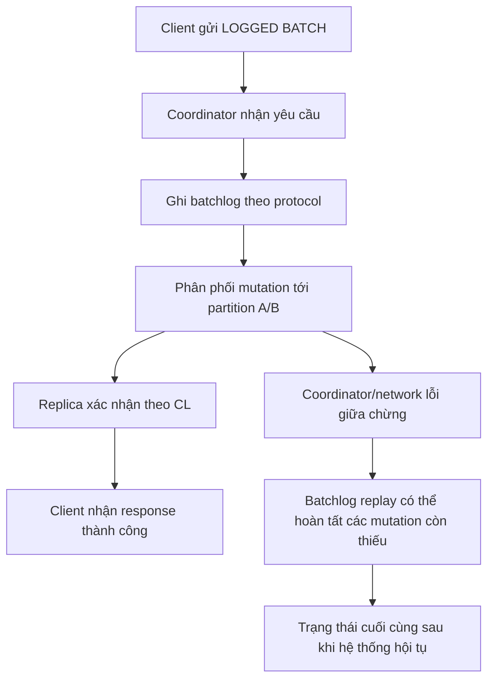
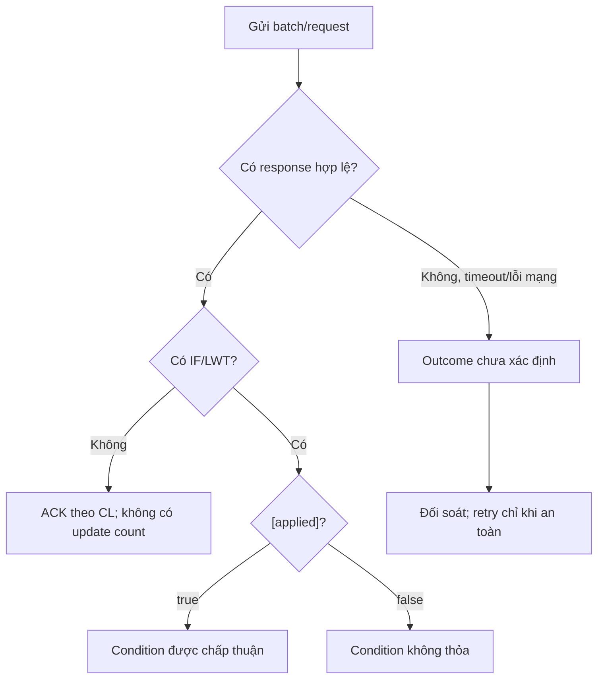
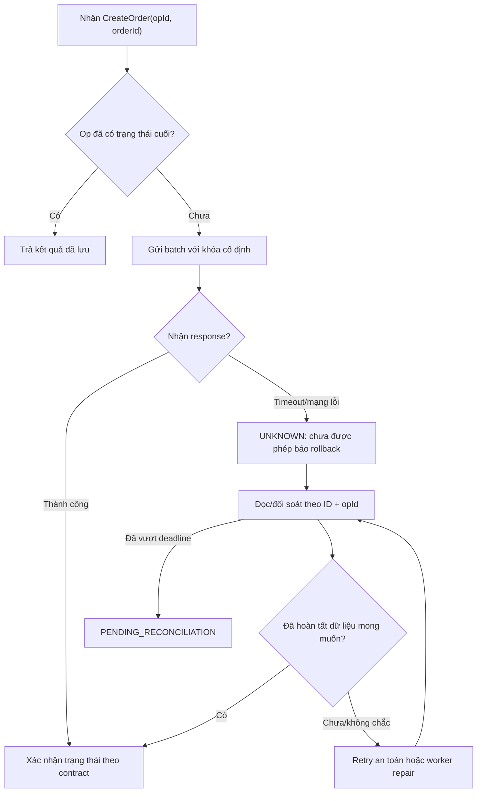
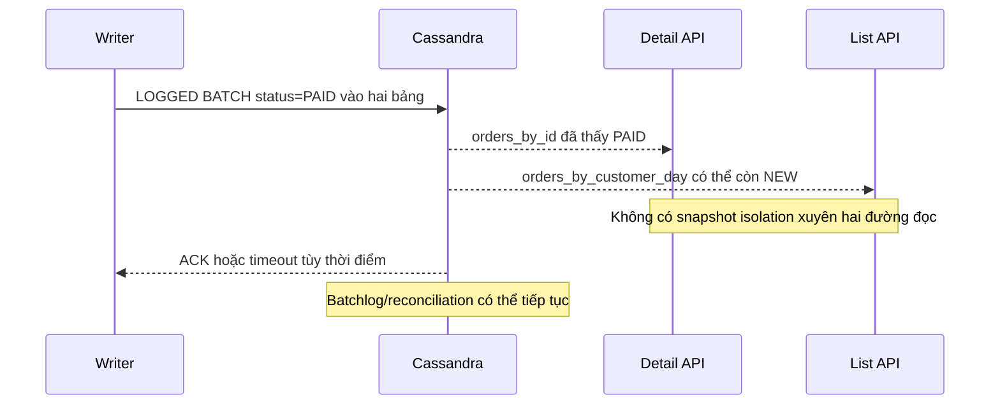

# Batch lỗi, kết quả chưa xác định và khả năng thử lại trong Spring Data Cassandra

Trong **Spring Data Cassandra**, một service có thể cần ghi nhiều mutation liên quan đến cùng một thao tác nghiệp vụ: một đơn hàng theo ID, một bản đọc theo khách hàng và một trạng thái phục vụ giao diện. Thật hấp dẫn khi cho tất cả vào một **CQL batch** rồi coi batch là “transaction”. Nhưng Cassandra là hệ thống phân tán: **batch có bảo đảm khác transaction RDBMS**, và khi request gặp timeout hoặc kết nối bị ngắt, client có thể **không biết chắc** những mutation nào đã được áp dụng.

Bài thuộc chương **Batch** của module **SPRING_DATA_CASSANDRA**. Trọng tâm là cách phân loại lỗi, lý giải kết quả chưa xác định (*unknown/ambiguous outcome*), quyết định có được retry hay không, thiết kế idempotency, kiểm soát batch size và kiểm thử lỗi trên cụm nhiều node. Ví dụ minh họa dùng **CQL, Spring-managed `CqlSession`, `CqlTemplate` và entity/repository ở mức ứng dụng**.

> **Nguyên tắc xuyên suốt:** Không trả lời “batch đã thất bại nên dữ liệu chưa đổi” nếu chỉ có thông báo timeout. Phải phân biệt **request chưa được thực thi**, **request đã được một phần hệ thống nhận**, **logged batch đã được ghi vào batchlog**, **mutation đã được gửi tới replica**, và **response đến được client hay không**.

## 1. Tại sao batch không phải transaction SQL?

Một giao dịch quan hệ thường khiến người học kỳ vọng `BEGIN TRANSACTION` → nhiều lệnh → `COMMIT` hoặc `ROLLBACK` với các bảo đảm ACID phù hợp isolation level. CQL batch **không có nghĩa tương đương**.

Cassandra cung cấp:

- **`LOGGED BATCH`:** nhóm mutation, dùng **batchlog** khi cần để hỗ trợ bảo đảm **atomicity ở mức eventual delivery** cho batch được chấp nhận. Không cung cấp isolation tổng quát: các truy vấn đồng thời có thể nhìn thấy một phần thay đổi trong quá trình áp dụng.
- **`UNLOGGED BATCH`:** không ghi batchlog bảo vệ những mutation trải trên nhiều partition. Nếu xảy ra sự cố giữa chừng, **một số partition có thể đã được ghi, số khác chưa**. Với mutation cùng một partition, Cassandra có thể xử lý tối ưu và tính nguyên tử cục bộ theo những điều kiện của batch cùng partition.
- **`COUNTER BATCH`:** dành cho mutation counter, có đặc tính và giới hạn riêng; retry một counter increment có nguy cơ **tăng trùng**, không được suy luận như upsert thông thường.

Mục tiêu chính của CQL batch là **nhóm mutation có mối liên hệ về atomicity**, không phải tự động tăng tốc độ bulk ingest. Đưa hàng nghìn ghi vào một logged batch nhiều partition thường gây thêm chi phí điều phối/batchlog và hot coordinator.

| Hành vi mong muốn | LOGGED batch | UNLOGGED batch nhiều partition | Transaction RDBMS truyền thống |
| --- | --- | --- | --- |
| Gửi nhiều mutation trong một request | Có | Có | Có |
| Phục hồi để hoàn tất các mutation của batch đã được chấp nhận/ghi log | Có cơ chế batchlog | Không có batchlog | Theo cơ chế transaction log của RDBMS |
| Isolation: reader không thể thấy trạng thái trung gian | **Không được bảo đảm tổng quát** | **Không được bảo đảm** | Phụ thuộc isolation level |
| Tự rollback mọi mutation khi client timeout | **Không** | **Không** | Không thể suy ra chỉ từ timeout; cần xác minh commit |
| Cơ chế chống trùng hiệu ứng ngoài database | Không | Không | Không tự giải quyết hệ thống ngoài transaction |
| Tự tăng throughput khi batch lớn | Không | Không | Không phải kết luận chung |

**Lưu ý quan trọng:** Ngay cả với logged batch, “atomicity” không nên diễn giải thành “mọi node, mọi reader thấy tất cả mutation cùng một thời điểm”. Khi có lỗi mạng hoặc coordinator, một phần đã được áp dụng trước khi các phần còn lại được hoàn tất nhờ batchlog; quan sát tức thời và trạng thái cuối cùng là hai câu hỏi khác nhau.

## 2. Chuẩn bị ví dụ: hai bảng theo hai đường đọc

Giả sử dịch vụ đơn hàng phục vụ hai access pattern:

1. `orders_by_id` — tìm chính xác đơn theo `order_id`.
2. `orders_by_customer_day` — liệt kê đơn của một khách hàng trong một ngày, mới nhất trước.

```sql
-- Giả sử keyspace commerce đã tồn tại với replication strategy hợp lý.
CREATE TABLE commerce.orders_by_id (
    order_id uuid PRIMARY KEY,
    customer_id uuid,
    order_day date,
    created_at timestamp,
    status text,
    total_amount decimal
);

CREATE TABLE commerce.orders_by_customer_day (
    customer_id uuid,
    order_day date,
    created_at timestamp,
    order_id uuid,
    status text,
    total_amount decimal,
    PRIMARY KEY ((customer_id, order_day), created_at, order_id)
) WITH CLUSTERING ORDER BY (created_at DESC, order_id ASC);
```

Bảng thứ hai có partition key ghép `(customer_id, order_day)`; hai clustering columns giúp sắp xếp và tránh trùng khi các đơn có cùng `created_at`. Việc chọn ngày theo UTC hay múi giờ kinh doanh phải được xác định nhất quán trước khi ghi.

Một thao tác tạo đơn cần ghi hai bảng:

```sql
BEGIN LOGGED BATCH

    INSERT INTO commerce.orders_by_id
    (order_id, customer_id, order_day, created_at, status, total_amount)
    VALUES (
        11111111-1111-1111-1111-111111111111,
        22222222-2222-2222-2222-222222222222,
        '2026-11-25',
        '2026-11-25T09:00:00Z',
        'NEW', 250000.00
    );

    INSERT INTO commerce.orders_by_customer_day
    (customer_id, order_day, created_at, order_id, status, total_amount)
    VALUES (
        22222222-2222-2222-2222-222222222222,
        '2026-11-25',
        '2026-11-25T09:00:00Z',
        11111111-1111-1111-1111-111111111111,
        'NEW', 250000.00
    );

APPLY BATCH;
```

Đây là hai **partition khác nhau**: một partition theo `order_id`, một partition theo `(customer_id, order_day)`. Dù thuộc cùng keyspace, cả hai không trở thành một partition và không được nhìn thấy đồng thời một cách có isolation chỉ vì đặt trong batch.

### 2.1. Truy vấn đối soát sau khi ghi

```sql
SELECT order_id, customer_id, status, total_amount
FROM commerce.orders_by_id
WHERE order_id = 11111111-1111-1111-1111-111111111111;

SELECT created_at, order_id, status, total_amount
FROM commerce.orders_by_customer_day
WHERE customer_id = 22222222-2222-2222-2222-222222222222
  AND order_day = '2026-11-25';
```

Hai lần đọc này là **hai request**, mỗi request quan sát dữ liệu theo CL/replica riêng; chúng không tạo một snapshot transaction xuyên bảng. Nếu batch vừa timeout, đối soát có thể cần retry/poll có giới hạn và chiến lược cuối cùng rõ ràng, không chỉ đọc một lần rồi tuyên bố mọi mutation đã hoàn tất.

## 3. Logged batch và batchlog: hiểu đúng bảo đảm

Với batch ghi nhiều partition, logged batch thường ghi thông tin batch vào **batchlog** trước khi gửi mutation tới các replica liên quan. Nếu coordinator gặp sự cố sau khi batchlog được ghi bền vững, cơ chế replay giúp những mutation chưa hoàn tất có thể được gửi lại.



Sơ đồ diễn đạt ý tưởng, không mô tả chính xác mọi RPC của mọi phiên bản Cassandra. **Không coi thời điểm client nhận exception là thời điểm coordinator đã rollback**.

### 3.1. Logged batch có hai loại thời điểm cần phân biệt

- **Thời điểm ghi nhận batch:** Cassandra đã chấp nhận/log đủ thông tin để hỗ trợ hoàn tất các mutation theo cơ chế logged batch.
- **Thời điểm một reader quan sát từng mutation:** các replica và partition khác nhau có thể chưa cùng cập nhật hoặc chưa cùng trả về trạng thái mới.

Ví dụ reader A có thể nhìn thấy đơn ở `orders_by_id`, trong khi reader B ngay sau đó chưa thấy đơn ở `orders_by_customer_day`. Đây không tự chứng minh batchlog mất dữ liệu hoặc vi phạm hợp đồng *eventual batch atomicity*. Cần biết response nào đã xảy ra, CL nào được sử dụng và hệ thống đã có cơ hội replay/hội tụ hay chưa.

### 3.2. Một logged batch báo timeout có thể rơi vào đâu?

| Điểm lỗi khả dĩ | Điều client thường nhìn thấy | Điều không thể kết luận chỉ từ lỗi |
| --- | --- | --- |
| Chưa gửi request ra ngoài | Lỗi client trước khi gửi. | Không nên gán đó là Cassandra đã ghi; nhưng phải biết chắc request chưa được gửi. |
| Mất kết nối khi đang gửi | Timeout/network error. | Không biết coordinator đã nhận đủ hay chưa. |
| Coordinator nhận nhưng batchlog chưa chắc được ghi | Timeout/unavailable/lỗi. | Không thể suy ra không mutation nào đã tới replica. |
| Batchlog đã ghi, một mutation đã được áp dụng | Timeout/connection lost. | Không thể xem là rollback; có thể sẽ replay hoàn tất. |
| Tất cả mutation đã áp dụng nhưng response thất lạc | Timeout/connection lost. | Không thể suy ra batch thất bại về mặt dữ liệu. |
| Client nhận thành công | Không có exception. | Không mặc nhiên có snapshot isolation hoặc đồng bộ lập tức mọi replica. |

Trong điều kiện sự cố kéo dài, “sẽ hoàn tất” còn phụ thuộc khả năng hoạt động/khôi phục và vận hành của cluster. Không biến bảo đảm về cơ chế batchlog thành cam kết về **deadline tuyệt đối** cho mọi reader.

### 3.3. Batchlog không phải hàng đợi nghiệp vụ

Batchlog phục vụ **phục hồi mutation của Cassandra**, không thay thế:

- Durable business event log dùng để replay quy trình sản phẩm.
- Idempotency key của HTTP request.
- Outbox/CDC protocol để đồng bộ Kafka, gửi email hoặc thanh toán.
- Công cụ đối soát các bảng đọc sau migration.
- Audit log có khả năng truy vết từ yêu cầu người dùng.

Không thể đọc batchlog như một danh sách công việc nghiệp vụ để quyết định “đã gửi email hay chưa”.

## 4. Unlogged batch: khi nào chỉ một phần được ghi?

`UNLOGGED BATCH` tránh chi phí batchlog. Điều này có thể hợp lý khi các mutation **cùng một partition** và hệ thống không cần một logged batch trải nhiều partition. Nhưng với hai bảng đọc ở phần 2, mutation nằm trên hai partition khác nhau; nếu một node/coordinator mất kết nối trong lúc thực thi, hệ thống có thể để lại:

| `orders_by_id` | `orders_by_customer_day` | Cách nhìn nhận |
| --- | --- | --- |
| Có row | Có row | Cả hai mutation có thể đã thành công. |
| Có row | Không có row | **Partial application** có thể xảy ra. |
| Không có row | Có row | **Partial application** cũng có thể xảy ra. |
| Không có row | Không có row | Chưa thấy dữ liệu; không tự chứng minh request chưa từng được gửi. |

Với **logged batch**, không nên mặc định các trạng thái trung gian biến mất khỏi tầm nhìn của reader; khác biệt quan trọng là **cơ chế batchlog hướng tới hoàn tất các mutation** sau khi đã ghi nhận, còn unlogged batch nhiều partition không có cơ chế này.

### 4.1. Một partition hay nhiều partition?

Ví dụ một bảng có khóa:

```sql
CREATE TABLE commerce.order_events_by_order (
    order_id uuid,
    occurred_at timestamp,
    event_id uuid,
    event_type text,
    PRIMARY KEY (order_id, occurred_at, event_id)
);
```

Hai `INSERT` có **cùng `order_id`** và khác clustering columns thuộc **một partition** của bảng này. Đây là use case đáng cân nhắc cho một batch nhỏ cùng partition nếu thực sự có lý do nhóm mutation.

Ngược lại:

- Hai `order_id` khác nhau → hai partition.
- Một `order_id` trong bảng `orders_by_id` và một `customer_id` trong bảng `orders_by_customer_day` → hai partition khác bảng.
- Nhiều hàng cùng `customer_id` nhưng khác `order_day` trong bảng có partition key `(customer_id, order_day)` → nhiều partition.

**Không đánh giá partition chỉ theo việc “cùng business entity” hoặc cùng tenant.** Phải đọc đúng định nghĩa `PRIMARY KEY`.

### 4.2. Đừng dùng UNLOGGED để tăng bulk throughput một cách máy móc

Một batch rất lớn nhiều partition có thể tạo hot coordinator, timeout và cảnh báo batch-size; các replica vẫn phải xử lý mutation theo quy mô dữ liệu. Khi mục tiêu chỉ là nhập 100.000 record độc lập, nên cân nhắc **prepared statements + async requests với concurrency giới hạn** thay vì gộp vào một batch khổng lồ.

## 5. Counter batch: retry có thể nhân đôi hiệu ứng

Cassandra có loại `COUNTER BATCH` cho các update trên cột counter. Counter increment **không idempotent**:

```sql
CREATE TABLE commerce.daily_counters (
    counter_day date PRIMARY KEY,
    requests counter
);

BEGIN COUNTER BATCH
    UPDATE commerce.daily_counters
    SET requests = requests + 1
    WHERE counter_day = '2026-11-25';
APPLY BATCH;
```

Nếu lần đầu được áp dụng nhưng response thất lạc, một lần retry có thể tăng từ `N` thành `N+2` thay vì `N+1`.

- Counter batch không được pha trộn tùy ý counter mutations với những regular mutations.
- Counter không có cùng mô hình idempotency như `INSERT` một giá trị xác định.
- Không tự đánh dấu `isIdempotent=true` cho batch counter.
- Nếu nghiệp vụ cần đếm **chính xác một lần cho mỗi event**, cân nhắc lưu event ID riêng và xây bảng tổng hợp/projection có chống trùng, thay vì kỳ vọng retry counter luôn an toàn.

**Không suy ra "COUNTER BATCH" là dạng LOGGED BATCH phù hợp để cứu các increment chưa chắc chắn.** Nó có semantics riêng và không chữa được double application do retry.

## 6. Kết quả trả về: thành công, condition false và timeout là ba trạng thái khác nhau

Phân biệt:

1. **Thành công có response:** driver nhận được xác nhận theo contract của statement và CL. Không có nghĩa reader ở mọi partition/replica ngay lập tức thấy một snapshot thống nhất.
2. **Thất bại điều kiện có response:** với LWT/conditional statement, Cassandra có thể trả `[applied] = false`. Điều kiện không được áp dụng; đây **không phải timeout**.
3. **Exception / timeout / mất response:** trạng thái ghi có thể **không xác định từ phía client**. Phải phân loại lỗi và đối soát theo hợp đồng nghiệp vụ.



### 6.1. ResultSet.wasApplied() không phải “số hàng đã ghi”

Java driver có `ResultSet.wasApplied()` dùng để đọc trạng thái áp dụng của những thao tác có điều kiện. Với statement **không có điều kiện IF**, `wasApplied()` thường trả `true` theo ngữ nghĩa API — không phải số hàng ghi thành công hoặc bảo đảm các bản ghi đã tồn tại từ trước.

Vì thế:

```java
// Cần hiểu đúng kết quả ở từng loại statement:
ResultSet result = session.execute(batch);
boolean applied = result.wasApplied();
```

**Không thể viết:** “`applied==true` nghĩa là có đúng hai row đã update và mọi reader nhìn thấy đồng thời”. Với regular batch, điều cần quan sát là **response/CL**, không phải một JDBC affected-row count.

### 6.2. Conditional batch không phải phép chữa chung

Cassandra có thể hỗ trợ conditional batch với những điều kiện và giới hạn chặt về phạm vi partition/cú pháp theo phiên bản. Không giả định một batch LWT có thể cung cấp transaction CAS tùy ý trên nhiều bảng/partition.

Nếu bài toán yêu cầu “chỉ tạo đơn nếu `order_id` chưa tồn tại”, `INSERT ... IF NOT EXISTS` trên **khóa nghiệp vụ chính** có thể cần thiết. Nhưng tạo bảng đọc ở partition khác vẫn cần kế hoạch **phát hành dữ liệu và phục hồi**. LWT trên bảng chính **không tự làm cho một ghi ở bảng đọc trở thành atomic cùng nó**.

## 7. Các loại lỗi driver và ý nghĩa thực sự

Java driver 4.x có những ngoại lệ cần phân biệt:

| Lỗi / tình huống | Nội dung thường gặp | Có được coi là “chưa ghi gì” không? |
| --- | --- | --- |
| `UnavailableException` | Không đủ replica sống đáp ứng CL tại thời điểm coordinator đánh giá. | Không nên suy rộng sang toàn bộ vòng đời/retry; xem request cụ thể. |
| `WriteTimeoutException` | Replica không xác nhận đủ trước timeout. | **Không.** Một số mutation có thể đã được áp dụng. |
| `ReadTimeoutException` khi đối soát | Không nhận đủ phản hồi đọc. | **Không.** Không kết luận dữ liệu vắng mặt. |
| `DriverTimeoutException` hoặc mất kết nối | Client không có response hoàn chỉnh trong hạn. | **Không.** Server có thể đã xử lý. |
| Lỗi cú pháp CQL/invalid query | Query không hợp lệ hoặc schema không khớp. | Thường không phải lý do để retry vô hạn; phải sửa query/schema. |
| `[applied]=false` khi conditional LWT | Điều kiện không thỏa. | Có kết quả về điều kiện, không phải unknown outcome. |

Các ngoại lệ có thể có khác nhau theo phiên bản Cassandra và Java driver. **Đừng viết `catch (RuntimeException) { retry(); }`**: retry mọi lỗi vừa gây tải vô ích, vừa có thể tạo hiệu ứng trùng.

### 7.1. Phân biệt availability và tính đúng nghiệp vụ

Ví dụ RF = 3, ghi ở `LOCAL_QUORUM` cần 2 replica trong local DC xác nhận. Nếu node chậm, có thể xảy ra:

- Coordinator gửi mutation.
- Một replica ghi thành công.
- Replica thứ hai phản hồi muộn hơn timeout.
- Client nhận `WriteTimeoutException`.

Kết quả từ client **không đủ để khẳng định** một hay hai replica đã ghi, hoặc batchlog đã/đang phục hồi toàn bộ nhóm mutation. Đừng dùng exception đơn lẻ để kết luận “business order chưa tạo”.

### 7.2. Error classification trước khi retry

Hãy phân loại theo các câu hỏi:

1. Request **chắc chắn chưa được gửi** hay đã có thể đi qua mạng?
2. Đây là **lỗi vĩnh viễn** (invalid CQL, thiếu quyền) hay **lỗi có thể hồi phục** (tạm thời thiếu replica/timeout)?
3. Mutation **idempotent hay non-idempotent**?
4. Batch là **LOGGED/UNLOGGED/COUNTER**, có bao nhiêu partition?
5. Có ghi TTL/timestamp/version/CAS/counter/collection mutation hay hiệu ứng ngoài Cassandra?
6. Có thông tin **opId/idempotency key** cho việc đối soát hay không?
7. Khi retry, có thể tạo business event trùng hay làm lùi trạng thái hay không?

Một lỗi “có thể hồi phục” **không tự động** đồng nghĩa “retry ngay thì an toàn”.

## 8. Idempotency: điều kiện để retry có kiểm soát

Một thao tác **idempotent** là khi thực thi lại cùng hành động không làm sai trạng thái nghiệp vụ mà nó định tạo ra. Trong Cassandra, cần phân biệt **idempotent về giá trị cuối cùng** và **idempotent về metadata/side effect**.

| Loại mutation | Nguy cơ khi retry | Đánh giá |
| --- | --- | --- |
| `INSERT` cùng full key, cùng giá trị xác định | Có thể an toàn về business value, nhưng timestamp/TTL có thể thay đổi. | **Chỉ idempotent khi đã xét concurrency/TTL.** |
| `UPDATE state='PAID' WHERE key=?` | Ghi lại cùng giá trị; có thể ghi đè version mới nếu retry đến muộn. | Cần protocol version/timestamp nếu nhiều writer. |
| `DELETE FROM ... WHERE full_key=?` | Xóa lại có thể không đổi trạng thái logic cuối cùng; tombstone/timestamp vẫn thay đổi. | Thường dễ retry hơn counter, vẫn phải xét concurrency. |
| `UPDATE counter = counter + 1` | Tăng thêm một lần nữa. | **Không idempotent.** |
| `list_col = list_col + [?]` | Có thể append phần tử thêm lần nữa. | **Không idempotent** về danh sách. |
| `INSERT/UPDATE ... USING TTL 600` | Mỗi lần ghi lại có thể làm mới thời hạn. | Không idempotent nếu hợp đồng là expiry tại thời điểm cố định. |
| `INSERT ... IF NOT EXISTS` | Lần sau có thể trả `[applied]=false` dù lần đầu đã thành công. | Cần đối soát theo ID nghiệp vụ. |
| `UPDATE ... IF version=3` | Retry có thể trả false sau khi lần đầu nâng version. | Cần đọc lại/đối soát, không xem false là thất bại ban đầu. |

### 8.1. TTL làm thay đổi kết luận “ghi lại cùng dữ liệu là an toàn”

Giả sử yêu cầu phải hết hạn đúng **12:00**. Lần đầu ghi lúc 11:50 với `TTL 600`, sau đó mất response. Client retry lúc 11:52 với **cùng TTL 600**:

- Lần đầu: hạn mong muốn gần 12:00.
- Lần retry: giá trị được ghi lại và có thể hết hạn gần **12:02**.
- Business value không đổi nhưng **hợp đồng retention đã thay đổi**.

Giải pháp là lưu **expiresAt cố định** theo nghiệp vụ, tính lại TTL còn lại tại mỗi lần ghi hoặc thiết kế phương thức đối soát phù hợp. Nếu đã qua deadline, không retry một ghi với TTL mới khiến dữ liệu “hồi sinh” ngoài chính sách.

### 8.2. Timestamp giúp ích nhưng không phải bùa hộ mệnh

Một số mutation dùng timestamp CQL tường minh để duy trì thứ tự và tránh việc retry tạo phiên bản mới tùy ý:

```sql
BEGIN LOGGED BATCH USING TIMESTAMP 1795597200000000
    UPDATE commerce.orders_by_id
    SET status = 'PAID'
    WHERE order_id = 11111111-1111-1111-1111-111111111111;
APPLY BATCH;
```

CQL write timestamp có đơn vị **microseconds kể từ Unix epoch**. Giá trị trên chỉ minh họa cú pháp; không copy số timestamp cứng vào application production.

Tuy nhiên:

- Timestamp không thay thế `IF version=?` khi cần optimistic concurrency.
- Một timestamp trong tương lai có thể khiến ghi hợp lệ đến sau không thắng.
- Một retry với cùng timestamp nhưng **khác giá trị** có thể gây quy tắc hòa giải tie-break khó dự đoán.
- TTL còn có ngữ nghĩa thời điểm hết hạn; **giữ cùng timestamp không tự chứng minh mọi trường hợp retry TTL là an toàn**.
- Không dùng timestamp phía client thiếu đồng bộ hoặc đơn vị sai.

**Chỉ dùng timestamp tường minh khi có protocol được thiết kế và kiểm chứng.**

## 9. Ví dụ Java driver với CqlSession được Spring quản lý

`CassandraRepository` và `CassandraTemplate` tốt cho entity mapping. Để minh họa chính xác loại batch và bound statements, ta dùng **Java driver 4.x** thông qua `CqlSession` do Spring tạo và quản lý.

### 9.1. Prepared statements và LOGGED batch nhỏ

```java
import java.math.BigDecimal;
import java.time.Instant;
import java.time.LocalDate;
import java.util.UUID;

import com.datastax.oss.driver.api.core.CqlSession;
import com.datastax.oss.driver.api.core.DefaultConsistencyLevel;
import com.datastax.oss.driver.api.core.cql.BatchStatement;
import com.datastax.oss.driver.api.core.cql.DefaultBatchType;
import com.datastax.oss.driver.api.core.cql.PreparedStatement;

import org.springframework.stereotype.Service;

@Service
public class OrderBatchWriter {

    private final CqlSession session;
    private final PreparedStatement insertById;
    private final PreparedStatement insertByCustomerDay;

    public OrderBatchWriter(CqlSession session) {
        this.session = session;
        this.insertById = session.prepare(
            "INSERT INTO commerce.orders_by_id " +
            "(order_id, customer_id, order_day, created_at, status, total_amount) " +
            "VALUES (?, ?, ?, ?, ?, ?)"
        );
        this.insertByCustomerDay = session.prepare(
            "INSERT INTO commerce.orders_by_customer_day " +
            "(customer_id, order_day, created_at, order_id, status, total_amount) " +
            "VALUES (?, ?, ?, ?, ?, ?)"
        );
    }

    public void create(OrderToCreate order) {
        // Dùng cùng các giá trị business key ở hai đường đọc.
        BatchStatement batch = BatchStatement.builder(DefaultBatchType.LOGGED)
            .addStatement(insertById.bind(
                order.orderId(), order.customerId(), order.orderDay(),
                order.createdAt(), "NEW", order.totalAmount()
            ))
            .addStatement(insertByCustomerDay.bind(
                order.customerId(), order.orderDay(), order.createdAt(),
                order.orderId(), "NEW", order.totalAmount()
            ))
            .setConsistencyLevel(DefaultConsistencyLevel.LOCAL_QUORUM)
            .build();

        // Exception/timeout ở đây KHÔNG chứng minh batch đã rollback.
        session.execute(batch);
    }

    public record OrderToCreate(
        UUID orderId,
        UUID customerId,
        LocalDate orderDay,
        Instant createdAt,
        BigDecimal totalAmount
    ) {}
}
```

Ví dụ cho thấy:

1. Prepared statements được chuẩn bị khi service được tạo, không prepare cho mọi request.
2. Hai mutation được bind **theo đúng kiểu** `uuid`, `date`, `timestamp` và `decimal`.
3. Loại batch là `LOGGED`; regular CL ở đây là `LOCAL_QUORUM` (cần RF/topology thực tế đáp ứng).
4. Không có thao tác “rollback Java” nếu `session.execute(batch)` timeout.
5. `OrderToCreate` nên được tạo từ dữ liệu đã validate, với **orderId cố định qua mọi retry**.

Đây là mã minh họa cách gửi batch, **chưa có cơ chế idempotency, xử lý unknown outcome và event ngoài Cassandra**. Không sử dụng nguyên trạng làm toàn bộ giao thức tạo đơn production.

### 9.2. Chọn loại batch có chủ đích

```java
// Khi tất cả mutation được xác nhận cùng một partition,
// cân nhắc unlogged batch nhỏ nếu đúng access pattern.
BatchStatement unlogged = BatchStatement
    .builder(DefaultBatchType.UNLOGGED)
    .addStatement(firstBoundStatement)
    .addStatement(secondBoundStatement)
    .build();
```

`firstBoundStatement` và `secondBoundStatement` trong đoạn trên là các `BoundStatement` do ứng dụng chuẩn bị cho **cùng một partition**. Đừng dùng code mẫu để gộp hai partition khác nhau mà không đánh giá partial failure.

Nếu chỉ muốn gửi nhiều thao tác **độc lập** để tăng throughput, dùng nhiều prepared requests có giới hạn concurrency thường phù hợp hơn batch lớn.

### 9.3. Đừng gắn isIdempotent bừa bãi

Java driver dùng metadata **idempotence** và retry policy để quyết định có thể thử lại trong một số tình huống. Đánh dấu request/batch là idempotent chỉ khi **toàn bộ mutation** thực sự an toàn để thực hiện lại dưới cạnh tranh, timestamp, TTL, counter, LWT và workflow thực tế.

**Không tự đặt tất cả batch thành idempotent** bằng cấu hình chung để “ít lỗi hơn”. Điều đó có thể biến một timeout thành một mutation trùng mà ứng dụng không nhận thấy.

## 10. Spring Data Cassandra: batch ở tầng mapping không thay đổi ngữ nghĩa

Spring Data Cassandra cung cấp các abstraction quanh Cassandra, nhưng bản chất batch vẫn do Cassandra quyết định. Tùy phiên bản, ứng dụng có thể dùng **batch operations** của `CassandraTemplate` để nhóm thao tác theo entity hoặc sử dụng `CqlTemplate`/`CqlSession` để điều khiển CQL rõ hơn.

Không nhầm:

- `repository.saveAll(entities)` là API ghi một tập entity; **không mặc nhiên là một logged batch ACID** trên nhiều partition.
- `@Transactional` trong service **không tự biến các mutation Cassandra thành giao dịch RDBMS** có rollback nhiều bảng.
- Một batch operation của template **không bảo đảm reader nhìn thấy mọi thay đổi đồng thời**.
- Options consistency và timeout của statement ảnh hưởng ACK/waiting, không giải quyết dữ liệu bị ghi trùng trong lần retry.

### 10.1. Lớp service nên giữ những thông tin nào?

Một lệnh create có thể được mô hình hóa:

```java
import java.time.Instant;
import java.util.UUID;

public record CreateOrderCommand(
    UUID operationId,
    UUID orderId,
    UUID customerId,
    Instant createdAt,
    String requestedBy
) {}
```

Trong đó:

- `operationId` nhận diện **một lần yêu cầu nghiệp vụ**, ổn định qua retry.
- `orderId` là full primary key của đơn, cũng phải ổn định qua retry.
- `createdAt` được xác định từ lần đầu, không lấy lại `Instant.now()` trên mỗi lần retry.
- `requestedBy` hỗ trợ kiểm tra quyền truy cập/audit; không nên ghi thông tin nhạy cảm vào log tùy tiện.

Khi HTTP client retry vì timeout, **không tạo UUID mới** rồi coi đó là cùng một lần tạo. Làm vậy tạo hai đơn khác nhau, bất kể CQL batch có idempotent hay không.

## 11. Thiết kế đối soát khi outcome chưa xác định

Giả sử client nhận timeout sau khi gửi logged batch tạo đơn. Ứng dụng có bốn hướng lựa chọn:

1. **Chờ/kiểm tra lại:** đọc bảng nguồn và bảng đọc qua khóa xác định, có backoff và deadline.
2. **Thử lại một mutation idempotent:** chỉ khi đã phân tích đầy đủ timestamp, TTL, concurrency và không có counter/list append.
3. **Gửi vào workflow sửa sai lệch:** nếu source record đã có nhưng bảng đọc thiếu, ghi lại projection theo quy tắc version/operationId.
4. **Đánh dấu yêu cầu ở trạng thái xử lý:** API trả `202 Accepted` với operation ID và endpoint tra trạng thái, thay vì khẳng định create thất bại hoặc thành công khi chưa biết.

### 11.1. Một state machine cho yêu cầu tạo đơn



Không có nghĩa mọi application đều phải tự tạo một bảng operation status mới; đó là thiết kế kiến trúc khi nghiệp vụ cần ghi nhận yêu cầu bền vững. Bài này không yêu cầu ghi thêm file hay thay đổi schema production.

### 11.2. Đối soát phải so **nội dung**, không chỉ tồn tại

Với một `orderId` cố định, kiểm tra:

- `orders_by_id` có hàng không; `customerId`, `orderDay`, `createdAt`, `status`, `totalAmount` có đúng không?
- `orders_by_customer_day` có hàng theo **đầy đủ key** tương ứng không?
- Hai bản có cùng version/trạng thái nghiệp vụ theo hợp đồng không?
- Có dữ liệu cũ từ retry hoặc workflow khác ghi đè không?
- Nếu thiếu một đường đọc, có quyền tự chữa hay phải báo cảnh báo cho workflow có hiệu ứng ngoài Cassandra?

Hai bảng có thể nhất quán về trạng thái cuối nhưng không phải cùng “thời điểm quan sát”. Đừng dùng kết quả một lần đọc `LOCAL_ONE` khi cluster đang gặp sự cố làm bằng chứng chắc chắn mutation không tồn tại.

### 11.3. Vì sao chỉ đọc lại ngay một lần là chưa đủ?

Với logged batch:

- Batchlog replay có thể còn đang diễn ra.
- Replica đọc với CL thấp có thể chưa thấy mutation đã ghi ở replica khác.
- Node tạm mất kết nối có thể cần hints/repair.
- Câu lệnh khác đang ghi đồng thời có thể thay đổi giá trị.

Do đó reconciliation cần **giới hạn thời gian, retry có backoff, CL phù hợp và tiêu chí kết thúc rõ**. Nếu quá deadline vẫn không chắc, đưa request vào trạng thái chờ xử lý/ticket phù hợp; không im lặng báo “đã rollback”.

## 12. Retry policy: đừng để retry tự động che giấu vấn đề

Retry có thể đến từ nhiều tầng:

- **Java driver retry policy** theo lỗi và metadata statement.
- **Spring Retry/Resilience4j** hoặc interceptor ở tầng service.
- **HTTP client** gửi lại khi nhận 502/504 hoặc timeout.
- **Message broker consumer** redeliver event khi chưa nhận ACK.
- **Scheduler/worker** phát lại các job failed.

Khi những tầng này retry chồng nhau, một logical operation có thể gửi Cassandra **nhiều lần hơn tưởng tượng**.

### 12.1. Những quy tắc tối thiểu

1. Giữ **operation ID và business primary key** bất biến giữa các lần retry.
2. Chỉ retry lỗi **tạm thời**; lỗi schema/permission/CQL invalid cần sửa nguyên nhân.
3. Retry dựa trên **idempotency được chứng minh**, không dựa vào tên lệnh `INSERT`.
4. Giới hạn số lần, có **exponential backoff + jitter**, thời gian chờ tối đa và circuit breaker khi cần.
5. Đặt timeout hợp lý ở client và driver, không để retry kéo dài vượt SLA của API.
6. Không retry non-idempotent counter/list operations một cách mù quáng.
7. Với conditional mutation, phân biệt **CAS false** với **timeout chưa chắc chắn**.
8. Log operation ID, trace ID, loại batch, mutation count, CL và loại exception; **không log nguyên secret hoặc payload nhạy cảm**.
9. Khi retry không bảo đảm thành công trước deadline, có đường **reconciliation/dead-letter**.
10. Xác minh retry ở tầng nào thực sự được kích hoạt để tránh retry trùng nhiều lớp.

### 12.2. Một ví dụ chống duplicate ở tầng business

API tạo đơn nên chấp nhận `Idempotency-Key` do client cấp hoặc tạo một `operationId` bền vững. Khi request có cùng key được gửi lại:

- Nếu operation đã hoàn tất, trả lại kết quả cũ.
- Nếu đang xử lý, trả trạng thái đang xử lý hoặc chờ có giới hạn.
- Nếu trạng thái không rõ, đối soát theo `orderId`/operation ID trước khi phát lệnh mới.
- Nếu payload với cùng key lại **khác nội dung** (`customerId` hoặc amount đổi), từ chối hoặc báo conflict; không âm thầm xem là cùng request.

**Idempotency key không tự bảo đảm nguyên tử** khi được kiểm tra/ghi trên nhiều bảng Cassandra. Nếu yêu cầu “chỉ một request thắng”, có thể cần một bảng operation riêng với `INSERT ... IF NOT EXISTS` theo một khóa nhất quán, và protocol tiếp nối để hoàn tất các projection. Việc phối hợp payment/email cần workflow riêng.

## 13. Atomicity không có isolation: đọc trong lúc batch đang áp dụng

Giả sử batch ghi:

1. `orders_by_id.status = 'PAID'`.
2. `orders_by_customer_day.status = 'PAID'`.

Một reader lấy chi tiết đơn có thể thấy `PAID`; reader lấy danh sách ngay lúc đó có thể thấy `NEW`. Dù logged batch sau này hoàn tất, **reader có thể chứng kiến trạng thái trung gian**.



**Không dùng điều kiện “cả hai bảng đều cập nhật cùng batch” làm cơ sở cho một bất biến cần đúng ngay ở mọi request**. Nếu UI yêu cầu hiện trạng thái thanh toán chính xác ngay tức thời, có thể đọc bảng nguồn theo ID thay vì bảng denormalized chưa bắt kịp, hoặc dùng protocol theo version/projection watermark.

### 13.1. Batch cũng không tự cung cấp business ordering

Một request batched không có nghĩa nhiều writer cùng batch sẽ được serialize theo thứ tự request đến. Cassandra hòa giải dữ liệu theo timestamp và các quy tắc CQL, còn LWT cung cấp conditional coordination khi có `IF` trong phạm vi hỗ trợ.

Ví dụ hai service cùng cập nhật `status` từ `NEW` thành `PAID` hoặc `CANCELLED`. Nếu chỉ dựa vào logged batch, một write đến muộn có thể thắng tùy timestamp mà **không đúng state machine**. Cần conditional update/version protocol hoặc mô hình event rõ ràng.

## 14. Định nghĩa đúng thành công của batch trong nghiệp vụ

Một phương thức tạo đơn không nên trả đơn giản:

```java
// API anti-pattern:
// return true;  // Vì session.execute(batch) không ném lỗi.
```

Cần định nghĩa rõ các mức:

| Mức | Điều thực sự biết | Dùng cho |
| --- | --- | --- |
| `REQUEST_ACCEPTED` | Hệ thống đã nhận operation ID/command. | Trạng thái API ban đầu, chưa chứng minh DB xong. |
| `BATCH_ACKNOWLEDGED` | Cassandra trả response hợp lệ theo CL. | Khẳng định lời gọi hoàn tất theo protocol request. |
| `SOURCE_VERIFIED` | Bảng nguồn có dữ liệu mong muốn theo phép đọc/CL quy định. | Một số nghiệp vụ cần đọc sau ghi. |
| `PROJECTION_VERIFIED` | Bảng đọc đã phản ánh đúng dữ liệu nguồn. | Giao diện danh sách/đường truy cập phụ. |
| `BUSINESS_COMPLETED` | Cả các hiệu ứng cần thiết ngoài Cassandra đã được xử lý theo protocol. | Thanh toán, email, inventory, giao hàng. |

Không phải mọi endpoint cần đợi đến mức cuối. Nhưng API/documentation phải nói rõ **thành công theo hợp đồng nào**, độ trễ có thể xảy ra và cách client tra cứu trạng thái khi timeout.

## 15. Kiểm thử: mô phỏng timeout và partial failure có mục tiêu

Một unit test mock `session.execute` ném timeout chỉ chứng minh **code xử lý exception**, không chứng minh Cassandra đã/không áp dụng mutation. Muốn đánh giá ngữ nghĩa batch cần **integration test** với cluster Cassandra và, cho lỗi node, môi trường nhiều replica.

### 15.1. Baseline trên cluster khỏe

Với hai bảng phần 2, một integration test có thể:

1. Tạo `orderId` và `operationId` mới.
2. Gửi logged batch gồm hai insert.
3. Đọc lại `orders_by_id` và `orders_by_customer_day` bằng full partition key tương ứng.
4. Xác minh cả hai chứa cùng dữ liệu nghiệp vụ.
5. Gửi lại cùng command nếu yêu cầu test idempotency; xác minh quy tắc timestamp/TTL và version chấp nhận được.
6. Kiểm tra result/timeouts theo CL được cấu hình.

**Lưu ý:** Test này mới chứng minh dữ liệu cuối cùng trên cluster khỏe; chưa chứng minh behavior dưới fault injection.

### 15.2. JUnit 5 minh họa happy path

```java
import static org.junit.jupiter.api.Assertions.*;

import java.math.BigDecimal;
import java.time.Instant;
import java.time.LocalDate;
import java.util.UUID;

import com.datastax.oss.driver.api.core.CqlSession;
import com.datastax.oss.driver.api.core.cql.Row;
import org.junit.jupiter.api.Test;
import org.springframework.beans.factory.annotation.Autowired;
import org.springframework.boot.test.context.SpringBootTest;

@SpringBootTest
class OrderBatchIntegrationTest {

    @Autowired
    OrderBatchWriter writer;

    @Autowired
    CqlSession session;

    @Test
    void loggedBatchCanPopulateBothAccessPaths() {
        UUID orderId = UUID.randomUUID();
        UUID customerId = UUID.randomUUID();
        LocalDate day = LocalDate.parse("2026-11-25");
        Instant createdAt = Instant.parse("2026-11-25T09:00:00Z");

        writer.create(new OrderBatchWriter.OrderToCreate(
            orderId, customerId, day, createdAt,
            new BigDecimal("250000.00")
        ));

        Row byId = session.execute(
            com.datastax.oss.driver.api.core.cql.SimpleStatement.builder(
                "SELECT status, total_amount FROM commerce.orders_by_id " +
                "WHERE order_id = ?")
                .addPositionalValue(orderId)
                .build()
        ).one();

        Row byCustomer = session.execute(
            com.datastax.oss.driver.api.core.cql.SimpleStatement.builder(
                "SELECT status, total_amount FROM commerce.orders_by_customer_day " +
                "WHERE customer_id = ? AND order_day = ? " +
                "AND created_at = ? AND order_id = ?")
                .addPositionalValues(customerId, day, createdAt, orderId)
                .build()
        ).one();

        assertNotNull(byId);
        assertNotNull(byCustomer);
        assertEquals("NEW", byId.getString("status"));
        assertEquals("NEW", byCustomer.getString("status"));
        assertEquals(0, new BigDecimal("250000.00")
            .compareTo(byId.getBigDecimal("total_amount")));
    }
}
```

Test minh họa cần keyspace/bảng đã tồn tại và Spring context cấu hình đúng. Trong tình huống test thực tế nên so sánh thêm `total_amount` trên bảng thứ hai, local DC/RF, retry policy và quyền ghi/đọc; không chỉ kiểm tra một field.

### 15.3. Lập ma trận fault injection

| Kịch bản | Cách tạo trong cluster test | Điều cần quan sát |
| --- | --- | --- |
| Tất cả replica khỏe | Chạy batch thường. | Thông báo thành công, dữ liệu hai đường đọc. |
| Một replica chậm | Network latency/chaos có kiểm soát. | CL, timeout, mức dữ liệu quan sát. |
| Coordinator mất sau khi nhận batch | Ngắt node/coordinator trong thời điểm phù hợp. | Response mơ hồ, batchlog/replay, hội tụ về sau. |
| Mất kết nối client khi đang chờ response | Cắt kết nối hoặc dùng proxy test. | Client nhận lỗi; DB có thể đã ghi. |
| UNLOGGED nhiều partition khi lỗi | Gây failure thích hợp. | Có thể chỉ một bảng có row. |
| Retry counter increment | Mô phỏng response loss. | Nguy cơ tăng trùng; test không được retry mù. |
| Retry TTL trong khoảng trễ | Đưa vào TTL ngắn theo deadline. | Có kéo dài thời gian sống không? |
| Hai writer cùng sửa trạng thái | Concurrent update trong cluster. | Last-write-wins so với CAS/version protocol. |

**Không dùng một container Cassandra đơn lẻ để kết luận tính chất batchlog khi mất replica hoặc coordinator**. Nó hữu ích cho test CQL/mapping, nhưng kiểm thử fault tolerance cần topology có đủ node/RF và công cụ gây lỗi phù hợp.

### 15.4. Quy trình fault injection an toàn

- Chỉ chạy trên **cluster thử nghiệm**; không dừng node production.
- Trước test, xác minh RF, DC/rack, trạng thái node và CL; dùng `nodetool status` ở môi trường được phép.
- Ghi log operation ID, order ID, loại batch, số mutation, query hash, coordinator nếu quan sát được, thời điểm gửi/timeout.
- Gây lỗi **một lần có kiểm soát**, chờ xác nhận fault thật sự tác động; không tự đoán từ thời gian `sleep`.
- Thực hiện đối soát nhiều lần có deadline và ghi nhận trạng thái trung gian.
- Khôi phục cluster và xác minh repair/hints/batchlog theo runbook phiên bản đang dùng.
- Tách loại lỗi: `Unavailable`, timeout, network, invalid CQL, CAS false.
- Nếu test chưa tạo được một trạng thái lỗi cụ thể, báo **không tái hiện**, không đánh dấu PASS giả.

## 16. Quan sát hệ thống và tối ưu batch

Cassandra có các cảnh báo và ngưỡng cấu hình về kích thước batch. Các giá trị mặc định thay đổi theo phiên bản/cấu hình, vì vậy không nên ghi cứng một giới hạn “mọi cluster chỉ được tối đa N KB”.

Theo dõi:

| Chỉ số | Ý nghĩa |
| --- | --- |
| Batch size (bytes) và mutation count | Tránh coordinator phải giữ/gửi một batch quá lớn. |
| Số partition trong batch | Cho biết rủi ro batch trải rộng nhiều node. |
| p50/p95/p99 latency của batch | Đánh giá tác động tới SLA. |
| `WriteTimeout`/`Unavailable` và retry rate | Xác định lỗi replica/network và retry storm. |
| Batchlog replay backlog/latency | Quan sát khả năng hoàn tất logged batch sau sự cố. |
| Tombstones, compaction, disk | Đánh giá hiệu ứng ghi lặp, TTL và xóa. |
| Hot partition/coordinator | Cảnh báo phân phối tải mất cân đối. |
| Dữ liệu lệch giữa bảng nguồn và bảng đọc | Đo chất lượng reconciliation và projection lag. |
| Duplicate business operations | Kiểm tra idempotency qua operation ID/event ID. |

### 16.1. Những quy tắc vận hành hữu ích

1. **Giữ batch nhỏ**, giới hạn mutation/bytes, và lý do batch phải rõ ràng.
2. Tránh cross-partition batch chỉ để tăng bulk write throughput.
3. Hạn chế retry đồng thời sau lỗi lớn; dùng backoff/jitter và giới hạn concurrency.
4. Không điều chỉnh CL thấp hơn trên đường retry chỉ vì muốn giảm lỗi, trừ khi nghiệp vụ cho phép và đã test.
5. Thêm integration test cho các batch chứa TTL, counter, collection và conditional mutation nếu có dùng.
6. Sửa data modeling/hot partition trước khi “tăng timeout để batch chạy”.
7. Theo dõi tình trạng logged batch replay, không chỉ log exception ở service.

## 17. Anti-patterns cần tránh

| Anti-pattern | Tại sao nguy hiểm | Cách sửa |
| --- | --- | --- |
| “Batch lỗi nên chắc rollback” | Timeout/client error không xác định được server outcome. | Dùng unknown state + reconciliation. |
| “LOGGED là transaction ACID đa bảng” | Không có isolation tổng quát xuyên partition. | Thiết kế read model/protocol phù hợp. |
| “UNLOGGED nhanh hơn cho mọi bulk ingest” | Cross-partition unlogged batch có thể bị partial và vẫn gây hot coordinator. | Async prepared statements, concurrency giới hạn. |
| “Retry mọi exception ba lần” | Counter/list/TTL/LWT không chắc idempotent; invalid CQL không hồi phục. | Phân loại lỗi và xác minh idempotency. |
| “Driver `wasApplied()=true` là 2 hàng đã ghi” | ResultSet không phải JDBC update count. | Dựa trên response/CL, đọc dữ liệu nếu cần. |
| “Cứ ghi lại TTL 600 khi timeout” | Có thể làm mới hạn sống ngoài chính sách. | Dùng deadline cố định và TTL còn lại. |
| “Đổi UUID trên retry để tránh đụng hàng cũ” | Tạo duplicate business entity. | Giữ business ID/operation ID ổn định. |
| “Chỉ lưu logs thay cho operation state” | Logs không tạo giao thức replay/đối soát bền vững. | Idempotency store, state machine, reconciliation. |
| “CQL batch bảo đảm gửi email cùng lúc” | Email nằm ngoài Cassandra batch. | Outbox/CDC/event workflow có idempotency. |
| “Thử lại conditional write không đọc [applied]” | CAS false khác timeout; retry có thể báo false sau lần đầu thành công. | Xử lý result và version hiện tại. |
| “Đặt `@Transactional` là đủ” | Không tự cung cấp RDBMS rollback cho Cassandra. | Hiểu từng abstraction và thiết kế workflow. |

## 18. Bài tập tình huống

**Bài 1 — Logged batch timeout.** Service gửi `BEGIN LOGGED BATCH` ghi `orders_by_id` và `orders_by_customer_day`, sau đó nhận `WriteTimeoutException`. Có thể khẳng định hai bảng đều không có hàng không? Nên phản hồi thế nào cho HTTP client?

**Bài 2 — Unlogged hai partition.** Batch `UNLOGGED` ghi hai partition rồi node bị lỗi. Bảng theo ID có row nhưng bảng theo khách hàng chưa có. Đây có phải khả năng cần tính đến không? Nên sửa như thế nào?

**Bài 3 — Counter.** Một counter batch tăng `requests + 1` bị timeout; client retry ngay. Điều gì có thể xảy ra với kết quả cuối? Nếu yêu cầu chính xác một lần cho mỗi event, cần kiến trúc gì?

**Bài 4 — TTL.** Dữ liệu được tạo lúc 11:50 và yêu cầu hết hạn 12:00. Retry một `INSERT ... USING TTL 600` lúc 11:53 có thể gây lỗi nghiệp vụ gì?

**Bài 5 — LWT.** Lần đầu `INSERT IF NOT EXISTS` timeout, lần thứ hai trả `[applied]=false`. Có thể kết luận lần đầu thất bại không? Cần đối soát theo định danh nào?

**Bài 6 — ResultSet.** Một batch thông thường trả response, `wasApplied()` là true. Lập trình viên log “cập nhật đúng hai row hiện hữu”. Điều gì sai?

**Bài 7 — Isolation.** Detail API nhìn thấy `PAID`, list API thấy `NEW` khi một logged batch đang cập nhật hai bảng. Điều này có thể xảy ra không, và đọc lại tức thời `LOCAL_ONE` có đủ xác nhận lỗi dữ liệu vĩnh viễn không?

**Bài 8 — Retry policy.** Driver đã retry một mutation khi đủ điều kiện; Spring Retry lại retry method; HTTP client còn retry request với UUID mới. Những tầng nào đang tạo nguy cơ trùng và phải thống nhất điều gì?

**Bài 9 — Bulk import.** 50.000 đơn không có quan hệ atomicity được gộp vào một logged batch. Tại sao việc này không mặc định tối ưu hơn nhiều prepared async inserts?

**Bài 10 — Test correctness.** Một unit test mock `session.execute` ném timeout và assert bảng không có dữ liệu. Vì sao assertion này không chứng minh server rollback? Cần test loại nào?

**Đáp án gợi ý:**

1. Không. Logged batch có thể đã được chấp nhận/ghi batchlog hoặc mutation đã áp dụng dù response lỗi. Trả trạng thái chưa chắc chắn/operation ID và đối soát có kiểm soát.
2. Có. Unlogged batch đa partition không có batchlog để bảo vệ atomicity giữa các partition. Thiết kế retry idempotent, reconciliation hoặc đổi protocol phù hợp.
3. Có thể tăng hai lần. Cần ghi nhận event ID và deduplication/projection nếu cần exactly-once business effect.
4. Retry có thể refresh TTL đến gần 12:03; dùng hạn nghiệp vụ cố định và TTL còn lại, tránh kéo dài retention.
5. Không. Lần đầu có thể đã tạo hàng, lần hai bị từ chối vì khóa đã tồn tại. Đối soát theo orderId/operationId và payload.
6. `wasApplied` không phải affected row count cho request không điều kiện; CQL upsert cũng không chứng minh hai hàng đã tồn tại trước đó.
7. Có thể. Batch không cung cấp isolation tổng quát xuyên hai partition; phép đọc tức thời một replica chưa đủ chứng minh sai lệch cuối cùng.
8. Cả ba tầng có thể retry; đặc biệt HTTP tạo UUID mới gây duplicate. Cần cùng operationId/business ID, một chính sách retry có giới hạn và đánh giá idempotency.
9. Batch lớn tạo chi phí batchlog/coordinator, gây timeout và phân phối tải không đều. Đo prepared async requests với concurrency hợp lý theo partition.
10. Mock chỉ thử code xử lý exception. Cần cluster integration test với fault injection, quan sát DB sau lỗi và quy trình recovery/reconciliation.

**Ghi nhớ:** Trong Cassandra, **logged batch hỗ trợ atomicity ở mức eventual application, không cung cấp snapshot isolation như transaction RDBMS**. **Unlogged batch** trải nhiều partition có thể chỉ ghi một phần; **counter batch** có nguy cơ nhân đôi hiệu ứng khi retry. Khi client nhận **timeout**, kết quả thực thi có thể **chưa xác định**; không tuyên bố rollback hay gửi lại mù quáng. Hãy phân loại lỗi, chứng minh idempotency, giữ khóa nghiệp vụ ổn định, tính đến TTL/version, đối soát bằng những truy vấn theo partition key, kiểm soát retry ở mọi tầng và thử lỗi trên cụm Cassandra nhiều node trước khi triển khai.

### Tài liệu đối chiếu theo phiên bản

- [Apache Cassandra — CQL BATCH statement](https://cassandra.apache.org/doc/stable/cassandra/developing/cql/dml.html)
- [Apache Cassandra — Data consistency and replication](https://cassandra.apache.org/doc/stable/cassandra/architecture/dynamo.html)
- [Apache Cassandra Java Driver 4.x — Batch statements](https://docs.datastax.com/en/developer/java-driver/4.17/manual/core/statements/batch/)
- [Apache Cassandra Java Driver 4.x — Retry policy và idempotence](https://docs.datastax.com/en/developer/java-driver/4.17/manual/core/retries/)
- [Spring Data Cassandra — CQL template](https://docs.spring.io/spring-data/cassandra/reference/cassandra/cql-template.html)
- [Spring Data Cassandra — Repository abstraction](https://docs.spring.io/spring-data/cassandra/reference/cassandra/repositories.html)
