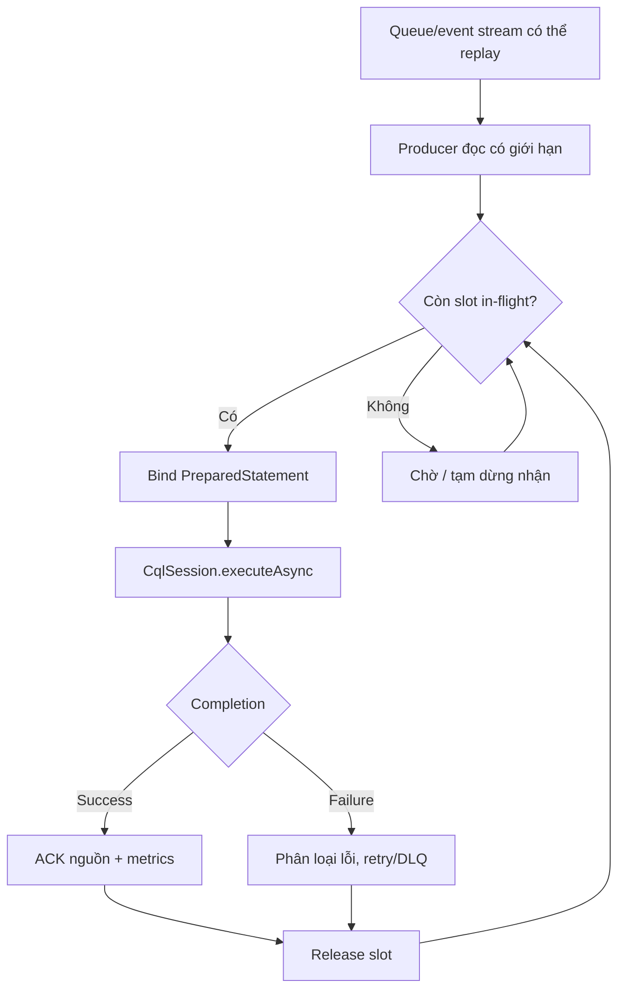

# So sánh batch với nhiều yêu cầu bất đồng bộ có giới hạn trong Spring Data Cassandra

Khi ứng dụng cần ghi hàng nghìn hoặc hàng triệu bản ghi vào **Apache Cassandra**, hai phương án dễ được đặt lên bàn cân là:

1. Gom nhiều mutation vào một câu lệnh **CQL BATCH**.
2. Gửi nhiều mutation **độc lập, bất đồng bộ** qua Java Driver, nhưng giới hạn số request đang thực thi đồng thời (*bounded concurrency*).

Hai phương án giải quyết **hai bài toán khác nhau**. BATCH chủ yếu là một cơ chế **nhóm thao tác ghi với semantics cụ thể**: logged, unlogged hoặc counter batch. Bounded async giúp **điều tiết lưu lượng và khai thác song song** giữa nhiều partition/node, nhưng **không tạo atomicity cho cả nhóm**. Chọn sai có thể khiến coordinator chịu tải lớn, batchlog phát sinh I/O không cần thiết, p99 latency tăng và retry sau timeout gây ghi trùng hoặc sai lệch.

Bài thuộc chương **Batch** của module `SPRING_DATA_CASSANDRA`: truy cập Cassandra bằng entity mapping, repository, `CassandraTemplate`, truy vấn CQL và Java Driver. Nội dung trình bày mô hình partition, batchlog, cách giới hạn `in-flight`, backpressure, lỗi và idempotency; đưa ra ví dụ Spring Data Cassandra, Java Driver 4.x, reactive programming và một kế hoạch benchmark có thể tái lập.

> **Quy tắc lựa chọn:** Nếu nhiều mutation cần **semantics của một nhóm ghi nhỏ**, hãy đánh giá batch tương ứng. Nếu nhiều row độc lập chỉ cần **throughput cao**, hãy bắt đầu bằng **prepared statements + async requests có giới hạn concurrency**, theo dõi latency, timeout và tải cluster. **Không dùng LOGGED batch nhiều partition như công cụ tăng tốc bulk ingestion mặc định.**

## 1. Hai khái niệm thường bị đánh đồng

### BATCH: nhóm mutation vào một lệnh CQL

Một ví dụ:

```sql
BEGIN UNLOGGED BATCH
    INSERT INTO events_by_account_day (
        account_id, bucket_day, occurred_at, event_id, event_type
    ) VALUES (?, ?, ?, ?, ?);

    INSERT INTO events_by_account_day (
        account_id, bucket_day, occurred_at, event_id, event_type
    ) VALUES (?, ?, ?, ?, ?);
APPLY BATCH;
```

Cassandra nhận một **batch statement** chứa các mutation. Batch có **type**, quy tắc atomicity/isolation và giới hạn payload riêng. Việc có nhiều `INSERT` trong batch không bảo đảm chúng có cùng partition key: phải xem **giá trị đã bind**.

### Bounded async: nhiều statement riêng, có giới hạn

```text
Nguồn sự kiện
    |
    v
Producer / scheduler
    |
    v
Giới hạn tối đa K request chưa hoàn tất
    |                |                |
    v                v                v
executeAsync(S1) executeAsync(S2) executeAsync(S3)
    |                |                |
    v                v                v
Replica/partition khác nhau theo token
    |                |                |
    +------ completion + outcome ------+
                   |
                   v
        Trả slot cho request kế tiếp
```

Mỗi statement có **kết quả thành công/thất bại riêng**. Không có một transaction bao trùm. Số lượng request đang chờ acknowledgment được kiểm soát, không tăng vô hạn theo kích thước nguồn dữ liệu.

Khác biệt quan trọng: **gộp lệnh** không giống **song song hóa có điều tiết**. Một batch có thể gồm nhiều mutation phân tán nhưng vẫn đi qua một coordinator; một luồng bounded async có thể phân phối các statement đến nhiều coordinator/replica phù hợp thông qua load-balancing policy của driver.

## 2. Thiết kế bảng theo truy vấn trước khi chọn cách ghi

Giả sử hệ thống nhận sự kiện giao dịch, cần đọc “20 sự kiện gần nhất của tài khoản A trong ngày D”:

```sql
CREATE TABLE events_by_account_day (
    account_id uuid,
    bucket_day date,
    occurred_at timestamp,
    event_id uuid,
    event_type text,
    amount_minor bigint,
    PRIMARY KEY ((account_id, bucket_day), occurred_at, event_id)
) WITH CLUSTERING ORDER BY (
    occurred_at DESC,
    event_id DESC
);
```

Ở đây:

- **Partition key** là cặp `(account_id, bucket_day)`.
- `occurred_at` và `event_id` là **clustering columns**.
- Hai event cùng account nhưng khác ngày thuộc **hai partition khác nhau**.
- Hai event khác account nhưng cùng ngày cũng thuộc **hai partition khác nhau**.
- Thao tác đọc theo account và ngày chỉ rõ một partition, không cần quét toàn bảng.

```sql
SELECT occurred_at, event_id, event_type, amount_minor
FROM events_by_account_day
WHERE account_id = ?
  AND bucket_day = ?
LIMIT 20;
```

Khi chọn batch hay async, **partition key thực tế của từng mutation** là dữ kiện quan trọng hơn số row hoặc tên bảng. Nếu 100.000 event nằm trong một partition cực lớn, tách chúng thành các async requests không chữa được hot partition; cần phân tích lại bucket/shard và truy vấn đọc. Nếu event trải đều trên nhiều partition, async có giới hạn có thể khai thác phân phối tải tốt hơn.

## 3. Logged, unlogged và counter batch: nhắc lại đúng phạm vi

| Loại | Mục tiêu chính | Giới hạn quan trọng |
|---|---|---|
| `LOGGED` | Với batch nhiều partition, dùng **distributed batchlog** để hỗ trợ hoàn tất toàn bộ nhóm mutation đã được nhận theo semantics Cassandra | **Không có isolation giữa nhiều partition**; thêm chi phí batchlog |
| `UNLOGGED` | Nhóm mutation **không dùng distributed batchlog**, thường phù hợp khi tất cả thuộc một partition | Với nhiều partition, có thể apply một phần khi lỗi |
| `COUNTER` | Nhóm các phép cộng/trừ trên counter columns | Không trộn regular mutations; counter increments **không idempotent** |
| Nhiều request async độc lập | Điều tiết và phân phối những mutation riêng rẽ | Không có group atomicity; phải xử lý mỗi kết quả và retry từng phần |

**Lưu ý:** Cassandra có thể tối ưu logged batch **cùng một partition** mà không cần batchlog phân tán. Vì thế so sánh performance chỉ theo tên `LOGGED` và `UNLOGGED`, bỏ qua số partition thật, dễ dẫn đến kết luận sai.

### Atomicity không đồng nghĩa isolation đa partition

Với logged batch nhiều partition, batchlog cho phép Cassandra **tiếp tục hoàn tất** các mutation nếu coordinator lỗi ở một số thời điểm. Nhưng một reader đồng thời có thể thấy dữ liệu ở partition A trước khi thấy ở B. Đây không phải transaction ACID nhiều hàng/bảng như ở RDBMS.

Đối với batch cùng partition, Cassandra có semantics atomicity/isolation trong **phạm vi partition**. Điều đó không mở rộng sang các partition khác, dù chúng thuộc cùng bảng hoặc cùng tài khoản nghiệp vụ.

## 4. So sánh trực tiếp theo các tiêu chí thiết kế

| Tiêu chí | Batch chứa nhiều mutation | Bounded async với statement riêng |
|---|---|---|
| Số request từ client | Một request cho mỗi batch | Một request cho mỗi mutation |
| Coordinator | Một coordinator xử lý batch, rồi phân phối mutation | Driver có thể phân phối nhiều statement theo routing/token |
| Khả năng song song hóa | Mutation bên trong có thể fan-out; không phải API tối ưu bulk throughput | Chủ động có tối đa K request đang chạy |
| Batchlog | Logged multi-partition có chi phí riêng | Không có distributed batchlog cho nhóm các request |
| Atomicity nhóm | Phụ thuộc loại batch và cùng/khác partition | **Không có** |
| Isolation nhóm | Trong cùng partition theo semantics hỗ trợ | **Không có** giữa các request |
| Lỗi | Một response có thể che tình trạng từng mutation; phải xét semantics batch/replay | Có completion/failure cho từng statement |
| Retry | Có thể lặp cả nhóm, cần hiểu idempotency | Có thể retry từng mutation thất bại hoặc không rõ trạng thái |
| Memory/backpressure | Kích thước batch cần giới hạn; một batch lớn giữ nhiều payload | In-flight cap giúp giới hạn request đang chờ, **không tự giới hạn upstream queue** |
| Tối ưu điển hình | Nhóm ghi nhỏ có lý do atomicity/hoàn tất | Ingestion nhiều partition độc lập |
| Quan sát | Batch size, batchlog, tổng latency, coordinator | Latency/timeout/error từng statement, in-flight, queue depth |
| Rủi ro nghiệp vụ | Hiểu nhầm batch thành transaction nhiều partition | Hiểu nhầm mọi request thành công đồng thời hoặc đúng thứ tự |

Bảng không có hàng “luôn nhanh hơn”. Kết quả thực tế tùy RF, consistency, kích thước mutation, số partition, topology, network, compaction, driver settings và máy chạy benchmark.

## 5. Vì sao logged batch đa partition thường bất lợi cho bulk ingest?

Giả sử producer nhận 5.000 sự kiện của 1.000 account. Nếu gom tất cả vào một logged batch:

```text
Client
  |
  v
Một coordinator nhận BATCH lớn
  |-- Lưu batchlog theo cơ chế server
  |-- Fan-out mutation tới nhiều replica/token ranges
  |-- Thu thập ACK theo consistency
  |-- Xử lý timeout/ghi batchlog cleanup/replay
```

Những chi phí có thể phát sinh:

1. **Batchlog I/O** bổ sung đối với logged batch nhiều partition.
2. **Một coordinator phải điều phối** nhiều mutation rải rác trong cluster.
3. **Payload lớn** làm tăng áp lực bộ nhớ, serialization, parsing và network.
4. Khi một node chậm, **tail latency** của batch có thể bị kéo lên.
5. **Một failure của batch** khó gắn ngay với một sự kiện cụ thể để retry có chọn lọc.
6. Batch có thể vượt ngưỡng warning/failure của server.
7. Khi retry nguyên nhóm sau timeout, những mutation đã được áp dụng có thể được gửi lại.

Không nên lấy việc giảm số lượt gọi API từ client làm bằng chứng đã giảm I/O thực tế trong cluster. Cassandra vẫn phải xử lý từng mutation theo partition/replica tương ứng.

### Không khuyến nghị unlogged multi-partition chỉ để bỏ batchlog

Đổi `BEGIN BATCH` thành `BEGIN UNLOGGED BATCH` loại bỏ distributed batchlog nhưng **không** làm batch đa partition trở nên transaction an toàn. Nếu coordinator hoặc network gặp lỗi, một số mutation có thể được áp dụng và số khác không. Với nhiều thao tác độc lập, bounded async dễ quan sát và hồi phục riêng từng statement hơn.

## 6. Trường hợp batch thật sự có lợi về semantics

### Nhóm hai row thuộc một partition

```sql
BEGIN UNLOGGED BATCH
    INSERT INTO events_by_account_day (
        account_id, bucket_day, occurred_at,
        event_id, event_type, amount_minor
    ) VALUES (
        11111111-1111-1111-1111-111111111111,
        '2026-11-25',
        '2026-11-25T08:00:00Z',
        aaaaaaaa-aaaa-aaaa-aaaa-aaaaaaaaaaa1,
        'DEBIT', 100000
    );

    INSERT INTO events_by_account_day (
        account_id, bucket_day, occurred_at,
        event_id, event_type, amount_minor
    ) VALUES (
        11111111-1111-1111-1111-111111111111,
        '2026-11-25',
        '2026-11-25T08:01:00Z',
        aaaaaaaa-aaaa-aaaa-aaaa-aaaaaaaaaaa2,
        'FEE', 2000
    );
APPLY BATCH;
```

Hai row có cùng `account_id + bucket_day`. Nếu ứng dụng cần chúng xuất hiện như một nhóm trong **phạm vi partition**, một unlogged single-partition batch nhỏ có thể thích hợp hơn hai async requests độc lập.

### Hai projection ở hai bảng/partition khác nhau

```sql
CREATE TABLE event_by_id (
    event_id uuid PRIMARY KEY,
    account_id uuid,
    bucket_day date,
    occurred_at timestamp,
    event_type text
);
```

Một logged batch nhỏ chứa:

- `INSERT` vào `events_by_account_day` để phục vụ danh sách theo account/ngày.
- `INSERT` vào `event_by_id` để lookup theo event ID.

Có thể giúp hoàn tất hai mutation khi xảy ra lỗi, nhưng **không buộc hai bảng cùng xuất hiện một thời điểm**. Những use case đòi cùng lúc nhìn thấy cả hai projection phải có chiến lược đọc/đối soát/state machine thích hợp.

### Counter không thể chuyển đơn giản sang retry async

```sql
CREATE TABLE page_views_by_day (
    page_id uuid,
    bucket_day date,
    views counter,
    PRIMARY KEY (page_id, bucket_day)
);
```

`UPDATE ... SET views = views + 1` là mutation counter. Gửi bất đồng bộ riêng hay trong `COUNTER BATCH` đều cần hiểu rủi ro **timeout nhưng increment đã áp dụng**. Khi retry, có thể tăng hai lần. Một semaphore hay `flatMap(concurrency)` **không biến phép tăng thành exactly-once**.

## 7. Cách suy luận throughput và in-flight concurrency

Với async writes, có hai đại lượng khác nhau:

- **Concurrency K:** tối đa bao nhiêu request đang chờ completion.
- **Arrival/production rate:** nguồn tạo mutation nhanh đến đâu.

Trong điều kiện tương đối ổn định, có thể dùng quan hệ trực giác từ **Little's Law**:

```text
Số request đang bay ≈ Throughput thực tế × Latency trung bình

K ≈ completed requests/second × average seconds/request
```

Đây là quan hệ trung bình, **không phải công thức cam kết throughput tối đa**. Khi latency tăng vì network hoặc compaction, cùng một mức K có thể tạo throughput thấp hơn. Tăng K vô hạn có thể làm queue, timeout và tail latency càng tệ.

### Hai dạng “giới hạn” khác nhau

| Giới hạn | Chặn điều gì? | Chưa chặn được điều gì? |
|---|---|---|
| **Max in-flight requests** | Quá nhiều request đang chờ ACK ở client | Nguồn sự kiện có thể xếp hàng vô hạn trước scheduler |
| **Rate limiter** | Quá nhiều request được phát ra mỗi giây | Request chậm vẫn có thể chồng nhiều lượt in-flight |
| **Bounded input queue** | Bộ nhớ của hàng đợi producer | Hệ thống vẫn có thể overload nếu tốc độ xử lý quá cao |
| **Per-key serialization** | Mutation cạnh tranh trên cùng primary key đi sai thứ tự | Tổng tải trên nhiều key vẫn có thể cao |
| **Batch size cap** | Một batch quá lớn về mutation/byte | Nhiều batch cùng lúc vẫn có thể quá tải cluster |

Thiết kế production thường cần **nhiều lớp**: input queue có giới hạn, in-flight cap, rate control, error budget và retry/backoff có kiểm soát. “Bất đồng bộ” một mình không mang nghĩa “có backpressure”.

## 8. Routing theo token: một lợi thế có điều kiện của các statement riêng

Với prepared statement chứa đầy đủ partition key `(account_id, bucket_day)`, Java Driver có thể tính **routing key/token** từ các bind values và metadata, rồi ưu tiên một coordinator phù hợp với replica của partition.

```sql
INSERT INTO events_by_account_day (
    account_id, bucket_day, occurred_at,
    event_id, event_type, amount_minor
) VALUES (?, ?, ?, ?, ?, ?);
```

Nếu mỗi async write dùng một `BoundStatement` cho một partition riêng, driver có cơ hội xây **query plan riêng** theo routing key của từng request.

Đối với batch nhiều partition, không có một routing key duy nhất đại diện chính xác cho mọi mutation. Driver/coordinator phải chọn đường điều phối phù hợp cho cả batch. Vì vậy **một số workload đa partition** có thể phân phối coordinator tốt hơn khi dùng async independent writes.

**Không được bảo đảm tuyệt đối:** token-aware routing còn tùy metadata, local DC, topology, policy, replica availability và driver version. Nếu từng statement không có đầy đủ partition-key values, việc tách batch thành async cũng không tự tạo routing key.

## 9. CQL prepared statement cho phép tách dữ liệu khỏi cấu trúc

Dùng một mẫu INSERT chuẩn bị trước:

```java
PreparedStatement prepared = session.prepare(
    "INSERT INTO events_by_account_day " +
    "(account_id, bucket_day, occurred_at, event_id, " +
    " event_type, amount_minor) VALUES (?, ?, ?, ?, ?, ?)"
);
```

Các điểm có lợi:

- **Một query shape ổn định**, ít chi phí prepare lặp lại.
- Bind marker biểu diễn dữ liệu, tránh nối chuỗi UUID/type/value.
- Driver có thể sử dụng prepared metadata cho routing khi đủ partition key.
- Mỗi event nhận một `BoundStatement` riêng, có option consistency/timeout/idempotency phù hợp.
- Lỗi từng mutation có thể gắn với ID của event và retry riêng.

Không prepare CQL mới trên mỗi event. Tránh dùng input từ client để chọn tên bảng/cột tùy ý; bind marker chỉ dành cho **giá trị**, còn CQL identifier phải là phần của câu lệnh đã được phép.

**PreparedStatement có thể dùng chung**; các `BoundStatement` mang giá trị cho từng lần gọi. Trong ứng dụng Spring Boot, inject `CqlSession` được quản lý vòng đời thay vì tạo một session trên mỗi request.

## 10. Java Driver 4.x: gửi nhiều write không giới hạn là sai

Một đoạn code dễ viết nhưng rủi ro:

```java
// Anti-pattern: phát toàn bộ nguồn mà không có giới hạn.
for (Event event : events) {
    session.executeAsync(prepared.bind(
        event.accountId(),
        event.bucketDay(),
        event.occurredAt(),
        event.eventId(),
        event.type(),
        event.amountMinor()
    ));
}
```

Vấn đề:

1. Không có max in-flight rõ ràng từ phía ứng dụng.
2. Phát source nhanh có thể làm pending requests/queue tăng lớn.
3. Không có cơ chế thu thập completion/failure của từng statement.
4. Chương trình có thể tưởng đã ghi xong trong khi request vẫn đang chạy.
5. Không biết event nào cần đưa vào retry/dead-letter queue.
6. Không có chính sách dừng khi cluster overload.
7. Driver có thể tự từ chối request khi vượt giới hạn nội bộ, nhưng **không nên dùng lỗi overload làm công cụ backpressure chính**.

Đặc biệt, `executeAsync` trả về `CompletionStage<AsyncResultSet>`, **không phải** một lời bảo đảm mutation đã được xác nhận tại thời điểm method trả về. Chỉ completion thành công mới cho biết request đã hoàn tất theo driver và consistency level được chọn.

## 11. Java Driver 4.x: bounded async với Semaphore và Phaser

Một mẫu đầy đủ hơn dùng `Semaphore` để giới hạn số request đang chờ và `Phaser` để chờ **mọi request đã phát** hoàn tất. Mẫu này thích hợp cho một pipeline hữu hạn chạy trên **producer thread riêng**; không gọi phương thức blocking này ngay trên event-loop của Java Driver hoặc reactive scheduler nhạy cảm với blocking.

### Dữ liệu sự kiện và kết quả

```java
import java.time.Instant;
import java.time.LocalDate;
import java.util.UUID;

public record Event(
    UUID accountId,
    LocalDate bucketDay,
    Instant occurredAt,
    UUID eventId,
    String eventType,
    long amountMinor
) {}

public record IngestSummary(
    long acknowledged,
    long failed,
    Throwable firstFailure
) {}
```

Trong code production, nên validate các field không null, giá trị amount và event ID ở boundary. Record ở đây nhằm minh họa cách giữ **primary key ổn định** qua retry.

### Lớp ingestion có giới hạn

```java
import java.util.concurrent.Phaser;
import java.util.concurrent.Semaphore;
import java.util.concurrent.atomic.AtomicLong;
import java.util.concurrent.atomic.AtomicReference;

import com.datastax.oss.driver.api.core.CqlSession;
import com.datastax.oss.driver.api.core.DefaultConsistencyLevel;
import com.datastax.oss.driver.api.core.cql.PreparedStatement;
import com.datastax.oss.driver.api.core.cql.BoundStatement;

public final class BoundedEventIngestor {

    private final CqlSession session;
    private final PreparedStatement insert;

    public BoundedEventIngestor(CqlSession session) {
        this.session = session;
        this.insert = session.prepare(
            "INSERT INTO events_by_account_day " +
            "(account_id, bucket_day, occurred_at, event_id, " +
            " event_type, amount_minor) VALUES (?, ?, ?, ?, ?, ?)"
        );
    }

    public IngestSummary ingest(
            Iterable<Event> source, int maxInFlight
    ) throws InterruptedException {

        if (maxInFlight < 1) {
            throw new IllegalArgumentException("maxInFlight must be positive");
        }

        Semaphore slots = new Semaphore(maxInFlight);
        Phaser pending = new Phaser(1); // Producer giữ một party.

        AtomicLong acknowledged = new AtomicLong();
        AtomicLong failed = new AtomicLong();
        AtomicReference<Throwable> firstError = new AtomicReference<>();

        try {
            for (Event event : source) {
                // BLOCKING: chỉ chạy trên producer thread.
                slots.acquire();
                pending.register();

                try {
                    BoundStatement bound = insert.bind(
                        event.accountId(),
                        event.bucketDay(),
                        event.occurredAt(),
                        event.eventId(),
                        event.eventType(),
                        event.amountMinor()
                    ).setConsistencyLevel(
                        DefaultConsistencyLevel.LOCAL_QUORUM
                    );

                    session.executeAsync(bound)
                        .whenComplete((rows, error) -> {
                            try {
                                if (error == null) {
                                    acknowledged.incrementAndGet();
                                } else {
                                    failed.incrementAndGet();
                                    firstError.compareAndSet(null, error);
                                }
                            } finally {
                                slots.release();
                                pending.arriveAndDeregister();
                            }
                        });
                } catch (RuntimeException error) {
                    failed.incrementAndGet();
                    firstError.compareAndSet(null, error);
                    slots.release();
                    pending.arriveAndDeregister();
                }
            }
        } finally {
            // Đợi mọi request đã phát trước khi trả kết quả.
            pending.arriveAndAwaitAdvance();
        }

        return new IngestSummary(
            acknowledged.get(),
            failed.get(),
            firstError.get()
        );
    }
}
```

**Giải thích từng thành phần:**

1. `Semaphore(maxInFlight)` chỉ cho phép tối đa K statement chưa giải phóng slot.
2. `slots.acquire()` **làm producer chờ** khi hệ thống đã có K request đang chạy: đây là backpressure ở điểm phát.
3. `Phaser` đếm các request được đăng ký. Kết thúc vòng lặp chưa đồng nghĩa mọi request hoàn tất; `arriveAndAwaitAdvance()` chờ chúng.
4. `whenComplete` xử lý completion, cập nhật bộ đếm và **luôn giải phóng slot** trong `finally`.
5. Một lỗi đồng bộ khi tạo statement/gửi request cũng phải **giải phóng slot và deregister**, tránh treo mãi.
6. Không lưu một `List<CompletionStage>` khổng lồ cho mọi event; bộ nhớ cho điều phối in-flight được giới hạn theo K, nếu `source` cũng được đọc/lấy có kiểm soát.
7. `LOCAL_QUORUM` chỉ là lựa chọn minh họa; RF và local DC thực tế phải phù hợp.

**Giới hạn của mẫu code:** nó chỉ đếm thành công/thất bại và ghi nhớ lỗi đầu tiên; **không lưu mọi failed event ID để retry**. Trong production, phải có một **nguồn dữ liệu có thể replay** và một **outcome store/dead-letter queue** đáng tin cậy. Nếu producer bị ngắt ở `acquire()`, các request đã phát được chờ hoàn tất trong `finally`, nhưng những event **chưa phát** không tự được ghi và caller phải xử lý trạng thái interrupted. Callback phải rất nhẹ; không chặn driver I/O thread bằng xử lý nặng, ghi disk đồng bộ hoặc sleep.

Mẫu dùng `Phaser` và semaphore này minh họa một pipeline **hữu hạn**. Với nguồn chạy liên tục 24/7, cần thêm cancellation, shutdown, retry scheduling, metrics, durable queue và rate control.

### Acknowledged không đồng nghĩa mọi replica đã ghi

`acknowledged` tăng khi Driver trả completion thành công **theo consistency level statement**. Nó không chứng minh mọi replica của partition hoặc mọi bảng denormalized đã hội tụ. Tương tự, `failed` có thể chứa **timeout không rõ mutation đã được áp dụng chưa**; phân biệt kết quả client với trạng thái dữ liệu thực tế.

## 12. Backpressure nhiều tầng trong hệ thống thật



Một semaphore chỉ hạn chế **request sau khi source được đọc đến điểm acquire**. Nếu HTTP gateway đã nhận cả triệu payload vào RAM hoặc queue đầu vào không giới hạn, memory vẫn có thể tăng vô hạn. Vì thế:

- Dùng durable queue hoặc cơ chế streaming có backpressure trước producer.
- Giới hạn batch đọc từ queue và dung lượng pending.
- Chỉ ACK/commit offset nguồn theo chính sách đảm bảo kết quả mong muốn.
- Khi nhiều event cùng một key có ràng buộc thứ tự, dùng **per-key serialization** hoặc logic versioning/conditional write.
- Thêm rate limiter nếu cụm có ngưỡng request/giây ổn định.
- Phân biệt request mới với retry để tránh retry storm.
- Khi shutdown, đợi in-flight hoàn tất hoặc lưu lại những event chưa xác nhận.

Không viết `whenComplete(... -> session.executeAsync(...).join())` trên callback thread của driver. Blocking/recursion không kiểm soát trong callback có thể làm nghẽn event loop, gây deadlock hoặc tăng tail latency.

## 13. Chọn K như thế nào?

Không có một giá trị K chuẩn cho mọi cluster.

Các yếu tố cần xem:

| Yếu tố | Khi tăng K có thể xảy ra |
|---|---|
| Throughput | Có thể tăng cho đến khi đạt giới hạn cluster/network |
| p95/p99 latency | Có thể tăng mạnh khi replica quá tải |
| Timeout | Tăng nếu hàng đợi phía client/server dài |
| Memory | Nhiều request và payload đang sống hơn |
| CPU coordinator/replica | Tăng song song xử lý, nhưng có điểm bão hòa |
| Compaction backlog | Tăng khi ghi nhanh hơn khả năng xử lý nền |
| Hot partition | Không giảm; có thể làm hotspot nặng hơn |
| Driver throttling | Request có thể bị queue/từ chối khi vượt giới hạn nội bộ |

Một quy trình thực tế:

1. Bắt đầu K nhỏ trên cluster test đại diện.
2. Tăng K theo từng nấc, giữ nguyên dataset, CL, payload và số partition.
3. Đo throughput **được xác nhận thành công**, không chỉ số request được gửi.
4. Theo dõi latency p50/p95/p99, failure, timeout, node utilization và queue.
5. Chọn K trước “đầu gối” của đường cong khi throughput tăng rất ít nhưng latency/error tăng mạnh.
6. Đặt giới hạn rate/concurrency riêng cho workload khác nhau nếu chúng tranh tài nguyên.
7. Trong production, dùng adaptive tuning có trần và SLO nếu cần, không tự tăng vô hạn.

**Đừng benchmark với RF=1 rồi áp nguyên K sang RF=3 multi-DC.** Consistency, network, replica placement và write amplification khác nhau đáng kể.

## 14. Spring Data Cassandra: batchOps và bounded async khác nhau

Ở tầng Spring Data, `CassandraOperations` có cơ chế batch mapped entities:

```java
import com.datastax.oss.driver.api.core.cql.DefaultBatchType;
import org.springframework.data.cassandra.core.CassandraOperations;

public void persistPair(
        CassandraOperations operations,
        AccountEvent first,
        AccountEvent second) {

    // Cả hai event phải cùng accountId + bucketDay nếu yêu cầu
    // single-partition isolation; validate ở service boundary.
    operations.batchOps(DefaultBatchType.UNLOGGED)
        .insert(first, second)
        .execute();
}
```

`AccountEvent` là entity `@Table` ánh xạ bảng `events_by_account_day`, được tạo sẵn với composite primary key. Mỗi `CassandraBatchOperations` được dùng cho một lần `execute()`; không chia sẻ lại một instance đã execute giữa nhiều request.

**Khác với bounded async:** `batchOps(...)` là API **nhóm mapped writes thành batch**, không tự cung cấp một “global maxInFlight”. Nếu gọi nhiều batch song song cũng cần giới hạn concurrency và quan sát hiệu năng riêng.

### Tùy chọn query và consistency

Trong những phiên bản Spring Data Cassandra hỗ trợ API tương ứng:

```java
import com.datastax.oss.driver.api.core.DefaultConsistencyLevel;
import org.springframework.data.cassandra.core.cql.QueryOptions;

QueryOptions options = QueryOptions.builder()
    .consistencyLevel(DefaultConsistencyLevel.LOCAL_QUORUM)
    .build();

operations.batchOps(DefaultBatchType.LOGGED)
    .withQueryOptions(options)
    .insert(projectionById, projectionByAccount)
    .execute();
```

Ở đây, `projectionById` và `projectionByAccount` là hai entity mapped vào các bảng khác nhau. `QueryOptions` chỉ điều chỉnh thuộc tính thực thi; nó **không tạo isolation đa partition**.

Tên overload, hỗ trợ `withQueryOptions` và các API mapping có thể khác theo phiên bản; cần xác minh Javadoc/kiểm thử đúng Spring Data Cassandra dependency của dự án trước khi sử dụng thật.

## 15. Java Driver: BatchStatement cho cùng partition và đa partition

Dùng driver trực tiếp khi cần kiểm soát chính xác CQL và batch type:

```java
import com.datastax.oss.driver.api.core.cql.BatchStatement;
import com.datastax.oss.driver.api.core.cql.DefaultBatchType;

BatchStatement samePartition =
    BatchStatement.builder(DefaultBatchType.UNLOGGED)
        .addStatement(insert.bind(
            accountId, day, t1, eventId1, "DEBIT", 100000L
        ))
        .addStatement(insert.bind(
            accountId, day, t2, eventId2, "FEE", 2000L
        ))
        .build();

session.execute(samePartition);
```

Code giả định `insert` là prepared statement ở mục 9, các biến đã định nghĩa và hai row **cùng `accountId + day`**. Nếu khác `day`, batch trở thành multi-partition và tính chất lỗi/tải sẽ khác.

Với logged batch hai projection:

```java
BatchStatement twoProjections =
    BatchStatement.builder(DefaultBatchType.LOGGED)
        .addStatement(insertById.bind(
            eventId, accountId, day, occurredAt, "PAYMENT"
        ))
        .addStatement(insertByAccount.bind(
            accountId, day, occurredAt, eventId, "PAYMENT"
        ))
        .build();

session.execute(twoProjections);
```

`insertById` và `insertByAccount` phải là prepared statements đúng schema và thứ tự bind values của hai bảng. Đây không phải “một giao dịch tài chính toàn cục”; chỉ là nhóm mutation phục vụ hai projection.

Java Driver 4.x dùng statement objects theo hướng immutable: setter như `setConsistencyLevel(...)` thường **trả về statement mới**, cần giữ giá trị trả về. Không nhầm giữa batch size ở client và số replica/partition mà coordinator thật sự phải xử lý.

## 16. Reactive Spring Data Cassandra: flatMap với concurrency

Nếu ứng dụng đã dùng Reactor và Spring Data Cassandra reactive APIs, có thể điều tiết số thao tác bằng đối số `concurrency` của `Flux.flatMap`:

```java
import reactor.core.publisher.Flux;
import reactor.core.publisher.Mono;

import org.springframework.data.cassandra.core.ReactiveCassandraOperations;

public Mono<Void> ingestReactive(
        Flux<AccountEvent> source,
        ReactiveCassandraOperations operations) {

    int maxConcurrent = 32;

    return source
        .flatMap(
            event -> operations.insert(event).then(),
            maxConcurrent
        )
        .then();
}
```

Ý nghĩa:

- `flatMap(..., 32)` giới hạn **số inner publishers được subscribe đồng thời**, phù hợp làm mức điều tiết số insert đang thực thi.
- `then()` hoàn tất khi pipeline đã xử lý xong theo semantics của Reactor và không trả lại từng entity.
- Đây là **nhiều insert riêng** chứ không phải một CQL BATCH; không có group atomicity.
- `ReactiveCassandraOperations` chạy trên infrastructure reactive của Spring Data; phiên bản API phải tương thích dependency đã chọn.

**Rất quan trọng:** `flatMap` với lỗi mặc định có thể làm pipeline kết thúc sớm, cancel upstream hoặc để request đã dispatch tiếp tục hoàn tất tùy thời điểm. Khi cần **ghi nhận kết quả từng event** và không bỏ sót, phải chuyển lỗi thành outcome riêng trong mỗi inner publisher hoặc dùng một chiến lược retry/durable queue đúng semantics; không chỉ bọc toàn pipeline bằng `onErrorResume(... -> Mono.empty())` rồi coi đã hoàn thành toàn bộ công việc.

Ngoài ra, `flatMap` có thể có cơ chế **prefetch**, queue và publisher upstream; bounded concurrency không tự bảo đảm tổng bộ nhớ được giới hạn nếu nguồn hoặc downstream dùng unbounded buffering.

### Mẫu giữ kết quả từng event ở dạng outcome

```java
record WriteOutcome(
    java.util.UUID eventId,
    boolean acknowledged,
    Throwable error
) {}

Flux<WriteOutcome> outcomes =
    source.flatMap(event ->
        operations.insert(event)
            .thenReturn(new WriteOutcome(event.eventId(), true, null))
            .onErrorResume(error ->
                Mono.just(new WriteOutcome(
                    event.eventId(), false, error
                ))
            ),
        32
    );
```

Các outcome phải được **tiêu thụ và lưu trữ có kiểm soát** theo yêu cầu của ứng dụng. Không gọi `collectList()` trên luồng hàng triệu sự kiện nếu không muốn giữ toàn bộ kết quả trong RAM; dùng một sink hoặc processing pipeline có backpressure/durability phù hợp.

## 17. Không bảo đảm thứ tự hoàn tất giữa các async requests

Ngay cả khi producer phát sự kiện A trước B:

```text
Producer:  A ------> B ------> C
Completion:
               B -> C --------> A
```

Các request có thể đi đến coordinator/replica khác nhau và hoàn tất theo thứ tự khác với lúc gửi. Nếu hai event **cùng primary key/cell** và cập nhật giá trị khác nhau, Cassandra giải quyết xung đột dựa trên **write timestamp**, không dùng thứ tự mà Java loop gọi `executeAsync`.

Ví dụ:

- A cập nhật `state = 'PAID'`.
- B cập nhật `state = 'REFUNDED'`.
- Nếu cả hai được gửi đồng thời và có timestamp không theo thứ tự nghiệp vụ, giá trị thắng có thể ngoài kỳ vọng.

Để bảo vệ trạng thái:

1. Dùng các row/event ID bất biến để tránh ghi đè cùng cell nếu phù hợp.
2. Nếu cần thứ tự trên mỗi key, **serialize writes per-key** hoặc dùng partitioned event stream giữ thứ tự.
3. Nếu cần chuyển trạng thái có điều kiện, sử dụng **LWT** với `IF` và kiểm tra `[applied]`.
4. Không chỉ tăng `LOCAL_QUORUM` để “ép” một request đến sau thắng.
5. Không cố nhồi hai update cạnh tranh vào batch và kỳ vọng dòng thứ hai trong CQL thắng.

**Tăng concurrency thường làm race dễ lộ hơn**, vì vậy cần thiết kế thứ tự ở domain trước khi tối ưu throughput.

## 18. Timeout và retry: async cho chi tiết hơn nhưng không hết mơ hồ

Khi một `executeAsync` completion thất bại vì timeout:

- Không thể mặc định mutation **chưa được áp dụng**.
- Một số replica có thể đã nhận mutation trước khi client timeout.
- Retry có thể tạo mutation thứ hai với write timestamp mới.
- Nếu là counter increment, retry có thể tăng thêm.
- Nếu là ghi TTL hoặc collection mutation, tính idempotent cần đánh giá chi tiết.

Ưu điểm của **request độc lập** là ứng dụng biết **ID của mutation nào có outcome không thành công** để đưa vào cơ chế kiểm tra/retry phù hợp. Nhưng “request failed” **không** luôn tương đương “server không ghi gì”.

### Một bảng retry policy

| Mutation | Retry sau timeout | Điều kiện quan trọng |
|---|---|---|
| `INSERT` event với UUID cố định, giá trị bất biến | Có thể thiết kế idempotent | Giữ nguyên ID, nội dung và chính sách timestamp/TTL |
| `UPDATE state = 'PAID'` | Cần xét cạnh tranh | Có thể bị state mới hơn ghi đè; xem LWT/version |
| `UPDATE counter = counter + 1` | **Không tự động an toàn** | Có thể double count |
| `DELETE` row theo key cố định | Có thể phù hợp ở mức logic | Timestamp/tombstone/side effect vẫn cần xét |
| LWT `IF state = ...` | Phải xem semantics outcome | Timeout không đồng nghĩa điều kiện chưa apply |
| Batch nhiều partition | Phức tạp hơn một mutation | Batchlog/replay, partial visibility và idempotency nhóm |

Đừng thiết kế một retry loop vô hạn, zero backoff. Khi cluster đã quá tải, retry ngay có thể tạo **retry storm** làm tình trạng tệ hơn. Nên có retry budget, exponential backoff có jitter, per-statement deadline và phân loại lỗi.

### Định nghĩa “hoàn thành” trong ingestion

Một pipeline cần viết rõ khi nào ACK nguồn:

- Sau khi driver xác nhận statement theo CL?
- Sau khi một read-back xác minh dữ liệu?
- Sau khi cả hai projection được tạo?
- Sau khi downstream nhận sự kiện?
- Hay sau khi event được lưu bền vững vào một queue có replay?

Không thể để một phương thức `void ingest()` trả về ngay sau khi phát async requests rồi coi sự kiện đã được commit. Đây là lỗi phổ biến trong ingestion và job xử lý dữ liệu.

## 19. Consistency level, RF và multi-DC ảnh hưởng benchmark

Một phép thử công bằng phải dùng **cùng consistency level** cho hai chiến lược nếu mục tiêu là so throughput của cùng một hợp đồng durability/availability.

Ví dụ RF=3 trong một datacenter:

| CL | Ý nghĩa ngắn | Tác động cần đo |
|---|---|---|
| `LOCAL_ONE` | Chờ một replica trong DC | Latency có thể thấp, read-after-write cần xem semantics |
| `LOCAL_QUORUM` | Chờ đa số replica trong DC | Tăng điều kiện ACK, có thể tăng tail latency |
| `ALL` | Chờ mọi replica đích | Availability thấp hơn khi replica lỗi/chậm |

Không so logged batch chạy `LOCAL_QUORUM` với async writes chạy `LOCAL_ONE` rồi kết luận cái nào nhanh hơn “về công nghệ”. Hai workload đã khác về ngưỡng xác nhận.

Trong multi-DC, `QUORUM` có thể cần ACK liên vùng, còn `LOCAL_QUORUM` chỉ đòi trong DC cục bộ. Cả hai chiến lược có thể chịu chi phí replication cross-DC nhưng ngưỡng phản hồi request khác. Driver `local-datacenter` quyết định locality của query plan, **không tự đổi CL** của statement thành LOCAL.

## 20. Batch size, payload và số partition là ba biến riêng

Một batch 100 statements với row rất nhỏ khác hoàn toàn một batch 100 statements chứa blob lớn.

| Biến | Đo bằng | Ảnh hưởng |
|---|---|---|
| Số mutations | Count | Số thao tác coordinator cần xử lý |
| Serialized bytes | Byte | Network/memory/I/O, ngưỡng warning/failure |
| Distinct partition keys | Count | Fan-out theo token/replica và khả năng single-partition semantics |
| Số bảng | Count | Schema/mapping và số projection |
| Batch type | LOGGED/UNLOGGED/COUNTER | Batchlog và loại mutation |
| RF/CL/DC | Config | Số/phạm vi ACK, latency |
| Số batch in-flight | Count | Tải đồng thời ngoài nội bộ mỗi batch |

Cassandra có các ngưỡng như `batch_size_warn_threshold` và `batch_size_fail_threshold` theo cấu hình server, nhưng **chúng không phải mục tiêu sizing**. Một batch nhỏ dưới warning vẫn có thể tạo contention trên hot partition hoặc fan-out nhiều node.

Một ingest pipeline thường cần theo dõi **bytes/sec** và **rows/sec**, không chỉ statements/sec; việc ghi 1.000 row 100 byte có đặc tính khác ghi 1.000 row 200 KiB.

## 21. Thực nghiệm so sánh A/B có thể tái lập

Đặt ra câu hỏi cụ thể: “Với 100.000 event độc lập trải trên nhiều account/ngày, cách nào đạt throughput xác nhận ổn định hơn mà vẫn giữ p99 latency và error rate trong SLO?”

### Chuẩn bị dataset

- Keyspace test riêng, schema `events_by_account_day` giống nhau.
- Cùng một tập event có UUID cố định, row size và tỷ lệ update/insert như workload thật.
- Có đủ distinct partition keys để đo phân phối tải, đồng thời có nhóm test cùng partition.
- RF và CL phù hợp cluster test; warm-up để driver khám phá metadata, prepare statements và ổn định kết nối.
- Không chạy đồng thời các benchmark khác trên cùng cluster.

### Các chiến lược thử

| Nhóm | Cách thực thi | Mục tiêu kiểm tra |
|---|---|---|
| A | `UNLOGGED` batch nhỏ, **cùng partition** | Semantics nhóm ghi và cost nhỏ |
| B | `LOGGED` batch nhỏ, **nhiều partition** | Batchlog cost, completion/failure |
| C | `UNLOGGED` batch **nhiều partition** | Quan sát anti-pattern và partial failure |
| D | `executeAsync` từng statement, K nhỏ | Baseline bounded concurrency |
| E | `executeAsync` từng statement, K tăng dần | Điểm tối ưu throughput/latency |
| F | Reactive `flatMap(..., K)` | So với async driver ở cùng giới hạn và mapping cost |
| G | Single synchronous `execute` theo vòng lặp | Baseline đơn giản, không phải mục tiêu production |

Nhóm A/B/C **khác semantics** nên không thể dùng con số throughput duy nhất để kết luận “tương đương”. Khi đánh giá tốc độ, phải ghi rõ **hợp đồng xử lý và khả năng lỗi** của từng nhóm.

### Các metric bắt buộc

1. **Acknowledged rows/sec** và tỷ lệ request hoàn tất theo CL.
2. Latency p50/p95/p99 theo mutation hoặc batch.
3. **Thời gian cuối cùng toàn bộ dataset hoàn tất**, không chỉ thời gian phát requests.
4. Lỗi: timeout, unavailable, driver overload, failures khác.
5. Retry attempts, số mutation cần reprocess và duplicate business outcomes.
6. In-flight max/average, queue depth, nguồn bị backpressure bao lâu.
7. Coordinator CPU/network; replica write latency và disk I/O.
8. Batchlog/replay metrics khi thử logged batch.
9. Compaction pending, SSTable/tombstone growth.
10. Memory/GC của JVM và băng thông network.

**Không xóa kết quả lỗi khỏi thống kê throughput**. Nếu một phương án “nhanh” nhưng làm 10% requests timeout và phải retry, so sánh chỉ theo số phát ban đầu sẽ sai.

## 22. Kiểm thử hành vi lỗi và khả năng phục hồi

Một benchmark bình thường trên cluster khỏe không kiểm chứng đúng semantics failure.

### Ca 1: timeout trên một async request

- Gửi event có ID cố định.
- Tạo tình huống timeout có kiểm soát ở môi trường test, không cố tình gây sự cố production.
- Kiểm tra trạng thái row theo primary key.
- Thử reprocess **cùng event ID và payload** theo chính sách idempotency.
- Ghi lại response client, trạng thái database và thời gian recovery.

### Ca 2: logged batch có hai projection

- Tạo một logged batch nhỏ chạm hai partition/bảng.
- Trong cluster test nhiều node, mô phỏng lỗi coordinator/network ở thời điểm thích hợp bằng công cụ fault injection có giám sát.
- Quan sát các projection có thể **hiển thị không đồng thời** trước khi hội tụ.
- Kiểm tra cơ chế batchlog/replay bằng metrics/logs của server.
- Không dùng kết quả lab một node RF=1 để tuyên bố đã xác minh failure recovery.

### Ca 3: unlogged multi-partition

- Thực hiện một batch chứa hai mutation độc lập.
- Mô phỏng lỗi trên test cluster; tìm hiểu khả năng chỉ một mutation đã apply.
- Chỉ rõ vì sao cách này không thích hợp nếu ứng dụng cần all-or-none across partitions.
- So với hai async requests độc lập: cả hai đều cần xử lý outcome riêng, nhưng async dễ gắn ID và retry một mutation hơn.

### Ca 4: counter increments

- Chạy counter batch hoặc async counter update.
- Xác minh nếu cùng mutation được thực thi hai lần, giá trị có thể tăng hai lần.
- Thiết kế phương án dùng event IDs/dedup nếu hệ thống cần exactly-once counting.

### Ca 5: source phát nhanh hơn sink

- Tăng tốc nguồn đưa vào.
- Xác minh semaphore/flatMap cap giữ số in-flight không vượt giới hạn thiết kế.
- Kiểm tra upstream queue có bounded/durable không, hoặc producer có bị block/pause đúng cách không.
- Xác minh khi stop/restart không mất những event chưa ACK.

Không tự giả lập network partition hoặc tắt node trên cluster production; chỉ thực hiện trên môi trường có quyền và quy trình thử lỗi riêng.

## 23. Tránh các bẫy khi đọc kết quả benchmark

| Kết luận vội vàng | Vì sao sai? | Cách đánh giá lại |
|---|---|---|
| “Một batch thay 100 request nên nhanh hơn 100 lần” | Replica vẫn xử lý 100 mutation; batchlog/coordinator có thể tăng cost | Đo completed rows/sec và I/O |
| “Async luôn nhanh hơn batch” | Cùng-partition group có semantics khác và ít request hơn | So theo cùng yêu cầu nghiệp vụ |
| “Không có batchlog nghĩa là an toàn” | UNLOGGED multi-partition có thể apply một phần | Test failure semantics |
| “K=1000 tốt hơn K=100” | Tải có thể vượt điểm bão hòa, làm p99/timeout tăng | Sweep K và đo error budget |
| “CompletionStage trả về nghĩa là write thành công” | Stage mới được tạo, chưa complete | Await completion và xử lý lỗi |
| “LOCAL_QUORUM làm ghi nhiều partition nguyên tử” | CL chỉ quyết định ngưỡng replica | Xem isolation và batchlog |
| “Logged batch là distributed ACID transaction” | Không isolation đa partition, không rollback SQL | Thiết kế trạng thái/reconciliation |
| “Một timeout nghĩa là row không tồn tại” | Mutation có thể đã apply ở replica | Kiểm tra theo ID, retry an toàn |
| “Counter batch có thể retry vì cả nhóm atomic” | Counter increment non-idempotent | Dedup hoặc thay data model |
| “maxInFlight giới hạn toàn bộ RAM” | Upstream queue/result collection có thể unbounded | Giới hạn mọi buffer và nguồn |
| “Thứ tự submit là thứ tự apply” | Async và LWW timestamp không bảo đảm | Per-key ordering/LWT |

**Lỗi đo lường phổ biến:** chạy 100.000 async writes mà chỉ đo thời gian vòng `for`, không đợi completion. Đây là **tốc độ phát request**, không phải tốc độ ghi đã được Cassandra xác nhận.

## 24. Tình huống thiết kế: chọn cách nào?

### Tình huống A: log sự kiện bất biến, nhiều account

- Nguồn Kafka/queue có thể replay.
- Mỗi event có UUID ổn định.
- Event độc lập, không cần group atomicity.
- Partition key có `account_id + bucket_day`.
- Mục tiêu hàng chục nghìn row/giây nhưng phải giới hạn p99 và timeout.

**Lựa chọn ưu tiên:** Prepared INSERT + bounded async (hoặc reactive `flatMap` có concurrency), durable per-event outcomes, rate/backpressure. Không dùng một logged batch hàng nghìn partition.

### Tình huống B: hai row cùng partition phải xuất hiện như một đơn vị đọc

- Hai mutation cùng `account_id + bucket_day`.
- Số row ít và cần cùng-partition isolation.
- Không yêu cầu cross-partition transaction.

**Lựa chọn cân nhắc:** UNLOGGED single-partition batch nhỏ. Nếu gọi hai async requests riêng, reader có thể thấy một row trước row còn lại.

### Tình huống C: ghi hai bảng projection cho một event

- Hai bảng phục vụ hai truy vấn khác nhau.
- Dữ liệu có thể cần hội tụ sau lỗi.
- Ứng dụng chấp nhận khoảng thời gian hai bảng chưa đồng bộ hoàn toàn, có cơ chế đối soát.

**Lựa chọn cân nhắc:** Logged batch nhỏ và reconciliation; hoặc ghi riêng qua pipeline/outbox có khả năng replay tùy hợp đồng nghiệp vụ. Không gọi logged batch là isolation toàn hệ thống.

### Tình huống D: chuyển tiền giữa hai số dư

- Phải kiểm tra số dư và đảm bảo không double-spend.
- Nhiều account, nhiều partition.
- Cần audit và invariant tài chính mạnh.

**Không lựa chọn chỉ dựa vào:** LOGGED/UNLOGGED batch hoặc async. Cần thiết kế ledger/transactional boundary và cơ chế điều phối đáp ứng invariant; Cassandra BATCH không thay thế transaction SQL đa partition.

### Tình huống E: page-view counter cập nhật liên tục

- Counter increments có thể đến trùng từ queue.
- Client có retry sau timeout.

**Chọn theo semantics:** COUNTER batch hoặc individual counter UPDATE đều có rủi ro double count. Nếu yêu cầu “mỗi event tính đúng một lần”, cần lưu event IDs/dedup trước khi cộng hoặc xây aggregate từ event log.

## 25. Checklist production cho batch và bounded async

1. **Nhu cầu:** cần semantics nhóm ghi hay chỉ cần throughput?
2. **Partition key:** đã tính đầy đủ các thành phần khóa của mỗi mutation chưa?
3. **Batch type:** LOGGED/UNLOGGED/COUNTER có đúng với yêu cầu và kiểu dữ liệu?
4. **Số partition:** có nhiều partition ẩn trong một batch tưởng cùng account không?
5. **Atomicity/isolation:** có đang nhầm batchlog eventual completion với transaction ACID không?
6. **Batch size:** có giới hạn mutation count, bytes và số partition mỗi batch?
7. **Prepared CQL:** đã tái sử dụng PreparedStatement và bind values, không tạo query shape vô hạn?
8. **In-flight cap:** bounded async có tối đa K request pending và giải phóng slot trong mọi đường lỗi?
9. **Upstream:** queue/source có backpressure hoặc durability hay vẫn buffer vô hạn?
10. **Completion:** có đợi tất cả requests và thu thập outcome từng event?
11. **Retry:** có phân loại timeout và giữ event ID ổn định, không retry counter tùy tiện?
12. **Idempotency:** có đánh giá TTL, timestamp, collection mutations, LWT và side effects?
13. **Ordering:** có mutation cùng primary key cần serialize hoặc LWT không?
14. **Consistency:** có chọn RF/CL/local DC phù hợp và benchmark cùng điều kiện?
15. **Concurrency tuning:** đã sweep K với throughput, p95/p99, errors và cluster load?
16. **Reactive:** flatMap concurrency, prefetch, cancellation và error behavior có được kiểm thử?
17. **Spring Data:** `CassandraBatchOperations` dùng một lần, API/overload đúng phiên bản?
18. **Driver:** `BatchStatement` và `BoundStatement` dùng đúng kiểu, xử lý immutable setters?
19. **Observability:** có metrics in-flight, queue depth, batch size, batchlog, retry, compaction?
20. **Failure lab:** có kiểm thử coordinator/replica lỗi trên test cluster, không làm gián đoạn production?
21. **Phân trang đọc:** đã thiết kế đúng partition/clustering key và `LIMIT`/page size cho đường kiểm tra kết quả?
22. **Phục hồi:** có cách replay những event chưa ACK và reconciliation giữa các bảng projection?
23. **An toàn:** không dùng BATCH hoặc async để bỏ qua phân quyền, schema validation hay tenant isolation?
24. **Quyết định cuối:** có ghi lại vì sao chọn batch hay bounded async, trade-off nào được chấp nhận?

**Kết luận:** Trong Cassandra, **BATCH là một công cụ mang semantics nhóm mutation**, còn **bounded asynchronous requests là một kỹ thuật điều tiết song song và throughput**. Logged batch giúp hoàn tất nhóm mutation nhiều partition qua batchlog nhưng không có isolation đa partition; unlogged batch hữu ích cho nhóm nhỏ cùng partition; counter batch chỉ cho counter và không tự bảo vệ khỏi retry trùng. Đối với bulk ingest độc lập, prepared statements cùng **giới hạn in-flight, backpressure, per-event outcomes và retry có chủ đích** thường là nền tảng phù hợp hơn một batch lớn. Kết quả phải được kiểm chứng trên RF/CL/topology và dữ liệu đại diện, cùng p95/p99, timeout, compaction và khả năng phục hồi sau lỗi. Với **Spring Data Cassandra**, hãy chọn rõ API `CassandraBatchOperations`, Java Driver `BatchStatement`, `executeAsync` hoặc `ReactiveCassandraOperations` theo đúng hợp đồng nghiệp vụ và năng lực vận hành.

## Tài liệu tham khảo

- [Apache Cassandra — CQL BATCH](https://cassandra.apache.org/doc/stable/cassandra/developing/cql/dml.html): cú pháp BATCH, logged/unlogged/counter và ràng buộc CQL.
- [Apache Cassandra — Data Modeling](https://cassandra.apache.org/doc/stable/cassandra/developing/data-modeling/): partition key, clustering và query-driven tables.
- [Java Driver 4 — Batch Statements](https://apache.github.io/cassandra-java-driver/4.18.1/core/statements/batch/): `BatchStatement` và batch types.
- [Java Driver 4 — Asynchronous Programming](https://apache.github.io/cassandra-java-driver/4.18.1/core/async/): `executeAsync`, `CompletionStage` và thực thi bất đồng bộ.
- [Java Driver 4 — Request Throttling](https://apache.github.io/cassandra-java-driver/4.18.1/core/throttling/): throttle/queue và giới hạn request.
- [Spring Data Cassandra — CassandraTemplate](https://docs.spring.io/spring-data/cassandra/reference/cassandra/template.html): mapped entity operations và batch.
- [Spring Data Cassandra — CassandraBatchOperations API](https://docs.spring.io/spring-data/cassandra/docs/current/api/org/springframework/data/cassandra/core/CassandraBatchOperations.html): `insert`, `execute`, options của batch.
- [Spring Data Cassandra — Reactive Cassandra](https://docs.spring.io/spring-data/cassandra/reference/cassandra/reactive-cassandra.html): reactive operations và mô hình publisher.
- [Project Reactor — Flux.flatMap](https://projectreactor.io/docs/core/release/api/reactor/core/publisher/Flux.html): concurrency và các chi tiết reactive composition.
