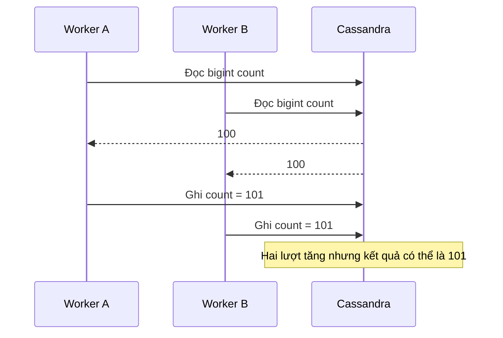
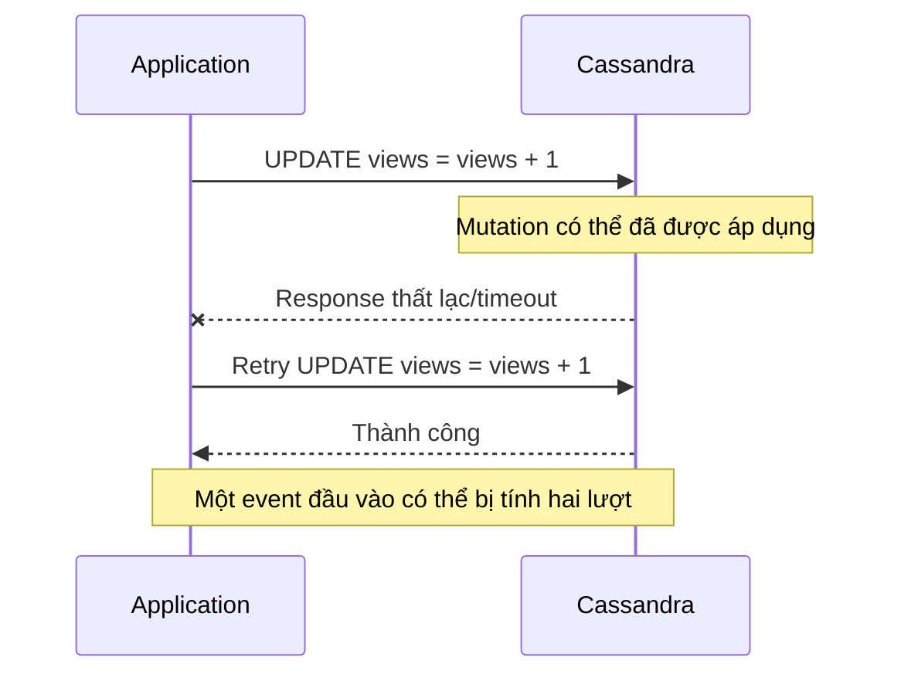
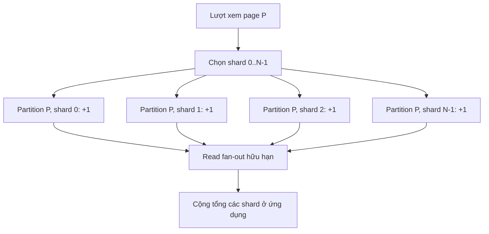
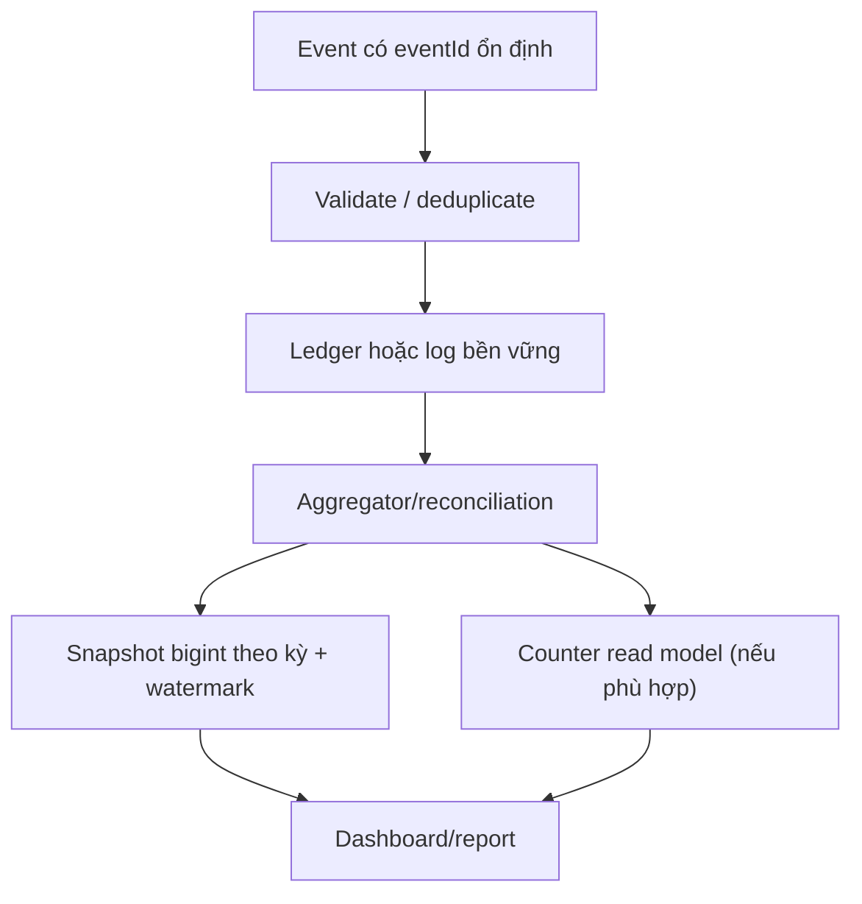

# Kiểu counter và mục đích lưu số đếm phân tán

Một sản phẩm phân tán thường cần lưu những con số liên tục thay đổi: lượt xem tin đăng, số lần tải tài liệu, tổng lần nhấn một nút, số sự kiện đã xử lý hoặc một vài chỉ số thống kê được phân nhóm theo ngày. Nếu nhiều máy ứng dụng cùng cập nhật, kiểu ghi thông thường **đọc số cũ → cộng một → ghi lại** rất dễ làm mất lượt tăng. Apache Cassandra cung cấp một kiểu dữ liệu chuyên biệt là **`counter`**, cho phép gửi **phép tăng/giảm** trực tiếp đến cluster mà không yêu cầu ứng dụng đọc giá trị trước.

Tuy nhiên, counter của Cassandra **không phải một bộ đếm giao dịch chính xác tuyệt đối**. Mỗi phép tăng/giảm là một thao tác có hiệu ứng; nếu request đã được xử lý nhưng client timeout rồi gửi lại, giá trị có thể bị cộng **hai lần**. Counter cũng có giới hạn về schema, CQL, conditional update, TTL, batch và việc reset. Chọn sai counter cho số dư tài khoản hoặc số ghế còn lại có thể gây lỗi nghiêm trọng.

Đây là bài mở đầu chương **Bộ đếm** trong module **`SPRING_DATA_CASSANDRA`**. Module hướng dẫn truy cập Apache Cassandra bằng entity mapping, Repository, `CassandraTemplate` và truy vấn CQL; đồng thời thiết kế bảng theo truy vấn, partition key, consistency level, paging và hiệu năng trên hệ phân tán. Mục tiêu của bài là hiểu đúng **counter là gì, vì sao nó tồn tại, hoạt động ở mức khái niệm ra sao và trường hợp nào thực sự phù hợp**, trước khi triển khai trong ứng dụng Spring.

**Sau bài học, bạn có thể:**

1. Giải thích sự khác nhau giữa CQL `counter` và `int`/`bigint` thông thường.
2. Tạo counter table đúng schema, thực hiện `UPDATE ... SET total = total + 1` và `total = total - 1`.
3. Hiểu vì sao counter xử lý được các lượt tăng cạnh tranh nhưng **không bảo đảm exactly-once** cho request bị retry.
4. Đọc counter qua `CqlSession`/Spring Data, biết những thao tác **không được** thực hiện như `INSERT` giá trị counter hay `IF`.
5. Phân biệt counter thống kê với **tồn kho/số dư/invariant nghiệp vụ** cần CAS, ledger hoặc mô hình khác.
6. Thiết kế khóa và bucket/shard thích hợp khi một metric quá nóng.
7. Áp dụng giới hạn consistency, batch, timeout, quan sát metrics và đối soát.

## 1. Vì sao số đếm khó trong hệ phân tán?

Giả sử một tin đăng có `views = 100`. Hai máy cùng xử lý hai lượt xem:

```text
Máy A: SELECT views -> 100
Máy B: SELECT views -> 100
Máy A: UPDATE views = 101
Máy B: UPDATE views = 101

Mong đợi: 102
Thực tế có thể: 101
```

Đó là **lost update**. Hai máy cùng tính từ một giá trị cũ, rồi ghi đè bằng giá trị mới mà không có điều kiện nguyên tử.



Một giải pháp là dùng **LWT/optimistic locking** trên `bigint`: đọc version, `UPDATE ... IF version = ?`, retry khi conflict. Giải pháp này thích hợp khi cần kiểm tra điều kiện, nhưng một metric nhiều người cùng tăng có thể tạo **điểm tranh chấp Paxos** rất lớn.

Counter của Cassandra cung cấp một mô hình khác: gửi **delta**, không gửi một giá trị tuyệt đối đã tính từ bản sao cũ.

## 2. CQL counter là gì?

`counter` là một kiểu cột đặc biệt của Cassandra, được thiết kế cho các thao tác **tăng hoặc giảm giá trị số nguyên có dấu**. Nó được đọc qua kiểu Java `long`/`Long` tương ứng với số đếm 64-bit, nhưng **không xử lý giống một cột `bigint` bình thường**.

| Loại cột | Ví dụ | Cách cập nhật |
| --- | --- | --- |
| `bigint` | `available = 100` | Ghi giá trị mới: `SET available = 101` |
| `counter` | `views = 100` | Gửi delta: `SET views = views + 1` |

Thao tác hợp lệ:

```sql
UPDATE page_views_by_day
SET views = views + 1
WHERE tenant_id = ?
  AND view_day = ?
  AND page_id = ?;
```

**Ý nghĩa:** client yêu cầu **cộng một lượt** vào counter, không phải yêu cầu “ghi giá trị hiện tại bằng X”. Cassandra sử dụng cơ chế lưu trữ/đồng bộ chuyên biệt cho counter để xử lý các cập nhật phân tán.

### Counter không phải “tổng chính xác của các business event”

Cassandra không tự biết một lượt xem có hợp lệ không, cùng request có bị gửi lại không, người dùng có click trùng không, hay một event đã được xử lý ở service khác chưa. Nếu chương trình gửi **hai phép cộng**, cluster có thể tính **hai lượt**, kể cả chúng phát sinh từ một hành động duy nhất của người dùng.

Đó là khác biệt giữa **cộng dồn thao tác** và **đếm số sự kiện duy nhất**.

## 3. Counter giúp được gì trong hệ phân tán?

Thay vì đọc-đổi-ghi một số tuyệt đối:

```text
READ 100 -> tính 101 -> WRITE 101
```

client chỉ gửi:

```text
INCREMENT +1
INCREMENT +1
```

Hai yêu cầu tăng độc lập có thể cùng đóng góp vào tổng khi hệ thống xử lý thành công. Về mặt phép toán, phép cộng có tính chất giao hoán:

\[
(x + a) + b = (x + b) + a
\]

Điều này hữu ích khi có nhiều nguồn tăng/giảm cùng một chỉ số và không cần kiểm tra một điều kiện nghiệp vụ phức tạp cho từng thao tác.

**Nhưng lưu ý:** giao hoán **không đồng nghĩa idempotent**.

\[
x + 1 + 1 \ne x + 1
\]

Nếu cùng phép tăng được thực thi hai lần do retry, nó vẫn là **hai lần cộng**, không tự bị loại trùng.

## 4. Khi nào nên nghĩ đến counter?

Các tình huống có thể phù hợp:

| Chỉ số | Counter có thể phù hợp? | Điều kiện |
| --- | --- | --- |
| Lượt xem trang/tin đăng | **Có** | Chấp nhận sai lệch do retry/bot/trùng event hoặc có pipeline giảm sai lệch |
| Số lượt nhấn nút | **Có** | Là chỉ số thống kê, không phải nguồn duy nhất cho thanh toán |
| Số lượt tải tài liệu | **Có** | Có giới hạn duplicate và quy tắc đếm rõ |
| Số sự kiện được worker xử lý | **Có**, như telemetry gần đúng | Không dùng làm checkpoint đảm bảo exactly-once |
| Tổng số lần một tính năng được gọi | **Có** | Đã tính đến rate, sampling, hot key và retention |
| Số booking đang hoạt động | **Cần cân nhắc** | Increments/decrements phải cân bằng; reconciliation cần thiết |
| Số ghế còn trống cần không âm | **Không nên dùng đơn độc** | Cần bảo vệ invariant phân bổ/chống oversell |
| Số dư tài khoản/tiền | **Không phù hợp làm nguồn sự thật** | Cần ledger, idempotency và transaction semantics |
| Một mã giảm giá chỉ được dùng một lần | **Không phù hợp làm điều kiện duy nhất** | Cần unique ownership/CAS hoặc mô hình tương đương |

**Cách chọn:** counter tốt khi **giá trị là tổng các delta**, tốc độ cập nhật quan trọng và nghiệp vụ chấp nhận hay có thể **đối soát sai lệch**. Nếu giá trị quyết định tiền, quyền sở hữu, hạn mức cứng hoặc không được âm, phải có cơ chế mạnh hơn.

## 5. Thiết kế bảng đầu tiên: lượt xem theo ngày

Giả sử cần đếm số lượt xem của một trang theo tenant và ngày:

```sql
CREATE TABLE IF NOT EXISTS page_views_by_day (
    tenant_id uuid,
    view_day date,
    page_id uuid,
    views counter,
    PRIMARY KEY ((tenant_id, view_day), page_id)
);
```

| Cột | Vai trò | Vì sao chọn? |
| --- | --- | --- |
| `tenant_id` | Partition key, phần 1 | Giới hạn dữ liệu theo tenant |
| `view_day` | Partition key, phần 2 | Bucket theo ngày/retention |
| `page_id` | Clustering column | Mỗi trang một dòng trong partition ngày/tenant |
| `views` | **Counter column** | Tổng số delta được áp dụng cho trang |

Vì `PRIMARY KEY ((tenant_id, view_day), page_id)`, một truy vấn có tenant/ngày/trang đầy đủ xác định được hàng cần đọc hoặc tăng.

**Đây là schema dạy cú pháp**, chưa chắc là thiết kế tối ưu cho một tenant rất lớn: tất cả các trang của cùng tenant/ngày **nằm chung partition**. Nếu một tenant có hàng triệu trang hoặc số lượt tăng rất lớn, phải đo kích thước/hot partition và có thể đưa `page_id` vào partition key hoặc chia shard.

### Vì sao không thêm title vào bảng counter?

Một counter table không thể tự do trộn các **regular non-counter columns** với counter columns; ngoại lệ là các cột thuộc **primary key**. Ví dụ sau **không hợp lệ** theo mô hình counter table của Cassandra:

```sql
-- KHÔNG hợp lệ: title là một cột thường,
-- views là counter trong cùng counter table.
CREATE TABLE page_views_bad (
    page_id uuid PRIMARY KEY,
    title text,
    views counter
);
```

Giữ metadata của trang ở **bảng thường khác**. Counter table chỉ chứa **primary key và các counter columns**.

## 6. Cú pháp tăng, giảm và đọc counter

Để tăng một lượt:

```sql
UPDATE page_views_by_day
SET views = views + 1
WHERE tenant_id = 5e039fd0-19a2-4be5-a60c-d104b6fae7c1
  AND view_day = '2026-11-25'
  AND page_id = f1a7208a-271e-4e55-b12f-685c65fc8c15;
```

Để tăng thêm năm lượt:

```sql
UPDATE page_views_by_day
SET views = views + 5
WHERE tenant_id = 5e039fd0-19a2-4be5-a60c-d104b6fae7c1
  AND view_day = '2026-11-25'
  AND page_id = f1a7208a-271e-4e55-b12f-685c65fc8c15;
```

Để giảm một lượt:

```sql
UPDATE page_views_by_day
SET views = views - 1
WHERE tenant_id = 5e039fd0-19a2-4be5-a60c-d104b6fae7c1
  AND view_day = '2026-11-25'
  AND page_id = f1a7208a-271e-4e55-b12f-685c65fc8c15;
```

Đọc:

```sql
SELECT tenant_id, view_day, page_id, views
FROM page_views_by_day
WHERE tenant_id = 5e039fd0-19a2-4be5-a60c-d104b6fae7c1
  AND view_day = '2026-11-25'
  AND page_id = f1a7208a-271e-4e55-b12f-685c65fc8c15;
```

**Ý nghĩa:** phép tăng đầu tiên có thể tạo trạng thái counter cho khóa chưa từng được cập nhật. Bạn không phải `INSERT` một dòng giá trị 0 trước rồi mới tăng.

### Nếu SELECT không trả hàng thì sao?

Một key chưa từng được cập nhật có thể **không có hàng kết quả**. Ở API hiển thị, ứng dụng có thể quy ước **“không có hàng = tổng 0”**, nhưng đó là **quy ước trình bày**, không phải bằng chứng Cassandra đã lưu một row có giá trị counter bằng 0.

Nếu cần phân biệt “chưa có hoạt động” và “đã có tăng/giảm nhưng tổng về 0”, chỉ nhìn giá trị counter **không đủ để lưu lịch sử**.

## 7. Những điều CQL counter KHÔNG giống bigint

Một counter có các ràng buộc đặc biệt. Đừng chép một ví dụ CRUD bình thường rồi chỉ đổi kiểu `bigint` thành `counter`.

| Thao tác | Cột `bigint` thường | Cột `counter` |
| --- | --- | --- |
| `INSERT INTO ... VALUES (..., 10)` | Hợp lệ với schema phù hợp | **Không dùng để khởi tạo/đặt giá trị counter** |
| `UPDATE SET value = 10` | Hợp lệ | **Không hợp lệ**: counter cập nhật bằng delta |
| `UPDATE SET value = value + 1` | Không phải cú pháp tăng cột thường như SQL ở mọi CQL | **Đúng dạng counter update** |
| `IF value = 10` trên UPDATE | Có thể dùng LWT trên cột thường khi hợp lệ | **Không hỗ trợ CAS/LWT trên counter update** |
| `USING TTL` | Có thể dùng cho cột thường | **Không dùng TTL cho counter** |
| `USING TIMESTAMP` | Có thể dùng với mutation thường theo quy tắc CQL | **Không đặt explicit timestamp cho counter update** |
| Trộn với cột `text` thường trong một bảng | Có | **Không**; chỉ primary key + counters |
| Đếm lại từ nguồn sự kiện | Có thể đặt lại một `bigint` sau đối soát | Không có phép `SET counter = absoluteValue` đơn giản |

**Hai lỗi nhiều người gặp:**

```sql
-- Sai: counter không nhận INSERT để đặt một giá trị.
-- INSERT INTO page_views_by_day
-- (tenant_id, view_day, page_id, views)
-- VALUES (?, ?, ?, 0);

-- Sai: counter không cho SET giá trị tuyệt đối.
-- UPDATE page_views_by_day
-- SET views = 100
-- WHERE tenant_id = ? AND view_day = ? AND page_id = ?;
```

Tất cả đường ghi counter nên có contract **delta** rõ ràng. Không dùng entity `save` thông thường để biểu đạt ý định “ghi giá trị hiện tại bằng N”.

## 8. Counter table có nhiều counter columns được không?

Có. Một bảng counter có thể chứa nhiều cột counter:

```sql
CREATE TABLE IF NOT EXISTS page_metrics_by_day (
    tenant_id uuid,
    metric_day date,
    page_id uuid,
    views counter,
    downloads counter,
    shares counter,
    PRIMARY KEY ((tenant_id, metric_day), page_id)
);
```

Tăng lượt xem và lượt chia sẻ:

```sql
UPDATE page_metrics_by_day
SET views = views + 1,
    shares = shares + 1
WHERE tenant_id = ?
  AND metric_day = ?
  AND page_id = ?;
```

**Cần phân biệt:**

- Nhiều counter columns **có thể cùng nằm trong counter table**.
- Counter vẫn không đi chung với `title text` hoặc `price bigint` dạng regular non-key columns.
- Một mutation cập nhật hai counter không làm toàn bộ hệ thống event/notification trở thành transaction.
- Nếu một trong hai delta cần bị từ chối vì nghiệp vụ, counter update **không có `IF`** để kiểm tra điều kiện đó.

Nếu nhu cầu là “mỗi một lượt xem chỉ được tính đúng một lần, và chỉ người dùng có quyền mới được tính”, hệ thống còn phải làm **authentication, event deduplication và validation** ở tầng ứng dụng.

## 9. Điều gì làm counter trở thành “phân tán”?

Các giá trị của Cassandra được sao chép qua nhiều replica theo **replication factor** và chiến lược đặt dữ liệu của keyspace. Counter dùng cơ chế lưu trữ và đồng bộ chuyên biệt để kết hợp các cập nhật số học từ hệ thống phân tán; cách biểu diễn nội bộ có thể liên quan đến những phần đếm theo replica/shard và reconciliation.

Không nên hình dung rằng mọi increment đều:

```text
Đọc tổng 100 trên một máy -> ghi tổng 101 lên tất cả máy
```

Counter không đơn thuần là một bigint được đặt dưới cơ chế regular last-write-wins. Mục đích của nó là xử lý **delta updates** trong môi trường replica.

### Những điều không nên suy từ cơ chế phân tán

- Không bảo đảm mọi replica hiển thị cùng tổng **ngay lập tức trong mọi điều kiện**.
- Không bảo đảm một request đến hai lần chỉ tính một lần.
- Không thay thế quyền truy cập hay validation.
- Không có một giao dịch global nối counter với mọi bảng khác.
- Không biến tổng counter thành lịch sử đầy đủ các delta đã được gửi.

**Cách nhìn phù hợp:** counter là **vật liệu hóa tổng tích lũy** được quản lý bởi Cassandra với ngữ nghĩa cập nhật đặc biệt, không phải ledger có thể kiểm tra từng đơn vị giao dịch.

## 10. Tính giao hoán khác tính idempotent

Đây là ý quan trọng nhất khi triển khai:

**Phép cộng giao hoán:**

\[
100 + 3 + 2 = 100 + 2 + 3
\]

**Phép cộng không idempotent:**

\[
100 + 3 + 3 \ne 100 + 3
\]

Nếu cùng một event `VIEWED` được worker xử lý hai lần, Cassandra không có thông tin để phân biệt đó là **hai lượt xem hợp lệ** hay **một lượt xem bị xử lý lặp**.



**Counter update không phù hợp để driver tự retry như một request idempotent.** Nếu chưa biết kết quả request đầu, gửi lại có thể tạo **một lần cộng bổ sung**.

### Không “sửa” bằng cách tăng consistency

Chọn `LOCAL_QUORUM` hay `QUORUM` có thể ảnh hưởng số replica phải phản hồi, nhưng **không tự deduplicate hai lần thực thi của cùng một phép cộng**. Quorum không biến `x = x + 1` thành thao tác có ID duy nhất.

## 11. Timeout: đừng suy ra phép tăng thất bại

Một counter update có thể gặp:

- Timeout client vì mạng/chậm replica.
- Replica unavailable.
- Coordinator lỗi trong thời điểm xử lý.
- Timeout hoặc retry từ gateway/HTTP client.
- Worker bị restart sau khi gửi request nhưng trước khi lưu checkpoint.

Với các tình huống **outcome chưa rõ**, có ít nhất hai khả năng:

```text
A. Counter update chưa được áp dụng -> retry là cần thiết.
B. Counter update đã được áp dụng -> retry có thể đếm đôi.
```

Ứng dụng không thể suy ra chính xác A/B chỉ từ một timeout. Hãy định nghĩa chính sách theo yêu cầu:

| Mục tiêu | Hướng xử lý |
| --- | --- |
| Metric gần đúng, chấp nhận lệch nhẹ | Có thể ưu tiên không retry/mất một phần event và ghi nhận sai lệch |
| Metric có thể tính lại từ event log | Dùng log làm nguồn sự thật, counter là read model và đối soát định kỳ |
| Mỗi sự kiện phải tính đúng một lần | Đặt idempotency/dedup ở nguồn đáng tin cậy và giải quyết khoảng trống giữa dedup + increment |
| Tiền/tồn kho/quota cứng | Không dùng raw counter update làm nguồn quyết định duy nhất |

**Lưu ý:** ngay cả khi worker có `event_id`, riêng CQL counter update **không nhận `IF event_id chưa xử lý`** trong cùng row. Dedup ở một bảng khác và tăng counter ở bảng này **không tự là giao dịch nguyên tử xuyên hai partition**.

## 12. Vì sao không có exactly-once mặc định?

Giả sử consumer xử lý message từ một broker:

```text
1. Nhận event E.
2. UPDATE counter +1.
3. Ghi nhận/ack offset event E.
```

Nếu consumer chết **sau bước 2 nhưng trước bước 3**, broker có thể gửi lại E. Lần xử lý sau có thể tăng counter lần nữa.

Đổi thứ tự cũng có vấn đề:

```text
1. Nhận event E.
2. Ack offset E.
3. UPDATE counter +1.
```

Nếu consumer chết sau bước 2 nhưng trước bước 3, lượt tăng có thể bị **mất**.

Đó là ranh giới atomicity giữa hai hệ thống. Cassandra counter không cung cấp khóa idempotency cho từng phép cộng; broker và Cassandra không tự tham gia chung một transaction toàn cục.

**Các phương án cần cân nhắc:**

1. Cho phép **at-least-once** và sai lệch nhỏ, công bố metric là gần đúng.
2. Lưu **event ledger** với ID duy nhất; tính/đối soát tổng từ ledger.
3. Dùng bộ tổng hợp theo **window/batch** có checkpoint và cơ chế thay thế snapshot theo version vào bảng thường.
4. Chọn một hệ thống/phân tích có semantics aggregation/idempotency phù hợp hơn nếu cần đúng tuyệt đối.

Không tuyên bố “đã dedup trước khi increment” là đủ cho exactly-once nếu hai bước vẫn có một cửa sổ lỗi không được xử lý.

## 13. Counter có thể âm không?

Counter là số nguyên có dấu; một phép giảm có thể làm tổng âm nếu ứng dụng gửi delta âm nhiều hơn delta dương.

```sql
UPDATE page_views_by_day
SET views = views - 10
WHERE tenant_id = ?
  AND view_day = ?
  AND page_id = ?;
```

Nếu trước đó tổng bằng 3, phép trừ 10 không tự bị Cassandra từ chối chỉ vì kết quả logic sẽ là `-7`.

**Không dùng counter đơn lẻ để giữ invariant “không bao giờ âm”.**

Ví dụ “số ghế còn trống” cần:

- Kiểm tra người dùng có quyền giữ chỗ.
- Bảo đảm hai yêu cầu cạnh tranh không bán cùng một slot.
- Không cấp phát vượt quota.
- Xử lý retry, hoàn tiền và timeout.

Counter không có `UPDATE ... IF views >= 10` tương đương CAS để bảo đảm những điều kiện đó. Tốt hơn là thiết kế **quyền sở hữu slot**, **LWT trên hàng thông thường**, ledger hoặc quy trình phân bổ phù hợp.

## 14. Counter không phải cách đặt lại giá trị tuyệt đối

Một cột `bigint` có thể được cập nhật:

```sql
UPDATE metric_snapshots_by_day
SET total = 1000
WHERE ...;
```

Nhưng `counter` không hỗ trợ phép gán kiểu:

```sql
-- SAI cho counter:
-- UPDATE page_views_by_day SET views = 0 WHERE ...;
```

### Nếu muốn bắt đầu kỳ đếm mới?

Ưu tiên **tạo khóa/bucket mới** (ví dụ `view_day` ngày mới hoặc `generation` mới trong partition key) thay vì cố reset counter cũ.

### Nếu phát hiện bộ đếm lệch?

Một phép bù `views = views - k` là **một delta mới**, có rủi ro timeout/retry giống phép cộng. Nó không tương đương sửa một row theo version và cũng không ghi nhận lịch sử event thiếu.

Nếu cần một số tuyệt đối đáng tin cậy sau đối soát, hãy cân nhắc **bảng snapshot thường** tách khỏi counter, lưu `total bigint` kèm version/watermark được tính từ nguồn có thể replay.

## 15. DELETE counter và tái sử dụng khóa: điểm cần thận trọng

Cassandra dùng thông tin xóa/tombstone và đồng bộ replica để giải quyết phiên bản dữ liệu. Với counter, việc **xóa rồi dùng lại cùng khóa để tăng tiếp** có thể có những caveat về trạng thái các replica, repair, replay và lịch sử counter tùy phiên bản/điều kiện vận hành.

**Không coi chuỗi thao tác này như một reset an toàn và nguyên tử:**

```text
DELETE counter cũ
-> UPDATE counter +1 trên đúng cùng key
-> giả định mọi replica cùng nhìn thấy số mới bắt đầu từ 1
```

Đặc biệt trong hệ phân tán có replica tạm thời offline, đừng dùng xóa counter để “xóa sạch lịch sử” rồi dựa trên tổng mới làm nguồn sự thật quan trọng.

**Khuyến nghị:** dùng **bucket/generation key mới**, lưu trạng thái kỳ đếm trong bảng metadata thường, xử lý retention/xóa theo quy trình đã kiểm thử với đúng Cassandra version và topology. Không gắn TTL trực tiếp lên counter.

## 16. Counter và TTL: khác bảng metric thông thường

Cột dữ liệu thường có thể dùng `USING TTL` để tự hết hạn sau một khoảng thời gian, nhưng counter có giới hạn riêng và **không dùng TTL như một cột thường**.

```sql
-- KHÔNG hợp lệ cho counter:
-- UPDATE page_views_by_day USING TTL 3600
-- SET views = views + 1
-- WHERE tenant_id = ? AND view_day = ? AND page_id = ?;
```

Nếu cần đếm 24 giờ gần nhất:

1. Bucket counter theo **ngày/giờ**.
2. Khi đọc, lấy danh sách bucket nằm trong cửa sổ.
3. Cộng tổng các bucket ở ứng dụng hoặc read model phù hợp.
4. Thiết kế retention/delete cho bucket **không còn sử dụng**, có kiểm thử ràng buộc về counter/repair.
5. Đừng nghĩ có thể gắn `TTL 86400` vào counter để duy trì sliding window mà không thiết kế bucket.

**Cảnh báo:** “24 giờ gần nhất” theo giờ thực là một cửa sổ trượt; bucket theo **ngày lịch** có thể cần đọc **hai hoặc nhiều bucket** và xử lý ranh giới thời gian. Một bucket theo ngày không tự tương đương 24 giờ liên tục.

## 17. Counter và IF/LWT: không trộn hai cơ chế

LWT dùng Paxos để kiểm tra điều kiện trên những thao tác Cassandra hỗ trợ, ví dụ:

```sql
UPDATE booking_state_by_id
SET business_version = 4
WHERE booking_id = ?
IF business_version = 3;
```

Với counter, **conditional update theo counter value không được hỗ trợ**:

```sql
-- SAI: không dùng IF như một CAS trên counter.
-- UPDATE page_views_by_day
-- SET views = views + 1
-- WHERE tenant_id = ? AND view_day = ? AND page_id = ?
-- IF views < 100;
```

Một counter update **không tự đảm bảo** điều kiện “chưa vượt 100” và cũng không có `[applied]` giống LWT để báo phiên bản bị từ chối.

### Nếu cần giới hạn đúng 100 lượt sử dụng?

Thiết kế một **bảng cấp quyền/slot** với một hàng mỗi quyền sử dụng, hoặc một **record versioned** có CAS và các yêu cầu của workflow. Đừng dùng counter `uses` làm bộ quyết định duy nhất:

```text
Đọc counter = 99
Hai worker cùng thấy còn 1 lượt
Cả hai cùng gửi +1
-> tổng có thể vượt 100
```

Một bộ đếm có thể dùng để **hiển thị thống kê**, trong khi nguồn sự thật cho số lượt được cấp phải nằm ở cơ chế có điều kiện và idempotency thích hợp.

## 18. Spring Data Cassandra: điều gì được tự động hóa?

Spring Data Cassandra cho phép truy cập dữ liệu bằng Repository, `CassandraTemplate`, `CqlOperations`/`CqlTemplate` và bean `CqlSession`. Chúng giúp quản lý kết nối, ánh xạ kiểu, xử lý query và tích hợp với Spring.

**Nhưng abstraction không thay đổi CQL counter semantics:**

- `repository.save(entity)` được thiết kế cho CRUD/entity persistence; **không xem đó là cách chuẩn để tăng counter**.
- `@Version` trên entity thường phục vụ optimistic locking theo phiên bản, **không cho phép gắn LWT lên counter column**.
- `CassandraTemplate` có API update/query, nhưng không được giả định mọi cách truyền một `Long` đều thành delta counter hợp lệ.
- `CqlSession`/`CqlOperations` với câu CQL `SET views = views + ?` thể hiện rõ mục đích thao tác.

Một mô hình hợp lý: **Repository đọc entity/metadata thường**, còn **counter gateway** có các method `incrementView`, `decrementView` và `getViewCount`.

## 19. Entity mapping counter để đọc

Nếu muốn ánh xạ kết quả counter thành đối tượng Java, cần tôn trọng khóa tổng hợp. Đoạn mapping sau là ví dụ cơ bản:

```java
package example.metrics.data;

import java.io.Serializable;
import java.time.LocalDate;
import java.util.UUID;
import org.springframework.data.cassandra.core.mapping.PrimaryKeyClass;
import org.springframework.data.cassandra.core.mapping.PrimaryKeyColumn;
import org.springframework.data.cassandra.core.mapping.PrimaryKeyType;

@PrimaryKeyClass
public class PageViewKey implements Serializable {
    @PrimaryKeyColumn(
            name = "tenant_id", ordinal = 0,
            type = PrimaryKeyType.PARTITIONED)
    private UUID tenantId;

    @PrimaryKeyColumn(
            name = "view_day", ordinal = 1,
            type = PrimaryKeyType.PARTITIONED)
    private LocalDate viewDay;

    @PrimaryKeyColumn(
            name = "page_id", ordinal = 2,
            type = PrimaryKeyType.CLUSTERED)
    private UUID pageId;

    public PageViewKey() {}

    // Bổ sung constructor/getters/setters/equals/hashCode.
}
```

Entity:

```java
package example.metrics.data;

import org.springframework.data.cassandra.core.mapping.Column;
import org.springframework.data.cassandra.core.mapping.PrimaryKey;
import org.springframework.data.cassandra.core.mapping.Table;

@Table("page_views_by_day")
public class PageViewCounter {
    @PrimaryKey
    private PageViewKey key;

    @Column("views")
    private Long views;

    public PageViewCounter() {}

    // Bổ sung constructor/getters/setters.
}
```

**Các đoạn mã tập trung vào mapping**, chưa đủ thành compilation units hoàn chỉnh khi chưa bổ sung getters/setters và `equals/hashCode`. Cột CQL `counter` có kiểu số nguyên 64-bit khi đọc; hãy kiểm tra conversion của Spring Data/driver đúng phiên bản dự án.

**Quan trọng:** mapping `Long views` nhằm **đọc giá trị**, không phải cho phép `save(new PageViewCounter(..., 500L))` đặt counter thành 500. CQL counter vẫn chỉ hỗ trợ delta updates.

## 20. Java Driver 4.x: gửi delta bằng PreparedStatement

Một gateway đơn giản có thể nhận một `CqlSession` do Spring quản lý và chuẩn bị truy vấn một lần:

```java
package example.metrics.data;

import java.time.LocalDate;
import java.util.UUID;

import com.datastax.oss.driver.api.core.CqlSession;
import com.datastax.oss.driver.api.core.DefaultConsistencyLevel;
import com.datastax.oss.driver.api.core.cql.BoundStatement;
import com.datastax.oss.driver.api.core.cql.PreparedStatement;

public final class PageViewCounterGateway {
    private final CqlSession session;
    private final PreparedStatement increment;

    public PageViewCounterGateway(CqlSession session) {
        this.session = session;
        this.increment = session.prepare("""
            UPDATE page_views_by_day
            SET views = views + ?
            WHERE tenant_id = ?
              AND view_day = ?
              AND page_id = ?
            """);
    }

    public void addViews(UUID tenantId,
                         LocalDate day,
                         UUID pageId,
                         long delta) {
        if (tenantId == null || day == null || pageId == null) {
            throw new IllegalArgumentException("Missing counter key");
        }
        if (delta <= 0 || delta > 1000) {
            throw new IllegalArgumentException(
                "Delta must be between 1 and 1000");
        }

        BoundStatement statement = increment
            .bind(delta, tenantId, day, pageId)
            .setConsistencyLevel(
                DefaultConsistencyLevel.LOCAL_QUORUM)
            .setIdempotent(false);

        session.execute(statement);
    }
}
```

**Giải thích:**

1. `UPDATE ... SET views = views + ?` dùng đúng phép tăng counter.
2. `delta` được giới hạn trong ví dụ để tránh input tùy ý quá lớn; giá trị 1000 là **chính sách minh họa**, không phải giới hạn chuẩn của Cassandra.
3. `setIdempotent(false)` làm rõ thao tác **không an toàn để thực thi lại một cách tùy tiện**. Việc retry còn phụ thuộc policy của driver/app; không nên chỉ dựa vào một flag mà bỏ qua kiến trúc xử lý lỗi.
4. `LOCAL_QUORUM` là ví dụ consistency; lựa chọn thực tế phụ thuộc RF, local DC, topology và SLO.
5. Không tạo/đóng `CqlSession` mỗi request; session nên được tái sử dụng.

Với một phép giảm, nên có **một prepared statement riêng** chứa `views = views - ?`, đồng thời xác thực delta dương. Đừng tự nhận đầu vào delta âm rồi ghép chuỗi CQL tùy ý.

### Vì sao đặt non-idempotent tường minh?

Counter update có hiệu ứng mỗi lần thực thi. Một retry, speculative execution hoặc duplicate từ service có thể làm tăng/giảm nhiều lần. Việc khai báo `setIdempotent(false)` trên statement giúp driver áp dụng các chính sách liên quan đến idempotence phù hợp; tuy nhiên **retry ở gateway hoặc message consumer vẫn do hệ thống bạn kiểm soát**.

## 21. Đọc counter bằng Java Driver

Một prepared SELECT theo **khóa đầy đủ**:

```java
import java.time.LocalDate;
import java.util.UUID;
import com.datastax.oss.driver.api.core.cql.PreparedStatement;
import com.datastax.oss.driver.api.core.cql.Row;

PreparedStatement query = session.prepare("""
    SELECT views
    FROM page_views_by_day
    WHERE tenant_id = ?
      AND view_day = ?
      AND page_id = ?
    """);

Row row = session.execute(
        query.bind(tenantId, day, pageId))
    .one();

long views = row == null ? 0L : row.getLong("views");
```

Ở đây `row == null ? 0L` là **quy ước của API hiển thị**, không có nghĩa mọi key chưa tồn tại đều đã có counter 0 được ghi vật lý.

### Có phải đọc ngay sau ghi luôn thấy tổng chính xác?

Không nên cam kết quá mức. Khả năng quan sát phụ thuộc **consistency level, replication, tình trạng cluster, các ghi đồng thời và thời điểm đọc**. Ngay cả khi chọn `LOCAL_QUORUM`, câu SELECT nhận được là một **quan sát tại một thời điểm**, không phải lịch sử mọi event, cũng không đảm bảo client biết request timeout trước đã được áp dụng hay chưa.

Nếu endpoint API cần hiển thị một con số thống kê, có thể chấp nhận độ trễ/cập nhật muộn. Nếu số đếm quyết định tiền hoặc quyền sở hữu, không dùng SELECT counter như một điều kiện quyết định cuối cùng.

## 22. Repository và CassandraTemplate: dùng thế nào cho hợp lý?

Với một counter table, Repository có thể hữu ích cho **đọc theo ID** hoặc query cố định, nếu mapping/driver/version hỗ trợ kiểu counter tương ứng:

```java
import org.springframework.data.cassandra.repository.CassandraRepository;

public interface PageViewReadRepository
        extends CassandraRepository<PageViewCounter, PageViewKey> {
    // Dùng findById(...) để đọc theo khóa,
    // không dùng save(...) để "set views = 10".
}
```

Nếu dùng `CassandraTemplate` hoặc `CqlOperations`:

- Đối với **đọc**, tận dụng mapping hoặc `RowMapper` để lấy `Long`.
- Đối với **ghi**, phải tạo CQL **counter increment/decrement** hợp lệ, không phải UPDATE regular set value.
- Khi API Template cung cấp helper tăng/giảm, kiểm tra JavaDoc/version và CQL phát sinh trước khi sử dụng.
- Khi cần kiểm soát retry/idempotence, driver gateway trực tiếp thường dễ review hơn.

**Đừng trộn hai abstraction để vô tình đổi semantics:** một dòng counter đọc thành entity **không có nghĩa** một entity với `views = 500` có thể được save lại như dữ liệu thường.

### Kiểm soát tenant

`tenant_id` nên được xác định từ ngữ cảnh xác thực/ủy quyền hợp lệ; không lấy mù một UUID từ input client. Nếu cho phép mỗi caller gửi delta tùy ý, kẻ tấn công có thể làm sai thống kê hoặc tạo hot partition.

## 23. COUNTER BATCH là gì?

CQL có loại batch dành riêng cho counter:

```sql
BEGIN COUNTER BATCH
    UPDATE page_metrics_by_day
    SET views = views + 1
    WHERE tenant_id = ?
      AND metric_day = ?
      AND page_id = ?;

    UPDATE page_metrics_by_day
    SET downloads = downloads + 1
    WHERE tenant_id = ?
      AND metric_day = ?
      AND page_id = ?;
APPLY BATCH;
```

**Lưu ý:**

1. Dùng `COUNTER BATCH` cho các **counter updates**, không trộn mutation counter với INSERT/UPDATE regular non-counter.
2. Batch counter **không trở thành LWT**: không có `IF views < 100`, không tự deduplicate một request replay.
3. Batch không phải cách “đảm bảo mỗi message chỉ đếm một lần”; nếu cả batch bị thực thi lặp, các delta trong batch cũng có thể bị cộng lặp.
4. Đừng gom hàng nghìn counter updates vào một batch nhiều partition với hy vọng tối ưu throughput.
5. Hãy đo overhead thực tế; nhiều counter ở những partition khác nhau thường cần một chiến lược phân tán lưu lượng phù hợp.

### Không dùng LOGGED/UNLOGGED batch thông thường để trộn counter

Counter data có quy tắc riêng, nên dùng đúng loại counter batch khi cần nhóm counter statements. Một batch chứa **cả** counter và regular mutation không phải một transaction Cassandra hợp lệ cho mọi loại CQL.

**Quan trọng:** `COUNTER BATCH` không thay thế transaction SQL nhiều bước và không cung cấp đảm bảo exactly-once cho các delta.

## 24. Hot counter và partition key

Một metric như “tổng lượt xem toàn nền tảng hôm nay” có thể nhận **rất nhiều cập nhật mỗi giây**. Nếu mọi ghi đi vào một partition/key, một nhóm replica có thể trở thành **điểm nóng**, dù toàn cluster còn nhiều tài nguyên.

```text
Tất cả request:
  UPDATE global_views SET count = count + 1 WHERE id = 'today'

                 |
                 v
             Một partition
                 |
                 v
       Replica set phục vụ key này
```

Vấn đề không chỉ là số row trong partition: **tần suất cập nhật vào cùng partition**, contention, network, CPU và I/O đều có thể làm tail latency tăng.

### Chọn khóa theo câu hỏi truy vấn

Nếu API luôn hỏi “lượt xem trang P trong ngày D”, có thể cân nhắc partition key `(tenant_id, day, page_id)` để phân bố các trang, thay vì chỉ `(tenant_id, day)`.

Nếu **một trang P quá nóng**, ngay cả partition theo page vẫn có thể quá tải. Khi đó cần **sharded counter**.

## 25. Sharded counter: chia một chỉ số thành nhiều partition

Một cách giảm hot key là chia cùng metric thành **N shard**, mỗi shard có **partition key khác nhau**:

```sql
CREATE TABLE IF NOT EXISTS page_views_sharded (
    tenant_id uuid,
    view_day date,
    page_id uuid,
    shard_no int,
    views counter,
    PRIMARY KEY ((tenant_id, view_day, page_id, shard_no))
);
```

Ở đây `shard_no` **nằm trong partition key**, không chỉ là clustering column. Vì vậy các shard có thể được phân tán giữa nhiều partition/replica set.



**Ghi:** chọn shard bằng một hàm phân bố phù hợp (ví dụ hash request ID ổn định hoặc random có kiểm soát), rồi gửi delta cho đúng shard.

**Đọc:** query **từng shard** trong phạm vi N hữu hạn, rồi cộng các giá trị ở ứng dụng:

\[
\text{views}(P,D) = \sum_{s=0}^{N-1} \text{counter}(P,D,s)
\]

### Đánh đổi của sharding

| Lợi ích | Chi phí |
| --- | --- |
| Giảm áp lực lên một partition nóng | Đọc phải fan-out nhiều partition |
| Tăng khả năng phân bố write load | Tổng có thể nhìn thấy các shard ở thời điểm khác nhau |
| Có thể tăng N khi quy mô yêu cầu | Cần quản lý **shard generation/N** và đường đọc tương thích |
| Mỗi write vẫn là một delta đơn giản | Retry vẫn có thể cộng trùng; sharding không tạo exactly-once |

Đừng thay N từ 16 sang 32 mà **chỉ đọc 32 shard mới** và bỏ số cũ. Có thể dùng generation/bucket version và tổng hợp cả tập shard cũ theo chính sách migration.

## 26. Bucketing theo thời gian và giới hạn partition

Đếm theo ngày/giờ thường hữu ích vì:

1. API thường có câu hỏi thống kê theo khoảng thời gian.
2. Mỗi bucket có tuổi thọ nghiệp vụ rõ hơn.
3. Có thể điều phối retention và lưu trữ lịch sử theo kỳ.
4. Tránh một partition duy nhất tăng vô hạn trong nhiều năm.

Ví dụ:

| Query | Bucket phù hợp để cân nhắc |
| --- | --- |
| Lượt xem hôm nay | Theo ngày |
| Lượt xem trong một giờ gần đây | Theo giờ hoặc nhỏ hơn nếu cần |
| Thống kê 90 ngày | Theo ngày, có tổng hợp định kỳ |
| Tổng năm | Snapshot tổng hợp theo tháng/năm, không quét vô hạn bucket |

**Bucket không làm phép đếm chính xác hơn**: nó chỉ giúp phân vùng dữ liệu và query. Nếu một request bị xử lý hai lần trong cùng bucket, vẫn có thể tăng hai lần.

### Kết hợp bucket với shard

Khi một page nổi tiếng có hàng trăm nghìn lượt xem/giây, có thể dùng:

```text
partition key = (tenant_id, time_bucket, page_id, shard_no)
```

Việc lựa chọn N, độ rộng bucket, đọc tổng, TTL/retention ở các bảng nguồn phải theo workload thực tế. **Không thêm shard cho mọi metric nhỏ** vì sẽ tăng chi phí đọc và độ phức tạp không cần thiết.

## 27. Consistency level cho counter

Counter hoạt động trên nhiều replica nên consistency level vẫn có vai trò. Tuy nhiên, **counter consistency không đồng nghĩa một counter ledger tuyến tính hóa mọi event**.

| Level | Ý nghĩa khi cân nhắc | Không bảo đảm |
| --- | --- | --- |
| `ONE` / `LOCAL_ONE` | Mức phản hồi thấp hơn, có thể giảm độ trễ tùy topology | Không bảo đảm đã nhìn thấy tất cả cập nhật cạnh tranh |
| `LOCAL_QUORUM` | Yêu cầu quorum replica tại DC cục bộ theo RF | Không chống double count do retry |
| `QUORUM` | Quorum theo RF của keyspace/replica set | Không tạo CAS/unique event ID |
| `ALL` | Yêu cầu phản hồi rộng hơn, nhạy với replica lỗi | Không biến counter thành số dư giao dịch |

Lựa chọn thực tế phải dựa trên **RF, NetworkTopologyStrategy, DC cục bộ của driver, SLA và khả năng sẵn sàng**. Một cặp consistency levels cho write/read chỉ giúp suy luận về mức phản hồi/khả kiến dưới điều kiện cụ thể; không loại bỏ tất cả vấn đề retry và hội tụ.

### Multi-DC

- Nếu app đọc/ghi chủ yếu trong một DC, thường cân nhắc các level `LOCAL_*`.
- Nếu app ghi counter từ nhiều DC, phải đánh giá replication lag, clock/network, sự cố vùng và semantics đọc tổng.
- Không trộn các chính sách khác nhau một cách tùy tiện rồi khẳng định mọi region luôn thấy cùng số ở mọi thời điểm.

**Quan trọng:** `SERIAL` và `LOCAL_SERIAL` dành cho **LWT/Paxos**, không dùng chúng làm phương án “nâng cấp” counter update thành CAS.

## 28. Quan sát hiệu năng và bảo vệ API

Một hệ thống đếm lượt xem có thể bị tấn công hoặc quá tải nếu mỗi client trực tiếp gửi:

```text
POST /metrics/add?delta=100000000000
```

**Không để client tự do quyết định delta**, trừ API nội bộ đã có quyền và validation:

- Xác thực principal và tenant.
- Ràng buộc page/metric hợp lệ trước khi tăng.
- Giới hạn `delta` (thường chỉ `+1` cho lượt xem hợp lệ).
- Rate limit theo tenant/page/IP/session tùy chính sách.
- Ghi nhận có sampling, bot filtering hoặc dedup business event không.
- Không log nhạy cảm hoặc mọi request ID ở mức quá chi tiết.

### Metrics cần theo dõi

| Nhóm | Chỉ số |
| --- | --- |
| API | QPS, p50/p95/p99 latency, rate limit |
| Driver | Request timeout, retry count, in-flight, pending requests |
| Counter | Delta write rate, read rate, distribution theo key/shard |
| Cluster | CPU, GC, network, disk I/O, replica health |
| Partition | Hot keys, partition size, tombstone/compaction |
| Chất lượng dữ liệu | Sai lệch với event log, duplicate rate, thời gian reconciliation |
| Recovery | Số update có outcome không rõ, backlog replay |

### Chi phí đọc tổng sharded

Nếu một tổng có 128 shard và client đọc chúng mỗi lần tải trang, mỗi request sẽ fan-out tới nhiều partition. Có thể dùng **cache/snapshot tổng** được cập nhật định kỳ để giảm tải, nhưng phải chấp nhận độ trễ dữ liệu và chỉ rõ tổng đó là **eventually updated**.

## 29. Counter so với bảng ledger/snapshot

Khi mục tiêu thật sự là **thống kê lượt xem**, counter có thể là một read model hợp lý. Nhưng khi mục tiêu là **biết chính xác sự kiện nào đã xảy ra**, cần một nguồn có thể kiểm tra.

Một event ledger đơn giản:

```sql
CREATE TABLE IF NOT EXISTS view_events_by_page_day (
    tenant_id uuid,
    view_day date,
    page_id uuid,
    event_id uuid,
    occurred_at timestamp,
    PRIMARY KEY ((tenant_id, view_day, page_id), event_id)
);
```

Với event ID ổn định, một quy trình có thể dùng `INSERT ... IF NOT EXISTS` theo event ID để **dedup tại bảng ledger**. Nhưng **đừng suy ra** bước ledger LWT và bước cập nhật counter ở **bảng counter khác** đã thành một transaction.

Một kiến trúc thường gặp:



**Bảng lựa chọn:**

| Nhu cầu | Counter | Ledger + snapshot |
| --- | --- | --- |
| Ghi delta tần suất cao | Thuận tiện | Cần ingestion/aggregation |
| Query tổng đơn giản | Thuận tiện | Thuận tiện sau materialization |
| Audit từng event | **Không** | **Có**, nếu lưu đầy đủ |
| Deduplicate theo event ID | Không trực tiếp | Có thể thiết kế |
| Tính lại tổng sau phát hiện lỗi | Khó nếu thiếu nguồn gốc | Có thể replay/đối soát |
| Chính xác cho tiền/quota | Không dùng đơn độc | Cần thêm transaction/invariant phù hợp |
| Rủi ro ghi trùng do retry | Có | Có thể xử lý nếu thiết kế đúng |

Đừng gọi ledger + snapshot tự động “exactly-once” nếu pipeline chưa giải quyết hết transaction boundaries, replay và idempotency.

## 30. Câu hỏi quan trọng: counter có phải CRDT hoàn chỉnh?

Các hệ thống phân tán thường dùng khái niệm CRDT (conflict-free replicated data type) để nói về dữ liệu có thể hợp nhất dưới những quy tắc nhất định. Counter của Cassandra có cơ chế nội bộ đặc biệt phục vụ việc tổng hợp các thay đổi trên replica, nhưng **API CQL counter không nên được đồng nhất với một CRDT application-level mang bảo đảm exactly-once/idempotent event processing**.

Một service vẫn phải giải quyết:

- Message bị gửi lại.
- API timeout sau khi mutation đã được áp dụng.
- Worker restart giữa update và checkpoint.
- Increments/decrements tạo từ event sai hoặc không hợp lệ.
- Tổng phải sửa sau một lần ingest dữ liệu lịch sử.
- Số shard/partition thay đổi theo thời gian.

**Vì sao nêu điểm này?** Từ “replicated counter” dễ khiến developer nghĩ “Cassandra tự dedup mọi phép tăng”. Không có cơ sở để hứa điều đó. **Khả năng hợp nhất replica** và **deduplication request nghiệp vụ** là hai bài toán khác nhau.

## 31. Bài thực hành A: tăng và đọc một counter

Thực hành trong **keyspace test**, không dùng số liệu sản phẩm thật.

**Bước 1 — Tạo bảng**:

```sql
CREATE TABLE IF NOT EXISTS page_views_by_day (
    tenant_id uuid,
    view_day date,
    page_id uuid,
    views counter,
    PRIMARY KEY ((tenant_id, view_day), page_id)
);
```

**Bước 2 — Tăng lần đầu** cho một key chưa có:

```sql
UPDATE page_views_by_day
SET views = views + 1
WHERE tenant_id = 5e039fd0-19a2-4be5-a60c-d104b6fae7c1
  AND view_day = '2026-11-25'
  AND page_id = f1a7208a-271e-4e55-b12f-685c65fc8c15;
```

**Bước 3 — Đọc**:

```sql
SELECT views
FROM page_views_by_day
WHERE tenant_id = 5e039fd0-19a2-4be5-a60c-d104b6fae7c1
  AND view_day = '2026-11-25'
  AND page_id = f1a7208a-271e-4e55-b12f-685c65fc8c15;
```

Nếu không có mutation cạnh tranh và dữ liệu test sạch, kỳ vọng tổng ban đầu là **1**. Đọc tiếp sau khi gửi `+5` thì kỳ vọng **6**, và sau `-2` là **4**. Nếu môi trường có retry/network issues, cần phân tích outcome thay vì cố “chỉnh” số theo suy đoán.

**Bước 4 — Tạo hai nhóm worker** mỗi nhóm thực hiện nhiều increments có số lượng đã biết, quan sát tổng và timeout/retry. Mục tiêu là tìm hiểu cơ chế và rủi ro, không tuyên bố luôn chính xác trên mọi failure mode.

**Bước 5 — Thử câu lệnh sai** (trên môi trường test) như `SET views = 100`, `INSERT views`, `USING TTL` và điều kiện `IF` để đọc lỗi CQL và ghi lại giới hạn.

## 32. Bài thực hành B: kiểm thử duplicate và timeout

Giả sử một event có ID cố định:

```text
eventId = E-123
tenant = T
page = P
delta = +1
```

**Bước 1:** ghi tổng đầu trước khi xử lý.

**Bước 2:** gửi một `UPDATE views = views + 1` rồi giả lập **client không nhận response** trong môi trường test. Có thể sử dụng fault injection/proxy ở test; không gây lỗi mạng production.

**Bước 3:** ứng dụng gửi lại **cùng CQL/delta** như một retry.

**Bước 4:** đọc tổng; có thể thấy tổng tăng hai lần nếu hai lần update đều được áp dụng. Khi không biết chính xác lượt nào đã được xử lý, không lấy một test thành công để suy ra mọi timeout đều giống nhau.

**Bước 5:** thiết kế một contract **at-least-once** hoặc **at-most-once** cho thống kê và nêu rõ sai lệch chấp nhận được.

**Bước 6:** nếu nghiệp vụ cần đếm mỗi event một lần, đề xuất ledger/dedup + aggregation và phân tích cửa sổ lỗi giữa các hệ thống.

**Bước 7:** xác minh code không đánh dấu counter update là `idempotent=true` chỉ vì nó dùng prepared statement.

## 33. Bài thực hành C: sharding counter nóng

**Yêu cầu:** ước tính lượt xem hôm nay của một trang có lưu lượng rất cao.

**Bước 1:** tạo `page_views_sharded` như mục 25 với `N = 8` hoặc `16` shard.

**Bước 2:** với mỗi event, chọn `shard_no` theo quy tắc phân bố của ứng dụng và tăng `+1` ở một shard.

**Bước 3:** dùng 8 hoặc 16 SELECT theo khóa shard tương ứng, sau đó cộng `long` ở ứng dụng:

```java
long total = 0L;
for (long shardValue : shardValues) {
    total = Math.addExact(total, shardValue);
}
```

`Math.addExact` giúp phát hiện tràn `long` trong phép cộng tại ứng dụng. Nó không thay đổi giới hạn kiểu dữ liệu/semantics của counter trong Cassandra.

**Bước 4:** so sánh độ trễ write, request in-flight và p99 của **một partition nóng** với **N partitions** dưới cùng workload có kiểm soát.

**Bước 5:** đo chi phí đọc N shard và tính toán có cần cache/snapshot hay không.

**Bước 6:** giả sử tăng N từ 8 lên 16; thiết kế generation/version để **không mất tổng ở 8 shard cũ**.

**Bước 7:** thử đọc tổng khi một shard bị chậm/timeout và định nghĩa API trả **giá trị chưa hoàn chỉnh**, lỗi hoặc snapshot cũ theo contract; không âm thầm trả thiếu shard như thể là tổng chính xác.

## 34. Những lỗi thường gặp và cách sửa

| Sai lầm | Hậu quả | Cách sửa |
| --- | --- | --- |
| Dùng `bigint` đọc-sửa-ghi cho lượt xem cạnh tranh | Lost update | Dùng counter delta hoặc CAS/aggregation phù hợp |
| Dùng `INSERT` để đặt counter = 0 | CQL không hợp lệ | Tăng từ khóa chưa có hoặc tạo kỳ đếm mới |
| Dùng `SET counter = absoluteValue` | CQL không hợp lệ | Delta update hoặc bảng snapshot thường |
| Để counter và `title text` trong một counter table | Schema không hợp lệ | Tách metadata vào bảng thường |
| Dùng TTL cho counter | Không được hỗ trợ | Bucket thời gian và retention có kiểm soát |
| Dùng `IF views < 100` | Không hỗ trợ LWT trên counter | Thiết kế CAS/quota/slot ownership |
| Driver/app tự retry mọi counter update | Có thể cộng trùng | Đánh dấu non-idempotent, chính sách retry/đối soát |
| Coi timeout là update thất bại chắc chắn | Đếm sai khi gửi lại | Phân loại outcome unknown, ledger nếu cần |
| Dùng counter làm số dư tiền | Không bảo vệ ràng buộc, thiếu audit | Ledger + giao dịch phù hợp |
| Dùng counter để biết số chỗ còn trống có giới hạn cứng | Có thể vượt quota/âm | LWT/ownership model |
| Đếm mọi tenant ở một partition | Hot partition | Chia khóa theo tenant/page/bucket/shard |
| Shard chỉ là clustering column | Vẫn cùng một partition nóng | Đặt shard vào **partition key** |
| Đọc 1/16 shard rồi gọi đó là tổng | Sai chỉ số | Đọc/aggregate mọi shard có hiệu lực |
| Đổi shard count mà bỏ nhóm cũ | Mất tổng lịch sử | Generation plan và dual-read/aggregation |
| Xóa rồi tạo lại cùng counter key để reset | Rủi ro từ replica/counter history | Dùng bucket/generation key mới |
| Dùng COUNTER BATCH để đảm bảo exactly-once | Batch replay vẫn có thể đếm lặp | Chống trùng ở nguồn, reconciliation |
| Hiểu prepared statement là idempotent | Retry không an toàn | Tách chuẩn bị query khỏi semantics thao tác |
| Chỉ đo average latency | Che giấu hot key và p99 | Theo dõi p95/p99, write rate và replica load |

## 35. Câu hỏi tự kiểm tra

**Câu 1.** Counter khác `bigint` ở điểm nào quan trọng nhất khi cập nhật?

<details>
<summary>Đáp án gợi ý</summary>

Counter được cập nhật bằng **delta** như `views = views + 1`, không phải phép gán giá trị tuyệt đối như `SET views = 101`. Nó dùng cơ chế lưu trữ chuyên biệt cho cập nhật phân tán.
</details>

**Câu 2.** Một lượt xem gửi `+1`, timeout rồi gửi lại `+1`. Có chắc tổng chỉ tăng 1 không?

<details>
<summary>Đáp án gợi ý</summary>

Không. Nếu cả hai mutation được xử lý, tổng có thể tăng **2**. Counter update không idempotent; cần retry policy và/hoặc nguồn event để đối soát.
</details>

**Câu 3.** Có thể định nghĩa `CREATE TABLE (..., views counter, title text)` mà `title` không thuộc primary key không?

<details>
<summary>Đáp án gợi ý</summary>

Không. Counter table không trộn counter columns với regular non-counter columns. Metadata thường nên lưu ở bảng khác.
</details>

**Câu 4.** Vì sao không thể dùng counter đơn lẻ để đảm bảo số ghế còn trống không âm?

<details>
<summary>Đáp án gợi ý</summary>

Counter cho phép giảm delta và không cung cấp điều kiện `IF current >= delta` kiểu CAS trên counter. Hai worker cũng có thể cạnh tranh và retry gây đếm trùng. Phải dùng mô hình phân bổ/LWT/ledger phù hợp.
</details>

**Câu 5.** `LOCAL_QUORUM` có làm phép increment trở thành exactly-once không?

<details>
<summary>Đáp án gợi ý</summary>

Không. Consistency level điều khiển yêu cầu replica phản hồi, không nhận diện event ID bị gửi lại và không chống duplicate processing.
</details>

**Câu 6.** Sharded counter đặt `shard_no` trong clustering key thay vì partition key có giảm hot partition không?

<details>
<summary>Đáp án gợi ý</summary>

Không giảm hot partition theo đúng mục tiêu, vì nhiều shard vẫn nằm trong **một partition**. Muốn phân tán writes, shard phải tạo **những partition keys khác nhau**.
</details>

**Câu 7.** Tại sao `COUNTER BATCH` không phải một transaction quan hệ cho nhiều thao tác?

<details>
<summary>Đáp án gợi ý</summary>

Nó nhóm counter updates theo quy tắc Cassandra nhưng không cung cấp CAS/idempotency/rollback SQL tổng quát, đặc biệt không xử lý side effects ngoài hệ thống.
</details>

**Câu 8.** Nếu cần tổng lượt xem 24 giờ gần đây, tại sao `USING TTL 86400` trên counter không phải giải pháp?

<details>
<summary>Đáp án gợi ý</summary>

Counter không hỗ trợ TTL như cột thường. Cần bucket theo thời gian và tổng hợp các bucket nằm trong khoảng mong muốn.
</details>

**Câu 9.** Nếu một metric cần được audit và tính lại chính xác từ từng event, counter có đủ không?

<details>
<summary>Đáp án gợi ý</summary>

Không. Counter chỉ giữ tổng tích lũy, không ghi đầy đủ danh sách sự kiện/ID. Cần event ledger/log và một pipeline aggregation/reconciliation phù hợp.
</details>

**Câu 10.** `PreparedStatement` có làm counter update tự chống retry không?

<details>
<summary>Đáp án gợi ý</summary>

Không. Prepared statement giúp bind tham số và tái sử dụng query shape; counter update vẫn là một phép cộng/giảm không idempotent.
</details>

**Câu 11.** Tại sao không nên reset counter bằng cách xóa rồi tăng lại cùng key?

<details>
<summary>Đáp án gợi ý</summary>

Counter có lịch sử/đồng bộ replica và các caveat về xóa, replay, repair; không coi chuỗi DELETE + UPDATE trên cùng key là reset nguyên tử an toàn. Chọn generation/bucket mới và kiểm thử retention/repair.
</details>

**Câu 12.** Một API thống kê trả kết quả bằng 0 khi row counter chưa tồn tại. Điều đó có nghĩa Cassandra đã lưu row 0 chưa?

<details>
<summary>Đáp án gợi ý</summary>

Chưa chắc. “Không có hàng = 0” có thể chỉ là **quy ước của application** khi hiển thị số liệu.
</details>

## 36. Checklist thiết kế counter cho production

1. **Ý nghĩa số đếm** đã rõ: số sự kiện hay tổng delta gần đúng?
2. Có yêu cầu **exactly-once, audit, không âm hoặc quota cứng** không? Nếu có, counter đơn lẻ có thể không phù hợp.
3. Counter table chỉ có **primary key và counter columns**, không trộn regular non-key columns?
4. Tất cả đường ghi dùng **delta update**, không `save`/`SET absoluteValue`?
5. Đã xác định **event duplicate/retry semantics** và đánh dấu statement non-idempotent?
6. Có phân biệt **timeout unknown** với chắc chắn không được áp dụng?
7. Có nguồn event/ledger để reconciliation nếu yêu cầu chất lượng số liệu cao?
8. Có quyền truy cập/validation/rate limit cho tenant, metric và delta?
9. **Partition key** có hỗ trợ truy vấn và tránh hot tenant/page?
10. Nếu sharded, `shard_no` có ở **partition key**, N/generation được quản lý rõ?
11. Có kiểm soát **read fan-out** khi tổng hợp các shard/bucket?
12. Có tính đến **cửa sổ thời gian**, múi giờ và ranh giới ngày/giờ?
13. Có kế hoạch retention/reset bằng **bucket/generation**, không lạm dụng DELETE/TTL?
14. Có dùng `COUNTER BATCH` đúng phạm vi và không trộn regular writes?
15. Consistency level phù hợp RF/DC, và không bị hiểu nhầm là CAS?
16. Có benchmark với nhiều writer, hot keys, p95/p99, timeout/retry?
17. Có giám sát sai lệch với source events và thời gian hồi phục?
18. Có cách xử lý khi một shard/replica chậm hoặc unavailable?
19. Có chính sách cho số âm và các giá trị bất thường?
20. Có tách **counter thống kê** khỏi **nguồn sự thật về tiền/booking/tồn kho**?

## 37. Ghi nhớ

- **`counter` là kiểu cột Cassandra dành cho phép cộng/trừ delta trong hệ phân tán**, không phải `bigint` được cập nhật bằng read-modify-write.
- **Cú pháp đúng:** `UPDATE ... SET views = views + 1 WHERE ...`; có thể dùng `views = views - 1`. Không `INSERT`/`SET` trực tiếp một giá trị tuyệt đối cho counter.
- **Counter table có thể chứa nhiều counters**, nhưng không chứa regular non-counter columns ngoài primary key.
- **Counter updates không idempotent.** Timeout/retry/duplicate event có thể tăng/giảm nhiều lần; prepared statement và quorum không tự chống đếm lặp.
- **Counter không hỗ trợ LWT/CAS và TTL theo cách của cột thường**. Không dùng counter đơn độc để đảm bảo số dư, quota cứng hay không âm.
- **Dùng counter cho thống kê** khi sai lệch nhỏ chấp nhận được hoặc có ledger/pipeline đối soát; dùng mô hình khác cho invariant quan trọng.
- **COUNTER BATCH** dành cho counter mutations, không phải transaction SQL, không trộn với regular non-counter mutations và không tự bảo đảm exactly-once.
- **Bucket theo thời gian và shard theo partition key** giúp kiểm soát retention, hot partitions và write throughput, nhưng đổi lại tăng read fan-out/chi phí tổng hợp.
- **Spring Data Cassandra** giúp mapping/repository/template và dùng `CqlSession`, nhưng không thay đổi semantics counter của Cassandra.
- **Thiết kế đúng bắt đầu từ câu hỏi nghiệp vụ, phân vùng và failure/retry policy**, chứ không từ việc chỉ đổi kiểu số sang `counter`.

### Tài liệu tham khảo

- [Apache Cassandra – CQL Data Types](https://cassandra.apache.org/doc/stable/cassandra/developing/cql/types.html)
- [Apache Cassandra – CQL Data Manipulation](https://cassandra.apache.org/doc/stable/cassandra/developing/cql/dml.html)
- [Apache Cassandra – Data Modeling](https://cassandra.apache.org/doc/stable/cassandra/developing/data-modeling/intro.html)
- [Apache Cassandra – Distributed Architecture](https://cassandra.apache.org/doc/stable/cassandra/architecture/overview.html)
- [Apache Cassandra Java Driver – Statements](https://apache.github.io/cassandra-java-driver/4.18.0/core/statements/)
- [Apache Cassandra Java Driver – Prepared Statements](https://apache.github.io/cassandra-java-driver/4.18.0/core/statements/prepared/)
- [Apache Cassandra Java Driver – Batches](https://apache.github.io/cassandra-java-driver/4.18.0/core/statements/batch/)
- [Apache Cassandra Java Driver – Idempotence](https://apache.github.io/cassandra-java-driver/4.18.0/core/idempotence/)
- [Spring Data for Apache Cassandra – Object Mapping](https://docs.spring.io/spring-data/cassandra/reference/object-mapping.html)
- [Spring Data for Apache Cassandra – CassandraTemplate](https://docs.spring.io/spring-data/cassandra/reference/cassandra/template.html)
- [Spring Data for Apache Cassandra – Repository Query Methods](https://docs.spring.io/spring-data/cassandra/reference/cassandra/repositories/query-methods.html)
