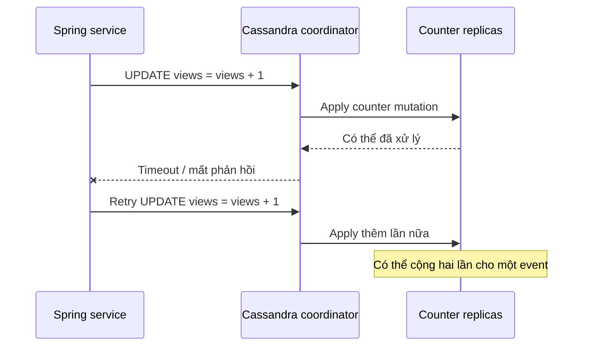

# Thiết kế bảng counter và giới hạn kiểu cột

Trong **Apache Cassandra**, kiểu `counter` không phải một cột số `bigint` thông thường. Nó là **kiểu cột chuyên biệt** hỗ trợ tích lũy giá trị bằng các phép cộng/trừ trên dữ liệu phân tán. Khi xây dựng các tính năng như lượt xem khóa học, số lần nhấp hoặc tổng số sự kiện, Cassandra counter có thể giảm nhu cầu đọc giá trị hiện tại rồi ghi lại con số mới.

Tuy nhiên, loại cột này đi kèm các ràng buộc mạnh về **cấu trúc bảng**, **cú pháp CQL**, **cách ghi** và **tính chính xác khi gặp sự cố**. Những giới hạn phổ biến nhất là:

- Cột `counter` **không thể là một thành phần của primary key**.
- Trong một bảng chứa `counter`, **mọi cột không thuộc primary key phải đều là counter**; không thể thêm regular column `text`, `timestamp`, `int` hoặc `boolean` vào cùng bảng.
- Counter chỉ được thay đổi bằng `UPDATE ... SET value = value + n` hoặc `value = value - n`. Không dùng `INSERT` để khởi tạo counter, cũng không `SET value = 100`.
- Counter **không hỗ trợ TTL/expiration** và không cho phép chỉ định `USING TIMESTAMP` trong counter update.
- Counter update **không idempotent**: nếu client bị timeout và gửi lại phép tăng, giá trị có thể được tăng thêm lần nữa.
- Xóa một counter có giới hạn quan trọng: **không nên xóa rồi tiếp tục tăng lại cùng counter key**, vì Cassandra không bảo đảm hành vi đúng của chuỗi thao tác đó.

Bài này thuộc chương **Bộ đếm** của module **SPRING_DATA_CASSANDRA**. Nội dung liên hệ với entity mapping, repository, `CassandraTemplate`, `CqlTemplate`, CQL, partition key, consistency, paging và kiểm soát hiệu năng của Apache Cassandra. Trọng tâm trực tiếp là **thiết kế bảng counter và giới hạn kiểu cột**, không chỉ là cú pháp tăng số.

## 1. Mục tiêu học tập

Sau bài này, bạn có thể:

1. Phân biệt `counter` và `bigint` dù cả hai được đọc trong Java như số nguyên 64-bit.
2. Thiết kế một counter table có **partition key**, **clustering columns** và **toàn bộ non-key columns là counter**.
3. Nhận biết các ví dụ DDL không hợp lệ do trộn counter với cột thông thường.
4. Viết `UPDATE` tăng, giảm và `SELECT` đọc counter bằng CQL có bind parameters.
5. Giải thích tại sao không dùng `INSERT`, `USING TTL`, `USING TIMESTAMP`, index trên counter hoặc phép gán giá trị tuyệt đối.
6. Chọn khi nào tách **metadata table** và **counter table** với hai đường truy vấn khác nhau.
7. Phân biệt một row chưa có counter với một counter đã được cập nhật và có giá trị bằng 0.
8. Biết cách xử lý counter đã bị xóa, reset theo **epoch/bucket mới** thay vì tin vào việc DELETE rồi increment.
9. Hiểu rủi ro **timeout, retry không idempotent, ghi trùng sự kiện và số liệu không chính xác tuyệt đối**.
10. Triển khai DAO counter bằng Java Driver 4.x và chọn các API Spring Data Cassandra phù hợp.
11. Nhận diện hot counter, thiết kế sharding/bucketing khi một khóa nhận nhiều cập nhật.
12. Kiểm thử CQL/schema và đặc tính đếm trong Cassandra thật trước khi triển khai.

## 2. Counter giải quyết bài toán gì?

Giả sử nền tảng học tập muốn theo dõi tổng số lượt xem và số lượt hoàn tất khóa học.

Nếu lưu `views bigint` trong một bảng thông thường, một cách triển khai ngây thơ sẽ là:

```text
Writer A: đọc views = 100
Writer B: đọc views = 100
Writer A: ghi views = 101
Writer B: ghi views = 101

Kết quả:
  Hai lượt xem nhưng chỉ thấy 101 thay vì 102.
```

Đây là lỗi **lost update** do thao tác đọc–tính–ghi không được điều phối đúng. Với Cassandra counter, ứng dụng có thể gửi trực tiếp:

```sql
UPDATE learning.course_metrics_by_day
SET views = views + 1
WHERE tenant_id = ?
  AND course_id = ?
  AND day_bucket = ?;
```

Cassandra xử lý tăng bộ đếm theo ngữ nghĩa riêng của counter, không yêu cầu ứng dụng đọc giá trị hiện tại trước mỗi update.

Nhưng counter không phải công cụ bảo đảm “mỗi sự kiện nghiệp vụ được đếm đúng một lần”. Nếu service nhận lại cùng một event hoặc retry sau timeout, Cassandra không thể tự biết hai phép `+1` thuộc cùng một lượt xem.

### 2.1. Counter phù hợp cho loại số liệu nào?

Ví dụ có thể cân nhắc:

- Lượt xem một trang/khóa học.
- Số lần người dùng click một hành động.
- Số lần phát sinh một loại sự kiện.
- Một số chỉ số hoạt động không yêu cầu exactly-once.
- Thống kê cộng/trừ mà sai số do retry có thể được chấp nhận hoặc đối soát.

Ví dụ **không nên quyết định dùng counter chỉ vì cần một con số**:

- Số tiền tài khoản.
- Tồn kho cần ràng buộc không âm chính xác.
- Số chỗ còn lại với yêu cầu không vượt quota.
- Thanh toán một lần, hóa đơn hoặc billing.
- Dữ liệu có yêu cầu kiểm toán exactly-once không thể chấp nhận đếm trùng.

Nếu correctness quan trọng hơn tốc độ increment, cần **event ledger, điều kiện/version nghiệp vụ, LWT trên bảng khác hoặc hệ thống giao dịch phù hợp**.

## 3. Kiểu counter khác bigint như thế nào?

Cassandra có cả `bigint` và `counter`. Cả hai biểu diễn số **64-bit có dấu**, nhưng các phép toán và hành vi lưu trữ khác nhau.

| Tiêu chí | `bigint` | `counter` |
| --- | --- | --- |
| Kiểu giá trị | 64-bit signed integer | 64-bit signed counter |
| Dùng trong primary key | Có thể, tùy schema | **Không được** |
| Ghi giá trị tuyệt đối | `SET value = 100` hoặc `INSERT` | **Không được** |
| Phép tăng/trừ trực tiếp | Không dùng dạng counter `value = value + n` | **Được**, là cách cập nhật chính |
| Trộn với `text`/`timestamp` thường | Được | **Không**, nếu đều là non-key columns |
| TTL | Có thể dùng trên dữ liệu thông thường | **Không hỗ trợ** |
| Custom write timestamp | Có thể theo CQL thông thường | **Không dùng** `USING TIMESTAMP` |
| Retry update | Set cùng giá trị thường dễ idempotent hơn | **Không idempotent** |
| Đọc trong Java | `long`/`Long` | `long`/`Long`, nhưng semantics ghi khác |
| Index trên giá trị | Tùy engine/index/phiên bản | Không hỗ trợ index counter column |

Điểm đáng chú ý: **Java `Long` không nói đủ Cassandra column type**. Nếu một entity khai báo field `Long views` nhưng không chỉ rõ schema, Spring Data có thể mặc định map thành `bigint` khi sinh DDL; cần kiểm chứng kiểu cột được tạo chính xác.

### 3.1. Giới hạn 64-bit

Counter có miền giá trị số nguyên 64-bit có dấu. Về mặt biểu diễn, cùng kích thước với Java `long`:

```text
-9_223_372_036_854_775_808  đến
+9_223_372_036_854_775_807
```

Không dùng counter như một kiểu số nguyên có độ chính xác tùy ý (`varint`) hay một kiểu decimal tài chính. Đối với thống kê tổng qua nhiều shard, Java cũng cần kiểm soát nguy cơ tràn số khi cộng nhiều giá trị lớn.

### 3.2. Counter chưa tồn tại khác với số 0

Counter chưa được increment/decrement thì chưa có giá trị như một ô dữ liệu hiện hữu. Lần update đầu tiên được hiểu tương tự cộng/trừ từ **0**.

Khi `SELECT` đọc một khóa chưa từng cập nhật, có thể không có hàng. Ứng dụng cần phân biệt:

- **Không tìm thấy hàng:** chưa có counter được ghi cho khóa đó.
- **Có hàng và giá trị bằng 0:** counter đã tồn tại nhưng tổng biến động hiện là 0, ví dụ sau phép `+1` và `-1`.
- **Có hàng và giá trị âm:** phép giảm đã vượt phép tăng theo dữ liệu ghi nhận.

Không mặc định rằng repository phải trả một entity có giá trị 0 khi hàng chưa tồn tại.

## 4. Thiết kế counter table đúng quy tắc

Ví dụ theo dõi lượt xem và lượt hoàn tất khóa học **theo ngày**. Giả sử keyspace `learning` đã được tạo.

```sql
CREATE TABLE IF NOT EXISTS learning.course_metrics_by_day (
    tenant_id uuid,
    course_id uuid,
    day_bucket date,
    views counter,
    completions counter,
    shares counter,
    PRIMARY KEY ((tenant_id, course_id), day_bucket)
);
```

Phân tích:

| Cột | Loại CQL | Vai trò |
| --- | --- | --- |
| `tenant_id` | `uuid` | Partition key thành phần 1 |
| `course_id` | `uuid` | Partition key thành phần 2 |
| `day_bucket` | `date` | Clustering column, một hàng cho mỗi ngày |
| `views` | `counter` | Đếm lượt xem |
| `completions` | `counter` | Đếm lượt hoàn tất |
| `shares` | `counter` | Đếm lượt chia sẻ |

**Tất cả các cột không thuộc primary key đều là `counter`.** Đây là ràng buộc cơ bản để CQL DDL hợp lệ.

Đường đọc của bảng là:

```sql
SELECT day_bucket, views, completions, shares
FROM learning.course_metrics_by_day
WHERE tenant_id = ? AND course_id = ?;
```

Những giá trị `tenant_id` và `course_id` xác định một partition. Các ngày khác nhau là các hàng clustering trong partition đó.

### 4.1. Ghi counter của một ngày

```sql
UPDATE learning.course_metrics_by_day
SET views = views + 1
WHERE tenant_id = ?
  AND course_id = ?
  AND day_bucket = ?;
```

Nếu khóa đó chưa có hàng, lần cập nhật counter đầu tiên sẽ tạo trạng thái counter tương ứng.

Có thể cập nhật hai counter trong một statement:

```sql
UPDATE learning.course_metrics_by_day
SET views = views + 1,
    shares = shares + 1
WHERE tenant_id = ?
  AND course_id = ?
  AND day_bucket = ?;
```

Vẫn phải bảo đảm hai phép tăng là kết quả của cùng một sự kiện nghiệp vụ, không được tự cộng hai metric nếu event chỉ biểu diễn một lượt xem.

### 4.2. Giảm counter

```sql
UPDATE learning.course_metrics_by_day
SET views = views - 1
WHERE tenant_id = ?
  AND course_id = ?
  AND day_bucket = ?;
```

Việc giảm có thể phục vụ sự kiện bù trừ được chấp nhận, nhưng **counter không ngăn giá trị xuống âm**. Nếu yêu cầu “không bao giờ âm”, kiểm tra bằng một phép đọc trước khi giảm không đủ trong môi trường concurrent writers.

### 4.3. Partition key ghép có ý nghĩa gì?

Với `PRIMARY KEY ((tenant_id, course_id), day_bucket)`:

- Một course trong một tenant có một partition.
- Mỗi ngày tạo thêm một clustering row trong partition đó.
- Query đủ `tenant_id` và `course_id` định tuyến đến partition.
- Query chỉ theo `tenant_id` không tự trở thành đường đọc đúng.
- `day_bucket` **không** là một thành phần của partition key trong thiết kế này.

Nếu một course rất nổi tiếng nhận hàng trăm nghìn increment mỗi giây, partition theo course có thể là **hot partition**. Việc thêm ngày làm clustering không thay đổi nhóm replica sở hữu partition ấy. Phần 14 sẽ trình bày bucket/shard thích hợp cho tải lớn.

## 5. Những thiết kế bảng không hợp lệ

Giới hạn kiểu cột của counter cần được kiểm tra ngay ở lúc xây schema.

### 5.1. Trộn counter với regular text

```sql
-- KHÔNG HỢP LỆ: title là regular column trong counter table.
CREATE TABLE learning.invalid_course_metrics (
    tenant_id uuid,
    course_id uuid,
    title text,
    views counter,
    PRIMARY KEY (tenant_id, course_id)
);
```

`title` không thuộc primary key và có kiểu `text`. Cassandra không cho một counter table trộn non-key `text` cùng non-key `counter`.

Đổi `title` thành `static text` cũng không phải cách lách hợp lệ để có metadata thông thường cùng các counters; hãy **tách metadata sang bảng riêng**.

### 5.2. Dùng counter trong primary key

```sql
-- KHÔNG HỢP LỆ: counter không thể là khóa.
CREATE TABLE learning.invalid_counter_key (
    tenant_id uuid,
    total counter,
    PRIMARY KEY (tenant_id, total)
);
```

Counter là dữ liệu **biến động theo phép cộng/trừ**, không được sử dụng làm partition/clustering key. Partition key nên là định danh ổn định như tenant, course, metric bucket hoặc shard.

### 5.3. Trộn counter với regular int/timestamp

```sql
-- KHÔNG HỢP LỆ: updated_at và rate là non-key non-counter.
CREATE TABLE learning.invalid_counter_stats (
    tenant_id uuid,
    course_id uuid,
    views counter,
    updated_at timestamp,
    rate int,
    PRIMARY KEY (tenant_id, course_id)
);
```

Ngay cả khi `updated_at` chỉ dùng để ghi thời điểm cập nhật gần nhất, vẫn phải tách nó thành metadata/ordinary table nếu muốn ghi cùng metric. Một counter table **không được thêm một regular column chỉ vì nghiệp vụ cần**.

### 5.4. Bảng hợp lệ có nhiều counter

```sql
-- HỢP LỆ: các cột ngoài khóa đều là counter.
CREATE TABLE learning.student_actions_counter (
    tenant_id uuid,
    student_id uuid,
    lesson_id uuid,
    starts counter,
    completions counter,
    retries counter,
    PRIMARY KEY ((tenant_id, student_id), lesson_id)
);
```

Các counter `starts`, `completions` và `retries` cùng nằm trong bảng vì đều có kiểu `counter`. Nhưng không có cột thường như `lesson_title text` hay `last_started_at timestamp`.

## 6. Tách bảng metadata khỏi bảng counter

Nếu UI cần trả:

```text
Course title: Spring Data Cassandra
Views today: 12345
Completions today: 327
Last updated: ...
```

hãy tách **dữ liệu mô tả** khỏi **số liệu cộng/trừ**.

### 6.1. Bảng metadata thông thường

```sql
CREATE TABLE IF NOT EXISTS learning.courses_by_id (
    tenant_id uuid,
    course_id uuid,
    course_title text,
    category text,
    updated_at timestamp,
    PRIMARY KEY ((tenant_id), course_id)
);
```

Bảng này có regular columns `text` và `timestamp` vì **không chứa counter**.

### 6.2. Bảng đếm riêng

```sql
CREATE TABLE IF NOT EXISTS learning.course_metrics_by_day (
    tenant_id uuid,
    course_id uuid,
    day_bucket date,
    views counter,
    completions counter,
    shares counter,
    PRIMARY KEY ((tenant_id, course_id), day_bucket)
);
```

Service có thể đọc course metadata và một row counter rồi ghép thành DTO:

```java
public record CourseStatsView(
    UUID tenantId,
    UUID courseId,
    String title,
    LocalDate day,
    long views,
    long completions) {
}
```

Đoạn DTO là mã minh họa, cần import `UUID` và `LocalDate` khi triển khai. **Cassandra không JOIN hai bảng này như SQL RDBMS**; việc kết hợp kết quả nằm ở service hoặc được denormalize có chủ đích vào một read model phù hợp.

### 6.3. Không giả định có snapshot hai bảng

Nếu một request đọc `courses_by_id` rồi `course_metrics_by_day`, hai truy vấn không tự nằm trong transaction snapshot chung. `course_title` có thể được đổi giữa lúc service đọc, còn counter đang nhận increments liên tục.

Đối với trang thống kê gần thời gian thực, điều này thường chấp nhận được. Nếu cần báo cáo tài chính/kiểm toán nhất quán, cần mô hình snapshot/ledger riêng.

## 7. Cú pháp CQL được phép với counter

### 7.1. UPDATE tăng

```sql
UPDATE learning.course_metrics_by_day
SET views = views + 1
WHERE tenant_id = ?
  AND course_id = ?
  AND day_bucket = ?;
```

Đây là phép tăng counter đúng chuẩn, với **đầy đủ primary key** để xác định hàng.

### 7.2. UPDATE giảm

```sql
UPDATE learning.course_metrics_by_day
SET views = views - 3
WHERE tenant_id = ?
  AND course_id = ?
  AND day_bucket = ?;
```

Giảm 3 đơn vị không có nghĩa Cassandra sẽ xác minh đã từng có 3 sự kiện cần bù trừ. Logic chống giảm sai vẫn thuộc tầng nghiệp vụ.

### 7.3. UPDATE có bind amount

```sql
UPDATE learning.course_metrics_by_day
SET views = views + ?
WHERE tenant_id = ?
  AND course_id = ?
  AND day_bucket = ?;
```

`?` đầu tiên nên được bind thành kiểu số nguyên 64-bit phù hợp. Dùng **PreparedStatement** cho đường ghi lặp lại, không nối delta hoặc UUID từ request vào chuỗi CQL.

### 7.4. SELECT đọc counter

```sql
SELECT views, completions, shares
FROM learning.course_metrics_by_day
WHERE tenant_id = ?
  AND course_id = ?
  AND day_bucket = ?;
```

Nên đọc **theo đúng partition và clustering key**. Không tìm theo `views > 1000` như một truy vấn toàn cluster, vì counter không được index và bảng không được thiết kế cho predicate đó.

### 7.5. Không có thao tác “SET counter bằng một giá trị mới”

```sql
-- KHÔNG HỢP LỆ: counter không được gán tuyệt đối.
UPDATE learning.course_metrics_by_day
SET views = 100
WHERE tenant_id = ?
  AND course_id = ?
  AND day_bucket = ?;
```

Một số người đề xuất:

```text
SELECT views = 47
UPDATE views = views + 53
-> nghĩ rằng đã "set views thành 100".
```

Đây là cách làm **không an toàn khi có concurrent writers**. Giữa lúc đọc 47 và cộng 53, các request khác có thể tăng/giảm. Nếu cần set giá trị tuyệt đối, **counter không phải abstraction phù hợp**.

## 8. Các thao tác không được hỗ trợ hoặc không nên dùng

| Thao tác | Tình trạng | Cách thay thế |
| --- | --- | --- |
| `INSERT INTO counter_table ...` | Counter không dùng INSERT | Dùng `UPDATE ... counter = counter + n` |
| `SET views = 100` | Không hợp lệ với counter | Nếu cần gán, dùng regular `bigint` ở bảng khác và cơ chế version |
| `UPDATE ... USING TTL ...` | Không hỗ trợ TTL cho counter | Tạo bucket/epoch mới, giữ/chuyển dữ liệu theo retention |
| `UPDATE ... USING TIMESTAMP ...` | Không hỗ trợ timestamp tùy chọn cho counter | Để Cassandra xử lý counter theo cơ chế riêng |
| `counter` trong `PRIMARY KEY` | Không hợp lệ | Dùng key ổn định như UUID/date/shard |
| `counter` cùng non-key `text` | Không hợp lệ | Tách metadata table |
| `CREATE INDEX` trên counter | Không được hỗ trợ | Thiết kế bảng/aggregation query riêng |
| `SELECT WHERE views > n` toàn bảng | Không có access path thông thường | Tổng hợp số liệu, bảng ranking/report hoặc search/analytics |
| `DELETE` rồi tiếp tục increment cùng key | Không có bảo đảm đúng đắn của counter | Epoch/bucket mới, rebuild từ event source |
| Mix counter và non-counter trong một batch | Không đúng loại batch | Tách luồng ghi theo bảng/kiểu |
| Counter dùng làm số dư/stock exact | Không đáp ứng ràng buộc nghiệp vụ | Ledger, conditional writes hoặc store giao dịch phù hợp |

### 8.1. Không dùng TTL để làm counter “tự reset mỗi ngày”

Counter không có TTL. Nếu muốn “views hôm nay”, đưa **ngày** vào primary key hoặc thiết kế một hệ tổng hợp theo thời gian. Không thể viết `USING TTL 86400` trên counter update rồi giả định ngày sau counter tự bằng 0.

### 8.2. Không dùng custom write timestamp như ghi thông thường

Cassandra có `USING TIMESTAMP` trong nhiều mutation thông thường, nhưng **counter updates bị từ chối** khi thêm `USING TIMESTAMP`. Đây là khác biệt quan trọng với bảng `bigint`.

Đối với Java Driver `setQueryTimestamp(...)`, không nên xem đó là một cách lách cơ chế CQL: counter là một loại mutation đặc biệt. Hãy giữ đường cập nhật counter không có custom timestamp và xác minh theo driver/server version khi cấu hình statement options.

### 8.3. Index trên counter bị giới hạn

Dù dự án dùng secondary index (2i) hoặc Storage-Attached Index (SAI) ở phiên bản Cassandra hỗ trợ, **không dựa vào khả năng tạo index cho cột counter**. Tài liệu CQL hiện tại ghi rõ index counter columns không được hỗ trợ.

Nếu cần bảng xếp hạng `ORDER BY views DESC` trên tất cả course, phải tạo một read model, pipeline tổng hợp/ranking hoặc dùng hệ thống thích hợp; counter table không hỗ trợ sort tùy ý trên giá trị tích lũy.

## 9. Xử lý DELETE và bài toán reset counter

Một counter có thể bị xóa, nhưng tài liệu Cassandra nhấn mạnh **chỉ bảo đảm thao tác xóa counter khi được xóa lần đầu**; sau khi xóa, **không nên cập nhật lại cùng counter** vì behavior không được bảo đảm.

Đây là giới hạn khác với một regular column: với regular column bạn thường có thể DELETE rồi INSERT lại một giá trị, với quy tắc timestamps/tombstones rõ hơn.

### 9.1. Cách reset nguy hiểm

```sql
-- Không xem đây là cách reset rồi dùng lại cùng khóa an toàn.
DELETE FROM learning.course_metrics_by_day
WHERE tenant_id = ?
  AND course_id = ?
  AND day_bucket = ?;

-- Sau đó tiếp tục UPDATE cùng hàng để tăng views.
-- Không được khuyến nghị vì counter delete/re-update có giới hạn.
```

Đừng viết một API `resetViews()` chỉ gọi DELETE rồi cập nhật `+1` ở cùng khóa mà không tính đến quy tắc counter.

### 9.2. Reset bằng generation/epoch mới

Nếu nghiệp vụ muốn đặt lại bộ đếm từ đầu tại một mốc, có thể thêm một **epoch ID** vào primary key:

```sql
CREATE TABLE IF NOT EXISTS learning.course_metrics_by_epoch (
    tenant_id uuid,
    course_id uuid,
    epoch_id uuid,
    views counter,
    completions counter,
    PRIMARY KEY ((tenant_id, course_id), epoch_id)
);
```

Khi cần reset, ứng dụng tạo **epoch_id mới** và đưa các increment tương lai vào **key mới**, không xóa rồi sử dụng lại counter cũ.

Cần lưu epoch đang hoạt động trong **một bảng metadata thông thường**, với cơ chế đồng bộ phù hợp, ví dụ:

```sql
CREATE TABLE IF NOT EXISTS learning.course_metric_epochs (
    tenant_id uuid,
    course_id uuid,
    active_epoch uuid,
    changed_at timestamp,
    PRIMARY KEY (tenant_id, course_id)
);
```

Hai bảng không có transaction ACID xuyên partition một cách tự động. Khi chuyển epoch, cần định nghĩa cách xử lý requests đang bay, giới hạn cập nhật muộn và quá trình tổng hợp/đối soát.

### 9.3. Reset theo thời gian bằng bucket

Nếu “reset” theo ngày/tuần, thường chỉ cần dùng **bucket mới**:

```text
2026-11-25 -> row day_bucket = 2026-11-25
2026-11-26 -> row day_bucket = 2026-11-26
```

Counter ngày cũ không cần xóa để có counter mới. Nhưng vì counter không hỗ trợ TTL, dữ liệu bucket cũ cũng **không tự hết hạn**; retention cần được giải quyết ở cấp bảng/bucket/export hoặc quản lý lifecycle được kiểm chứng, không giả vờ có TTL.

## 10. Cấu trúc partition và clustering cho nhiều chỉ số

Một cách thiết kế hợp lệ:

```sql
CREATE TABLE learning.course_metric_counts (
    tenant_id uuid,
    course_id uuid,
    metric_bucket text,
    page_views counter,
    finish_count counter,
    share_count counter,
    PRIMARY KEY ((tenant_id, course_id), metric_bucket)
);
```

`metric_bucket` có thể nhận các giá trị như:

```text
2026-11-25
2026-W48
all-time
```

Nhưng trộn nhiều loại bucket trong cùng một cột `text` dễ dẫn tới khó validation, xung đột quy tắc và truy vấn không rõ kiểu ngày. Một mô hình rõ ràng thường dùng `date` cho bucket ngày, hoặc tạo bảng riêng cho `all-time` vs `daily` theo access pattern.

### 10.1. Vì sao không gom mọi metric vào một cột “metric_value”?

Có thể định nghĩa:

```sql
CREATE TABLE learning.course_metric_by_name (
    tenant_id uuid,
    course_id uuid,
    day_bucket date,
    metric_name text,
    metric_value counter,
    PRIMARY KEY ((tenant_id, course_id), day_bucket, metric_name)
);
```

Bảng này **hợp lệ**: `metric_name` là clustering key, không phải regular column. Nó cho phép thêm tên metric mới mà không `ALTER TABLE` để thêm một cột counter.

Trade-off:

- Một metric là một hàng thay vì một cột.
- Đọc nhiều loại metric có thể cần nhiều hàng.
- Phải validate/allowlist metric names trong ứng dụng.
- Partition vẫn có thể nóng nếu nhiều update nhắm cùng `tenantId,courseId`.
- Không thể query tất cả course theo `metric_value` giảm dần chỉ vì metric_name là key.

Nếu danh sách metric ít và ổn định, nhiều cột counter trong cùng row có thể đơn giản hơn. Nếu danh sách metric được mở rộng theo cấu hình, schema theo `metric_name` trong primary key có thể tiện hơn.

### 10.2. Đừng để tên metric từ client tùy ý tạo dữ liệu

Nếu `metric_name` là clustering key, ứng dụng nên giới hạn các giá trị hợp lệ như `"views"`, `"completions"`, `"shares"`. Không biến mọi chuỗi do client gửi thành một metric mới vô hạn; làm vậy có thể tăng số hàng và kích thước partition không kiểm soát.

## 11. Spring Data Cassandra và mapping counter

Spring Data Cassandra có thể ánh xạ dữ liệu CQL vào entity/DTO; kiểu `counter` được đọc tương thích với Java `long`/`Long`. Nhưng **khả năng map dữ liệu không có nghĩa mọi API CRUD thông thường đều dùng đúng mutation counter**.

### 11.1. Read-only entity minh họa

```java
import java.time.LocalDate;
import java.util.UUID;

import org.springframework.data.cassandra.core.mapping.Column;
import org.springframework.data.cassandra.core.mapping.PrimaryKey;
import org.springframework.data.cassandra.core.mapping.Table;

@Table("course_metrics_by_day")
public class CourseMetricsRow {

    @PrimaryKey
    private CourseMetricKey key;

    @Column("views")
    private Long views;

    @Column("completions")
    private Long completions;

    @Column("shares")
    private Long shares;

    protected CourseMetricsRow() {}

    public CourseMetricKey getKey() { return key; }
    public Long getViews() { return views; }
    public Long getCompletions() { return completions; }
    public Long getShares() { return shares; }

    // Constructor, setters theo mapping/version nếu cần.
}
```

Composite key:

```java
import java.io.Serializable;
import java.time.LocalDate;
import java.util.UUID;

import org.springframework.data.cassandra.core.cql.PrimaryKeyType;
import org.springframework.data.cassandra.core.mapping.PrimaryKeyClass;
import org.springframework.data.cassandra.core.mapping.PrimaryKeyColumn;

@PrimaryKeyClass
public class CourseMetricKey implements Serializable {

    @PrimaryKeyColumn(name = "tenant_id", ordinal = 0,
                      type = PrimaryKeyType.PARTITIONED)
    private UUID tenantId;

    @PrimaryKeyColumn(name = "course_id", ordinal = 1,
                      type = PrimaryKeyType.PARTITIONED)
    private UUID courseId;

    @PrimaryKeyColumn(name = "day_bucket", ordinal = 2,
                      type = PrimaryKeyType.CLUSTERED)
    private LocalDate day;

    protected CourseMetricKey() {}

    // Constructor, getters/setters, equals/hashCode theo toàn bộ khóa.
}
```

**Quan trọng:** entity này chỉ minh họa đường **đọc/mapping** từ một counter table đã được tạo bằng CQL migration. Không dùng `repository.save(row)` như cách “gán số lượt xem”, và không bật auto-schema mà chưa bảo đảm cột counter được tạo đúng kiểu. Java `Long` là kiểu giá trị, nhưng Cassandra phân biệt `bigint` và `counter` ở DDL và CQL mutation.

### 11.2. Repository có thể chỉ mở quyền đọc

Nếu muốn đọc bằng repository, có thể khai báo một interface chỉ expose method tìm theo khóa, dùng `Repository` thay vì tự ý expose mọi thao tác `save`:

```java
import java.util.Optional;

import org.springframework.data.repository.Repository;

public interface CourseMetricReadRepository
        extends Repository<CourseMetricsRow, CourseMetricKey> {

    Optional<CourseMetricsRow> findById(CourseMetricKey id);
}
```

Khả năng tạo repository proxy và mapping phải được kiểm thử đúng Spring Data Cassandra version. Thiết kế interface riêng giúp code review dễ thấy đây **không phải entity ghi theo CRUD thông thường**.

### 11.3. Không dùng save để increment

Ví dụ anti-pattern:

```java
// KHÔNG LÀM: read-modify-save không phải counter update.
CourseMetricsRow row = repository.findById(key).orElseThrow();
// row.setViews(row.getViews() + 1);
// repository.save(row);
```

Counter cần CQL `UPDATE ... SET views = views + 1`. Dùng CRUD `save` không tự biến entity state thành delta, và có thể tạo CQL `INSERT`/gán tuyệt đối không được Cassandra hỗ trợ cho counter.

Với đường ghi quan trọng, nên dùng **CqlSession/PreparedStatement** hoặc một API Spring Data CQL được tài liệu phiên bản xác nhận phát đúng câu counter update.

## 12. DAO counter bằng Java Driver 4.x

Ví dụ hoàn chỉnh ở mức DAO (không chứa cấu hình Spring Boot/server) để cập nhật và đọc counter:

```java
import java.time.LocalDate;
import java.util.Objects;
import java.util.OptionalLong;
import java.util.UUID;

import com.datastax.oss.driver.api.core.CqlSession;
import com.datastax.oss.driver.api.core.cql.PreparedStatement;
import com.datastax.oss.driver.api.core.cql.ResultSet;
import com.datastax.oss.driver.api.core.cql.Row;

public class CourseCounterDao {

    private final CqlSession session;
    private final PreparedStatement addViews;
    private final PreparedStatement readViews;

    public CourseCounterDao(CqlSession session) {
        this.session = Objects.requireNonNull(session);

        this.addViews = session.prepare("""
            UPDATE learning.course_metrics_by_day
            SET views = views + ?
            WHERE tenant_id = ?
              AND course_id = ?
              AND day_bucket = ?
            """);

        this.readViews = session.prepare("""
            SELECT views
            FROM learning.course_metrics_by_day
            WHERE tenant_id = ?
              AND course_id = ?
              AND day_bucket = ?
            """);
    }

    public void incrementViews(
            UUID tenantId,
            UUID courseId,
            LocalDate day) {

        Objects.requireNonNull(tenantId, "tenantId");
        Objects.requireNonNull(courseId, "courseId");
        Objects.requireNonNull(day, "day");

        session.execute(addViews.bind(
            1L, tenantId, courseId, day
        ));
    }

    public OptionalLong getViews(
            UUID tenantId,
            UUID courseId,
            LocalDate day) {

        Objects.requireNonNull(tenantId, "tenantId");
        Objects.requireNonNull(courseId, "courseId");
        Objects.requireNonNull(day, "day");

        ResultSet result = session.execute(
            readViews.bind(tenantId, courseId, day)
        );

        Row row = result.one();

        if (row == null || row.isNull("views")) {
            return OptionalLong.empty();
        }

        return OptionalLong.of(row.getLong("views"));
    }
}
```

Phân tích:

- `PreparedStatement` được chuẩn bị một lần trong DAO.
- `UPDATE` dùng phép `views = views + ?`; giá trị `1L` là một delta, **không phải giá trị mới tuyệt đối**.
- `CqlSession` do ứng dụng quản lý lifecycle; không mở session mới cho mỗi increment.
- `OptionalLong.empty()` phân biệt counter chưa có hàng/giá trị với số 0 đã tồn tại.
- `Row.getLong(...)` đọc giá trị kiểu 64-bit; cần kiểm tra null trước khi gọi.
- Phương thức increment không tự retry. Đó là lựa chọn có chủ đích vì counter update **không idempotent**.
- Service cần xác thực quyền tenant/course, đồng bộ định nghĩa `day` và giới hạn lưu lượng.

### 12.1. Cẩn thận khi trả giá trị 0 cho dashboard

Ở tầng hiển thị, có thể dùng:

```java
long displayedViews =
    dao.getViews(tenantId, courseId, day)
       .orElse(0L);
```

Đây là **chính sách trình bày**: không có counter được hiển thị là 0. Nếu hệ thống cần phân biệt “chưa được ghi nhận” với “giá trị thực bằng 0” để đối soát, phải giữ thông tin đó trong domain/API, không ép tất cả thành cùng một số.

### 12.2. Đảm bảo đúng ngày của sự kiện

Nếu một view xảy ra lúc `2026-11-25T23:59:59Z`, phải thống nhất bucket dùng **UTC** hay múi giờ sản phẩm. Không lấy `LocalDate.now()` ở máy chủ theo múi giờ không kiểm soát khi ngày thuộc hợp đồng sự kiện.

Ví dụ dùng UTC:

```java
import java.time.Instant;
import java.time.LocalDate;
import java.time.ZoneOffset;

public static LocalDate dayBucketUtc(Instant eventTime) {
    return eventTime.atZone(ZoneOffset.UTC).toLocalDate();
}
```

Nếu nghiệp vụ có timezone địa phương, hãy cố định timezone policy và dùng thống nhất ở writer, query và backfill.

## 13. CqlTemplate, CassandraTemplate và @Query

Spring Data Cassandra có các tầng truy cập dữ liệu:

| API | Vai trò | Với counter |
| --- | --- | --- |
| `CassandraRepository` | CRUD/entity mapping | Hữu ích cho đọc, nhưng `save` không phải phép cộng |
| `CassandraTemplate` / `CassandraOperations` | Query/update theo entity mapping | Cần chắc chắn statement cuối là counter increment, không phải set absolute |
| `CqlTemplate` / `CqlOperations` | Thực thi CQL, mapper và callback | Có thể dùng CQL tường minh cho `UPDATE counter + n` |
| `CqlSession` | Driver API cấp thấp | Điều khiển prepared statements, consistency và retry |
| Repository fragment | API repository tùy biến | Cách tốt để bọc logic increment rõ ràng |

### 13.1. Gói nghiệp vụ sau một repository fragment

Một thiết kế tốt có thể expose:

```java
public interface CourseCounterCommands {
    void recordView(UUID tenantId, UUID courseId, LocalDate day);
}
```

Implementation sử dụng `CourseCounterDao` ở phần trước. Controller/service chỉ gọi `recordView(...)`, không biết chi tiết CQL, trong khi việc tăng counter vẫn là **một mutation cụ thể và có thể kiểm tra**.

Nếu muốn dùng `@Query` cho UPDATE counter trên repository method, cần đối chiếu cách framework xử lý modifying queries, parameter binding và return type theo **phiên bản Spring Data Cassandra đang triển khai**. Không suy ra từ cách `@Modifying` hoạt động trong Spring Data JPA.

### 13.2. Schema migration phải explicit

Các lớp Java với `Long views` không phải nguồn sự thật đủ để tạo counter schema. Nên dùng CQL migration đã review:

```sql
CREATE TABLE IF NOT EXISTS learning.course_metrics_by_day (
    tenant_id uuid,
    course_id uuid,
    day_bucket date,
    views counter,
    completions counter,
    shares counter,
    PRIMARY KEY ((tenant_id, course_id), day_bucket)
);
```

Kiểm tra kiểu cột trong metadata CQL/server thật. Nếu nhầm `views bigint`, một câu `SET views = views + 1` của counter sẽ không có cùng semantics và có thể bị Cassandra từ chối.

## 14. Counter table có thể bị hot partition

Thiết kế `PRIMARY KEY ((tenant_id, course_id), day_bucket)` có vấn đề khi một course cực phổ biến nhận hàng trăm nghìn requests mỗi giây.

Mọi ngày của cùng một course vẫn nằm trong **một partition**; tất cả increment của course đó đi vào cùng nhóm replica. Dù cluster có nhiều node, một hot partition có thể giới hạn throughput và tạo contention/read latency.

### 14.1. Đưa ngày vào partition key

Một biến thể:

```sql
CREATE TABLE IF NOT EXISTS learning.course_metrics_by_day_partition (
    tenant_id uuid,
    course_id uuid,
    day_bucket date,
    views counter,
    completions counter,
    PRIMARY KEY ((tenant_id, course_id, day_bucket))
);
```

Ở đây `day_bucket` **là thành phần partition key**, không phải clustering column. Mỗi course/day có một partition riêng; điều đó giúp phân chia dữ liệu theo thời gian, nhưng **vẫn có hot partition trong ngày** nếu một course nhận quá nhiều writes.

Không coi partition theo ngày là giải pháp tự động cho mọi lượng tải.

### 14.2. Shard counter khi một khóa quá nóng

Một phương án mở rộng là thêm `shard_id` vào partition key:

```sql
CREATE TABLE IF NOT EXISTS learning.course_metrics_by_shard (
    tenant_id uuid,
    course_id uuid,
    day_bucket date,
    shard_id int,
    views counter,
    completions counter,
    PRIMARY KEY ((tenant_id, course_id, day_bucket, shard_id))
);
```

Writer chọn một shard trong tập hữu hạn (ví dụ 16 hoặc 64 shards), rồi increment counter của shard ấy.

```text
course X / day D:
  shard 0  -> views = 210
  shard 1  -> views = 194
  shard 2  -> views = 206
  ...
  shard 15 -> views = 201

Tổng lượt xem ngày D = tổng views ở 16 shard.
```

Các số ở đây chỉ là ví dụ minh họa, không phải kết quả benchmark.

### 14.3. Shard phải được chọn có quy tắc

Không chọn shard bằng một giá trị random hoàn toàn không thể tái tạo nếu cần truy vết sự kiện. Có thể dùng:

```text
shard = stableHash(eventId) mod numberOfShards
```

Cách này giúp cùng một event thường chọn cùng shard khi retry, nhưng **không làm counter update trở thành idempotent**: hai lần `+1` trên cùng shard vẫn là hai increment.

Đổi số shard từ 16 sang 64 làm quy tắc định tuyến thay đổi. Cần version hóa shard config hoặc phân vùng theo epoch, rồi tổng hợp cả thế hệ cũ/mới theo chính sách rõ ràng.

### 14.4. Đánh đổi của sharding

| Lợi ích | Chi phí |
| --- | --- |
| Phân tán increments qua nhiều partition | Cần đọc nhiều shard để lấy tổng |
| Giảm hot-spot trên một partition | Tổng có thể không phải snapshot nhất quán tại một thời điểm |
| Có thể tăng throughput write | Phức tạp hơn về page, retry, fan-out và cấu hình |
| Dễ đặt giới hạn shard count | Cần quản lý migration khi tăng/giảm shard |
| Hỗ trợ đo tải theo shard | Không tạo exactly-once |

**Không tự chọn 1.024 shards cho mọi metric**. Nhiều shard quá mức tăng read fan-out và số partition. Chọn số shard từ benchmark và số liệu phân phối thực tế.

## 15. Đọc tổng counter theo nhiều shard

Để đọc tổng views của một course/day, ứng dụng có thể gọi SELECT cho từng shard hoặc dùng chiến lược đọc phù hợp.

Ví dụ CQL cho một shard:

```sql
SELECT views
FROM learning.course_metrics_by_shard
WHERE tenant_id = ?
  AND course_id = ?
  AND day_bucket = ?
  AND shard_id = ?;
```

Trong Java, có thể dùng phép cộng an toàn:

```java
long total = 0L;

for (int shard = 0; shard < configuredShardCount; shard++) {
    long value = readShardValue(shard); // DAO giả định.

    total = Math.addExact(total, value);
}
```

Đây là pseudo-code cho một phương thức trong service đã có `readShardValue(...)`. `Math.addExact` giúp phát hiện overflow ở phía Java thay vì âm thầm wrap số khi cộng quá giới hạn `long`.

Nếu cần tổng có miền vượt 64-bit hoặc tổng trên rất nhiều shards, cân nhắc `BigInteger`/analytics store thích hợp cho **kết quả tổng hợp**, dù từng counter Cassandra vẫn có giới hạn 64-bit.

### 15.1. Tổng đọc không có snapshot nguyên tử tự động

Khi service đọc shard 0 lúc `T0`, shard 1 lúc `T1` và shard 2 lúc `T2`, các increment vẫn đang diễn ra. Kết quả tổng không nhất thiết tương ứng một snapshot duy nhất trên tất cả shards.

Với dashboard số lượt xem gần thời gian thực, eventual total có thể chấp nhận được. Với nghiệp vụ phải chính xác tuyệt đối theo một thời điểm, counter shards không tự đáp ứng contract.

### 15.2. Cân nhắc snapshot materialization

Có thể định kỳ chụp số liệu đã tổng hợp vào một bảng regular columns:

```sql
CREATE TABLE IF NOT EXISTS learning.course_metrics_snapshots (
    tenant_id uuid,
    course_id uuid,
    day_bucket date,
    snapshot_at timestamp,
    views_total bigint,
    completions_total bigint,
    PRIMARY KEY ((tenant_id, course_id, day_bucket), snapshot_at)
) WITH CLUSTERING ORDER BY (snapshot_at DESC);
```

Đây là **bảng thường**, không chứa counter. Nó có thể lưu giá trị tuyệt đối cùng mốc tính toán và phù hợp cho báo cáo. Nhưng việc tạo snapshot không tự chữa đếm trùng; nếu nguồn counter đã sai, snapshot sẽ phản ánh sai số đó trừ khi được đối soát với event ledger.

## 16. Non-idempotent increment và lỗi retry

Đây là giới hạn quan trọng nhất khi vận hành counter.

Giả sử client gửi:

```sql
UPDATE learning.course_metrics_by_day
SET views = views + 1
WHERE tenant_id = ?
  AND course_id = ?
  AND day_bucket = ?;
```

Mạng có thể mất phản hồi sau khi mutation đã được áp dụng. Client thấy timeout nhưng **không biết** increment đã thành công hay chưa.



**Cassandra không thể tự gộp hai increment giống nhau thành một** chỉ vì chúng có cùng primary key và delta.

### 16.1. Không bật retry write không kiểm soát

Với một statement đặt giá trị tuyệt đối cùng key, driver có thể đánh giá idempotency theo ngữ nghĩa. Với counter update, **phải xem đây là non-idempotent mutation** và không tự động retry như upsert thông thường.

Nếu sử dụng Java Driver 4.x, cần kiểm tra:

- Retry policy và cách driver quyết định statement idempotence.
- Không đánh dấu một counter increment là idempotent chỉ để driver retry.
- Request timeout/unknown outcome được ghi nhận rõ trong telemetry.
- Hệ thống có business event ID ổn định để phục vụ đối soát.
- Không thay delta hoặc shard khi retry một event nếu dùng cơ chế xử lý riêng.

### 16.2. Gắn eventId có tự giải quyết không?

Giả sử mỗi lượt xem có `eventId` và service gọi:

```text
1. INSERT event_id IF NOT EXISTS vào bảng dedup.
2. Nếu insert mới -> UPDATE views = views + 1.
```

Đây **chưa phải exactly-once end-to-end**: nếu INSERT dedup thành công nhưng process chết trước UPDATE counter, lượt xem bị thiếu. Nếu UPDATE counter đã thành công nhưng tiến trình chưa ghi trạng thái “applied”, retry có thể cộng trùng.

Muốn exactly-once hoặc sai số được khống chế, cần **workflow/ledger bền vững có trạng thái**, cơ chế đối soát/rebuild hoặc mô hình giao dịch đáp ứng yêu cầu; không chỉ thêm một cột eventId vào counter table (điều này còn vi phạm giới hạn non-key column nếu không là key).

### 16.3. Replay và out-of-order events

Nếu cùng event được replay do message queue at-least-once, nó có thể tăng counter nhiều lần. Dù stableHash(eventId) luôn chọn cùng shard, counter không lưu danh sách ID đã áp dụng.

Đối với thống kê cho phép sai số, có thể chấp nhận và theo dõi mức chênh lệch. Đối với số liệu bắt buộc đúng tuyệt đối, lựa chọn kiến trúc phải thay đổi.

## 17. Counter batch và giới hạn loại mutation

Cassandra có **COUNTER BATCH** dành cho các counter updates.

Ví dụ:

```sql
BEGIN COUNTER BATCH
    UPDATE learning.course_metrics_by_day
    SET views = views + 1
    WHERE tenant_id = ?
      AND course_id = ?
      AND day_bucket = ?;

    UPDATE learning.course_metrics_by_day
    SET completions = completions + 1
    WHERE tenant_id = ?
      AND course_id = ?
      AND day_bucket = ?;
APPLY BATCH;
```

Các counter updates phải thuộc một **counter batch**, không trộn INSERT/UPDATE của regular columns vào cùng batch ấy.

### 17.1. Không trộn counter với regular updates

Ví dụ sai về ý tưởng:

```sql
-- KHÔNG LÀM: counter update và regular metadata write
-- không được đặt chung như một transaction thông thường.
BEGIN COUNTER BATCH
    UPDATE learning.course_metrics_by_day
    SET views = views + 1
    WHERE tenant_id = ?
      AND course_id = ?
      AND day_bucket = ?;

    UPDATE learning.courses_by_id
    SET updated_at = ?
    WHERE tenant_id = ?
      AND course_id = ?;
APPLY BATCH;
```

Counter và regular data thuộc **hai kiểu mutation khác nhau**. Nếu cần ghi metadata và tăng counter trong cùng workflow, phải phối hợp rõ ràng ở tầng service/event processing, với retry và eventual consistency.

### 17.2. COUNTER BATCH không đồng nghĩa exactly-once

Ngay cả khi các counter increments được gom một batch, nếu client timeout sau khi server xử lý, **retry cả batch có thể cộng lại**.

Đừng dùng counter batch để che rủi ro non-idempotence. Nếu chỉ cần một update counter, dùng một `UPDATE` là đủ; không cần đặt nó vào batch.

### 17.3. Không dùng batch để bulk-import một triệu counter events

Một counter batch khổng lồ có thể làm tăng coordinator load, latency, memory và timeout. Với dữ liệu sự kiện lớn, cân nhắc ingestion/aggregation pipeline có backpressure, phân vùng event ID và cơ chế tổng hợp/đối soát thay vì gửi một batch chứa hàng chục nghìn increments.

## 18. Consistency và tính đúng đắn của số đếm

Cassandra counters là dữ liệu phân tán và có cơ chế phối hợp replica riêng. Mức consistency như `ONE`, `LOCAL_QUORUM` và replication factor ảnh hưởng đến số replica cần phản hồi, độ trễ, khả dụng và cách dữ liệu được quan sát.

**Không được suy luận rằng tăng consistency là một cơ chế exactly-once**. Một phép `+1` đã áp dụng nhưng client mất ACK vẫn có thể bị gửi lại; `LOCAL_QUORUM` không tự biết hai lần gửi thuộc một business event.

### 18.1. Đọc ngay sau increment

Một request ghi xong `views + 1` rồi đọc lại có thể quan sát giá trị tùy consistency, trạng thái replica và các concurrent writers. Điều đó khác với một counter trong bộ nhớ của một thread.

Định nghĩa API cần rõ:

- Dashboard cho phép số liệu gần thời gian thực và có thể trễ?
- Có yêu cầu read-your-writes ở một phạm vi nhất định?
- Counter có được cập nhật từ nhiều datacenter?
- Nếu client timeout, UX hiển thị “chưa chắc thành công” hay tự động retry?
- Một giá trị nhỏ lệch do duplicate events có chấp nhận được không?

### 18.2. Không dùng counter để enforce quota

Nếu quy định “mỗi khóa học chỉ có 100 ghế”, không thể an toàn làm:

```text
SELECT seats_taken
IF seats_taken < 100:
    UPDATE seats_taken = seats_taken + 1
```

Hai request đồng thời có thể cùng đọc 99 rồi đều tăng. Counter update không có primitive đồng bộ nghiệp vụ kiểu `IF seats_taken < 100` để đảm bảo tuyệt đối theo cách này.

Cần thiết kế reservation/availability theo sự kiện có điều kiện, một single-writer queue, LWT trên regular rows hoặc store giao dịch phù hợp. Nếu đổi sang bảng regular `bigint` để dùng LWT, đây là **mô hình dữ liệu khác**, không còn là Cassandra counter.

### 18.3. Số liệu âm có phải lỗi Cassandra?

Không nhất thiết. Counter hỗ trợ decrement; giá trị âm có thể hợp lệ về mặt CQL. Nếu business metric “số views” luôn không âm, âm là **tín hiệu nghiệp vụ/luồng xử lý có vấn đề**: double decrement, replay không đối xứng, mismatch giữa events.

Không yêu cầu Cassandra counter tự bảo vệ invariant không âm, vì kiểu counter không cung cấp ràng buộc ấy.

## 19. Migration và backfill counter

Counter table có cách migration khác bảng thường:

- Không thể `INSERT` một giá trị tuyệt đối cho mỗi hàng.
- Không thể đổi một regular `bigint` column thành `counter` như một schema migration đơn giản, vì semantics/type restrictions khác.
- Không có TTL để “tự dọn” số liệu cũ.
- Không nên xóa counter rồi tiếp tục dùng chính primary key đó.
- Replay các events để đếm có rủi ro tăng trùng khi job restart.

### 19.1. Chuyển từ bigint sang counter

Giả sử hệ thống có bảng:

```sql
CREATE TABLE learning.old_course_stats (
    tenant_id uuid,
    course_id uuid,
    views bigint,
    updated_at timestamp,
    PRIMARY KEY (tenant_id, course_id)
);
```

Không dùng một lệnh kiểu “ALTER views bigint thành counter” rồi giữ nguyên dữ liệu mà không thay semantics. Hướng an toàn hơn là:

1. Thiết kế counter table mới phù hợp.
2. Xác định nguồn sự thật của số lượng (event log hay số snapshot cũ).
3. Xác định mốc cutover và phạm vi sự kiện được phép tính.
4. Tạo các counter keys mới không trùng với dữ liệu cũ đã xóa/reused.
5. Nếu cần khởi tạo giá trị N, **cân nhắc một increment N duy nhất trên key mới**, chỉ khi chính sách cutover và xử lý lỗi đã được thiết kế. Đây không phải gán tuyệt đối.
6. Bật writer mới có replay/dedup policy rõ ràng.
7. Đối soát kết quả với nguồn sự thật và theo dõi discrepancy.
8. Chuyển read path theo tỷ lệ, giữ rollback có kiểm soát.

Bước `+N` phải được bảo vệ khỏi retry trùng; gửi lại sẽ cộng thêm N. Nếu có event ledger, có thể chọn rebuild theo event sequence và checkpoint phù hợp.

### 19.2. Backfill theo sự kiện

Một job replay 1.000.000 view events bằng mỗi `+1` có thể mắc:

- Duplicate events trong input.
- Job restart và replay cùng offset.
- Timeout không biết sự kiện nào đã áp dụng.
- Sai bucket vì timezone.
- Thay đổi shard count giữa lần chạy.
- Hot partition khi nhiều events đổ vào cùng course.

Cần checkpoint và reconciliation. Nếu đòi exact counts, counter table không thay thế hệ thống event dedup/transaction phù hợp.

## 20. Retention và dữ liệu cũ

Vì counter không hỗ trợ TTL, việc tạo metric “daily views” không có nghĩa Cassandra tự xóa sau 30 ngày. Nếu giữ nhiều năm:

- Số partition/rows có thể tăng.
- Storage và compaction cần được theo dõi.
- Cần có retention policy ở mức dữ liệu/epoch/bucket.
- Khi xóa counter cũ, không tiếp tục ghi vào cùng khóa đã xóa.
- Backfill muộn vào bucket đã retire cần quy tắc rõ (bỏ qua, redirect sang epoch mới, hay rebuild từ sự kiện).

Nếu hệ thống cần **tự hết hạn** dữ liệu sau một thời gian và không yêu cầu phép counter online, cân nhắc bảng thường hoặc aggregation pipeline với regular TTL values. Không ép counter vào yêu cầu mà kiểu dữ liệu không hỗ trợ.

### 20.1. "Xóa hết counter bảng" khác "reset"

Một migration có thể tạo table mới/generation mới và chuyển read/write. Đó là chiến lược khác với DELETE từng row rồi lập tức dùng lại key cũ.

Không chạy `TRUNCATE` hoặc `DROP TABLE` trên production để reset dashboard khi chưa có kế hoạch dữ liệu, vì thao tác này có thể ảnh hưởng mọi tenant và yêu cầu khôi phục.

## 21. Quan sát, cảnh báo và hiệu năng

Tối thiểu cần đo:

| Nhóm | Chỉ số/câu hỏi |
| --- | --- |
| Đường ghi | Counter update throughput, p50/p95/p99 latency |
| Độ lỗi | Write timeouts, unavailable, server warnings |
| Đường đọc | Read latency, số partitions/shards được đọc |
| Phân bố | Hot courses, hot tenants, writes per partition |
| Data correctness | Sai số so với event ledger, duplicate rate |
| Sharding | Số shard, skew giữa shards, read fan-out |
| Backfill | Checkpoint lag, replay count, duplicated events |
| Storage | Dung lượng, compaction backlog, số partitions/buckets |
| Retry | Bao nhiêu counter writes bị retry hoặc outcome chưa chắc chắn |
| Consistency | Cấu hình replica/DC, read/write consistency policy |

**Đừng chỉ quan sát giá trị counter cuối cùng.** Một dashboard hiển thị “views tăng” có thể che việc increment đang bị replay hai lần mỗi event.

### 21.1. Dấu hiệu hot counter

- Một khóa/course có p99 cao hơn phần còn lại.
- Coordinator/replicas sở hữu partition đó chịu tải bất cân xứng.
- Thêm nodes không giúp nhiều vì một partition vẫn được ánh xạ tới một nhóm replica.
- Có nhiều timeouts khi sự kiện cùng course bùng nổ.
- Đọc tổng từ nhiều shards có latency tăng khi shard count quá lớn.

Khi các dấu hiệu này xuất hiện, đo partition distribution và throughput trước khi tăng số shard. Cũng có thể cần rate limiting hoặc ingestion pipeline để hấp thụ burst.

## 22. Kiểm thử counter trên Cassandra thật

Không thể xác minh hành vi CQL counter bằng unit test mock repository. Cần một test tích hợp trên Cassandra thật (Testcontainers hoặc cluster cô lập) để kiểm tra schema, câu lệnh và mapping.

### 22.1. Fixture và kịch bản cơ bản

1. Tạo keyspace `learning`.
2. Tạo bảng `course_metrics_by_day` với `views counter` và các counter columns khác.
3. Chọn UUID riêng cho test và một ngày cụ thể.
4. Kiểm tra `SELECT` trước khi ghi: chưa có hàng hoặc chưa có giá trị, **không áp đặt là 0**.
5. Gọi `UPDATE views = views + 1` ba lần, xác minh giá trị tăng theo kết quả mong đợi trong môi trường test ổn định.
6. Gọi `UPDATE views = views - 1` một lần, xác minh kết quả giảm.
7. Đọc các counter khác và xác minh không bị tự tăng khi chỉ update views.
8. Chạy negative DDL test: bảng trộn counter/text phải bị từ chối.
9. Chạy negative CQL test: `INSERT`, set absolute, `USING TTL` và `USING TIMESTAMP` không hợp lệ.
10. Test DAO Java Driver và mapping Java `Long`.
11. Dùng khóa/test table riêng để tránh DELETE rồi reuse cùng counter trong test.
12. Nếu kiểm thử xóa, dùng một khóa mới và **không increment lại khóa đó**.

### 22.2. Ví dụ CQL kiểm tra chức năng

```sql
-- Khóa fixture minh họa riêng cho test.
UPDATE learning.course_metrics_by_day
SET views = views + 3
WHERE tenant_id = 11111111-1111-1111-1111-111111111111
  AND course_id = 22222222-2222-2222-2222-222222222222
  AND day_bucket = '2026-11-25';

UPDATE learning.course_metrics_by_day
SET views = views - 1
WHERE tenant_id = 11111111-1111-1111-1111-111111111111
  AND course_id = 22222222-2222-2222-2222-222222222222
  AND day_bucket = '2026-11-25';

SELECT views
FROM learning.course_metrics_by_day
WHERE tenant_id = 11111111-1111-1111-1111-111111111111
  AND course_id = 22222222-2222-2222-2222-222222222222
  AND day_bucket = '2026-11-25';
```

Kết quả mong đợi trên **key mới chưa có mutation nào khác** là `views = 2`. Khi test chạy lại với cùng key, kết quả sẽ không còn là 2: counter increments cộng dồn. Vì vậy, mỗi ca test cần **khóa riêng và môi trường cô lập**.

### 22.3. Test Java DAO

Đoạn thân integration test:

```java
UUID tenantId = UUID.randomUUID();
UUID courseId = UUID.randomUUID();
LocalDate day = LocalDate.of(2026, 11, 25);

CourseCounterDao dao = new CourseCounterDao(session);

assertThat(dao.getViews(tenantId, courseId, day).isPresent())
    .isFalse();

dao.incrementViews(tenantId, courseId, day);
dao.incrementViews(tenantId, courseId, day);

assertThat(dao.getViews(tenantId, courseId, day))
    .hasValue(2L);
```

Đây là đoạn code **bên trong test**: cần imports, `session` từ Testcontainers và AssertJ hỗ trợ `OptionalLong` tương ứng. Nếu version AssertJ chưa có assertion cho `OptionalLong.hasValue`, có thể dùng `getAsLong()` sau kiểm tra `isPresent()`.

### 22.4. Test concurrency và fault injection

Có thể kiểm tra nhiều concurrent increments vào cùng key trên một Cassandra test cluster để quan sát throughput/tính đúng của trường hợp **không có timeout và không retry**.

Nhưng một test thành công với 100 threads không chứng minh exactly-once khi:

- Coordinator bị mất kết nối sau khi đã áp dụng increment.
- Driver retry cùng mutation sau timeout.
- Message broker replay cùng eventId.
- Node gặp sự cố và đồng bộ replica về sau.
- Workload có nhiều datacenter.

Cần fault injection/test nhiều node thích hợp để đánh giá rủi ro, và phải định nghĩa cách product chấp nhận/đối soát sai số.

### 22.5. Test loại cột, không chỉ giá trị

Một kiểm tra cơ bản là xác nhận schema **thực sự có type `counter`** cho views. Nếu migration nhầm sang `bigint`, test SELECT có thể vẫn nhận Java `Long` nhưng cập nhật counter `views = views + 1` sẽ không có semantics đúng.

## 23. Lỗi thường gặp và xử lý

| Triệu chứng | Nguyên nhân khả dĩ | Hướng xử lý |
| --- | --- | --- |
| CREATE TABLE bị từ chối | Trộn `counter` với non-key `text`/`timestamp` | Tách metadata sang bảng thường |
| `counter` trong primary key gây lỗi | Counter không được là khóa | Dùng UUID/date/shard làm khóa |
| INSERT counter báo lỗi | Counter chỉ cập nhật qua UPDATE | `SET views = views + n` |
| `SET views = 100` báo lỗi | Không có phép gán tuyệt đối | Chọn mô hình regular bigint nếu cần set |
| UPDATE có TTL bị từ chối | Counter không hỗ trợ expiration | Bucket/epoch hoặc bảng thường có TTL |
| UPDATE có TIMESTAMP bị từ chối | Counter không cho custom write timestamp | Dùng mutation counter đúng quy tắc |
| CREATE INDEX trên views bị từ chối | Không index counter column | Read model/report riêng |
| Hàng chưa có nhưng API trả null | Counter chưa được increment | Mapping `OptionalLong`/display zero theo policy |
| Retry sau timeout làm tăng thêm | Increment không idempotent | Không auto retry; event ledger/reconciliation |
| Reset DELETE rồi +1 cho kết quả lạ | Delete/re-update counter không được bảo đảm | Tạo key epoch/bucket mới |
| Lượt xem thành số âm | Decrements/compensations sai | Kiểm tra event ledger và policy |
| `repository.save` không tăng số | Save không diễn giải object thành delta | Dùng CQL counter UPDATE |
| Auto-schema tạo views bigint | Mapping Long không đồng nghĩa counter DDL | Explicit migration với `views counter` |
| Chậm khi course hot | Tập trung writes vào một partition | Sharding/partitioning, benchmark |
| Tổng nhiều shards không ổn định | Không có snapshot đa partition | Định nghĩa eventual total/snapshot |
| Counter batch được retry hai lần | Counter batch không exactly-once | Giữ event ID, tránh retry mù |
| Backfill chạy lại làm double count | Replay các sự kiện đã tính | Checkpoint/dedup/rebuild strategy |
| Dashboard đòi ORDER BY views DESC | Counter không là clustering/index column | Tạo bảng ranking/materialized report |
| Dữ liệu không tự hết hạn sau 30 ngày | Không có TTL | Retention dựa bucket/generation hoặc pipeline |
| Tăng consistency nhưng vẫn đếm trùng | Consistency không chống duplicate event | Sửa event processing và idempotency |

### Quy trình debug

1. Xác nhận cột ở schema là **`counter`**, không phải `bigint`.
2. Kiểm tra **PRIMARY KEY** và partition key của tất cả increments.
3. Kiểm tra statement có thực sự là `UPDATE counter = counter +/- n` không.
4. Tìm các lựa chọn không hợp lệ: `INSERT`, TTL, custom timestamp, index counter.
5. Đối chiếu request/event ID với số lần gọi update thực tế.
6. Kiểm tra timeout, retry policy và message replay.
7. Kiểm tra giá trị bucket/shard có ổn định không.
8. Quan sát write latency, hot partitions và consistency settings.
9. So sánh tổng với event source/ledger khi yêu cầu đúng đắn cao.
10. Tạo integration test với key mới trên Cassandra cô lập.

## 24. Bài tập thực hành

Giả sử nền tảng học tập cần:

- Đếm lượt xem của một khóa học theo ngày.
- Đếm số lượt hoàn thành bài học.
- Hiển thị tên khóa học, tên giảng viên và thời điểm cập nhật gần nhất.
- Reset chỉ số hiển thị khi bước sang một học kỳ mới.
- Hỗ trợ một khóa học rất nổi tiếng có lượng tương tác tăng đột biến.

Xét schema sau:

```sql
-- Schema KHÔNG HỢP LỆ, dùng làm bài tập.
CREATE TABLE learning.course_activity_stats (
    tenant_id uuid,
    course_id uuid,
    day_bucket date,
    title text,
    views counter,
    completions counter,
    updated_at timestamp,
    PRIMARY KEY ((tenant_id, course_id), day_bucket)
);
```

Hãy trả lời:

1. Vì sao schema trên không hợp lệ?
2. Cột nào được phép có kiểu khác `counter` khi nằm trong counter table?
3. `day_bucket date` trong schema này là partition key hay clustering column?
4. Nếu muốn `day_bucket` trở thành thành phần partition key, phải đổi `PRIMARY KEY` như thế nào?
5. `counter` và `bigint` khác nhau thế nào dù Java đều dùng `long`?
6. Viết schema counter table đúng với ba loại metric `views`, `completions` và `shares`.
7. Viết một bảng metadata riêng chứa `title`, `instructor_name` và `updated_at`.
8. Viết CQL tăng views của một course/ngày thêm 1.
9. Viết CQL giảm completions đi 2 (giả định nghiệp vụ cho phép).
10. Vì sao `INSERT INTO counter_table` không phải cách khởi tạo counter?
11. Có thể dùng `UPDATE SET views = 100` không? Vì sao?
12. Có thể dùng `USING TTL 86400` để tự reset counter sau một ngày không?
13. Vì sao không nên tạo index trực tiếp lên `views` để xếp hạng?
14. Nếu một counter chưa có hàng, tầng API có thể hiển thị 0 như thế nào mà không nhầm đó là dữ liệu đã lưu?
15. Khi client timeout sau `views = views + 1`, vì sao retry có thể làm tăng hai lần?
16. Event ID ổn định có đủ để biến counter increment thành exactly-once không?
17. Khi nào cần tách counter thành nhiều shards?
18. Nếu một course/day có 16 shards, phải đọc tổng ra sao và có snapshot nguyên tử không?
19. Nếu cần reset theo học kỳ, có nên DELETE rồi increment lại cùng key không?
20. Khi metadata và counter nằm ở hai bảng, Spring Data có tự JOIN chúng không?
21. Vì sao `repository.save(entity)` không thay cho một counter increment?
22. Khi nâng Spring Data version, cần kiểm tra lại mapping/DAO những gì?
23. Có thể dùng counter để đảm bảo số ghế khóa học không quá 100 không?
24. LWT/ledger/event processing có thể thay thế counter trong những nghiệp vụ nào?
25. Những metrics cần đo khi số counter writes tăng gấp 100 lần là gì?

**Hướng giải:** Non-key columns của counter table phải có kiểu `counter`; `title` và `updated_at` cần bảng thông thường. Ghi counter bằng `UPDATE ... SET views = views + 1`; không dùng `INSERT`, TTL, gán tuyệt đối hoặc custom timestamp. Counter không idempotent nên cần xử lý timeout/retry cẩn trọng. Reset bằng key/epoch/bucket mới; khi nóng có thể shard và tổng hợp, chấp nhận trade-off read fan-out. Nếu cần exactly-once hoặc quota cứng, phải đổi kiến trúc.

## 25. Checklist trước khi triển khai

- [ ] Đã xác nhận kiểu `counter` trong CQL schema, không nhầm với `bigint`.
- [ ] Counter không nằm trong partition/clustering key.
- [ ] Mọi cột **ngoài primary key** trong counter table đều là counter.
- [ ] Metadata text/timestamp/boolean được đặt ở bảng thường riêng.
- [ ] Schema được tạo bằng migration có kiểm chứng, không chỉ dựa Java `Long`.
- [ ] Mỗi counter update có đầy đủ primary key.
- [ ] Ghi bằng `UPDATE counter = counter + n` hoặc `- n`.
- [ ] Không dùng INSERT, gán tuyệt đối, TTL hoặc USING TIMESTAMP cho counter.
- [ ] Không tạo index trên counter column.
- [ ] Không dùng counter làm cơ chế kiểm tra quota/số dư chính xác.
- [ ] Chưa có hàng được xử lý khác với row có giá trị 0.
- [ ] Không DELETE rồi tiếp tục increment cùng key.
- [ ] Reset bằng epoch/bucket mới có policy xử lý request trễ.
- [ ] Đã xác định retry policy **non-idempotent**.
- [ ] Có cách đối soát duplicate/lost events nếu product cần.
- [ ] Không dùng COUNTER BATCH làm cách “exactly once”.
- [ ] Không trộn counter/regular mutation vào batch.
- [ ] Có chiến lược hot partition, bucket, shard và tổng hợp read.
- [ ] Nếu sharding, có version của shard count và cursor/read fan-out.
- [ ] Có consistency policy phù hợp RF/DC và SLA.
- [ ] Có benchmark read/write trên phân phối hot course thực tế.
- [ ] Có integration test với Cassandra thật, đúng version.
- [ ] Có test schema invalid, counter update và timeout/replay policy.
- [ ] Có metrics p95/p99, timeouts, shard skew và sai số so với nguồn sự thật.
- [ ] Có retention/migration policy không phụ thuộc TTL counter.

## 26. Ghi nhớ

**Counter là một kiểu dữ liệu chuyên biệt, không phải bigint có cú pháp cộng tiện lợi.** Trong Cassandra, cột counter **không được là primary key**, và khi bảng có counter, **mọi cột ngoài primary key phải đều có kiểu counter**. Metadata thông thường như tên khóa học, trạng thái hay thời gian cần được lưu riêng.

**Counter chỉ thay đổi bằng phép tăng/giảm của UPDATE.** Không dùng INSERT, gán tuyệt đối, TTL, custom write timestamp hoặc index trực tiếp trên counter. Xóa rồi tiếp tục dùng lại cùng counter key không được bảo đảm đúng, nên reset bằng một epoch/bucket mới và có chiến lược lifecycle rõ ràng.

**Counter update không idempotent.** Timeout, retry hoặc replay một sự kiện có thể gây overcount; consistency level và COUNTER BATCH không tự tạo exactly-once. Khi thiết kế Spring Data Cassandra, hãy sử dụng CQL/DAO rõ ràng, quản lý partition/shard và kiểm thử bằng Cassandra thật. Với số liệu cần đúng tuyệt đối hoặc quota cứng, cân nhắc ledger, conditional writes hoặc mô hình giao dịch khác phù hợp yêu cầu.

### Tài liệu tham khảo

- [Apache Cassandra — CQL Data Types: Counters](https://cassandra.apache.org/doc/stable/cassandra/developing/cql/types.html#counters)
- [Apache Cassandra — Using a Counter](https://cassandra.apache.org/doc/stable/cassandra/developing/cql/counter-column.html)
- [Apache Cassandra — CQL UPDATE and COUNTER BATCH](https://cassandra.apache.org/doc/stable/cassandra/developing/cql/dml.html)
- [Apache Cassandra — CREATE TABLE / Index Restrictions](https://cassandra.apache.org/doc/stable/cassandra/reference/cql-commands/create-table.html)
- [Spring Data Cassandra — Object Mapping](https://docs.spring.io/spring-data/cassandra/reference/object-mapping.html)
- [Spring Data Cassandra — Repository Query Methods](https://docs.spring.io/spring-data/cassandra/reference/cassandra/repositories/query-methods.html)
- [Spring Data Cassandra — CassandraTemplate](https://docs.spring.io/spring-data/cassandra/reference/cassandra/template.html)
- [Apache Cassandra Java Driver 4 — Prepared Statements](https://docs.datastax.com/en/developer/java-driver/4.17/manual/core/statements/prepared/)
