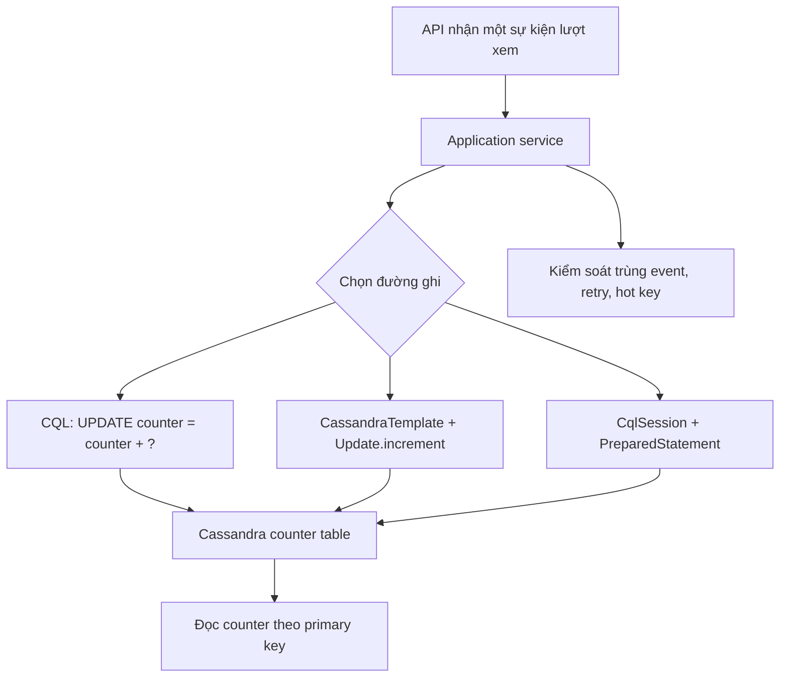
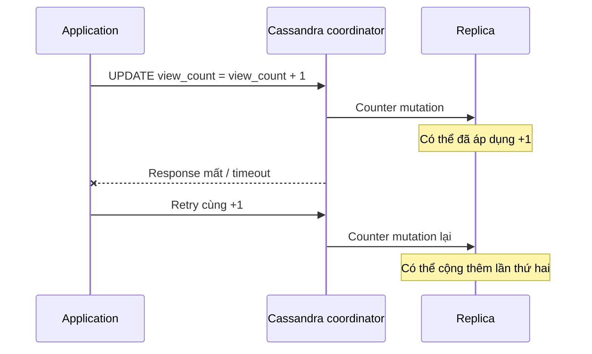
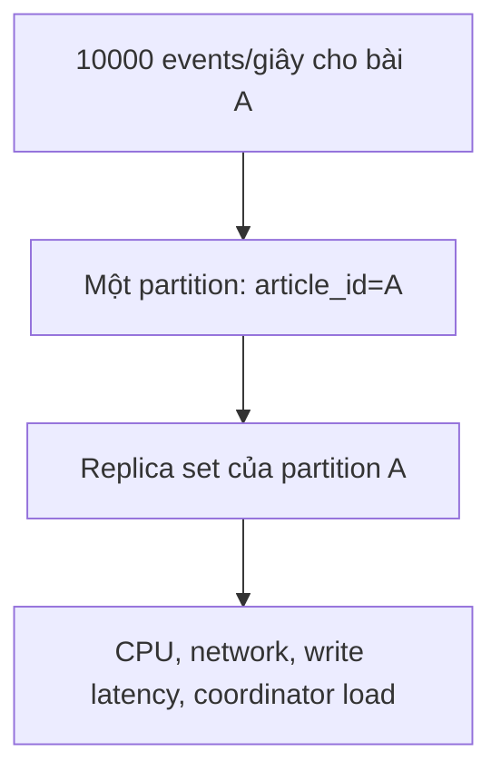
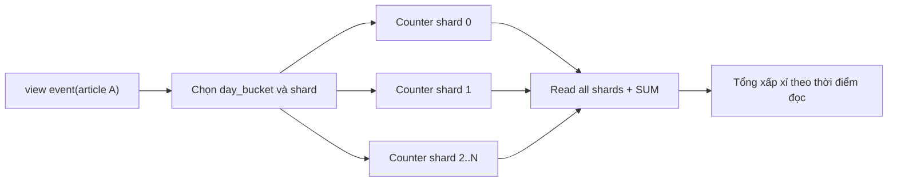

# Tăng, giảm counter bằng CQL hoặc Update

## 1. Vì sao Cassandra có kiểu `counter` riêng?

Trong **Spring Data Cassandra**, hầu hết entity được lưu bằng `INSERT` hoặc `UPDATE` theo primary key. Nhưng có những yêu cầu như *“tăng số lượt xem bài viết”*, *“giảm số lượt thích sau khi bỏ thích”* hoặc *“cộng thêm số sự kiện đã xử lý”*. Với một cột thường kiểu `bigint`, thao tác đọc giá trị rồi ghi lại `value + 1` rất dễ làm mất cập nhật khi nhiều request đồng thời.

Apache Cassandra cung cấp kiểu CQL **`counter`** chuyên dùng cho **tăng và giảm một số nguyên có dấu 64-bit**. Thay vì gán giá trị tuyệt đối, ứng dụng gửi một **delta**:

```sql
UPDATE metrics_lab.article_counters_by_id
SET view_count = view_count + 1
WHERE article_id = ?;
```

Cassandra xử lý đây là **counter mutation**, không phải câu `UPDATE` số học tùy ý đối với một cột `bigint`. Counter có quy tắc lưu trữ và giới hạn riêng, khác với cột thường chịu cơ chế last-write-wins.



**Điều quan trọng:** counter là công cụ biểu diễn phép cộng/trừ phân tán, **không phải bộ đếm chính xác-một-lần (exactly once) mặc định**. Khi request timeout, ứng dụng có thể không biết delta đã được áp dụng hay chưa. Nếu gửi lại, tổng số có thể bị cộng hai lần.

Bài này tập trung vào cách tăng/giảm counter bằng **CQL**, `CassandraTemplate` với `org.springframework.data.cassandra.core.query.Update`, Java Driver và repository `@Query`; đồng thời giải thích các ràng buộc về schema, consistency, tính idempotent, hiệu năng và kiểm thử.

## 2. Thiết kế bảng counter theo đường truy cập

Giả sử dịch vụ theo dõi số lượt xem và lượt thích của một bài viết. Một bảng counter tối giản:

```sql
-- Keyspace để thực hành trên một Cassandra node local.
CREATE KEYSPACE IF NOT EXISTS metrics_lab
WITH replication = {
    'class': 'SimpleStrategy',
    'replication_factor': 1
};

CREATE TABLE IF NOT EXISTS metrics_lab.article_counters_by_id (
    article_id uuid PRIMARY KEY,
    view_count counter,
    like_count counter
);
```

Trong bảng:

- `article_id` là **partition key** và toàn bộ primary key, vì vậy một thao tác theo `article_id` định vị một partition.
- `view_count` và `like_count` là các cột **`counter`**, không phải `bigint` thông thường.
- Các cột không thuộc primary key trong bảng có counter phải **đều là counter**. Không được thêm `title text`, `updated_at timestamp` hoặc `status text` vào cùng bảng.
- Keyspace ví dụ sử dụng RF=1 cho local. Production cần replication strategy và datacenter phù hợp, thường là `NetworkTopologyStrategy`; không suy khả năng chịu lỗi/quorum từ bài test một node.

Một bảng thông tin bài viết nên để riêng:

```sql
CREATE TABLE IF NOT EXISTS metrics_lab.articles_by_id (
    article_id uuid PRIMARY KEY,
    title text,
    author_id uuid,
    published_at timestamp
);
```

Đây là **bảng thường**, không chứa counter. Muốn hiển thị một bài viết cùng số lượt xem, service có thể đọc `articles_by_id` và `article_counters_by_id` theo cùng `article_id`, rồi tổng hợp DTO. Cassandra **không tự join hai bảng hoặc transaction hóa hai lượt ghi**.

### Những ví dụ schema không hợp lệ

```sql
-- Sai: trộn counter với cột thường không thuộc primary key.
CREATE TABLE invalid_article_metrics (
    article_id uuid PRIMARY KEY,
    title text,
    view_count counter
);

-- Sai: counter không thể tham gia primary key.
CREATE TABLE invalid_counter_key (
    article_id uuid,
    view_count counter,
    PRIMARY KEY (view_count)
);
```

Không dùng câu CQL sai trên để xây schema thực. Ngoài quy tắc kiểu dữ liệu, một bảng có `article_id` làm partition key còn cần đánh giá **hot partition** khi một bài viết cực kỳ phổ biến; phần sau sẽ trình bày cách bucket/shard nếu cần.

## 3. Tăng counter bằng CQL `UPDATE ... +`

### 3.1. Tăng một đơn vị

```sql
UPDATE metrics_lab.article_counters_by_id
SET view_count = view_count + 1
WHERE article_id = 11111111-1111-4111-8111-111111111111;
```

Nếu trước đó chưa có counter cho khóa này, lần tăng đầu được thực hiện **như thể giá trị trước đó là 0**. Sau một thao tác thành công và khi dữ liệu đã được đọc với điều kiện consistency phù hợp, giá trị mong đợi là `1`.

Đọc lại:

```sql
SELECT view_count, like_count
FROM metrics_lab.article_counters_by_id
WHERE article_id = 11111111-1111-4111-8111-111111111111;
```

Không khẳng định `like_count` phải là `0` chỉ vì chưa từng được tăng. **Cột chưa tồn tại** có thể được biểu diễn là `null` trong kết quả; hãy phân biệt counter chưa được khởi tạo với một counter sống có giá trị số 0. Cách trả `0` cho UI phải là **quy tắc mapping có chủ đích**, không tự suy ra toàn bộ Cassandra đang lưu một cell 0.

### 3.2. Tăng nhiều đơn vị

```sql
UPDATE metrics_lab.article_counters_by_id
SET view_count = view_count + 5
WHERE article_id = 11111111-1111-4111-8111-111111111111;
```

Delta có thể là một số nguyên trong phạm vi được Cassandra chấp nhận cho `counter` 64-bit. Sau `+1` rồi `+5`, tổng hợp lý tưởng (không có mutation khác) là `6`.

Đây là phép **cộng**, không phải phép ghi giá trị tuyệt đối `5`. Nếu client gửi hai lần cùng lệnh `+5`, giá trị có thể tăng **10**, không tự được deduplicate.

### 3.3. Tăng nhiều cột counter của cùng hàng

```sql
UPDATE metrics_lab.article_counters_by_id
SET view_count = view_count + 1,
    like_count = like_count + 1
WHERE article_id = 11111111-1111-4111-8111-111111111111;
```

Câu này gửi các delta cho **hai counter columns** cùng một primary key. Không coi nó là một transaction ACID mang theo quy tắc “phải có like mới được tính view”; các bất biến nghiệp vụ vẫn cần thiết kế ở tầng service. Nếu hai phép cộng luôn thuộc một event nghiệp vụ, phải có request/event identity để xử lý retry và đối soát.

## 4. Giảm counter bằng `UPDATE ... -`

### 4.1. Giảm một đơn vị

```sql
UPDATE metrics_lab.article_counters_by_id
SET like_count = like_count - 1
WHERE article_id = 11111111-1111-4111-8111-111111111111;
```

Ví dụ nghiệp vụ: người dùng đã thích bài viết và giờ hủy thích, nên hệ thống gửi delta `-1`.

### 4.2. Giảm nhiều đơn vị

```sql
UPDATE metrics_lab.article_counters_by_id
SET view_count = view_count - 3
WHERE article_id = 11111111-1111-4111-8111-111111111111;
```

Nếu một counter chưa từng được cập nhật, lần giảm đầu **coi giá trị trước đó là 0**; vì vậy tổng có thể là số âm, chẳng hạn `-3`. Kiểu `counter` không tự bảo đảm “số lượt thích không âm”.

**Quy tắc an toàn ở service:** tham số `delta` phải có dấu được xác định rõ. Nên viết hai method tường minh `increaseLikes(id, positiveDelta)` và `decreaseLikes(id, positiveDelta)`, bắt buộc `delta > 0`, rồi dùng `+` hoặc `-`. Tránh cho client truyền dấu âm tùy ý vào một API mang tên `increase` vì có thể đảo nghĩa thao tác.

```java
private static void requirePositive(long delta) {
    if (delta <= 0) {
        throw new IllegalArgumentException("delta phải lớn hơn 0");
    }
}
```

**Counter không có sẵn ngữ nghĩa `MAX(0, counter - 1)` hay `IF counter > 0`.** Nếu nghiệp vụ cần không âm tuyệt đối hoặc lượng tồn kho không được xuống dưới 0, counter là lựa chọn cần cân nhắc lại. Đọc counter trước rồi giảm sau cũng **không nguyên tử** dưới cạnh tranh.

### 4.3. Không gán lại bằng `=`

Các lệnh sau không được dùng cho counter:

```sql
-- Sai: counter không nhận phép gán giá trị tuyệt đối.
UPDATE metrics_lab.article_counters_by_id
SET view_count = 100
WHERE article_id = 11111111-1111-4111-8111-111111111111;

-- Sai: INSERT không hỗ trợ ghi counter.
INSERT INTO metrics_lab.article_counters_by_id (article_id, view_count)
VALUES (11111111-1111-4111-8111-111111111111, 100);
```

Nếu cần “đặt lại số lượt xem thành 100”, không có một lệnh `SET view_count=100` an toàn như cột thường. Thiết kế **epoch/generation mới**, bảng đếm mới hoặc tái tính tổng từ sự kiện gốc sẽ phù hợp hơn việc cố gán một giá trị counter.

## 5. Những giới hạn bắt buộc của CQL counter

| Hành vi/cú pháp | Với cột `counter` | Lý do hoặc hướng thay thế |
| --- | --- | --- |
| `UPDATE ... SET c = c + N` | **Hỗ trợ** | Cộng delta |
| `UPDATE ... SET c = c - N` | **Hỗ trợ** | Trừ delta |
| `UPDATE ... SET c = 100` | **Không** | Không có phép gán tuyệt đối |
| `INSERT` giá trị counter | **Không** | Dùng `UPDATE` cộng/trừ |
| `USING TTL` trên counter mutation | **Không** | Thiết kế bucket/retention bằng bảng phù hợp |
| `USING TIMESTAMP` hoặc query timestamp tùy chọn cho counter | **Không** theo thao tác counter CQL | Không ép LWW timestamp thủ công cho counter |
| `UPDATE counter ... IF ...` | **Không** theo LWT điều kiện thông thường | Không dùng CAS trên cột counter; chọn mô hình trạng thái khác |
| `counter` trong primary key | **Không** | Dùng UUID/text/date/int làm khóa |
| Counter cùng cột thường ngoài PK | **Không** | Tách bảng counter và bảng metadata |
| `DELETE` counter rồi lại cộng vào chính counter đó | **Không được dựa vào hành vi ổn định** | Xóa counter có giới hạn; không tái sử dụng khóa đã xóa tùy tiện |
| `BEGIN COUNTER BATCH` | **Có hỗ trợ** cho counter updates | Không đồng nghĩa exactly once hoặc tăng throughput |

Các giới hạn này đến từ **Apache Cassandra**, không phụ thuộc việc gọi `@Query`, `CassandraTemplate`, `CqlTemplate` hay Java Driver. API Spring chỉ giúp biểu diễn CQL; nó không làm counter nhận được TTL, LWT hoặc `INSERT`.

### 5.1. Tại sao việc xóa counter nguy hiểm?

Apache Cassandra có hỗ trợ xóa counter, nhưng tài liệu nêu rõ việc xóa counter **chỉ được bảo đảm về hành vi ở lần xóa đầu**; tiếp tục cập nhật counter đã xóa có thể không có kết quả được bảo đảm như mong muốn. Vì vậy:

- Không dùng `DELETE counter; UPDATE counter = counter + 1` như một thủ thuật reset định kỳ.
- Khi cần reset theo ngày/tháng, đưa **bucket thời gian vào primary key** để tạo một chuỗi counter mới theo bucket mới.
- Khi cần xóa số liệu vì chính sách dữ liệu, xác định cả read models, bản sao và quy trình quản trị; không đơn thuần delete rồi tái tạo cùng key.
- Đặc biệt thận trọng với TTL/retention: cột counter **không hỗ trợ hết hạn tự động** như dữ liệu thường.

### 5.2. Counter là số nguyên có dấu 64-bit

Không dùng `int` Java cho số liệu có thể vượt phạm vi 32-bit; chọn `Long`/`long`. Trên ứng dụng, nên validate delta để tránh thao tác ngoài mong muốn và theo dõi tăng trưởng lâu dài. Kiểu signed 64-bit có thể lưu số âm; nó không tự mã hóa logic “lượt xem luôn không âm”.

## 6. Spring Data Cassandra `Update.increment` và `Update.decrement`

Spring Data Cassandra cung cấp API **`org.springframework.data.cassandra.core.query.Update`** với các thao tác:

```java
Update.empty().increment("view_count");
Update.empty().increment("view_count", 5L);
Update.empty().decrement("like_count");
Update.empty().decrement("like_count", 2L);
```

Các method trả về **một `Update` mới** theo phong cách immutable. Cần **sử dụng giá trị được trả về**, không chỉ gọi rồi bỏ kết quả.

```java
// Đúng: giữ lại Update được tạo.
Update change = Update.empty()
    .increment("view_count", 5L);

// Không đúng: gọi nhưng bỏ kết quả trên Update immutable.
Update ignored = Update.empty();
ignored.increment("view_count", 5L); // ignored vẫn không chứa operation mới.
```

`Update.increment("view_count", 5L)` là biểu thức cập nhật **`view_count = view_count + 5`**; với schema ở trên, `view_count` là **counter**. Đừng suy rằng nó biến mọi cột thường `bigint` thành kiểu cộng/trừ atomic tương đương SQL trên RDBMS.

### 6.1. Entity mapping của bảng counter

```java
import java.util.UUID;

import org.springframework.data.cassandra.core.mapping.CassandraType;
import org.springframework.data.cassandra.core.mapping.Column;
import org.springframework.data.cassandra.core.mapping.PrimaryKey;
import org.springframework.data.cassandra.core.mapping.Table;

@Table("article_counters_by_id")
public class ArticleCounters {

    @PrimaryKey("article_id")
    private UUID articleId;

    @Column("view_count")
    @CassandraType(type = CassandraType.Name.COUNTER)
    private Long viewCount;

    @Column("like_count")
    @CassandraType(type = CassandraType.Name.COUNTER)
    private Long likeCount;

    protected ArticleCounters() {
    }

    public UUID getArticleId() {
        return articleId;
    }

    public Long getViewCount() {
        return viewCount;
    }

    public Long getLikeCount() {
        return likeCount;
    }
}
```

Ở đây, `Long` phù hợp với giá trị signed 64-bit của CQL `counter`; `@CassandraType(Name.COUNTER)` chỉ rõ kiểu CQL, vì kiểu Java `Long` mặc định thường ánh xạ `bigint`. Entity này dùng để **mapping query/update**, không được hiểu là có thể gọi `save(entity)` để gán counter bằng giá trị hiện tại.

Để các CQL không cần prefix `metrics_lab.`, cấu hình **keyspace mặc định** của session Spring Data là `metrics_lab`. Ví dụ với Spring Boot:

```yaml
spring:
  cassandra:
    contact-points: 127.0.0.1:9042
    keyspace-name: metrics_lab
    local-datacenter: datacenter1
    schema-action: none
```

Tên `datacenter1` phải khớp tên datacenter thực tế; đây là ví dụ local. Một session đã chọn keyspace khác sẽ không tự map `@Table("article_counters_by_id")` vào `metrics_lab` nếu không cấu hình rõ.

### 6.2. Tăng/giảm qua `CassandraTemplate.update`

```java
import java.util.UUID;

import org.springframework.data.cassandra.core.CassandraTemplate;
import org.springframework.data.cassandra.core.query.Criteria;
import org.springframework.data.cassandra.core.query.Query;
import org.springframework.data.cassandra.core.query.Update;
import org.springframework.stereotype.Repository;

@Repository
public class ArticleCounterTemplateWriter {

    private final CassandraTemplate template;

    public ArticleCounterTemplateWriter(CassandraTemplate template) {
        this.template = template;
    }

    public void addViews(UUID articleId, long delta) {
        requirePositive(delta);

        Query query = Query.query(
            Criteria.where("article_id").is(articleId)
        );
        Update update = Update.empty()
            .increment("view_count", delta);

        template.update(query, update, ArticleCounters.class);
    }

    public void removeLikes(UUID articleId, long delta) {
        requirePositive(delta);

        Query query = Query.query(
            Criteria.where("article_id").is(articleId)
        );
        Update update = Update.empty()
            .decrement("like_count", delta);

        template.update(query, update, ArticleCounters.class);
    }

    private static void requirePositive(long delta) {
        if (delta <= 0) {
            throw new IllegalArgumentException("delta phải > 0");
        }
    }
}
```

`Query` trong hai method **định vị đúng primary key**. `Update.increment/decrement` biểu đạt phép thay đổi delta, tránh thao tác đọc-sửa-ghi có nguy cơ mất cập nhật.

`CassandraTemplate.update(Query, Update, Class<?>)` trả `boolean` theo API Spring Data Cassandra, nhưng **không được diễn giải boolean như số lần tăng đã diễn ra chính xác một lần trên toàn hệ thống**. Nếu request timeout và ném exception, caller vẫn có thể không biết mutation đã được áp dụng hay chưa. Không dựa vào return value của một lần gọi để xây cơ chế exactly-once.

**Lưu ý tương thích:** tên API `Update.empty()`, `increment(String, Number)`, `decrement(String, Number)` và overload của template có trong các dòng Spring Data Cassandra hiện đại. Kiểm thử bản dựng bằng dependency BOM của dự án; không lấy các method `Update` của Spring Data MongoDB hoặc JPA làm thay thế.

### 6.3. Khi muốn tăng/giảm hai counter cùng hàng

```java
Query query = Query.query(Criteria.where("article_id").is(articleId));

Update update = Update.empty()
    .increment("view_count", 1L)
    .increment("like_count", 1L);

template.update(query, update, ArticleCounters.class);
```

Đây là **một update definition** gồm hai delta, tương ứng một câu UPDATE hợp lệ nếu phiên bản mapper xây statement như mong đợi. Hãy kiểm tra CQL phát sinh khi bắt đầu tích hợp; không giả định `Update.set(...)` trên một cột counter sẽ được framework tự chuyển thành increment.

## 7. Repository `@Query` có thể biểu đạt CQL counter

Nếu ứng dụng thích khai báo các câu CQL rõ ràng ở interface repository, có thể sử dụng `@Modifying` cùng `@Query`:

```java
import java.util.UUID;

import org.springframework.data.repository.Repository;
import org.springframework.data.cassandra.repository.Modifying;
import org.springframework.data.cassandra.repository.Query;

public interface ArticleCounterCommands
        extends Repository<ArticleCounters, UUID> {

    @Modifying
    @Query("""
        UPDATE article_counters_by_id
        SET view_count = view_count + ?1
        WHERE article_id = ?0
        """)
    void addViews(UUID articleId, long positiveDelta);

    @Modifying
    @Query("""
        UPDATE article_counters_by_id
        SET like_count = like_count - ?1
        WHERE article_id = ?0
        """)
    void subtractLikes(UUID articleId, long positiveDelta);
}
```

Ví dụ cố ý kế thừa `Repository` cơ sở **mà không khai báo `save()`**, để người đọc không lầm tưởng counter cần được lưu bằng entity snapshot. Phương thức có `@Modifying` biểu thị đây là lệnh ghi; `?0`, `?1` là tham số được Spring Data bind theo thứ tự.

Tầng service phải validate `positiveDelta > 0`, phân quyền article/user và định nghĩa chính sách retry **trước khi gọi** repository. Không đưa `positiveDelta` từ HTTP vào string CQL bằng nối literal.

Ở một số trường hợp CQL counter đặc biệt, `CqlTemplate` hoặc Java Driver trực tiếp cho phép kiểm soát CQL/statement options rõ hơn. Với phiên bản Spring Data Cassandra bạn đang dùng, **integration test** sẽ xác nhận `@Modifying @Query` thực sự phát đúng counter update và exception được chuyển đổi phù hợp.

## 8. Java Driver: prepared counter UPDATE và idempotence

Để kiểm soát bind values, consistency và việc đánh dấu câu lệnh không idempotent, có thể dùng Java Driver 4.x:

```java
import java.util.UUID;

import com.datastax.oss.driver.api.core.CqlSession;
import com.datastax.oss.driver.api.core.cql.BoundStatement;
import com.datastax.oss.driver.api.core.cql.PreparedStatement;
import org.springframework.stereotype.Repository;

@Repository
public class ArticleCounterDriverWriter {

    private final CqlSession session;
    private final PreparedStatement incrementViews;
    private final PreparedStatement decrementLikes;

    public ArticleCounterDriverWriter(CqlSession session) {
        this.session = session;
        this.incrementViews = session.prepare("""
            UPDATE metrics_lab.article_counters_by_id
            SET view_count = view_count + ?
            WHERE article_id = ?
            """);
        this.decrementLikes = session.prepare("""
            UPDATE metrics_lab.article_counters_by_id
            SET like_count = like_count - ?
            WHERE article_id = ?
            """);
    }

    public void addViews(UUID articleId, long delta) {
        requirePositive(delta);
        BoundStatement statement = incrementViews.bind(delta, articleId)
            .setIdempotent(false);
        session.execute(statement);
    }

    public void removeLikes(UUID articleId, long delta) {
        requirePositive(delta);
        BoundStatement statement = decrementLikes.bind(delta, articleId)
            .setIdempotent(false);
        session.execute(statement);
    }

    private static void requirePositive(long delta) {
        if (delta <= 0) {
            throw new IllegalArgumentException("delta phải > 0");
        }
    }
}
```

**Tại sao `setIdempotent(false)`?** Phép cộng/trừ counter không an toàn khi thực hiện lại cùng một request sau timeout. Đánh dấu statement **không idempotent** giúp các cơ chế driver có thông tin đúng khi quyết định retry/speculative execution theo cấu hình. Nó **không chứng minh không bao giờ có trùng** do sự cố server/network, và không thay thế thiết kế idempotency ở tầng nghiệp vụ.

Đừng tạo `CqlSession` cho mỗi request; Spring Boot thường cấu hình session dùng chung. `PreparedStatement` có thể được reuse cho nhiều giá trị `delta` và `articleId`, còn `BoundStatement` phải tạo riêng mỗi lần chạy.

### 8.1. Đọc lại bằng Java Driver

```java
PreparedStatement read = session.prepare("""
    SELECT view_count, like_count
    FROM metrics_lab.article_counters_by_id
    WHERE article_id = ?
    """);

var row = session.execute(read.bind(articleId)).one();
if (row == null) {
    // Chưa có hàng counter được tạo bởi mutation có hiệu lực.
} else {
    Long views = row.isNull("view_count")
        ? null : row.getLong("view_count");
    Long likes = row.isNull("like_count")
        ? null : row.getLong("like_count");
    // Tầng hiển thị quyết định có map null thành 0 hay không.
}
```

Không gọi `getLong("view_count")` rồi mặc định coi giá trị Java 0 là bằng chứng Cassandra đã lưu đúng cell 0. Cần phân biệt **hàng chưa tồn tại**, **cell chưa được tăng** và **counter có giá trị 0 sau các delta bù trừ**.

### 8.2. `CqlTemplate` ở mức thấp

`CqlTemplate` phù hợp khi muốn chạy CQL tường minh với cách xử lý exception/row mapping quen thuộc của Spring. Với câu CQL cố định, chẳng hạn:

```java
// Chỉ để minh họa execute CQL cố định trên môi trường lab.
cqlTemplate.execute("""
    UPDATE metrics_lab.article_counters_by_id
    SET view_count = view_count + 1
    WHERE article_id = 11111111-1111-4111-8111-111111111111
    """);
```

Trong ứng dụng thật, **không nối user input vào chuỗi CQL**. Dùng prepared/bind API hoặc adapter Driver như trên cho giá trị thay đổi. `CqlTemplate` có quyền thực thi CQL, nhưng không cho counter thêm semantics exactly once hay LWT.

## 9. Vì sao counter khác cột `bigint` thường?

Giả sử bảng thường:

```sql
CREATE TABLE IF NOT EXISTS metrics_lab.article_stats_by_id (
    article_id uuid PRIMARY KEY,
    last_viewed_at timestamp,
    cached_views bigint
);
```

`cached_views bigint` là **cột thường**, có thể gán giá trị tuyệt đối:

```sql
UPDATE metrics_lab.article_stats_by_id
SET cached_views = 100
WHERE article_id = 11111111-1111-4111-8111-111111111111;
```

Nhưng `cached_views` không có phép atomic `+1` như `counter` chỉ vì cùng là số nguyên. Cách quen thuộc sau có race:

```text
Đọc cached_views = 100 (client A)
Đọc cached_views = 100 (client B)
Client A ghi 101
Client B ghi 101

Hai lượt xem nhưng kết quả vẫn là 101.
```

Counter cho phép gửi delta và hợp nhất đóng góp theo cơ chế của Cassandra, tránh mô hình đọc-ghi snapshot đơn giản ấy. Tuy nhiên, nếu phải **ghi mỗi event chính xác một lần**, counter vẫn chưa đủ vì retry/tác vụ trùng có thể được cộng lại.

| Thuộc tính | `bigint` thường | `counter` |
| --- | --- | --- |
| Gán một giá trị tuyệt đối | Có | Không |
| Gửi delta cộng/trừ theo CQL counter | Không | Có |
| Kết hợp với cột thường cùng bảng | Có | Không, trừ khóa chính |
| `USING TTL` theo CQL thường | Có khi thao tác hỗ trợ | Không |
| Conditional `IF`/LWT | Có trên những câu CQL hỗ trợ | Không hỗ trợ như cột thường |
| Ghi lại cùng request sau timeout | Phụ thuộc thao tác và write timestamp | Nguy cơ double increment/decrement |
| Dùng để giữ inventory không âm tuyệt đối | Cần LWT/quy tắc nghiệp vụ | Không tự đáp ứng |

**Đừng dùng `Update.increment(...)` chỉ vì tên method quen thuộc từ Spring Data ở database khác.** Phải kiểm tra schema CQL của cột đích thật sự là `counter` và phép toán được Cassandra hỗ trợ.

## 10. Kết quả ghi, consistency và tính hiển thị

Một lệnh counter `UPDATE` có thể được xác nhận thành công khi đạt điều kiện consistency của request. Với hệ thống nhiều replica, **đọc ngay từ một replica khác** có thể chưa thấy cùng tổng ở thời điểm đó, tùy CL và tiến độ hội tụ.

### 10.1. Điều gì có thể xảy ra?

```text
Request A: +1 view_count
   ↓
Một số replica nhận mutation
   ↓
Client nhận ACK hoặc timeout
   ↓
Request đọc: có thể thấy giá trị cũ/mới,
tùy sự cố, CL, replica và trạng thái đồng bộ.
```

Consistency level không biến counter thành giao dịch cộng chính xác-một-lần. Nếu một request đã được áp dụng nhưng response mất, client vẫn không biết chắc để quyết định retry.

### 10.2. Đặt consistency theo topology

Với RF=3 trong một datacenter, `LOCAL_ONE` yêu cầu một replica local đáp ứng; `LOCAL_QUORUM` yêu cầu đa số 2/3 replica local. Mức cao hơn thường làm tăng điều kiện phản hồi/khả dụng cần thiết, đồng thời có thể cải thiện độ mới dữ liệu khi điều kiện của workload phù hợp.

```java
import com.datastax.oss.driver.api.core.DefaultConsistencyLevel;

BoundStatement statement = incrementViews.bind(delta, articleId)
    .setIdempotent(false)
    .setConsistencyLevel(DefaultConsistencyLevel.LOCAL_QUORUM);

session.execute(statement);
```

Đừng coi ví dụ `LOCAL_QUORUM` là yêu cầu cố định cho mọi counter. Với RF=1 local, quorum vẫn chỉ đòi một replica, không kiểm thử được khả năng chịu một node down. Với nhiều DC, phải xét `LOCAL_*`, replication strategy và traffic routing.

**Quan trọng hơn:** `LOCAL_QUORUM` không cấp **exactly-once** và không ngăn client gửi lại một delta sau timeout. Cũng không thể dùng LWT `IF view_count < 100` trên counter để bảo đảm “không vượt 100”.

## 11. Counter không idempotent: vấn đề lớn nhất khi retry

Giả sử ứng dụng nhận một sự kiện view:

```text
Request ID = E123
Article ID = A42
Delta = +1
```

Luồng lỗi:



**Một timeout không chứng minh mutation chưa được áp dụng.** Nếu ứng dụng tự động retry, tổng có thể bị tăng hai lần. Nếu không retry, ứng dụng cũng có thể **bỏ sót** một lượt xem khi mutation đầu chưa hoàn tất.

| Hành động | Tình huống có thể xảy ra | Hệ quả |
| --- | --- | --- |
| Retry ngay sau timeout | Lần đầu thực ra đã ghi | **Overcount** |
| Không retry | Lần đầu thực ra chưa ghi | **Undercount** |
| Gửi event trùng từ message broker | Hai delivery cùng cộng | **Overcount** |
| Ghi `-1` bù theo suy đoán | Bước `+1` đầu chưa chắc tồn tại | Có thể tạo **undercount** |
| Đặt `setIdempotent(true)` | Driver có thể coi phép cộng là an toàn để lặp | Không sửa được logic; nguy cơ đếm trùng |

Không nên suy từ việc `CassandraTemplate.update(...)` trả `true` rằng **nghiệp vụ đã được xử lý exactly once**. Trả thành công chỉ nói về kết quả lần gọi theo contract API; không là một biên nhận dedup vĩnh viễn gắn với event ID.

### 11.1. Sự khác nhau giữa “mỗi request” và “mỗi sự kiện”

Một lượt xem có thể tạo nhiều HTTP requests hoặc nhiều message deliveries. Nếu nghiệp vụ chỉ cần thống kê **xấp xỉ**, counter thường đủ hữu dụng. Nhưng nếu “mỗi giao dịch phải được tính đúng một lần”, cần một **nguồn sự thật có ID và khả năng đối soát**.

Không có cách biến một counter thành bộ đếm chính xác chỉ bằng cách:

- Đặt CL cao hơn.
- Gói delta trong `COUNTER BATCH`.
- Gọi `@Transactional` ở tầng Spring.
- Dùng `IF NOT EXISTS` trực tiếp trên counter update.
- Gắn `.setIdempotent(true)` hoặc retry vô hạn.

### 11.2. Thiết kế event ledger khi cần độ chính xác cao

Ví dụ bảng dữ liệu sự kiện thường:

```sql
CREATE TABLE IF NOT EXISTS metrics_lab.view_events_by_id (
    event_id uuid PRIMARY KEY,
    article_id uuid,
    occurred_at timestamp,
    source text
);
```

Tạo event duy nhất theo khóa:

```sql
INSERT INTO metrics_lab.view_events_by_id
    (event_id, article_id, occurred_at, source)
VALUES (?, ?, ?, ?)
IF NOT EXISTS;
```

Câu lệnh này dùng LWT trên **bảng thường** để chặn event ID trùng. Nhưng lưu ý **hai bước không nguyên tử**:

```text
1. INSERT view_events_by_id IF NOT EXISTS  -> applied=true
2. UPDATE article_counters_by_id +1        -> timeout hoặc app crash
```

Nếu bước 2 thất bại, ledger có event nhưng counter chưa cập nhật. Nếu bước 2 đã ghi nhưng response mất rồi worker xử lý lại, counter có thể bị cộng thêm. **Một bảng ledger cộng một câu counter UPDATE không tự trở thành exactly-once trên hai bảng.**

Giải pháp có thể bao gồm: coi ledger/stream là **nguồn sự thật**, lưu checkpoint/progress có điều kiện ở một luồng xử lý nhất quán, chấp nhận counter là **projection có thể tái xây dựng**, và thực hiện reconciliation theo batch/cửa sổ thời gian. Nếu cần chính xác tuyệt đối tại mọi thời điểm, xem xét kiến trúc khác có primitive giao dịch phù hợp hơn.

## 12. Counter có thể âm: đừng dùng để bảo vệ tồn kho

Giả sử một API dùng `remaining_stock counter`, rồi cho checkout:

```sql
UPDATE metrics_lab.remaining_stock_counter
SET remaining = remaining - 1
WHERE sku = ?;
```

Counter cho phép giá trị âm. Hai người mua đồng thời có thể đều giảm số tồn mà **không có kiểm tra điều kiện tồn kho trước khi giảm**. Counter không hỗ trợ `UPDATE ... IF remaining > 0` theo kiểu LWT thông thường.

Nếu cần invariant:

```text
remaining >= 0
sold <= stock_initial
```

hãy cân nhắc **bảng thường với LWT/optimistic locking**, cơ chế giữ chỗ có điều kiện hoặc chiến lược quota/escrow được thiết kế và chứng minh đúng. Counter vẫn có thể là **read-side metric** về hàng đã bán, nhưng không là nguồn duy nhất quyết định một đơn được phép mua.

Một mục đích phù hợp hơn:

- Lượt xem, lượt tải, số event được quan sát, thống kê hiển thị.
- Những số đo chấp nhận **tạm thời lệch** và có thể tái tính.
- Một số bộ đếm hoạt động kỹ thuật mà trễ/overcount/undercount có thể được giải thích.

Không dùng counter như số dư tiền, hạn mức chi tiêu, số token còn lại bắt buộc không âm hoặc hệ thống tính phí chính xác mà không có cơ chế bảo vệ khác.

## 13. `COUNTER BATCH`: gộp delta, không phải bảo đảm exactly once

Cassandra có cú pháp `BEGIN COUNTER BATCH` cho các thao tác trên counter:

```sql
BEGIN COUNTER BATCH
    UPDATE metrics_lab.article_counters_by_id
    SET view_count = view_count + 1
    WHERE article_id = 11111111-1111-4111-8111-111111111111;

    UPDATE metrics_lab.article_counters_by_id
    SET like_count = like_count + 2
    WHERE article_id = 11111111-1111-4111-8111-111111111111;
APPLY BATCH;
```

**Không trộn counter update với mutation cột thường** trong một batch tùy ý, và không hiểu batch là một giao dịch ACID xuyên mọi partition. Đối với cùng một hàng, một `UPDATE` có nhiều phép cộng thường đơn giản hơn một counter batch:

```sql
UPDATE metrics_lab.article_counters_by_id
SET view_count = view_count + 1,
    like_count = like_count + 2
WHERE article_id = 11111111-1111-4111-8111-111111111111;
```

Batch không phải cách tăng throughput mặc định khi nhiều partition độc lập bị cập nhật. Batch quá lớn hoặc nhiều partition có thể tăng chi phí coordinator/network; lỗi/timeout vẫn có **outcome chưa xác định** đối với từng delta trong hoạt động thực tế. Với những event độc lập, dùng các câu prepared counter update và kiểm soát concurrency thường dễ vận hành hơn.

### Không dùng logged batch như một giao dịch giữa event và counter

```text
INSERT event vào bảng thường
UPDATE counter +1
```

Không thể tự gói hai lệnh này thành một *counter batch* vừa có semantics dedup, vừa có rollback và exactly once. Cần tách nhu cầu **ghi nhận sự kiện** khỏi nhu cầu **tăng projection**, xác định nguồn sự thật và cách khôi phục khi thất bại giữa chừng.

## 14. Hot partition và chiến lược bucket/shard

Một bảng `article_counters_by_id` có đúng **một partition mỗi article**. Nếu một bài viết cực nổi tiếng nhận hàng chục nghìn lượt xem/giây, mọi delta trên bài ấy cùng dồn vào một partition và các replica liên quan.



Thêm node vào cluster không biến một partition hot thành nhiều partition độc lập. Khi throughput theo key quá lớn, cân nhắc **chia bucket theo thời gian** và/hoặc **shard trong một bucket**.

### 14.1. Một bảng counter theo ngày và shard

```sql
CREATE TABLE IF NOT EXISTS metrics_lab.article_views_by_day_shard (
    article_id uuid,
    day_bucket date,
    shard int,
    view_count counter,
    PRIMARY KEY ((article_id, day_bucket, shard))
);
```

Ví dụ:

```sql
UPDATE metrics_lab.article_views_by_day_shard
SET view_count = view_count + 1
WHERE article_id = 11111111-1111-4111-8111-111111111111
  AND day_bucket = '2026-11-25'
  AND shard = 3;
```

Như vậy một bài/ngày có nhiều **partition** theo shard, giúp phân bố lượt ghi. Khi muốn xem tổng ngày, service phải đọc các shard, cộng các `view_count` đã trả và chấp nhận rằng phép đọc qua nhiều partition **không phải một snapshot nguyên tử chung**.



### 14.2. Cách chọn shard

Có thể dùng **một hàm hash ổn định từ `eventId`** để phân phối sự kiện:

```java
int shard = Math.floorMod(eventId.hashCode(), shardCount);
```

Điều này làm cùng một event ID **đi tới cùng shard**, thuận tiện cho logging/reconciliation. Nhưng **không tự loại trừ việc đếm hai lần**: gửi lại cùng event vẫn cộng thêm delta tại shard ấy nếu không có dedup ở nơi khác.

Nếu phân shard bằng số ngẫu nhiên mỗi lần retry, cùng một event có thể rơi vào nhiều shard khác nhau, khiến việc truy vết khó hơn. `shardCount` cũng phải được version hóa khi đổi từ 8 lên 16 shard; không thay đổi cấu hình đột ngột rồi chỉ đọc số shard mới, vì có thể bỏ sót dữ liệu cũ.

### 14.3. Trade-off

| Thiết kế | Lợi ích | Chi phí |
| --- | --- | --- |
| Một counter/`article_id` | Một lookup đọc và một partition/metric | Hot key khi bài rất phổ biến |
| Counter/`article_id, day_bucket` | Giới hạn theo ngày/retention logic | Bài cực hot vẫn làm partition ngày nóng |
| Counter/`article_id, day_bucket, shard` | Dàn tải ghi trên nhiều partition | Đọc phải fan-out và SUM; cursor/consistency phức tạp |
| Event ledger + aggregate | Có nguồn để đối soát/rebuild | Nhiều storage và pipeline xử lý |

Không có số shard tối ưu chung. Chọn từ **RPS theo hot key, p95/p99, throughput replica và chi phí đọc fan-out**; không shard chỉ vì muốn dùng mọi node trong cluster.

## 15. Phân biệt `COUNT(*)` với counter được duy trì sẵn

Câu:

```sql
SELECT COUNT(*)
FROM metrics_lab.view_events_by_id;
```

khác với:

```sql
SELECT view_count
FROM metrics_lab.article_counters_by_id
WHERE article_id = 11111111-1111-4111-8111-111111111111;
```

`COUNT(*)` trên tập dữ liệu rộng có thể phải xử lý nhiều hàng/partition; không phải truy vấn tổng hợp tức thì rẻ như trên một số hệ quản trị quan hệ. Một counter được duy trì trước cho phép lookup hẹp theo key, đổi lại có **write amplification, sai số do retry và hot key**.

Với dashboard cần số lượt xem gần thời gian thực, counter là một read model phổ biến. Với báo cáo tính phí, kiểm toán hoặc tổng doanh số bắt buộc chính xác, hãy dựa trên **dữ liệu sự kiện/ledger đã được kiểm soát**, không coi counter là bằng chứng cuối cùng.

## 16. Kiểm thử tích hợp và tình huống lỗi

### 16.1. Test cú pháp CQL cơ bản

Trên Cassandra test instance có bảng `article_counters_by_id`:

1. Chọn một `article_id` mới, kiểm tra trước mutation có thể chưa có hàng.
2. Thực hiện `view_count + 1`, đọc lại giá trị.
3. Thực hiện `view_count + 5`, đọc lại và kiểm tra tổng dự kiến `6` trong môi trường không lỗi/không có writer cạnh tranh.
4. Thực hiện `view_count - 2`, kiểm tra tổng dự kiến `4`.
5. Kiểm tra một counter khác `like_count` không bị ảnh hưởng khi chỉ đổi `view_count`.
6. Trên **một ID khác**, thử giảm trước khi tăng để thấy counter có thể âm.
7. Thử một câu `SET view_count = 100`, `INSERT` counter và `USING TTL` để xác nhận server từ chối theo version CQL.

Từng test nên dùng key riêng để tránh trạng thái tồn dư làm sai kỳ vọng. Không dùng xóa rồi tạo lại cùng counter key như cách reset fixture; nên tạo UUID mới hoặc test keyspace/table riêng được tái tạo ở cấp môi trường.

### 16.2. Test Spring Data `Update`

Integration test:

```java
UUID id = UUID.randomUUID();

writer.addViews(id, 1L);
writer.addViews(id, 5L);
writer.removeLikes(id, 2L);

// Đọc lại bằng Java Driver hoặc CassandraTemplate:
// view_count kỳ vọng 6; like_count kỳ vọng -2
// trong test local không có lỗi/không có writer khác.
```

Kiểm tra `Update.empty().increment(...)` và `decrement(...)` được mapper chuyển thành CQL đúng, không phải phép `SET` một giá trị tuyệt đối. Đọc bằng driver trực tiếp giúp đối chiếu với mapping entity `@CassandraType(Name.COUNTER)`.

Nếu test `@Modifying @Query`, xác minh việc bind `?0`, `?1` và câu counter UPDATE hợp lệ trên phiên bản framework. Unit test mock chỉ chứng minh method được gọi, không chứng minh Cassandra đã cộng delta.

### 16.3. Test concurrency trên nhiều keys và hot key

So sánh:

- 100 worker, mỗi worker tăng một **article ID khác nhau**.
- 100 worker cùng tăng **một article ID**, không có lỗi mạng và có chờ hoàn tất.
- 100 worker tăng vào các shard được phân bố đều.

Đo p50/p95/p99, timeout, CPU/network, số request in-flight và tỷ lệ successful acknowledgments. Trong môi trường test lý tưởng không lỗi, có thể đối chiếu tổng sau hội tụ; nhưng **không dùng một test concurrency thành công để kết luận exactly once khi timeout/retry xảy ra**.

### 16.4. Fault injection: kết quả chưa rõ

Mô phỏng mất response sau khi một mutation có thể đã được áp dụng. Với cùng `eventId`, thử:

```text
Trường hợp A: delta thực đã ghi nhưng client timeout.
Trường hợp B: delta chưa ghi và client timeout.
```

Một client chỉ biết **timeout** không thể phân biệt chắc hai trường hợp từ lỗi đơn lẻ. Test phải kiểm tra service:

- Không retry mù quáng những counter updates cần độ chính xác.
- Giữ event ID ổn định để đối soát với ledger nếu có.
- Không tự gửi `-1` bù chỉ vì `+1` bị timeout.
- Có deadline/retry budget và trạng thái lỗi phù hợp.
- Đọc/tổng hợp lại có tính đến replication và eventual consistency.

### 16.5. Test những hành vi không hỗ trợ

Đảm bảo không có code path nào:

- Gọi `repository.save(entity)` để gán giá trị counter.
- Dùng `@Version`/LWT trực tiếp để điều kiện hóa counter increment.
- Cấu hình TTL trên counter hoặc ghi write timestamp tùy ý.
- Trộn cột metadata thường vào một counter table.
- Dùng DELETE rồi cộng vào chính counter key đó như một phép reset.
- Gắn retry tự động an toàn cho mọi statement dù chúng là non-idempotent.

## 17. Quan sát hiệu năng và sự cố thường gặp

| Triệu chứng | Nguyên nhân khả dĩ | Cách điều tra |
| --- | --- | --- |
| Số lượt xem cao gấp đôi sau deploy/retry | Counter mutation bị xử lý lại sau timeout/message redelivery | Đối chiếu event IDs, retries, logs và nguồn sự thật |
| Số lượt xem thấp hơn thực tế | Bỏ qua mutation khi timeout, queue mất event | Kiểm tra dead-letter/reconciliation, pipeline events |
| Counter âm | Đã thực hiện trừ trước khi cộng hoặc nhiều lần | Xem nghiệp vụ unlike/remove, duplicate deliveries |
| `INSERT` counter bị từ chối | Counter chỉ cho phép update cộng/trừ | Dùng CQL UPDATE hoặc `Update.increment` |
| TTL/TIMESTAMP gây lỗi | Counter không hỗ trợ | Thiết kế bucket/retention riêng |
| `Update.set("count", value)` thất bại | Đang cố gán tuyệt đối | `Update.increment/decrement` và kiểm tra schema |
| `@Version` trên counter table gây vấn đề | LWT/regular version không phù hợp counter | Tách nguồn dữ liệu có điều kiện ra bảng thường |
| Counter có lúc trả null | Chưa có cell sống hoặc đọc chưa thấy dữ liệu | Kiểm tra row/cell tồn tại, CL và mapping |
| Chỉ một bài có p99 cao | Hot partition theo `article_id` | Xem throughput/key, cân nhắc bucket/shard |
| Sau DELETE rồi tăng lại giá trị lạ | Reuse counter sau delete không được bảo đảm | Không reset bằng delete, đổi generation/key |
| Tăng CL không sửa đếm trùng | Lỗi nằm ở retry/idempotency | Phân biệt consistency với exactly-once |
| `COUNTER BATCH` lớn làm chậm cluster | Dồn nhiều partition/đồng bộ không cần thiết | Thu nhỏ batch hoặc dùng statement độc lập |

### Nhóm metric quan trọng

1. Counter mutations/giây, phân bố theo **article ID hoặc nhóm hot key**.
2. p50/p95/p99 latency đọc/ghi, timeout, retry, overloaded/unavailable.
3. Số event unique, số event deliveries, số attempts cộng counter, độ lệch với số liệu ledger.
4. Độ trễ và backlog của pipeline aggregation/reconciliation.
5. CPU, network, compaction và disk pressure ở replica.
6. Số shard/ngày được đọc cho một dashboard request.
7. RPS và fan-out theo partition key, đặc biệt với bài viết viral.

Không log raw user IDs, token hoặc payload nhạy cảm vào metrics labels có cardinality vô hạn. Dùng query family và identifier đã được ẩn danh/hashing phù hợp khi quan sát hot keys. Tên metric cụ thể phụ thuộc phiên bản Cassandra, Java Driver và hệ thống giám sát.

## 18. Ma trận quyết định dùng counter hay mô hình khác

| Yêu cầu | Chọn gì để đánh giá trước? | Vì sao? |
| --- | --- | --- |
| Hiển thị lượt xem gần thời gian thực, chấp nhận lệch nhỏ | **Counter** hoặc aggregate projection | Ghi delta rẻ hơn đọc-sửa-ghi thủ công |
| Like/unlike có trạng thái từng người, tránh like trùng | **Bảng trạng thái like theo user + projection count** | Counter đơn lẻ không biết một user đã like chưa |
| Giới hạn bán không vượt số ghế tồn | **LWT/optimistic locking hoặc cấp phát quota** | Cần điều kiện không âm/cạnh tranh |
| Tính tiền đúng theo mỗi sự kiện | **Event ledger/transactional source of truth** | Retry counter có thể double count |
| Thống kê kỹ thuật theo giờ/ngày | **Time-bucketed counters** | Giới hạn phạm vi thời gian, dễ tổng hợp |
| Bài viết nhận lượng ghi rất lớn | **Sharded counters hoặc stream aggregation** | Tránh một hot partition |
| Báo cáo lịch sử có kiểm toán | **Dữ liệu nguồn + batch/reconciliation** | Có thể truy nguyên và tái tính |
| Reset counter định kỳ | **Đổi bucket/generation**, không delete-reincrement | Counter xóa rồi tái dùng có giới hạn |

### Ví dụ nghiệp vụ like/unlike

Nếu một người nhấn nút “Thích” ba lần vì timeout, không nên tăng `like_count` ba lần. Một hệ thống có thể lưu:

```sql
CREATE TABLE IF NOT EXISTS metrics_lab.likes_by_article_user (
    article_id uuid,
    user_id uuid,
    liked_at timestamp,
    PRIMARY KEY ((article_id), user_id)
);
```

Dùng LWT `INSERT ... IF NOT EXISTS` trên bảng **thường** này để nhận diện một like mới, rồi cập nhật projection count. Nhưng **hai bước vẫn không nguyên tử xuyên hai bảng**, nên cần reconciliation hoặc thiết kế xử lý event nhất quán. Nếu một bài viral có rất nhiều người thích, partition `article_id` của bảng likes cũng có thể lớn/nóng; mô hình thực tế phải đánh giá và có thể phân bucket/shard đọc theo use case.

## 19. Bài tập thực hành

**Bài 1 — Schema counter:** Viết CQL tạo `article_counters_by_id` gồm `article_id uuid PRIMARY KEY`, `view_count counter`, `like_count counter`. Giải thích vì sao thêm `title text` vào cùng bảng sẽ sai.

**Bài 2 — Cộng/trừ CQL:** Với một key mới, lần lượt chạy `+1`, `+5`, `-2` trên `view_count`; dự đoán tổng trong môi trường ổn định và kiểm chứng bằng SELECT. Thử trừ trước trên một key mới khác và giải thích vì sao counter có thể âm.

**Bài 3 — API Spring Data:** Tạo entity `ArticleCounters` với `@CassandraType(Name.COUNTER)`. Viết `CassandraTemplate.update(Query, Update.empty().increment(...), ArticleCounters.class)` và `Update.empty().decrement(...)`. Kiểm tra CQL thực thi thật trên Cassandra.

**Bài 4 — Immutable Update:** So sánh `Update.empty().increment(...)` với việc gọi `increment(...)` rồi bỏ giá trị trả về. Vì sao một `Update` không giữ reference kết quả có thể không chứa operation mong muốn?

**Bài 5 — Repository:** Viết interface chỉ mở hai method `@Modifying @Query` để tăng lượt xem và giảm lượt thích. Tại sao không nên cung cấp `save(entity)` cho consumer của API này?

**Bài 6 — Retry:** Một request `+1` được Cassandra áp dụng nhưng client timeout. Khi retry, kết quả có thể là gì? Vì sao `.setIdempotent(false)` là cần thiết nhưng không chứng minh exactly once?

**Bài 7 — LWT và counter:** Muốn bảo đảm tồn kho không âm, một nhóm đề xuất `UPDATE stock SET remaining = remaining - 1 IF remaining > 0` trên counter. Phân tích vì sao cách này không phù hợp; thiết kế một mô hình có điều kiện trên cột thường.

**Bài 8 — Counter batch:** Viết một `BEGIN COUNTER BATCH` cập nhật hai counter columns. Trả lời vì sao batch không bảo đảm counter chỉ được cộng một lần khi client retry sau timeout.

**Bài 9 — Shard:** Thiết kế bảng counter theo `article_id`, `day_bucket`, `shard`; chọn shard ổn định từ `eventId` và mô tả cách SUM nhiều shard. Khi tăng số shard, ứng dụng cần làm gì để không bỏ sót dữ liệu cũ?

**Bài 10 — Ledger:** Thiết kế `view_events_by_id(event_id PRIMARY KEY, ...)`, dùng `IF NOT EXISTS` để phát hiện event trùng, sau đó tăng counter. Chỉ ra điểm crash giữa hai bước và cách tổ chức reconciliation để counter là một projection có thể tái xây dựng.

**Bài 11 — Fault injection:** Mô phỏng timeout ở hai thời điểm: trước khi counter mutation được áp dụng và sau khi đã áp dụng. Vì sao client không phân biệt được chỉ từ timeout? Thiết kế response/retry policy theo yêu cầu nghiệp vụ.

**Bài 12 — Đo hiệu năng:** Benchmark 1.000 bài viết ít lượt xem so với một bài viral nhận cùng tổng số events; đo p99/timeout/fan-out rồi so sánh bảng một partition và bảng shard theo ngày.

### Câu hỏi tự kiểm tra

1. `counter` khác `bigint` ở ngữ nghĩa cập nhật như thế nào?
2. Counter trong Cassandra có kiểu số nguyên độ rộng bao nhiêu bit?
3. Vì sao không dùng `INSERT` hoặc `SET count = 100` trên counter?
4. Những cột nào được phép có mặt trong bảng chứa counter?
5. `Update.increment(String, Number)` và `Update.decrement(String, Number)` thuộc package nào?
6. Vì sao `Update` immutable cần giữ lại giá trị được trả về?
7. Khi giảm counter chưa tồn tại, vì sao có thể nhận số âm?
8. Counter có hỗ trợ TTL, user timestamp hay LWT `IF` không?
9. Tại sao `UPDATE counter +1` không idempotent?
10. Lỗi timeout có cho biết chắc delta đã được áp dụng không?
11. Vì sao `LOCAL_QUORUM` không bảo đảm exactly-once cho counter?
12. `BEGIN COUNTER BATCH` khác transaction của RDBMS ở đâu?
13. Vì sao delete rồi increment lại cùng counter key không phải cách reset đáng tin?
14. Một hot article có thể gây bottleneck ở partition như thế nào?
15. Sharding counter thay đổi chi phí đọc tổng ra sao?
16. Khi nào nên lưu event ledger thay vì chỉ counter?
17. Vì sao bảng ledger cộng một lệnh counter UPDATE vẫn chưa nguyên tử?
18. Những bài test nào cần Cassandra thật và nhiều replica thay vì mock?

## Kết luận

Trong **Spring Data Cassandra**, tăng/giảm counter có thể được thực hiện trực tiếp bằng CQL `UPDATE c = c + N` / `UPDATE c = c - N`, bằng `CassandraTemplate.update(...)` với **`Update.increment` / `Update.decrement`**, hoặc bằng Java Driver `PreparedStatement` và `BoundStatement`. Counter là **kiểu CQL riêng**, không nhận `INSERT`, gán tuyệt đối, TTL, timestamp tùy ý hay LWT giống cột thường; các cột không phải primary key của một counter table phải đều là `counter`. Điều quan trọng nhất là counter mutation **không idempotent**: timeout và retry có thể gây đếm trùng hoặc bỏ sót, bất kể có dùng consistency level cao hay `COUNTER BATCH`. Hãy chọn counter cho metric chấp nhận độ lệch phù hợp, dùng **event ID/ledger và reconciliation** khi cần kiểm toán, và đánh giá **partition hot, bucket, shard và chi phí fan-out** ở quy mô lớn. Với bất biến cần tính đúng như tồn kho không âm hoặc thanh toán chính xác, dùng một nguồn sự thật và cơ chế cập nhật có điều kiện thích hợp thay vì mặc định coi counter là giao dịch chính xác-một-lần.

### Tài liệu tham khảo

- [Apache Cassandra — Using a counter](https://cassandra.apache.org/doc/stable/cassandra/developing/cql/counter-column.html)
- [Apache Cassandra — Data Types / Counters](https://cassandra.apache.org/doc/stable/cassandra/developing/cql/types.html)
- [Apache Cassandra — Data Manipulation / Counter batches](https://cassandra.apache.org/doc/stable/cassandra/developing/cql/dml.html)
- [Spring Data Cassandra — Persisting Entities / Updating Rows](https://docs.spring.io/spring-data/cassandra/reference/cassandra/template.html)
- [Spring Data Cassandra — `Update` API](https://docs.spring.io/spring-data/cassandra/reference/api/java/org/springframework/data/cassandra/core/query/Update.html)
