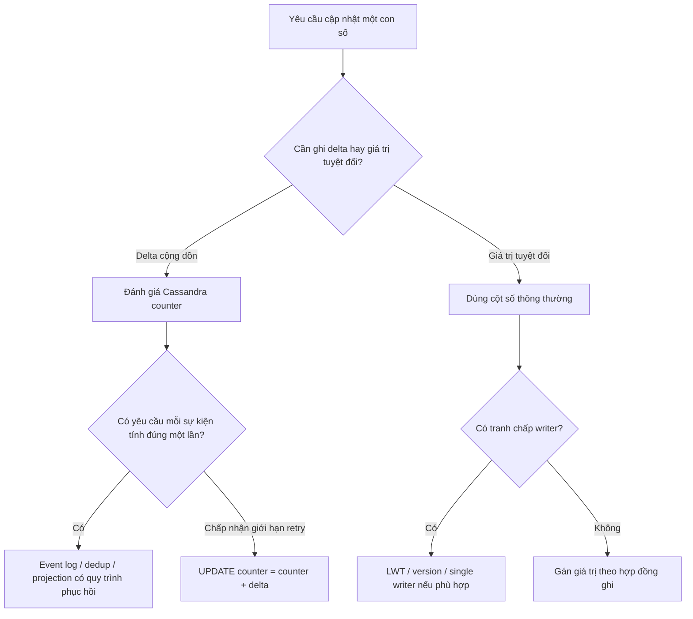
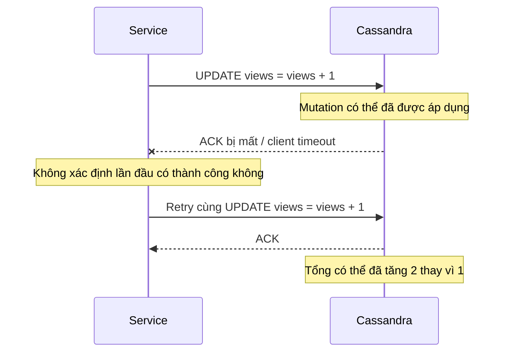

# Ngữ nghĩa của thao tác tăng so với gán một giá trị

Trong **Spring Data Cassandra**, có hai yêu cầu dễ bị nhầm là giống nhau: **“tăng lượt xem thêm 1”** và **“đặt tổng lượt xem bằng 100”**. Với Apache Cassandra, đó là **hai loại mutation có ngữ nghĩa khác nhau**. Thao tác tăng theo lượng thay đổi (*delta*) trên cột kiểu `counter` không giống việc gán giá trị tuyệt đối cho cột `bigint` thông thường.

Sự khác biệt này càng quan trọng khi có nhiều instance ứng dụng cùng ghi, request bị timeout, driver thử lại thao tác hoặc replica tạm thời mất liên lạc. Một phép tăng có thể phù hợp để cộng dồn số liệu, nhưng **không tự bảo đảm mỗi sự kiện chỉ được tính đúng một lần**. Một phép gán có thể phù hợp với trạng thái xác định, nhưng nếu chỉ đọc giá trị hiện tại rồi cộng 1 và ghi lại thì có nguy cơ **lost update** khi nhiều writer cạnh tranh.

Bài học thuộc chương **Bộ đếm** của module `SPRING_DATA_CASSANDRA`. Ta sẽ học cách đọc đúng câu CQL cho counter, thiết kế bảng theo partition key, phân biệt phép cộng delta và phép gán, triển khai qua `CqlTemplate`/Java Driver 4, xử lý retry và xác định khi nào **không nên dùng Cassandra counter**.

## 1. Từ yêu cầu nghiệp vụ đến ngữ nghĩa ghi

Hãy phân biệt bốn câu hỏi trước khi chọn bảng:

| Yêu cầu | Ngữ nghĩa mong muốn | Lựa chọn ban đầu |
| --- | --- | --- |
| Có thêm một lượt xem trang | Tăng tổng thêm 1 so với trạng thái đã có | Counter với `views = views + 1` |
| Bộ tổng hợp nhận thêm 250 lượt xem | Cộng thêm delta 250 | Counter với `views = views + 250` khi delta đáng tin |
| Bên quản trị chốt tổng tháng là 12.000 | Đặt giá trị tuyệt đối thành 12.000 | Cột `bigint` thường và chính sách cập nhật/version |
| Mỗi giao dịch thanh toán chỉ được tính đúng một lần | Bất biến *exactly once* theo giao dịch | Lưu event/idempotency + quy trình tổng hợp có kiểm soát; không chỉ counter |

**Quy tắc:** phép tăng mang nghĩa “áp dụng thay đổi này”, còn phép gán mang nghĩa “giá trị mới phải bằng X”. Hai phép không thể thay thế nhau chỉ bằng việc đổi tên method trong repository.



## 2. Bảng counter và bảng số thông thường là hai kiểu dữ liệu khác nhau

Giả sử ứng dụng thống kê số lượt xem một trang của từng tenant theo ngày UTC. Với Cassandra counter:

```sql
CREATE TABLE page_views_counter_by_day (
    tenant_id  text,
    page_id    uuid,
    view_day   date,
    views      counter,
    PRIMARY KEY ((tenant_id, page_id, view_day))
);
```

Ở đây bộ ba `(tenant_id, page_id, view_day)` là **partition key ghép và full primary key**. Mỗi cặp tenant/trang/ngày có một bộ đếm logic. Cột `views` có kiểu **`counter`**, không phải `bigint`.

Một bảng lưu giá trị tuyệt đối có thể được thiết kế riêng:

```sql
CREATE TABLE page_view_target_by_day (
    tenant_id  text,
    page_id    uuid,
    view_day   date,
    views      bigint,
    version    bigint,
    PRIMARY KEY ((tenant_id, page_id, view_day))
);
```

Hai bảng có cùng kiểu primary key nhưng **không tương đương**:

- Ở bảng thứ nhất, `views counter` hỗ trợ thao tác **tăng/giảm** bằng cú pháp counter.
- Ở bảng thứ hai, `views bigint` là dữ liệu số thông thường, có thể được **gán** trong `UPDATE` hoặc `INSERT`; muốn bảo vệ khỏi writer cạnh tranh phải bổ sung chính sách đồng thời.
- `version` trong bảng thường là cột nghiệp vụ để so sánh điều kiện. Cassandra **không tự tăng version** chỉ vì nó có tên `version`.

Các ví dụ tiếp theo giả định bảng đã được tạo bằng một migration được quản lý. Không nên tạo bảng mới mỗi lần service khởi động.

## 3. Cú pháp đúng để tăng và giảm counter

Với bảng counter, dùng `UPDATE` có phép toán trên **chính cột counter**:

```sql
-- Cộng thêm một lượt xem.
UPDATE page_views_counter_by_day
SET views = views + 1
WHERE tenant_id = 'tenant-a'
  AND page_id = 550e8400-e29b-41d4-a716-446655440000
  AND view_day = '2026-11-25';

-- Cộng thêm 25 lượt xem được tổng hợp từ một nguồn có kiểm soát.
UPDATE page_views_counter_by_day
SET views = views + 25
WHERE tenant_id = 'tenant-a'
  AND page_id = 550e8400-e29b-41d4-a716-446655440000
  AND view_day = '2026-11-25';

-- Trừ đi ba đơn vị theo một quy tắc nghiệp vụ được phép.
UPDATE page_views_counter_by_day
SET views = views - 3
WHERE tenant_id = 'tenant-a'
  AND page_id = 550e8400-e29b-41d4-a716-446655440000
  AND view_day = '2026-11-25';
```

Nếu không có lỗi, không có mutation cạnh tranh khác và bắt đầu từ 0, ba thay đổi trên tạo tổng logic `0 + 1 + 25 - 3 = 23`. Đây là phép **cộng/trừ delta**, không phải lệnh đặt counter bằng 1, 25 hoặc 3.

Đọc:

```sql
SELECT views
FROM page_views_counter_by_day
WHERE tenant_id = ?
  AND page_id = ?
  AND view_day = ?;
```

Câu đọc dùng **đầy đủ partition key**. Việc không có hàng trả về không nên được diễn giải một cách âm thầm như “đã tồn tại counter bằng 0” trong mọi API; ứng dụng có thể quyết định trả mặc định 0 cho màn hình, nhưng cần phân biệt **chưa ghi lần nào** với **đã ghi và tổng đang bằng 0** nếu nghiệp vụ cần.

### 3.1. Counter không hỗ trợ gán giá trị tuyệt đối

Các câu sau **không phải cách dùng hợp lệ** để đặt giá trị của một cột `counter`:

```sql
-- SAI: counter không nhận phép gán trực tiếp.
UPDATE page_views_counter_by_day
SET views = 100
WHERE tenant_id = 'tenant-a'
  AND page_id = 550e8400-e29b-41d4-a716-446655440000
  AND view_day = '2026-11-25';

-- SAI: không INSERT một counter như cột bigint thường.
INSERT INTO page_views_counter_by_day
    (tenant_id, page_id, view_day, views)
VALUES ('tenant-a',
        550e8400-e29b-41d4-a716-446655440000,
        '2026-11-25', 100);
```

Để bắt đầu sử dụng một counter key mới, ứng dụng thường chỉ cần **`UPDATE views = views + delta`** với đủ primary key; Cassandra xử lý thao tác counter theo ngữ nghĩa riêng. Không cần `INSERT` hàng counter với một giá trị ban đầu.

### 3.2. Dùng giá trị bind, không nối số từ request vào CQL

```sql
UPDATE page_views_counter_by_day
SET views = views + ?
WHERE tenant_id = ?
  AND page_id = ?
  AND view_day = ?;
```

Marker đầu tiên là **delta kiểu số nguyên phù hợp với counter** (thường bind bằng `long` trong Java Driver 4); ba marker tiếp theo là các thành phần primary key. CQL vẫn phải có **cột `views` và cấu trúc cố định**. Bind parameter không thể thay tên cột, tên bảng hoặc biến một câu gán `bigint` thành thao tác counter.

## 4. Counter table có những giới hạn cấu trúc riêng

Cassandra counter là **loại cột đặc biệt**, với những giới hạn khác một bảng chứa `int`/`bigint` thông thường:

| Quy tắc | Ý nghĩa khi thiết kế |
| --- | --- |
| Cột `counter` nằm ngoài primary key | Không dùng counter làm partition/clustering key |
| Các cột không thuộc primary key trong counter table phải là counter | Không trộn `counter` và cột thường như `title text` trong cùng bảng |
| Mutation counter dùng phép cộng/trừ trên chính cột đó | Không dùng `INSERT` để đặt số hoặc `SET views = 100` |
| Không hỗ trợ TTL thông thường cho counter | Cần chiến lược bucket/retention riêng |
| Không dùng `USING TIMESTAMP` như với ghi scalar thường | Không ép cơ chế timestamp/LWW thông thường cho counter |
| Không hỗ trợ LWT `IF ...` trên counter update | Không dùng counter để làm compare-and-set hoặc giới hạn cứng |
| Không trộn counter mutation và non-counter mutation trong cùng batch | Nếu dùng batch, phải tuân thủ cú pháp/quy tắc counter batch của CQL |

Ví dụ **không hợp lệ** vì trộn kiểu counter và kiểu thường ngoài khóa:

```sql
-- SAI: title là cột thường không thuộc primary key.
CREATE TABLE invalid_views (
    tenant_id text PRIMARY KEY,
    views     counter,
    title     text
);
```

Nếu cần tiêu đề trang, chủ sở hữu, cấu hình hoặc thời điểm cập nhật, lưu các thuộc tính đó trong **bảng entity thông thường** được thiết kế theo access pattern; chỉ đưa thông tin khóa và các counter phù hợp vào counter table.

### Counter batch không biến nhiều increment thành giao dịch nghiệp vụ

Một số câu CQL counter có thể được nhóm bằng `BEGIN COUNTER BATCH`, nhưng việc gom batch **không bảo đảm mỗi event được tính đúng một lần**, cũng không tạo transaction tổng quát gồm counter + bảng đơn hàng khác partition. Tránh gom những cập nhật độc lập chỉ để tiết kiệm request nếu điều đó làm tăng tải coordinator hoặc tạo kỳ vọng sai về atomicity.

## 5. Tăng không giống đọc rồi gán giá trị mới

Xét một bảng thường có `views bigint`. Hai service cùng thấy giá trị ban đầu `views=10`:

```text
Service A: SELECT views → 10
Service B: SELECT views → 10
Service A: UPDATE SET views = 11
Service B: UPDATE SET views = 11

Kết quả có thể là 11, dù có hai lượt xem mới.
```

Đây là **lost update**: hai phép gán dựa trên cùng snapshot đã đọc. Cassandra không tự phát hiện “đáng ra phải cộng hai lần” chỉ vì cả hai cùng đặt giá trị 11.

Với counter, hai writer phát thao tác **cộng một delta**:

```sql
UPDATE page_views_counter_by_day
SET views = views + 1
WHERE tenant_id = ? AND page_id = ? AND view_day = ?;
```

Khi hai mutation cộng độc lập đều được áp dụng đúng một lần và không gặp lỗi, tổng logic được cộng thêm 2. Cassandra hỗ trợ việc hợp nhất những thay đổi counter từ các writer/replica mà không cần mỗi writer đọc tổng trước rồi ghi lại.

| Khía cạnh | `counter = counter + 1` | `bigint = 11` |
| --- | --- | --- |
| Diễn tả | Một thay đổi +1 | Một giá trị tuyệt đối 11 |
| Phụ thuộc phép đọc của ứng dụng trước đó | Không cần để biết tổng hiện tại | Có thể, nếu 11 được tính từ `SELECT` |
| Hai thao tác giống nhau liên tiếp | Về ngữ nghĩa, cộng hai lần | Đặt cùng giá trị hai lần |
| Retry sau timeout | **Nguy cơ tăng trùng** | Gán cùng giá trị có thể không đổi kết quả cuối, nhưng timestamp và concurrency vẫn cần xét |
| Kiểm tra giới hạn `views <= N` | Không có CAS counter trực tiếp | Có thể dùng conditional update/LWT trên bảng thường |
| Phù hợp | Thống kê cộng dồn có hợp đồng sai số/rủi ro rõ | Trạng thái, số đã chốt, versioned business data |

**Không đồng nhất counter update với một giao dịch “exactly once”**. Vấn đề khi retry và sự cố mạng sẽ được phân tích ngay sau đây.

## 6. Trường hợp nguy hiểm: một increment bị thực thi hai lần

Counter update là một thao tác **không idempotent**. Cùng một câu `views = views + 1` thực thi hai lần có ý nghĩa khác với chỉ thực thi một lần.

Giả sử client gửi increment, Cassandra đã áp dụng mutation nhưng response không đến client:



Điểm phân biệt:

1. **`[applied]` của LWT không xuất hiện ở counter UPDATE thông thường.** Không có một kết quả điều kiện để hỏi “event ID này đã tăng chưa?” ngay trong counter mutation.
2. **ACK thành công không phải bằng chứng một event chỉ được tính một lần** nếu tầng phía trước có retry hoặc gửi trùng.
3. **Timeout không chứng minh thao tác chưa được áp dụng.** Retry mù có thể tăng lần nữa.
4. **Không retry** giảm một số trường hợp đếm trùng nhưng có thể bỏ sót increment khi mutation thực sự chưa được áp dụng. Đây là một đánh đổi, không phải giải pháp exactly-once.

Các cơ chế như consistency `LOCAL_QUORUM` hoặc đọc nhiều replica không tự sửa được việc **hai mutation cộng độc lập đã được áp dụng**. Replica sẽ đối chiếu dữ liệu counter theo ngữ nghĩa riêng, không có thông tin rằng hai lần tăng ấy xuất phát từ cùng một business event.

### 6.1. Tính idempotency phải nằm ngoài thao tác counter

Giả sử một webhook có `event_id`. Bạn có thể ghi event vào một bảng ledger theo khóa duy nhất và dùng `IF NOT EXISTS` để phát hiện trùng. Nhưng hai bước **“ghi ledger thành công”** và **“tăng counter thành công”** thuộc các thao tác riêng.

Nếu tiến trình dừng sau khi ledger ghi thành công mà trước khi counter tăng, việc retry có thể thấy event đã có và **bỏ qua việc tăng**. Ngược lại, nếu counter tăng xong nhưng checkpoint chưa lưu, một lần phát lại có thể **tăng trùng**.

**Do đó không được tuyên bố** chỉ cần `INSERT IF NOT EXISTS event` trước `UPDATE counter` là đã có transaction exactly-once qua hai bảng. Khi cần độ chính xác nghiêm ngặt, nên thiết kế nguồn sự thật dạng event/ledger bền vững và cơ chế **tổng hợp lại hoặc đối soát có thể lặp lại** theo event ID; counter Cassandra chỉ là một projection/metric không mang vai trò quyết định thanh toán.

## 7. Ví dụ Java Driver 4: statement cộng delta không idempotent

Khi sử dụng Spring Boot với Java Driver 4, `CqlSession` thường là tài nguyên dùng chung. Ví dụ service chỉ cho phép **delta dương** để ghi thêm lượt xem:

```java
import java.time.LocalDate;
import java.util.OptionalLong;
import java.util.UUID;

import com.datastax.oss.driver.api.core.CqlSession;
import com.datastax.oss.driver.api.core.DefaultConsistencyLevel;
import com.datastax.oss.driver.api.core.cql.BoundStatement;
import com.datastax.oss.driver.api.core.cql.PreparedStatement;
import com.datastax.oss.driver.api.core.cql.Row;

public final class PageViewCounterGateway {
    private final CqlSession session;
    private final PreparedStatement increment;
    private final PreparedStatement select;

    public PageViewCounterGateway(CqlSession session) {
        this.session = session;
        this.increment = session.prepare(
                "UPDATE page_views_counter_by_day " +
                "SET views = views + ? " +
                "WHERE tenant_id = ? AND page_id = ? AND view_day = ?");
        this.select = session.prepare(
                "SELECT views FROM page_views_counter_by_day " +
                "WHERE tenant_id = ? AND page_id = ? AND view_day = ?");
    }

    public void addViews(String tenantId, UUID pageId,
                         LocalDate day, long positiveDelta) {
        validateKey(tenantId, pageId, day);
        if (positiveDelta <= 0) {
            throw new IllegalArgumentException("Delta phải dương");
        }

        BoundStatement statement = increment.bind(
                positiveDelta, tenantId, pageId, day)
                .setConsistencyLevel(DefaultConsistencyLevel.LOCAL_QUORUM)
                .setIdempotent(false);

        session.execute(statement);
    }

    public OptionalLong readViews(String tenantId, UUID pageId,
                                  LocalDate day) {
        validateKey(tenantId, pageId, day);
        BoundStatement statement = select.bind(tenantId, pageId, day)
                .setConsistencyLevel(DefaultConsistencyLevel.LOCAL_QUORUM);

        Row row = session.execute(statement).one();
        if (row == null || row.isNull("views")) {
            return OptionalLong.empty();
        }
        return OptionalLong.of(row.getLong("views"));
    }

    private static void validateKey(
            String tenantId, UUID pageId, LocalDate day) {
        if (tenantId == null || tenantId.isBlank()
                || pageId == null || day == null) {
            throw new IllegalArgumentException("Thiếu partition key");
        }
    }
}
```

Giải thích:

- `increment` và `select` được **prepare một lần** và tái sử dụng theo query shape.
- `setIdempotent(false)` truyền ý định **không an toàn khi thực thi lặp** cho những chính sách retry/speculative execution của driver có sử dụng thuộc tính này. Nó không biến counter thành exactly-once.
- `LOCAL_QUORUM` là **ví dụ cấu hình consistency**, phải lựa chọn theo replication factor và local datacenter thực tế. Nó không bảo đảm event không bị tính trùng.
- Phương thức đọc trả `OptionalLong.empty()` nếu query không có hàng phù hợp, để tầng nghiệp vụ quyết định có hiển thị 0 hay không.
- `pageId`, `viewDay` và `tenantId` đều thuộc khóa; chúng phải được chuẩn hóa/kiểm tra cùng một cách ở writer và reader.

**Nếu `session.execute` ném timeout:** không tự động gọi lại `addViews` trong catch mà giả định lần đầu chưa áp dụng. Caller phải đánh giá yêu cầu chính xác và chính sách retry của toàn bộ pipeline.

## 8. `CqlTemplate` trong Spring Data Cassandra

`CqlTemplate` thích hợp khi muốn thao tác CQL trực tiếp và map `Row` mà không dùng entity ghi. Một ví dụ tăng counter:

```java
import java.time.LocalDate;
import java.util.UUID;
import com.datastax.oss.driver.api.core.cql.SimpleStatement;
import org.springframework.data.cassandra.core.cql.CqlTemplate;

public void incrementPageViews(
        CqlTemplate template, String tenantId, UUID pageId,
        LocalDate day, long delta) {

    if (tenantId == null || tenantId.isBlank()
            || pageId == null || day == null || delta <= 0) {
        throw new IllegalArgumentException("Input hoặc delta không hợp lệ");
    }

    SimpleStatement statement = SimpleStatement.builder(
            "UPDATE page_views_counter_by_day " +
            "SET views = views + ? " +
            "WHERE tenant_id = ? AND page_id = ? AND view_day = ?")
            .addPositionalValues(delta, tenantId, pageId, day)
            .setIdempotent(false)
            .build();

    template.execute(statement);
}
```

Đoạn trên là một **method minh họa để đặt trong service**, với `CqlTemplate` do Spring quản lý. Nếu service muốn quy định consistency riêng, có thể cấu hình ở statement/template/driver theo API phù hợp phiên bản. Điều không đổi là **delta được truyền như một giá trị bind** và statement **không idempotent**.

### Tại sao không dùng `repository.save` như phép cộng?

Nếu bạn ánh xạ counter thành entity rồi gọi:

```java
// KHÔNG phải cách biểu diễn tăng counter:
counterEntity.setViews(counterEntity.getViews() + 1);
repository.save(counterEntity);
```

thì về ngữ nghĩa đây là “đọc số hiện có, đặt giá trị mới”, không phải counter update `views = views + ?`. Hơn nữa, `save`/insert theo cơ chế entity thông thường **không phải** cách ghi hợp lệ cho cột CQL `counter`.

Với counter table, ưu tiên một **custom repository/service method chuyên dụng**, phát CQL `UPDATE` đúng cú pháp counter, thay vì cố dùng CRUD `save` để ẩn khác biệt quan trọng này.

## 9. Khi muốn đặt chính xác giá trị 100

Giả sử dashboard vận hành cho phép quản trị viên “chốt giá trị chính xác là 100”. Với counter, không thể viết `SET views = 100`. Ý tưởng đọc tổng hiện tại 75 rồi gửi `views = views + 25` **không tạo phép gán an toàn** nếu:

- Người khác tăng thêm 10 giữa hai bước đọc và ghi.
- Read ban đầu chưa phản ánh toàn bộ mutation đang hội tụ.
- Lần gửi delta bị timeout; retry có thể áp dụng hai lần.

Vì vậy, **`delta = target - current` không tương đương với một atomic set**.

Đối với giá trị được chốt và cần bảo vệ khỏi concurrent update, dùng **bảng thường** như `page_view_target_by_day`:

```sql
-- Đặt giá trị tuyệt đối, không phải cộng delta.
UPDATE page_view_target_by_day
SET views = 100
WHERE tenant_id = ?
  AND page_id = ?
  AND view_day = ?;
```

Câu gán này hợp lệ với `bigint`, nhưng nhiều writer vẫn có thể ghi đè theo **write timestamp**. Nếu cần kiểm tra rằng dữ liệu chưa bị thay từ lúc đọc, dùng conditional update trên **bảng thường**, ví dụ version hiện tại là 7:

```sql
UPDATE page_view_target_by_day
SET views = 100,
    version = 8
WHERE tenant_id = ?
  AND page_id = ?
  AND view_day = ?
IF version = 7;
```

Đây là **lightweight transaction (LWT)** với so sánh điều kiện. Kết quả cần kiểm tra cột `[applied]`:

- `true`: điều kiện đúng, giá trị/version mới đã được áp dụng theo cơ chế LWT.
- `false`: version hiện tại không còn là 7; service phải tải lại hoặc báo conflict.
- Timeout: không biết kết quả đã được áp dụng chưa; cần đối soát, không đoán.

Ví dụ giả định row đã tồn tại với `version = 7`. Khi khởi tạo row lần đầu, cần một quy trình được kiểm soát như `INSERT ... IF NOT EXISTS`. **Counter table không hỗ trợ thay thế trực tiếp bằng `IF version = ...`**, bởi nó không phải bảng scalar thường.

## 10. Không dùng counter để giữ bất biến tồn kho hoặc số dư

Một số bài toán chứa phép cộng/trừ nhưng **không phù hợp với counter đơn thuần**:

- “Số ghế còn lại **không bao giờ âm**.”
- “Một tài khoản chỉ được chi tiền khi **đủ số dư**.”
- “Mỗi đơn hàng chỉ được trừ tồn kho **đúng một lần**.”
- “Không được vượt quá hạn mức 100 yêu cầu.”

Counter cho phép tăng/giảm delta, **không kèm điều kiện nguyên tử kiểu `IF views >= 1`** để bảo vệ các bất biến đó. Một `SELECT` kiểm tra `remaining=1` rồi hai writer cùng trừ 1 vẫn là read-then-write race.

Chọn công cụ theo yêu cầu:

| Trường hợp | Gợi ý |
| --- | --- |
| Lượt xem, số click, số lần chạy tác vụ có thể đối soát | Cassandra counter có thể phù hợp sau khi đánh giá retry và contention |
| Tồn kho nhỏ hoặc số chỗ có giới hạn cứng | Dữ liệu thông thường + LWT/version hoặc mô hình reservation theo từng khóa |
| Số dư tài chính | Ledger/event model và cơ chế giao dịch/bảo đảm mạnh phù hợp với nghiệp vụ |
| Số lượng đơn được thanh toán | Nguồn sự thật là đơn/event thanh toán; counter chỉ là projection tái dựng được |
| Dashboard tổng hợp cuối ngày | Pipeline tổng hợp có checkpoint/idempotency hoặc snapshot đã được chốt |

**Không dùng `views = views - 1` như một phép “trừ nếu còn đủ”**. Cassandra không tự đặt ngưỡng 0 và không ngăn giá trị âm chỉ vì cột được gọi là `remaining`.

## 11. Đọc và consistency level của counter

Trong cluster Cassandra có nhiều replica, counter sử dụng cơ chế lưu trữ và phối hợp cập nhật riêng. Khi đọc, ứng dụng vẫn phải xác định mức consistency như `LOCAL_ONE` hoặc `LOCAL_QUORUM` theo topology và SLA.

| CL đọc | Điểm cần cân nhắc |
| --- | --- |
| `LOCAL_ONE` | Thường ưu tiên ít phản hồi hơn; có thể quan sát trạng thái chưa hội tụ |
| `LOCAL_QUORUM` | Yêu cầu nhiều replica cục bộ hơn, thường chi phí/latency cao hơn |
| `QUORUM` hoặc mức khác | Cần phân tích RF, nhiều DC, đường mạng và phạm vi ứng dụng |

**Consistency cao hơn không biến increment thành idempotent**. Nếu cùng một event đã gửi hai mutation tăng thành công, reader quorum vẫn có thể đọc một giá trị đã cộng cả hai. Cũng không nên hứa độ chính xác tức thời tuyệt đối trên mọi trường hợp lỗi mạng, retry và failover chỉ dựa vào CL.

Khi test, cần phân biệt ba loại vấn đề:

1. **Dữ liệu chưa hội tụ giữa replica:** đọc ở thời điểm và CL khác nhau có thể thấy kết quả khác.
2. **Sự kiện được áp dụng nhiều lần:** chính counter đã được tăng trùng; tăng CL đọc không sửa được.
3. **Sự kiện không được áp dụng:** counter thiếu một delta; đọc lại nhiều lần cũng không tự tạo delta đã mất.

Giải pháp cần đúng nguyên nhân: sửa retry policy, đối soát nguồn event, đánh giá cluster/consistency hoặc điều chỉnh thiết kế.

## 12. Đặt lại counter: vì sao reset bằng DELETE là rủi ro?

Với cột `bigint`, đặt lại về 0 là một phép gán bình thường. Với counter, không có cú pháp `SET views = 0`. Một số người chọn `DELETE` rồi cập nhật lại cùng key, nhưng thao tác này **không tương đương với reset nguyên tử**:

- Có thể có mutation tăng đang trên đường đến hoặc một client đang retry.
- Replica, tombstone, repair và trạng thái cũ có thể chưa hội tụ.
- Không có điều kiện bảo đảm “mọi lần tăng của thế hệ cũ đã dừng” chỉ bằng một lệnh xóa.

Nếu bài toán có **chu kỳ thống kê** như ngày/tuần/tháng, dùng bucket thời gian trong primary key đã là một cách bắt đầu số liệu mới theo **khóa mới**:

```sql
-- Ngày mới là một partition key khác.
UPDATE page_views_counter_by_day
SET views = views + 1
WHERE tenant_id = 'tenant-a'
  AND page_id = 550e8400-e29b-41d4-a716-446655440000
  AND view_day = '2026-11-26';
```

Nếu cần một thao tác “reset ngay lúc này” trong cùng ngày, có thể thiết kế **counter epoch/generation** trong khóa:

```sql
CREATE TABLE page_views_by_epoch (
    tenant_id  text,
    page_id    uuid,
    view_day   date,
    epoch_id   uuid,
    views      counter,
    PRIMARY KEY ((tenant_id, page_id, view_day, epoch_id))
);
```

Quy trình khái niệm:

1. Lưu **epoch hiện hành** trong một bảng cấu hình thông thường được cập nhật có kiểm soát (có thể dùng LWT nếu nhiều writer muốn reset cùng lúc).
2. Khi reset, tạo `epoch_id` mới và chuyển định tuyến writer/reader sang epoch đó.
3. Các increment muộn mang epoch cũ **không được cộng sang epoch mới**; chúng chỉ tác động khóa cũ.
4. Theo dõi thời gian lưu epoch cũ và chính sách xóa/phục hồi riêng, vì **counter không hỗ trợ TTL thông thường**.

**Giới hạn:** đổi epoch ở bảng thường và increment ở bảng counter là **hai thao tác riêng**. Khi nhiều service cache epoch, có thể có độ trễ chuyển đổi; cần thiết kế cách phát hành epoch, refresh và đối soát. Epoch tạo **ranh giới dữ liệu logic**, không tự tạo transaction giữa các bảng.

## 13. Dữ liệu lớn, hot partition và sharding

Một trang rất phổ biến có thể nhận hàng nghìn lượt xem mỗi giây. Nếu tất cả mutation đều đến **một counter key**, contention/coordination và áp lực trên replica có thể tăng; p95/p99 không nhất thiết tăng tuyến tính theo số node.

Một chiến lược scale-out có thể chia thành nhiều **shard counter**:

```sql
CREATE TABLE page_views_counter_sharded (
    tenant_id  text,
    page_id    uuid,
    view_day   date,
    shard_id   int,
    views      counter,
    PRIMARY KEY ((tenant_id, page_id, view_day, shard_id))
);
```

Writer lựa chọn `shard_id` trong một tập hữu hạn theo quy tắc có thể kiểm soát, rồi phát `views = views + 1` vào shard đó. Reader tổng hợp các shard của cùng tenant/page/day để tính tổng.

**Đánh đổi:**

- Giảm contention trên **một** counter key nhưng làm tăng số partition cần đọc/tổng hợp.
- Khi shard count thay đổi, reader phải biết những thế hệ shard nào có dữ liệu; không quên dữ liệu ở shard cũ.
- Kết quả cộng các shard qua nhiều request không tạo một snapshot nguyên tử toàn hệ.
- Retry mù vẫn gây tăng trùng **bên trong một shard**; sharding không giải quyết idempotency.
- Nên giới hạn số shard, số request đồng thời và cache/refresh chiến lược phù hợp SLA.

Không shard chỉ vì “Cassandra là distributed”. Hãy đo tốc độ update, latency, replica load và mức độ nóng của key trước; sharding thêm nhiều phức tạp cho đường đọc.

## 14. Những giới hạn về TTL, deletion và retention

Counter khác các cell thông thường ở chỗ **không thể dùng TTL như một cột `text`/ `bigint` có thời hạn**. Vì thế, bảng counter theo ngày có thể tích lũy dữ liệu nếu không có retention rõ ràng.

| Nhu cầu | Cần lưu ý |
| --- | --- |
| Chỉ giữ 90 ngày lịch sử | Dùng khóa/bucket ngày và kế hoạch dọn dữ liệu theo policy được phê duyệt |
| Muốn tự động hết hạn từng count | Counter không hỗ trợ `USING TTL` |
| Muốn xóa/cấu hình lại một counter | Thao tác xóa cần cân nhắc tombstone, in-flight increments và tái dùng key |
| Muốn mỗi event có timestamp/owner | Không trộn field thường cùng counter trong một counter table |
| Muốn tổng cuối kỳ cố định | Chụp snapshot sang bảng thường, có version và nguồn tái dựng |

Khi xóa dữ liệu counter cũ, phải xét **khả năng client vẫn đang ghi vào bucket cũ**, thời gian retry/replay, khôi phục node và repair/tombstone. Nếu hệ thống cần dữ liệu tự hết hạn theo TTL phức tạp, counter có thể không phải lựa chọn đúng cho toàn bộ vòng đời dữ liệu.

## 15. Kiểm thử đúng các trường hợp phân tán

Một test đơn giản “gọi `UPDATE += 1` ba lần rồi `SELECT` thấy 3” chỉ kiểm chứng **đường chạy bình thường**. Bài toán khó là khi thông tin thành công hoặc thứ tự request không còn rõ ràng.

| Tình huống kiểm thử | Kết quả/điều cần xác minh |
| --- | --- |
| Ba increment tuần tự, không lỗi | Cộng đúng ba delta trong môi trường thử |
| Hai service tăng cùng key | Không phát sinh lost update kiểu read-modify-write thông thường |
| Gửi trùng cùng một event | Hai increment **có thể** được tính; không được kỳ vọng dedup tự động |
| Cassandra áp dụng mutation nhưng ACK bị mất | Caller đánh dấu **unknown outcome**, không retry mù |
| Một node/replica suy giảm | Ảnh hưởng CL, timeout, retry và kết quả quan sát được |
| Tăng rồi giảm với delta hợp lệ | Kết quả phản ánh tổng đại số của các mutation được áp dụng |
| Đọc key chưa từng ghi | API phân biệt vắng hàng với chính sách hiển thị 0 |
| Đổi ngày UTC | Writer và reader dùng cùng quy tắc bucket |
| Reset bằng epoch mới | Mutation trễ mang epoch cũ không làm tăng số liệu epoch mới |
| Giá trị cần giới hạn không âm | Counter không tự thực thi invariant; test chiến lược thay thế |
| Sharding nhiều key | Tổng hợp đủ shard và kiểm soát fan-out, không khẳng định snapshot toàn cục |

Đối với các test tích hợp, dùng **Cassandra thật hoặc môi trường kiểm thử tương đương** để kiểm chứng cú pháp counter, consistency và những hạn chế CQL; mock repository không thể mô phỏng chính xác counter shards, timeout và race.

## 16. Các lỗi điển hình và cách sửa

| Sai lầm | Hậu quả | Cách làm phù hợp |
| --- | --- | --- |
| `SET views = 100` trên counter | Sai cú pháp/ngữ nghĩa counter | Dùng bảng `bigint` cho giá trị tuyệt đối |
| `INSERT` vào counter table như entity thường | Thao tác không phù hợp với counter CQL | `UPDATE views = views + ?` |
| `SELECT views` rồi `UPDATE bigint = old + 1` | Lost update khi hai writer đọc cùng snapshot | Counter cho delta hoặc LWT/version cho dữ liệu thường |
| Timeout → retry counter ngay | Có thể cộng trùng | Phân loại unknown outcome và thiết kế pipeline idempotent |
| Coi `LOCAL_QUORUM` là exactly-once | Nhầm replica consistency với event dedup | Ledger/event source + đối soát; CL phù hợp |
| Coi counter là số dư cần ngăn âm | Không có điều kiện nguyên tử với counter | Mô hình state/ledger + LWT/transaction phù hợp |
| `USING TTL` cho counter | Không được hỗ trợ | Bucket và retention workflow riêng |
| Lưu `title` cùng cột counter trong một bảng | Vi phạm cấu trúc counter table | Bảng metadata thông thường riêng |
| `repository.save` để tăng counter | Không diễn tả `counter += delta` | Custom CQL/driver writer chuyên dụng |
| Dùng `DELETE` như reset tức thì | Dễ gặp in-flight mutation/tombstone/reuse key | Chuyển bucket hoặc epoch mới |
| Một key rất nóng, chỉ tăng số replica | Có thể vẫn contention | Đo tải, cân nhắc shard hữu hạn và tổng hợp |
| Không lưu event ID, sau đó cần kiểm toán | Không thể suy ra event nào đã được tính | Dùng event/ledger làm nguồn sự thật |

## 17. Checklist trước khi triển khai

1. **Xác định hợp đồng số liệu:** counter tăng theo delta hay giá trị phải được đặt chính xác?
2. **Thiết kế full primary key:** tenant, đối tượng và bucket thời gian được chuẩn hóa đồng nhất giữa writer/reader.
3. **Chọn schema đúng:** bảng chỉ có primary key và counter columns; metadata thường tách riêng.
4. **Dùng đúng CQL:** `UPDATE counter = counter + ?` hoặc `counter - ?`, không `INSERT`/`SET absolute`.
5. **Đánh dấu không idempotent:** driver retry/speculative execution phải phù hợp với counter semantics.
6. **Thiết kế kết quả không rõ:** timeout, mất ACK và request trùng được xử lý theo hợp đồng nghiệp vụ.
7. **Phân biệt correctness:** thống kê có thể đối soát khác với tiền, tồn kho, đặt chỗ hoặc quota cứng.
8. **Kiểm tra CL và topology:** read/write consistency không thay thế idempotency.
9. **Cân nhắc lifecycle:** counter không có TTL; bucket, retention, reset/epoch và cleanup cần kế hoạch.
10. **Đo hot key:** tăng/giảm liên tục có thể gây contention, sharding có chi phí tổng hợp.
11. **Thử failure scenarios:** timeout sau apply, duplicate events, node lỗi, đọc key chưa tồn tại.
12. **Giữ nguồn sự thật nếu cần tái dựng:** event ID/checkpoint/snapshot có version và đối soát.

## 18. Bài tập tình huống

**Tình huống A — Gán bằng phép tăng.** Một counter hiện trả 75 và admin muốn đặt tổng bằng 100. Developer định đọc 75 rồi phát `views = views + 25`. Có bảo đảm kết quả là 100 không?

**Đáp án gợi ý:** Không. Một writer khác có thể tăng trong khoảng đọc-ghi, và counter mutation có thể bị retry. Nếu yêu cầu là giá trị tuyệt đối, cần bảng thường và cơ chế version/LWT khi có concurrency.

**Tình huống B — Retry sau timeout.** Một request xem trang được gửi một lần từ mobile, nhưng gateway retry `UPDATE += 1` khi không nhận ACK. Có thể ghi nhận chính xác một lượt xem không?

**Đáp án gợi ý:** Không bảo đảm. Mutation đầu có thể đã áp dụng. Retry có thể cộng lần hai; không retry có thể bỏ sót nếu mutation đầu thất bại. Cần hợp đồng chấp nhận sai số hoặc pipeline event/idempotency có khả năng đối soát.

**Tình huống C — Tồn kho.** Hệ thống có `remaining counter`, hai khách cùng mua khi còn 1 và mỗi người gửi `remaining = remaining - 1`. Counter có tự ngăn giá trị thành -1 không?

**Đáp án gợi ý:** Không. Không có CAS `IF remaining >= 1` trên counter. Dùng cơ chế reservation theo khóa, LWT trên bảng thường hoặc transaction thích hợp để bảo vệ invariant.

**Tình huống D — Metadata.** Developer tạo bảng có `tenant_id PRIMARY KEY, views counter, title text`. Tại sao không đúng?

**Đáp án gợi ý:** Counter table không trộn counter với cột thông thường ngoài primary key. Tách tiêu đề sang bảng metadata; bảng counter chỉ giữ khóa và các counter columns.

**Tình huống E — Reset lúc 12 giờ.** Scheduler xóa row counter rồi tiếp tục increment trên cùng key. Một message từ trước 12 giờ đến muộn sau reset. Có thể bảo đảm message cũ không lọt vào tổng mới không?

**Đáp án gợi ý:** Không. Sử dụng bucket/epoch trong key và gắn message với epoch đúng; quản lý quá trình chuyển epoch, xử lý writer bị cache và retention.

**Tình huống F — Đúng một lần.** Hệ thống ghi event ID bằng `INSERT IF NOT EXISTS`, sau đó tăng counter. Có thể coi hai bước là transaction exactly-once chưa?

**Đáp án gợi ý:** Chưa. Tiến trình có thể chết giữa hai thao tác, hoặc counter tăng thành công nhưng checkpoint bị mất. Cần cơ chế bù trừ/đối soát, tái dựng projection từ event ledger hoặc kiến trúc có atomicity phù hợp.

**Tình huống G — Hiệu năng.** Một trang có 100.000 lượt xem/giây cùng ghi vào một counter key. Chỉ tăng RF từ 3 lên 5 có chắc giải quyết contention không?

**Đáp án gợi ý:** Không. Cần đo tải, routing, latency và khả năng phân tán cập nhật; cân nhắc sharding có kiểm soát. Sharding tăng chi phí fan-out và không sửa nguy cơ retry trùng.

## Kết luận

Trong Cassandra, **tăng counter là phát một delta** như `views = views + 1`; còn **gán giá trị tuyệt đối** như `views = 100` là thao tác dành cho cột số thông thường, không phải `counter`. Hai phép khác nhau về concurrency, cách lưu trữ và đặc biệt là **idempotency**: cùng một counter increment được thực thi hai lần có thể làm tổng tăng hai lần.

Với Spring Data Cassandra, hãy chọn theo trình tự **xác định ngữ nghĩa nghiệp vụ → thiết kế khóa/bucket → chọn counter hoặc bảng số thường → dùng CQL đúng kiểu → kiểm soát retry/timeout → chọn consistency phù hợp → đo hot key → thiết kế retention và đối soát**. Counter hữu ích cho số liệu cộng dồn; nó không thay thế ledger, LWT hay giao dịch khi bài toán đòi hỏi giá trị chính xác và bất biến nghiệp vụ nghiêm ngặt.
