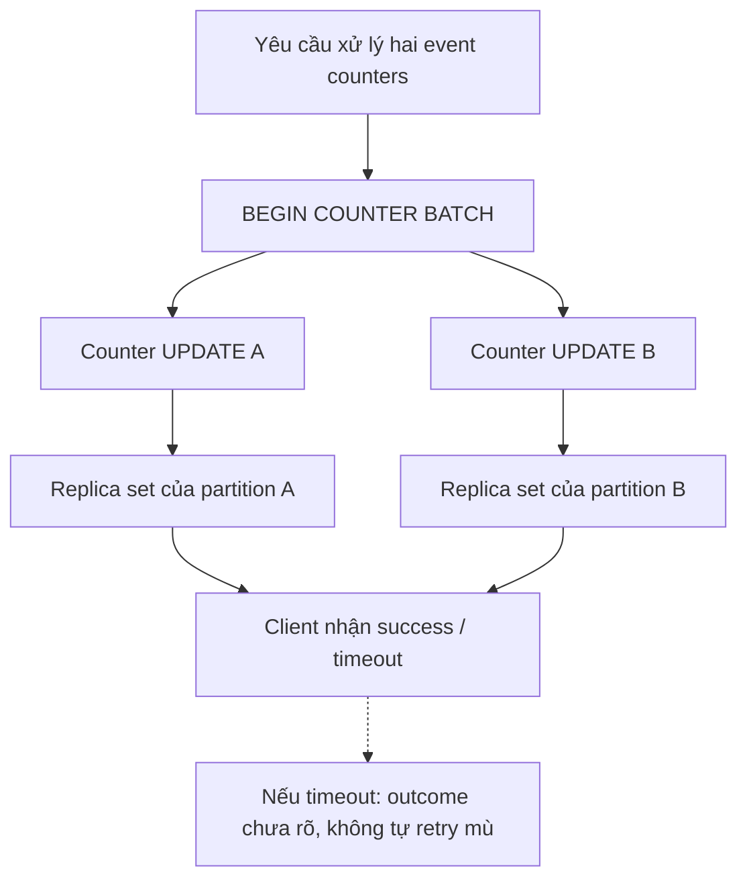
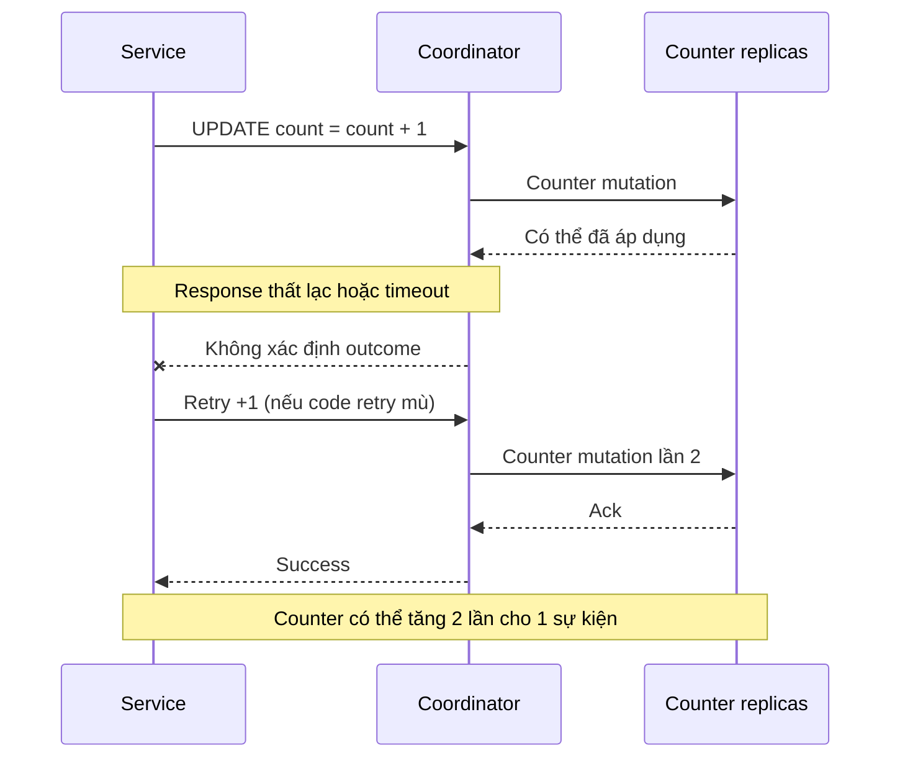
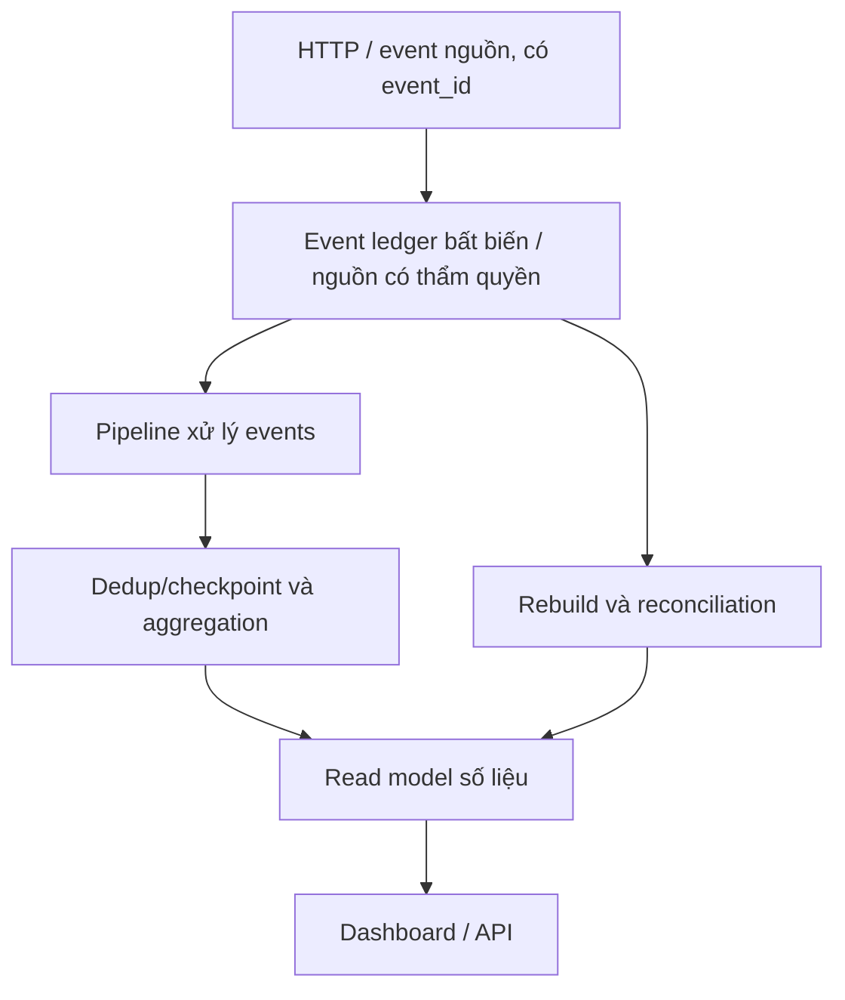

# Counter batch và giới hạn phối hợp với thao tác thông thường

Trong **Spring Data Cassandra**, việc tăng lượt xem, lượt tải, số lần nhấp hoặc một chỉ số tích lũy có vẻ đơn giản: đọc giá trị hiện tại, cộng thêm 1 rồi `save(...)`. Tuy nhiên, khi nhiều request cùng cập nhật một khóa, cách đọc–sửa–ghi thông thường dễ bị **lost update**. **Apache Cassandra** cung cấp kiểu dữ liệu `counter` và cú pháp `UPDATE count = count + 1` để diễn đạt phép tăng/giảm ngay tại cơ sở dữ liệu.

Nếu cần nhóm nhiều phép tăng, CQL có **`BEGIN COUNTER BATCH ... APPLY BATCH`**. Nhưng đây không phải một phiên bản “mạnh hơn” của counter: nó có các giới hạn đặc biệt, **không trộn được counter mutations với INSERT/UPDATE/DELETE của bảng dữ liệu thường**, không cho phép thêm các ràng buộc nghiệp vụ như transaction SQL nhiều bảng và đặc biệt **không giải quyết việc retry có thể đếm trùng sau timeout**.

Bài thuộc chương **Bộ đếm** của module **SPRING_DATA_CASSANDRA**. Ta sẽ học thiết kế bảng counter theo partition key, viết counter batch CQL, hiểu ranh giới với `LOGGED`/`UNLOGGED` batch, làm việc với Java Driver và Spring Data Cassandra, xử lý lỗi mạng và nhu cầu đếm chính xác, rồi áp dụng trong kiểm thử và vận hành hệ thống phân tán.

> **Điểm nhớ quan trọng:** **Counter batch chỉ dành cho counter updates; không thể dùng để “tăng bộ đếm và ghi log sự kiện thường” trong cùng một transaction CQL.** Ngoài ra, một phép tăng counter **không idempotent**: gửi lại sau timeout có thể làm tăng thêm lần nữa.

## 1. Mục tiêu học tập

Sau bài này, bạn có thể:

1. Phân biệt `counter` với số nguyên `int`/`bigint` thông thường.
2. Tạo bảng có counter columns và xác định partition key/clustering key đúng mẫu đọc.
3. Viết một `UPDATE` tăng/giảm counter và một `COUNTER BATCH` có nhiều mutation.
4. Giải thích vì sao không trộn regular DML, TTL, timestamp và LWT với counter mutations.
5. Nhận diện rủi ro **ambiguous outcome** và **double count** khi timeout/retry.
6. Hiểu cái mà counter batch **không** bảo đảm về atomicity, isolation và exactly-once.
7. Dùng prepared statements và `BatchStatement` của Java Driver 4; biết vai trò của repository/`CassandraTemplate`.
8. Chọn giữa counter, event ledger, read model và aggregate dựa trên độ chính xác cần thiết.
9. Kiểm thử tính đúng của CQL trên Cassandra thật và giám sát counter workload.

## 2. Vì sao `read → +1 → save` là sai khi nhiều writer?

Một bảng thường lưu giá trị `view_count bigint`:

```sql
CREATE TABLE IF NOT EXISTS commerce_ks.content_stats_by_id (
    tenant_id uuid,
    content_id uuid,
    view_count bigint,
    title text,
    PRIMARY KEY ((tenant_id, content_id))
);
```

Service A và Service B đồng thời xử lý hai lượt xem:

```text
Ban đầu: view_count = 100

Service A đọc 100
Service B đọc 100

Service A tính 100 + 1 = 101
Service B tính 100 + 1 = 101

Service A UPDATE view_count = 101
Service B UPDATE view_count = 101

Kết quả có thể là 101, dù có hai lượt xem.
```

Đây là **lost update** do cả hai writer ghi đè cùng một giá trị tính từ bản đọc cũ. Nâng CL lên `LOCAL_QUORUM` có thể cải thiện độ mới của read/write trong một DC, nhưng **không biến hai bước đọc–sửa–ghi thành một thao tác cộng nguyên tử có điều kiện**.

### Dùng counter column để diễn đạt phép cộng

Với một bảng counter, client gửi **delta**:

```sql
UPDATE commerce_ks.content_views_by_day
SET view_count = view_count + 1
WHERE tenant_id = ?
  AND content_id = ?
  AND bucket_day = ?;
```

Không phải gửi `view_count = 101`. Cassandra nhận mutation **increment**. Điều này giải quyết kiểu lost update do `read → +1 → save`, nhưng **không** giải quyết việc cùng một event được gửi hai lần, retry sau timeout hoặc logic nghiệp vụ có side effect ngoài database.

## 3. Counter column là kiểu dữ liệu đặc biệt

Counter là kiểu **`counter`**, có ngữ nghĩa của một số nguyên có dấu 64-bit được thay đổi qua phép tăng/giảm. Những ràng buộc quan trọng:

| Đặc tính | Counter column | Regular `bigint` |
| --- | --- | --- |
| Dữ liệu | Giá trị tích lũy qua delta | Giá trị được ghi trực tiếp |
| Câu ghi | `SET c = c + n` / `SET c = c - n` | `SET c = n` |
| `INSERT` để đặt giá trị | Không | Có |
| Gán một số tuyệt đối bằng `UPDATE` | Không | Có |
| Cập nhật theo TTL | Không | Có thể, theo loại cell |
| Timestamp tùy chỉnh | Không hỗ trợ cho counter update | Có thể hỗ trợ theo CQL |
| Idempotent khi lặp cùng statement | **Không** | Có thể, tùy timestamp, TTL và workflow |
| Trộn với regular columns trong một bảng | Không, ngoài primary-key columns | Có |
| Hỗ trợ conditional update thông thường | Không tương đương LWT/CAS | Có thể dùng `IF` trong các trường hợp hợp lệ |

**Counter không nằm trong primary key.** Một bảng chứa counter chỉ được có các cột **không thuộc primary key** là `counter`, không thêm `text status`, `timestamp updated_at` hoặc `bigint total_amount` vào cùng bảng đó.

### Bảng counter hợp lệ

```sql
CREATE TABLE IF NOT EXISTS commerce_ks.content_views_by_day (
    tenant_id uuid,
    content_id uuid,
    bucket_day date,
    view_count counter,
    download_count counter,
    PRIMARY KEY ((tenant_id, content_id, bucket_day))
);
```

Bảng này hợp lệ về kiểu dữ liệu:

- `tenant_id`, `content_id` và `bucket_day` tạo **composite partition key**.
- `view_count` và `download_count` đều là counter columns.
- Không có regular column trộn trong bảng counter.

### Bảng counter không hợp lệ

```sql
-- SAI: không thể trộn regular non-key column với counter:
CREATE TABLE commerce_ks.invalid_content_stats (
    tenant_id uuid,
    content_id uuid,
    title text,
    view_count counter,
    PRIMARY KEY ((tenant_id, content_id))
);
```

`title` là một regular column kiểu `text` và không thuộc primary key, nên schema bị từ chối. Muốn đọc title, dùng bảng dữ liệu thường riêng.

### Counter không phải kiểu có TTL

Một counter không có hạn sống theo `USING TTL 3600` hoặc `default_time_to_live` như cell thông thường. Nếu cần “số lượt xem của 24 giờ gần nhất”, không đặt TTL 24 giờ lên counter rồi mong nó tự giảm hoặc tự reset. Phải thiết kế **bucket thời gian**, chính sách giữ/xóa bucket cũ và cách query/aggregation phù hợp.

## 4. Chọn primary key theo mẫu đọc

Giả sử sản phẩm cần:

- Đọc lượt xem của một nội dung trong một ngày.
- Đọc lượt tải của cùng nội dung trong ngày.
- Tổng hợp số liệu theo tuần/tháng bằng một pipeline bên ngoài hoặc bằng cách đọc một số bucket được giới hạn.

Bảng `content_views_by_day` dùng:

```sql
PRIMARY KEY ((tenant_id, content_id, bucket_day))
```

Một ngày của một nội dung là một **partition**, và chứa các counter columns `view_count`, `download_count`.

```sql
SELECT view_count, download_count
FROM commerce_ks.content_views_by_day
WHERE tenant_id = 11111111-1111-1111-1111-111111111111
  AND content_id = 22222222-2222-2222-2222-222222222222
  AND bucket_day = '2026-11-25';
```

Đây là **đường đọc theo khóa**. Không cần secondary index để tìm một counter bằng đầy đủ partition key.

### Bucket không tự giải quyết hot key

Một nội dung nổi tiếng có thể nhận hàng chục nghìn increments mỗi giây. Tất cả phép tăng vào `(tenant_id, content_id, bucket_day)` vẫn tập trung vào cùng replica set và có nguy cơ **hot partition/hot counter**.

Có thể cân nhắc sharding:

```sql
CREATE TABLE IF NOT EXISTS commerce_ks.content_views_by_day_shard (
    tenant_id uuid,
    content_id uuid,
    bucket_day date,
    shard smallint,
    view_count counter,
    PRIMARY KEY ((tenant_id, content_id, bucket_day, shard))
);
```

Ứng dụng phân phối increments qua một số shard ổn định, sau đó đọc **tất cả shard phù hợp** và cộng kết quả ở tầng service/aggregation.

Đánh đổi:

- Tăng số partition và số query khi đọc.
- Cần định nghĩa số shard, thuật toán chọn shard, rebalance và giám sát.
- Một lần đọc nhiều shard **không có snapshot/transaction chung**.
- Sharding không loại nguy cơ **đếm trùng** khi retry cùng event.

Không tạo shard một cách tùy tiện cho workload nhỏ; chỉ làm khi metrics chỉ ra contention/hotspot.

## 5. UPDATE counter: tăng và giảm

### Tăng một lượt xem

```sql
UPDATE commerce_ks.content_views_by_day
SET view_count = view_count + 1
WHERE tenant_id = 11111111-1111-1111-1111-111111111111
  AND content_id = 22222222-2222-2222-2222-222222222222
  AND bucket_day = '2026-11-25';
```

### Giảm số đếm

```sql
UPDATE commerce_ks.content_views_by_day
SET view_count = view_count - 1
WHERE tenant_id = 11111111-1111-1111-1111-111111111111
  AND content_id = 22222222-2222-2222-2222-222222222222
  AND bucket_day = '2026-11-25';
```

Đây là phép **cộng/trừ delta**, không phải phép “hủy” được gắn với một operation ID. Nếu phép tăng ban đầu có thể chưa xảy ra, trừ 1 để “bù” có thể tạo số âm hoặc khiến kết quả sai.

### Một UPDATE thay đổi hai counter cùng hàng

```sql
UPDATE commerce_ks.content_views_by_day
SET view_count = view_count + 1,
    download_count = download_count + 1
WHERE tenant_id = 11111111-1111-1111-1111-111111111111
  AND content_id = 22222222-2222-2222-2222-222222222222
  AND bucket_day = '2026-11-25';
```

Một statement đã đủ nếu nghiệp vụ chủ đích cập nhật hai chỉ số **cùng hàng**. **Không cần một COUNTER BATCH chỉ vì có hai counter assignments trong cùng UPDATE.**

### Không có SET trực tiếp

```sql
-- SAI: counter không được gán giá trị tuyệt đối theo cách này:
UPDATE commerce_ks.content_views_by_day
SET view_count = 100
WHERE tenant_id = 11111111-1111-1111-1111-111111111111
  AND content_id = 22222222-2222-2222-2222-222222222222
  AND bucket_day = '2026-11-25';
```

Nếu cần sửa báo cáo “từ 103 về đúng 100” theo dữ liệu sự kiện, không nên coi `SET view_count = 100` là một khả năng của counter. Phải thiết kế cách tính lại, thay bucket/key, delta có kiểm soát hoặc read model số nguyên thường theo pipeline.

## 6. COUNTER BATCH dùng để làm gì?

`COUNTER BATCH` là cú pháp dành cho **nhiều counter updates**:

```sql
BEGIN COUNTER BATCH
    UPDATE commerce_ks.content_views_by_day
    SET view_count = view_count + 1
    WHERE tenant_id = 11111111-1111-1111-1111-111111111111
      AND content_id = 22222222-2222-2222-2222-222222222222
      AND bucket_day = '2026-11-25';

    UPDATE commerce_ks.content_views_by_day
    SET download_count = download_count + 1
    WHERE tenant_id = 11111111-1111-1111-1111-111111111111
      AND content_id = 33333333-3333-3333-3333-333333333333
      AND bucket_day = '2026-11-25';
APPLY BATCH;
```

Hai counter updates ở đây thuộc **hai partition** vì `content_id` khác nhau. Chúng được gửi trong một counter batch, nhưng:

- Không có bảo đảm transaction isolation xuyên hai partition.
- Không thể gọi batch một lần rồi khẳng định luôn quan sát hai counter tăng đồng thời.
- Khi request timeout, không thể suy chắc đã tăng cả hai, chưa tăng cái nào hay chỉ tăng một phần.
- Retry cả batch có thể tăng từng counter **hơn một lần**.

Counter batch có thể giúp biểu diễn một nhóm cập nhật counter và giảm một số network round trips. Nó **không biến nhóm đó thành một phép đếm exactly-once**, không dùng để bulk ingest hàng triệu event và không tự trở thành một logged batch kiểu regular mutations.

### Sơ đồ về ranh giới



Sơ đồ logic không mô tả chi tiết mọi giai đoạn điều phối counter nội bộ của các phiên bản Cassandra.

## 7. COUNTER BATCH khác LOGGED và UNLOGGED BATCH

Trong CQL có ba kiểu batch cần phân biệt:

| Loại | Mẫu cú pháp | Loại mutation | Tính chất cần nhớ |
| --- | --- | --- | --- |
| **LOGGED** | `BEGIN BATCH` / `BEGIN LOGGED BATCH` theo cú pháp được hỗ trợ | Regular DML | Batchlog hỗ trợ eventual application của logged batch, nhất là khi nhiều partition |
| **UNLOGGED** | `BEGIN UNLOGGED BATCH` | Regular DML | Không có logged-batch recovery xuyên nhiều partition |
| **COUNTER** | `BEGIN COUNTER BATCH` | Counter updates | Dành riêng cho counters; delta không idempotent, không trộn regular mutations |

Trong nhiều phiên bản, cú pháp phổ biến là `BEGIN BATCH` cho logged regular batch, `BEGIN UNLOGGED BATCH` cho unlogged, và `BEGIN COUNTER BATCH` cho counters.

**Không đánh đồng COUNTER BATCH với LOGGED BATCH.** Counter có cơ chế cập nhật/điều phối đặc thù, không được coi là có cùng khả năng replay an toàn như regular idempotent mutation. Không được hứa “counter batch ghi hai bộ đếm sẽ tự rollback cả hai khi lỗi”.

### Khi nào cần counter batch thay vì một UPDATE?

Có thể cân nhắc khi **thực sự muốn gom nhiều counter mutations** và chấp nhận ranh giới lỗi. Nếu chỉ tăng một counter, dùng một `UPDATE`. Nếu muốn tăng hai counter columns trong **cùng row** và đáp ứng CQL, một statement với hai assignments thường đơn giản hơn.

### Vì sao không dùng LOGGED BATCH để có batchlog cho counters?

CQL không cho phép chuyển counter mutations thành regular logged batch chỉ bằng cách đổi từ khóa. **Counter updates phải dùng cú pháp/loại statement phù hợp**, không được trộn với regular DML. Một counter increment không idempotent, nên replay tùy tiện không phải giải pháp chống mất mát.

## 8. Không thể trộn counter và regular DML trong cùng batch

Đây là ràng buộc cốt lõi của bài.

Giả sử service muốn:

1. Tăng lượt xem của nội dung.
2. Ghi một event `VIEWED` vào bảng log thông thường.

Schema log:

```sql
CREATE TABLE IF NOT EXISTS commerce_ks.view_events_by_id (
    tenant_id uuid,
    event_id uuid,
    content_id uuid,
    event_time timestamp,
    PRIMARY KEY ((tenant_id, event_id))
);
```

**Không hợp lệ** khi viết:

```sql
-- SAI: COUNTER BATCH không được chứa regular INSERT.
BEGIN COUNTER BATCH
    UPDATE commerce_ks.content_views_by_day
    SET view_count = view_count + 1
    WHERE tenant_id = 11111111-1111-1111-1111-111111111111
      AND content_id = 22222222-2222-2222-2222-222222222222
      AND bucket_day = '2026-11-25';

    INSERT INTO commerce_ks.view_events_by_id (
        tenant_id, event_id, content_id, event_time
    ) VALUES (
        11111111-1111-1111-1111-111111111111,
        44444444-4444-4444-4444-444444444444,
        22222222-2222-2222-2222-222222222222,
        '2026-11-25T03:00:00Z'
    );
APPLY BATCH;
```

Cũng không hợp lệ nếu dùng `BEGIN BATCH` hoặc `BEGIN UNLOGGED BATCH` thông thường rồi trộn counter `UPDATE` vào regular `INSERT`. Không tồn tại một loại BATCH thứ tư tự gộp hai semantics.

### Tại sao việc “cùng tenant” không cứu được?

Ngay cả khi cả hai bảng có cột `tenant_id`, chúng là **hai bảng và hai partition khác nhau**. Quan trọng hơn, Cassandra **cấm trộn hai kiểu mutation** trong batch theo quy tắc CQL, không chỉ vì khác partition key.

### Phương án thay thế cho counter + event

- Ghi event bằng một lệnh hoặc một workflow riêng.
- Tăng counter bằng counter UPDATE khác, với retry policy thận trọng.
- Nếu mỗi event chỉ được tính một lần, dùng **event ID và một ledger bền vững** để xử lý deduplication/reconciliation, rồi duy trì projection/aggregate.
- Nếu nghiệp vụ bắt buộc đồng nhất tuyệt đối, đánh giá mô hình dữ liệu khác và một hệ thống có transaction/điều phối tương ứng; không giả vờ COUNTER BATCH là atomic transaction cho cả event + counter.

**Hai requests độc lập có thể thất bại một phần.** Đổi từ batch sang hai lệnh Java không tự giải quyết đúng đắn; bạn phải thiết kế recovery.

## 9. Không dùng TTL hoặc timestamp tùy chỉnh trên counter mutation

Một thao tác counter **không hỗ trợ `USING TTL` hoặc `USING TIMESTAMP` như regular update**. Đây là ràng buộc của counter CQL, không phải sự thiếu sót của API Java.

```sql
-- SAI: TTL với counter update.
UPDATE commerce_ks.content_views_by_day
USING TTL 3600
SET view_count = view_count + 1
WHERE tenant_id = 11111111-1111-1111-1111-111111111111
  AND content_id = 22222222-2222-2222-2222-222222222222
  AND bucket_day = '2026-11-25';
```

```sql
-- SAI: custom timestamp cho counter update.
UPDATE commerce_ks.content_views_by_day
USING TIMESTAMP 1700000000000000
SET view_count = view_count + 1
WHERE tenant_id = 11111111-1111-1111-1111-111111111111
  AND content_id = 22222222-2222-2222-2222-222222222222
  AND bucket_day = '2026-11-25';
```

Tương tự, **COUNTER BATCH không được cung cấp custom timestamps**. Không lấy ví dụ batch thường có `USING TIMESTAMP` rồi áp cho counter batch.

### Nếu muốn “reset counter lúc 0:00 mỗi ngày”?

**Thiết kế bucket ngày** như `bucket_day` để ngày mới ghi vào một **khóa khác**, không reset một counter cũ:

```text
(tenant_id, content_id, 2026-11-25) -> 342 lượt xem
(tenant_id, content_id, 2026-11-26) -> bắt đầu từ giá trị logic 0
```

Ở đây “bắt đầu 0” là hiểu theo dữ liệu chưa có counter mutation; row chưa tồn tại có thể không được trả khi đọc. Không nên coi một row vắng mặt tương đương row có counter=0 ở mọi cấp API nếu cần phân biệt hai trạng thái.

## 10. Xóa hoặc reset counter cần cực kỳ thận trọng

Cassandra có thể hỗ trợ **DELETE counter** với những giới hạn quan trọng. Theo tài liệu Apache Cassandra, việc xóa counter chỉ được bảo đảm theo một số điều kiện của lần xóa; **không nên xóa rồi tiếp tục increment lại cùng counter key và mong semantics chắc chắn như tạo counter mới**.

Đây là một trong những lý do **bucket/key mới** phù hợp hơn việc “reset” một bộ đếm đang được cập nhật.

### Những cách “reset” cần tránh

- `UPDATE count = 0` — không hợp lệ cho counter.
- `DELETE` rồi lại `UPDATE count = count + 1` trên **cùng khóa** mà không kiểm tra giới hạn/cảnh báo của Cassandra.
- Dùng `TTL` để counter tự mất sau 24 giờ.
- Đọc count hiện tại rồi `count = count - currentCount` như cách set về 0: có thể sai khi có concurrent increments và retry.
- Gửi một counter decrement “bù” sau timeout mà không biết lần increment trước có áp dụng không.

Nếu cần chuẩn hóa lại số đếm từ nguồn dữ liệu đáng tin:

1. Xây **aggregate mới** ở key/bucket/version khác.
2. Tính lại từ event ledger hoặc nguồn có thẩm quyền.
3. Chuyển đường đọc sang aggregate mới bằng cấu hình/version có kiểm soát.
4. Không phụ thuộc vào một phép “reset counter” không được CQL bảo đảm.

## 11. Tính nhất quán và độ mới khi đọc counter

Counters là dữ liệu được sao chép qua nhiều replica và chịu **consistency level** của request theo cơ chế phù hợp. Điều đó tạo đánh đổi độ trễ/khả dụng/độ mới, nhưng không biến counter increments thành idempotent.

Một read theo key:

```sql
SELECT view_count
FROM commerce_ks.content_views_by_day
WHERE tenant_id = 11111111-1111-1111-1111-111111111111
  AND content_id = 22222222-2222-2222-2222-222222222222
  AND bucket_day = '2026-11-25';
```

Nếu read ở `LOCAL_ONE` sau write vừa được xác nhận ở một replica, bạn vẫn phải cân nhắc khả năng quan sát counter chưa hội tụ ở replica khác. `LOCAL_QUORUM` có các đặc tính quorum trong DC và chi phí khác. Với multi-DC, `LOCAL_QUORUM` của DC A không có cùng replica set với `LOCAL_QUORUM` của DC B.

### CL cao không giải quyết duplicate increments

Giả sử service gửi `+1` ở `LOCAL_QUORUM`, nhận timeout, rồi gửi lại cùng `+1` ở `LOCAL_QUORUM`. Nếu mutation đầu thực tế đã được áp dụng, tổng có thể tăng 2 lần. **Tăng CL không khiến hai request được nhận diện là cùng một event.**

### Không kỳ vọng snapshot qua nhiều counter

Nếu một dashboard đọc số lượt xem của 10 nội dung, các keys có thể nằm trên nhiều partitions/replica sets. Ngay cả khi đều đọc ở quorum, đó không phải một snapshot transaction toàn cục với cùng mốc thời gian. Cân nhắc độ trễ và độ chính xác cần cho báo cáo.
## 12. Timeout: tại sao retry một phép tăng có thể đếm trùng?

Đây là khác biệt quan trọng nhất giữa một regular write có thể được thiết kế idempotent và một counter mutation.

Giả sử `view_count = 100`:

1. Service gửi `view_count = view_count + 1`.
2. Coordinator/replica có thể đã áp dụng increment.
3. Response bị mất hoặc driver hết thời gian chờ.
4. Service nhận `WriteTimeout`/transport failure.
5. Service gửi lại **cùng lệnh `+1`**.
6. Nếu lần đầu đã áp dụng, tổng có thể trở thành **102** thay vì 101.



**Cần phân biệt:**

| Tình huống | Điều có thể biết | Quyết định tiếp |
| --- | --- | --- |
| Driver nhận success | Request đạt điều kiện phản hồi CL | Ghi nhận thành công, nhưng vẫn cần tránh sự kiện gửi trùng từ phía client |
| Query/schema bị từ chối trước khi mutation hợp lệ | CQL hoặc input không được chấp nhận | Sửa lỗi; không lặp vô hạn |
| `WriteTimeout` hoặc mất kết nối | Outcome chưa chắc chắn | Không tự retry counter increment nếu nghiệp vụ không chấp nhận over-count |
| Client retry HTTP sau khi response mất | Lệnh trước có thể đã được xử lý | Cần event/operation ID ở tầng ứng dụng, không chỉ retry CQL |

### Tại sao không đọc counter rồi quyết định đã tăng hay chưa?

Nếu count tăng từ 100 lên 101 sau timeout, không thể biết một cách chắc chắn **event hiện tại** đã được tính hay một event khác vừa tăng count. Khi có concurrent writers, đọc giá trị tổng không xác định tác giả từng increment.

Muốn trả lời “event E đã được tính chưa?”, hệ thống cần dữ liệu có danh tính event E, không chỉ một con số cộng dồn.

## 13. Counter batch không bảo đảm exactly-once hoặc rollback

Một COUNTER BATCH có hai increments:

```text
Mutation A: content X / today / view_count +1
Mutation B: content Y / today / download_count +1
```

Bốn kết quả cần cân nhắc khi client không nhận phản hồi rõ ràng:

- Cả A và B có thể đã được áp dụng.
- A có thể đã được áp dụng, B chưa được quan sát.
- B có thể đã được áp dụng, A chưa được quan sát.
- Không có mutation nào được áp dụng, tùy nơi lỗi và đường thực thi.

Đây là **các khả năng cần xử lý về mặt ứng dụng**, không phải khẳng định tất cả đều xảy ra với mọi cách thực thi. COUNTER BATCH không phải transaction SQL nhiều partition và không cung cấp một lệnh rollback counter an toàn.

### Đừng dùng decrement để “hoàn tác” mù quáng

Giả sử tăng A thành công, B thất bại. Developer quyết định giảm A đi một. Nếu trạng thái ban đầu chỉ là **UNKNOWN** chứ không được xác minh chắc chắn, decrement có thể làm sai số liệu. Nếu cùng lúc có các increments khác, phép bù không gắn với event ID còn khó kiểm tra hơn.

Vì vậy, thao tác compensating delta chỉ phù hợp khi domain có nguồn xác thực riêng để xác định chính xác cần điều chỉnh, và cơ chế sửa sai đã được kiểm thử. Trong nhiều trường hợp, **rebuild aggregate từ event ledger** dễ chứng minh hơn.

### Phân biệt atomicity và observability

Một request có thể có các điều kiện xử lý trên từng partition, nhưng **đọc đồng thời từ nhiều partition** không có cùng snapshot. Ngay cả ở single partition, đừng lấy việc “một batch được gửi” làm bằng chứng **không thể mất/đếm trùng một event** trong trường hợp retry.

Lời hứa đúng cần dựa trên **idempotency của toàn workflow**. COUNTER BATCH không thể tự tạo ràng buộc unique cho event ở một bảng thường.

## 14. COUNTER BATCH nhiều partition có làm bulk ingest nhanh hơn không?

**Không mặc định.** Một batch lớn trải qua hàng trăm/hàng nghìn counter keys có thể khiến coordinator phải điều phối nhiều replica sets, tăng network fan-out, memory, latency và độ khó khi request timeout.

Ví dụ ý tưởng **cần tránh**:

```java
// Giả mã: không dùng cho một triệu event trên nhiều partitions.
for (ViewEvent event : millionEvents) {
    counterBatch.addStatement(counterUpdateFor(event));
}
session.execute(counterBatch.build());
```

Các vấn đề:

1. **Không có idempotent retry** cho nhóm increments.
2. Một lần timeout của batch lớn tạo outcome khó đối soát.
3. Số partition cao làm chi phí coordinator và mạng tăng.
4. Một vài hot counters có thể làm batch chịu tail latency.
5. Dữ liệu payload lớn hoặc quá nhiều statements có thể gây cảnh báo batch size.
6. Batch không giảm tổng số mutations cần xử lý ở replica.

Nếu workload **không cần grouping**, thường nên gửi những writes độc lập bất đồng bộ với **bounded concurrency**, nhưng riêng counter writes vẫn phải có policy về lỗi không xác định.

### Giới hạn thực tế không chỉ là số câu lệnh

Khi đánh giá COUNTER BATCH, cần đo:

| Biến | Tác động |
| --- | --- |
| Số counter assignments | Lượng công cập nhật |
| Số distinct partition keys | Số replica sets có thể tham gia |
| Số node / datacenter | Network fan-out |
| RF và CL | Điều kiện phản hồi và độ trễ |
| Độ nóng của từng counter | Contention và hotspot |
| Bytes và mutation size | Memory/network overhead |
| Retry rate | Nguy cơ over-count và tăng tải |
| Client in-flight requests | Queue, timeout và backpressure |

Không có một ngưỡng “N statements mỗi counter batch luôn tối ưu”. Benchmark với workload và topology thật mới quyết định được.

## 15. Java Driver 4: prepared statement tăng một counter

Cách diễn đạt rõ semantics nhất ở tầng Java là chuẩn bị CQL rồi bind delta/primary key.

```java
import java.time.LocalDate;
import java.util.Objects;
import java.util.UUID;

import com.datastax.oss.driver.api.core.CqlSession;
import com.datastax.oss.driver.api.core.DefaultConsistencyLevel;
import com.datastax.oss.driver.api.core.cql.BoundStatement;
import com.datastax.oss.driver.api.core.cql.PreparedStatement;

public final class ContentCounterWriter {

    private final CqlSession session;
    private final PreparedStatement incrementViews;

    public ContentCounterWriter(CqlSession session) {
        this.session = Objects.requireNonNull(session);
        this.incrementViews = session.prepare("""
            UPDATE commerce_ks.content_views_by_day
            SET view_count = view_count + ?
            WHERE tenant_id = ?
              AND content_id = ?
              AND bucket_day = ?
            """);
    }

    public void addViews(
            UUID tenantId,
            UUID contentId,
            LocalDate day,
            long delta) {

        Objects.requireNonNull(tenantId);
        Objects.requireNonNull(contentId);
        Objects.requireNonNull(day);

        if (delta <= 0 || delta > 1000) {
            throw new IllegalArgumentException(
                "Delta ngoài giới hạn nghiệp vụ"
            );
        }

        BoundStatement statement = incrementViews
            .bind(delta, tenantId, contentId, day)
            .setConsistencyLevel(
                DefaultConsistencyLevel.LOCAL_QUORUM
            )
            .setIdempotent(false);

        session.execute(statement);
    }
}
```

Giải thích:

- `?` cho delta được bind với `long` tương thích CQL counter arithmetic.
- `LocalDate` tương ứng cột `date` qua driver codec phù hợp.
- `setIdempotent(false)` thể hiện rõ **không được retry/speculate như idempotent write**. Khả năng/thứ tự áp dụng retry policy thực tế cần xác minh theo Java Driver version.
- `LOCAL_QUORUM` chỉ là policy minh họa, yêu cầu RF/DC phù hợp.
- `delta > 0` và `delta <= 1000` là **giới hạn ứng dụng**, không phải giới hạn của CQL counter. Muốn decrement có thể dùng statement riêng với dấu trừ.
- Không tạo `CqlSession` cho mỗi HTTP request; session và prepared statement nên được tái sử dụng theo lifecycle ứng dụng.

### Vì sao setIdempotent(false) quan trọng?

Driver có các chiến lược retry/speculative execution phụ thuộc **idempotence** và loại lỗi. Counter increment không phải phép ghi có thể lặp an toàn, nên code không nên khai báo nó idempotent để “cải thiện độ tin cậy”.

**Tuy nhiên, cờ này không tạo exactly-once.** Nó không ngăn API gateway, frontend hoặc job queue gửi cùng một event hai lần. Nó cũng không thay thế logic đối soát sau timeout.

### Đọc counter bằng driver

```java
PreparedStatement findViews = session.prepare("""
    SELECT view_count
    FROM commerce_ks.content_views_by_day
    WHERE tenant_id = ? AND content_id = ? AND bucket_day = ?
    """);

Row row = session.execute(
    findViews.bind(tenantId, contentId, day)
        .setConsistencyLevel(
            DefaultConsistencyLevel.LOCAL_QUORUM
        )
).one();

Long views = row == null || row.isNull("view_count")
    ? null
    : row.getLong("view_count");
```

Đoạn code giả định `session`, các khóa và imports đã có. `null` được giữ riêng để phân biệt **hàng chưa tồn tại** với giá trị counter bằng `0`. Service có thể trình bày cả hai là 0 theo UX, nhưng tầng lưu trữ không nhất thiết có cùng ý nghĩa.

## 16. Java Driver 4: tạo COUNTER BATCH

Dùng `DefaultBatchType.COUNTER` và các prepared counter updates.

```java
import java.time.LocalDate;
import java.util.Objects;
import java.util.UUID;

import com.datastax.oss.driver.api.core.CqlSession;
import com.datastax.oss.driver.api.core.DefaultConsistencyLevel;
import com.datastax.oss.driver.api.core.cql.BatchStatement;
import com.datastax.oss.driver.api.core.cql.DefaultBatchType;
import com.datastax.oss.driver.api.core.cql.PreparedStatement;

public final class CounterBatchWriter {

    private final CqlSession session;
    private final PreparedStatement incrementViews;

    public CounterBatchWriter(CqlSession session) {
        this.session = Objects.requireNonNull(session);
        this.incrementViews = session.prepare("""
            UPDATE commerce_ks.content_views_by_day
            SET view_count = view_count + ?
            WHERE tenant_id = ?
              AND content_id = ?
              AND bucket_day = ?
            """);
    }

    public void incrementTwoContents(
            UUID tenantId,
            UUID firstContent,
            UUID secondContent,
            LocalDate day) {

        BatchStatement batch =
            BatchStatement.builder(DefaultBatchType.COUNTER)
                .addStatement(incrementViews.bind(
                    1L, tenantId, firstContent, day
                ))
                .addStatement(incrementViews.bind(
                    1L, tenantId, secondContent, day
                ))
                .build()
                .setConsistencyLevel(
                    DefaultConsistencyLevel.LOCAL_QUORUM
                )
                .setIdempotent(false);

        session.execute(batch);
    }
}
```

**Lưu ý về phạm vi:**

- Hai `contentId` khác nhau dẫn đến **hai partition** trong bảng `content_views_by_day`.
- Mỗi statement là một counter update, không có regular `INSERT`.
- Batch cố tình được đánh dấu **non-idempotent**.
- Nếu timeout, **không tự gửi lại cùng batch** mà không chấp nhận rõ ràng khả năng đếm trùng.
- Cần giới hạn số statements và size của batch thực tế.

### Khi chỉ có một counter update

Không cần xây COUNTER BATCH chứa đúng một statement. Gửi prepared `UPDATE ... SET count = count + ?` đơn giản hơn và giảm nguy cơ team hiểu nhầm là đang có một transaction.

### Có thể dùng async không?

Có thể dùng `CqlSession.executeAsync(...)` theo API Java Driver phù hợp, nhưng **async không biến counter thành idempotent**. Khi nhiều task fail/timeout, policy cần xử lý outcome unknown, bounded concurrency, metrics và không retry mù.

## 17. Một lỗi dễ mắc: đưa INSERT thường vào Counter BatchStatement

Java Driver batch builder có thể cho phép thêm các statement ở mức type API, nhưng Cassandra sẽ kiểm tra **ngữ nghĩa CQL** và từ chối tổ hợp counter/non-counter không hợp lệ.

Đoạn ý tưởng **không hợp lệ về CQL**:

```java
BatchStatement batch =
    BatchStatement.builder(DefaultBatchType.COUNTER)
        .addStatement(counterUpdate.bind(...))
        .addStatement(eventInsert.bind(...))
        .build();
```

`...` là placeholder trong **giả mã**; không phải đoạn biên dịch độc lập. Dù API builder tạo object, server vẫn từ chối counter batch chứa regular mutation.

**Không sửa bằng cách đổi sang `DefaultBatchType.LOGGED` hoặc `UNLOGGED`.** Điều kiện không trộn vẫn tồn tại. Cần tách hai hệ ghi và thiết kế idempotency/reconciliation.

## 18. Spring Data Cassandra: Repository không tự hiểu phép tăng

Một entity dùng `Long viewCount` có thể phù hợp để **đọc dữ liệu** qua mapping, nhưng `repository.save(entity)` không tự có nghĩa `UPDATE view_count = view_count + 1`.

### Entity đọc counter

Ví dụ một bảng counter có **khóa đơn** để minh họa mapping đơn giản:

```sql
CREATE TABLE IF NOT EXISTS commerce_ks.content_totals_by_id (
    content_id uuid PRIMARY KEY,
    view_count counter,
    download_count counter
);
```

Entity Java định hướng:

```java
import java.util.UUID;

import org.springframework.data.cassandra.core.mapping.Column;
import org.springframework.data.cassandra.core.mapping.PrimaryKey;
import org.springframework.data.cassandra.core.mapping.Table;

@Table("content_totals_by_id")
public class ContentTotal {

    @PrimaryKey("content_id")
    private UUID contentId;

    @Column("view_count")
    private Long viewCount;

    @Column("download_count")
    private Long downloadCount;

    // Constructor/accessor dùng cho read mapping.
}
```

Repository có thể dùng để đọc theo ID nếu mapping của release hỗ trợ:

```java
public interface ContentTotalRepository
        extends CassandraRepository<ContentTotal, UUID> {
}
```

**Không dùng `repository.save(contentTotal)` để “lưu bộ đếm mới”** như ordinary entity: Cassandra counter chỉ cho phép increment/decrement, còn entity save có thể tạo regular `INSERT`/`UPDATE SET view_count = ?` không đúng semantics. Nếu dự án có API counter-specialized theo phiên bản, phải kiểm chứng statement nó sinh ra.

### CassandraTemplate và counter update

`CassandraTemplate` hỗ trợ mapping/query operations, nhưng **không nên suy rằng mọi generic update API có thể biến một giá trị `Long` thành counter arithmetic**. Để có semantics chính xác:

1. Kiểm tra phiên bản Spring Data Cassandra đang chạy.
2. Dùng API counter operation được hỗ trợ, nếu có.
3. Hoặc dùng `CqlSession`/prepared CQL như các ví dụ trên.
4. Test generated CQL và kết quả tăng/giảm thật.
5. Không để mapper ghi cả object counter với những regular fields không hợp lệ.

Một service có thể tiếp tục dùng repository và `CassandraTemplate` cho entity thường, nhưng **đường ghi counter** nên được tách thành một component có tên rõ ràng như `ContentCounterWriter` để không bị nhầm với CRUD.

## 19. Không thể dùng counter làm optimistic lock hay điều kiện nghiệp vụ

Một số yêu cầu nghe giống counter nhưng thực chất cần **kiểm tra điều kiện**:

- Chỉ tăng số lượt đăng ký nếu chưa đạt mức tối đa 100.
- Chỉ trừ tồn kho nếu còn đủ.
- Chỉ tăng một lần cho mỗi người dùng/ngày.
- Chỉ giảm ngân sách khi thanh toán được xác nhận.
- Không cho phép số lượng trở thành âm.

Counter increment **không có compare-and-set trên chính counter** giống `UPDATE ... IF count < limit` thông thường. Lệnh `count = count - 1` có thể làm số âm và không tự kiểm tra lượng tồn.

### Ví dụ tồn kho: vì sao counter là công cụ sai?

```text
Stock = 1

Buyer A gửi decrement -1
Buyer B gửi decrement -1

Nếu cả hai đều được chấp nhận:
  stock có thể thành -1
```

Counter rất hữu ích cho thống kê, nhưng không tự ngăn oversell. Nếu nghiệp vụ yêu cầu ràng buộc cứng, cân nhắc mô hình **conditional regular-column update, reservation workflow, serializable transaction trong hệ thống phù hợp**, hoặc điều phối bằng một nguồn dữ liệu có thẩm quyền. Chọn Cassandra LWT khi phạm vi và chi phí của conditional mutation tương thích, không cố nhét `IF` vào counter batch.

### Không dùng counter để phát hiện exactly-once event

Một counter giá trị 500 không cho biết cụ thể **500 event IDs nào** đã được đếm. Nó không phải set membership, unique index hoặc ledger. Muốn chống trùng, phải lưu danh tính sự kiện ở nơi khác.

## 20. Event ledger: khi nghiệp vụ cần đếm có thể kiểm chứng

Giả sử mỗi lượt tải có `event_id`. Ta muốn biết một event đã được ghi nhận chưa, và có thể tính lại số lượng.

Bảng event theo ID:

```sql
CREATE TABLE IF NOT EXISTS commerce_ks.view_events_by_id (
    tenant_id uuid,
    event_id uuid,
    content_id uuid,
    occurred_at timestamp,
    PRIMARY KEY ((tenant_id, event_id))
);
```

Ghi event với một điều kiện chống trùng trên **regular table**:

```sql
INSERT INTO commerce_ks.view_events_by_id (
    tenant_id, event_id, content_id, occurred_at
) VALUES (
    11111111-1111-1111-1111-111111111111,
    44444444-4444-4444-4444-444444444444,
    22222222-2222-2222-2222-222222222222,
    '2026-11-25T03:00:00Z'
)
IF NOT EXISTS;
```

Điều kiện `IF NOT EXISTS` là **LWT/Paxos** trên regular table, có chi phí cao hơn insert không điều kiện. Nó chỉ giúp xác định/claim danh tính event theo key trong phạm vi phù hợp.

### Vì sao vẫn chưa đủ để bảo đảm increment exactly-once?

Nếu service làm:

```text
1. INSERT event IF NOT EXISTS -> applied = true
2. UPDATE counter +1
```

vẫn có một khoảng lỗi:

- Nếu bước 1 thành công và service chết trước bước 2, event đã lưu nhưng counter chưa tăng.
- Nếu bước 2 đã tăng nhưng response bị mất, retry có thể tăng thêm.
- Vì **không thể trộn regular event insert với counter update trong một CQL BATCH**, hai bước không thành transaction chung.

### Một kiến trúc dễ đối soát hơn



Các nguyên tắc:

1. **Event ID ổn định** từ nguồn; retry phải dùng lại ID, không sinh ID mới.
2. Lưu sự kiện đủ bền và có quy tắc deduplication.
3. Duy trì aggregate với checkpoint/version hoặc mô hình cập nhật idempotent có thể đối soát.
4. Có khả năng **rebuild từ ledger** khi số liệu bị lệch.
5. Không dùng counter mutation non-idempotent làm bước cuối mà bỏ qua khoảng lỗi của việc commit checkpoint.
6. Nếu cần số đếm tuyệt đối chính xác tức thì, đánh giá lại yêu cầu và lựa chọn hệ lưu trữ/transaction phù hợp.

**Counter có thể là một read model approximate/eventual**, còn ledger là nơi giải thích vì sao số lượng là bao nhiêu. Nhưng chỉ thêm ledger mà vẫn gọi counter `+1` một cách không kiểm soát cũng **không tự có exactly-once**.

## 21. Phân biệt chỉ số chấp nhận trễ với số liệu phải chính xác

| Chỉ số | Có nên dùng counter? | Lý do |
| --- | --- | --- |
| Lượt xem nội dung mang tính tham khảo | Có thể phù hợp | Chấp nhận độ trễ và sai lệch nhỏ theo SLA |
| Số click dùng để gợi ý xu hướng | Có thể phù hợp | Throughput cao, không nhất thiết cần audit từng event |
| Số lượt tải để hiển thị công khai | Có thể phù hợp | Cần cảnh báo người dùng rằng số liệu có thể cập nhật trễ |
| Tổng tiền giao dịch | **Không nên dùng counter làm nguồn sự thật duy nhất** | Cần ledger, reconciliation, không đếm trùng |
| Số lượng tồn kho khả dụng | **Thường không phù hợp** | Cần ràng buộc không oversell |
| Hạn mức sử dụng dịch vụ có tính phí | Cần thiết kế cẩn thận | Sai lệch có thể dẫn tới thu phí/sử dụng sai |
| Tổng lượt tham gia có ràng buộc unique | Cần event/member ledger | Một người có thể gửi lặp request |
| Quota request mềm để hiển thị | Có thể cân nhắc | Chấp nhận approximate và cần fallback rõ |

**Đếm chính xác** phải được định nghĩa: chính xác theo event nào, trong cửa sổ nào, sau độ trễ bao nhiêu, xử lý duplicate ra sao và khi node/datacenter lỗi có được phép tạm lệch không? Không có một kiểu CQL nào trả lời toàn bộ thay cho contract đó.

## 22. Những tình huống sử dụng COUNTER BATCH hợp lý

Không phải mọi counter batch đều sai. Một số tình huống có thể đáng cân nhắc:

### Tình huống A — hai chỉ số thuộc cùng một hành động

Một sự kiện được chấp nhận làm tăng `view_count` của nội dung và `view_count` của danh mục. Cả hai counter mutations cần gửi tới Cassandra.

**Có thể dùng COUNTER BATCH?** Có thể, nếu chấp nhận giới hạn không isolation, không exactly-once và đã đánh giá case timeout. Nhưng với yêu cầu bảo đảm số liệu chính xác theo event, nên dựa vào ledger/aggregator có thể rebuild.

### Tình huống B — nhiều counter rows trong cùng một partition

Một schema khác, tối ưu cho số liệu theo tenant/day:

```sql
CREATE TABLE IF NOT EXISTS commerce_ks.metrics_by_tenant_day (
    tenant_id uuid,
    bucket_day date,
    metric_name text,
    segment text,
    metric_value counter,
    PRIMARY KEY ((tenant_id, bucket_day), metric_name, segment)
);
```

Hai row:

```text
(tenant_id, 2026-11-25, "view", "mobile")
(tenant_id, 2026-11-25, "view", "web")
```

thuộc **cùng partition** trong một bảng nhưng có clustering keys khác nhau. COUNTER BATCH có thể gom hai counter updates theo partition; tuy nhiên, **đừng suy từ việc cùng partition rằng hai increments đã trở thành exactly-once cho một event hay có một rollback API**.

Đặc biệt, nếu một tenant rất lớn, partition theo ngày có thể quá nóng hoặc quá rộng. Một schema có shard/metric ở partition key có thể tốt hơn cho throughput nhưng làm tổng hợp phức tạp hơn.

### Tình huống C — dashboard approximate chấp nhận outcome unknown

Một chỉ số tương tác có thể chịu sai lệch nhỏ và vẫn hữu ích. Team có thể quyết định **không retry counter increments khi outcome unknown**, đánh đổi khả năng undercount một số sự kiện để tránh overcount do retry. Đây là **business policy**, không phải quy luật Cassandra.

Một team khác có thể chọn retry để giảm nguy cơ bỏ lỡ event và chấp nhận overcount. Phải có metric và mô tả sai số; không được nói “đã chọn COUNTER BATCH là Cassandra bảo đảm không trùng”.

## 23. Những trường hợp không nên dùng COUNTER BATCH

| Yêu cầu | Vì sao counter batch không phù hợp | Thay thế cần đánh giá |
| --- | --- | --- |
| Ghi metadata + counter trong cùng atomic transaction | Không trộn regular DML và counter mutations | Nguồn event bền vững + projector/reconciliation hoặc hệ transaction phù hợp |
| Đếm mỗi event đúng một lần qua retry | Counter không idempotent | Event ID ledger + aggregate có thể rebuild |
| Đọc nhiều counters tại cùng một snapshot | Không có cross-partition snapshot | Aggregation job theo mốc version/watermark |
| Đặt giới hạn cứng không vượt quá 100 | Counter không có compare-and-set theo giá trị | Conditional regular table/reservation |
| Reset counter mỗi ngày bằng TTL | Counter không hỗ trợ TTL | Bucket key theo ngày và retention policy |
| Tăng hàng triệu counter keys bằng một batch | Fan-out, timeout, kiểm soát lỗi kém | Bounded asynchronous writes hoặc streaming aggregator |
| Xóa counter rồi tạo lại cùng key để reset | Hành vi counter deletion/re-update có giới hạn | New key/bucket/version |
| Tăng counter và gửi email nguyên tử | CQL không chạy API ngoài Cassandra | Saga/outbox/idempotent workflow |
| Tăng counter khi người dùng chỉ “xem trước” | Phải định nghĩa event hợp lệ | Xác định event semantics tại ingress |
| Tạo unique count từ một số counter | Counter không biết tập ID nào đã đếm | Set membership/ledger/approximate distinct algorithm theo yêu cầu |

## 24. Đa datacenter và counter batch

Giả sử keyspace có RF3 ở HCM và RF3 ở Hà Nội. Một ứng dụng ở HCM gửi COUNTER BATCH, rồi một dashboard ở Hà Nội đọc ngay.

Những điều cần nhớ:

- Counter updates đi qua replication và consistency policy của Cassandra.
- `LOCAL_QUORUM` chỉ quan tâm **local DC** để đạt ngưỡng CL local; không tự bảo đảm remote DC đã cập nhật.
- `QUORUM` tổng RF nhiều DC khác `LOCAL_QUORUM`.
- Hai counter keys có thể có replica sets khác nhau.
- **Kết quả hai partition không tạo snapshot đồng thời**.
- Đổi CL không chữa idempotency của `+1`.
- Failover giữa DC phải xét replication lag, retry và khả năng client gửi lại cùng event.

### Kịch bản client chuyển DC

```text
T0: HCM gửi increment event E, client nhận timeout
T1: Traffic chuyển sang Hà Nội
T2: Request HTTP của E bị gửi lại
T3: Counter có thể tăng thêm lần nữa
```

Đây là vấn đề **at-least-once delivery/ambiguous outcome ở tầng workflow**. Cho dù các lần gửi dùng CL khác nhau, Cassandra counter vẫn không thể tự biết hai mutations là cùng một sự kiện E.

Nếu sai số không chấp nhận được, cần idempotent event ledger/aggregation thay vì một API increment trần.

## 25. Hiệu năng: đo theo counter key, không chỉ theo batch

Counter workload cần được giám sát tương tự writes thông thường, nhưng phải thêm rủi ro duplicate/uncertain outcome.

| Nhóm metric | Lý do |
| --- | --- |
| Read/write p50/p95/p99 | Phát hiện hot counter và replica chậm |
| Timeout/unavailable | Giám sát tình huống outcome chưa rõ |
| Retry/speculative requests | Cảnh báo khả năng tăng trùng |
| Distinct partition keys per batch | Đánh giá fan-out |
| Batch size bytes/statements | Đánh giá pressure lên coordinator |
| Counter increment rate theo key | Phát hiện một nội dung/tenant quá nóng |
| CPU, disk I/O, GC, network | Tác động tài nguyên cluster |
| Pending requests, in-flight statements | Backpressure và queue |
| Replication/repair health | Số liệu đọc có thể khác nhau giữa replica/DC |
| Chênh lệch aggregate so với event ledger | Đo sai số/độ trễ hội tụ theo nghiệp vụ |
| Số event bị dedup và số outcome UNKNOWN | Đánh giá chất lượng ingestion/retry |

**Một batch có 10 statements vẫn có thể khó xử lý** nếu cùng nhắm vào một hot partition, trong khi 100 statements nhỏ trải đều nhiều node không nhất thiết có cùng đặc điểm. Đừng kết luận chỉ từ số statement.

### Backpressure quan trọng hơn gom batch vô hạn

Với event stream lớn, service nên giới hạn concurrency và rate:

```text
Ingress event IDs
    -> validation, dedup/queue (nếu yêu cầu)
    -> worker pool giới hạn in-flight writes
    -> prepared UPDATE/COUNTER BATCH nhỏ
    -> metrics: confirmed / unknown / rejected
    -> reconciliation hoặc rebuild từ ledger
```

Nếu queue tăng, cần scale/giảm tốc theo capacity thay vì gom hàng vạn increments vào một batch.

## 26. Kiểm thử tích hợp: từ CQL hợp lệ đến fault injection

**Unit test** mock `CqlSession` chỉ kiểm tra builder/statement, không chứng minh Cassandra chấp nhận mutation hay hành vi replica khi timeout.

Dùng test cluster có schema giống production về loại dữ liệu và RF thích hợp. Chỉ thực hiện chaos/fault injection trên môi trường được phép.

### Test A — counter đơn hoạt động

1. Tạo bảng `content_views_by_day` trong keyspace test.
2. Dùng một primary key chưa có counter.
3. Gửi `UPDATE view_count = view_count + 1`.
4. Đọc lại bằng `SELECT view_count`.
5. Gửi tiếp `+2` và xác minh giá trị tăng thêm 2.
6. Thử `SET view_count = 100`, xác minh Cassandra từ chối.

### Test B — COUNTER BATCH hai keys

1. Dùng hai `content_id` riêng.
2. Gửi một `BEGIN COUNTER BATCH` tăng mỗi key 1.
3. Đọc hai counters sau khi request thành công và trạng thái test ổn định.
4. Kiểm tra statement type và số partition.
5. Không chỉ từ happy path mà kết luận đã có isolation/fault atomicity xuyên keys.

### Test C — trộn regular DML bị từ chối

1. Tạo regular table `view_events_by_id`.
2. Viết `COUNTER BATCH` chứa counter UPDATE và regular INSERT.
3. Xác minh Cassandra từ chối.
4. Thử đặt counter UPDATE vào regular `BEGIN BATCH` rồi xác minh lỗi.
5. Không sửa code bằng cách bỏ cảnh báo hoặc đổi CL.

### Test D — TTL và timestamp

1. Thử `USING TTL` trên counter UPDATE.
2. Thử `USING TIMESTAMP` trên counter UPDATE.
3. Ghi nhận lỗi cú pháp/semantics theo phiên bản.
4. Kiểm tra counter batch không nhận custom timestamp.
5. Tách ra một test regular table để thấy TTL có thể hợp lệ trên regular cell, **không** trên counter.

### Test E — non-idempotent retry

1. Seed một counter ở trạng thái đã biết bằng một khóa test mới.
2. Gửi increment cùng delta hai lần một cách chủ đích.
3. Xác minh số đếm tăng hai lần.
4. Mô phỏng timeout/mất response trong môi trường cô lập.
5. Xác minh service **không tự kết luận fail = chưa tăng**.
6. Đảm bảo retry policy không tự phát lại counter như idempotent statement.

### Test F — multiple writers và hot key

1. Tạo N worker gửi increments vào cùng một counter key.
2. So với N worker trải đều nhiều keys/shards.
3. Đo p95/p99, timeout và throughput; không chỉ xét giá trị cuối.
4. Đánh giá effect của consistency level và topology.
5. Không dùng kết quả test trên một node để dự báo cluster RF3/multi-DC.

### Test G — event ledger và khoảng lỗi hai thao tác

1. Ghi regular event `IF NOT EXISTS` thành công.
2. Mô phỏng crash **trước** counter increment.
3. Khôi phục service và kiểm tra cách phát hiện event chưa được phản ánh vào aggregate.
4. Mô phỏng counter increment thành công nhưng response bị mất.
5. Kiểm tra worker có thể đối soát/rebuild số lượng mà không cộng trùng.

**Mục tiêu:** Chứng minh thiết kế workflow, không chỉ test được một câu CQL.

## 27. Các lỗi thường gặp và cách khắc phục

| Triệu chứng | Nguyên nhân thường gặp | Hướng xử lý |
| --- | --- | --- |
| Cassandra từ chối `INSERT` counter | Counter chỉ tăng/giảm qua `UPDATE` | Dùng `SET count = count + ?` |
| `SET count = 42` bị từ chối | Không thể gán số tuyệt đối cho counter | Thiết kế aggregate/điều chỉnh bằng workflow khác |
| Counter table không tạo được | Trộn `counter` với regular columns | Tách metadata sang bảng thường |
| `BEGIN BATCH` chứa counter update bị lỗi | Sai batch type | Dùng COUNTER BATCH chỉ gồm counter updates |
| COUNTER BATCH chứa event INSERT bị lỗi | Trộn regular với counter DML | Tách writes, thiết kế ledger/reconciliation |
| TTL trên counter bị từ chối | Counters không hỗ trợ TTL | Dùng bucket thời gian |
| Custom timestamp trên counter bị từ chối | CQL hạn chế timestamp counter | Không cung cấp timestamp tự chọn |
| `repository.save` không tăng như mong đợi | Entity save không phải increment | Dùng counter-specific CQL/API |
| Timeout nhưng count tăng hai | Retry non-idempotent increment | Bỏ retry mù, event ID/reconciliation |
| Đọc counter sau failover khác giá trị | Replica/DC chưa hội tụ hoặc retry | Xem CL, routing, repair và event duplicates |
| Lượt xem quá lớn gây hot partition | Một key nhận quá nhiều increments | Đánh giá shard/bucket và backpressure |
| Counter có số âm bất ngờ | Decrement không có ràng buộc nonnegative | Dùng conditional regular data/model nghiệp vụ |
| Không reset về 0 được | Counter không có direct assignment | Tạo bucket/key mới hoặc rebuild aggregate |
| Xóa counter rồi tăng lại không ổn định | Counter deletion/re-use có giới hạn | Không tái sử dụng key đã xóa để reset |
| Thêm event ledger nhưng vẫn overcount | Khoảng lỗi event→increment, duplicate delivery | Thiết kế dedup/aggregation và rebuild |
| COUNTER BATCH nhiều keys chậm | Fan-out, hot key, overload | Giảm batch size hoặc writes độc lập được giới hạn |
| CL cao nhưng vẫn có duplicate | CL không phải idempotency | Dùng event identity và business contract |
| Dashboard đòi tổng nhất quán tức thì | Đọc nhiều partitions không có snapshot | Thiết kế watermark/authoritative aggregate |
| Mapping counter thành `Long` rồi bị null | Counter chưa từng tăng hoặc row vắng mặt | Phân biệt missing với zero trong API |
| COUNTER BATCH “success” nhưng số thống kê không khớp event | Event trùng, filter business sai hoặc pipeline lệch | Đối soát event IDs và định nghĩa cách tính |

### Trình tự debug

1. Xác định bảng có **counter columns** hay regular `bigint`.
2. Đọc CQL thật: `UPDATE c = c + ?` hay `SET c = ?`?
3. Xem batch type: `COUNTER` hay `LOGGED/UNLOGGED`?
4. Xác minh **không có regular DML/TTL/custom timestamp** trong counter batch.
5. Kiểm tra đầy đủ partition key và phân bố các keys.
6. Xác định operation ID/event ID, retry, speculative execution và outcome timeout.
7. Đo P95/P99, hot partition, node health và replication.
8. Đối chiếu count với event ledger/aggregate nếu có.
9. Chỉ sau đó chọn sửa CQL, retry policy, schema hoặc toàn bộ workflow.

## 28. Bài tập tự kiểm tra

### Bài 1 — counter table hợp lệ hay không?

Một bảng có `content_id uuid PRIMARY KEY`, `views counter` và `title text`. Có hợp lệ không?

<details>
<summary>Gợi ý đáp án</summary>

Không. Khi bảng có counter, mọi non-primary-key columns đều phải là counters. `title` là regular column và phải tách sang bảng thường.

</details>

### Bài 2 — COUNTER BATCH trộn INSERT

Service muốn thêm event vào `view_events_by_id` rồi tăng `view_count` trong một COUNTER BATCH. Cassandra có chấp nhận không?

<details>
<summary>Gợi ý đáp án</summary>

Không. COUNTER BATCH không được chứa regular INSERT/UPDATE/DELETE; regular batch cũng không được chứa counter updates. Cần tách thao tác và thiết kế idempotency/reconciliation hoặc mô hình lưu trữ khác.

</details>

### Bài 3 — retry sau timeout

Counter đang là 7. Client gửi `+1` nhưng nhận timeout, sau đó gửi lại `+1`. Counter có thể trở thành bao nhiêu?

<details>
<summary>Gợi ý đáp án</summary>

Có thể là 8 hoặc 9 trong kịch bản đơn giản không có writer khác, tùy lần đầu đã được áp dụng hay chưa và kết quả retry. Không thể suy chỉ từ timeout; nếu có concurrent writers và replica lag, tình huống phức tạp hơn.

</details>

### Bài 4 — TTL 24 giờ

Muốn đếm lượt xem mỗi ngày, developer đề xuất `USING TTL 86400` trên counter. Đúng không?

<details>
<summary>Gợi ý đáp án</summary>

Không. Counter updates không hỗ trợ TTL. Hãy dùng `bucket_day` trong primary key để tạo bộ đếm riêng cho mỗi ngày; retention/xóa bucket cũ cần chính sách riêng.

</details>

### Bài 5 — dùng counter cho tồn kho

Một kho còn 1 sản phẩm. Hai khách cùng mua, service gửi hai lệnh `stock = stock - 1`. Counter có tự từ chối đơn thứ hai không?

<details>
<summary>Gợi ý đáp án</summary>

Không. Counter decrement không tự kiểm tra `stock >= 1` theo LWT. Cần reservation/conditional regular data hoặc hệ transaction phù hợp để tránh bán vượt tồn kho.

</details>

### Bài 6 — gán giá trị tuyệt đối

Team muốn đặt lại `view_count = 100` để sửa báo cáo. Dùng `UPDATE view_count = 100` được không?

<details>
<summary>Gợi ý đáp án</summary>

Không. Counter hỗ trợ tăng/giảm, không gán trực tiếp. Để sửa một báo cáo có thể audit, cần đối soát từ event source rồi tạo aggregate mới hoặc delta có kiểm soát với policy concurrency rõ.

</details>

### Bài 7 — hai counter cùng row

Một yêu cầu cần tăng `view_count` và `download_count` của cùng content/day. Bắt buộc phải có COUNTER BATCH không?

<details>
<summary>Gợi ý đáp án</summary>

Không. Có thể dùng một `UPDATE` với hai counter assignments nếu semantics CQL/schema phù hợp. COUNTER BATCH chỉ cần khi thật sự có nhiều mutation statements.

</details>

### Bài 8 — sharding

Một nội dung có hàng chục nghìn view/s, tạo hot partition theo `(tenant_id, content_id, bucket_day)`. Thêm `shard` vào partition key có đủ giải quyết mọi vấn đề chưa?

<details>
<summary>Gợi ý đáp án</summary>

Có thể giảm contention khi increments được phân phối đều, nhưng làm tăng số partition cần đọc và yêu cầu cộng kết quả. Sharding không giải quyết duplicate events, retry không idempotent hay việc đọc snapshot nhiều shards.

</details>

### Bài 9 — event IF NOT EXISTS có đủ không?

Ứng dụng chèn event `IF NOT EXISTS` rồi tăng counter `+1`. Nếu chết giữa hai bước, counter có thể thiếu không?

<details>
<summary>Gợi ý đáp án</summary>

Có. Hai thao tác không thể trộn vào một COUNTER BATCH và không có transaction chung. Ledger có event nhưng projection counter chưa cập nhật. Cần checkpoint/reconciliation/rebuild hoặc mô hình tổng hợp idempotent hơn.

</details>

### Bài 10 — LOCAL_QUORUM và exactly-once

Giả sử mọi counter updates đều ở `LOCAL_QUORUM`. Có bảo đảm một HTTP event chỉ được đếm một lần không?

<details>
<summary>Gợi ý đáp án</summary>

Không. Consistency level quy định mức phản hồi replica, không gắn identity cho event và không ngăn client gửi lại increment sau timeout. Cần idempotency/ledger/aggregation theo yêu cầu nghiệp vụ.

</details>

## 29. Checklist trước khi đưa COUNTER BATCH vào production

- [ ] Đã xác định **cần counter delta**, không phải regular bigint/value assignment.
- [ ] Schema chỉ có primary key columns và counter columns, không trộn regular fields.
- [ ] Không dùng `INSERT` hoặc `SET counter = n` để ghi counter.
- [ ] Mọi counter updates dùng `SET c = c + n` hoặc `SET c = c - n`.
- [ ] Counter columns không được dùng làm primary key.
- [ ] Counter updates không dùng TTL/custom timestamp theo semantics regular DML.
- [ ] Không xem `DELETE + increment lại cùng key` là cách reset an toàn.
- [ ] Nếu cần reset theo ngày/tháng, đã thiết kế bucket/key/version mới.
- [ ] COUNTER BATCH chỉ chứa counter updates hợp lệ.
- [ ] Không trộn COUNTER BATCH với regular INSERT/UPDATE/DELETE.
- [ ] Không cố thay COUNTER bằng LOGGED/UNLOGGED để có transaction SQL.
- [ ] Không dùng COUNTER BATCH để tạo global snapshot hoặc rollback xuyên partition.
- [ ] Chỉ gom những counter mutations nhỏ có lý do; giới hạn statements, bytes và distinct partitions.
- [ ] Không dùng một batch khổng lồ để bulk ingest.
- [ ] Đã đặt driver statement/batch `idempotent=false` và kiểm tra retry/speculative policy.
- [ ] Khi timeout, ứng dụng phân biệt **CONFIRMED / REJECTED / UNKNOWN**.
- [ ] Không retry increments/decrements mù quáng khi không chấp nhận sai lệch.
- [ ] Có chính sách về duplicate HTTP/events và operation IDs.
- [ ] Nếu cần số đếm chính xác, có event ledger/aggregation/reconciliation phù hợp.
- [ ] Không tin `IF NOT EXISTS` rồi `+1` là transaction chung không có khoảng lỗi.
- [ ] Không dùng counter làm authoritative stock, balance hoặc ràng buộc hard quota.
- [ ] Có CL/local DC/RF phù hợp yêu cầu và khả năng chịu lỗi.
- [ ] Đã kiểm tra mọi full partition keys trong query và counter batch.
- [ ] Đã đánh giá hot key, sharding, bucket size và fan-out khi đọc.
- [ ] Không suy `repository.save(...)` tạo counter increment.
- [ ] Dùng `CqlSession`/prepared CQL hoặc API counter-specialized đã được kiểm chứng.
- [ ] Có integration tests cho counter updates, batch, invalid mixing, TTL, timeout và concurrency.
- [ ] Đo p95/p99, timeout, retry, hot partition, replica health và chênh lệch so với ledger.
- [ ] Đã kiểm soát authorization/tenant scope cho **mọi** counter key.
- [ ] Không chạy fault injection hoặc benchmark phá tải trên production ngoài quy trình phê duyệt.

## 30. Nguồn tham khảo và phạm vi áp dụng

Các nguyên tắc về kiểu `counter` và CQL BATCH cần được đối chiếu với **phiên bản Apache Cassandra và bản phân phối cụ thể** của dự án; các driver/framework APIs có thể thay đổi theo release.

- [Apache Cassandra — Data Types, phần Counters](https://cassandra.apache.org/doc/stable/cassandra/developing/cql/types.html): giới hạn kiểu counter, TTL, xóa và non-idempotency.
- [Apache Cassandra — Data Manipulation, phần UPDATE/BATCH](https://cassandra.apache.org/doc/latest/cassandra/developing/cql/dml.html): cú pháp update/batch và sự khác biệt với transaction.
- [Apache Cassandra — Using a counter](https://cassandra.apache.org/doc/stable/cassandra/developing/cql/counter-column.html): ví dụ tăng/giảm và COUNTER BATCH.
- [DataStax CQL — BATCH](https://docs.datastax.com/en/cql-oss/3.x/cql/cql_reference/cqlBatch.html): giới hạn trộn counter/non-counter và custom timestamp theo tài liệu phiên bản tương ứng.

Khi sử dụng code Java, kiểm tra Java Driver 4, Spring Boot và Spring Data Cassandra đang được khóa trong dependency management. Những đoạn có tên entity/service minh họa cần hoàn thiện imports, mapping và cấu hình kết nối theo dự án; chỉ những khối code được giải thích là **ví dụ định hướng/giả mã** mới không nhằm biên dịch trực tiếp.

**Kết luận:** **COUNTER BATCH** là cơ chế gom các thao tác tăng/giảm **counter columns**, **không phải** logged transaction cho counter và metadata thông thường. Cassandra không cho phép trộn counter mutations với regular DML trong cùng batch; counter không hỗ trợ gán giá trị tuyệt đối, TTL, timestamp tùy chỉnh hay conditional CAS theo cách regular columns hỗ trợ. Khi request timeout, phép tăng có thể đã được áp dụng, vì thế **retry không idempotent có thể đếm trùng**. Với **Spring Data Cassandra**, hãy thiết kế partition key theo mẫu đọc, dùng prepared CQL/Driver hoặc API counter phù hợp, giới hạn số mutations và độ nóng của khóa; nếu số đếm có ý nghĩa nghiệp vụ cần chính xác, xây thêm **event identity, deduplication, reconciliation và khả năng tái tạo aggregate** thay vì đặt toàn bộ trách nhiệm lên COUNTER BATCH.


