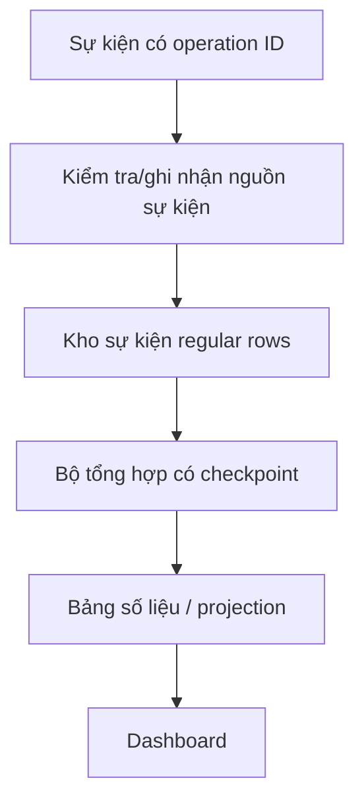

# Giới hạn về TTL, timestamp và cập nhật có điều kiện

## Mục tiêu học tập

Apache Cassandra có kiểu dữ liệu **`counter`** để tăng hoặc giảm một giá trị số nguyên trực tiếp bằng CQL. Nó hữu ích cho một số phép đếm như tổng lượt truy cập hoặc tổng sự kiện được ghi nhận theo bucket. Tuy nhiên, counter có những giới hạn đáng kể: **không được dùng TTL như regular column, không đặt write timestamp tường minh theo cách thông thường, và không cập nhật có điều kiện bằng LWT/`IF`**. Một thao tác tăng counter cũng **không idempotent**: nếu request đã thành công nhưng phản hồi bị mất, gửi lại có thể cộng thêm lần nữa.

Đây là bài học trong chương **Bộ đếm** của module `SPRING_DATA_CASSANDRA`. Với Spring Data Cassandra, ta vẫn có thể truy cập Apache Cassandra qua entity mapping, repository, `CassandraTemplate`, `CqlTemplate` và truy vấn CQL; nhưng chọn API Java **không thay đổi được ngữ nghĩa đặc biệt của counter**. Việc thiết kế theo truy vấn, partition key, consistency, paging và hiệu năng phân tán vẫn cần được xem xét từ đầu.

Sau bài này, bạn có thể:

- Viết schema và câu `UPDATE` hợp lệ cho counter, phân biệt tăng/giảm với gán giá trị tuyệt đối.
- Giải thích vì sao `USING TTL`, `USING TIMESTAMP`, `TTL(counter)` và `WRITETIME(counter)` không phù hợp với counter column.
- Hiểu vì sao không thể dùng `UPDATE ... IF ...` hoặc optimistic locking thông thường trên counter như trên regular column.
- Phân biệt **consistency level**, **giá trị đếm**, **tính idempotent** và **điều kiện nghiệp vụ**.
- Xử lý đúng timeout/unknown outcome mà không biến một yêu cầu thành nhiều lần tăng.
- Dùng `CqlSession` do Spring quản lý để gửi counter update có bind parameter và khai báo non-idempotence.
- Chọn mô hình thay thế nếu nghiệp vụ cần TTL, audit timestamp, uniqueness, giới hạn không âm hoặc exactly-once.
- Thiết kế time bucket, shard và kiểm thử cạnh tranh phù hợp với tải thực tế.

## 1. Counter là gì, và không phải là gì?

Trong CQL, một regular column kiểu `bigint` có thể được gán:

```sql
UPDATE normal_totals_by_id
SET total = 15
WHERE id = 11111111-1111-4111-8111-111111111111;
```

Ngược lại, một counter column được cập nhật bằng **phép cộng hoặc trừ tương đối trên giá trị hiện có**:

```sql
UPDATE page_views_by_day
SET views = views + 1
WHERE page_id = 11111111-1111-4111-8111-111111111111
  AND view_day = '2026-11-25';
```

Với bảng counter phù hợp, ý nghĩa là “tăng `views` lên một đơn vị” chứ không phải “đặt `views` bằng 1”.

### Bảng so sánh

| Thuộc tính | Regular `bigint` | `counter` |
| --- | --- | --- |
| Cập nhật giá trị | Gán trực tiếp với `SET total = 15`. | Tăng/giảm với `SET total = total + 1` hoặc `- 1`. |
| Nạp giá trị bằng INSERT | Hỗ trợ theo schema thông thường. | Counter cần câu `UPDATE` theo cú pháp riêng; không INSERT counter như giá trị thường. |
| TTL theo cell | Hỗ trợ khi là loại dữ liệu và câu lệnh phù hợp. | **Không hỗ trợ TTL trên counter.** |
| Write timestamp tường minh | Có thể dùng `USING TIMESTAMP` khi câu lệnh cho phép. | **Không hỗ trợ timestamp do client chỉ định theo cách đó.** |
| `WRITETIME(column)` | Dùng để quan sát write timestamp của regular cell phù hợp. | **Không dùng được trên counter.** |
| `UPDATE ... IF ...` | Có thể hỗ trợ LWT/CAS theo quy tắc CQL. | **Không hỗ trợ LWT/IF trên counter.** |
| Idempotent khi lặp request | Một số phép gán cố định có thể idempotent theo ngữ cảnh. | **Tăng/giảm không idempotent.** |

**Không chọn counter chỉ vì giá trị có vẻ là một số nguyên.** Câu hỏi quan trọng hơn là *cách ghi*, *cần chính xác đến mức nào*, *có cần điều kiện không* và *có thể chịu kết quả chưa xác định khi timeout không*.

## 2. Schema tối giản và các ràng buộc của counter table

Giả sử cần theo dõi lượt xem của một trang theo ngày:

```sql
CREATE TABLE page_views_by_day (
    page_id uuid,
    view_day date,
    views counter,
    PRIMARY KEY ((page_id), view_day)
);
```

Ở đây:

- `page_id` là **partition key**.
- `view_day` là **clustering column**.
- `views` là **counter column**.

Đối với nhiều sản phẩm, cần thêm `tenant_id` vào khóa để tránh việc một tenant truy cập hoặc ghi nhầm dữ liệu của tenant khác. Bảng ở đây được giữ đơn giản để giải thích counter; phần sau sẽ đưa ví dụ cho thiết kế multi-tenant và shard.

### Counter table không được trộn regular columns tùy ý

Một bảng chứa counter column có quy tắc đặc biệt: **các cột không thuộc primary key phải tuân thủ kiểu counter**, không được tự thêm regular column như text/bigint/timestamp vào cùng bảng rồi cập nhật như row thường.

Ví dụ schema sau **không phải thiết kế counter table hợp lệ**:

```sql
-- Phản ví dụ: last_updated là regular timestamp trong counter table.
CREATE TABLE invalid_page_views (
    page_id uuid PRIMARY KEY,
    views counter,
    last_updated timestamp
);
```

Nếu muốn lưu tên trang, thông tin chủ sở hữu hoặc thời gian nghiệp vụ, hãy dùng **bảng metadata riêng**, hoặc thay counter bằng mô hình dữ liệu khác. Việc gộp tất cả thành một counter table không được CQL cho phép.

### Một bảng counter có thể có nhiều counter

```sql
CREATE TABLE article_reactions_by_id (
    article_id uuid PRIMARY KEY,
    likes counter,
    shares counter
);
```

Các cột `likes` và `shares` đều là counter. Nhưng không vì thế mà ứng dụng có thể giả định hai thao tác tăng chúng qua các request riêng tạo thành một transaction nghiệp vụ nguyên tử.

### Cú pháp ghi hợp lệ

```sql
-- Một lượt xem.
UPDATE page_views_by_day
SET views = views + 1
WHERE page_id = 11111111-1111-4111-8111-111111111111
  AND view_day = '2026-11-25';

-- Giảm một đơn vị khi có quy tắc nghiệp vụ phù hợp.
UPDATE page_views_by_day
SET views = views - 1
WHERE page_id = 11111111-1111-4111-8111-111111111111
  AND view_day = '2026-11-25';
```

Counter cho phép thay đổi tương đối; nó **không áp đặt sẵn invariant không âm**. Nếu từ 0 giảm 1, ứng dụng không thể trông đợi counter tự từ chối theo một quy tắc `CHECK(views >= 0)`.

### Cú pháp gán tuyệt đối không đúng

```sql
-- Phản ví dụ: counter không được gán 0 như regular bigint.
UPDATE page_views_by_day
SET views = 0
WHERE page_id = 11111111-1111-4111-8111-111111111111
  AND view_day = '2026-11-25';

-- Phản ví dụ: không INSERT giá trị counter theo cách này.
INSERT INTO page_views_by_day (page_id, view_day, views)
VALUES (
    11111111-1111-4111-8111-111111111111,
    '2026-11-25',
    0
);
```

Không dùng cách `DELETE rồi UPDATE + giá trị mới` để mô phỏng thao tác reset trên cùng khóa khi chưa hiểu ràng buộc về counter shards, replica và dữ liệu đến muộn. **Counter không phải lựa chọn tốt cho một bộ đếm phải reset chính xác và an toàn dưới cạnh tranh.**

## 3. Giới hạn thứ nhất: counter không hỗ trợ TTL

TTL (time-to-live) trên regular column cho phép dữ liệu hết hạn sau một số giây. Tuy nhiên, đối với counter, các thao tác kiểu sau không được hỗ trợ:

```sql
-- KHÔNG HỢP LỆ với counter:
UPDATE page_views_by_day
USING TTL 3600
SET views = views + 1
WHERE page_id = 11111111-1111-4111-8111-111111111111
  AND view_day = '2026-11-25';
```

Lý do thực tế quan trọng là **một counter update không phải một cell regular được ghi đè cùng TTL**. Counter có cơ chế lưu và hợp nhất những cập nhật tăng/giảm riêng, trong khi TTL cần định nghĩa rõ khi nào một phiên bản dữ liệu hết hạn. CQL không cung cấp chức năng “mỗi lần tăng counter sống đúng một giờ rồi tự trừ đi” cho kiểu counter.

### TTL trên bảng counter cũng không giải quyết vấn đề

Không nên tạo counter table với kỳ vọng `default_time_to_live` có thể biến những increment thành các giá trị tự hết hạn. Counter không hỗ trợ TTL; những cấu hình TTL dương trên counter table bị hạn chế/không hợp lệ theo quy tắc CQL của Cassandra. Hãy kiểm tra schema và lỗi cụ thể của phiên bản server đang dùng; **đừng diễn giải default TTL như một cách tự động giảm số đếm theo thời gian**.

### Không có “TTL của từng increment”

Giả sử:

```text
09:00  +1 view
09:15  +1 view
09:30  +1 view
```

Yêu cầu “chỉ đếm lượt xem trong 60 phút gần nhất” sẽ cần đến việc:

```text
10:00  phép +1 lúc 09:00 hết hạn
10:15  phép +1 lúc 09:15 hết hạn
10:30  phép +1 lúc 09:30 hết hạn
```

Một counter chứa tổng hiện tại **không lưu từng phép cộng dưới dạng các sự kiện có TTL riêng để tự trừ khi hết hạn**. Không có lệnh CQL “TTL 3600 cho phép +1 này” trong counter.

### Hàm TTL(counter) cũng không dùng được

```sql
-- Phản ví dụ: TTL() không phải selector hợp lệ trên counter column.
SELECT views, TTL(views)
FROM page_views_by_day
WHERE page_id = 11111111-1111-4111-8111-111111111111
  AND view_day = '2026-11-25';
```

Không xử lý chuyện này bằng cách nhận `null` rồi coi là “vĩnh viễn”: bản thân việc áp dụng `TTL()` lên counter **không thuộc nhóm selector được hỗ trợ**. Muốn đọc chính sách lưu giữ của hệ thống, hãy quản lý chúng ở tầng nghiệp vụ.

## 4. Giới hạn thứ hai: không đặt write timestamp cho counter như regular column

Trên regular column, Cassandra có khái niệm write timestamp và hỗ trợ những biểu thức như:

```sql
-- Ví dụ dùng regular column trong một bảng thường.
UPDATE ordinary_metrics_by_id
USING TIMESTAMP 1700000000000000
SET total = 42
WHERE metric_id = 11111111-1111-4111-8111-111111111111;
```

Đối với counter, **không dùng `USING TIMESTAMP` để đặt timestamp cho increment**:

```sql
-- KHÔNG HỢP LỆ với counter:
UPDATE page_views_by_day
USING TIMESTAMP 1700000000000000
SET views = views + 1
WHERE page_id = 11111111-1111-4111-8111-111111111111
  AND view_day = '2026-11-25';
```

Counter được quản lý theo ngữ nghĩa tích lũy tăng/giảm, không phải một regular cell đơn giản được chọn theo **last-write-wins** bằng timestamp do client cung cấp.

### Không dùng WRITETIME(counter)

```sql
-- Phản ví dụ: không lấy WRITETIME() của counter như regular cell.
SELECT views, WRITETIME(views)
FROM page_views_by_day
WHERE page_id = 11111111-1111-4111-8111-111111111111
  AND view_day = '2026-11-25';
```

Hàm `WRITETIME(column)` hữu ích với regular column phù hợp, nhưng **không phải API truy vấn lịch sử cập nhật counter**.

### “Giá trị đếm là 100” không nói lần tăng cuối khi nào

Giả sử:

```text
counter hiện tại: views = 100
```

Chỉ từ giá trị 100, ta không biết:

- 100 request đến trong một phút hay trong một năm.
- Lần cập nhật cuối xảy ra vào lúc nào.
- Ai gửi phép tăng.
- Có bao nhiêu lần retry sau timeout.
- Có một phép giảm nào đã bù trừ trước đó không.

**Không thể suy ra audit history từ trạng thái counter cuối cùng**. Nếu cần timestamp, actor hoặc operation ID, phải lưu dấu ở một đường dữ liệu khác có hợp đồng rõ ràng.

### Tránh dùng đồng hồ client để “bù” write timestamp

Ghi:

```text
application sends UPDATE counter + 1
application logs currentTimeMillis()
```

không tạo một transaction nguyên tử giữa Cassandra và log. Lệnh counter có thể thành công nhưng service crash trước khi ghi log; hoặc log ghi thành công rồi Cassandra timeout. Nếu mục tiêu là audit chính xác, cần **thiết kế quy trình ghi nhận ý định và kết quả**, không coi hai câu lệnh độc lập là một sự kiện bất khả phân.

## 5. Giới hạn thứ ba: counter không hỗ trợ cập nhật có điều kiện

Ứng dụng thường muốn:

> “Chỉ tăng số lượt nếu chưa vượt quota.”

hoặc:

> “Chỉ trừ một đơn vị nếu counter hiện tại lớn hơn 0.”

Trên regular columns, có thể dùng LWT với điều kiện `IF` trong phạm vi CQL được hỗ trợ. Với counter column, **không dùng conditional update như sau**:

```sql
-- KHÔNG HỢP LỆ với counter:
UPDATE page_views_by_day
SET views = views + 1
WHERE page_id = 11111111-1111-4111-8111-111111111111
  AND view_day = '2026-11-25'
IF views < 1000;
```

Vấn đề không chỉ là toán tử so sánh trong ví dụ. **Cassandra không hỗ trợ LWT/CAS trên counter update** theo cách dùng `IF` của regular rows.

### Không thể dùng IF EXISTS hoặc IF NOT EXISTS như lối tắt

```sql
-- Phản ví dụ: không thêm IF EXISTS để biến increment thành CAS.
UPDATE page_views_by_day
SET views = views + 1
WHERE page_id = 11111111-1111-4111-8111-111111111111
  AND view_day = '2026-11-25'
IF EXISTS;

-- Phản ví dụ: không INSERT counter kèm IF NOT EXISTS.
INSERT INTO page_views_by_day (page_id, view_day, views)
VALUES (
    11111111-1111-4111-8111-111111111111, '2026-11-25', 1
)
IF NOT EXISTS;
```

Đừng nhầm khả năng `IF NOT EXISTS` của **bảng regular** với khả năng cập nhật counter. Đây là **hai mô hình ghi khác nhau**.

### @Version không tự bổ sung CAS cho counter

Một entity bình thường có thể có `@Version` và sử dụng optimistic locking nếu phiên bản Spring Data Cassandra hỗ trợ. Nhưng counter table không thể chỉ thêm một regular `version bigint` như cột metadata để biến counter thành hàng LWT, vì **counter không được trộn với regular non-key columns** trong cùng bảng.

Do đó, không nên thử:

```java
// Phản ví dụ về ý định, không phải entity mapping hợp lệ cho CAS:
// @Table("page_views_by_day")
// class PageViews {
//     @PrimaryKey private PageDayKey key;
//     private Long views;      // counter
//     @Version private Long version; // regular column: xung đột schema
// }
```

Nếu cần **kiểm tra quota, tránh âm, hoặc CAS một giá trị**, hãy chọn **regular table + version/LWT hoặc hệ điều phối nghiệp vụ** thay cho counter.

## 6. Quorum cũng không biến counter thành CAS

Giả sử một ứng dụng định thực hiện:

```text
1. SELECT views ở LOCAL_QUORUM.
2. Nếu views < 1000, UPDATE views = views + 1 ở LOCAL_QUORUM.
```

Hai request A và B có thể đều nhìn thấy `views=999`:

```text
T1: A đọc -> 999
T2: B đọc -> 999
T3: A cho phép tăng
T4: B cho phép tăng
T5: A cập nhật +1
T6: B cập nhật +1
Kết quả có thể -> 1001
```

Đây là race **check-then-act**. Dù mỗi SELECT và UPDATE được xác nhận theo mức quorum đã chọn, **hai thao tác không được gộp thành một điều kiện nguyên tử**.

| Yêu cầu | Counter có phù hợp không? |
| --- | --- |
| Đếm số sự kiện với mức chính xác phù hợp cho telemetry | Có thể phù hợp nếu chấp nhận rủi ro retry và quy trình đối soát. |
| Chặn lượt sử dụng thứ 1001 tại đúng ngưỡng 1000 | Không nên dựa vào counter + kiểm tra ở Java. |
| Không bao giờ cho phép số dư âm | Counter không tự bảo đảm invariant đó. |
| Chỉ áp dụng một operation ID duy nhất | Counter không có CAS trên từng increment để deduplicate trực tiếp. |
| Cập nhật hai bảng cùng lúc với atomic rollback | Không phải khả năng của một counter increment. |

**Consistency level quy định phạm vi xác nhận replica, không bảo đảm tính điều kiện của một business operation.**

## 7. Counter increment là non-idempotent

Một phép ghi **idempotent** có thể thực hiện lại với cùng input mà không làm thay đổi kết quả thêm lần nữa, trong các điều kiện phù hợp. Ví dụ ý tưởng với regular row:

```sql
-- Có thể idempotent nếu không có cạnh tranh hoặc tác dụng phụ khác:
UPDATE normal_totals_by_id
SET total = 42
WHERE id = 11111111-1111-4111-8111-111111111111;
```

Counter update khác:

```sql
UPDATE page_views_by_day
SET views = views + 1
WHERE page_id = 11111111-1111-4111-8111-111111111111
  AND view_day = '2026-11-25';
```

Nếu cùng một thao tác `+1` **được áp dụng hai lần**, tổng có thể tăng 2 thay vì 1:

```text
Ban đầu:  views=20
Lần 1:   views=21
Lần 2:   views=22
```

Vì vậy, driver hoặc cơ sở hạ tầng **không được tùy ý retry counter update như một phép SET idempotent**. Mức consistency cao hơn không loại bỏ nguy cơ này nếu client không biết liệu request trước đã được áp dụng hay chưa.

### Timeout không nói counter đã tăng hay chưa

```text
Client                 Coordinator              Replicas
  |                         |                      |
  |--- UPDATE count+1 ----->|--------------------->|
  |                         |    một số replica xử lý
  |<------- TIMEOUT --------|                      |
  |                         |   phản hồi đến trễ   |

Client không biết chắc increment đã được áp dụng hay chưa.
```

Nếu tự retry ngay một lần nữa:

- Có thể **đếm thừa** nếu lần đầu đã áp dụng.
- Có thể đếm đúng nếu lần đầu chưa áp dụng.
- Có thể còn biến động do tình trạng replica và xử lý lỗi.

**Không có một phép SELECT counter sau timeout có thể tự chứng minh operation ID cụ thể đã được cộng chính xác một lần**, đặc biệt khi có nhiều client cùng tăng.

## 8. COUNTER BATCH không giải quyết idempotency

CQL có cú pháp chuyên biệt cho counter batch trong những tình huống được hỗ trợ:

```sql
BEGIN COUNTER BATCH
  UPDATE page_views_by_day
  SET views = views + 1
  WHERE page_id = 11111111-1111-4111-8111-111111111111
    AND view_day = '2026-11-25';

  UPDATE page_views_by_day
  SET views = views + 1
  WHERE page_id = 22222222-2222-4222-8222-222222222222
    AND view_day = '2026-11-25';
APPLY BATCH;
```

Counter batch **không phải transaction ACID** để giải quyết điều kiện, khử trùng lặp hoặc bảo đảm retry không cộng hai lần. Không được tùy ý trộn counter mutations và regular mutations trong một batch để biến chúng thành một giao dịch đa bảng.

Với thao tác tăng một counter duy nhất, thường không có lý do dùng batch. Với nhiều key, phải kiểm tra chi phí phối hợp, phân phối token và mục tiêu nghiệp vụ; **batch không phải mẹo tăng throughput tổng quát của Cassandra**.

## 9. Dùng CqlSession trong Spring Data Cassandra

Mặc dù ứng dụng dùng Spring Data Cassandra, với counter nên ưu tiên một **đường CQL tường minh** thay vì giả định `repository.save(entity)` có thể tự chuyển một số `Long` thành increment. Một thao tác lưu entity thông thường có ý định gán các giá trị hiện tại; counter lại yêu cầu phép cộng tương đối.

Ví dụ gateway dùng Java 17+, Java Driver 4.x và `CqlSession` do Spring quản lý:

```java
import java.time.LocalDate;
import java.util.OptionalLong;
import java.util.UUID;

import com.datastax.oss.driver.api.core.CqlSession;
import com.datastax.oss.driver.api.core.DefaultConsistencyLevel;
import com.datastax.oss.driver.api.core.cql.BoundStatement;
import com.datastax.oss.driver.api.core.cql.PreparedStatement;
import com.datastax.oss.driver.api.core.cql.Row;

import org.springframework.stereotype.Repository;

@Repository
public final class PageViewCounterGateway {

    private final CqlSession session;
    private final PreparedStatement increment;
    private final PreparedStatement read;

    public PageViewCounterGateway(CqlSession session) {
        this.session = session;

        this.increment = session.prepare("""
            UPDATE page_views_by_day
            SET views = views + 1
            WHERE page_id = ?
              AND view_day = ?
            """);

        this.read = session.prepare("""
            SELECT views
            FROM page_views_by_day
            WHERE page_id = ?
              AND view_day = ?
            """);
    }

    public void recordView(UUID pageId, LocalDate day) {
        BoundStatement statement = increment.bind(pageId, day)
                .setConsistencyLevel(
                        DefaultConsistencyLevel.LOCAL_QUORUM)
                .setIdempotent(false);

        session.execute(statement);
        // Không có IF hoặc [applied] để kiểm tra trên increment này.
        // Timeout phải được xử lý như outcome có thể chưa xác định.
    }

    public OptionalLong readViews(UUID pageId, LocalDate day) {
        BoundStatement statement = read.bind(pageId, day)
                .setConsistencyLevel(
                        DefaultConsistencyLevel.LOCAL_QUORUM);

        Row row = session.execute(statement).one();
        if (row == null || row.isNull("views")) {
            return OptionalLong.empty();
        }

        return OptionalLong.of(row.getLong("views"));
    }
}
```

Ví dụ giả định đã có bảng `page_views_by_day` và session kết nối đúng keyspace. Nó dùng `LOCAL_QUORUM` như **một lựa chọn minh họa trong một local datacenter được cấu hình đúng**, không phải mức CL tối ưu cho mọi hệ thống. Khi chạy multi-DC cần xác định replication factor, routing và yêu cầu đọc sau ghi.

### Vì sao setIdempotent(false)?

`setIdempotent(false)` thông báo cho Java Driver rằng statement **không an toàn để lặp lại tùy ý**. Đây là tín hiệu quan trọng cho chính sách retry/speculative execution của driver, nhưng không thể tự ngăn:

- HTTP gateway gửi request lại vì timeout.
- Message broker giao cùng event nhiều lần.
- Service gọi `recordView()` hai lần do lỗi ứng dụng.
- Một operator chạy lại job xử lý mà không có checkpoint.

**Khai báo non-idempotent không làm thao tác trở nên idempotent.** Nó giúp tránh việc một số cơ chế tự động coi statement như phép ghi có thể lặp vô hại; application vẫn phải có chính sách xử lý kết quả không rõ.

### Không dùng wasApplied() cho increment thường

`ResultSet.wasApplied()` có ý nghĩa với **conditional statement**. Counter update trong ví dụ không có `IF` và không dùng LWT. Do đó, đừng dựng một abstraction cho counter mà coi nó trả “applied=false → retry sau khi đọc lại” như optimistic locking.

Thao tác `session.execute(...)` trả về bình thường cho biết câu lệnh đã được xử lý theo hợp đồng driver/CL, **không phải xác nhận request gốc được thực thi đúng một lần trên toàn bộ workflow**.

### Vì sao dùng prepared statements?

- Giá trị khóa được bind, không nối chuỗi input vào CQL.
- Prepared statement có thể tái sử dụng cho nhiều request.
- Các instance request tạo `BoundStatement` riêng, không chia sẻ biến mutable chứa khóa hiện tại.
- Có thể cấu hình consistency, timeout và idempotence theo statement.

Tuy nhiên, Java Driver **không thể cứu một schema sai mục tiêu nghiệp vụ**. Nếu cần điều kiện “chỉ cộng khi quota chưa hết”, phải chọn mô hình khác ở tầng dữ liệu.

## 10. Repository và CassandraTemplate: tránh ngộ nhận về save()

Spring Data Cassandra hỗ trợ entity mapping, converter và repository cho dữ liệu Cassandra. Điều đó không có nghĩa cách viết:

```java
// Phản ví dụ ý định:
PageViews entity = repository.findById(key).orElseThrow();
entity.setViews(entity.getViews() + 1);
repository.save(entity);
```

sẽ tương đương một **counter increment nguyên tử**. Có hai vấn đề:

1. Counter CQL không nhận phép `SET views = <absolute value>` giống regular `bigint`.
2. Đọc giá trị cũ rồi tự tăng ở Java vẫn mang nguy cơ đua read-modify-write nếu cố thực hiện bằng regular update.

Nếu dùng entity để **đọc kết quả** của counter, cần kiểm tra mapping và conversion của phiên bản Spring Data đang dùng. Nhưng đối với **đường ghi increment**, hãy dùng API/CQL thực sự phát ra `SET views = views + 1`, chẳng hạn qua `CqlSession` hoặc `CqlTemplate` phù hợp.

| Công cụ | Khả năng phù hợp | Điều phải kiểm tra |
| --- | --- | --- |
| `CassandraRepository` | Đọc entity/mapping theo khóa khi module hỗ trợ. | Không tự suy ra `save()` có semantics increment. |
| `CassandraTemplate` | Query/update qua mapping entity khi có API phù hợp. | CQL được tạo có phải counter update thực sự không? |
| `CqlTemplate` | Thực thi CQL và ánh xạ Row gần driver. | Cách bind, loại statement, exception/timeout. |
| `CqlSession` | Prepared CQL, consistency, idempotence, driver options. | Tự chịu trách nhiệm ngữ nghĩa non-idempotent và retry. |

Khi tính đúng của nghiệp vụ quan trọng, **xem câu CQL thực tế** có ý nghĩa hơn chỉ nhìn chữ ký method Java.

## 11. Cần TTL thì thiết kế dữ liệu khác thế nào?

Yêu cầu “mỗi increment sống 24 giờ” không thể được giải quyết chỉ bằng thêm `USING TTL 86400` vào counter. Cần làm rõ **đang muốn đếm điều gì**:

- Tổng số lượt xem **trong một ngày lịch**?
- Số lượt xem **trong 24 giờ gần nhất**, trượt liên tục theo thời điểm hiện tại?
- Tổng tất cả lượt xem từ trước đến nay, nhưng chỉ giữ các bucket cũ trong 30 ngày?
- Số người dùng **duy nhất** trong một khoảng thời gian?

Đó là bốn hợp đồng khác nhau. Không có một bảng counter duy nhất tự giải quyết tất cả.

### 11.1. Đếm theo bucket thời gian

Với số lượt xem theo ngày, khóa đã có `view_day`:

```sql
CREATE TABLE page_views_by_day (
    page_id uuid,
    view_day date,
    views counter,
    PRIMARY KEY ((page_id), view_day)
);
```

Khi sang ngày mới, application ghi vào khóa có `view_day` mới. Dữ liệu ngày cũ vẫn giữ nguyên giá trị của ngày ấy.

Ưu điểm:

- Phân biệt tổng theo ngày.
- Truy vấn theo page và ngày được xác định.
- Không cần đặt TTL cho từng increment để có cửa sổ ngày.

Giới hạn:

- Counter **không tự hết hạn**.
- Cần quy trình retention để xử lý bucket cũ nếu không muốn giữ vô thời hạn.
- Cửa sổ trượt 24 giờ không trùng với một ngày lịch.
- Độ chính xác vẫn chịu ảnh hưởng duplicate/retry của increment.

**Lưu ý về partition key:** trong schema này, mỗi `page_id` là một partition chứa các ngày ở clustering column. Khi một page có lịch sử rất dài hoặc quá nóng, cần xem lại cách bucket/shard ở partition key thay vì tích lũy không giới hạn.

### 11.2. Dữ liệu nguồn là từng sự kiện regular có TTL

Nếu sản phẩm cần giữ từng sự kiện trong bảy ngày:

```sql
CREATE TABLE page_view_events_by_day (
    tenant_id uuid,
    page_id uuid,
    event_day date,
    event_at timestamp,
    event_id uuid,
    source text,
    PRIMARY KEY (
        (tenant_id, page_id, event_day),
        event_at,
        event_id
    )
) WITH CLUSTERING ORDER BY (event_at DESC, event_id ASC);
```

Ghi một sự kiện là **regular write**, có thể đặt TTL:

```sql
INSERT INTO page_view_events_by_day (
    tenant_id, page_id, event_day,
    event_at, event_id, source
) VALUES (
    11111111-1111-4111-8111-111111111111,
    22222222-2222-4222-8222-222222222222,
    '2026-11-25',
    '2026-11-25T09:30:00Z',
    33333333-3333-4333-8333-333333333333,
    'WEB'
) USING TTL 604800;
```

Các regular cells phù hợp có thể hết hạn theo TTL. Nhưng **đừng nhầm** rằng xóa/hết hạn một event ở bảng này tự động trừ bộ đếm ở bảng khác. Nếu có cả event ledger và counter aggregate, phải thiết kế quy trình tổng hợp, đối soát hoặc rebuild.

### 11.3. Bucket nhỏ cho cửa sổ trượt

Với “24 giờ gần nhất”, hệ thống có thể dùng bucket theo phút hoặc giờ và cộng các bucket còn nằm trong cửa sổ:

```text
10:15 ngày 25/11:
  tính tổng các bucket giờ từ 11:00 ngày 24/11
  đến bucket 10:00 ngày 25/11
```

Đây chỉ là **xấp xỉ theo ranh giới bucket** nếu không giữ timestamp chi tiết. Cửa sổ càng nhỏ thì phải đọc/cộng càng nhiều bucket; cửa sổ lớn dễ sai nhiều ở ranh giới. Nếu cần kết quả chính xác đến từng event, phải dùng một nguồn sự kiện và quy tắc xử lý rõ ràng.

### 11.4. Xóa bucket cũ không phải “reset counter miễn phí”

Counter không hỗ trợ thao tác gán 0 trực tiếp. Việc xóa rồi cập nhật lại **cùng khóa counter** có những rủi ro liên quan replica cũ, counter state, dữ liệu đến muộn và quá trình repair; không nên coi đó là cách reset an toàn trong mọi điều kiện.

Nếu retention cần xóa bucket, hãy:

1. Quy định bucket nào đã đóng và **không còn nhận write**.
2. Xác định cách xử lý sự kiện đến muộn.
3. Kiểm tra policy delete/repair/compaction của phiên bản Cassandra.
4. Tránh tái sử dụng cùng khóa cho một thế hệ đếm mới; cân nhắc khóa có `generation` hoặc bucket mới.
5. Có dữ liệu nguồn hoặc quy trình đối soát để khôi phục tổng khi cần.

TTL, tombstone và `gc_grace_seconds` của dữ liệu thường vẫn là các vấn đề vận hành quan trọng, nhưng **không nên dựa vào TTL counter vốn không được hỗ trợ** để đơn giản hóa retention.

## 12. Cần timestamp và audit thì lưu sự kiện, không dùng WRITETIME(counter)

Nếu nghiệp vụ muốn biết:

> “Ai đã tăng bộ đếm, lúc nào, do thao tác nào?”

thì counter chỉ chứa **kết quả tích lũy**. Đừng cố lấy lịch sử qua `WRITETIME(views)` hoặc thêm cột `last_updated timestamp` không phải counter vào cùng bảng.

Một bảng sự kiện thường nên lưu:

- `operation_id` hoặc `event_id` ổn định.
- `actor_id`/nguồn yêu cầu, khi chính sách cho phép.
- `event_at` và `received_at` có ý nghĩa nghiệp vụ riêng.
- Loại sự kiện và delta (nếu được phép).
- Thông tin tenant, resource và thời gian bucket để truy vấn.

### Event time không phải write timestamp

`event_at` là khi sự kiện xảy ra theo ứng dụng; `received_at` là khi service nhận; write timestamp là metadata theo quy tắc Cassandra đối với regular cells phù hợp. Chúng có thể khác nhau do mạng, xử lý bất đồng bộ, replay hoặc clock skew.

Nếu cần audit chính xác, việc đọc `WRITETIME(event_type)` ở bảng sự kiện thông thường **cũng không thay được** bản ghi audit chứa actor và operation ID. Write timestamp chỉ có ý nghĩa theo quy tắc ghi, không cho toàn bộ lịch sử nghiệp vụ.

### Tách dữ liệu nguồn và aggregate



Đây là **mẫu kiến trúc ý tưởng**, không phải bảo đảm mỗi event được cộng chính xác một lần. Nếu dự án cần exactly-once effect, phải xây protocol xác định cách checkpoint và trạng thái tổng hợp được commit/khôi phục, và đánh giá những bước qua partition khác nhau. Có thể chọn hệ thống stream processing/transactional store phù hợp khi yêu cầu vượt khả năng triển khai an toàn trên counter.

## 13. Cần cập nhật có điều kiện thì dùng regular table và LWT

Giả sử một API phải bảo đảm số lượt còn lại của quota không âm. Một **counter không thể tự dùng `IF remaining >= amount`**. Giải pháp thay thế là mô hình regular row có version:

```sql
CREATE TABLE quota_by_tenant_key (
    tenant_id uuid,
    quota_key text,
    remaining bigint,
    version bigint,
    PRIMARY KEY ((tenant_id, quota_key))
);
```

Khởi tạo bằng conditional INSERT:

```sql
INSERT INTO quota_by_tenant_key (
    tenant_id, quota_key, remaining, version
) VALUES (
    11111111-1111-4111-8111-111111111111,
    'daily-api-requests',
    1000,
    0
) IF NOT EXISTS;
```

Giả sử application vừa đọc `remaining=5, version=17` và muốn sử dụng hai lượt. Nó kiểm tra `5 >= 2` rồi gửi:

```sql
UPDATE quota_by_tenant_key
SET remaining = 3,
    version = 18
WHERE tenant_id = 11111111-1111-4111-8111-111111111111
  AND quota_key = 'daily-api-requests'
IF version = 17;
```

Nếu request khác đã thay đổi version, LWT trả `[applied]=false`. Application **đọc lại, kiểm tra quota mới, tính lại, rồi thử lại có giới hạn**. Khi `remaining < amount`, nó trả kết quả không đủ quota thay vì cố tăng version cho thắng.

### Vì sao thiết kế này khác counter?

| Counter | Regular row + version/LWT |
| --- | --- |
| Ghi `value = value + delta`. | Ghi giá trị mới **nếu version hiện tại khớp**. |
| Không có `IF`. | Có thể dùng conditional CQL hợp lệ. |
| Không có read-modify-write CAS trên counter. | Có thể bảo vệ một invariant ở phạm vi được LWT hỗ trợ. |
| Tăng/giảm không idempotent; retry mù quáng nguy hiểm. | Có nhánh conflict xác định, nhưng timeout của LWT **vẫn cần idempotency/outcome handling**. |
| Không hỗ trợ TTL. | Regular data có thể dùng TTL trong các điều kiện thích hợp. |

**LWT không biến toàn bộ workflow thành exactly-once.** Sau timeout, một conditional update cũng có thể đã thành công mà response bị mất. Khi có side effect ngoài Cassandra hoặc thao tác qua nhiều bảng, cần operation ID và cơ chế đối soát.

### Những nhược điểm của regular row + LWT

- Có chi phí Paxos/consensus cao hơn ghi thường.
- Một khóa có nhiều writer cạnh tranh trở thành hotspot.
- Phải kiểm tra đồng nhất protocol của mọi writer.
- Phải xử lý `applied=false` và retry budget.
- Điều kiện trong nhiều partition/bảng không tự được gộp thành một transaction ACID.

Chọn cơ chế theo **invariant nghiệp vụ**, không chỉ theo thông số throughput lý tưởng.

## 14. Idempotency key ở bảng riêng: hữu ích nhưng chưa đủ

Một team có thể thử chống cộng hai lần bằng:

```sql
CREATE TABLE processed_view_events_by_id (
    operation_id uuid PRIMARY KEY,
    page_id uuid,
    event_day date,
    processed_at timestamp
);
```

Sau đó:

```text
1. INSERT processed_view_events_by_id ... IF NOT EXISTS
2. Nếu applied=true, UPDATE page_views_by_day SET views=views+1
```

Quy trình này **có khoảng trống lỗi**:

```text
LWT insert operation ID -> thành công
Service crash trước khi tăng counter
Request đến lại -> operation ID đã tồn tại
Không tăng counter nữa -> thiếu một lượt
```

Đổi thứ tự:

```text
1. Tăng counter
2. Lưu operation ID
```

cũng có vấn đề:

```text
Tăng counter -> thành công
Service crash trước khi ghi operation ID
Request đến lại -> tưởng chưa làm
Tăng tiếp -> đếm thừa một lượt
```

Đây là ví dụ **dual-write problem**. Một `INSERT IF NOT EXISTS` ở bảng regular không tạo transaction nguyên tử với counter increment ở partition khác. Counter cũng không thể tham gia cùng một LWT như một giá trị regular có điều kiện.

### Chọn giải pháp theo mức độ bảo đảm

| Mục tiêu | Hướng tham khảo |
| --- | --- |
| Telemetry không quá nghiêm ngặt | Counter với xử lý retry thận trọng, chấp nhận sai số và đối soát. |
| Đếm mỗi event ID một lần và có thể rebuild | Lưu event source chuẩn, aggregate từ nguồn và checkpoint. |
| Quota/đặt hàng không được vượt giới hạn | Regular row + LWT hoặc bộ điều phối ràng buộc nghiệp vụ. |
| Hiệu ứng exactly-once qua nhiều dịch vụ | Protocol giao dịch/đối soát hoặc hạ tầng phù hợp; không chỉ counter + bảng ID. |
| Cần audit đầy đủ và retention | Event ledger với timestamp, actor, TTL/policy rõ ràng. |

Không nên quảng bá counter là **“bộ đếm transaction chính xác tuyệt đối”** khi hệ thống vẫn có retry và partial failure chưa được giải quyết.

## 15. Shard counter để giảm một partition quá nóng

Một page rất phổ biến có thể nhận hàng nghìn lượt xem mỗi giây. Nếu tất cả client cập nhật cùng một counter key, mọi request đều tập trung vào **cùng tập replica**, dễ gây hotspot.

Có thể thiết kế bảng có shard ở **partition key**:

```sql
CREATE TABLE page_views_by_day_shard (
    tenant_id uuid,
    page_id uuid,
    view_day date,
    shard_id smallint,
    views counter,
    PRIMARY KEY ((tenant_id, page_id, view_day, shard_id))
);
```

Trong ví dụ, mỗi tổ hợp `tenant_id/page_id/view_day/shard_id` là một partition khác nhau. Ứng dụng phân phối increment qua số shard cố định, ví dụ 16 shard.

### Cách phân phối

```text
Page P, ngày D:

shard 0  -> +1, +1, ...
shard 1  -> +1, ...
...
shard 15 -> +1, +1, ...

Kết quả hiển thị:
  total(P,D) = sum(views trên 16 shard)
```

Ví dụ một increment:

```sql
UPDATE page_views_by_day_shard
SET views = views + 1
WHERE tenant_id = 11111111-1111-4111-8111-111111111111
  AND page_id = 22222222-2222-4222-8222-222222222222
  AND view_day = '2026-11-25'
  AND shard_id = 7;
```

### Điều kiện quan trọng khi dùng shard

1. Chọn shard theo cơ chế phân phối có thể kiểm soát, không để mọi client cùng chọn 0.
2. Dùng **shard_id như một phần của partition key** nếu mục tiêu là phân phối tải qua nhiều token.
3. Query tổng cần đọc **nhiều partition**; không có một câu `SELECT sum(views)` tự động gom mọi shard thành một transaction tổng nhất quán toàn cụm.
4. Những lần đọc shard riêng có thể nhìn thấy các thời điểm khác nhau.
5. Đổi số shard cần có phiên bản cấu hình hoặc quy trình migration để không bỏ sót dữ liệu cũ.
6. Không coi việc phân shard là cách sửa thiếu idempotency: increment bị gửi lại vẫn có thể làm đếm thừa.

**Đánh đổi:** ít hotspot hơn nhưng chi phí đọc/tổng hợp cao hơn, và không có snapshot nguyên tử của tất cả shard. Vì vậy, dashboard tổng theo ngày có thể chấp nhận chậm/ước lượng, còn quota nghiêm ngặt không nên dựa vào cách cộng các counter shard thông thường.

## 16. Consistency, replication và độ đúng của counter

Cassandra cho phép đặt consistency level cho counter update và read theo khả năng server. Nhưng cần phân biệt:

```text
Request counter update ở LOCAL_QUORUM thành công
    không có nghĩa:
  - request ID được deduplicate;
  - mỗi increment được áp dụng đúng một lần mọi trường hợp;
  - không có counter update đang tranh chấp;
  - một lần đọc ở DC khác sẽ thấy ngay;
  - dữ liệu đã hợp nhất với bảng audit;
  - giá trị có thể CAS theo quota.
```

### Multi-datacenter

`LOCAL_QUORUM` thường tính trên replica ở datacenter cục bộ. Một ghi tại DC-A và một đọc tại DC-B với `LOCAL_QUORUM` thuộc **hai tập replica khác nhau**; không thể suy chỉ từ công thức quorum intersection của một DC rằng đọc xuyên vùng luôn thấy ngay cập nhật.

Với counter, ngoài độ trễ nhân bản còn có những đặc điểm của counter state và cách xử lý retry. Cần kiểm chứng trực tiếp với phiên bản, replication strategy, topology và lỗi mạng thực tế, thay vì mô tả tính chính xác chỉ bằng `R + W > RF`.

### Không có SERIAL/LOCAL_SERIAL cho counter update

`SERIAL` và `LOCAL_SERIAL` dùng cho giai đoạn LWT có điều kiện. Vì counter update không có `IF`, **không đặt serial CL lên một counter increment rồi mong biến nó thành CAS**. Nếu cần compare-and-set, đổi mô hình dữ liệu.

### Paging không tạo snapshot tổng

Một job đọc nhiều trang counter hoặc lần lượt đọc nhiều shard có thể quan sát chúng tại **những thời điểm khác nhau**. `CassandraPageRequest` hay paging state không tạo một transaction snapshot bao trùm mọi partition. Với dashboard, hãy xác định mức chậm cập nhật chấp nhận được và cách hiển thị timestamp “dữ liệu được tổng hợp đến lúc nào”.

## 17. Khi nào không nên dùng counter?

| Tình huống | Vì sao counter không phù hợp | Hướng thay thế |
| --- | --- | --- |
| Giữ hàng tồn kho với điều kiện không âm | Không có `IF remaining >= quantity`. | Regular row + LWT hoặc reservation service. |
| Trừ tiền/số dư tài khoản | Yêu cầu invariant mạnh, audit và chính sách idempotency. | Ledger/transaction store thích hợp. |
| Đếm người dùng duy nhất | Counter cộng event, không deduplicate identity. | Thiết kế theo unique key, tập sự kiện hoặc aggregate chuyên biệt. |
| Mỗi increment tự hết hạn sau N giây | Không hỗ trợ TTL per increment. | Event ledger có TTL/bucket và tổng hợp lại. |
| Biết ai tăng và lúc nào | Không có `WRITETIME(counter)`/actor history. | Audit/event log riêng. |
| Chặn quota chính xác ngay tại ranh giới | Counter không có conditional update. | Regular row CAS/LWT hoặc điều phối. |
| Reset giá trị tuyệt đối an toàn lúc 00:00 | Không `SET counter = 0`; xóa/tái dùng khóa có caveat. | Key bucket mới, generation mới hoặc regular state. |
| Bảo đảm exactly-once qua queue/retry | Increment non-idempotent và dual-write problem. | Idempotent aggregation/workflow có checkpoint phù hợp. |

Ngược lại, counter có thể vẫn hữu ích cho **số liệu thống kê/telemetry** khi ứng dụng hiểu rõ sai số có thể phát sinh do retry, có phương án reconciliation và không gắn trực tiếp với ràng buộc tài chính/nghiệp vụ.

## 18. Triển khai production: giám sát và chính sách lỗi

Một đường ghi counter cần nhiều hơn câu CQL `UPDATE ... SET count=count+1`.

### Checklist cho request path

1. **Định danh sự kiện:** request có operation/event ID ổn định không?
2. **Mức độ chính xác:** sai lệch do duplicate/missed updates có chấp nhận không?
3. **Timeout:** response API nói gì khi không biết increment đã áp dụng chưa?
4. **Retry:** driver và những tầng HTTP/queue có thể lặp không?
5. **Idempotence:** statement có được đánh dấu non-idempotent không?
6. **Schema:** partition key có đúng tenant/resource/time bucket không?
7. **Tải:** hot key có cần shard không, và chi phí đọc tổng hợp ra sao?
8. **Retention:** có quy trình xử lý bucket cũ không?
9. **Audit:** có lưu event khi nghiệp vụ cần truy vết không?
10. **Monitoring:** có số liệu latency, timeout, retry, mismatch và partition load không?

### Metric nên theo dõi

| Chỉ số | Ý nghĩa |
| --- | --- |
| Counter update QPS theo key/tenant | Nhận diện partition nóng. |
| Write/read p50, p95, p99 latency | Ảnh hưởng replication, tải, compaction. |
| Timeout và unknown-outcome rate | Rủi ro retry gây đếm thừa/thiếu. |
| Duplicate operation IDs ở nguồn | Mức độ lặp của message/request. |
| Mismatch giữa ledger và aggregate | Độ lệch của số đếm so với nguồn sự kiện. |
| Số shard cần đọc mỗi truy vấn | Chi phí fan-out và độ trễ dashboard. |
| Repair/backlog/node health | Tình trạng vận hành hệ phân tán. |
| Retention backlog | Các bucket hết vòng đời còn tồn đọng bao nhiêu? |

Không kết luận “counter đúng tuyệt đối” chỉ vì nhiều request thử nghiệm trả `LOCAL_QUORUM` thành công; cần tạo tình huống timeout, duplicate và failover để biết giới hạn thật.

## 19. Lỗi thường gặp và hướng khắc phục

| Triệu chứng | Nguyên nhân cần kiểm tra | Cách xử lý |
| --- | --- | --- |
| `UPDATE ... USING TTL` lỗi | Counter không hỗ trợ TTL. | Dùng bucket/event source; không ép TTL cho counter. |
| `TTL(views)` bị từ chối | Selector TTL không áp dụng trên counter. | Quản lý retention ở schema/ứng dụng, không đọc TTL counter. |
| `UPDATE ... USING TIMESTAMP` lỗi | Không đặt timestamp client cho counter như regular cell. | Dùng event/audit table cho metadata nghiệp vụ. |
| `WRITETIME(views)` lỗi | Counter không expose write timestamp như regular column. | Lưu thời gian sự kiện trong bảng regular khác. |
| `UPDATE ... IF views < ...` lỗi | LWT/conditional update không hỗ trợ counter. | Chuyển sang regular row + version/CAS. |
| Schema chứa counter và cột text/timestamp lỗi | Counter table không cho trộn regular non-key columns tùy ý. | Tách metadata table. |
| `INSERT ... views = 0` lỗi | Counter không được INSERT/gán tuyệt đối. | Dùng counter UPDATE để thay đổi tương đối, không ép giá trị. |
| Retry làm giá trị tăng hai lần | Increment non-idempotent, outcome trước không rõ. | Không retry mù quáng; operation ID và đối soát. |
| Số đếm không bao giờ về 0 | Không có TTL/reset đơn giản trên counter. | Bucket mới, retention workflow hoặc regular state. |
| Counter âm sau decrement | Không có guard không âm. | Chọn regular row CAS nếu invariant bắt buộc. |
| Quota đôi khi vượt giới hạn | Kiểm tra-ghi là hai request, không phải CAS. | LWT trên regular state hoặc service điều phối. |
| Dữ liệu giữa ledger và counter lệch | Dual writes không atomic, retry/outcome unknown. | Thiết kế nguồn sự thật và reconciliation. |
| Read aggregate chậm | Fan-out nhiều shard/bucket hoặc hot partition. | Giới hạn scope, cache/tổng hợp phù hợp và đo tải. |

### Trình tự debug

1. **Kiểm tra schema:** cột nào là `counter`, cột nào là primary key? Có regular column không hợp lệ?
2. **Kiểm tra câu CQL:** có dùng `USING TTL`, `TIMESTAMP`, `IF` hoặc gán tuyệt đối không?
3. **Kiểm tra driver:** statement có đánh dấu `setIdempotent(false)` và retry policy hợp lý không?
4. **Kiểm tra chuỗi request:** có HTTP retry/queue redelivery hoặc job replay không?
5. **Kiểm tra consistency/topology:** CL, RF, datacenter, replica/node health.
6. **Kiểm tra yêu cầu nghiệp vụ:** có đang đòi TTL, audit, uniqueness hoặc quota chính xác từ counter không?
7. **Kiểm tra partition/shard:** tải có tập trung vào một khóa? Query đọc tổng có bao nhiêu partition?
8. **Đối chiếu nguồn dữ liệu:** aggregate có thể rebuild hoặc reconcile không?

Sửa lỗi đúng tầng thường quan trọng hơn tăng số retry, tăng CL hoặc thêm index.

## 20. Kiểm thử các giới hạn counter

Unit test kiểm tra code bind và điều phối request là cần thiết, nhưng không thể thay thế kiểm thử **CQL trên Cassandra server thật hoặc môi trường tích hợp tương đương**.

### Bộ ca kiểm thử

| Ca thử | Kỳ vọng |
| --- | --- |
| Tạo bảng chỉ có khóa và counter | Schema hợp lệ trên version hỗ trợ counter. |
| Tạo bảng trộn counter và regular timestamp | Server từ chối theo ràng buộc counter table. |
| UPDATE `views = views + 1` | Giá trị tăng theo counter semantics. |
| UPDATE `views = views - 1` | Giá trị giảm, không tự có guard không âm. |
| INSERT giá trị counter tuyệt đối | Query không hợp lệ. |
| UPDATE với `USING TTL` | Query bị từ chối, không tự hết hạn increment. |
| `TTL(views)`/`WRITETIME(views)` | Không được dùng như regular column selectors. |
| UPDATE với `USING TIMESTAMP` | Server từ chối cú pháp/option không hỗ trợ cho counter. |
| UPDATE với `IF views < ...` hoặc `IF EXISTS` | Không có conditional counter update hợp lệ. |
| Hai request `+1` khác nhau | Xem tổng thay đổi khi cả hai được xử lý. |
| Lặp cùng request `+1` hai lần | Chứng minh non-idempotent: tổng có thể tăng hai. |
| Fault injection timeout sau khi ghi có thể thành công | API xử lý outcome unknown, không tự retry vô hạn. |
| Multi-DC và local quorum | Kiểm tra hành vi đọc sau ghi theo topology. |
| 16 shard phân tán | Xem fan-out và phép tổng của nhiều partition. |
| Event ledger có TTL | Kiểm tra event expiration **không tự trừ** counter aggregate. |

### Test đại diện cho việc lặp lại

```text
Given:
  counter views=20 (đã được tạo qua các increment)

When:
  gửi increment +1 với key cố định
  gửi increment +1 lần nữa cùng ý định người dùng

Then:
  có thể quan sát views=22
  => request lặp gây đếm thừa, không có dedup tự động
```

Với test timeout, việc gây timeout ngẫu nhiên thường khó tái lập. Nên dùng fault injection/test harness kiểm soát phản hồi giữa driver và server, **không** dựa vào `Thread.sleep` hoặc giả lập `applied=false` vì counter không có trường kết quả đó.

### Không lẫn kiểm thử CQL với bảo đảm nghiệp vụ

Một test chứng minh 1.000 increments đồng thời có thể tạo một số đếm hợp lý trong điều kiện tải cụ thể **không chứng minh** mọi retry, partition failure hoặc client crash trong tương lai sẽ không gây duplicate/missed events. Chất lượng của aggregate cần được đánh giá theo hợp đồng thực tế và chiến lược đối soát.

## 21. Bài tập vận dụng

**Câu 1 — TTL.** Team viết `UPDATE counter SET views=views+1 USING TTL 3600` với ý định mỗi lượt xem tự hết hạn sau một giờ. Vấn đề nằm ở đâu?

**Gợi ý:** Counter không hỗ trợ TTL cho increment. Muốn cửa sổ một giờ, dùng bucket/sự kiện và tổng hợp phù hợp; không gắn TTL trực tiếp lên counter.

**Câu 2 — WRITETIME.** Một quản trị viên muốn dùng `WRITETIME(views)` để biết ai đã tăng lượt xem cuối cùng. Có phù hợp không?

**Gợi ý:** Không. WRITETIME không áp dụng trên counter, và ngay cả regular write timestamp cũng không chứa actor. Cần audit/event record.

**Câu 3 — Gán về 0.** Giao diện cần reset thống kê vào nửa đêm. Có thể dùng `SET views=0` trên counter không?

**Gợi ý:** Không. Dùng key bucket ngày mới/generation mới hoặc chọn regular state với protocol phù hợp. Đừng xóa rồi tái sử dụng counter key cũ tùy tiện.

**Câu 4 — IF.** Một API muốn chặn increment thứ 1001 bằng `IF views < 1000`. Vì sao không viết được trực tiếp trên counter?

**Gợi ý:** Counter không hỗ trợ conditional update/LWT. Chọn regular row + version/CAS hoặc service điều phối nếu cần chặn chính xác.

**Câu 5 — Timeout.** Counter +1 bị timeout, nhưng có thể đã được áp dụng. Gửi lại ngay có an toàn không?

**Gợi ý:** Không. Increment non-idempotent. Cần xử lý outcome unknown theo mức độ chính xác và idempotency/reconciliation của hệ thống.

**Câu 6 — Idempotency.** Đặt `setIdempotent(false)` đã bảo đảm HTTP gateway không gửi request lại chưa?

**Gợi ý:** Chưa. Đây là metadata của statement cho driver; tầng HTTP, queue hoặc ứng dụng vẫn có thể retry.

**Câu 7 — Dual write.** Service tạo `operation_id` bằng LWT rồi crash trước khi tăng counter. Có thể nói operation đã được áp dụng đúng một lần không?

**Gợi ý:** Không. Dấu operation tồn tại nhưng aggregate có thể thiếu increment. Hai bảng/partition không tự commit cùng nhau.

**Câu 8 — Nonnegative.** Có thể dựa vào counter và một lần SELECT trước UPDATE để bảo đảm số lượng không bao giờ âm không?

**Gợi ý:** Không. Hai client có thể cùng thấy giá trị cũ; SELECT+UPDATE không thành CAS.

**Câu 9 — Sharding.** Chia counter thành 16 shard có sửa được non-idempotent retry không?

**Gợi ý:** Không. Nó giảm tập trung tải khi phân phối đúng, nhưng mỗi phép tăng ở từng shard vẫn có thể bị lặp.

**Câu 10 — Thống kê ngày.** Dùng `view_day` để đếm theo ngày có nghĩa counter của ngày cũ tự hết hạn không?

**Gợi ý:** Không. Bucket giúp tách số liệu theo thời gian; retention cần chính sách riêng.

**Câu 11 — Regular table.** Một quota phải kiểm tra version rồi giảm số lượt còn lại. Có thể dùng `IF version = ?` trên một bảng regular với `bigint remaining` không?

**Gợi ý:** Có thể dùng LWT phù hợp, nhưng vẫn phải đọc lại và tính lại khi conflict, xử lý timeout/idempotency và không bỏ qua những writer khác.

**Câu 12 — Consistency.** Đặt `LOCAL_QUORUM` cho counter write có chứng minh request chỉ được cộng một lần và DC khác thấy ngay không?

**Gợi ý:** Không. Nó quy định mức xác nhận replica cục bộ; không giải quyết dedup, idempotency hoặc giao quorum xuyên DC.

## Tổng kết

**Counter trong Apache Cassandra là kiểu dữ liệu cho phép tăng/giảm giá trị theo phép cập nhật tương đối**, không phải regular `bigint` với thêm vài toán tử. Vì có ngữ nghĩa đặc biệt, **counter không hỗ trợ TTL, write timestamp tường minh kiểu `USING TIMESTAMP` và conditional update/LWT với `IF`**; các hàm `TTL(counter)` và `WRITETIME(counter)` cũng không phải công cụ chẩn đoán hợp lệ cho counter.

Giới hạn quan trọng nhất trong ứng dụng phân tán là **increment không idempotent**. Một request timeout có thể đã được áp dụng; gửi lại tùy tiện gây đếm thừa. `COUNTER BATCH`, `LOCAL_QUORUM` và việc đánh dấu statement non-idempotent chỉ xử lý những khía cạnh riêng, **không biến counter thành transaction chính xác với khử trùng lặp**.

Trong module `SPRING_DATA_CASSANDRA`, hãy dùng CQL/`CqlSession` rõ ràng cho increment; thiết kế **partition key, time bucket và shard** theo workload; theo dõi latency, retry và độ lệch aggregate. Khi cần **TTL cho từng sự kiện, timestamp/audit, uniqueness, quota không âm hoặc cập nhật có điều kiện**, hãy chuyển sang **regular tables, LWT/CAS, event ledger hoặc hệ điều phối phù hợp**. Repository, `CassandraTemplate` và driver là những cách truy cập dữ liệu; tính đúng đắn cuối cùng phụ thuộc vào mô hình dữ liệu và protocol nghiệp vụ đã chọn.
