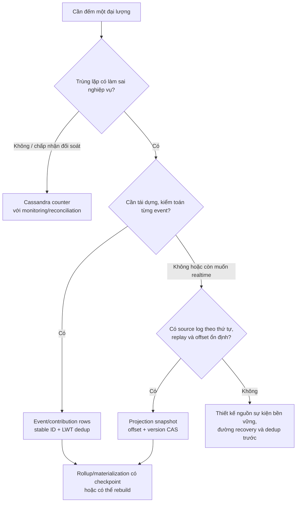
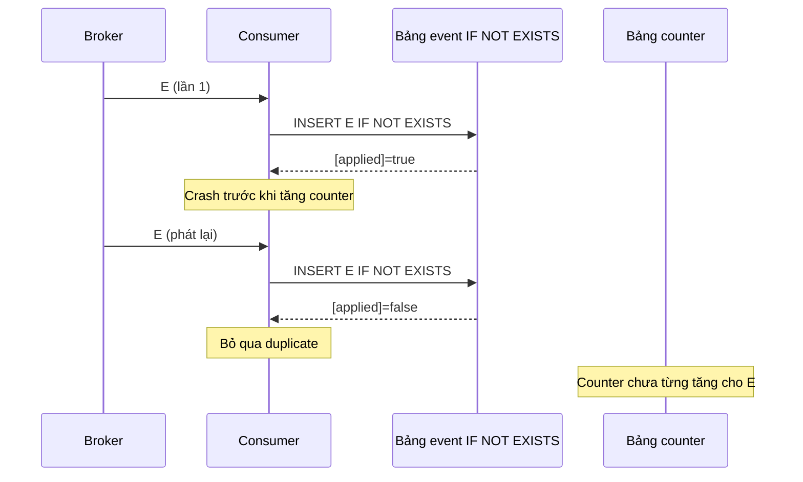

# Chọn mô hình sự kiện để tổng hợp khi cần kiểm soát trùng lặp

## 1. Bài toán: một sự kiện được gửi hai lần, bộ đếm phải tăng mấy lần?

Giả sử một ứng dụng **Spring Boot + Spring Data Cassandra** ghi nhận mỗi lần khách hàng đặt hàng. Màn hình quản trị hiển thị “số đơn hàng thành công trong ngày” của từng tenant.

Hệ thống nhận thông điệp:

```json
{
  "eventId": "22222222-2222-2222-2222-222222222222",
  "tenantId": "11111111-1111-1111-1111-111111111111",
  "metricKey": "orders.completed",
  "occurredAt": "2026-11-25T09:15:00Z",
  "delta": 1
}
```

Consumer cập nhật bộ đếm và gặp **request timeout**. Broker sau đó phát lại cùng thông điệp. Hai câu hỏi rất khác nhau xuất hiện:

- **Bộ đếm Cassandra:** nếu chạy hai lần `SET total = total + 1` thì tổng có thể tăng **2**. Cassandra không tự nhận diện hai lần gọi là cùng một sự kiện nghiệp vụ.
- **Số đơn hàng duy nhất:** nếu hai thông điệp mang cùng `eventId`, ứng dụng có thể chỉ muốn tổng tăng **1**; đây là vấn đề **deduplication và mô hình dữ liệu**, không phải tùy chọn consistency của một câu UPDATE.

Bài học thuộc chương **Bộ đếm** của module `SPRING_DATA_CASSANDRA`, liên hệ entity mapping, repository, `CassandraTemplate`, Java Driver/CQL, partition key, consistency, paging và hiệu năng trong hệ dữ liệu phân tán.

### Mục tiêu

Sau bài này, bạn sẽ:

1. Biết khi nào Cassandra `counter` phù hợp và khi nào nó không thỏa yêu cầu “mỗi sự kiện chỉ tính một lần”.
2. Phân biệt **duplicate message**, **duplicate business event**, **retry** và **concurrent update**.
3. Thiết kế **event ID ổn định**, bảng sự kiện làm nguồn dữ liệu có thể đối soát và điều kiện `IF NOT EXISTS` khi cần.
4. Hiểu vì sao **ghi marker đã xử lý rồi tăng counter** không tự trở thành một transaction.
5. Chọn giữa **counter trực tiếp**, **sự kiện/đóng góp bất biến có thể tính lại**, và **snapshot tổng hợp có checkpoint + CAS**.
6. Viết Java/CQL mẫu cho từng cách, phân tích điểm lỗi khi timeout hoặc process crash.
7. Định nghĩa điều kiện thực tế của “effectively-once” ở **một phép chiếu tổng hợp**, không nhầm với exactly-once end-to-end của mọi hệ thống.
8. Thiết kế kiểm thử trùng lặp, phát lại, thứ tự, đa partition và vận hành tải lớn.

> **Nguyên tắc:** Nếu nghiệp vụ cần đếm **đúng số sự kiện duy nhất**, không chọn kiểu `counter` chỉ vì nó có phép cộng. Hãy chọn **nguồn chân lý**, **khóa chống trùng lặp**, **ranh giới nguyên tử** và **khả năng khôi phục** trước.

## 2. Cassandra counter thực sự làm gì?

Cassandra có kiểu dữ liệu `counter` cho phép cộng/trừ trên một cột theo primary key:

```sql
CREATE KEYSPACE IF NOT EXISTS learning
WITH replication = {
  'class': 'NetworkTopologyStrategy',
  'dc1': 1
};

CREATE TABLE IF NOT EXISTS learning.order_counts_by_tenant_day (
  tenant_id uuid,
  order_day date,
  shard int,
  total counter,
  PRIMARY KEY ((tenant_id, order_day, shard))
);
```

Cấu hình `RF=1` và DC `dc1` chỉ nhằm chạy **lab một node**. Với production, cần replication factor, DC và repair/monitoring phù hợp topology.

Ví dụ tăng bộ đếm:

```sql
UPDATE learning.order_counts_by_tenant_day
SET total = total + 1
WHERE tenant_id = 11111111-1111-1111-1111-111111111111
  AND order_day = '2026-11-25'
  AND shard = 0;

SELECT total
FROM learning.order_counts_by_tenant_day
WHERE tenant_id = 11111111-1111-1111-1111-111111111111
  AND order_day = '2026-11-25'
  AND shard = 0;
```

Muốn giảm, dùng một phép cập nhật counter với delta âm:

```sql
UPDATE learning.order_counts_by_tenant_day
SET total = total - 1
WHERE tenant_id = 11111111-1111-1111-1111-111111111111
  AND order_day = '2026-11-25'
  AND shard = 0;
```

**Counter không phải `bigint` thông thường.** Counter dùng cơ chế xử lý riêng cho phép cộng/trừ phân tán, không phải cột số có thể `INSERT total=15` rồi `UPDATE total=16` tùy ý.

### Các giới hạn quan trọng

| Khả năng | Counter column | Cột `bigint` bình thường |
| --- | --- | --- |
| Tăng/giảm bằng CQL | `total = total + n` | Thông thường phải tính và ghi giá trị mới từ ứng dụng hoặc dùng mô hình khác. |
| Gán giá trị tuyệt đối | **Không** dùng như `SET total = 42` | `SET total = 42` hợp lệ trên cột thường. |
| Đặt TTL trên chính phép tăng | **Không** dùng `USING TTL` cho counter mutation. | Giá trị thường có thể dùng TTL theo CQL. |
| `INSERT IF NOT EXISTS` + điều kiện version | Không dùng cơ chế LWT cho phép tăng counter như ghi thường. | Có thể thiết kế `IF NOT EXISTS` hoặc `IF version = ?`. |
| Trộn với cột thường trong cùng bảng | Ngoài primary key, bảng counter có ràng buộc: không trộn counter và non-counter data columns. | Có thể có nhiều cột thường. |
| Retry cùng statement sau timeout | **Có nguy cơ cộng hai lần.** | Tùy statement và ID, có thể thiết kế lại cho idempotency. |
| Ghi đồng thời nhiều replica | Có cơ chế counter chuyên biệt. | Dữ liệu thường hòa giải theo write timestamp và/hoặc LWT. |

### Tại sao counter hữu ích nhưng không đủ?

Counter rất phù hợp cho **số lần quan sát/tăng được chấp nhận là xấp xỉ theo delivery**, hoặc hệ thống có pipeline kiểm soát retry riêng và chấp nhận sai số/reconciliation.

Nó **không biết `eventId`** trong câu `SET total = total + 1`. Thêm `eventId` vào body của HTTP request không khiến Cassandra counter từ chối lần tăng thứ hai. Nếu client gọi lại nguyên câu UPDATE, đó vẫn là một phép tăng khác về ý nghĩa counter.

**Đổi CL từ `LOCAL_ONE` sang `LOCAL_QUORUM` không tạo deduplication.** CL liên quan số replica xác nhận/đáp ứng, không nhận diện hai message có cùng business ID.

## 3. Bốn loại trùng lặp cần phân biệt

Trong pipeline sự kiện, có nhiều nguồn gây đếm sai:

| Loại | Ví dụ | Cách suy nghĩ đúng |
| --- | --- | --- |
| **Transport redelivery** | Broker giao lại cùng record/offset vì consumer chưa ACK. | Có thể dùng checkpoint dựa trên source partition/offset **nếu xử lý có thứ tự**. |
| **Client retry** | HTTP client gửi lại cùng create request sau timeout. | Dùng idempotency key/biz event ID ổn định và xác nhận trạng thái. |
| **Business duplicate** | Cùng đơn hàng phát hai event `ORDER_COMPLETED` với **ID khác nhau**. | Chọn khóa nghiệp vụ như `orderId + transition`; `eventId` riêng không tự phát hiện. |
| **Concurrent projection** | Hai consumer cùng cập nhật tổng từ trạng thái cũ. | Dùng phân vùng ownership hoặc CAS/version; tránh read-modify-write không điều kiện. |
| **Duplicate ở nhiều bảng** | Ingest thành công vào bảng A, ghi bảng B lỗi rồi job replay. | Không giả định dual-write là transaction; phải có reconciliation/outbox/stream có thể phát lại. |

**Phải định nghĩa “cùng một sự kiện” trước.** Có ít nhất hai cách:

1. **Identity của thông điệp:** `(tenantId, eventId)`; một ID không được tái sử dụng cho nội dung khác.
2. **Identity nghiệp vụ:** `(tenantId, orderId, actionType, version)`, ví dụ một đơn hàng hoàn tất một lần ở trạng thái version 5.

Nếu producer cấp **eventId mới mỗi lần retry**, dedup theo eventId không có hiệu quả. Nếu gộp mọi `ORDER_COMPLETED` cùng orderId dù nghiệp vụ cho phép hoàn tất lại ở version khác, sẽ vô tình bỏ sự kiện hợp lệ.

### Hợp đồng event mẫu

```json
{
  "tenantId": "11111111-1111-1111-1111-111111111111",
  "eventId": "22222222-2222-2222-2222-222222222222",
  "businessKey": "order-123/completed/v5",
  "metricKey": "orders.completed",
  "occurredAt": "2026-11-25T09:15:00Z",
  "delta": 1,
  "schemaVersion": 1
}
```

Hãy cố định ý nghĩa `eventId`, `businessKey`, `delta`, `metricKey` và thời điểm sự kiện ngay từ đầu. Khi retry, các trường xác định event **không được cấp mới tùy ý**.

## 4. Ba mô hình tổng hợp và quyết định sử dụng

| Mô hình | Nguồn chân lý | Chống trùng lặp | Chi phí/đánh đổi | Khi phù hợp |
| --- | --- | --- | --- | --- |
| **A. Counter trực tiếp** | Giá trị `counter` đang được cộng/trừ | Không tự có; retry có thể cộng hai lần. | Ghi đơn giản, nhưng kết quả có thể lệch và khó giải thích từng đóng góp. | Chỉ số chấp nhận sai số, có reconciliation định kỳ hoặc nguồn increment đã được kiểm soát ngoài DB. |
| **B. Lưu đóng góp theo event ID** | **Mỗi event duy nhất = một hàng bất biến** | `IF NOT EXISTS` tại khóa ổn định trong phạm vi dedup. | Tốn lưu trữ/LWT; tổng cần truy vấn/tính lại/rollup, không tự cập nhật một số tổng nguyên tử. | Audit, billing/đếm chính xác theo tập sự kiện, cần rebuild và đối soát. |
| **C. Snapshot tổng hợp + source checkpoint + CAS** | Luồng sự kiện **có thứ tự, có thể replay** và state tổng hợp của từng shard | Chống **redelivery cùng offset** bằng `lastOffset` ghi cùng `total` và điều kiện version. | LWT contention; phụ thuộc nguồn offset ổn định và xử lý đúng thứ tự. | Streaming projection cần cập nhật gần realtime, có durable log/partition và recovery rõ. |

**Mô hình B và C có thể kết hợp**, nhưng không tự động tạo exactly-once khi ghép chúng qua nhiều bảng/hệ thống. Cần xác định một **nguồn chân lý có thể replay** và cơ chế tránh tình huống “đánh dấu đã xử lý nhưng chưa cập nhật tổng”.



## 5. Vấn đề cốt lõi của counter: retry sau timeout

Giả sử:

```text
t0  Consumer nhận event E
t1  UPDATE total = total + 1
t2  Một số replica đã xử lý increment
t3  Client nhận WriteTimeout / mất kết nối
t4  Consumer không ACK E cho broker
t5  Broker phát lại E
t6  Consumer lại UPDATE total = total + 1
```

Có thể xảy ra cả ba trường hợp:

1. Lần đầu **không áp dụng**; lần hai áp dụng ⇒ tổng tăng một lần.
2. Lần đầu **đã áp dụng**, chỉ response bị mất; lần hai áp dụng ⇒ tổng tăng **hai lần**.
3. Cả hai lần đều lỗi/tạm thời chưa chắc chắn ⇒ hệ thống cần đối soát theo nguồn sự kiện.

Từ góc nhìn của client tại `t3`, **timeout là kết quả chưa chắc chắn**, không đồng nghĩa “Cassandra đã rollback” hay “không có replica nào ghi”.

### Đánh dấu idempotent không tự làm increment an toàn

```java
// Sai khi dùng như một cách "chữa" duplicate increment:
counterStatement.setIdempotent(true);
```

`setIdempotent(true)` chỉ khai báo cho Java Driver rằng statement được coi là an toàn để thử lại theo policy. Nó **không** khiến Cassandra nhận diện và bỏ qua phép tăng đã từng áp dụng. Với counter increment, đặt `idempotent(true)` một cách máy móc là nguy hiểm.

### COUNTER BATCH cũng không giải quyết dedup

```sql
BEGIN COUNTER BATCH
  UPDATE learning.order_counts_by_tenant_day
  SET total = total + 1
  WHERE tenant_id = 11111111-1111-1111-1111-111111111111
    AND order_day = '2026-11-25'
    AND shard = 0;
APPLY BATCH;
```

Một counter batch hợp lệ không có nghĩa “mỗi event một lần”. Nếu cùng batch được phát lại sau timeout, mỗi phép increment vẫn có thể được áp dụng thêm lần nữa. Không trộn counter mutations và non-counter mutations trong một batch để giả vờ tạo transaction giữa “marker” và “counter”.

## 6. Java Driver 4.x: viết counter an toàn ở mức nhận biết rủi ro

Dưới đây là một gateway Java minh họa counter **khi nghiệp vụ chấp nhận semantics ở mức delivery và có cơ chế đối soát**:

```java
package com.example.metrics.counter;

import java.time.LocalDate;
import java.time.Duration;
import java.util.UUID;

import com.datastax.oss.driver.api.core.CqlSession;
import com.datastax.oss.driver.api.core.DefaultConsistencyLevel;
import com.datastax.oss.driver.api.core.cql.PreparedStatement;

public final class CounterGateway {

    private final CqlSession session;
    private final PreparedStatement increment;

    public CounterGateway(CqlSession session) {
        this.session = session;
        this.increment = session.prepare(
            "UPDATE learning.order_counts_by_tenant_day " +
            "SET total = total + ? " +
            "WHERE tenant_id = ? AND order_day = ? AND shard = ?"
        );
    }

    public void add(
            UUID tenantId, LocalDate day, int shard, long delta) {

        if (tenantId == null || day == null || shard < 0
                || delta == 0L) {
            throw new IllegalArgumentException(
                "Partition key va delta phai hop le"
            );
        }

        session.execute(
            increment.bind(delta, tenantId, day, shard)
                .setConsistencyLevel(
                    DefaultConsistencyLevel.LOCAL_QUORUM)
                .setTimeout(Duration.ofSeconds(3))
                .setIdempotent(false)
        );
    }
}
```

Lưu ý:

- `?` đầu tiên là giá trị `delta` kiểu CQL tương ứng với counter; primary key nằm sau.
- `setIdempotent(false)` giúp truyền ý định đúng tới driver policy, **không** cấm toàn bộ khả năng resend ở mọi tầng HTTP/broker. Ứng dụng phải quản lý retry ngoài driver.
- `LOCAL_QUORUM` là policy minh họa. RF=1 ở lab vẫn chỉ có một replica trong local DC.
- Câu update không có `eventId`, vì bảng counter không tự ghi một tập event đã xử lý. Nếu bạn cần chống trùng lặp nghiêm ngặt, chọn mô hình B hoặc C.
- Đừng dùng `repository.save()` với một entity có `counter` như thể `total` là số `bigint` có thể đặt bằng giá trị tuyệt đối.

**Kiểm thử câu hỏi quan trọng nhất:** Nếu gateway báo timeout nhưng operation đã applied, gọi lại có làm tăng thêm không? Với counter, câu trả lời có thể là **có**.

## 7. Mô hình sự kiện: một event ID ổn định là nguồn chân lý

Khi kiểm soát duplicate là yêu cầu bắt buộc, bước đầu thường là lưu **thông tin bất biến của sự kiện** với một định danh đủ mạnh.

### 7.1. Khóa dedup phải định nghĩa đúng phạm vi

Nếu business cho phép event ID duy nhất **trong mỗi tenant**, bảng tra theo ID có thể dùng:

```sql
CREATE TABLE IF NOT EXISTS learning.event_by_tenant_id (
    tenant_id uuid,
    event_id uuid,
    business_key text,
    metric_key text,
    occurred_at timestamp,
    event_day date,
    delta int,
    payload_hash text,
    PRIMARY KEY ((tenant_id, event_id))
);
```

Hai thành phần `(tenant_id,event_id)` tạo một composite partition key. Bảng này phục vụ truy vấn **biết chính xác ID của event**, không phải quét tất cả event theo ngày.

Lợi ích của khóa theo ID:

- Hai lần nhận **cùng tenant/event ID** nhắm tới **cùng hàng**.
- Có thể tìm event theo ID để phân biệt duplicate hợp lệ với xung đột payload.
- Không để hai message cùng ID nhưng khác `occurred_at` hoặc ngày bucket tự động trở thành hai khóa khác nhau.

**Điểm đánh đổi:** Bảng tra theo ID không trực tiếp hỗ trợ query “mọi event của tenant trong ngày” một cách hiệu quả. Cassandra thiết kế **theo query pattern**, nên khi cần timeline/aggregation theo ngày phải có cách chiếu/phân bucket riêng, với cơ chế đồng bộ và recovery được thiết kế rõ ràng.

### 7.2. Ghi có điều kiện IF NOT EXISTS

```sql
INSERT INTO learning.event_by_tenant_id (
    tenant_id, event_id, business_key,
    metric_key, occurred_at, event_day, delta, payload_hash
) VALUES (
    11111111-1111-1111-1111-111111111111,
    22222222-2222-2222-2222-222222222222,
    'order-123/completed/v5',
    'orders.completed',
    '2026-11-25T09:15:00Z',
    '2026-11-25',
    1,
    'sha256:example-canonical-hash'
) IF NOT EXISTS;
```

Đây là một **lightweight transaction (LWT)**. Kết quả CQL có thông tin `[applied]`:

- `true`: hàng chưa tồn tại tại thời điểm điều kiện được phối hợp và statement đã được áp dụng theo kết quả thành công.
- `false`: khóa đã tồn tại, vì thế **không chèn hàng mới**.
- Timeout/lỗi kết nối: **chưa xác định chắc chắn** mutation đã applied hay chưa từ lỗi ấy.

`[applied]=false` **chưa đủ** để kết luận đó là duplicate hợp lệ. Nếu cùng `eventId` nhưng `businessKey`, `delta` hoặc nội dung canonical khác, ứng dụng phải báo **ID collision/payload conflict**, không gộp hai sự kiện khác nhau.

### 7.3. Tạo payload_hash đúng cách

Hash nên tính từ **một biểu diễn canonical** của những trường quyết định identity và nội dung bất biến:

```text
canonical content:
tenantId | eventId | businessKey | metricKey |
occurredAt canonical UTC millis | delta | schemaVersion

payloadHash = SHA-256(canonical UTF-8 bytes)
```

Không hash ngẫu nhiên thứ tự trường JSON, whitespace hay chuỗi thời gian khác zone nếu các biểu diễn đó có thể khác nhau giữa lần retry. Với trường số, xác định kiểu/scale, và phân biệt null/missing.

Hash là công cụ **so sánh tính toàn vẹn**, không phải thay thế xác thực, phân quyền hoặc bảo vệ khỏi kẻ tấn công biết cách tạo nội dung mới. Khi event chứa PII, tránh log cả payload hoặc lưu thông tin ngoài chính sách retention.

## 8. Spring Data Cassandra: entity/repository đọc theo event ID

Sử dụng bảng `event_by_tenant_id` ở phần trên.

### 8.1. Entity có composite partition key

```java
package com.example.metrics.event;

import java.time.Instant;
import java.time.LocalDate;
import java.util.UUID;

import org.springframework.data.cassandra.core.mapping.Column;
import org.springframework.data.cassandra.core.mapping.PrimaryKeyColumn;
import org.springframework.data.cassandra.core.mapping.PrimaryKeyType;
import org.springframework.data.cassandra.core.mapping.Table;

@Table("event_by_tenant_id")
public class EventRecord {

    @PrimaryKeyColumn(
        name = "tenant_id", ordinal = 0,
        type = PrimaryKeyType.PARTITIONED)
    private UUID tenantId;

    @PrimaryKeyColumn(
        name = "event_id", ordinal = 1,
        type = PrimaryKeyType.PARTITIONED)
    private UUID eventId;

    @Column("business_key")
    private String businessKey;

    @Column("metric_key")
    private String metricKey;

    @Column("occurred_at")
    private Instant occurredAt;

    @Column("event_day")
    private LocalDate eventDay;

    private Integer delta;

    @Column("payload_hash")
    private String payloadHash;

    protected EventRecord() {
    }

    public UUID getTenantId() { return tenantId; }
    public UUID getEventId() { return eventId; }
    public String getBusinessKey() { return businessKey; }
    public String getMetricKey() { return metricKey; }
    public Instant getOccurredAt() { return occurredAt; }
    public LocalDate getEventDay() { return eventDay; }
    public Integer getDelta() { return delta; }
    public String getPayloadHash() { return payloadHash; }

    // Bổ sung factory/constructor, validation và immutable update policy.
}
```

### 8.2. Repository tra theo đầy đủ khóa

```java
package com.example.metrics.event;

import java.util.Optional;
import java.util.UUID;

import org.springframework.data.cassandra.core.mapping.MapId;
import org.springframework.data.cassandra.repository.CassandraRepository;
import org.springframework.data.cassandra.repository.Query;

public interface EventRecordRepository
        extends CassandraRepository<EventRecord, MapId> {

    @Query(
        "SELECT tenant_id, event_id, business_key, metric_key, " +
        "occurred_at, event_day, delta, payload_hash " +
        "FROM event_by_tenant_id " +
        "WHERE tenant_id = ?0 AND event_id = ?1"
    )
    Optional<EventRecord> findEvent(
        UUID tenantId, UUID eventId
    );
}
```

`MapId` là cách biểu diễn ID tổng hợp theo metadata Spring Data cho entity khai báo các primary key columns trực tiếp. Trong hệ thống thực tế có thể dùng `@PrimaryKeyClass` với ID type riêng.

**Cảnh báo quan trọng:** `repository.save(event)` thông thường không tự có semantics `INSERT ... IF NOT EXISTS` chỉ vì entity có primary key. Để chống duplicate có **điều kiện tạo mới**, hãy dùng API conditional insert có hợp đồng rõ, hoặc prepared CQL LWT và kiểm tra `[applied]`.

### 8.3. Java Driver kiểm soát kết quả dedup

`EventCommand` là DTO bất biến chứa thông tin dùng để đăng ký sự kiện:

```java
package com.example.metrics.event;

import java.time.Instant;
import java.time.LocalDate;
import java.util.UUID;

public record EventCommand(
    UUID tenantId,
    UUID eventId,
    String businessKey,
    String metricKey,
    Instant occurredAt,
    LocalDate eventDay,
    int delta,
    String payloadHash
) {
}
```

`eventDay` và `payloadHash` phải được chuẩn hóa nhất quán ở biên ingest; một lần retry không được tự đổi các trường bất biến của cùng `eventId`.

```java
package com.example.metrics.event;

import java.util.UUID;

import com.datastax.oss.driver.api.core.CqlSession;
import com.datastax.oss.driver.api.core.DefaultConsistencyLevel;
import com.datastax.oss.driver.api.core.cql.PreparedStatement;
import com.datastax.oss.driver.api.core.cql.Row;

public final class EventRegistrationGateway {

    private final CqlSession session;
    private final PreparedStatement createIfAbsent;

    public EventRegistrationGateway(CqlSession session) {
        this.session = session;
        this.createIfAbsent = session.prepare(
            "INSERT INTO learning.event_by_tenant_id " +
            "(tenant_id, event_id, business_key, metric_key, " +
            "occurred_at, event_day, delta, payload_hash) " +
            "VALUES (?, ?, ?, ?, ?, ?, ?, ?) IF NOT EXISTS"
        );
    }

    public boolean createIfAbsent(EventCommand event) {
        Row result = session.execute(
            createIfAbsent.bind(
                event.tenantId(), event.eventId(),
                event.businessKey(), event.metricKey(),
                event.occurredAt(), event.eventDay(),
                event.delta(), event.payloadHash()
            )
            .setConsistencyLevel(
                DefaultConsistencyLevel.LOCAL_QUORUM)
            .setSerialConsistencyLevel(
                DefaultConsistencyLevel.LOCAL_SERIAL)
        ).one();

        if (result == null) {
            throw new IllegalStateException(
                "Khong nhan duoc ket qua LWT"
            );
        }

        return result.getBoolean("[applied]");
    }
}
```

Đoạn code dùng record `EventCommand` bên trên. Khi đưa vào dự án, bổ sung validation cho các trường bắt buộc, chuẩn hóa `eventDay` và `payloadHash`, xác thực quyền ghi tenant, xử lý LWT timeout và kiểm soát retry. Gateway chỉ minh họa **ghi event duy nhất**, chưa thực hiện tăng metric.

Khi `false`, đọc lại `EventRecord` theo khóa và so sánh `payloadHash`/business identity. **Không tự động bỏ qua mọi `false` như duplicate hợp lệ.**

## 9. Bẫy lớn: tạo marker IF NOT EXISTS rồi tăng counter

Một đoạn mã trông có vẻ hợp lý nhưng **không bảo đảm “một event tính đúng một lần”**:

```java
// ANTI-PATTERN nếu cần bảo đảm tổng chính xác:
if (eventGateway.createIfAbsent(event)) {
    counterGateway.add(
        event.tenantId(), event.eventDay(), 0, event.delta());
}
```

Điểm lỗi:



Nếu đảo thứ tự thành **tăng counter trước rồi ghi marker**, crash ở giữa gây nguy cơ **tăng hai lần** sau replay. Không có cách đổi thứ tự hai statement riêng trên hai partition/bảng để tự tạo all-or-nothing.

**LOGGED BATCH không phải transaction SQL nhiều partition**, và counter mutations không được trộn với non-counter mutations trong một batch. Không dùng `BEGIN BATCH` như lời giải giản lược để bảo đảm dedup + counter.

### Kết luận từ failure window

Muốn đảm bảo tổng cuối đúng, cần ít nhất một trong những hướng sau:

- Lưu **các đóng góp duy nhất làm nguồn chân lý**, rồi tính/rebuild rollup từ chúng.
- Có **luồng sự kiện bền vững có thể replay**, và ghi **tổng + checkpoint** theo một phép CAS trên cùng hàng/partition.
- Dùng một nền tảng stream/transaction có hợp đồng xử lý exactly-once phù hợp, rồi kiểm tra cả ranh giới đổ dữ liệu vào Cassandra.
- Thiết kế một ranh giới nguyên tử đặc thù với sự kiện-marker và state nếu Cassandra hỗ trợ đúng mô hình, nhưng phải chứng minh qua CQL/integration test; không giả định mọi bảng/partition có thể điều kiện hóa trong một transaction.

## 10. Mô hình B: mỗi đóng góp có event ID, tổng có thể tính lại

Nếu yêu cầu quan trọng nhất là **không đếm trùng khi tổng hợp**, thay vì cập nhật một con số tại thời điểm ingest, lưu **một hàng đại diện cho từng đóng góp được chấp nhận**.

### 10.1. Schema phục vụ đọc theo metric và bucket

```sql
CREATE TABLE IF NOT EXISTS learning.metric_contributions_by_day (
    tenant_id uuid,
    metric_key text,
    event_day date,
    shard int,
    event_id uuid,
    occurred_at timestamp,
    delta int,
    PRIMARY KEY (
      (tenant_id, metric_key, event_day, shard),
      event_id
    )
);
```

Schema được thiết kế theo query “lấy các đóng góp của một metric trong một ngày/shard”, với:

- Composite partition key `(tenant_id, metric_key, event_day, shard)`.
- Clustering key `event_id` đảm bảo **một hàng trong shard cho một ID**.
- `delta` là đóng góp +1/-1 hoặc một lượng định nghĩa bởi nghiệp vụ.
- `occurred_at` là cột thông tin, không tạo thứ tự quét theo thời gian ở schema này.

**Giới hạn phạm vi dedup:** khóa này chỉ chống duplicate khi event luôn đi đến **cùng metric/day/shard**. Nếu cùng `eventId` có thể tới bucket/shard khác do retry, hệ thống có thể lưu hai hàng. Cần canonical routing ổn định hoặc một registry duy nhất `(tenant_id,event_id)` ở đầu vào, với quy trình recovery phù hợp.

### 10.2. Shard phải được tính xác định

```java
// Ý tưởng phân phối, không dùng hashCode() ngẫu nhiên theo process.
int shard = Math.floorMod(stableHash(eventId), shardCount);
```

`stableHash` phải là thuật toán hash **được định nghĩa rõ và ổn định giữa mọi instance/ngôn ngữ/version**; `shardCount` là một phần của phiên bản mô hình dữ liệu. Nếu đổi shard count giữa các lần replay của cùng event, ID có thể chuyển sang partition khác.

Một cách đơn giản là lấy byte của UUID và dùng thuật toán băm cố định có test vectors. Không dựa vào cache, node hiện tại hay round-robin để chọn shard cho một event cần dedup.

### 10.3. Ghi một đóng góp có điều kiện

```sql
INSERT INTO learning.metric_contributions_by_day (
    tenant_id, metric_key, event_day, shard,
    event_id, occurred_at, delta
) VALUES (
    11111111-1111-1111-1111-111111111111,
    'orders.completed',
    '2026-11-25',
    2,
    22222222-2222-2222-2222-222222222222,
    '2026-11-25T09:15:00Z',
    1
) IF NOT EXISTS;
```

Nếu `[applied]=true`, có một đóng góp mới. Nếu `false`, **không tăng một con số**; tra hàng đã có và xác nhận đây là cùng event.

Cần cân nhắc chi phí **LWT cho mỗi event**; đây là đánh đổi để có một tập sự kiện duy nhất trực tiếp trong Cassandra.

### 10.4. Tổng được định nghĩa từ tập đóng góp, không từ số lượt gọi

```text
Tổng(metric, ngày) = SUM(delta) của
  các hàng đóng góp hợp lệ, duy nhất,
  trong các shards thuộc metric/ngày.
```

Nếu đóng góp là sự kiện tuyệt đối có `delta=1`, tổng là số hàng đóng góp hợp lệ. Nếu có event hủy/bù trừ, `delta=-1` có thể đại diện nghiệp vụ, nhưng phải tránh ghi hai phiên bản trái nhau cho cùng ID và có quy tắc hủy/đảo sự kiện.

**Không dùng `SELECT COUNT(*)` trên một partition khổng lồ cho mỗi request HTTP** để thay counter: trên Cassandra, đếm nhiều hàng có thể cần quét/đọc rất lớn. Hãy thiết kế **rollup bất đồng bộ, rebuild theo bucket**, hoặc caching có thời hạn đi cùng cam kết độ trễ cập nhật.

### 10.5. Nếu cần query sự kiện theo thời gian

Bảng dùng `event_id` làm clustering key sẽ không tối ưu cho range `occurred_at`. Khi API cần timeline, có thể tạo bảng phụ:

```sql
CREATE TABLE IF NOT EXISTS learning.events_by_tenant_day (
    tenant_id uuid,
    event_day date,
    occurred_at timestamp,
    event_id uuid,
    metric_key text,
    delta int,
    PRIMARY KEY ((tenant_id, event_day), occurred_at, event_id)
) WITH CLUSTERING ORDER BY (
    occurred_at DESC,
    event_id ASC
);
```

Đây là **read model khác**. Khi ghi cả hai bảng, phải có cơ chế phát lại/đối soát nếu một đường ghi thất bại; Cassandra không tự bảo đảm atomicity/isolation xuyên mọi partition.

## 11. Tại sao một bảng event vẫn chưa tự cho ra aggregate realtime đúng?

Giả sử `metric_contributions_by_day` đã chống duplicate thành công. Ứng dụng muốn cập nhật bảng:

```sql
CREATE TABLE IF NOT EXISTS learning.metric_totals_by_day (
    tenant_id uuid,
    metric_key text,
    event_day date,
    shard int,
    total bigint,
    PRIMARY KEY ((tenant_id, metric_key, event_day, shard))
);
```

Một phép đọc rồi ghi:

```text
oldTotal = SELECT total
newTotal = oldTotal + delta
UPDATE total = newTotal
```

vẫn có thể **mất cập nhật khi hai worker chạy đồng thời**:

```text
A đọc total = 10
B đọc total = 10
A ghi total = 11
B ghi total = 11
=> Thực tế hai event mới, tổng vẫn 11 thay vì 12
```

Nếu dùng counter thay `bigint`, vấn đề lost update kiểu đọc-ghi được giảm nhưng **rủi ro double increment sau retry** lại xuất hiện. Nếu dùng `IF version = ?` để CAS số tổng mà không lưu thông tin đã xử lý, replay một event có thể tăng thêm lần nữa.

Vì vậy cần **cả hai lớp vấn đề**:

1. **Định danh/khử trùng lặp đóng góp**.
2. **Cập nhật tổng hợp và checkpoint theo cách recoverable**.

Một bảng đóng góp bất biến cho phép **rebuild tổng đúng** theo tập hàng hợp lệ; đây có thể là hợp đồng đủ tốt cho báo cáo cuối ngày. Nếu muốn tổng realtime với độ trễ thấp, cần thiết kế pipeline có thể kiểm tra và phát lại.

## 12. Mô hình C: tổng hợp theo offset có checkpoint và CAS

Một lựa chọn khi đã có **durable ordered event log** (ví dụ một broker có partition/offset ổn định) là lưu **giá trị tổng và offset cuối cùng đã áp dụng trong cùng hàng Cassandra**, rồi cập nhật cả hai bằng LWT/CAS.

### 12.1. Điều kiện tiên quyết rất quan trọng

Mô hình này có thể chống **redelivery của cùng một record/offset**, nếu:

1. Mỗi record có cặp `(sourcePartition, sourceOffset)` ổn định sau replay.
2. Các record của **cùng source partition** được xử lý **đúng thứ tự**; không xử lý offset 105 trước 104 rồi coi 104 đã xong.
3. State lưu `lastOffset` tương ứng **chính xác một nguồn/partition** có thứ tự ấy.
4. Mỗi event có semantics bất biến (`delta`, `metricKey`, bucket...).
5. Các bản ghi được xử lý lại cho một aggregation shard sử dụng đúng cùng khóa state.
6. Nếu business producer có thể phát **cùng eventId ở hai offsets khác nhau**, checkpoint offset **không tự dedup eventId**. Cần tầng chống trùng lặp business trước hoặc nguồn sự kiện canonical được cam kết.
7. Có chính sách khi đổi số partition, resharding, schema và source retention.

**Không nhầm “một offset chỉ áp dụng một lần” với “một business event ID chỉ áp dụng một lần”.** Hai lời hứa này khác nhau.

### 12.2. Schema cho một snapshot theo source partition

```sql
CREATE TABLE IF NOT EXISTS learning.metric_progress_by_day_source (
    tenant_id uuid,
    metric_key text,
    event_day date,
    source_partition int,
    applied_total bigint,
    last_offset bigint,
    version bigint,
    PRIMARY KEY (
        (tenant_id, metric_key, event_day, source_partition)
    )
);
```

Ở đây `applied_total` là **`bigint` thường**, không phải Cassandra `counter`. Lý do: cần ghi **giá trị tuyệt đối mới** cùng checkpoint và version trong một conditional mutation.

Mỗi `source_partition` có một state riêng. Hệ thống tổng hợp metric/ngày có thể lấy các state shard hợp lệ rồi cộng lại ở tầng service (với số shard hữu hạn), hoặc tạo rollup cao hơn với cơ chế idempotency riêng.

### 12.3. Khởi tạo state một lần bằng LWT

```sql
INSERT INTO learning.metric_progress_by_day_source (
    tenant_id, metric_key, event_day, source_partition,
    applied_total, last_offset, version
) VALUES (
    11111111-1111-1111-1111-111111111111,
    'orders.completed', '2026-11-25', 3,
    0, -1, 0
) IF NOT EXISTS;
```

`last_offset=-1` chỉ là giá trị khởi tạo; offset thực của log có thể bắt đầu từ giá trị khác. Không dựa trên giá trị âm nếu nguồn có quy tắc offset khác. Nếu khởi tạo bị timeout, kiểm tra lại state; đừng ghi đè bằng `INSERT` không điều kiện.

### 12.4. Tính tổng mới và ghi cùng offset bằng CAS

Giả sử state hiện tại:

```text
applied_total = 41
last_offset   = 120
version       = 9
```

Consumer nhận record cùng source partition ở offset 121, `delta=1`:

```sql
UPDATE learning.metric_progress_by_day_source
SET applied_total = 42,
    last_offset = 121,
    version = 10
WHERE tenant_id = 11111111-1111-1111-1111-111111111111
  AND metric_key = 'orders.completed'
  AND event_day = '2026-11-25'
  AND source_partition = 3
IF version = 9;
```

Nếu `[applied]=true`, cả `applied_total`, `last_offset` và `version` của hàng được ghi **theo cùng conditional mutation**.

Nếu consumer crash **sau CAS nhưng trước khi ACK broker**, record 121 có thể được phát lại. Khi đọc state thấy `last_offset >= 121`, consumer nhận biết **đã áp dụng offset đó** và không cộng lại.

Nếu consumer crash **trước CAS**, state vẫn có offset 120; record 121 được replay và thử lại.

Nếu CAS trả `false` vì worker khác đã tăng version, consumer phải **đọc lại state** và quyết định theo lastOffset. Không tự lấy total 41 cộng một lần nữa rồi retry mù.

### 12.5. Điều kiện xử lý thứ tự

Nếu các offset 121, 122, 123 thuộc cùng source partition nhưng nhận/áp dụng không đúng thứ tự, việc ghi `last_offset=123` trước 121 và 122 có thể khiến hệ thống **bỏ sót** hai event trước.

Vì vậy, worker cần đảm bảo:

- Trong mỗi source partition, xử lý **tuần tự** hoặc có protocol reorder/commit watermark đúng.
- Không ACK/advance checkpoint vượt qua một event chưa áp dụng.
- Khi shard/partition ownership thay đổi, worker mới đọc state/cursor trước khi bắt đầu xử lý.
- Không dùng một offset của source partition A để so với offset của partition B.
- Khi một source record được chiếu tới nhiều metric, mỗi projection state có checkpoint/khả năng resume riêng.

Một consumer có thể xử lý **nhiều source partitions song song** để tăng throughput, miễn là giữ thứ tự cần thiết trong từng partition.

## 13. Java Driver: conditional update tổng và checkpoint

### 13.1. DTO có offset nguồn

```java
package com.example.metrics.projection;

import java.time.LocalDate;
import java.util.UUID;

public record MetricEvent(
    UUID tenantId,
    String metricKey,
    LocalDate eventDay,
    int sourcePartition,
    long sourceOffset,
    UUID eventId,
    long delta
) {
}
```

`eventId` được giữ trong event để audit/đối soát, nhưng **điều kiện replay ở ví dụ này dựa trên source offset**, không tự so sánh ID. Nếu một event ID xuất hiện ở hai offset khác nhau, service phải có chính sách dedup business riêng.

### 13.2. Gateway với CAS và retry có giới hạn

```java
package com.example.metrics.projection;

import java.time.Duration;
import java.util.Objects;

import com.datastax.oss.driver.api.core.CqlSession;
import com.datastax.oss.driver.api.core.DefaultConsistencyLevel;
import com.datastax.oss.driver.api.core.cql.PreparedStatement;
import com.datastax.oss.driver.api.core.cql.Row;

public final class MetricProjectionGateway {

    private final CqlSession session;
    private final PreparedStatement init;
    private final PreparedStatement read;
    private final PreparedStatement cas;

    public MetricProjectionGateway(CqlSession session) {
        this.session = session;

        this.init = session.prepare(
            "INSERT INTO learning.metric_progress_by_day_source " +
            "(tenant_id, metric_key, event_day, source_partition, " +
            "applied_total, last_offset, version) " +
            "VALUES (?, ?, ?, ?, 0, -1, 0) IF NOT EXISTS"
        );

        this.read = session.prepare(
            "SELECT applied_total, last_offset, version " +
            "FROM learning.metric_progress_by_day_source " +
            "WHERE tenant_id = ? AND metric_key = ? " +
            "AND event_day = ? AND source_partition = ?"
        );

        this.cas = session.prepare(
            "UPDATE learning.metric_progress_by_day_source " +
            "SET applied_total = ?, last_offset = ?, version = ? " +
            "WHERE tenant_id = ? AND metric_key = ? " +
            "AND event_day = ? AND source_partition = ? " +
            "IF version = ?"
        );
    }

    public boolean apply(MetricEvent event) {
        Objects.requireNonNull(event, "event");
        if (event.tenantId() == null
                || event.metricKey() == null
                || event.metricKey().isBlank()
                || event.eventDay() == null
                || event.eventId() == null
                || event.sourcePartition() < 0
                || event.sourceOffset() < 0) {
            throw new IllegalArgumentException("Event khong hop le");
        }

        // Idempotent create-if-absent cho state.
        session.execute(
            init.bind(
                event.tenantId(), event.metricKey(),
                event.eventDay(), event.sourcePartition()
            )
            .setConsistencyLevel(DefaultConsistencyLevel.LOCAL_QUORUM)
            .setSerialConsistencyLevel(DefaultConsistencyLevel.LOCAL_SERIAL)
            .setTimeout(Duration.ofSeconds(3))
        );

        for (int attempt = 0; attempt < 4; attempt++) {
            Row current = session.execute(
                read.bind(
                    event.tenantId(), event.metricKey(),
                    event.eventDay(), event.sourcePartition()
                )
                .setConsistencyLevel(DefaultConsistencyLevel.LOCAL_QUORUM)
            ).one();

            if (current == null) {
                throw new IllegalStateException(
                    "State chua san sang sau khoi tao"
                );
            }

            long lastOffset = current.getLong("last_offset");
            if (event.sourceOffset() <= lastOffset) {
                // Da xu ly offset nay; yeu cau xu ly dung thu tu.
                return false;
            }

            long nextTotal = Math.addExact(
                current.getLong("applied_total"), event.delta()
            );
            long nextVersion = Math.addExact(
                current.getLong("version"), 1L
            );

            Row applied = session.execute(
                cas.bind(
                    nextTotal, event.sourceOffset(), nextVersion,
                    event.tenantId(), event.metricKey(),
                    event.eventDay(), event.sourcePartition(),
                    current.getLong("version")
                )
                .setConsistencyLevel(DefaultConsistencyLevel.LOCAL_QUORUM)
                .setSerialConsistencyLevel(
                    DefaultConsistencyLevel.LOCAL_SERIAL)
                .setTimeout(Duration.ofSeconds(3))
            ).one();

            if (applied != null
                    && applied.getBoolean("[applied]")) {
                return true;
            }

            // CAS conflict: doc lai, dung offset de tranh cong lan nua.
        }

        throw new IllegalStateException(
            "Qua nhieu xung dot CAS; can backoff/retry co gioi han"
        );
    }
}
```

**Phạm vi chính xác của ví dụ:**

- Nó là **mẫu cơ chế projection**, không phải giải pháp exactly-once toàn hệ thống.
- Nó giả định **xử lý source partition theo thứ tự** và event mapping tới state ổn định.
- Nó **chống replay cùng offset**; không chống cùng `eventId` xuất hiện ở offset khác.
- `init` theo LWT ở mỗi lần gọi khá đắt. Production nên **khởi tạo state theo bucket/shard** hoặc cache thông tin đã khởi tạo có thể đối soát, thay vì bắt đầu mọi event bằng một Paxos round riêng.
- Sau CAS conflict, code đọc lại state nhưng không thực hiện backoff; production cần backoff/jitter, giới hạn tổng deadline và metrics.
- **Timeout LWT có thể là unknown outcome**: nếu `session.execute(...)` ném timeout, code không tự kết luận mutation đã thất bại. Caller cần recovery/readback/replay theo offset. Không nuốt exception rồi tăng thêm một cách mù quáng.
- Giới hạn `4` lần thử là ví dụ; nếu một hàng quá hot, phải shard/đổi mô hình, không chỉ tăng số lần.
- `Math.addExact` giúp báo overflow trong `bigint`; vẫn phải validate `delta` theo luật nghiệp vụ.
- Nếu cluster multi-DC, cần xem xét `LOCAL_SERIAL`/`SERIAL` và read/write CL phù hợp khả năng giao nhau/semantics cần thiết.

### 13.3. Không tự commit nguồn trước khi CAS thành công

Một chu trình đúng về thứ tự ý tưởng:

```text
receive record(offset)
  -> map metric/bucket/shard
  -> apply CAS(total, last_offset)
  -> nếu thành công hoặc offset đã applied: mới advance nguồn
  -> nếu timeout chưa rõ: readback/replay theo cơ chế nguồn
```

Nếu broker ACK/commit offset **trước** khi state Cassandra được cập nhật, process crash có thể làm mất event khỏi phép tổng hợp.

Khi broker và Cassandra là hai hệ khác nhau, **không có một transaction chung tự động**. Giá trị `last_offset` trong Cassandra giúp khôi phục sau redelivery, nhưng vẫn phải thiết kế retention/rebalance, quyền sở hữu partition và khả năng replay của broker.

## 14. Giới hạn của offset CAS: duplicate eventId ở offset khác

Giả sử producer gửi:

```text
offset 100 -> eventId X, delta +1
offset 101 -> eventId X, delta +1  (business duplicate)
```

Gateway phần 13 nhìn thấy **hai offset mới**, nên có thể cộng **hai lần**. CAS đang bảo vệ phép chiếu trước **giao lại một source record**, không trước business duplicate đã tồn tại **hai record khác nhau trong log**.

Muốn đảm bảo mỗi `eventId` chỉ góp một lần, cần bổ sung **một cách dedup có thể khôi phục**:

1. **Nguồn đầu vào chuẩn hóa:** producer/ingest tạo một log canonical trong đó một business event chỉ phát một lần, với cơ chế dedup bền vững và kiểm thử recovery.
2. **Đóng góp bất biến theo ID:** lưu mỗi event vào một hàng có khóa ổn định và conditional insert, sau đó rollup từ **tập đóng góp** theo kỳ/hợp đồng rõ ràng.
3. **Xử lý stream có state dedup bền vững:** state store/changelog với chính sách giao dịch phù hợp, rồi đổ sang Cassandra qua projection idempotent.
4. **Một ranh giới nguyên tử đủ hẹp:** nếu chọn mô hình gộp marker+aggregate trong cùng partition bằng conditional operations, phải kiểm chứng tính hợp lệ CQL, thông lượng, kích thước partition và recovery thực tế.

**Không được kết hợp tùy tiện `INSERT event IF NOT EXISTS` rồi `apply offset CAS` như một transaction duy nhất.** Nếu process crash sau insert event nhưng trước CAS, lần replay thấy event đã tồn tại mà nhánh code bỏ qua sẽ làm mất một đóng góp.

### Cách phát biểu cam kết phù hợp

Thay vì hứa “exactly once cho toàn hệ thống”, hãy ghi:

> “Projection tránh cộng lại cùng source offset khi record được replay, với điều kiện source partition xử lý có thứ tự, checkpoint CAS được lưu bền vững và record vẫn có thể replay; việc loại bỏ duplicate business event ID giữa các offset được bảo đảm bởi tầng dedup riêng.”

Đó là một **hợp đồng kiểm chứng được** và không che giấu những ranh giới còn cần giải quyết.

## 15. Tính tổng từ nhiều shard mà không phải scan toàn cluster

Cả counter trực tiếp và progress snapshot có thể được **shard** để giảm hot partition.

### 15.1. Nguồn counter

Ví dụ metric một ngày có 4 shard `0,1,2,3`. Service đọc bốn partition đã biết:

```sql
SELECT total
FROM learning.order_counts_by_tenant_day
WHERE tenant_id = 11111111-1111-1111-1111-111111111111
  AND order_day = '2026-11-25'
  AND shard = 0;
```

Lặp với `shard = 1, 2, 3` và cộng tại service. Đừng giả định Cassandra cung cấp `ORDER BY` hoặc `SUM` hiệu quả trên **mọi partition tùy ý** mà không có mô hình truy vấn phù hợp.

### 15.2. Progress snapshot

Tương tự, với bảng `metric_progress_by_day_source`, truy vấn theo **đầy đủ partition key**:

```sql
SELECT applied_total, last_offset, version
FROM learning.metric_progress_by_day_source
WHERE tenant_id = 11111111-1111-1111-1111-111111111111
  AND metric_key = 'orders.completed'
  AND event_day = '2026-11-25'
  AND source_partition = 3;
```

Tổng cuối là phép cộng của những source partitions thuộc metric/day đó theo **danh sách source partitions hợp lệ đã biết**. Nếu một shard chưa cập nhật hoặc không truy cập được, API phải có chính sách **partial/lagging result**, không trả kết quả thiếu mà khẳng định chính xác 100%.

### 15.3. Thêm shard làm tăng chi phí đọc

| Số shard | Mặt tích cực | Mặt hạn chế |
| --- | --- | --- |
| 1 | Đọc tổng nhanh; ít request. | Hot partition, nhiều writer tranh cùng state/CAS. |
| 4 | Chia tải ghi và contention. | Cần đọc/cộng nhiều partition. |
| 32 hoặc hơn | Có thể giảm nóng mỗi shard. | Fanout đọc, overhead và complexity tăng; quản lý shard count version. |

Chọn shard count theo **traffic thực tế**, không phải số cố định trong bài. Nếu thay số shard ở giữa ngày, phải định nghĩa cách đọc cả shard scheme cũ và mới hoặc migration có reconciliation.

## 16. Consistency, LWT và giới hạn “đúng sau khi ghi”

### 16.1. RF và CL không tự sửa double count

Trong một DC RF=3:

- `LOCAL_ONE` thường cần một phản hồi replica.
- `LOCAL_QUORUM` thường cần hai phản hồi.
- LWT còn có **serial consistency** cho pha đồng thuận.

Việc chọn `LOCAL_QUORUM` có thể hữu ích để suy luận trạng thái đọc/ghi theo quorum trong điều kiện thích hợp, nhưng:

- Không biết event ID nào đã được đếm trong một counter.
- Không khiến retry counter increment trở thành idempotent.
- Không biến dual-write sang hai bảng thành transaction.
- Không bảo đảm snapshot nhất quán khi đọc nhiều shard lần lượt.
- Không chữa source broker bị duplicate theo business ID.

Đọc tổng từ **nhiều partition** ở nhiều thời điểm có thể thấy các shard đang được cập nhật khác nhau. Nếu báo cáo cần cut-off rõ ràng, cần watermark, cutoff offset hoặc quy trình chốt số liệu.

### 16.2. LWT có chi phí

`INSERT IF NOT EXISTS` và `UPDATE ... IF version = ?` có thêm coordination. Với workload hàng chục nghìn event/giây:

- LWT trên một hàng tổng có thể tạo contention.
- Cùng một event liên tục chạm registry ID có thể làm tăng read/write latency.
- Quá nhiều shards làm chi phí tính tổng và vận hành tăng.
- Timeout LWT cần handling khác `[applied]=false`.
- Theo dõi cả tỷ lệ CAS conflict, p95/p99 latency, in-flight requests, retry và data lag.

**Tính đúng và khả năng mở rộng là hai bài toán riêng**. Một schema giữ đúng trong lab 10 event chưa chắc đáp ứng sản lượng cao; cần load test với đúng RF/DC và distribution keys.

### 16.3. “Exactly once” phải có phạm vi

Các từ thường bị dùng lẫn:

| Mệnh đề | Phạm vi chính xác |
| --- | --- |
| “Counter tăng atomic” | Một phép mutation counter được xử lý theo cơ chế của Cassandra; không có ID dedup nghiệp vụ. |
| “LWT IF NOT EXISTS” | Một sự kiện với **cùng primary key** không được insert lần hai nếu điều kiện không thỏa. |
| “Checkpoint offset + CAS” | Một source record/offset không làm projection tăng lại sau replay khi các giả định thứ tự/state đúng. |
| “Đếm số event duy nhất” | Cần identity business và nguồn sự kiện/đóng góp canonical; không chỉ offset. |
| “Exactly once end-to-end” | Cần xem xét mọi boundary: producer, broker, consumer, Cassandra, read model, HTTP và recovery; không suy ra từ một câu CQL. |

## 17. TTL, tombstone và vòng đời dedup

Counter và event có chính sách retention khác nhau.

### 17.1. Không áp TTL lên counter increment

Counter column không hỗ trợ `USING TTL` như cột thường. Nếu muốn “đếm theo ngày và hết hạn sau 90 ngày”, có thể dùng **time bucket** trong partition key rồi dọn/cắt vòng đời các partition/counter theo chính sách phù hợp (không phải tự set TTL cho cột counter).

### 17.2. Event marker hết hạn có thể mở cửa cho duplicate

Nếu bảng `event_by_tenant_id` hoặc `metric_contributions_by_day` có TTL 7 ngày, nhưng broker có thể replay event cũ sau 30 ngày, marker chống duplicate có thể đã biến mất. Một event cũ sẽ bị xem là **mới** và được chấp nhận lần nữa.

Cần đặt mối quan hệ:

```text
Thời gian giữ identity/dedup state
    >= cửa sổ phát lại tối đa + thời gian recovery/đối soát
       (có headroom theo chính sách vận hành)
```

Nhưng lưu marker rất lâu cũng tạo chi phí lưu trữ, nhiều partition và tombstones. Đây là **quyết định retention nghiệp vụ**, không chỉ một tham số TTL.

### 17.3. TTL không xóa vật lý ngay lập tức

Giá trị có TTL hết hạn sẽ không còn là dữ liệu sống, nhưng tombstone và bytes trên SSTable có thể còn đến khi đủ điều kiện compaction/purge. `gc_grace_seconds`, repair và trạng thái replica ảnh hưởng an toàn khi dọn dấu xóa; không giảm grace về 0 chỉ để “giải phóng đĩa nhanh”.

Nếu dùng contribution store làm **nguồn chân lý để rebuild tổng**, xóa event/marker trước khi đóng số hoặc trước thời hạn cần đối soát làm mất khả năng rebuild chính xác.

### 17.4. Cân nhắc dữ liệu cần xóa vì quyền riêng tư

Event IDs, tenant identifiers và payload có thể nhạy cảm. TTL không tự xóa tất cả backup/snapshot/log, nên cần chính sách privacy/retention xuyên hệ thống. Hash payload phục vụ duplicate check cũng phải theo chính sách dữ liệu và phân quyền truy cập phù hợp.

## 18. Paging và đọc dữ liệu sự kiện để rebuild

Khi tính lại tổng từ **tập contribution rows**, cần xử lý số hàng lớn một cách có giới hạn.

### 18.1. Query phải định vị đúng partition

```sql
SELECT event_id, occurred_at, delta
FROM learning.metric_contributions_by_day
WHERE tenant_id = 11111111-1111-1111-1111-111111111111
  AND metric_key = 'orders.completed'
  AND event_day = '2026-11-25'
  AND shard = 2;
```

Câu query có đầy đủ partition key nên phù hợp schema. Tuy nhiên, nếu shard chứa hàng triệu event, **không** materialize tất cả vào một `List` trong RAM.

### 18.2. Driver paging state và giới hạn bộ nhớ

Java Driver có fetch page size và paging state; Spring Data Cassandra có hỗ trợ paging theo `Slice`/`CassandraPageRequest` trên những repository methods tương thích.

- `pageSize(100)` điều khiển kích thước các đợt fetch, không mặc định tổng query chỉ có 100 hàng.
- `LIMIT 100` giới hạn kết quả của một query, không tự tạo một kế hoạch quét đầy đủ mọi event của bucket.
- Paging state là token opaque gắn với statement/values; không biến thành offset/page number SQL.
- Nếu rebuild dài, cần checkpoint/cursor theo nguồn dữ liệu hoặc keyset có đủ clustering keys, và chiến lược đối phó event insert/delete trong lúc quét.
- Không hứa snapshot bất biến nhiều trang chỉ vì CL là quorum.

### 18.3. Tại sao cần phân bucket/shard hữu hạn?

Một partition quá lớn gây read amplification, tombstone scan, memory/latency cao, đặc biệt khi TTL dày. Nếu sự kiện nhiều, chọn bucket theo giờ/ngày và shard có kiểm soát theo **truy vấn**. Mỗi shard làm giảm kích thước partition nhưng tăng fanout khi tổng hợp.

Nếu hệ thống cần báo cáo quý từ hàng tỷ event, không dùng `SELECT COUNT(*)` quét trực tiếp từng request; xây **rollup có thể rebuild và checkpoint** hoặc analytics pipeline phù hợp.

## 19. Failure matrix: điều gì xảy ra tại từng điểm crash?

Xét ba đường làm việc: counter trực tiếp, marker + counter tách rời, offset CAS. Đây là ma trận để review thiết kế.

| Điểm lỗi | Counter trực tiếp | Marker IF NOT EXISTS rồi counter | Offset + total cùng CAS |
| --- | --- | --- | --- |
| Crash trước khi gửi ghi | Broker replay có thể thử lại bình thường. | Chưa có marker/total, replay được. | Chưa đổi state, replay offset được. |
| Timeout khi ghi | Unknown; retry có thể double count. | Marker hoặc counter đang ở trạng thái chưa chắc chắn; cần đối soát. | Unknown; đọc lại state/offset rồi replay theo policy. |
| Crash sau marker, trước increment | Không áp dụng. | **Mất đóng góp** nếu replay thấy marker và bỏ qua. | Không có cửa sổ này trong một CAS state. |
| Crash sau increment, trước marker | Không áp dụng. | **Nguy cơ double count** nếu đảo thứ tự. | Không có cửa sổ này trong một CAS state. |
| Crash sau CAS, trước ACK broker | Không áp dụng. | Tuỳ vị trí giữa hai mutation. | Replay cùng offset sẽ được **skip**, nếu state được đọc lại đúng. |
| Cùng event ID ở offset mới | Counter lại tăng. | Có thể bị chặn bởi marker nếu retention/identity đúng, nhưng vẫn có gap cập nhật tổng. | **Vẫn có thể tăng**; cần dedup theo ID riêng. |
| Hai worker cùng cập nhật | Increment có cơ chế counter nhưng không dedup. | Hai marker CAS có thể phân thắng, nhưng checkpoint không atomic với total. | CAS version ngăn ghi đè stale; cần xử lý contention và đúng thứ tự. |
| Replica/cluster tạm không sẵn sàng | Timeout/unavailable; trạng thái có thể chưa rõ. | Có thể lỗi ở một bước riêng. | CAS/readback có thể timeout, cần dừng/khôi phục có kiểm soát. |

**Lựa chọn phụ thuộc tiêu chuẩn cần đạt.** Nếu business cần số tiền/số đơn tính đúng và có thể audit, chọn một mô hình có **sự kiện nguồn duy nhất, đối soát/rebuild**. Counter trực tiếp thường không đủ để chứng minh tính đúng từng event.

## 20. Quan sát hệ thống và chiến lược đối soát

### 20.1. Các chỉ số nên có

| Metric | Vì sao quan trọng? |
| --- | --- |
| `received_events_total` | Số thông điệp nhận, **không phải** số business event duy nhất. |
| `new_unique_events_total` | Số lần conditional insert applied, hoặc số identity được canonicalize thành công. |
| `duplicate_event_ids_total` | Tỷ lệ duplicate theo ID ổn định. |
| `duplicate_payload_conflicts_total` | Cùng ID nhưng nội dung khác; đây là lỗi chất lượng dữ liệu. |
| `projection_applied_total` | Số source offsets/records đã chiếu thành công. |
| `projection_skipped_offset_total` | Số replay bị bỏ qua bởi checkpoint; không đồng nhất với business duplicate. |
| `projection_lag_seconds` | Độ trễ từ sự kiện đến khi tổng hợp hiện hành. |
| `cas_conflicts_total` | Contention/LWT conflicts trên state. |
| `counter_unknown_outcomes_total` | Increment timeout chưa biết áp dụng hay không. |
| `reconciliation_difference` | Chênh giữa tổng materialized và tổng tính lại từ nguồn chân lý. |
| `p95/p99_write_latency` | Đánh giá chi phí LWT/COUNTER và tải cluster. |
| `partition_bytes/tombstones` | Phát hiện hot/large partitions và TTL-heavy reads. |

Không log raw payload, ID người dùng hoặc dữ liệu kinh doanh nhạy cảm nếu chưa có chính sách; có thể sử dụng correlation ID, hashing đúng mục đích và retention log phù hợp.

### 20.2. Reconciliation là yêu cầu thiết kế, không phải phương án chữa cháy

Một job đối soát có thể:

1. Chọn một bucket **đã đóng** theo watermark nghiệp vụ.
2. Đọc tập đóng góp canonical còn được giữ trong retention.
3. Tính lại tổng trong bộ nhớ/streaming theo từng shard bằng phép cộng có kiểm tra overflow.
4. So với giá trị tổng đã materialize.
5. Ghi kết quả kiểm toán, đánh dấu lag, giải thích nguồn sai lệch.
6. Chọn **rebuild** snapshot hay tạo corrective event theo chính sách; tránh ghi đè counter một cách không kiểm soát.

Nếu tất cả sự kiện cần đối soát đã bị TTL xóa, không thể chứng minh chênh lệch chỉ từ counter. Do đó thời hạn giữ raw events phải phù hợp SLA báo cáo/điều tra.

### 20.3. Đóng bucket theo watermark

Với event đến muộn, một báo cáo “tổng ngày 25” có thể còn thay đổi sau nửa đêm. Hãy chọn:

- **Event-time bucket** theo `occurredAt` và business zone.
- **Processing-time cutoff** và độ trễ cho phép đối với late events.
- Watermark/chính sách “ngày đã đóng” và cách ghi corrective events.
- Quy tắc thay đổi số shards hoặc consumer partition.
- Hợp đồng giao diện: số tạm tính hay số đã đối soát.

Nếu metric dùng cho billing, tổng đã khóa có thể cần snapshot bất biến và một kênh correction/audit riêng, không được ngầm đổi số sau kỳ chốt.

## 21. Anti-pattern cần nhận diện

| Anti-pattern | Vấn đề | Hướng thay thế |
| --- | --- | --- |
| Tăng counter mỗi lần message được nhận | Broker redelivery và HTTP retry làm double count. | Định nghĩa event identity và nguồn canonical. |
| `setIdempotent(true)` cho phép tăng counter | Driver không biết business event; retry vẫn tăng lần nữa. | Không đánh dấu an toàn nếu semantics không cho phép. |
| Ghi marker trước rồi tăng counter | Crash sau marker làm **mất đóng góp**. | Durable replay + checkpoint CAS hoặc rollup từ contributions. |
| Tăng counter trước rồi ghi marker | Crash sau tăng làm **double count**. | Tránh hai bước không nguyên tử. |
| Gói marker và counter vào CQL BATCH | Counter không được trộn với mutation thường; không tạo ACID đa partition. | Chọn mô hình dữ liệu/stream đúng boundary. |
| Chỉ dùng offset, không quan tâm event ID | Hai offsets khác nhau có cùng business event vẫn bị tính hai lần. | Dedup business trước hoặc tính từ event rows duy nhất. |
| `repository.save(event)` được coi là unique insert | Upsert không tự từ chối ID cũ. | `INSERT IF NOT EXISTS` và kiểm tra `[applied]`. |
| Cùng eventId nhưng retry đổi `eventDay`/shard | Marker theo bucket không còn cùng khóa, duplicate lọt qua. | Immutable canonical routing/registry ID. |
| `SELECT COUNT(*)` mọi lần mở dashboard | Quét dữ liệu lớn; độ trễ khó kiểm soát. | Materialized rollup/rebuild theo kỳ. |
| Đọc total rồi `SET total = total+1` tại app | Lost update khi concurrent writers. | CAS version trên snapshot hoặc pipeline tuần tự. |
| CAS snapshot nhưng xử lý offset đảo thứ tự | Offset lớn advance trước làm bỏ sự kiện nhỏ. | Serialize theo source partition/watermark. |
| Retry CAS timeout như conflict thường | CAS có thể đã applied, không có thông tin chắc chắn. | Readback offset/version và recovery. |
| Marker TTL ngắn hơn replay window | Event cũ trở thành “mới” sau khi marker hết hạn. | Giữ dedup state đủ lâu và đối soát. |
| Nhiều shards không có registry/version | Tổng hợp có thể bỏ sót shard cũ sau resharding. | Version hóa routing và danh sách shards. |
| Tuyên bố exactly-once end-to-end từ một câu CQL | Bỏ sót producer/broker/consumer/Cassandra boundaries. | Viết hợp đồng chính xác theo từng boundary. |

## 22. Bài thực hành và ma trận kiểm thử

### Bài 1 — Tự chứng minh counter không idempotent

1. Tạo `order_counts_by_tenant_day` trên lab một node.
2. Chạy `UPDATE total = total + 1` một lần và đọc `total`.
3. Chạy lại **y hệt câu UPDATE` lần nữa.
4. So sánh kết quả, giải thích vì sao Cassandra không biết đó là retry của cùng event.
5. Viết ra vì sao tăng CL hoặc dùng `COUNTER BATCH` không giải quyết câu hỏi identity.

Không fault-inject vào production để kiểm thử.

### Bài 2 — Dedup sự kiện bằng IF NOT EXISTS

Dùng `event_by_tenant_id`:

1. Gửi `INSERT ... IF NOT EXISTS` với event ID cố định.
2. Lần đầu mong đợi `[applied]=true`.
3. Gửi lại cùng ID/nội dung, mong đợi `[applied]=false`.
4. Gửi lại cùng ID nhưng `delta` hoặc `businessKey` khác, vẫn `false`; so sánh dữ liệu cũ để phát hiện **payload conflict**.
5. Mô phỏng timeout ở tầng test; giải thích vì sao không thể coi timeout là `false`.

### Bài 3 — Chứng minh marker + counter có failure window

Vẽ hai timeline:

- Ghi marker thành công, crash trước tăng counter.
- Tăng counter thành công, crash trước ghi marker.

Với mỗi timeline, phân tích kết quả khi message được replay. Kết luận vì sao **thay đổi thứ tự hai thao tác không tạo exactly-once**.

### Bài 4 — Bảng contributions và rebuild

1. Tạo `metric_contributions_by_day`.
2. Ghi ba event ID khác nhau `A,B,C`, cùng `tenant/metric/day/shard`, `delta=1`.
3. Gửi lại `B` bằng `IF NOT EXISTS`: không tạo hàng thứ hai.
4. Đọc các đóng góp qua partition key đúng, tính tổng `3`.
5. Gửi event correction `D` với `delta=-1` (nếu policy cho phép), tổng mới là `2`.
6. Thử thay `eventDay`/shard cho cùng ID và thảo luận phạm vi dedup.

### Bài 5 — Offset + CAS

Khởi tạo `metric_progress_by_day_source`:

```text
total = 0
last_offset = -1
version = 0
```

Xử lý:

| Source offset | Event ID | Delta | Kết quả mong đợi |
| ---: | --- | ---: | --- |
| 100 | A | +1 | Tổng 1, checkpoint 100. |
| 100 | A | +1 | **Skip** replay offset 100, tổng vẫn 1. |
| 101 | B | +1 | Tổng 2, checkpoint 101. |
| 102 | B | +1 | Tổng **3** nếu cùng event ID B được emit ở offset mới: chứng minh offset dedup không phải business dedup. |
| 103 | C | -1 | Tổng 2 nếu correction hợp lệ, checkpoint 103. |

Giải thích yêu cầu **nguồn canonical event** và xử lý tuần tự khi muốn dùng offset để khôi phục chính xác.

### Bài 6 — Hai writer và xung đột version

Hai process đọc cùng `version=10, total=5`, mỗi process muốn áp dụng offset mới:

1. Process A thử `UPDATE ... IF version=10`.
2. Process B cũng thử version 10.
3. Chỉ một CAS có thể applied; worker còn lại phải đọc lại state.
4. Kiểm tra `last_offset`, xác định event đã xử lý hay chưa.
5. Không ghi đè `total=6` mù quáng hoặc tự increment counter sau conflict.

### Bài 7 — Thử TTL/replay horizon

Giả lập marker chỉ giữ 1 ngày, trong khi broker cho phép replay 7 ngày. Phát lại một event ngày đầu sau khi marker hết TTL. Kết luận chính sách retention chưa đủ; thiết kế lại theo **cửa sổ replay tối đa + thời gian đối soát**.

### Ma trận kiểm thử tổng hợp

| Trường hợp | Điều phải chứng minh |
| --- | --- |
| Cùng ID/nội dung, nhận hai lần | Dedup đúng **trong phạm vi khóa** đã định nghĩa. |
| Cùng ID nhưng payload khác | Phát hiện conflict, không coi là duplicate hợp lệ. |
| Cùng businessKey nhưng ID mới | Policy business dedup có phát hiện hay không? |
| Retry counter sau timeout | Có nguy cơ double increment; không hứa exactly once. |
| Crash giữa marker và increment | Có khả năng mất hoặc nhân đôi đóng góp. |
| Projection replay cùng source offset | CAS checkpoint khiến phép chiếu không cộng lại. |
| Projection nhận hai offsets cùng event ID | Offset CAS **không** tự xử lý business duplicate. |
| Hai CAS cùng version | Chỉ một operation applied; process còn lại phải reconcile. |
| Offset out-of-order | Không được skip record thấp hơn chưa xử lý. |
| Source partition rebalance | Worker mới resume với checkpoint đúng và không có hai owner không kiểm soát. |
| Change of hash/shard count | Cần routing version/migration, tránh cùng ID đổi shard. |
| RF=1 lab | Không suy ra quorum/khả năng chịu lỗi của RF=3. |
| Đọc nhiều shards | Có hợp đồng tổng tạm thời/watermark; không xem là snapshot tự động. |
| Marker TTL hết trước replay | Chứng minh duplicate có thể lọt lại. |
| Partition lớn/tombstones | Đo read latency, paging, repair/compaction. |
| Dữ liệu đảo dấu/giới hạn số | Có validation `delta`, overflow và corrections. |

## 23. Checklist triển khai sản xuất

- [ ] Đã định nghĩa rõ **một sự kiện duy nhất** bằng eventId hoặc business key có version; ID ổn định khi retry.
- [ ] Đã xác định việc duplicate gây hậu quả gì: chấp nhận sai số, đối soát được hay bắt buộc chính xác từng event.
- [ ] Hiểu counter là phép cộng không idempotent; không dùng `setIdempotent(true)` để che retry.
- [ ] Không gắn TTL/normal LWT tùy ý vào cột counter, không trộn counter/non-counter trong một batch.
- [ ] Có nguồn sự kiện bền vững/khả năng replay nếu tổng phải khôi phục sau sự cố.
- [ ] Đã chọn rõ nguồn chân lý: counter, event contributions hoặc ordered source log.
- [ ] Với `IF NOT EXISTS`, luôn kiểm tra `[applied]` và phân biệt duplicate hợp lệ với payload conflict.
- [ ] Không coi `repository.save` là conditional insert trừ khi đường API thật sự có điều kiện.
- [ ] Không kết hợp marker và counter bằng hai request rồi tuyên bố atomicity.
- [ ] Nếu dùng offset+CAS, `total`/`lastOffset`/`version` cập nhật **cùng một conditional mutation**.
- [ ] Source partition/offset và routing key ổn định; xử lý đúng thứ tự, không advance checkpoint qua record chưa áp dụng.
- [ ] Nếu cùng eventId có thể xuất hiện ở nhiều offsets, có **dedup business** riêng và recovery an toàn.
- [ ] Có kế hoạch xử lý LWT timeout/unknown outcome, CAS conflict và bounded retry/backoff.
- [ ] Có chính sách owner/rebalance khi nhiều consumer, tránh xử lý out-of-order.
- [ ] Shard count và routing algorithm được version hóa; tránh một event chuyển shard sau retry/upgrade.
- [ ] RF/CL/serial CL theo local DC và topology đã được đánh giá, không suy luận từ lab một node.
- [ ] Có giới hạn số shard/partition, paging và thời gian rebuild; không dùng COUNT(*) trên dữ liệu khổng lồ ở mọi API request.
- [ ] Event TTL, dedup retention, replay horizon, backup và thời gian cần đối soát phù hợp nhau.
- [ ] Có metrics duplicate ID, payload conflict, projection lag, CAS conflict, unknown outcome và reconciliation difference.
- [ ] Có kiểm thử crash giữa từng bước, replay, timeout, out-of-order, correction, resharding và multi-DC.
- [ ] Đã tránh log dữ liệu nhạy cảm và kiểm tra quyền truy cập tenant ở mọi API/consumer boundary.
- [ ] Cam kết “exactly once” được giới hạn bằng điều kiện và phạm vi kiểm chứng rõ ràng.

## 24. Tài liệu tham khảo và hướng học tiếp

Để áp dụng vào một dự án cụ thể, tra đúng phiên bản của:

- [Apache Cassandra CQL DDL](https://cassandra.apache.org/doc/latest/cassandra/developing/cql/ddl.html): kiểu `counter`, primary key, partition/clustering columns và cấu trúc bảng.
- [Apache Cassandra CQL DML](https://cassandra.apache.org/doc/latest/cassandra/developing/cql/dml.html): `UPDATE counter = counter + n`, `INSERT IF NOT EXISTS`, `UPDATE ... IF`, `COUNTER BATCH`.
- [Apache Cassandra Architecture](https://cassandra.apache.org/doc/latest/cassandra/architecture/overview.html): replication, coordinator, consistency và các đường ghi/đọc.
- [Spring Data Cassandra Reference](https://docs.spring.io/spring-data/cassandra/reference/): entity mapping, repository, `CassandraTemplate`, optimistic locking và repository query methods.
- [Java Driver 4.x — Statements](https://apache.github.io/cassandra-java-driver/4.18.0/core/statements/): prepared/bound statements, idempotency, consistency/serial consistency và timeouts.

Các tài liệu trên là đường tham khảo để đối chiếu khi cần; trong hệ thống thật phải kiểm tra phiên bản Apache Cassandra, Spring Boot, Spring Data Cassandra và Java Driver đang triển khai.

**Kết luận:** Nếu yêu cầu chỉ là **cộng số lần mutation được nhận**, Cassandra counter có thể hữu ích, nhưng **không tự chống message retry hay business duplicate**. Nếu cần **đếm sự kiện duy nhất**, hãy giữ identity bất biến và chọn mô hình có khả năng xác minh/rebuild: hàng đóng góp theo event ID với `IF NOT EXISTS`, hoặc luồng sự kiện có thứ tự và một projection dùng `total + lastOffset + version` trong cùng CAS. Đừng đánh đồng dedup theo offset với dedup theo business ID, đừng ghép marker và counter ở hai bước rồi hứa transaction, và hãy kiểm chứng mọi failure window bằng replay, readback, consistency phù hợp, checkpoint và đối soát.
