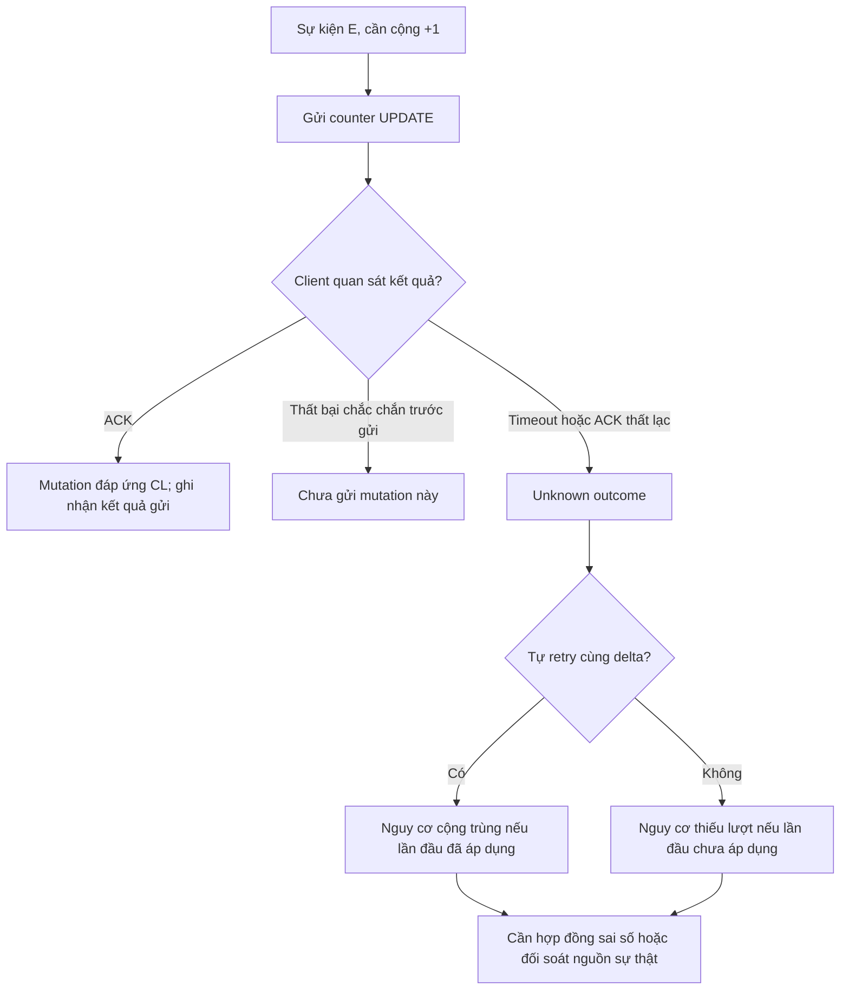
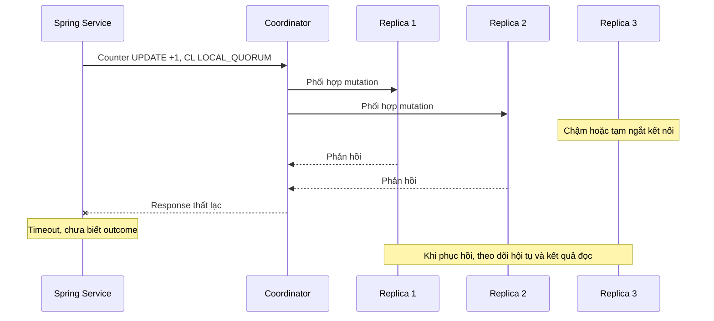

# Kiểm thử yêu cầu lặp, lỗi mạng và số đếm sau phục hồi

Trong **Spring Data Cassandra**, một bộ đếm có thể được cập nhật qua `CqlTemplate`, `CqlSession` hoặc một repository tùy biến. Câu CQL `UPDATE ... SET clicks = clicks + 1` nhìn đơn giản, nhưng kiểm thử chỉ gọi nó một lần rồi thấy giá trị tăng 1 **chưa chứng minh hệ thống đếm đúng trong production**. Gateway có thể gửi lại HTTP request, consumer phát lại message, driver gặp timeout, coordinator mất kết nối sau khi mutation đã được áp dụng, hoặc một replica rời cluster rồi quay lại.

Với **Apache Cassandra counter**, phép cộng là một thao tác theo **delta** và về ngữ nghĩa **không idempotent**: cùng một yêu cầu tăng được thực thi hai lần có thể làm số đếm tăng hai đơn vị. Ngược lại, bỏ qua một request chưa rõ kết quả có thể khiến số đếm thấp hơn số sự kiện thực. Vì vậy, bài học này tập trung vào **kiểm thử yêu cầu lặp, lỗi mạng và số đếm sau phục hồi**, phân biệt điều gì thật sự được chứng minh ở từng mức test và cách xây dựng quy trình đối soát khi số liệu phải chính xác.

Chủ đề nằm trong chương **Bộ đếm** của module `SPRING_DATA_CASSANDRA`, liên hệ trực tiếp tới thiết kế bảng theo truy vấn, partition key, replication/consistency, hiệu năng của một khóa nóng và các lựa chọn giữa repository, `CassandraTemplate` và `CqlTemplate`.

## 1. Xác định hợp đồng đếm trước khi viết test

Hai hệ thống đều gọi trường dữ liệu là “số lượt”, nhưng yêu cầu đúng/sai có thể hoàn toàn khác:

| Sản phẩm | Hợp đồng số đếm | Mức rủi ro khi tăng trùng/mất một increment |
| --- | --- | --- |
| Dashboard lượt xem mang tính tham khảo | Chấp nhận sai lệch nhỏ, có thể cập nhật lại | Có thể chấp nhận nếu đã quy định |
| Thống kê quảng cáo để thanh toán | Mỗi sự kiện hợp lệ phải được tính đúng theo chính sách | Không nên lấy counter làm nguồn sự thật duy nhất |
| Số ghế còn lại hoặc tồn kho | Không được âm, không bán vượt số lượng | Counter thuần túy không bảo vệ invariant |
| Số lần xử lý một tác vụ | Có thể cần kiểm toán event ID và retry | Cần idempotency/ledger để điều tra |
| Tổng số đơn trong ngày | Có thể tái tính từ bảng đơn hoặc event log | Counter phù hợp hơn như read model có thể đối soát |

Trước khi lập test, hãy ghi rõ:

1. **Đơn vị đếm:** một HTTP request, một hành động người dùng hay một event hợp lệ có ID duy nhất?
2. **Định danh trùng lặp:** hai lần gửi cùng `event_id` là hai đơn vị hay chỉ một?
3. **Ranh giới thời gian:** ngày UTC, giờ, tenant và đối tượng nào quyết định bucket?
4. **Độ trễ hội tụ:** cần thấy ngay sau ghi hay chấp nhận đọc dữ liệu chưa hội tụ?
5. **Chính sách lỗi:** timeout được báo là thất bại, chưa xác định hay tự động retry?
6. **Khả năng tái dựng:** có lưu event/ledger chuẩn để tính lại tổng chính xác không?

Nếu không trả lời được các câu này, việc assert `count == 10` chưa đủ chứng minh hệ thống thỏa mãn yêu cầu nghiệp vụ.

## 2. Mô hình bảng counter dùng trong các bài kiểm thử

Giả sử cần đếm số lần truy cập một trang theo tenant, trang và ngày UTC:

```sql
CREATE TABLE clicks_by_tenant_page_day (
    tenant_id   text,
    page_id     uuid,
    click_day   date,
    clicks      counter,
    PRIMARY KEY ((tenant_id, page_id, click_day))
);
```

Đây là một **counter table**: `clicks` có kiểu `counter` và những cột không thuộc khóa không được trộn tùy tiện giữa `counter` với các loại scalar thông thường. Một partition được định danh bằng **đầy đủ** `(tenant_id, page_id, click_day)`.

Thao tác cộng delta:

```sql
UPDATE clicks_by_tenant_page_day
SET clicks = clicks + ?
WHERE tenant_id = ?
  AND page_id = ?
  AND click_day = ?;
```

Thao tác đọc:

```sql
SELECT clicks
FROM clicks_by_tenant_page_day
WHERE tenant_id = ?
  AND page_id = ?
  AND click_day = ?;
```

Không thử tạo số đếm ban đầu bằng `INSERT ... clicks = 0` hoặc `UPDATE ... SET clicks = 100`: kiểu `counter` có **ngữ nghĩa cộng/trừ**, không hỗ trợ phép gán tuyệt đối như cột `bigint`. Một `UPDATE clicks = clicks + 1` có thể khởi tạo count cho khóa chưa tồn tại.

Counter không hỗ trợ TTL và LWT conditional update theo cách của cột thường. Muốn giới hạn thời gian lưu, phải cân nhắc **bucket, vòng đời khóa và kế hoạch cleanup**; muốn bảo vệ số lượng không âm hoặc một điều kiện `IF clicks >= 1`, cần mô hình khác.

### Tạo test data bằng khóa riêng

Không dùng chung một `tenant_id/page_id/click_day` cho những test chạy song song. Mỗi test tạo **khóa duy nhất**, ví dụ tenant `test-<UUID>` và `page_id` ngẫu nhiên. Test không nên mặc định `DELETE` trên counter rồi tăng lại cùng khóa sẽ lập tức tạo một môi trường trắng: có thể còn mutation đang thực thi, replication, tombstone hoặc delayed retry.

Nếu kiểm thử dùng một cluster thực, cần keyspace riêng, RF/consistency phù hợp, quyền hạn chế và chính sách dọn dữ liệu sau khi các writer đã dừng. Không dùng bảng production làm sân thử lỗi mạng.

## 3. Ba trạng thái kết quả phải được phân biệt

Một lời gọi tăng counter có thể kết thúc ở một trong ba trạng thái nhận biết từ phía ứng dụng:

| Trạng thái phía service | Điều đã biết | Điều **chưa** thể khẳng định |
| --- | --- | --- |
| **ACK thành công** | Cassandra đã chấp nhận thao tác theo consistency level và đường thực thi | Event chỉ xuất hiện đúng một lần trong toàn pipeline |
| **Lỗi trước khi gửi** được xác nhận chắc chắn | Mutation chưa được gửi trong đường thử đang quan sát | Những producer khác không gửi cùng event |
| **Timeout / mất ACK / mất kết nối khi đang thực thi** | Client không nhận được câu trả lời chắc chắn | Mutation chưa được áp dụng hoặc đã được áp dụng đúng một lần |

Đặc biệt, **timeout là trạng thái kết quả không xác định (*unknown outcome*)**, không đồng nghĩa `UPDATE` thất bại chắc chắn. Nếu ứng dụng tự động lặp lại phép tăng, nó có thể biến một lần bấm thành hai lần cộng.



Mục tiêu kiểm thử không phải “biến unknown thành true/false bằng đoán”, mà là **xác minh service có xử lý unknown theo chính sách đã định**.

## 4. Ma trận tình huống kiểm thử bắt buộc

| ID | Tình huống | Phương pháp | Tiêu chí quan sát |
| --- | --- | --- | --- |
| C01 | Một increment thành công | Integration test với Cassandra | Tổng tăng 1 sau khi ACK và đọc phù hợp |
| C02 | Hai event khác nhau, hai increment | Test tuần tự/đồng thời | Tổng phản ánh hai delta được áp dụng |
| C03 | **Cùng request** được gửi hai lần | Gọi writer hai lần có cùng event ID bên ngoài | Counter thô có thể tăng **hai lần** |
| C04 | Lỗi chắc chắn trước khi gửi | Fault ở adapter trước `execute` | Không phát mutation; trạng thái lỗi đúng |
| C05 | Server đã áp dụng, client mất ACK | Fault sau `execute` thành công, trước trả response | Service thấy lỗi nhưng tổng vẫn đã tăng |
| C06 | Timeout trong lúc chạy, kết quả không biết | Transport/fault proxy hoặc kịch bản kiểm soát | Không đánh đồng timeout với `[applied]=false` |
| C07 | Gateway/consumer retry sau timeout | Kiểm tra chính sách retries và message redelivery | Có cảnh báo trùng/thiếu, không tuyên bố exactly-once |
| C08 | Hai writer đồng thời trên cùng khóa | Nhiều request có ACK trong môi trường ổn định | Không có lost update kiểu read–set; đo p95/p99 |
| C09 | Một replica offline rồi trở lại | Cluster RF phù hợp, fault injection có kiểm soát | Quan sát CL, timeout và giá trị sau hội tụ |
| C10 | Service restart khi còn message chưa ACK | Khởi động lại consumer theo checkpoint | Không tự động khẳng định không có trùng/thiếu |
| C11 | Khôi phục từ event ledger | Tổng hợp theo event duy nhất và checkpoint ổn định | Snapshot tái dựng khớp nguồn sự thật |
| C12 | Chuyển ngày/bucket | Giờ UTC và message gửi trễ | Event về đúng ngày, không cộng nhầm partition |

Đây là **ma trận nhiều tầng**, không phải tất cả các tình huống đều có thể kiểm thử thật bằng một container Cassandra một node. C03/C04/C05 có thể xác minh nhanh trong integration/unit harness. C09 cần cluster nhiều replica; C10/C11 cần consumer, message store và chính sách checkpoint thật.

## 5. Java Driver 4: tạo writer rõ ràng không idempotent

Trong ứng dụng Spring Boot, `CqlSession` được quản lý theo vòng đời ứng dụng, còn `PreparedStatement` nên được tạo một lần cho mỗi query shape.

```java
import java.time.LocalDate;
import java.util.OptionalLong;
import java.util.UUID;

import com.datastax.oss.driver.api.core.CqlSession;
import com.datastax.oss.driver.api.core.DefaultConsistencyLevel;
import com.datastax.oss.driver.api.core.cql.BoundStatement;
import com.datastax.oss.driver.api.core.cql.PreparedStatement;
import com.datastax.oss.driver.api.core.cql.Row;

public final class ClickCounterGateway {
    private final CqlSession session;
    private final PreparedStatement increment;
    private final PreparedStatement read;

    public record Key(String tenantId, UUID pageId, LocalDate day) {}

    public ClickCounterGateway(CqlSession session) {
        this.session = session;
        this.increment = session.prepare(
            "UPDATE clicks_by_tenant_page_day " +
            "SET clicks = clicks + ? " +
            "WHERE tenant_id = ? AND page_id = ? AND click_day = ?");
        this.read = session.prepare(
            "SELECT clicks FROM clicks_by_tenant_page_day " +
            "WHERE tenant_id = ? AND page_id = ? AND click_day = ?");
    }

    public void increment(Key key, long delta) {
        validate(key);
        if (delta <= 0) {
            throw new IllegalArgumentException("delta phải lớn hơn 0");
        }

        BoundStatement statement = increment.bind(
                delta, key.tenantId(), key.pageId(), key.day())
                .setConsistencyLevel(DefaultConsistencyLevel.LOCAL_QUORUM)
                .setIdempotent(false);

        session.execute(statement);
    }

    public OptionalLong read(Key key) {
        validate(key);
        BoundStatement statement = read.bind(
                key.tenantId(), key.pageId(), key.day())
                .setConsistencyLevel(DefaultConsistencyLevel.LOCAL_QUORUM);
        Row row = session.execute(statement).one();
        return row == null || row.isNull("clicks")
                ? OptionalLong.empty()
                : OptionalLong.of(row.getLong("clicks"));
    }

    private static void validate(Key key) {
        if (key == null || key.tenantId() == null
                || key.tenantId().isBlank()
                || key.pageId() == null || key.day() == null) {
            throw new IllegalArgumentException("Thiếu primary key");
        }
    }
}
```

Ví dụ dùng `LOCAL_QUORUM` để thể hiện cách đặt CL, **không khuyến nghị một mức mặc định cho mọi cluster**. Để chạy, keyspace thử phải có replica và topology tương ứng; nếu môi trường chỉ có một Cassandra node với RF=1, cần cấu hình lại consistency cho fixture phù hợp.

`setIdempotent(false)` là một tín hiệu quan trọng cho cơ chế retry/speculative execution của Java Driver: driver không nên xem counter mutation là thao tác an toàn để thực hiện lại. **Nó không kiểm soát được mọi lần gửi lặp ở gateway, HTTP client, message broker hoặc chính code ứng dụng**. Do đó, test phải bao phủ các tầng phía ngoài driver.

Đồng thời, một `PreparedStatement` được tái sử dụng không có tác dụng deduplicate hai lần `BoundStatement` mang cùng dữ liệu. Prepared statement giúp tránh lặp công việc chuẩn bị query, **không cấp exactly-once**.

## 6. JUnit 5: kiểm thử một request và request bị gửi lặp

Ví dụ một integration test dùng session của Spring Boot test context:

```java
import static org.junit.jupiter.api.Assertions.assertEquals;

import java.time.LocalDate;
import java.util.UUID;

import com.datastax.oss.driver.api.core.CqlSession;
import org.junit.jupiter.api.Test;
import org.springframework.beans.factory.annotation.Autowired;
import org.springframework.boot.test.context.SpringBootTest;

@SpringBootTest
class ClickCounterContractIT {

    @Autowired
    private CqlSession session;

    private ClickCounterGateway.Key newKey() {
        return new ClickCounterGateway.Key(
                "test-" + UUID.randomUUID(),
                UUID.randomUUID(),
                LocalDate.of(2026, 11, 25));
    }

    @Test
    void oneAcceptedIncrementAddsOne() {
        ClickCounterGateway gateway = new ClickCounterGateway(session);
        var key = newKey();

        gateway.increment(key, 1);

        assertEquals(1L, gateway.read(key).orElseThrow());
    }

    @Test
    void duplicateDeliveryIsTwoCounterMutations() {
        ClickCounterGateway gateway = new ClickCounterGateway(session);
        var key = newKey();

        // Hai lần phát mutation trên cùng primary key.
        gateway.increment(key, 1);
        gateway.increment(key, 1);

        assertEquals(2L, gateway.read(key).orElseThrow());
    }
}
```

Đây là ví dụ **cần dự án test đã cấu hình Spring context/CqlSession và bảng schema test**. Mỗi test sử dụng key riêng, không phụ thuộc giá trị còn sót từ test trước. Không chạy nguyên mẫu vào keyspace production. Trong cluster ổn định, không lỗi và không retry ngoài ý muốn, các assert phản ánh tính chất delta của counter.

Test thứ hai **cố ý kỳ vọng 2, không phải 1**: nó chứng minh hai mutation counter riêng biệt không tự bị Cassandra loại trùng chỉ vì payload giống nhau. Nếu API thực tế yêu cầu cùng `event_id` chỉ tính một lần, phải đặt contract ấy ở tầng trên và kiểm tra nó bằng một bộ test riêng.

## 7. Kiểm thử ACK bị mất mà không cần phá mạng thật

Lỗi mạng thực không luôn tái lập được ở đúng khoảnh khắc. Một **fault adapter** có thể tạo kịch bản có tính quyết định: ghi đã thành công, nhưng phía gọi không nhận được kết quả.

```java
import static org.junit.jupiter.api.Assertions.*;
import com.datastax.oss.driver.api.core.CqlSession;
import org.junit.jupiter.api.Test;
import org.springframework.beans.factory.annotation.Autowired;
import org.springframework.boot.test.context.SpringBootTest;

final class SimulatedAckLoss extends RuntimeException {}

@SpringBootTest
final class CounterAckLossTest {
    @Autowired
    private CqlSession session;

    void applyThenDropAck(ClickCounterGateway gateway,
                          ClickCounterGateway.Key key) {
        gateway.increment(key, 1);  // Đã nhận ACK từ Cassandra.
        throw new SimulatedAckLoss(); // Giả lập ACK mất trước service caller.
    }

    @Test
    void callerCannotInferFailureFromLostAck() {
        var gateway = new ClickCounterGateway(session);
        var key = new ClickCounterGateway.Key(
                "test-ack-loss", java.util.UUID.randomUUID(),
                java.time.LocalDate.of(2026, 11, 25));

        assertThrows(SimulatedAckLoss.class,
                () -> applyThenDropAck(gateway, key));

        assertEquals(1L, gateway.read(key).orElseThrow());
    }
}
```

Đoạn code trên là **integration test giả lập mất ACK tại ranh giới caller**, sử dụng `CqlSession` từ Spring test context; để chạy, fixture cần kết nối tới Cassandra thử nghiệm và có sẵn bảng CQL đã khai báo. Điểm kiểm thử là **từ góc nhìn caller có exception, nhưng phía dưới counter đã tăng**.

Cần tách hai tình huống khác nhau:

- **Fault trước gửi:** wrapper từ chối trước khi gọi `gateway.increment` → không có mutation từ wrapper ấy.
- **Fault sau khi áp dụng:** wrapper thực hiện `increment` trước khi ném lỗi → counter đã tăng dù caller báo lỗi.

Đừng dùng test này để tuyên bố “đã mô phỏng Cassandra read timeout hoặc Java Driver network partition”. Nó chỉ **tái tạo được sự mơ hồ ở ranh giới gọi**. Để kiểm thử lỗi mạng thực, cần proxy/fault injection phù hợp và một cluster test riêng.

## 8. Kiểm thử chính sách retry và `idempotent=false`

Counter mutation không idempotent, nên có ít nhất ba nơi cần audit retry:

| Tầng | Ví dụ nguồn request lặp | Điều test phải kiểm tra |
| --- | --- | --- |
| Java Driver | Retry policy, speculative execution khi timeout/chậm | Counter statement được đánh dấu không idempotent; kiểm tra policy đúng phiên bản |
| Service/HTTP gateway | Client timeout và gọi lại endpoint | Cùng một intent có bị phát hai increment không? |
| Message broker/consumer | Redelivery sau consumer restart, checkpoint/ACK bị mất | Event ID cũ có bị cộng lại không? |

Một service có thể cấu hình `setIdempotent(false)` đúng nhưng **API gateway vẫn tự gửi cùng HTTP request hai lần**, hoặc consumer vẫn xử lý lại message sau restart. Vì thế, chỉ kiểm tra option trên BoundStatement **không đủ**.

### Mẫu anti-pattern

```java
try {
    counterGateway.increment(key, 1);
} catch (RuntimeException timeoutOrNetworkError) {
    // NGUY HIỂM: không biết lần đầu đã áp dụng hay chưa.
    counterGateway.increment(key, 1);
}
```

Ngay cả khi retry cuối cùng trả ACK, tổng có thể đã tăng **hai lần**. Một policy đúng hơn phải phân biệt **mất kết nối trước gửi đã được biết chắc**, **lỗi cú pháp không thể retry**, và **unknown outcome**. Với unknown outcome, tùy contract, service có thể trả trạng thái chờ đối soát, lưu event để xử lý theo workflow hoặc chấp nhận một mức sai số thống kê.

### Kiểm thử cùng một `event_id` ở tầng nghiệp vụ

Giả sử API nhận `event_id=E-123`. Test nên phát **chính event này hai lần** và quan sát cả:

1. Số lần phương thức gateway counter được gọi.
2. Trạng thái ghi nhận request/event ID ở tầng ứng dụng.
3. Kết quả response ở lần gửi lại.
4. Số đếm cuối cùng.

Nếu yêu cầu là **đếm mỗi event hợp lệ một lần**, test chỉ pass khi toàn bộ workflow đạt điều đó; không kết luận từ một `UPDATE` counter riêng lẻ rằng Cassandra đã cung cấp exactly-once.

## 9. Kiểm thử đồng thời: hai writer và khóa nóng

Với bảng thường chứa `clicks bigint`, mô hình `SELECT current` rồi `UPDATE SET clicks=current+1` có thể mất cập nhật vì hai writer cùng đọc một giá trị. Với counter, hai mutation `clicks = clicks + 1` được áp dụng độc lập về ngữ nghĩa.

Một test không có lỗi mạng có thể:

1. Tạo khóa riêng.
2. Cho 20–100 task độc lập phát **một** increment.
3. Chờ tất cả request hoàn thành và kiểm tra exception.
4. Đọc với CL được chọn và so sánh tổng với số mutation đã ACK.
5. Ghi p50/p95/p99 và số request đang tranh chấp trên cùng khóa.

**Không dùng test đồng thời này để chứng minh exactly-once khi có retry**. Kết quả đúng trong điều kiện mạng ổn định chỉ chứng minh khả năng tích lũy delta khi các thao tác riêng biệt hoàn thành. Nếu có timeout/connection reset, phải đưa những request không rõ kết quả vào nhóm **unknown** thay vì ép expected count bằng số task đã tạo.

```text
Đối với 100 request được phát:
  92 nhận ACK, 5 lỗi chắc chắn trước gửi, 3 timeout không rõ kết quả.

Không được tự kết luận tổng cuối phải chính xác 92
hoặc phải chính xác 95.

Phải điều tra ba request unknown và các lần gửi lặp khác trong pipeline.
```

Trong hệ có nhiều replicas, một test concurrency còn chịu tác động của consistency level, coordinator, latency và topology. Đặt một load test trên cluster một node không phản ánh contention/failover của cluster RF=3.

## 10. Kiểm thử lỗi mạng thực: đừng nhầm một node với cluster nhiều replica

Để kiểm chứng tình huống coordinator/replica, cần môi trường **Cassandra nhiều node**, replication factor và local datacenter được cấu hình phù hợp. Không tạo lỗi bằng cách tắt node production.

Một kịch bản minh họa với RF=3 ở cùng DC:



Hình trên chỉ thể hiện **trường hợp có thể xảy ra về mạng/ACK**, không mô tả chính xác thuật toán counter nội bộ hoặc số bước của mọi phiên bản Cassandra. Counter có đường xử lý riêng và không nên suy rằng mỗi increment luôn gửi một mutation giống hệt tới cả ba replica ngay từ đầu.

### Những phép thử có giá trị

- **Một replica ngắt kết nối ngắn:** quan sát update/read theo `LOCAL_ONE`, `LOCAL_QUORUM` và cấu hình thực tế; không giả định mọi CL có cùng độ trễ.
- **Coordinator mất kết nối với client sau khi thao tác bắt đầu:** bắt unknown outcome, không khẳng định request chưa áp dụng.
- **Service mất kết nối tới local DC:** xem chính sách routing/failover; không tự đổi local datacenter và kết luận kết quả giống nhau.
- **Replica khôi phục sau downtime:** quan sát số đếm, repair và thời gian hội tụ; kiểm tra dữ liệu lịch sử không bị đọc sai vì đổi bucket/tenant.
- **Consumer khởi động lại trong lúc checkpoint:** xác minh cùng event có thể được nhận lại và chính sách chống trùng ở tầng ứng dụng.

Đối với mỗi bài, cần thu **timestamp, request ID, event ID, counter key, CL, lỗi trả về, số lần thực tế gửi và giá trị trước/sau**, nhưng không ghi log dữ liệu cá nhân hoặc bind values nhạy cảm một cách không kiểm soát.

## 11. Sau khi phục hồi, con số “đúng” được xác định từ đâu?

Một câu hỏi quan trọng: nếu một thao tác counter timeout và sau đó cluster ổn định trở lại, làm thế nào biết tổng hiện tại là đúng?

**Không thể suy ra số event duy nhất chỉ từ giá trị counter.** Counter lưu số liệu đã cộng theo mutation; nó không giữ danh sách `event_id`, không lưu nguồn nghiệp vụ và không cho biết một delta có phải là replay trùng.

Ví dụ:

| Lịch sử thực tế | Giá trị counter cuối | Số event duy nhất |
| --- | ---: | ---: |
| E1, E2, E3, mỗi event cộng đúng một lần | 3 | 3 |
| E1 cộng hai lần, E2 cộng một lần | 3 | 2 |
| E1, E2, E3, E4; một event không được áp dụng | 3 | 4 |

**Cùng giá trị 3 không chứng minh cùng sự thật.** Một lần đọc `LOCAL_QUORUM` sau phục hồi chỉ cho biết giá trị quan sát qua một đường đọc có yêu cầu replica tương ứng; nó không thể tạo lại ID của event đã mất hoặc khử một event đã cộng trùng mà không có metadata bên ngoài.

Do đó cần phân biệt:

- **Hội tụ replica:** các replica của counter được đồng bộ/đối soát theo cơ chế Cassandra.
- **Đúng theo nghiệp vụ:** số đếm bằng số event hợp lệ, duy nhất, nằm trong khoảng thời gian được quy định.

Repair và consistency giúp tầng đầu; một **nguồn sự thật có danh tính sự kiện** và quy trình reconciliation mới giúp đánh giá tầng sau.

## 12. Event ledger, deduplication và khoảng trống giữa hai thao tác

Đối với thống kê quan trọng, có thể lưu event được chấp nhận trong một bảng/stream có `event_id` ổn định:

```sql
CREATE TABLE accepted_click_by_id (
    tenant_id   text,
    event_id    uuid,
    page_id     uuid,
    click_day   date,
    accepted_at timestamp,
    PRIMARY KEY ((tenant_id, event_id))
);
```

Ứng dụng nhận một event và thử:

```sql
INSERT INTO accepted_click_by_id
    (tenant_id, event_id, page_id, click_day, accepted_at)
VALUES (?, ?, ?, ?, ?)
IF NOT EXISTS;
```

Khi `[applied]=false`, tầng ledger có thể nhận ra event với cùng canonical ID đã tồn tại; phải so sánh cả payload/identity đã lưu để tránh **cùng event ID nhưng nội dung khác**. Trong production, phân vùng theo `(tenant_id,event_id)` là một lựa chọn minh họa cho lookup theo ID, cần đánh giá số partition, tải và mô hình truy vấn.

**Bẫy quan trọng:** hai thao tác này **không phải một transaction nguyên tử**:

```text
Bước A: INSERT event E IF NOT EXISTS vào ledger    → đã áp dụng
Bước B: UPDATE counter = counter + 1                → chưa rõ kết quả
```

Nếu service chết giữa A và B, event đã có trong ledger nhưng counter chưa chắc đã tăng. Nếu counter tăng xong mà checkpoint consumer chưa được ghi, cùng event có thể được xử lý lại. Vì thế chỉ thêm `IF NOT EXISTS` trước phép tăng **không tạo bảo đảm exactly-once cho hai bảng**.

### Kiểm thử khoảng trống transaction

Thiết kế fault injection tại bốn điểm:

1. Trước ghi ledger.
2. Sau ledger applied, trước counter update.
3. Sau counter update đã áp dụng, trước checkpoint.
4. Sau checkpoint nhưng trước trả response cho client.

Với mỗi điểm, khởi động lại service rồi xem có event bị mất, counter cộng trùng hoặc trạng thái chưa rõ không. Test phải kiểm tra **hành vi phục hồi**, không chỉ kiểm tra một ACK đơn lẻ.

## 13. Chiến lược đối soát có thể lặp lại an toàn

Nếu yêu cầu số đếm chính xác là cốt lõi, một cách dễ kiểm chứng hơn là **coi ledger/stream sự kiện hợp lệ là nguồn sự thật**, còn counter là một projection phục vụ đọc nhanh. Khi cần tái dựng:

1. Xác định **checkpoint/watermark** ổn định của event stream để biết tập sự kiện đã được đóng.
2. Lọc sự kiện không hợp lệ và **deduplicate theo event ID** với quy tắc nghiệp vụ rõ ràng.
3. Tính tổng chính xác cho `(tenant_id,page_id,click_day)`.
4. Ghi **giá trị tuyệt đối** vào một bảng snapshot **kiểu `bigint`**, không dùng counter để “SET tổng”.
5. Công bố snapshot/checkpoint sau khi ghi thành công; nếu có writer cạnh tranh, dùng version/conditional write để tránh snapshot cũ ghi đè mới.
6. So sánh snapshot với counter hiện hữu, ghi nhận độ lệch và quyết định cách hiển thị/cảnh báo theo SLA.

Một bảng snapshot minh họa:

```sql
CREATE TABLE click_total_snapshot_by_day (
    tenant_id         text,
    page_id           uuid,
    click_day         date,
    total_clicks      bigint,
    source_checkpoint text,
    generation        uuid,
    PRIMARY KEY ((tenant_id, page_id, click_day))
);
```

`total_clicks bigint` là **giá trị tuyệt đối**, phù hợp cho một phép tổng hợp đã chốt. `generation` hoặc version giúp xuất bản một thế hệ snapshot được kiểm soát, nhưng chỉ có hiệu lực bảo vệ cạnh tranh nếu service sử dụng **điều kiện cập nhật/luồng publish phù hợp**; cột mang tên `generation` tự nó không tạo CAS.

**Đừng cố sửa counter bằng `delta = expectedTotal - observedCounter` rồi retry cho đến khi “có vẻ đúng”**. Counter có thể tiếp tục nhận ghi, các phép đọc có thể chưa hội tụ, còn thao tác delta sửa chữa cũng không idempotent khi timeout. Kết quả có thể dao động hoặc tăng sai hơn. Khi cần thay thế projection, hãy dùng **snapshot có version** hoặc tạo **generation/bucket mới**, có cơ chế ngừng writer cũ và chuyển reader an toàn.

### Ma trận đối soát sau phục hồi

| Counter quan sát | Tổng event deduplicated | Phân tích ban đầu |
| ---: | ---: | --- |
| 100 | 100 | Khớp tại checkpoint đã chọn; vẫn cần kiểm tra event source hoàn chỉnh |
| 103 | 100 | Có thể tăng trùng, event ngoài watermark hoặc sai bucket |
| 97 | 100 | Có thể thiếu increment, writer lỗi hoặc event chưa được phản chiếu |
| Không đọc được | 100 | Sự cố query/cluster; không được suy ra count = 0 |
| 100 | Không có ledger đáng tin | Không chứng minh được số event duy nhất |

Đừng so sánh một counter **đang nhận thêm dữ liệu realtime** với snapshot của một checkpoint cũ mà không điều chỉnh phạm vi; độ lệch đó có thể chỉ phản ánh hai thời điểm đo khác nhau.

## 14. Test phục hồi service và replay của message consumer

Đối với một consumer dùng broker có cơ chế redelivery, bài test phục hồi cần điều khiển chính xác vị trí crash:

```text
Event E được broker giao cho consumer.

Case A: crash trước ghi Cassandra
  → sau restart, broker có thể giao E lại.

Case B: counter tăng thành công, crash trước broker ACK
  → sau restart, E có thể được giao lại; tăng trùng nếu replay mù.

Case C: ledger ghi thành công, crash trước counter tăng
  → replay thấy E đã có; nếu bỏ qua toàn bộ E sẽ thiếu counter.

Case D: snapshot/checkpoint đã publish
  → retry phải không làm snapshot cũ ghi đè generation mới.
```

Hãy viết assert trên **event ID, checkpoint, số mutation gửi và số liệu đã tái dựng**, không chỉ dựa vào giá trị counter. Nếu product chấp nhận thống kê gần đúng, test có thể kiểm tra giới hạn độ lệch và phát cảnh báo; nếu yêu cầu chính xác tuyệt đối, cần kiến trúc cho phép khôi phục deterministic từ sự kiện đáng tin.

Test cũng phải xét **message đến muộn hoặc có event-time trước nửa đêm UTC**. Nếu service chọn `click_day = LocalDate.now()` tại thời điểm replay thay vì ngày nghiệp vụ của event, một event cũ có thể được cộng vào **partition ngày mới**, dù tổng của ngày cũ không còn sửa được bằng retry.

## 15. Quan sát các replica sau khi node quay lại

Khi một node Cassandra được đưa trở lại cluster, cần đánh giá:

- Node có thuộc đúng **datacenter, rack và token ranges** của keyspace đang kiểm thử không?
- Replica của partition thử có đủ số lượng theo replication factor?
- Hệ thống đã hoàn thành các bước khôi phục/repair phù hợp phiên bản chưa?
- Counter read ở các consistency levels đang dùng có trả về giá trị mong đợi sau khi trạng thái ổn định không?
- Có timeout, unavailable, retry hoặc coordinator routing bất thường trong giai đoạn phục hồi không?
- Một lần replay event đã chạy lại counter mutation chưa?

**Không lấy một kết quả `SELECT` thành công làm bằng chứng toàn cluster đã repair**, cũng không dùng chênh lệch counter so với ledger để mặc định lỗi là do replica. Chênh lệch có thể xuất phát từ duplicate delivery, dữ liệu thiếu, sai bucket hoặc snapshot khác checkpoint.

Đặc biệt, không tiến hành fault injection trên cluster production chỉ để đo hậu quả của mất node. Dùng cluster kiểm thử nhiều replica, proxy có kiểm soát, log/metric phù hợp và playbook thao tác node đã được phê duyệt.

## 16. Theo dõi kết quả bằng chỉ số có thể hành động

| Nhóm chỉ số | Ví dụ | Mục đích |
| --- | --- | --- |
| API/consumer | Số event nhận, event ID trùng, retry/redelivery | Phát hiện nguồn gửi lặp |
| Counter writer | Increment ACK, timeout, unavailable, lỗi trước gửi | Phân biệt đã biết với unknown outcome |
| Driver | Idempotence flag, retry policy, speculative execution, latency | Kiểm soát thực thi lặp ngoài ý muốn |
| Cassandra | Read/write p95/p99, replica health, coordinator load | Xác định hot key/sự cố cluster |
| Đối soát | Ledger unique total, snapshot total, counter value, checkpoint | Biết độ lệch có cơ sở và nguồn so sánh |
| Phục hồi | Node downtime, repair coverage, consumer lag, checkpoint age | Biết hệ đã thực sự bắt kịp chưa |

Nên kết nối các chỉ số bằng `request_id`/`event_id` và định danh khóa được phép ghi log, nhưng tránh đưa PII hoặc giá trị nhạy cảm vào metric labels. Tỷ lệ cardinality quá cao của labels cũng tạo tải giám sát; có thể dùng trace có lấy mẫu và tổng hợp theo tenant nhóm/luồng khi thích hợp.

Một dashboard chỉ hiển thị **giá trị counter tăng** mà không có `duplicate_rate`, `unknown_outcome_rate` hay `reconciliation_lag` sẽ khó phát hiện sai lệch trước khi khách hàng báo cáo.

## 17. Những sai lầm phổ biến

| Sai lầm | Vì sao nguy hiểm | Cách làm phù hợp |
| --- | --- | --- |
| Gửi cùng `UPDATE += 1` hai lần và mong count tăng 1 | Counter không deduplicate theo event | Test duplicate delivery; dedup/ledger ở tầng phù hợp |
| Timeout → retry ngay counter update | Lần đầu có thể đã áp dụng | Giữ unknown outcome, chính sách retry có kiểm soát |
| `setIdempotent(false)` là đủ để tránh mọi request lặp | Gateway, HTTP client, broker vẫn có thể lặp | Audit cả pipeline, không chỉ driver |
| Test với một node rồi kết luận chịu được một replica mất | Không có fault behavior của RF>1 | Cluster nhiều replica/fault proxy |
| Dùng `SELECT` sau timeout để quyết định increment nào thành công | Không có event ID trong counter | Dùng event ledger/idempotency và đối soát |
| Ledger `IF NOT EXISTS` + counter update được coi là atomic | Có cửa sổ crash giữa hai bảng | Snapshot/reconciliation workflow |
| Sau recovery chênh lệch → cộng delta sửa ngay | Repair delta không idempotent, writer vẫn đang chạy | Rebuild snapshot tuyệt đối hoặc generation mới |
| Chỉ assert count mà không ghi số mutation thực gửi | Không biết tăng trùng do tầng nào | Instrument request ID/event ID và retries |
| Đổi ngày bucket theo thời gian replay | Event muộn rơi vào ngày sai | Bucket từ event-time/contract đã chuẩn hóa |
| Xóa counter rồi reuse cùng key làm fixture mới | Mutation đến muộn vẫn có thể cộng lại | Dùng primary key/generation riêng mỗi test |
| Dùng counter cho hạn mức cứng/tiền | Không có LWT `IF clicks >= 1` | Ledger, reservation hoặc state versioned phù hợp |

## 18. Checklist kiểm thử trước khi triển khai

1. **Hợp đồng nghiệp vụ:** một event khác một request, có định nghĩa độ chính xác và độ trễ hội tụ.
2. **Test data độc lập:** tenant/page/day riêng, không reset bằng `DELETE` rồi tái sử dụng ngay cùng khóa.
3. **CQL đúng kiểu:** counter được cộng bằng `UPDATE += delta`, không set tuyệt đối hay dùng TTL/LWT trên counter.
4. **Idempotency rõ ràng:** increment được gắn `setIdempotent(false)`, kiểm tra retry/speculative settings.
5. **Duplicate test:** cùng event gửi hai lần qua HTTP và broker, quan sát số mutation thực tế.
6. **Fault trước và sau ghi:** phân biệt request chắc chắn chưa gửi với ACK thất lạc sau khi apply.
7. **Unknown outcome:** không biến timeout thành “không áp dụng”, không retry mù.
8. **Concurrency:** đo nhiều writer chung key và p95/p99, tách điều kiện ổn định với chaos.
9. **Replica recovery:** thử CL, node outage và repair trên cluster test nhiều replica.
10. **Consumer restart:** crash ở các checkpoint, kiểm tra redelivery và idempotency.
11. **Ledger đủ thông tin:** event ID ổn định, validation, checkpoint/watermark và khả năng dedup.
12. **Đối soát deterministic:** có snapshot tuyệt đối/version hoặc generation, không cộng delta sửa chữa tùy tiện.
13. **Bucketing nhất quán:** sự kiện muộn/đổi ngày UTC không bị cộng nhầm partition.
14. **Monitoring và cảnh báo:** unknown rate, duplicate rate, reconciliation lag, replica/driver health.

## 19. Bài tập tình huống

**Tình huống A — Cùng một click, hai request.** Frontend retry sau timeout và gửi cùng `event_id` hai lần; backend gọi `UPDATE clicks = clicks + 1` cả hai lần. Giá trị có thể tăng bao nhiêu?

**Đáp án gợi ý:** Có thể tăng 2 nếu hai mutation đều được áp dụng. Counter không biết chúng có chung event ID; cần kiểm soát duplicate delivery ở tầng nghiệp vụ.

**Tình huống B — ACK thất lạc.** CQL update được áp dụng nhưng response bị mất. Service bắt exception rồi retry. Vì sao test chỉ mong tổng tăng đúng 1 sẽ có thể thất bại?

**Đáp án gợi ý:** Lần đầu đã tăng 1 dù caller thấy lỗi; retry tiếp tục cộng thêm delta. Timeout là unknown outcome, không phải chắc chắn chưa ghi.

**Tình huống C — Đọc sau phục hồi.** Counter bằng 102, còn ledger chứa 100 event duy nhất. Có thể kết luận ngay replica lưu sai không?

**Đáp án gợi ý:** Không. Có thể do duplicate delivery, khác checkpoint, event ngoài khoảng ngày, hoặc thao tác repair/replay. Đối chiếu event IDs, watermark, request logs và lịch sử mutation trước.

**Tình huống D — LWT trên ledger.** Một service `INSERT IF NOT EXISTS` event thành công rồi chết trước khi tăng counter. Retry thấy event đã tồn tại. Nếu bỏ qua increment thì sao?

**Đáp án gợi ý:** Counter có thể thiếu 1. Ledger và counter không có transaction atomic; cần workflow phục hồi/rebuild projection, không coi `IF NOT EXISTS` đơn lẻ là exactly-once.

**Tình huống E — Repair số đếm.** Tổng từ ledger là 100 nhưng counter đọc 98. Developer đề xuất `UPDATE clicks = clicks + 2`. Có chắc sau đó đúng 100?

**Đáp án gợi ý:** Không. Có thể có writer mới, đọc chưa hội tụ, hoặc delta sửa chữa bị retry. Một snapshot `bigint` có version/checkpoint hoặc generation được quản lý an toàn hơn nếu cần số chính xác.

**Tình huống F — Test một node.** Một integration test với Cassandra một node chạy thành công sau khi restart container. Có đủ chứng minh hệ chịu được mất một replica và phục hồi RF=3 không?

**Đáp án gợi ý:** Không. Nó không mô phỏng routing/quorum/replica disagreement của cluster nhiều node. Cần môi trường nhiều replica và fault injection có kiểm soát.

**Tình huống G — Sự kiện đến muộn.** Click xảy ra ngày 25/11 UTC, nhưng consumer replay ngày 26/11 và dùng `LocalDate.now()` làm partition key. Hậu quả?

**Đáp án gợi ý:** Click có thể bị cộng vào ngày 26 thay vì ngày 25, làm sai cả hai tổng. Khóa bucket phải được tính theo event-time/contract được xác định rõ, không theo giờ replay mặc định.

## Kết luận

**Kiểm thử Cassandra counter không dừng ở việc thấy `clicks + 1` trả về số tăng.** Cùng một yêu cầu bị gửi lặp có thể làm số đếm tăng nhiều lần; timeout hoặc ACK bị mất có thể che giấu một mutation đã được áp dụng; khi replica/service phục hồi, số đếm hội tụ **không tự chứng minh** số event duy nhất được tính đúng.

Với Spring Data Cassandra, hãy đi theo trình tự **xác định event và khóa/bucket → dùng counter CQL đúng ngữ nghĩa → đánh dấu non-idempotent và audit retry → test duplicate/lost ACK/timeout → test restart và replica recovery → đối soát với nguồn sự thật có event ID → xuất bản snapshot/version khi cần chính xác**. Counter là công cụ cộng dồn hữu ích, còn tính đúng đắn sau lỗi mạng phụ thuộc vào **hợp đồng nghiệp vụ, nhận diện sự kiện, cơ chế phục hồi và kiểm thử phân tán có chủ đích**.
