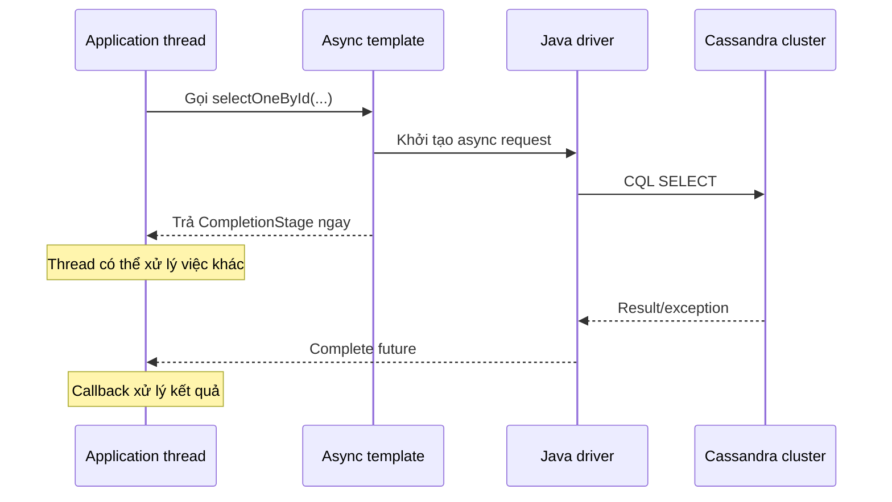
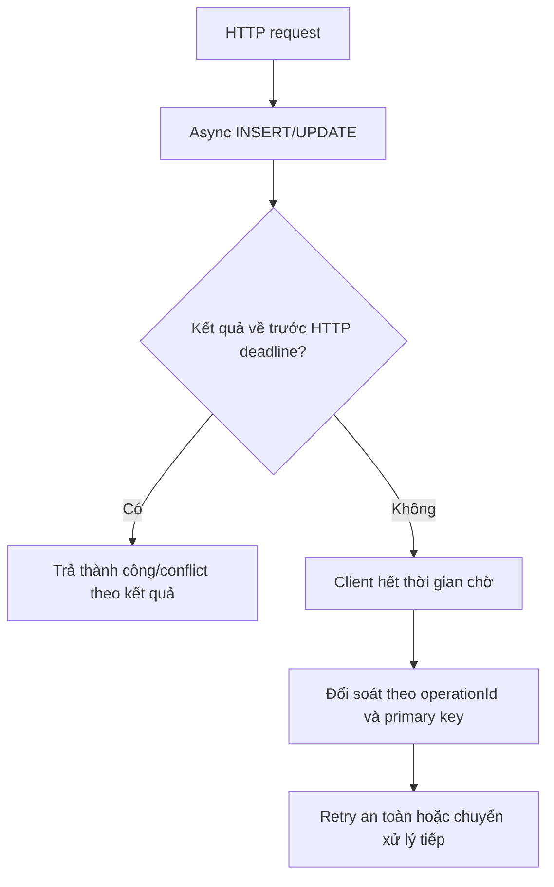

# AsyncCassandraTemplate và AsyncCqlTemplate trong Spring Data Cassandra

Truy cập Cassandra không nhất thiết phải giữ một thread chờ phản hồi cho đến khi hoàn thành câu lệnh. Với **Spring Data Cassandra**, `AsyncCassandraTemplate` và `AsyncCqlTemplate` cung cấp các thao tác bất đồng bộ dựa trên cơ chế async của **Java driver**, cho phép ứng dụng nhận một kết quả tương lai rồi tiếp tục xử lý khi tác vụ hoàn tất.

Bài thuộc chương **Truy cập bất đồng bộ** của module **SPRING_DATA_CASSANDRA**: truy cập Apache Cassandra thông qua entity mapping, repository, CassandraTemplate và CQL, đồng thời tôn trọng partition key, consistency, paging và đặc tính phân tán. Nội dung phân biệt hai template, minh họa cách tạo bean, đọc/ghi entity và CQL, ghép nhiều tác vụ, truyền lỗi, kiểm soát số request đang chạy, cũng như các tình huống cần dùng driver trực tiếp.

> **Phạm vi phiên bản:** Ví dụ hướng tới Spring Data Cassandra dùng Java driver 4.x và cách thao tác với `CompletionStage`/`CompletableFuture`. Chữ ký cụ thể của overload hoặc kiểu future có thể khác giữa các phiên bản Spring Data; cần kiểm tra API đúng phiên bản dependency trước khi copy vào production. Code minh họa giả định Spring Boot đã cấu hình `CqlSession` dùng chung.

## 1. “Bất đồng bộ” nghĩa là gì trong truy cập Cassandra?

Ở chế độ đồng bộ, một lời gọi có thể giữ thread hiện tại để đợi kết quả:

```java
// Đồng bộ: thread gọi chờ khi truy vấn đang thực hiện.
OrderById order = cassandraTemplate.selectOneById(orderId, OrderById.class);
```

Với API bất đồng bộ, lời gọi trả về **một đại diện của kết quả chưa hoàn tất**:

```java
// Bất đồng bộ: nhận future và đăng ký bước xử lý khi có kết quả.
CompletionStage<OrderById> stage =
    asyncCassandraTemplate.selectOneById(orderId, OrderById.class);

stage.thenAccept(order -> {
    // Được gọi khi phép đọc hoàn tất thành công.
    // Không thực hiện tác vụ blocking nặng trong callback này.
});
```

Sự khác biệt quan trọng:

- **Không chặn thread ở lời gọi ban đầu:** thao tác đọc/ghi mạng được driver xử lý bất đồng bộ.
- **Không có nghĩa truy vấn hoàn thành tức thì:** thời gian Cassandra xử lý replica, consistency và mạng vẫn tồn tại.
- **Không có nghĩa mọi callback chạy trên thread mới:** thread thực thi callback phụ thuộc trạng thái completion và executor.
- **Không có nghĩa bất kỳ code nào sau `thenApply` đều an toàn để blocking:** callback có thể chạy trên thread hoàn tất future của driver.
- **Không đồng nghĩa Reactive Streams:** `CompletionStage` biểu diễn một kết quả của một tác vụ, khác `Flux`/`Mono` với cơ chế stream và backpressure.



**Async không thể sửa một thiết kế truy vấn sai.** Nếu `WHERE` thiếu partition key hoặc yêu cầu quét một partition rất lớn, truy vấn vẫn tốn kém, chỉ là thread gọi không phải ngồi đợi theo cách đồng bộ.

## 2. So sánh AsyncCassandraTemplate và AsyncCqlTemplate

Hai abstraction phục vụ **hai mức khác nhau** của ứng dụng:

| Tiêu chí | `AsyncCassandraTemplate` | `AsyncCqlTemplate` |
| --- | --- | --- |
| Mức thao tác | Entity mapping: Java object, bảng, khóa, converter. | CQL gần Java driver: statement, bind values, callback/result. |
| Trường hợp phù hợp | CRUD theo entity, query kết hợp mapping, domain service. | CQL tùy biến, update một số cột, conditional CQL, đọc driver result. |
| Dữ liệu đầu vào | Entity class, entity instance, ID, query API. | CQL/statement và giá trị bind. |
| Dữ liệu trả về | Future chứa entity, danh sách hoặc kết quả thao tác tùy method. | Future chứa kết quả CQL hoặc kết quả mapping cụ thể. |
| Ai quản lý mapping? | Spring Data Cassandra mapping/conversion. | Caller xử lý Row/DTO khi dùng CQL mức thấp. |
| Có tự chọn partition key hiệu quả không? | Không. | Không. |
| Có tự tạo transaction ACID đa partition không? | Không. | Không. |
| Có tự đóng session sau từng request không? | Không; dùng session theo vòng đời ứng dụng. | Tương tự. |

Các lớp thường nằm ở:

```java
import org.springframework.data.cassandra.core.AsyncCassandraTemplate;
import org.springframework.data.cassandra.core.cql.AsyncCqlTemplate;
```

Có thể hiểu:

- `CassandraTemplate` là lớp đồng bộ thao tác entity; **`AsyncCassandraTemplate`** là abstraction bất đồng bộ tương ứng.
- `CqlTemplate` là lớp đồng bộ thao tác CQL; **`AsyncCqlTemplate`** là abstraction bất đồng bộ tương ứng.
- **`CqlSession` Java driver** nằm bên dưới và cũng cung cấp `executeAsync(...)`, `AsyncResultSet` cùng các tùy chọn statement mức thấp.

Không nhầm tên template với “tự chạy một thread mới cho mỗi query”. Cơ chế chính dựa trên async request của driver và quá trình completion.

## 3. Cấu hình bean đúng vòng đời Spring

### 3.1. CqlSession dùng chung

Một ứng dụng Spring Boot thường cấu hình Cassandra bằng các thuộc tính:

```yaml
spring:
  cassandra:
    contact-points: cassandra-1.internal:9042,cassandra-2.internal:9042
    local-datacenter: dc1
    keyspace-name: commerce
    # username, password, TLS và timeout phải lấy từ cấu hình bảo mật.
```

Tên máy chỉ là ví dụ. Không tạo `CqlSession` mới cho mỗi HTTP request, vì session có cơ chế quản lý kết nối, metadata cluster và tài nguyên nền; khởi tạo liên tục gây chi phí và rò rỉ tài nguyên.

Nếu ứng dụng đang dùng các starter có sẵn, hãy kiểm tra bean nào đã được auto-configure trước khi tự định nghĩa bean trùng kiểu.

### 3.2. Đăng ký hai async template

Ví dụ cấu hình khi cần khai báo tường minh:

```java
import com.datastax.oss.driver.api.core.CqlSession;
import org.springframework.context.annotation.Bean;
import org.springframework.context.annotation.Configuration;
import org.springframework.data.cassandra.core.AsyncCassandraTemplate;
import org.springframework.data.cassandra.core.convert.CassandraConverter;
import org.springframework.data.cassandra.core.cql.AsyncCqlTemplate;

@Configuration
public class AsyncCassandraConfig {

    @Bean
    AsyncCqlTemplate asyncCqlTemplate(CqlSession session) {
        return new AsyncCqlTemplate(session);
    }

    @Bean
    AsyncCassandraTemplate asyncCassandraTemplate(
            CqlSession session, CassandraConverter converter) {
        return new AsyncCassandraTemplate(session, converter);
    }
}
```

Ý tưởng cấu hình:

1. Nhận `CqlSession` và `CassandraConverter` do Spring quản lý.
2. Dùng **cùng session** cho cả hai abstraction.
3. Để ApplicationContext quản lý đóng session khi ứng dụng dừng.
4. Không gọi `session.close()` bên trong service hoặc callback của một query.
5. Đối chiếu constructor được hỗ trợ bởi Spring Data Cassandra đang sử dụng; một số phiên bản có overload khác hoặc bean async đã được cấu hình sẵn.

`CassandraConverter` phụ trách chuyển đổi kiểu Java, entity metadata và custom converters của ứng dụng. Cần dùng cùng converter nếu service async phải có mapping nhất quán với repository và template đồng bộ.

## 4. Thiết kế bảng theo truy vấn trước khi viết code async

Giả sử ứng dụng có API:

- `GET /orders/{id}`: tìm đơn theo ID.
- `POST /orders`: tạo một đơn.
- `PATCH /orders/{id}/state`: cập nhật một trạng thái có điều kiện.

Bảng phục vụ truy vấn theo ID:

```sql
-- Keyspace commerce giả định đã tồn tại và được chọn trong session.
CREATE TABLE commerce.orders_by_id (
    order_id uuid PRIMARY KEY,
    customer_id uuid,
    status text,
    total_amount decimal,
    created_at timestamp,
    version bigint
);
```

Các thuộc tính:

| Cột CQL | Vai trò | Kiểu Java tương ứng |
| --- | --- | --- |
| `order_id uuid` | Partition key và full primary key. | `UUID` |
| `customer_id uuid` | Dữ liệu tham chiếu nghiệp vụ. | `UUID` |
| `status text` | Trạng thái đơn. | `String` |
| `total_amount decimal` | Tổng tiền. | `BigDecimal` |
| `created_at timestamp` | Thời điểm tạo đơn. | `Instant` |
| `version bigint` | Phiên bản nghiệp vụ cho CAS khi dùng. | `Long` |

Đường đọc hiệu quả:

```sql
SELECT *
FROM commerce.orders_by_id
WHERE order_id = 11111111-1111-1111-1111-111111111111;
```

Ngược lại, câu:

```sql
-- customer_id không phải partition key ở bảng này.
SELECT * FROM commerce.orders_by_id
WHERE customer_id = 22222222-2222-2222-2222-222222222222;
```

không tự được phép chỉ vì service gọi nó bằng `AsyncCassandraTemplate`. Nếu cần liệt kê theo khách hàng, hãy thiết kế **bảng truy cập phù hợp** hoặc index thích hợp với workload và phiên bản Cassandra.

## 5. Entity mapping cho AsyncCassandraTemplate

Một entity ánh xạ bảng `orders_by_id`:

```java
import java.math.BigDecimal;
import java.time.Instant;
import java.util.UUID;

import org.springframework.data.cassandra.core.mapping.Column;
import org.springframework.data.cassandra.core.mapping.PrimaryKey;
import org.springframework.data.cassandra.core.mapping.Table;

@Table("orders_by_id")
public class OrderById {

    @PrimaryKey("order_id")
    private UUID orderId;

    @Column("customer_id")
    private UUID customerId;

    @Column("status")
    private String status;

    @Column("total_amount")
    private BigDecimal totalAmount;

    @Column("created_at")
    private Instant createdAt;

    @Column("version")
    private Long version;

    public OrderById() {}

    public UUID getOrderId() { return orderId; }
    public void setOrderId(UUID id) { orderId = id; }

    public UUID getCustomerId() { return customerId; }
    public void setCustomerId(UUID id) { customerId = id; }

    public String getStatus() { return status; }
    public void setStatus(String value) { status = value; }

    public BigDecimal getTotalAmount() { return totalAmount; }
    public void setTotalAmount(BigDecimal value) { totalAmount = value; }

    public Instant getCreatedAt() { return createdAt; }
    public void setCreatedAt(Instant value) { createdAt = value; }

    public Long getVersion() { return version; }
    public void setVersion(Long value) { version = value; }
}
```

`version` trong ví dụ **chưa gắn `@Version`** vì bài đang tách thao tác async entity cơ bản khỏi chiến lược optimistic locking của framework. Nếu dùng `@Version`, phải hiểu rõ new-state detection và LWT; không tự gắn annotation rồi đồng thời cập nhật version bằng CQL không điều kiện.

### 5.1. Đọc theo full primary key

```java
import java.util.UUID;
import java.util.concurrent.CompletionStage;

import org.springframework.data.cassandra.core.AsyncCassandraTemplate;
import org.springframework.stereotype.Service;

@Service
public class AsyncOrderReader {

    private final AsyncCassandraTemplate template;

    public AsyncOrderReader(AsyncCassandraTemplate template) {
        this.template = template;
    }

    public CompletionStage<OrderById> load(UUID orderId) {
        // Lời gọi không giữ thread để chờ SELECT hoàn thành.
        return template.selectOneById(orderId, OrderById.class);
    }
}
```

`CompletionStage` mô tả **khả năng tiếp tục xử lý** khi có kết quả; code gọi không cần biết một `CompletableFuture` cụ thể được implement như thế nào. Với API/version đang dùng, cần xác định hợp đồng **không tìm thấy hàng** (ví dụ kết quả `null` hay dạng wrapper khác) để biến thành HTTP 404 phù hợp.

Không viết `return template.selectOneById(...).toCompletableFuture().join();` trong service rồi gọi đó là async: `join()` biến lời gọi thành **blocking wait**.

### 5.2. Ghi entity và xử lý kết quả

```java
import java.time.Instant;
import java.util.UUID;
import java.util.concurrent.CompletionStage;

import org.springframework.data.cassandra.core.AsyncCassandraTemplate;
import org.springframework.stereotype.Service;

@Service
public class AsyncOrderWriter {

    private final AsyncCassandraTemplate template;

    public AsyncOrderWriter(AsyncCassandraTemplate template) {
        this.template = template;
    }

    public CompletionStage<OrderById> create(
            UUID customerId, java.math.BigDecimal amount) {
        OrderById row = new OrderById();
        row.setOrderId(UUID.randomUUID());
        row.setCustomerId(customerId);
        row.setStatus("NEW");
        row.setTotalAmount(amount);
        row.setCreatedAt(Instant.now());

        return template.insert(row);
    }
}
```

Ở ví dụ này:

- `insert(row)` là async operation ở tầng mapping; không tạo thread blocking thủ công.
- `UUID` được tạo **một lần trước khi gửi request**.
- Khi có retry ở tầng nghiệp vụ, phải giữ cùng `orderId` nếu muốn tránh tạo thêm đơn mới.
- Không suy luận `insert` thông thường tương đương `INSERT IF NOT EXISTS`; nếu cần create-only, phải dùng điều kiện được hỗ trợ theo protocol của phiên bản hoặc CQL LWT.
- Không cập nhật các property của `row` từ nhiều thread đồng thời trong khi request đang dùng object đó.

## 6. AsyncCqlTemplate: viết câu CQL trực tiếp và bind giá trị

`AsyncCqlTemplate` thích hợp khi cần điều khiển câu CQL, đặc biệt là **partial update** hoặc điều kiện không tiện biểu đạt qua entity mapping.

### 6.1. Cập nhật trạng thái bằng một câu CQL

```java
import java.util.UUID;
import java.util.concurrent.CompletionStage;

import org.springframework.data.cassandra.core.cql.AsyncCqlTemplate;
import org.springframework.stereotype.Service;

@Service
public class AsyncOrderStateWriter {

    private final AsyncCqlTemplate cql;

    public AsyncOrderStateWriter(AsyncCqlTemplate cql) {
        this.cql = cql;
    }

    public CompletionStage<Boolean> markPaid(UUID orderId) {
        return cql.execute(
            "UPDATE commerce.orders_by_id " +
            "SET status = ? WHERE order_id = ?",
            "PAID", orderId
        );
    }
}
```

Marker `?` trong `AsyncCqlTemplate.execute(...)` đại diện cho **giá trị CQL** được bind theo vị trí. Nó khác với `?0`/`?1` của annotation repository `@Query`: không trộn hai tầng API.

**Không hiểu `Boolean true` là “đã sửa đúng một hàng tồn tại”.** Với UPDATE không có `IF`, Cassandra có thể upsert theo khóa; boolean áp dụng không phải `affectedRows` của JDBC.

### 6.2. Cập nhật có điều kiện với LWT

Nếu nghiệp vụ chỉ cho phép `NEW → PAID`:

```java
import java.util.UUID;
import java.util.concurrent.CompletionStage;

public CompletionStage<Boolean> markPaidIfNew(UUID orderId) {
    return cql.execute(
        "UPDATE commerce.orders_by_id " +
        "SET status = ? WHERE order_id = ? IF status = ?",
        "PAID", orderId, "NEW"
    );
}
```

Đoạn này giả định được đặt trong service có field `AsyncCqlTemplate cql`.

Kết quả:

| Hoàn tất future | Ý nghĩa |
| --- | --- |
| `true` | Điều kiện LWT được áp dụng. |
| `false` | Điều kiện không thỏa; mutation yêu cầu không được áp dụng. |
| Future hoàn tất bằng exception | Có lỗi CQL/driver/network/timeout; **không đồng nhất với false**. |

LWT tốn thêm round-trip và coordination (Paxos). Dùng khi có lý do concurrency cụ thể, không bật cho mọi thao tác ghi chỉ vì service đang sử dụng API bất đồng bộ.

### 6.3. Binding không dùng cho tên bảng/cột

Hợp lệ:

```sql
UPDATE commerce.orders_by_id
SET status = ?
WHERE order_id = ?;
```

Không hợp lệ như cách parameterize identifier:

```sql
-- Không thể bind tên bảng/cột như một giá trị.
UPDATE ? SET ? = ? WHERE order_id = ?;
```

Nếu cần chọn giữa nhiều bảng, chọn từ **danh sách identifier cho phép** rồi xây statement tường minh. Không lấy nguyên câu CQL hoặc tên bảng từ request không tin cậy.

## 7. CompletionStage: ghép các bước xử lý không chặn thread

`CompletionStage`/`CompletableFuture` cung cấp nhiều phép kết hợp. Ba phương thức cần nắm:

| Phương thức | Khi dùng | Trả về |
| --- | --- | --- |
| `thenApply(fn)` | Biến đổi kết quả đã có thành giá trị mới **đồng bộ, nhanh**. | Một stage của giá trị biến đổi. |
| `thenCompose(fn)` | Bước sau **cũng bất đồng bộ**, cần “làm phẳng” future lồng nhau. | Một stage nối tiếp của tác vụ mới. |
| `thenCombine(other, fn)` | Hai kết quả độc lập, kết hợp sau khi cả hai hoàn thành. | Một stage chứa giá trị kết hợp. |
| `whenComplete(action)` | Quan sát thành công/thất bại, log/metrics/cleanup nhẹ. | Stage giữ nguyên kết quả hoặc lỗi (trừ lỗi callback). |
| `handle(fn)` | Chuyển cả đường thành công và thất bại thành kết quả mới. | Stage của giá trị do hàm trả về. |

### 7.1. thenApply: ánh xạ entity thành DTO

```java
public record OrderView(
    UUID orderId,
    String status,
    java.math.BigDecimal amount
) {}

public CompletionStage<OrderView> getView(UUID id) {
    return template.selectOneById(id, OrderById.class)
        .thenApply(row -> {
            if (row == null) {
                return null; // Tầng HTTP sẽ chuyển thành 404.
            }
            return new OrderView(
                row.getOrderId(),
                row.getStatus(),
                row.getTotalAmount()
            );
        });
}
```

Mapping DTO nhỏ, không blocking phù hợp với `thenApply`. Không gọi JDBC, REST đồng bộ hoặc `Thread.sleep(...)` bên trong callback.

### 7.2. thenCompose: bước sau cần kết quả của bước trước

Giả sử khi tạo đơn, ứng dụng muốn xác minh bằng một truy vấn độc lập sau khi ghi:

```java
public CompletionStage<OrderById> createThenRead(OrderById row) {
    return template.insert(row)
        .thenCompose(saved ->
            template.selectOneById(saved.getOrderId(), OrderById.class)
        );
}
```

**Không viết:**

```java
// Không có cùng kiểu kết quả: tạo future lồng nhau.
var nested = template.insert(row)
    .thenApply(saved ->
        template.selectOneById(saved.getOrderId(), OrderById.class)
    );
```

`thenApply` ở đây tạo stage của một stage; `thenCompose` là toán tử đúng để **nối** hai tác vụ bất đồng bộ.

**Cảnh báo:** Đọc lại sau ghi không phải cơ chế bảo đảm nhất quán tuyệt đối trong mọi topology. Với dữ liệu phân tán, kết quả phụ thuộc consistency level đọc/ghi, replica convergence và writer cạnh tranh. Đừng tạo thêm SELECT chỉ để “chắc là đã ghi” nếu không có yêu cầu nghiệp vụ cụ thể.

### 7.3. Hai truy vấn độc lập với thenCombine

```java
CompletionStage<OrderById> first =
    template.selectOneById(firstId, OrderById.class);
CompletionStage<OrderById> second =
    template.selectOneById(secondId, OrderById.class);

CompletionStage<Integer> countFound = first.thenCombine(
    second,
    (a, b) -> (a != null ? 1 : 0) + (b != null ? 1 : 0)
);
```

Hai câu SELECT có thể chạy đồng thời. Tuy nhiên, **fan-out không giới hạn** (ví dụ 100.000 query async trong một vòng `for`) có thể gây quá tải driver/coordinator/cluster. Cần giới hạn số request đang chờ — sẽ trình bày ở phần 11.

## 8. Completion callback chạy ở đâu? Đừng blocking I/O threads

Một giả định nguy hiểm là “callback của CompletableFuture luôn chạy trên thread dành riêng cho nghiệp vụ”. Thực tế:

- Callback dạng `thenApply`/`thenAccept` không có hậu tố `Async` có thể chạy ngay trên thread hoàn tất stage hoặc thread đăng ký, tùy thời điểm.
- Khi future hoàn tất bởi driver, callback nhanh có thể chạy trên thread xử lý completion của driver.
- Các callback dạng `thenApplyAsync`/`thenComposeAsync` có thể dùng executor được cung cấp, còn nếu không chỉ định thì hành vi phụ thuộc executor mặc định của Java.
- Tạo một thread mới cho mỗi Cassandra request **không phải** cách triển khai async hiệu quả.

### 8.1. Chuyển xử lý CPU nặng sang executor chuyên dụng

Ví dụ entity cần biến đổi tốn CPU sau khi query:

```java
import java.util.concurrent.CompletionStage;
import java.util.concurrent.Executor;

public CompletionStage<HeavyReport> loadAndTransform(
        UUID id, Executor computeExecutor) {

    return template.selectOneById(id, OrderById.class)
        .thenApplyAsync(row -> {
            if (row == null) {
                throw new IllegalArgumentException("Order not found");
            }
            return heavyTransform(row);
        }, computeExecutor);
}
```

Trong đó `heavyTransform(row)` là hàm nghiệp vụ do ứng dụng định nghĩa và `computeExecutor` là executor có pool/queue **giới hạn**. Không chạy phép biến đổi CPU lớn trên driver I/O thread. Cũng không dùng một executor không giới hạn để “chữa” bottleneck: nó chuyển áp lực sang CPU/bộ nhớ của ứng dụng.

### 8.2. Những thao tác nên tránh trong callback

- `future.get()`/`future.join()` chờ một request khác.
- `Thread.sleep(...)` để đợi dữ liệu hội tụ.
- REST client đồng bộ hoặc JDBC query có thể chờ lâu.
- Ghi tệp hoặc nén/serialize payload rất lớn trực tiếp trên callback thread.
- Duyệt hàng triệu kết quả vào `List` mà không giới hạn.

Nếu thật sự phải kết hợp một thư viện blocking, cần đưa nó sang executor được quản lý và tính toán giới hạn tài nguyên, hoặc cân nhắc một workflow khác.

## 9. Lỗi bất đồng bộ: lỗi nằm trong future, không nhất thiết ở lời gọi

Một câu query async có thể trả future **thành công về mặt tạo request**, sau đó future mới **hoàn tất bằng exception** vì Cassandra timeout, thiếu quyền, sai CQL hoặc không đủ replica.

```java
CompletionStage<OrderById> operation =
    template.selectOneById(orderId, OrderById.class);

operation.whenComplete((row, error) -> {
    if (error != null) {
        // Ghi nhận metrics và trace, không log dữ liệu nhạy cảm.
        logger.warn("Cassandra async read failed for requestId={}",
                    requestId, error);
    }
});
```

`logger` và `requestId` là các biến từ service/observability context, không phải bean do template tự tạo. `whenComplete` nên chủ yếu quan sát; nếu cần biến lỗi thành kết quả khác, dùng `handle` hoặc `exceptionally` có kiểm soát.

### 9.1. Unwrap exception đúng cách

Ở một số đường đi Java async, ngoại lệ có thể được bọc bởi `CompletionException` hoặc `ExecutionException`. Khi phân loại:

```java
import java.util.concurrent.CompletionException;

static Throwable rootCompletionCause(Throwable error) {
    Throwable current = error;
    while (current instanceof CompletionException
            && current.getCause() != null) {
        current = current.getCause();
    }
    return current;
}
```

Nếu kết quả test được lấy qua `future.get(...)`, Java có thể dùng `ExecutionException`; cần xét wrapper tương ứng. Không catch toàn bộ `RuntimeException` rồi retry, vì nó có thể bao gồm lỗi lập trình, converter, mapping và lỗi vĩnh viễn.

### 9.2. Phân biệt conflict, timeout và unavailable

| Kết quả | Cách hiểu | Hướng xử lý |
| --- | --- | --- |
| LWT hoàn tất với `applied=false` | Điều kiện không thỏa. | Trả conflict hoặc đọc lại trạng thái nghiệp vụ. |
| `WriteTimeoutException` | Không đạt đủ phản hồi ghi trước deadline. | **Không chắc mutation chưa áp dụng**; đối soát/idempotency. |
| `UnavailableException` | Không đủ replica đáp ứng consistency yêu cầu. | Kiểm tra RF, CL, topology; retry theo policy. |
| `ReadTimeoutException` | Không đạt đủ phản hồi đọc. | Không kết luận “row không tồn tại”. |
| Driver/connection timeout | Client không có response hoàn chỉnh. | Có thể là outcome chưa xác định; điều tra. |
| Invalid query / missing table / permission | Lỗi schema/CQL hoặc quyền. | Sửa nguyên nhân, không retry mù. |

**Đặc biệt ở đường ghi:** timeout không có nghĩa Cassandra đã rollback. Kết quả future exceptional có thể che một outcome chưa xác định ở server. Nếu retry, phải xác minh mutation **idempotent** và các hiệu ứng bên ngoài không bị thực hiện hai lần.

## 10. Cancellation và timeout ở phía ứng dụng

Không nên giả định hủy một `CompletableFuture` có nghĩa Cassandra đã dừng xử lý mutation.

Giả sử request HTTP hết thời gian chờ trong lúc Cassandra đang xử lý:

1. HTTP layer có thể ngừng chờ và đánh dấu request timeout.
2. Java driver/Cassandra vẫn có thể tiếp tục công việc hoặc đã áp dụng mutation.
3. Một lần retry đến sau có thể ghi trùng hoặc gặp conflict do lần đầu thành công.
4. Future bị cancel/timeout ở client **không phải bằng chứng rollback**.



### 10.1. Quản lý nhiều lớp timeout

Cần phân biệt:

- **Driver request timeout**: thời hạn chờ phản hồi Cassandra.
- **Spring MVC/WebFlux/HTTP server timeout**: thời hạn xử lý request API.
- **Client timeout**: trình duyệt/gateway ngừng đợi.
- **Workflow deadline**: thời gian nghiệp vụ chấp nhận request ở trạng thái xử lý.

Nếu mỗi tầng tự retry, tổng số query thực tế có thể tăng gấp nhiều lần. Thiết kế một chính sách retry/backoff và một **idempotency key** xuyên các tầng.

Không trả HTTP 200 “đã lưu” chỉ vì stage đã được tạo. Thành công phải đến từ **future completed successfully** và hợp đồng nghiệp vụ tương ứng.

## 11. Concurrency và backpressure: async không có nghĩa gửi vô hạn

Một ứng dụng có thể tạo hàng nghìn futures rất nhanh:

```java
// Anti-pattern: fan-out không giới hạn.
for (OrderById row : aMillionOrders) {
    asyncCassandraTemplate.insert(row);
}
```

Thao tác này không chặn thread gọi lâu, nhưng vẫn làm tăng:

- Số request outstanding, bộ nhớ giữ các statement/future/callback.
- Hàng đợi và traffic giữa ứng dụng với driver/coordinator.
- Latency p95/p99, timeout, retry storm.
- Hot partition khi nhiều request cùng đánh vào một partition key.
- Rủi ro ứng dụng dừng trước khi các future hoàn thành và không biết kết quả.

### 11.1. Giới hạn số request đồng thời

Một cách đơn giản là xử lý dữ liệu theo **các nhóm nhỏ có giới hạn**, chờ kết quả theo từng nhóm ở tác vụ nền đã được quản lý:

```java
import java.util.ArrayList;
import java.util.List;
import java.util.concurrent.CompletableFuture;
import java.util.concurrent.CompletionStage;

public CompletionStage<Void> insertSmallBatchOfIndependentRows(
        List<OrderById> rows) {

    // Hàm minh họa nhận đầu vào ĐÃ được giới hạn bởi caller,
    // ví dụ tối đa 20 phần tử, không nhận một triệu row.
    if (rows.size() > 20) {
        throw new IllegalArgumentException("Too many rows");
    }

    List<CompletableFuture<?>> pending = new ArrayList<>();

    for (OrderById row : rows) {
        pending.add(
            asyncCassandraTemplate.insert(row).toCompletableFuture()
        );
    }

    // Không phải CQL BATCH: đây là 20 request riêng.
    return CompletableFuture.allOf(
        pending.toArray(new CompletableFuture[0])
    );
}
```

Đoạn này minh họa một **nhóm request được giới hạn trước**. `allOf(...)` hoàn thành khi tất cả future hoàn thành; nếu một future thất bại, stage tổng có thể thất bại — nhưng **những request còn lại không tự rollback**.

Nếu caller đưa hàng triệu record, cần pipeline có **admission control**, cửa sổ outstanding hữu hạn hoặc worker queue với concurrency giới hạn; không chia nhóm rồi đồng thời khởi động tất cả nhóm. Với bulk ingest, cần đo tải driver/cluster và phân bố partition.

### 11.2. Async request khác CQL BATCH

Nhiều lời gọi `insert(row)` song song **không phải** một `BEGIN BATCH ... APPLY BATCH`:

- Mỗi query có timeout, CL, retry và kết quả riêng.
- `CompletableFuture.allOf` không cung cấp atomicity.
- CQL batch có semantics riêng (logged/unlogged/counter), cũng không cung cấp transaction ACID xuyên nhiều partition.
- Đưa nhiều record độc lập vào logged batch lớn **không tự tăng throughput**.

Giới hạn concurrency thường mang lại lợi ích thực tế hơn so với “batch tất cả” nếu mục tiêu là nhập dữ liệu độc lập.

## 12. Paging bất đồng bộ: AsyncResultSet và đọc tiếp theo trạng thái

Một truy vấn có thể trả hàng nghìn row trong cùng partition. Với Java driver 4.x, `executeAsync` trả kết quả dạng `AsyncResultSet`, cho phép xử lý **trang hiện tại** và lấy **trang kế tiếp** có kiểm soát.

### 12.1. CQL theo partition key ghép

Ví dụ bảng sự kiện:

```sql
CREATE TABLE commerce.events_by_tenant_day (
    tenant_id text,
    event_day date,
    occurred_at timestamp,
    event_id uuid,
    event_type text,
    PRIMARY KEY ((tenant_id, event_day), occurred_at, event_id)
) WITH CLUSTERING ORDER BY (occurred_at DESC, event_id ASC);
```

Truy vấn:

```sql
SELECT occurred_at, event_id, event_type
FROM commerce.events_by_tenant_day
WHERE tenant_id = 'shop-42'
  AND event_day = '2026-11-25';
```

Hai cột `tenant_id`, `event_day` xác định **một partition**. `AsyncResultSet` không giúp một query thiếu partition key trở thành hợp lệ/hiệu quả.

### 12.2. Đọc một trang bằng driver 4.x

```java
import com.datastax.oss.driver.api.core.CqlSession;
import com.datastax.oss.driver.api.core.cql.BoundStatement;
import com.datastax.oss.driver.api.core.cql.PreparedStatement;
import com.datastax.oss.driver.api.core.cql.Row;

import java.time.LocalDate;
import java.util.ArrayList;
import java.util.List;
import java.util.concurrent.CompletionStage;

public record EventBrief(
    java.time.Instant occurredAt,
    java.util.UUID eventId,
    String eventType
) {}

public CompletionStage<List<EventBrief>> firstPage(
        CqlSession session, String tenantId, LocalDate day) {

    PreparedStatement prepared = session.prepare(
        "SELECT occurred_at, event_id, event_type " +
        "FROM commerce.events_by_tenant_day " +
        "WHERE tenant_id = ? AND event_day = ?"
    );

    BoundStatement stmt = prepared
        .bind(tenantId, day)
        .setPageSize(20);

    return session.executeAsync(stmt).thenApply(asyncRows -> {
        List<EventBrief> result = new ArrayList<>();

        for (Row row : asyncRows.currentPage()) {
            result.add(new EventBrief(
                row.getInstant("occurred_at"),
                row.getUuid("event_id"),
                row.getString("event_type")
            ));
        }

        // Chỉ chuyển các hàng của trang đầu sang DTO.
        // API muốn nextCursor phải lưu/biểu diễn paging state phù hợp.
        return result;
    });
}
```

Hàm `session.prepare` ở ví dụ nằm trong lời gọi minh họa; trong service production nên **cache/prepare một lần** cho truy vấn lặp lại, không prepare trên mỗi HTTP request. Việc chuẩn bị statement có thể là blocking operation; không thực hiện trong driver completion callback.

### 12.3. Đọc trang kế tiếp

```java
import com.datastax.oss.driver.api.core.cql.AsyncResultSet;
import java.util.concurrent.CompletionStage;

// page là AsyncResultSet vừa được nhận từ executeAsync.
public CompletionStage<AsyncResultSet> nextPage(AsyncResultSet page) {
    if (!page.hasMorePages()) {
        return java.util.concurrent.CompletableFuture.completedFuture(page);
    }
    return page.fetchNextPage();
}
```

Khi đã nhận `AsyncResultSet` kế tiếp, đọc `currentPage()` của **trang mới**. Một chuỗi gọi `fetchNextPage()` không chặn thread như `get()`/`join()`, nhưng vẫn cần giới hạn số trang và khối lượng dữ liệu.

**Không suy ra đã hết dữ liệu vì `currentPage()` ít hơn `pageSize`**: Cassandra có thể trả trang ngắn hơn kỳ vọng tùy điều kiện. Hãy dùng `hasMorePages()` hoặc tín hiệu continuation của API.

### 12.4. PagingState không phải OFFSET

- Cassandra không hỗ trợ `OFFSET` tùy ý như RDBMS.
- PagingState là trạng thái tiếp nối **opaque** gắn với statement và các giá trị bind.
- Không dùng state của tenant/ngày này để đọc tenant/ngày khác.
- Paging giữa nhiều request HTTP phải có **nextCursor** được bảo vệ toàn vẹn, expiry, query fingerprint và kiểm tra quyền tenant.
- Paging **không cung cấp snapshot** của toàn bộ dữ liệu khi có ghi/xóa/TTL xảy ra giữa các trang.

Một phương thức async trả `CompletionStage<List<T>>` có thể đã **gom nhiều trang** nếu API cấp cao được thiết kế như vậy. Muốn kiểm soát từng trang và memory budget, hãy chọn API rõ ràng về paging, ví dụ driver `AsyncResultSet` hoặc cơ chế `Slice` phù hợp phiên bản.

## 13. Consistency và statement options khi truy cập async

Async không thay đổi consistency của Cassandra. Một thao tác `LOCAL_QUORUM` vẫn cần đủ replica tương ứng trong local DC, dù future được trả ngay tại thread gọi.

Nếu cần consistency riêng từng request, Java driver hỗ trợ statement options:

```java
import com.datastax.oss.driver.api.core.DefaultConsistencyLevel;
import com.datastax.oss.driver.api.core.cql.SimpleStatement;

SimpleStatement query = SimpleStatement.builder(
        "SELECT status FROM commerce.orders_by_id WHERE order_id = ?")
    .addPositionalValue(orderId)
    .setConsistencyLevel(DefaultConsistencyLevel.LOCAL_QUORUM)
    .setPageSize(20)
    .build();

CompletionStage<com.datastax.oss.driver.api.core.cql.AsyncResultSet> stage =
    session.executeAsync(query);
```

`orderId` và `session` là biến trong service sử dụng driver. `LOCAL_QUORUM` chỉ đáp ứng đúng ngưỡng khi RF và topology của keyspace phù hợp; đừng chọn CL mà không hiểu cấu hình cluster.

### 13.1. Một request async vẫn có outcome chưa xác định

Ví dụ service ghi `status='PAID'` với CL `LOCAL_QUORUM`:

1. Driver gửi statement.
2. Replica nhận mutation.
3. Response bị mất, future thất bại vì timeout.
4. HTTP retry thực hiện ghi lại.

Nếu ghi lại cùng giá trị, state cuối có thể giống ý định, nhưng **timestamp, TTL, version và hiệu ứng nghiệp vụ** có thể khác. Với counter, list append hoặc LWT, retry mù đặc biệt nguy hiểm.

Bởi vậy:

- Đặt **idempotency key** ở tầng nghiệp vụ.
- Giữ business primary key ổn định giữa các lần retry.
- Phân biệt lỗi **CAS false** với timeout.
- Đo và giới hạn retry, có backoff/jitter.
- Thiết kế đối soát khi không biết chắc mutation đã áp dụng.

### 13.2. LWT với async driver

```java
import com.datastax.oss.driver.api.core.DefaultConsistencyLevel;
import com.datastax.oss.driver.api.core.cql.SimpleStatement;

SimpleStatement changeIfNew = SimpleStatement.builder(
        "UPDATE commerce.orders_by_id " +
        "SET status = ? WHERE order_id = ? IF status = ?")
    .addPositionalValues("PAID", orderId, "NEW")
    .setConsistencyLevel(DefaultConsistencyLevel.LOCAL_QUORUM)
    .setSerialConsistencyLevel(DefaultConsistencyLevel.LOCAL_SERIAL)
    .build();

CompletionStage<Boolean> applied =
    session.executeAsync(changeIfNew)
        .thenApply(result -> result.wasApplied());
```

`wasApplied()` xác nhận điều kiện LWT được áp dụng khi **có response hợp lệ**. Nếu stage thất bại vì timeout, **không** tự coi kết quả là `false`. `LOCAL_SERIAL` cần được đánh giá theo topology/multi-DC và chính sách consistency của ứng dụng, không mặc định cho mọi hệ thống.

## 14. Spring MVC/WebFlux: giữ async từ persistence đến HTTP

Nếu tầng persistence trả future nhưng controller lập tức gọi `join()`, lợi ích của kiến trúc bất đồng bộ bị giảm hoặc mất.

### 14.1. Spring MVC trả kết quả async

```java
import java.util.UUID;
import java.util.concurrent.CompletionStage;

import org.springframework.http.ResponseEntity;
import org.springframework.web.bind.annotation.GetMapping;
import org.springframework.web.bind.annotation.PathVariable;
import org.springframework.web.bind.annotation.RequestMapping;
import org.springframework.web.bind.annotation.RestController;

@RestController
@RequestMapping("/api/orders")
public class OrderController {

    private final AsyncOrderReader reader;

    public OrderController(AsyncOrderReader reader) {
        this.reader = reader;
    }

    @GetMapping("/{id}")
    public CompletionStage<ResponseEntity<OrderById>> get(
            @PathVariable UUID id) {
        return reader.load(id)
            .thenApply(order -> order == null
                ? ResponseEntity.notFound().build()
                : ResponseEntity.ok(order));
    }
}
```

Với Spring MVC phiên bản hỗ trợ asynchronous return values, controller có thể trả `CompletionStage`/`CompletableFuture` để framework hoàn tất HTTP response khi kết quả sẵn sàng. **Hãy kiểm tra phiên bản framework** và cấu hình timeout async web layer.

Không gọi `.get()` trong controller; không dùng `Thread.sleep` để chờ. Exception của stage cần được chuyển thành HTTP error phù hợp bằng exception handler/cơ chế async của Spring, không trả 200 trước khi Cassandra phản hồi.

### 14.2. Async template khác ReactiveCassandraTemplate

Nếu ứng dụng dùng WebFlux, có thể bridge một future sang `Mono` khi cần:

```java
import reactor.core.publisher.Mono;

// reader.load(id) trả CompletionStage<OrderById>.
Mono<OrderById> mono = Mono.fromCompletionStage(reader.load(id));
```

Đây là **ví dụ tích hợp** khi dự án đã sử dụng Reactor. Nó không biến `CompletionStage` thành một truy vấn tự hỗ trợ Reactive Streams backpressure ở cấp từng hàng. Hơn nữa, vì `reader.load(id)` được gọi ngay khi tạo `Mono` ở đoạn trên, request Cassandra **có thể đã bắt đầu trước khi subscriber đăng ký**.

Nếu muốn defer việc tạo future đến lúc subscribe:

```java
Mono<OrderById> deferred =
    Mono.defer(() -> Mono.fromCompletionStage(reader.load(id)));
```

Khi pipeline hoàn toàn reactive và cần streaming/backpressure theo quy ước Reactor, hãy cân nhắc **ReactiveCassandraTemplate** hoặc repository reactive, thay vì trộn một số lượng lớn CompletableFuture vào event loop mà không kiểm soát.

## 15. Truyền ngữ cảnh, logging và tracing

Trong async code, dữ liệu lưu trong `ThreadLocal` có thể **không tự đi theo callback** vì callback có thể chạy ở thread khác.

Ví dụ context thường gặp:

- Trace ID/span để nối các request.
- Request ID và correlation ID.
- Danh tính người dùng, tenant ID đã xác thực.
- Locale hoặc thông tin audit.
- Transaction context của các framework khác.

Không giả định một `SecurityContextHolder`/MDC đặt trong HTTP thread vẫn có mặt đầy đủ khi callback hoàn tất từ driver.

### 15.1. Ưu tiên tham số bất biến

Một cách ít phụ thuộc thread context:

```java
public record ReadOrderContext(
    UUID requestId,
    UUID tenantId,
    UUID orderId
) {}

public CompletionStage<OrderById> loadForTenant(ReadOrderContext context) {
    // Kiểm tra quyền tenant trước khi gọi DB.
    // Bảng orders_by_id minh họa chưa dùng tenantId làm partition key;
    // phải có bước phân quyền phù hợp trước khi trả dữ liệu.
    return template.selectOneById(context.orderId(), OrderById.class);
}
```

Với môi trường đa tenant, **không xem việc giữ tenantId trong context là đã thực hiện authorization**. Bảng theo ID có thể cho phép truy cập xuyên tenant nếu service không kiểm tra quyền. Một thiết kế schema theo tenant hoặc lớp kiểm tra quyền phải xử lý điều đó.

### 15.2. Quan sát nên đo gì?

| Nhóm | Chỉ số/thuộc tính |
| --- | --- |
| Client | Request rate, p50/p95/p99 latency, timeout, retry, cancellation. |
| Outstanding | Số future/request chưa xong, queue depth, saturation. |
| Query | CQL shape/hash, partition key pattern, page size, result size. |
| Cluster | Coordinator load, replica latency, unavailable, hot partitions. |
| Paging | Số trang fetch, số hàng/byte, cursor continuation failures. |
| Business | Operation ID, idempotency state, CAS conflict, stale result. |

Hạn chế log nguyên CQL kèm dữ liệu nhạy cảm. Dùng statement tracing và telemetry của driver/Spring theo chính sách công ty, tránh ghi secret/password hoặc payload có thông tin cá nhân.

## 16. Kiểm thử AsyncCassandraTemplate và AsyncCqlTemplate

**Unit test** hữu ích để kiểm tra composition và exception handlers. Nhưng để xác minh mapping, bind parameter, CQL, CL và LWT, cần **integration test chạy trên Cassandra thực** phù hợp với phiên bản dự án.

### 16.1. Test async insert rồi select bằng future có deadline

```java
import static org.junit.jupiter.api.Assertions.*;

import java.math.BigDecimal;
import java.time.Instant;
import java.util.UUID;
import java.util.concurrent.TimeUnit;

import org.junit.jupiter.api.Test;
import org.springframework.beans.factory.annotation.Autowired;
import org.springframework.boot.test.context.SpringBootTest;
import org.springframework.data.cassandra.core.AsyncCassandraTemplate;

@SpringBootTest
class AsyncOrderIntegrationTest {

    @Autowired
    AsyncCassandraTemplate template;

    @Test
    void insertAndReadByPrimaryKey() throws Exception {
        UUID id = UUID.randomUUID();

        OrderById row = new OrderById();
        row.setOrderId(id);
        row.setCustomerId(UUID.randomUUID());
        row.setStatus("NEW");
        row.setTotalAmount(new BigDecimal("150000.00"));
        row.setCreatedAt(Instant.now());

        var stage = template.insert(row)
            .thenCompose(saved ->
                template.selectOneById(saved.getOrderId(), OrderById.class)
            );

        // Blocking chỉ ở ranh giới JUnit test có timeout rõ ràng.
        OrderById loaded = stage.toCompletableFuture()
            .get(10, TimeUnit.SECONDS);

        assertNotNull(loaded);
        assertEquals(id, loaded.getOrderId());
        assertEquals("NEW", loaded.getStatus());
    }
}
```

**Không sao chép cách gọi `get(10, TimeUnit.SECONDS)` này vào controller/driver callback.** Trong test JUnit nó là cách có giới hạn để chờ assertion; trong production async chain phải được truyền tiếp.

### 16.2. Test AsyncCqlTemplate với IF và kết quả boolean

```java
import static org.junit.jupiter.api.Assertions.*;

import java.util.UUID;
import java.util.concurrent.TimeUnit;

import org.junit.jupiter.api.Test;
import org.springframework.beans.factory.annotation.Autowired;
import org.springframework.data.cassandra.core.cql.AsyncCqlTemplate;
import org.springframework.boot.test.context.SpringBootTest;

@SpringBootTest
class AsyncCqlConditionalIntegrationTest {

    @Autowired
    AsyncCqlTemplate asyncCql;

    @Test
    void conditionalUpdateOnlyAppliesOnce() throws Exception {
        UUID id = UUID.randomUUID();

        asyncCql.execute(
            "INSERT INTO commerce.orders_by_id (order_id, status) " +
            "VALUES (?, ?)", id, "NEW"
        ).get(10, TimeUnit.SECONDS);

        boolean first = asyncCql.execute(
            "UPDATE commerce.orders_by_id SET status=? " +
            "WHERE order_id=? IF status=?",
            "PAID", id, "NEW"
        ).get(10, TimeUnit.SECONDS);

        boolean second = asyncCql.execute(
            "UPDATE commerce.orders_by_id SET status=? " +
            "WHERE order_id=? IF status=?",
            "CANCELLED", id, "NEW"
        ).get(10, TimeUnit.SECONDS);

        assertTrue(first);
        assertFalse(second);
    }
}
```

Test giả định overload `execute` trả `CompletableFuture<Boolean>` theo phiên bản Spring Data được sử dụng. Nếu API dự án chỉ phơi bày `CompletionStage`, dùng `toCompletableFuture().get(...)` tại ranh giới test. Hãy xác nhận chính xác return type trong API của phiên bản hiện tại.

**Không kiểm thử timeout** bằng cách mock `execute` ném exception rồi suy rằng row chưa tồn tại ở Cassandra. Mock chỉ xác minh handler Java; muốn khảo sát unknown outcome cần fault injection trên cluster thật.

### 16.3. Những trường hợp bắt buộc thử thêm

1. **Không tìm thấy ID:** API trả 404/empty theo contract, không gửi HTTP 200 với `null` ngoài ý muốn.
2. **Bind sai kiểu dữ liệu:** UUID, date, timestamp, custom converter.
3. **Lỗi CQL/thiếu quyền:** future hoàn tất exceptional, không bị swallowed hoặc convert thành kết quả thành công.
4. **LWT condition false:** kiểm tra `false` được ánh xạ thành conflict, không thành lỗi mạng.
5. **Timeout khi ghi:** handler tạo trạng thái uncertain và đối soát, không retry mù.
6. **Fan-out:** áp dụng giới hạn outstanding, đo memory và latency ở tải cao.
7. **Paging:** đọc nhiều trang, dừng đúng `hasMorePages()`, không lẫn tenant hoặc query state.
8. **Cluster node lỗi:** kiểm tra CL, retry, recovery trên môi trường nhiều replica; một Cassandra container không đủ để chứng minh chịu lỗi quorum.
9. **Đóng application context:** session đóng một lần sau các tác vụ được quản lý, không bị đóng bởi service.
10. **Context propagation:** trace/request ID trong callback chính xác theo cơ chế telemetry đã chọn.

## 17. Những sai lầm thường gặp

| Sai lầm | Vì sao sai | Cách khắc phục |
| --- | --- | --- |
| “Async nhanh hơn Cassandra” | Async tiết kiệm thread chờ, không giảm chi phí replica/network tự động. | Benchmark theo SLA và workload thực. |
| Dùng `join()` trong controller | Biến đường xử lý thành blocking. | Trả future/CompletionStage cho web framework. |
| Dùng `thenApply` khi callback trả future | Tạo future lồng nhau. | Dùng `thenCompose`. |
| Gọi JDBC/HTTP blocking trong completion callback | Có thể chặn I/O/completion thread. | Executor riêng giới hạn hoặc API async tương ứng. |
| Phát hàng trăm nghìn future cùng lúc | Cạn bộ nhớ/queue/connection, timeout storm. | Bounded concurrency, batching logic, backpressure. |
| Tạo `CqlSession` mỗi request | Tốn tài nguyên và rối lifecycle. | Session/bean theo ApplicationContext. |
| Đóng session khi một future xong | Làm hỏng các query khác đang dùng session. | Để Spring quản lý close. |
| Hiểu `execute()=true` là update count | Cassandra update có thể upsert. | Xác định đúng statement/result contract. |
| Thay đổi CL để chữa partition key sai | CL không tạo access path. | Thiết kế bảng theo query. |
| Dùng `?0` của repository cho raw CQL driver | Trộn placeholder ở hai tầng khác nhau. | Dùng `?` hoặc cú pháp bind của API tương ứng. |
| Xem future timeout là rollback | Server có thể đã áp dụng mutation. | Idempotency và reconciliation. |
| Gộp `allOf` rồi nghĩ là atomic batch | Futures độc lập không tạo transaction. | Thiết kế business workflow riêng. |
| Lấy nhiều trang rồi gom hết `List` | Vẫn gây memory pressure dù request async. | Xử lý từng page, đặt giới hạn kết quả. |
| Xem `Mono.fromCompletionStage` luôn là lazy Cassandra request | Future có thể đã bắt đầu trước subscribe. | Dùng `Mono.defer` khi cần, hoặc ReactiveCassandraTemplate. |
| Cho rằng thread-local MDC/Security luôn tự chuyển | Callback có thể chạy trên thread khác. | Truyền context rõ ràng hoặc dùng cơ chế propagation. |
| Bỏ qua version trong concurrent update | Async không đảm bảo concurrency business. | LWT/optimistic protocol khi cần. |

## 18. Bài tập và tình huống

**Bài 1 — Async thật hay giả?** Một service gọi `asyncTemplate.selectOneById(...)` nhưng ngay lập tức gọi `join()` rồi trả entity. Vì sao request này vẫn giữ thread chờ? Hãy sửa interface service để trả `CompletionStage<T>`.

**Bài 2 — Hai bước phụ thuộc.** Sau khi insert entity, ứng dụng muốn select entity vừa lưu bằng primary key. Nên dùng `thenApply` hay `thenCompose`? Giải thích kiểu dữ liệu kết quả.

**Bài 3 — CQL và mapping.** Khi nào chọn `AsyncCassandraTemplate` thay vì `AsyncCqlTemplate` cho yêu cầu đọc đơn theo ID, và khi nào cần `AsyncCqlTemplate` để update một cột có điều kiện `IF`?

**Bài 4 — Fan-out.** Một endpoint nhận 30.000 ID và gửi 30.000 `selectOneById` futures cùng lúc. Những tài nguyên nào bị ảnh hưởng? Hãy thiết kế giới hạn outstanding requests và response size.

**Bài 5 — Timeout.** Async UPDATE `status=PAID` hoàn tất exceptional vì driver timeout. Có thể chắc chắn trạng thái chưa đổi không? Nếu payment service đã xử lý tiền, cần một protocol gì để tránh thu tiền hai lần?

**Bài 6 — Paging.** `AsyncResultSet.currentPage()` trả 12 hàng dù page size đặt 20. Đã hết dữ liệu chưa? Làm sao lấy trang tiếp theo mà không block thread?

**Bài 7 — Consistency.** Ghi ở `LOCAL_QUORUM` trên RF=3, sau đó đọc ở `LOCAL_ONE` thấy giá trị cũ. Có thể vì async template gây lỗi mapping không? Cần kiểm tra gì?

**Bài 8 — Completion thread.** Trong callback `thenApply`, code gọi một REST API đồng bộ mất 2 giây. Tại sao điều này có thể ảnh hưởng throughput? Hãy chuyển phần blocking/CPU nặng sang vùng thực thi phù hợp.

**Bài 9 — WebFlux.** Khi nào `Mono.fromCompletionStage(reader.load(id))` khởi động query, và khi nào `Mono.defer(() -> Mono.fromCompletionStage(reader.load(id)))` thích hợp hơn?

**Bài 10 — LWT.** `AsyncCqlTemplate.execute("UPDATE ... IF status=?", ...)` trả `false`. Đây có phải một exception? Nên phản hồi HTTP 409 hay retry mù?

**Bài 11 — Test.** Vì sao mock future thành công không chứng minh truy vấn CQL thực thi được? Cần integration test nào và vì sao không nên dùng `Thread.sleep` như đồng bộ hóa?

**Bài 12 — Session lifecycle.** Nếu hai template dùng hai CqlSession mới cho mỗi request và tự close trong callback, điều gì xảy ra khi request đồng thời tăng?

### Gợi ý lời giải

1. `join()` chặn thread; giữ tương tác bất đồng bộ bằng cách trả stage và để caller/controller xử lý sau.
2. Dùng `thenCompose` vì bước select cũng trả future; `thenApply` tạo stage lồng nhau.
3. Entity CRUD thông thường dùng async mapping template; CQL tùy biến/partial update/LWT có thể dùng async CQL template hoặc driver nếu cần options sâu hơn.
4. Outstanding requests, queue, bộ nhớ, coordinator và replica đều chịu tải. Giới hạn concurrency, chia page/nhóm, đặt ngân sách kết quả và backoff.
5. Không. Server có thể đã áp dụng mutation; cần operationId/idempotency key, đối soát và workflow tránh duplicate external side effects.
6. Chưa chắc. Kiểm tra `hasMorePages()` và gọi `fetchNextPage()` nếu còn, không dựa chỉ vào số row.
7. Có thể do replica chưa hội tụ, CL đọc thấp hơn, write timestamp và concurrent writes; cần xem RF/CL/topology và logs trước khi kết luận.
8. Callback có thể chạy trên thread completion của driver; blocking làm chậm xử lý request khác. Sử dụng executor giới hạn hoặc API non-blocking.
9. Future trong biểu thức đầu có thể được tạo ngay; `Mono.defer` trì hoãn tạo future đến khi subscribe.
10. `false` là kết quả điều kiện không thỏa khi đã có response; xử lý conflict/state machine, không coi là mạng lỗi.
11. Mock không kiểm tra driver, schema, partition key hay mapping. Dùng Cassandra integration test với future deadline rõ ràng; không dựa vào sleep.
12. Khởi tạo/đóng session liên tục gây overhead, connection churn và có thể làm hỏng request đang chạy. Dùng CqlSession theo vòng đời Spring context.

**Ghi nhớ:** `AsyncCassandraTemplate` thuận tiện khi muốn truy cập **entity mapping** bằng API bất đồng bộ; `AsyncCqlTemplate` phù hợp khi cần **CQL tường minh và bind parameter**. Cả hai dựa trên async driver và hoàn tất qua future/stage; chúng **không tự sửa** truy vấn thiếu partition key, không làm tăng consistency và không tạo transaction đa partition. Hãy ghép tác vụ bằng `thenCompose`, tránh blocking callbacks, giới hạn số request đồng thời, phân trang theo `AsyncResultSet` khi cần, phân loại timeout/conflict và đảm bảo session được Spring quản lý.

### Tài liệu tham khảo theo phiên bản

- [Spring Data Cassandra — Reference Documentation](https://docs.spring.io/spring-data/cassandra/reference/)
- [Spring Data Cassandra — CQL Template](https://docs.spring.io/spring-data/cassandra/reference/cassandra/cql-template.html)
- [Spring Data Cassandra — Cassandra Template](https://docs.spring.io/spring-data/cassandra/reference/cassandra/template.html)
- [Spring Data Cassandra — AsyncCassandraTemplate API](https://docs.spring.io/spring-data/cassandra/reference/api/java/org/springframework/data/cassandra/core/AsyncCassandraTemplate.html)
- [Spring Data Cassandra — AsyncCqlTemplate API](https://docs.spring.io/spring-data/cassandra/reference/api/java/org/springframework/data/cassandra/core/cql/AsyncCqlTemplate.html)
- [Java Driver 4.x — Asynchronous execution and paging](https://docs.datastax.com/en/developer/java-driver/4.17/manual/core/paging/)
