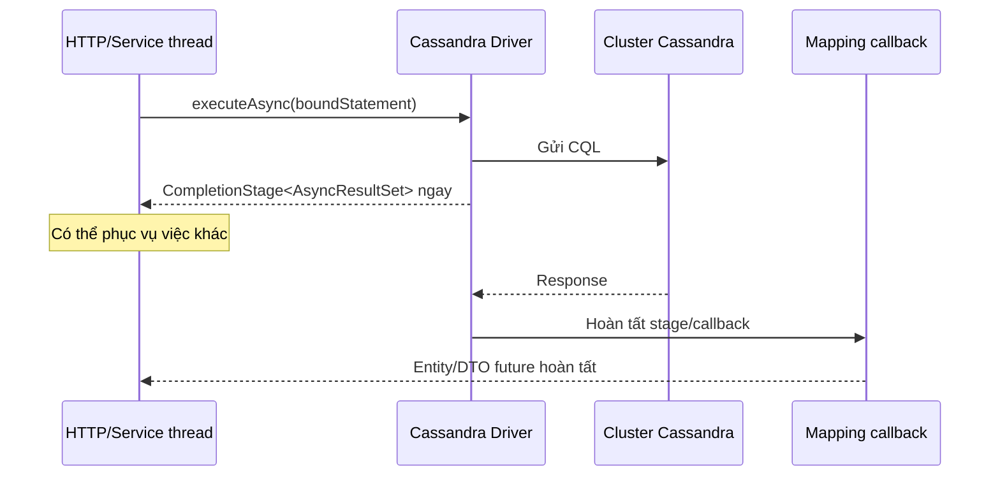

# CompletableFuture trong các thao tác ánh xạ entity

Khi một ứng dụng đọc hàng trăm booking từ Apache Cassandra, lập trình viên thường bắt đầu bằng cách gọi Repository hoặc `CassandraTemplate` theo kiểu đồng bộ: gửi truy vấn, chờ kết quả, ánh xạ hàng dữ liệu thành entity, rồi trả phản hồi. Trong hệ thống có nhiều request đồng thời, việc **chặn một thread trong lúc chờ network** có thể tiêu tốn đáng kể tài nguyên. Java cung cấp `CompletionStage` và `CompletableFuture` để biểu diễn **kết quả có ở tương lai** và kết hợp các bước xử lý mà không bắt buộc block thread đang gọi.

Tuy nhiên, có một khác biệt rất quan trọng:

- **Thực thi CQL bất đồng bộ**: tầng driver thực sự sử dụng API không chặn, ví dụ `CqlSession.executeAsync(...)`.
- **Ánh xạ entity bất đồng bộ**: khi `Row` đã đến, code chuyển dữ liệu sang entity/DTO trong một callback; bước mapping này vẫn **tiêu thụ CPU và chạy trên một thread cụ thể**.
- **Bọc lời gọi đồng bộ trong CompletableFuture**: có thể chuyển việc chờ sang một thread pool, nhưng **không biến hoạt động I/O đồng bộ thành I/O không chặn**.

Bài này thuộc chương **Truy cập bất đồng bộ** của module **`SPRING_DATA_CASSANDRA`**. Module tập trung vào truy cập Apache Cassandra thông qua entity mapping, Repository, `CassandraTemplate` và CQL; thiết kế bảng theo truy vấn, partition key, consistency, paging và hiệu năng để hoạt động đúng với hệ thống phân tán. Chúng ta sẽ dùng **Java Driver 4.x**, các công cụ ánh xạ của Spring Data Cassandra và API `CompletableFuture` để xây đường đọc/ghi bất đồng bộ, đồng thời xác định ranh giới thread, timeout, backpressure và lỗi.

**Sau bài học, bạn có thể:**

1. Phân biệt `CompletionStage<T>`, `CompletableFuture<T>` và `AsyncResultSet` của Cassandra Java Driver.
2. Đọc hàng bằng `executeAsync`, ánh xạ `Row` thành **entity** bằng `CassandraConverter` hoặc thành **DTO** bằng mã mapping tường minh.
3. Viết thao tác ghi entity bất đồng bộ qua prepared statement mà không gọi `get()`/`join()` trong request path.
4. Kết hợp `thenApply`, `thenCompose`, `exceptionally`, `handle` và `whenComplete` đúng mục đích.
5. Duyệt dữ liệu phân trang với `currentPage()`, `hasMorePages()` và `fetchNextPage()`.
6. Hiểu khi nào phải dùng `thenApplyAsync(..., Executor)` để không chiếm driver I/O threads.
7. Xây giới hạn concurrent requests, timeout, cancellation, consistency và idempotency hợp lý.
8. Biết khi nào nên chọn Reactive Spring Data Cassandra thay cho tự tạo nhiều `CompletableFuture`.

## 1. Đồng bộ và bất đồng bộ khác nhau ở đâu?

Với phương thức đồng bộ:

```java
Row row = session.execute(statement).one();
BookingSummary summary = row == null ? null : mapSummary(row);
return summary;
```

Thread gọi `execute` phải chờ hoạt động I/O hoàn tất rồi mới nhận `ResultSet`. Khi truy vấn Cassandra kéo dài vài chục mili giây, phần lớn thời gian đó có thể là **chờ network/coordinator/replica**.

Với API bất đồng bộ:

```java
CompletionStage<AsyncResultSet> stage =
        session.executeAsync(statement);

CompletionStage<BookingSummary> mapped =
        stage.thenApply(result -> {
            java.util.Iterator<Row> rows =
                    result.currentPage().iterator();
            return rows.hasNext() ? mapSummary(rows.next()) : null;
        });
```

Method có thể **trả stage ngay**, và phép ánh xạ chạy khi kết quả có sẵn. Thread gọi không cần chờ đồng bộ để lấy hàng.

### Sơ đồ xử lý



Sơ đồ nói về luồng bất đồng bộ **ở tầng ứng dụng**, không cam kết một callback chạy trên thread nào. `CompletableFuture` không tự biến các thao tác CPU/DB khác bên trong callback thành không chặn.

## 2. Ba kiểu cốt lõi

| Kiểu | Thuộc thư viện | Vai trò |
| --- | --- | --- |
| `CompletionStage<T>` | Java `java.util.concurrent` | Giao diện tạo pipeline khi kết quả `T` hoàn tất |
| `CompletableFuture<T>` | Java `java.util.concurrent` | Implementation của `CompletionStage`, hỗ trợ hoàn tất chủ động và thêm tiện ích |
| `AsyncResultSet` | Java Driver 4.x của Cassandra | Kết quả truy vấn bất đồng bộ, có thể chứa **một trang hiện tại** và khả năng fetch trang tiếp |
| `Row` | Java Driver | Một hàng CQL với column definitions và getters có kiểu |
| `CassandraConverter` | Spring Data Cassandra | Mapping giữa hàng CQL và đối tượng ứng dụng theo metadata entity |

Ví dụ API điển hình:

```java
CompletionStage<AsyncResultSet> stage =
        session.executeAsync(boundStatement);

CompletableFuture<AsyncResultSet> future =
        stage.toCompletableFuture();
```

**Điểm cần hiểu:** `executeAsync` trả `CompletionStage`, không phải luôn khai báo trực tiếp `CompletableFuture` trong chữ ký driver. Bạn có thể **giữ kiểu `CompletionStage` bên trong tầng DAO** để hạn chế quyền hoàn tất tùy tiện, hoặc chuyển sang `CompletableFuture` khi API ứng dụng yêu cầu.

### Future chưa có nghĩa là truy vấn đã hoàn tất

`CompletableFuture<BookingRecord>` là **một lời hứa kết quả hoặc exception**. Việc tạo ra object đó không chứng minh câu CQL đã trả về, và không tự thực hiện validation/authorization hoặc bảo đảm consistency.

## 3. Bảng Cassandra và entity dùng xuyên suốt

Để tập trung vào cơ chế async và mapping, ta chọn bảng tra cứu **một booking theo ID**:

```sql
CREATE TABLE IF NOT EXISTS bookings_by_id (
    booking_id uuid PRIMARY KEY,
    tenant_id uuid,
    status text,
    created_at timestamp,
    total_amount_cents bigint
);
```

| Cột | Mục đích |
| --- | --- |
| `booking_id` | Partition key; point lookup theo booking ID |
| `tenant_id` | Tenant sở hữu booking, cần kiểm tra quyền |
| `status` | Trạng thái nghiệp vụ |
| `created_at` | Thời điểm tạo booking |
| `total_amount_cents` | Số tiền theo đơn vị nhỏ để tránh sai số float |

Query cho một booking:

```sql
SELECT booking_id, tenant_id, status,
       created_at, total_amount_cents
FROM bookings_by_id
WHERE booking_id = ?;
```

**Lưu ý đa tenant:** bảng này định vị bằng `booking_id`, còn `tenant_id` là **cột thường**. Bạn không thể mặc định thêm `AND tenant_id = ?` như thể tenant là một phần partition key; phải **kiểm tra tenant sau khi đọc** hoặc thiết kế một bảng có partition key chứa tenant nếu đó là yêu cầu bảo mật/đường truy vấn chính. Mapping async không thay thế phân quyền.

### Entity Spring Data Cassandra

```java
package example.booking.data;

import java.time.Instant;
import java.util.UUID;
import org.springframework.data.cassandra.core.mapping.Column;
import org.springframework.data.cassandra.core.mapping.PrimaryKey;
import org.springframework.data.cassandra.core.mapping.Table;

@Table("bookings_by_id")
public class BookingRecord {

    @PrimaryKey("booking_id")
    private UUID bookingId;

    @Column("tenant_id")
    private UUID tenantId;

    @Column("status")
    private String status;

    @Column("created_at")
    private Instant createdAt;

    @Column("total_amount_cents")
    private Long totalAmountCents;

    public BookingRecord() {
    }

    public UUID getBookingId() { return bookingId; }
    public UUID getTenantId() { return tenantId; }
    public String getStatus() { return status; }
    public Instant getCreatedAt() { return createdAt; }
    public Long getTotalAmountCents() { return totalAmountCents; }

    public void setBookingId(UUID value) { bookingId = value; }
    public void setTenantId(UUID value) { tenantId = value; }
    public void setStatus(String value) { status = value; }
    public void setCreatedAt(Instant value) { createdAt = value; }
    public void setTotalAmountCents(Long value) {
        totalAmountCents = value;
    }
}
```

Annotation xác định tên bảng/cột và primary key. Tầng `CassandraConverter` có thể dùng metadata của entity để mapping `Row` thành `BookingRecord`. Kiểu `Instant` ứng với CQL `timestamp`, `UUID` ứng với `uuid` và `Long` ứng với `bigint` khi codec/conversions tương thích.

**Ranh giới cần nhớ:** entity mapping không tự tạo async request; đó là công việc của driver/abstraction thực thi query.

## 4. Projection DTO giúp giảm lượng dữ liệu phải ánh xạ

Màn hình danh sách chỉ cần ID, trạng thái và thời gian; không nhất thiết đọc mọi cột.

```java
package example.booking.api;

import java.time.Instant;
import java.util.UUID;

public record BookingSummary(
        UUID bookingId,
        String status,
        Instant createdAt) {
}
```

Prepared query:

```sql
SELECT booking_id, status, created_at
FROM bookings_by_id
WHERE booking_id = ?;
```

Hàm mapping:

```java
import com.datastax.oss.driver.api.core.cql.Row;

static BookingSummary mapSummary(Row row) {
    return new BookingSummary(
            row.getUuid("booking_id"),
            row.getString("status"),
            row.getInstant("created_at"));
}
```

**Lợi ích:** số cột đọc từ Cassandra giảm, số byte trên network và công việc mapping ít hơn. Đây là **projection tại CQL**, không chỉ chuyển một full entity thành DTO sau khi đã đọc hết các cột.

**Không đồng nhất mọi interface projection với SELECT ít cột**: một số cơ chế projection của Spring Data có thể dựng object sau khi đọc nhiều cột; nếu tối ưu payload quan trọng, xác minh câu CQL thực tế.

## 5. CompletableFuture đọc một entity từ CassandraConverter

Spring Data Cassandra cung cấp mapping converter có thể đọc một `Row` thành entity. Với Java Driver 4.x, ta có thể kết hợp **driver async** và **Spring Data conversion**:

```java
package example.booking.data;

import java.util.Iterator;
import java.util.Optional;
import java.util.UUID;
import java.util.concurrent.CompletableFuture;

import com.datastax.oss.driver.api.core.CqlSession;
import com.datastax.oss.driver.api.core.DefaultConsistencyLevel;
import com.datastax.oss.driver.api.core.cql.AsyncResultSet;
import com.datastax.oss.driver.api.core.cql.BoundStatement;
import com.datastax.oss.driver.api.core.cql.PreparedStatement;
import com.datastax.oss.driver.api.core.cql.Row;

import org.springframework.data.cassandra.core.convert.CassandraConverter;

public final class AsyncBookingReader {
    private final CqlSession session;
    private final CassandraConverter converter;
    private final PreparedStatement selectById;

    public AsyncBookingReader(
            CqlSession session, CassandraConverter converter) {
        this.session = session;
        this.converter = converter;
        this.selectById = session.prepare("""
            SELECT booking_id, tenant_id, status,
                   created_at, total_amount_cents
            FROM bookings_by_id
            WHERE booking_id = ?
            """);
    }

    public CompletableFuture<Optional<BookingRecord>> findById(
            UUID bookingId) {

        BoundStatement statement = selectById.bind(bookingId)
                .setConsistencyLevel(
                        DefaultConsistencyLevel.LOCAL_QUORUM)
                .setIdempotent(true);

        return session.executeAsync(statement)
                .thenApply(this::mapFirstRow)
                .toCompletableFuture();
    }

    private Optional<BookingRecord> mapFirstRow(
            AsyncResultSet result) {
        Iterator<Row> rows = result.currentPage().iterator();
        if (!rows.hasNext()) {
            return Optional.empty();
        }
        BookingRecord entity = converter.read(
                BookingRecord.class, rows.next());
        return Optional.of(entity);
    }
}
```

Trong đoạn code:

1. `session.prepare(...)` chạy **một lần lúc khởi tạo gateway** (ở đây là sync setup), không prepare lại trên mỗi request.
2. `executeAsync` thực hiện CQL không chặn thread gọi trong thời gian chờ I/O.
3. `thenApply` chỉ chạy khi stage đầu đã hoàn tất thành công và `AsyncResultSet` sẵn sàng.
4. `CassandraConverter.read(BookingRecord.class, row)` sử dụng metadata Spring Data để ánh xạ full entity.
5. Nếu query không có hàng, phương thức trả `Optional.empty()` bên trong future.
6. Nếu driver/mapping phát sinh exception, future **hoàn tất thất bại**, thay vì trả null như thành công.

**Về phiên bản:** ví dụ hướng tới Spring Data Cassandra dùng Java Driver 4.x và API `CassandraConverter.read(Class<T>, Row)`. Kiểm tra đúng chữ ký converter và kiểu hỗ trợ trong dependency thực tế; nếu không có API mapping phù hợp hoặc cần projection nhỏ, dùng `RowMapper`/DTO thủ công như mục 4. Không tự khởi tạo một converter chưa cấu hình custom conversions, naming strategy và mapping context của ứng dụng.

## 6. Vì sao gọi currentPage() thay vì duyệt toàn ResultSet?

`AsyncResultSet` không giống `ResultSet` đồng bộ tự cung cấp một iterator duyệt toàn bộ kết quả. Với Java Driver 4.x:

```java
for (Row row : asyncResultSet.currentPage()) {
    // Chỉ những hàng hiện có ở trang này.
}
```

`currentPage()` chỉ là **trang đã tải**. Để có trang kế tiếp phải kiểm tra `hasMorePages()` rồi gọi `fetchNextPage()`.

Trong một point lookup theo `booking_id`, nhiều khả năng chỉ có không hoặc một hàng, nên lấy phần tử đầu của `currentPage()` là hợp lý. Nhưng với truy vấn **một partition có nhiều hàng**, chỉ map `currentPage()` rồi coi như đã đọc hết có thể làm **thiếu dữ liệu**.

| Truy vấn | Kết quả kỳ vọng | Hành vi cần triển khai |
| --- | --- | --- |
| `WHERE booking_id = ?`, partition key duy nhất | 0–1 row | Map hàng đầu hoặc empty |
| `WHERE tenant_id = ? AND day = ?` | Có thể nhiều rows | Paging với `fetchNextPage()` |
| Multi-partition query có `IN` | Nhiều partition, fan-out | Cân nhắc số ID và page size |
| Analytics/scan rộng | Nhiều hàng, tốn tải | Xem lại data model hoặc pipeline chuyên dụng |

**Async không làm một truy vấn quét lớn trở nên rẻ**. Đường truy vấn phải tuân đúng partition key và kích thước kết quả được giới hạn.

## 7. CompletableFuture đọc DTO mà không cần converter

Nếu chỉ đọc projection ít cột, chuyển Row sang DTO có thể dễ kiểm soát hơn:

```java
import java.util.Iterator;
import java.util.Optional;
import java.util.UUID;
import java.util.concurrent.CompletableFuture;
import com.datastax.oss.driver.api.core.cql.AsyncResultSet;
import com.datastax.oss.driver.api.core.cql.Row;

public CompletableFuture<Optional<BookingSummary>> findSummary(
        UUID bookingId) {
    return session.executeAsync(selectSummary.bind(bookingId))
        .thenApply((AsyncResultSet result) -> {
            Iterator<Row> rows = result.currentPage().iterator();
            if (!rows.hasNext()) {
                return Optional.<BookingSummary>empty();
            }
            return Optional.of(mapSummary(rows.next()));
        })
        .toCompletableFuture();
}
```

Đoạn này giả định `session`, prepared statement `selectSummary` và hàm `mapSummary` đã được định nghĩa trong gateway. So với converter:

| Cách mapping | Phù hợp khi | Đánh đổi |
| --- | --- | --- |
| `CassandraConverter.read(...)` | Entity mapping với annotation, custom conversions | Cần cấu hình Spring Data converter đúng |
| `Row` getters thủ công | Projection nhỏ, query shape rõ | Nhiều mã mapping nếu hàng có nhiều field |
| Repository/`CassandraTemplate` | CRUD/query thông thường | Không tự chứng minh API async đúng theo driver |
| Reactive mapping | Pipeline streaming/backpressure | Cần kiến trúc reactive và hiểu Publisher |

**Chọn cách ánh xạ nhất quán với loại dữ liệu đang đọc**, không ép DTO thành entity chỉ để tái sử dụng converter.

## 8. CompletableFuture của thao tác ghi entity

Một thao tác ghi cũng có thể được thực hiện qua `executeAsync`. Giả sử ứng dụng đã validate entity và authorization:

```java
import java.util.concurrent.CompletableFuture;
import com.datastax.oss.driver.api.core.cql.PreparedStatement;
import com.datastax.oss.driver.api.core.cql.BoundStatement;

private final PreparedStatement insertBooking =
        session.prepare("""
            INSERT INTO bookings_by_id (
                booking_id, tenant_id, status,
                created_at, total_amount_cents
            ) VALUES (?, ?, ?, ?, ?)
            """);

public CompletableFuture<Void> insertAsync(BookingRecord entity) {
    BoundStatement statement = insertBooking.bind(
            entity.getBookingId(),
            entity.getTenantId(),
            entity.getStatus(),
            entity.getCreatedAt(),
            entity.getTotalAmountCents());

    return session.executeAsync(statement)
            .thenApply(ignored -> (Void) null)
            .toCompletableFuture();
}
```

Đoạn mã là **mảnh method minh họa** đặt bên trong gateway; không dùng nó như một class hoàn chỉnh vì phần khai báo `session`/constructor nằm ngoài. Ở đây **entity-to-bind mapping được viết tường minh**: ta lấy các field của entity rồi bind theo thứ tự marker.

**Lưu ý lớn:** `INSERT` trong Cassandra thường có ngữ nghĩa **upsert**, không phải “chỉ tạo khi chưa tồn tại”. Nếu yêu cầu “không ghi đè booking đang có”, cần `IF NOT EXISTS`/LWT và đọc `[applied]`; async không thay đổi semantics.

### Future<Void> nói gì?

`CompletableFuture<Void>` hoàn tất thành công nghĩa là driver đã nhận phản hồi thành công theo consistency của statement. Nó không có nghĩa:

- Tất cả DC trên toàn thế giới đã nhìn thấy dữ liệu ngay.
- Các bảng denormalized khác đã được cập nhật.
- Side effects như payment/email đã hoàn tất.
- Một transaction multi-table đã commit.

**Không gọi `future.complete(null)` bằng tay trên future do driver cung cấp** để giả vờ truy vấn đã hoàn tất.

## 9. Viết có điều kiện: Future<Boolean> với LWT

Khi dùng `INSERT ... IF NOT EXISTS` hoặc `UPDATE ... IF`, Cassandra trả **conditional result**. Với Java Driver, có thể đọc `AsyncResultSet.wasApplied()`:

```java
import java.util.concurrent.CompletableFuture;
import com.datastax.oss.driver.api.core.DefaultConsistencyLevel;

private final PreparedStatement insertIfAbsent =
        session.prepare("""
            INSERT INTO bookings_by_id (
                booking_id, tenant_id, status
            ) VALUES (?, ?, ?)
            IF NOT EXISTS
            """);

public CompletableFuture<Boolean> insertIfAbsentAsync(
        UUID bookingId, UUID tenantId, String status) {

    BoundStatement bound = insertIfAbsent.bind(
                    bookingId, tenantId, status)
            .setConsistencyLevel(
                    DefaultConsistencyLevel.LOCAL_QUORUM)
            .setSerialConsistencyLevel(
                    DefaultConsistencyLevel.LOCAL_SERIAL)
            .setIdempotent(false);

    return session.executeAsync(bound)
            .thenApply(AsyncResultSet::wasApplied)
            .toCompletableFuture();
}
```

Điều kiện `IF NOT EXISTS` là **LWT/Paxos**; `[applied] = false` nghĩa là **không được tạo vì điều kiện không khớp**, không phải driver timeout.

Nếu future hoàn tất **exceptionally** vì timeout, kết quả có thể **chưa xác định từ góc nhìn client**. Không được tự biến mọi exception thành `false`. Muốn giải thích conflict bằng dữ liệu đang tồn tại, có thể đọc `Row` của conditional response hoặc SELECT lại, kèm kiểm tra quyền.

Với nhiều datacenter, lựa chọn `LOCAL_SERIAL`/`SERIAL` phải phù hợp phạm vi writer và invariant nghiệp vụ; **không mặc định LOCAL_SERIAL ở hai DC bảo vệ uniqueness toàn cục**.

## 10. thenApply: biến đổi kết quả khi đã có Row

`thenApply(Function<T,R>)` dùng khi từ một kết quả đầu vào ta **tính ra ngay một giá trị mới**, không khởi tạo thêm một thao tác bất đồng bộ.

```java
CompletableFuture<Optional<BookingRecord>> entityFuture =
        reader.findById(bookingId);

CompletableFuture<Optional<String>> statusFuture =
        entityFuture.thenApply(
                maybeBooking -> maybeBooking.map(
                        BookingRecord::getStatus));
```

Pipeline:

```text
CompletionStage<AsyncResultSet>
    -> thenApply(Row -> BookingRecord)
    -> thenApply(BookingRecord -> status)
    -> CompletableFuture<status>
```

**Không nên chèn network I/O hoặc công việc chặn lâu trong `thenApply`**. Callback có thể được thực hiện trên thread hoàn tất stage, bao gồm thread có liên quan đến driver; xử lý nặng khiến tầng I/O bị chiếm dụng.

## 11. thenCompose: khi bước tiếp theo cũng bất đồng bộ

`thenCompose` dùng để nối các thao tác async tuần tự, tránh tạo future lồng future.

Ví dụ đọc booking rồi đọc bảng chi tiết khác nếu booking tồn tại và caller đã có quyền:

```java
CompletableFuture<Optional<BookingDetails>> details =
        reader.findById(bookingId)
            .thenCompose(maybeBooking -> {
                if (maybeBooking.isEmpty()) {
                    return CompletableFuture.completedFuture(
                            Optional.<BookingDetails>empty());
                }
                BookingRecord booking = maybeBooking.get();
                authorizeTenant(booking, authenticatedTenantId);
                return detailsGateway.findAsync(
                        booking.getBookingId());
            });
```

Ví dụ giả định `detailsGateway.findAsync(...)` trả `CompletableFuture<Optional<BookingDetails>>` và `authorizeTenant(...)` ném exception khi không được phép. Đây là **đoạn minh họa pipeline**, không phải class hoàn chỉnh.

**Phân biệt kiểu:**

```java
// Tạo future lồng nhau:
CompletableFuture<CompletableFuture<Details>> nested =
        bookingFuture.thenApply(b -> findDetailsAsync(b));

// Làm phẳng thành một future:
CompletableFuture<Details> flat =
        bookingFuture.thenCompose(b -> findDetailsAsync(b));
```

**Nguyên tắc:** nếu lambda trả `T` → thường dùng `thenApply`; nếu lambda trả `CompletionStage<T>` → thường dùng `thenCompose`.

## 12. thenCombine và allOf: ghép truy vấn độc lập

Hai dữ liệu có thể được đọc **song song** nếu không phụ thuộc vào nhau:

```java
CompletableFuture<Optional<BookingRecord>> booking =
        reader.findById(bookingId);

CompletableFuture<Optional<PaymentSummary>> payment =
        paymentGateway.findByBookingIdAsync(bookingId);

CompletableFuture<BookingPageDto> page =
        booking.thenCombine(payment, (b, p) ->
                buildPageDto(b, p));
```

Đoạn trên giả định `paymentGateway` truy cập dữ liệu qua API phù hợp và `buildPageDto` làm việc CPU nhẹ; **không đồng nghĩa cả hai nguồn cùng tham gia một transaction**.

Nếu cần nhiều future:

```java
CompletableFuture<Void> all =
        CompletableFuture.allOf(future1, future2, future3);

CompletableFuture<List<BookingSummary>> combined =
        all.thenApply(ignored -> List.of(
                future1.join(), future2.join(), future3.join()));
```

`join()` trong đoạn này chỉ chạy **sau khi `allOf` đã hoàn tất thành công**, nên các future thành phần đã xong; không nên copy `join()` vào một request thread trước khi `allOf` hoàn tất.

**Đánh đổi:** `allOf` không tự giới hạn concurrency, số request Cassandra đang chạy hoặc memory. Không tạo hàng chục nghìn future cùng lúc rồi hy vọng driver tự bảo vệ hệ thống.

## 13. CompletableFuture không phải backpressure

Một phương thức `findById` trả ngay future khiến người gọi có thể dễ dàng tạo 20.000 query đồng thời:

```java
// Anti-pattern: phát quá nhiều request không có giới hạn.
for (UUID id : massiveIdList) {
    futures.add(reader.findById(id));
}
```

Các tác hại có thể có:

1. Tăng request in-flight tại driver và coordinator.
2. Chiếm nhiều heap cho futures, rows và entities.
3. Đẩy tải không đều vào hot partitions.
4. Gây timeout, retry khuếch đại tải và tăng p99.
5. Khi response về cùng lúc, mapping callback có thể gây CPU burst.

**Backpressure/concurrency limit phải là chính sách chủ động**. Có thể dùng hàng đợi có giới hạn, semaphore không chặn, executor với bounded queue, rate limit hoặc một stream framework hỗ trợ demand.

Async API **không đồng nghĩa “gửi bao nhiêu request cũng được”**.

## 14. Giới hạn in-flight requests bằng Semaphore

Ví dụ pattern **từ chối khi quá tải** thay vì block driver I/O thread:

```java
import java.util.Optional;
import java.util.UUID;
import java.util.concurrent.CompletableFuture;
import java.util.concurrent.CompletionStage;
import java.util.concurrent.RejectedExecutionException;
import java.util.concurrent.Semaphore;

public final class LimitedBookingReader {
    private final Semaphore permits = new Semaphore(100);
    private final AsyncBookingReader delegate;

    public LimitedBookingReader(AsyncBookingReader delegate) {
        this.delegate = delegate;
    }

    public CompletableFuture<Optional<BookingRecord>> findById(
            UUID id) {

        if (!permits.tryAcquire()) {
            return CompletableFuture.failedFuture(
                new RejectedExecutionException(
                    "Too many Cassandra requests in flight"));
        }

        try {
            CompletionStage<Optional<BookingRecord>> stage =
                    delegate.findById(id);
            return stage.whenComplete(
                    (result, failure) -> permits.release())
                    .toCompletableFuture();
        } catch (RuntimeException ex) {
            permits.release();
            return CompletableFuture.failedFuture(ex);
        }
    }
}
```

Ở đây:

- `tryAcquire()` **không chặn** thread; khi hết slot, trả future lỗi để tầng trên áp dụng overload policy.
- Permit được trả khi dependent stage hoàn tất, **dù thành công hay thất bại**.
- 100 là **ngưỡng minh họa**, cần đo theo topology, pool, row size, QPS và SLA.
- `CompletableFuture.failedFuture` yêu cầu Java 9+; các ứng dụng Spring hiện đại thường chạy JDK mới hơn.

**Caveat quan trọng:** nếu caller tự dùng `orTimeout` hoặc `cancel` trên future trả ra, **đừng tự suy rằng underlying Cassandra request đã dừng và tài nguyên in-flight đã được giải phóng**. Một chiến lược production cần theo dõi **lifecycle của chính driver operation**, nhất là khi dùng timeout/cancellation ở nhiều tầng. Đừng giải phóng permit sớm chỉ vì HTTP caller không còn chờ trong khi CQL vẫn đang chạy.

## 15. thenApply và thenApplyAsync chạy trên thread nào?

`CompletableFuture` có hai kiểu continuation chính:

```java
// Không chỉ định executor:
stage.thenApply(result -> mapLightweight(result));

// Chuyển mapping sang executor có kiểm soát:
stage.thenApplyAsync(
        result -> mapExpensive(result),
        mappingExecutor);
```

**`thenApply`** thường chạy trên thread hoàn tất stage (hoặc thread đăng ký nếu future đã hoàn tất), theo quy tắc của `CompletableFuture`. Với driver, callback có thể chạy trên thread quan trọng đối với quá trình hoàn tất I/O.

**`thenApplyAsync`** đưa callback tới executor, giúp tách mapping nặng khỏi thread hoàn tất. Nhưng nó có thêm chi phí chuyển thread/queueing và **cần một executor có giới hạn**.

| Công việc | Hướng đề xuất |
| --- | --- |
| Đọc vài cột, tạo DTO nhỏ | `thenApply` thường đủ |
| Ánh xạ nhiều rows/UDTs, chuyển đổi nặng | Cân nhắc `thenApplyAsync` với bounded executor |
| Gọi HTTP đồng bộ hoặc đọc file trong callback | Tránh block; dùng API async hoặc offload |
| Gửi email, mã hóa/chuyển đổi payload lớn | Tách tác vụ, executor chuyên dụng hoặc queue |
| Đọc nhiều trang hàng trăm nghìn rows | Streaming/bounded paging, không gom hết |

**Không dùng `thenApplyAsync` mặc định cho mọi hàng**: đổi thread cho từng record có thể tốn hơn mapping thực tế, tăng overhead và context switching.

## 16. Cấu hình Executor cho mapping nặng

Một ví dụ `ExecutorService` có hàng đợi giới hạn:

```java
import java.util.concurrent.ArrayBlockingQueue;
import java.util.concurrent.ExecutorService;
import java.util.concurrent.ThreadPoolExecutor;
import java.util.concurrent.TimeUnit;

ExecutorService mappingExecutor = new ThreadPoolExecutor(
        4,
        8,
        30,
        TimeUnit.SECONDS,
        new ArrayBlockingQueue<>(200),
        new ThreadPoolExecutor.AbortPolicy());
```

`AbortPolicy` khiến thao tác mới bị từ chối khi hàng đợi và worker đều đầy, thay vì tích tụ vô hạn trong heap. Ở ứng dụng Spring, executor nên là **bean được quản lý vòng đời**, shutdown khi context đóng và cấu hình thông qua capacity test.

### Rủi ro khi executor từ chối mapping

`thenApplyAsync` có thể khiến dependent future hoàn tất exceptionally vì `RejectedExecutionException`. Query Cassandra có thể **đã thành công** nhưng không có tài nguyên mapping để tạo entity/DTO. Vì vậy:

- Không coi mọi exception mapping là “Cassandra không đọc được”.
- Đo queue depth, rejection count và mapping latency.
- Có overload response rõ ràng, giới hạn input và giải pháp backpressure trước khi query.
- Không dùng một executor duy nhất cho mọi blocking task của ứng dụng.

**Mapping nặng không được sửa bằng cách tăng vô hạn thread pool.** Cần giảm kích thước row/projection và tối ưu query trước.

## 17. Async paging với AsyncResultSet

Cho bài toán: “Lấy một nhóm booking của tenant trong một ngày”, dùng bảng theo partition key:

```sql
CREATE TABLE IF NOT EXISTS bookings_by_tenant_day (
    tenant_id uuid,
    booking_day date,
    booking_id uuid,
    status text,
    created_at timestamp,
    PRIMARY KEY ((tenant_id, booking_day), booking_id)
);
```

CQL:

```sql
SELECT booking_id, status, created_at
FROM bookings_by_tenant_day
WHERE tenant_id = ?
  AND booking_day = ?;
```

Với Java Driver:

```java
BoundStatement statement = selectByTenantDay
        .bind(tenantId, day)
        .setPageSize(20);

CompletionStage<AsyncResultSet> firstPage =
        session.executeAsync(statement);

CompletionStage<AsyncResultSet> secondPage =
        firstPage.thenCompose(page ->
            page.hasMorePages()
                ? page.fetchNextPage()
                : CompletableFuture.completedFuture(page));
```

**Không dùng `setPageSize(20)` như giới hạn tổng số hàng**. Nó là mục tiêu page fetch, không phải bảo đảm xử lý tối đa 20 hàng cho cả request. Một truy vấn có thể trả nhiều trang và việc duyệt đầy đủ có thể tạo nhiều round trip.

## 18. Đọc tối đa hai trang mà không chặn

Ví dụ có giới hạn trang rõ ràng, thay vì `while` + `join`:

```java
import java.util.ArrayList;
import java.util.List;
import java.util.concurrent.CompletableFuture;
import java.util.concurrent.CompletionStage;
import com.datastax.oss.driver.api.core.cql.AsyncResultSet;
import com.datastax.oss.driver.api.core.cql.Row;

private CompletionStage<List<BookingSummary>> collectPages(
        AsyncResultSet page,
        List<BookingSummary> collected,
        int remainingPages) {

    for (Row row : page.currentPage()) {
        collected.add(mapSummary(row));
    }

    if (remainingPages <= 1 || !page.hasMorePages()) {
        return CompletableFuture.completedFuture(
                List.copyOf(collected));
    }

    return page.fetchNextPage()
            .thenCompose(next ->
                collectPages(next, collected, remainingPages - 1));
}

public CompletableFuture<List<BookingSummary>> readTwoPages(
        BoundStatement query) {
    return session.executeAsync(query.setPageSize(20))
            .thenCompose(page ->
                collectPages(page, new ArrayList<>(), 2))
            .toCompletableFuture();
}
```

Code là **mảnh gateway**: `session` và `mapSummary` nằm trong class xung quanh. `collected` chỉ được sửa bởi **chuỗi callback tuần tự**, không chia sẻ cho các request khác. `remainingPages = 2` là ranh giới rõ.

### Giới hạn thêm cần có ở production

1. Max rows và bytes được chấp nhận, **độc lập với page size**.
2. Giới hạn số lần `fetchNextPage` và thời gian xử lý.
3. Quy định client **có nhận next-page cursor** hay chỉ nhận kết quả đã tổng hợp.
4. Không trả một List chứa mọi hàng của partition vô hạn.
5. Khi ghi/đọc đồng thời, không giả định các trang là **snapshot transaction bất biến**.

**Đường code trên gom tối đa hai trang vào memory**; muốn xử lý dữ liệu rất lớn, cân nhắc **stream từng trang đến consumer có backpressure** thay vì tích lũy mọi entity trong list.

## 19. Vì sao không gọi join() giữa các trang?

Anti-pattern:

```java
AsyncResultSet page = session.executeAsync(statement)
        .toCompletableFuture()
        .join();

while (page.hasMorePages()) {
    page = page.fetchNextPage()
            .toCompletableFuture()
            .join();
}
```

Đoạn này **chặn thread hiện tại** tại mỗi `join()`. Nếu chạy trên HTTP request thread, mục tiêu không chặn đã mất; nếu chạy trong driver callback, có thể gây **thread starvation/deadlock-like behavior** khi callback đang giữ những thread quan trọng để nhận response.

**Giải pháp:** dùng `thenCompose` để chờ trang tiếp theo trong pipeline. Nếu yêu cầu của bạn thực sự chỉ có workflow đồng bộ, có thể chọn `session.execute(...)` một cách tường minh thay vì giấu blocking sau chữ “Async”.

## 20. Đọc và ghi bất đồng bộ không đồng nghĩa transaction

Giả sử service thực hiện:

```java
return gateway.insertAsync(booking)
    .thenCompose(ignored ->
        eventsGateway.insertEventAsync(event));
```

Đây là **hai bước bất đồng bộ theo thứ tự**, không phải một transaction Cassandra đa bảng/partition. Nếu bước một hoàn tất nhưng bước hai thất bại, bước một **không tự rollback**.

Tương tự:

```java
CompletableFuture<Void> both =
        CompletableFuture.allOf(
                gateway.insertAsync(booking),
                eventsGateway.insertEventAsync(event));
```

`allOf` giúp **đợi hai futures**, nhưng không tạo atomic commit cho chúng. Trong trường hợp một future thất bại, thao tác kia có thể đã hoàn tất. Cần **idempotency, outbox/reconciliation hoặc compensation** theo nghiệp vụ.

**Quy tắc:** composition là orchestration trong ứng dụng; transaction semantics thuộc hệ lưu trữ và thiết kế workflow.

## 21. Xử lý exception: CompletionException và nguyên nhân gốc

Khi một future thất bại, exception có thể đi qua `CompletionException` (hoặc `ExecutionException` nếu có code chặn bằng `get()`). Lỗi gốc có thể là:

- Read/write timeout từ driver.
- Unavailable/overload từ cluster.
- Syntax/schema/type mapping error.
- Conversion exception khi map `Row` sang entity.
- `RejectedExecutionException` từ mapping executor.
- Lỗi phân quyền nghiệp vụ ở callback.

Ví dụ phân loại:

```java
import java.util.concurrent.CompletionException;

static Throwable unwrap(Throwable failure) {
    Throwable current = failure;
    while (current instanceof CompletionException
            && current.getCause() != null) {
        current = current.getCause();
    }
    return current;
}
```

Không nên chỉ:

```java
future.exceptionally(failure -> null);
```

vì nó biến **timeout, dữ liệu không tồn tại và lỗi mapping** thành một kết quả giống nhau. Hãy dùng domain error hoặc exception có cấu trúc, và giữ stack trace để vận hành.

### Missing row khác failed future

| Trường hợp | Cách biểu diễn |
| --- | --- |
| Query thành công, không có hàng | `CompletableFuture.completedFuture(Optional.empty())` |
| Query thành công, có entity | Future hoàn tất với `Optional.of(entity)` |
| Truy vấn lỗi/timeout | Future hoàn tất **exceptionally** |
| LWT có phản hồi `[applied] = false` | Future hoàn tất **thành công** với kết quả điều kiện false |
| Caller hủy/không còn chờ | Trạng thái local cancellation, không suy ra query đã bị hủy ở cluster |

## 22. exceptionally, handle và whenComplete

Ba API rất dễ bị nhầm:

| API | Công dụng | Có đổi kết quả không? |
| --- | --- | --- |
| `exceptionally(fn)` | Chỉ chạy khi stage thất bại, có thể tạo fallback | **Có**, nếu trả giá trị thay thế |
| `handle((value,error) -> ...)` | Chạy cả thành công và thất bại; chuyển thành một kết quả khác | **Có** |
| `whenComplete((value,error) -> ...)` | Quan sát completion để log/metrics/cleanup | Thường **không thay** outcome gốc, trừ khi callback tự ném lỗi |

Ví dụ có fallback **chỉ cho read cache không quan trọng**:

```java
CompletableFuture<Optional<BookingSummary>> result =
    gateway.findSummary(bookingId)
        .exceptionally(failure -> {
            recordFailure(unwrap(failure));
            return Optional.empty(); // Chỉ khi API contract cho phép.
        });
```

**Cảnh báo:** fallback `Optional.empty()` ở ví dụ trên **không nên dùng cho booking/payment cần phân biệt not found và outage**. Chỉ dùng fallback khi UI/metric có contract rõ ràng rằng cache miss có thể được trả thay lỗi.

Ví dụ quan sát metrics:

```java
long start = System.nanoTime();

return gateway.findSummary(bookingId)
    .whenComplete((value, error) -> {
        long elapsedNanos = System.nanoTime() - start;
        recordLatency(elapsedNanos, error == null);
    });
```

**Dừng ở telemetry nhẹ** trong `whenComplete`. Đừng gọi database sync, gửi email hoặc ném lỗi mới từ logging callback.

## 23. Timeout: phía client bỏ chờ không có nghĩa mutation chưa xảy ra

`CompletableFuture` có tiện ích:

```java
CompletableFuture<Optional<BookingRecord>> timed =
        reader.findById(bookingId)
              .orTimeout(2, TimeUnit.SECONDS);
```

Đây là **timeout ở tầng future phía ứng dụng**. Nó không tự cam kết **CQL đã bị hủy trên server** hoặc Cassandra không còn thực thi. Với một **ghi**:

```text
Client gửi UPDATE/INSERT
  -> coordinator/replica xử lý
  -> HTTP future hết hạn chờ
  -> mutation có thể đã được áp dụng
```

Vì vậy cần phân biệt:

1. **Driver request timeout** được cấu hình ở tầng Cassandra.
2. **Application/HTTP timeout** của request.
3. **Client disconnect/cancellation**.
4. **Business timeout** (ví dụ booking hết hạn).

Các tầng timeout không tự đồng nhất và không tạo rollback. Trong một workflow ghi có điều kiện, nếu không nhận được phản hồi `[applied]`, kết quả có thể **chưa rõ** và cần idempotency/reconciliation.

### Một lưu ý về orTimeout

`orTimeout` **thay đổi trạng thái của chính CompletableFuture đang được gọi**. Nếu nhiều consumer dùng chung future, một consumer áp timeout có thể khiến consumer khác thấy cùng timeout. Khi cần các hợp đồng thời gian chờ khác nhau, thiết kế wrapper/derived future riêng và xác định rõ chính sách xử lý operation gốc.

## 24. Cancellation không phải hủy giao dịch Cassandra

Một HTTP client đóng kết nối khi request vẫn đang đọc có thể khiến ứng dụng muốn hủy future:

```java
future.cancel(true);
```

Đây là tín hiệu cancellation ở tầng Java `CompletableFuture`; tham số boolean không bảo đảm **ngắt thread driver**, **gửi cancel CQL thành công** hoặc **rollback mutation đã gửi**.

**Đối với read:** có thể không còn cần chuyển tiếp kết quả, nhưng cần giải phóng tài nguyên và tránh tiếp tục fetch các trang mới không cần thiết.

**Đối với write/LWT:** nếu request đã chạm cluster, cancellation không cho phép kết luận “ghi thất bại”; cần xử lý unknown outcome như timeout.

**Đối với batch/page loop:** khi hủy, ứng dụng phải dừng **khởi tạo các bước tiếp theo** nếu còn khả năng, thay vì tiếp tục đẩy hàng trăm CQL mới vào cluster.

## 25. @Async của Spring khác executeAsync của driver

Annotation `@Async` trong Spring có thể chạy một phương thức trên một executor khác. Ví dụ một service gọi repository đồng bộ:

```java
import java.util.Optional;
import java.util.UUID;
import java.util.concurrent.CompletableFuture;
import org.springframework.scheduling.annotation.Async;

public class BlockingRepositoryAdapter {
    private final BookingRepository repository;

    public BlockingRepositoryAdapter(BookingRepository repository) {
        this.repository = repository;
    }

    @Async("bookingExecutor")
    public CompletableFuture<Optional<BookingRecord>> findAsync(
            UUID id) {
        Optional<BookingRecord> value =
                repository.findById(id); // Vẫn là lời gọi blocking.
        return CompletableFuture.completedFuture(value);
    }
}
```

`@Async` yêu cầu **Spring async infrastructure/proxy được bật và method được gọi qua proxy**, không phải self-invocation. Nếu cấu hình đúng, việc chặn I/O chuyển từ request thread sang **thread của `bookingExecutor`**; thao tác `repository.findById` **vẫn blocking**.

**Không kết luận** phương pháp trên có cùng khả năng mở rộng như `CqlSession.executeAsync`. Thread pool của `@Async` cũng phải có giới hạn; nếu hàng nghìn query chờ, nó có thể bị tràn như mọi hệ thread-per-request khác.

### So sánh thực chất

| Cách | Chờ network ở đâu? | Khi cân nhắc |
| --- | --- | --- |
| Repository/CassandraTemplate đồng bộ | Trên thread gọi | Logic đơn giản, concurrency vừa phải |
| `@Async` bọc repository đồng bộ | Trong executor thread | Cần thích nghi một API sync tạm thời |
| Driver `executeAsync` | I/O không chặn thread caller theo driver model | Nhiều in-flight requests, pipeline future rõ |
| Spring Data Reactive Cassandra | Reactive Publisher, xử lý demand/backpressure | Ứng dụng reactive toàn luồng |

**Không trộn lẫn kiểu return Future với bản chất I/O**. Chữ ký `CompletableFuture<T>` chỉ mô tả kết quả, không đủ chứng minh bên trong thực sự nonblocking.

## 26. Spring Data Cassandra có API async sẵn không?

Các phiên bản Spring Data Cassandra đã có nhiều thế hệ abstraction, bao gồm template/repository đồng bộ, một số API bất đồng bộ lịch sử và hỗ trợ **Reactive Cassandra**. Các loại future và module cụ thể có thể thay đổi theo release train.

Vì vậy, không nên copy mù một ví dụ `AsyncCassandraTemplate`/`AsyncCassandraOperations` hay chữ ký repository `CompletableFuture<T>` từ **một bài viết dùng phiên bản khác** rồi giả định dự án của bạn có đúng API đó.

### Checklist phụ thuộc

1. Kiểm tra phiên bản **`spring-data-cassandra`** và **`spring-data-commons`** thực sự được resolve.
2. Kiểm tra driver đang dùng có `CqlSession.executeAsync`/`AsyncResultSet` hay không.
3. Xác nhận converter bean và chữ ký `CassandraConverter.read(...)` tương ứng với phiên bản.
4. Nếu dùng annotation repository async, xác nhận **module Cassandra hỗ trợ kiểu return/method đó**, không chỉ Spring Data Commons có một abstraction tương tự.
5. Nếu dùng reactive, kiểm tra `ReactiveCassandraRepository`/`ReactiveCassandraTemplate`, Reactor và các dependency tương thích.
6. Chạy integration test, nhất là pagination, custom conversions, null mapping và exception propagation.

**Phương án trong bài:** dùng driver 4.x `executeAsync` kết hợp `CassandraConverter` cho entity, thay vì dựa vào một template async có tên/API có thể khác giữa các nhánh Spring Data.

## 27. Khi nào nên chọn ReactiveCassandraTemplate?

`CompletableFuture` thích hợp khi có **một hoặc một nhóm truy vấn hữu hạn** cần ghép kết quả. Với một stream rất lớn, nhiều trang liên tục, nhiều subscriber hoặc yêu cầu **backpressure end-to-end**, reactive pipeline có thể phù hợp hơn.

Trong Spring Data Cassandra có các thành phần reactive như `ReactiveCassandraTemplate` và `ReactiveCassandraRepository` trên những phiên bản hỗ trợ. Dữ liệu thường được biểu diễn bằng `Mono<T>` hoặc `Flux<T>` của Reactor.

| Nhu cầu | CompletableFuture | Reactive |
| --- | --- | --- |
| Một booking theo ID | Rất phù hợp | Cũng phù hợp |
| Ghép hai truy vấn độc lập | `thenCombine` | `zip` |
| Một trang hữu hạn của nhiều row | `CompletionStage<List<T>>` hoặc DTO | `Flux<T>`/`collectList` |
| Nhiều trang streaming liên tục | Phải tự quản lý flow control | Có operator/backpressure hỗ trợ |
| Tích hợp service hiện có dùng Java Future | Tự nhiên | Cần adapter nếu chưa reactive |
| Mapping blocking bên trong callback | Phải offload | Reactive cũng **không cho phép block event loop** |

**Không phải cứ Reactive là nhanh hơn**: nếu schema/query sai partition key, tải quá lớn hoặc mapping chặn thread, reactive chỉ làm những vấn đề đó khó quan sát hơn.

## 28. Thread safety của entity và converter

Một `CompletableFuture` có thể được hoàn tất trên thread bất kỳ; entity được tạo ra trong callback rồi truyền tiếp cho các stage khác.

**Các quy tắc quan trọng:**

- Không chia sẻ một `BookingRecord` mutable giữa nhiều pipeline rồi cho các callback cùng chỉnh field không đồng bộ.
- Nếu entity chỉ dùng làm dữ liệu đọc, chuyển sang **DTO immutable** (`record`) khi phù hợp.
- `CassandraConverter` được cấu hình bằng Spring Data có thể được dùng như một bean chung trong ứng dụng; **custom converters và callbacks của bạn vẫn phải đảm bảo thread-safety**.
- Không giữ tham chiếu mutable đến `Row` hoặc buffer của driver để dùng sau khi thay đổi/lifecycle không còn phù hợp; map thành giá trị độc lập trong callback.
- Không mutate cùng một `ArrayList` từ nhiều completion stages chạy song song mà không có đồng bộ.
- Không cập nhật trực tiếp UI/HTTP response ở nhiều callback cạnh tranh; compose một kết quả rõ ràng rồi trả cho tầng giao tiếp.

### Vì sao DTO immutable có lợi?

`BookingSummary` là một Java `record`, nên dữ liệu đọc xong có thể được truyền an toàn hơn giữa các callback nếu các field bản thân cũng immutable. Nó giảm rủi ro hai task vô tình ghi đè field và giúp test đơn giản hơn.

## 29. Data modeling vẫn quyết định hiệu năng

Async không thay thế nguyên tắc thiết kế Cassandra:

```text
Query tốt:
SELECT ... FROM bookings_by_id WHERE booking_id = ?
                  -> point lookup có partition key

Query cần cân nhắc:
SELECT ... WHERE status = 'CONFIRMED'
                  -> cột thường, thiếu đường truy vấn phù hợp
```

Một query rộng có thể mất nhiều tài nguyên coordinator/replica dù ứng dụng không block request thread. Những yếu tố vẫn cần đánh giá:

1. Partition key có cung cấp đủ giá trị cho đường truy vấn không?
2. Truy vấn có cần nhiều partition hoặc `IN` fan-out không?
3. Kích thước một partition và mức độ hot key ra sao?
4. Có tombstone/TTL/compaction ảnh hưởng số hàng phải quét không?
5. Projection đã chọn đúng cột hay đọc payload lớn không cần thiết?
6. Paging state và consistency level có phù hợp SLA không?
7. Có giới hạn concurrent requests, byte response và timeout không?

**Không dùng `ALLOW FILTERING` như một mẹo để tận dụng async**. Nếu business cần lọc theo status thường xuyên, hãy thiết kế bảng/index phù hợp theo phiên bản Cassandra và workload.

## 30. Đảm bảo quyền tenant trong async pipeline

Một method `findById(bookingId)` có thể trả entity thuộc tenant khác. Nếu caller không được quyền đọc, phải kiểm tra trước khi hiển thị:

```java
CompletableFuture<Optional<BookingSummary>> authorized =
        reader.findById(bookingId)
            .thenApply(maybeBooking ->
                maybeBooking.map(record -> {
                    if (!authenticatedTenantId.equals(
                            record.getTenantId())) {
                        throw new SecurityException(
                                "Forbidden booking");
                    }
                    return new BookingSummary(
                            record.getBookingId(),
                            record.getStatus(),
                            record.getCreatedAt());
                }));
```

Trong production, lỗi quyền có thể được xử lý thành HTTP 403/404 theo policy; **không được biến nó thành kết quả empty một cách tùy tiện nếu điều đó làm thay đổi contract hoặc gây rò rỉ thông tin**.

**Cách tốt hơn về data model** khi query chủ yếu được phân vùng theo tenant: tạo bảng có tenant trong partition key, ví dụ `PRIMARY KEY ((tenant_id, day), booking_id)`. Nhưng đó là một **query shape khác**; đừng tự thêm tenant filter vào cột thường của `bookings_by_id` rồi mong Cassandra thực thi hiệu quả.

## 31. Quan sát async latency và lỗi

Một hệ thống async có ít thread chặn không có nghĩa đang hoạt động tốt. Các metric cần theo dõi:

| Nhóm | Câu hỏi |
| --- | --- |
| Driver latency p50/p95/p99 | Cassandra trả response trong bao lâu? |
| In-flight requests | Có bao nhiêu query đang chờ hoàn tất? |
| Executor queue | Mapping task có bị dồn hàng? |
| Mapping latency | `Row` → entity/DTO tốn bao nhiêu CPU? |
| Timeout/unknown write outcome | Tỷ lệ mất xác nhận là bao nhiêu? |
| Rejection count | Rate limiter/semaphore/executor có từ chối bao nhiêu? |
| Driver retry | Retry có khuếch đại load hoặc làm ghi lặp không? |
| Rows/bytes mỗi query | Projection có thực sự giảm payload? |
| Cassandra replica health | Có node chậm, compaction hoặc tombstone scan không? |
| Business result | Query empty, conflict, permission denied, mapping failure có bị nhập nhằng? |

### Phân tách timing

Nên phân biệt:

```text
T_total
  = thời gian chờ đến lượt gọi (queue)
  + driver/network/Cassandra latency
  + mapping CPU + queue mapping executor
  + business composition
  + serialization/HTTP response
```

Một query mất 20 ms nhưng mapping executor backlog 300 ms sẽ tạo p99 cao, dù Cassandra hoàn toàn khỏe. Việc đo đúng từng giai đoạn giúp tránh tăng số replica không cần thiết.

## 32. Những lỗi thường gặp

| Lỗi | Hậu quả | Cách sửa |
| --- | --- | --- |
| Gọi `join()` ngay sau `executeAsync` | Biến request thành blocking | Return future/compose pipeline |
| Nhầm `CompletionStage` là `CompletableFuture` trong mọi API | Sai kiểu hoặc phụ thuộc implementation | Dùng `toCompletableFuture()` khi cần |
| Map chỉ `currentPage()` rồi coi như toàn bộ kết quả | Mất hàng ở các trang sau | Dùng `fetchNextPage()` có giới hạn |
| Mapping nặng trên callback driver | Chậm driver completion/I/O | Projection nhỏ, `thenApplyAsync` với bounded executor |
| Dùng common pool cho mọi việc blocking | Starvation, latency tăng | Executor chuyên dụng có giới hạn |
| Tạo hàng chục nghìn futures bằng `allOf` | Memory/in-flight bùng nổ | Bounded concurrency, partition-aware queries |
| Dùng `@Async` bọc query sync rồi gọi là nonblocking I/O | Vẫn tiêu tốn thread chờ | Dùng `executeAsync` hoặc reactive |
| Dùng `exceptionally(ex -> null)` cho mọi lỗi | Timeout bị hiểu là not found | Phân loại lỗi, giữ domain contract |
| Coi `orTimeout` đã hủy Cassandra write | Sai business outcome | Idempotency/reconciliation |
| Coi `cancel(true)` là rollback | Ghi có thể đã được áp dụng | Phân biệt cancel local và server outcome |
| Tạo `CqlSession` cho mỗi future | Connection overhead, cạn tài nguyên | Một session bean dùng chung |
| Prepare CQL ở mọi request | Thừa round trip/metadata | Cache/reuse `PreparedStatement` |
| Dùng entity mutable chung cho nhiều callbacks | Race condition, kết quả sai | DTO immutable hoặc ownership rõ |
| Không kiểm tra tenant khi đọc theo ID | Lộ dữ liệu cross-tenant | Authorization và data model phù hợp |
| Gọi hai async writes rồi nghĩ atomic | Partial success | Outbox/saga/reconciliation |
| Đánh dấu counter increment idempotent | Retry cộng đôi | Phân biệt semantics của mutation |
| Dùng async để quét bảng rộng | Coordinator/replica bị tải nặng | Thiết kế query theo partition |

## 33. Bài thực hành A: entity mapping bất đồng bộ

**Bước 1 — Tạo bảng** `bookings_by_id` như mục 3 trong keyspace test.

**Bước 2 — Ghi dữ liệu mẫu:**

```sql
INSERT INTO bookings_by_id (
    booking_id, tenant_id, status,
    created_at, total_amount_cents
) VALUES (
    c9bb70ad-c8a3-451c-a8ac-a93b16e027ab,
    5e039fd0-19a2-4be5-a60c-d104b6fae7c1,
    'CONFIRMED',
    '2026-11-25T04:00:00Z',
    175000
);
```

**Bước 3 — Cấu hình Spring Data** với `CqlSession`, Cassandra keyspace/mapping context và `CassandraConverter` tương thích.

**Bước 4 — Viết `AsyncBookingReader`** theo mục 5: chuẩn bị SELECT một lần rồi `executeAsync` → `thenApply(converter.read)`.

**Bước 5 — Gọi method:**

```java
UUID id = UUID.fromString(
        "c9bb70ad-c8a3-451c-a8ac-a93b16e027ab");

CompletableFuture<Optional<BookingRecord>> result =
        reader.findById(id);

result.thenAccept(maybeBooking -> {
    maybeBooking.ifPresent(booking ->
            System.out.println(booking.getStatus()));
});
```

Trong bài thực hành console/test có thể dùng `join()` **chỉ ở biên chương trình test** để đợi kết quả; trong service request path, giữ future để tầng framework xử lý completion.

**Bước 6 — Test ID không tồn tại:** future hoàn tất thành công với `Optional.empty()`.

**Bước 7 — Test lỗi:** cố tình sai query/table trên môi trường test; xác nhận future hoàn tất **exceptionally** và không bị chuyển thành empty.

**Bước 8 — So sánh DTO mapper:** thử `SELECT` chỉ ba cột rồi map `BookingSummary`; đối chiếu bytes và CPU nếu có bộ đo phù hợp.

## 34. Bài thực hành B: hai trang Cassandra không blocking

**Bước 1 — Tạo bảng** `bookings_by_tenant_day` như mục 17.

**Bước 2 — Ghi 55 booking** cho một tenant/ngày, mỗi booking ID khác nhau.

**Bước 3 — Chuẩn bị SELECT** với `tenant_id` và `booking_day` đầy đủ; `setPageSize(20)`.

**Bước 4 — Đọc trang đầu** bằng `executeAsync`. In số hàng trả về từ `currentPage()` và `hasMorePages()`.

**Bước 5 — Nếu còn trang**, gọi `fetchNextPage()` trong `thenCompose`, không dùng `join()`.

**Bước 6 — Thử method `collectPages` với `remainingPages = 2`:** kết quả chỉ gồm những trang được xử lý, không tự đồng nghĩa toàn bộ 55 booking.

**Bước 7 — Thêm giới hạn 30–40 hàng thực tế**, xử lý trường hợp một trang vượt số phần tử dự kiến theo contract; không chỉ dựa vào `pageSize`.

**Bước 8 — Test cancellation:** ngắt client trước khi trang ba được fetch, xác minh service không khởi tạo thêm truy vấn không cần thiết và không giả định driver request đã bị rollback.

**Bước 9 — Đo mapping time:** so sánh `thenApply` với `thenApplyAsync` trên tập 20–50 rows có payload vừa phải. Không kết luận bản Async luôn nhanh hơn; đo queue, CPU và p95.

## 35. Bài thực hành C: timeout và in-flight capacity

**Yêu cầu:** xây endpoint đọc booking có giới hạn tối đa 100 CQL reads đồng thời.

1. Dùng `Semaphore.tryAcquire()` trước `executeAsync`; nếu hết permit, trả overload/future failed theo API contract.
2. Trả permit khi **driver stage hoàn tất**, không chỉ khi HTTP caller bỏ chờ.
3. Test 10 request đồng thời: không có rejection trong môi trường ổn định.
4. Test 200 request đồng thời: số CQL in-flight được giới hạn, request vượt có overload feedback.
5. Giả lập driver timeout; bảo đảm permit không bị rò rỉ.
6. Thử `orTimeout` tại HTTP boundary và kiểm tra driver operation không bị coi như đã bị hủy chắc chắn.
7. Đối với write, ghi rõ outcome **SUCCESS**, **CONFLICT**, **UNKNOWN** và lỗi mapping trước khi viết handler HTTP.
8. Thu thập p95/p99, error rate, queue/rejection count và thời gian mapping.
9. Kiểm tra tenant authorization ở mọi response thành công.
10. Tối ưu query/partition key trước khi tăng concurrency limit.

## 36. Câu hỏi tự kiểm tra

**Câu 1.** `CompletableFuture<T>` có chứng minh một lời gọi Cassandra bên trong đã nonblocking không?

<details>
<summary>Gợi ý trả lời</summary>

Không. Có thể chỉ là `@Async` bọc một lời gọi Repository đồng bộ. Cần xem code thực thi `CqlSession.executeAsync` hay API reactive/async phù hợp.
</details>

**Câu 2.** `executeAsync` trả kiểu nào trong Java Driver 4.x?

<details>
<summary>Gợi ý trả lời</summary>

Thông thường là `CompletionStage<AsyncResultSet>`. Khi API của ứng dụng cần `CompletableFuture`, có thể dùng `toCompletableFuture()` trên stage.
</details>

**Câu 3.** Làm thế nào ánh xạ một `Row` thành entity Spring Data Cassandra?

<details>
<summary>Gợi ý trả lời</summary>

Dùng `CassandraConverter.read(EntityClass.class, row)` với converter đã được Spring Data cấu hình và mapping metadata phù hợp, hoặc viết DTO mapper trực tiếp qua `Row` getters.
</details>

**Câu 4.** Vì sao `currentPage()` không đảm bảo đã đọc toàn bộ kết quả?

<details>
<summary>Gợi ý trả lời</summary>

Vì `AsyncResultSet` chỉ chứa một trang đã tải. Nếu `hasMorePages()` là true, cần `fetchNextPage()` để lấy trang sau, có giới hạn rows/pages/bytes.
</details>

**Câu 5.** Khi nào dùng `thenCompose` thay `thenApply`?

<details>
<summary>Gợi ý trả lời</summary>

Khi bước tiếp theo **trả một CompletionStage/Future khác** và muốn làm phẳng pipeline. `thenApply` phù hợp cho phép biến đổi đồng bộ từ `T` sang `R`.
</details>

**Câu 6.** `thenApplyAsync` có tự làm phép map row thành nonblocking CPU work không?

<details>
<summary>Gợi ý trả lời</summary>

Không. Mapping vẫn tiêu thụ CPU; `thenApplyAsync` chỉ chuyển công việc sang một executor, giảm nguy cơ chiếm thread hoàn tất driver nhưng cần queue/capacity phù hợp.
</details>

**Câu 7.** Gọi `join()` ngay sau `executeAsync` có thể gây vấn đề gì?

<details>
<summary>Gợi ý trả lời</summary>

Nó block thread hiện tại, mất lợi ích nonblocking và có nguy cơ starvation nếu gọi trong callback/driver thread.
</details>

**Câu 8.** `CompletableFuture.allOf(writeA, writeB)` có tạo transaction Cassandra đa bảng không?

<details>
<summary>Gợi ý trả lời</summary>

Không. Nó chỉ đợi hai futures. Nếu một write thất bại, write kia có thể đã áp dụng; cần idempotency, outbox, saga hoặc reconciliation theo business semantics.
</details>

**Câu 9.** `orTimeout` hoặc `cancel(true)` trên future ghi có bảo đảm mutation chưa commit không?

<details>
<summary>Gợi ý trả lời</summary>

Không. Đây là trạng thái ở tầng Java/app. Request có thể vẫn được xử lý tại Cassandra; với write cần phân loại unknown outcome và đối soát.
</details>

**Câu 10.** Vì sao không nên dùng `exceptionally(error -> Optional.empty())` cho mọi lỗi?

<details>
<summary>Gợi ý trả lời</summary>

Vì nó làm timeout/permission/mapping failure bị hiểu sai thành “không tìm thấy bản ghi”. Cần giữ domain error và phân loại exception rõ ràng.
</details>

**Câu 11.** Nếu method trả future ngay, tại sao vẫn cần concurrency limit?

<details>
<summary>Gợi ý trả lời</summary>

Vì có thể phát quá nhiều request in-flight, gây quá tải coordinator, replica, heap và mapping executor. CompletableFuture không tự tạo backpressure.
</details>

**Câu 12.** Khi nào nên chọn Reactive Cassandra thay cho Future pipeline?

<details>
<summary>Gợi ý trả lời</summary>

Khi cần dòng dữ liệu lớn, streaming/backpressure end-to-end, hoặc ứng dụng đang theo kiến trúc reactive. Với một số truy vấn hữu hạn, `CompletableFuture` thường đơn giản và đủ hiệu quả.
</details>

## 37. Checklist triển khai production

1. Query có **partition key đầy đủ** hoặc đường truy vấn/index được Cassandra hỗ trợ không?
2. Đã phân biệt **nonblocking driver API** và `@Async` chỉ offload blocking call chưa?
3. CqlSession và PreparedStatement có được **tái sử dụng** không?
4. Entity mapping dùng `CassandraConverter`/custom conversion đúng phiên bản Spring Data không?
5. DTO projection có giảm thực sự **cột SELECT/bytes** không?
6. `AsyncResultSet` có được duyệt **đúng page** với `hasMorePages/fetchNextPage` không?
7. Có cap **rows, bytes, pages, partitions và in-flight requests** không?
8. `thenApply` chỉ làm CPU nhẹ và không block driver callback?
9. Mapping nặng có bounded executor/queue/rejection policy không?
10. Có tránh `join()`/`get()` trong request path và driver callbacks không?
11. `thenCompose`/`thenCombine` có theo đúng quan hệ phụ thuộc không?
12. `allOf` có giới hạn concurrency thay vì phát request không kiểm soát không?
13. Missing row có được biểu diễn khác **exception/timeout** không?
14. LWT false có được phân biệt với driver timeout/unknown outcome không?
15. Có hiểu `orTimeout/cancel` **không bảo đảm hủy Cassandra mutation** không?
16. Có idempotency/reconciliation cho write và nhiều bảng không?
17. Consistency level/serial CL có phù hợp RF, local DC, multi-DC và nghiệp vụ không?
18. Authorization tenant có được thực hiện trên toàn bộ đường async không?
19. Có telemetry driver latency, mapping latency, queue depth, p95/p99, retry/rejection không?
20. Có integration tests cho success, empty, multi-page, mapping failure, timeout và overload không?

## 38. Ghi nhớ

- **`CompletableFuture` biểu diễn kết quả hoàn tất trong tương lai**; chỉ có chữ ký Future **không chứng minh I/O không chặn**.
- **`CqlSession.executeAsync`** của Java Driver 4.x cung cấp `CompletionStage<AsyncResultSet>` để gửi CQL mà không bắt request thread chờ network.
- **Ánh xạ entity** thực hiện trong callback bằng `CassandraConverter.read(...)` hoặc DTO mapping thủ công; mapping vẫn dùng CPU, có thể cần executor có giới hạn.
- **`thenApply` biến đổi kết quả**, `thenCompose` nối thêm thao tác async, `thenCombine/allOf` phối hợp các nhánh nhưng **không tạo transaction Cassandra**.
- **`AsyncResultSet.currentPage()` không phải tất cả dữ liệu**. Phải có `hasMorePages/fetchNextPage` và giới hạn tổng rows/bytes/pages.
- **Không gọi `join/get` trong request path hoặc driver callback**. Nếu dùng `@Async` bọc Repository sync, đó là offload blocking, không phải driver nonblocking.
- **CompletableFuture không tự backpressure**: cần giới hạn in-flight requests, concurrency, mapping executor và query payload.
- **Timeout/cancel ở ứng dụng không phải rollback Cassandra**. Với write/LWT, có thể tồn tại outcome chưa rõ; xử lý idempotency và reconciliation.
- **Spring Data Cassandra hỗ trợ mapping, Repository, CassandraTemplate và Reactive API**, nhưng chọn abstraction phải theo phiên bản, thread model và yêu cầu nghiệp vụ.
- **Thiết kế bảng theo truy vấn, partition key, consistency và authorization vẫn là nền tảng**, dù bạn viết tất cả method dưới dạng async.

### Tài liệu tham khảo

- [Java SE – CompletableFuture JavaDoc](https://docs.oracle.com/en/java/javase/17/docs/api/java.base/java/util/concurrent/CompletableFuture.html)
- [Java SE – CompletionStage JavaDoc](https://docs.oracle.com/en/java/javase/17/docs/api/java.base/java/util/concurrent/CompletionStage.html)
- [Apache Cassandra Java Driver 4.18 – Manual](https://apache.github.io/cassandra-java-driver/4.18.0/)
- [Apache Cassandra Java Driver – Paging](https://apache.github.io/cassandra-java-driver/4.18.0/core/paging/)
- [Apache Cassandra Java Driver – Prepared Statements](https://apache.github.io/cassandra-java-driver/4.18.0/core/statements/prepared/)
- [Apache Cassandra Java Driver – Idempotence](https://apache.github.io/cassandra-java-driver/4.18.0/core/idempotence/)
- [Spring Data for Apache Cassandra – Object Mapping](https://docs.spring.io/spring-data/cassandra/reference/object-mapping.html)
- [Spring Data for Apache Cassandra – CassandraTemplate](https://docs.spring.io/spring-data/cassandra/reference/cassandra/template.html)
- [Spring Data for Apache Cassandra – Repository Query Methods](https://docs.spring.io/spring-data/cassandra/reference/cassandra/repositories/query-methods.html)
- [Spring Data for Apache Cassandra – Reference](https://docs.spring.io/spring-data/cassandra/reference/)
- [Apache Cassandra – Data Modeling](https://cassandra.apache.org/doc/stable/cassandra/developing/data-modeling/intro.html)
