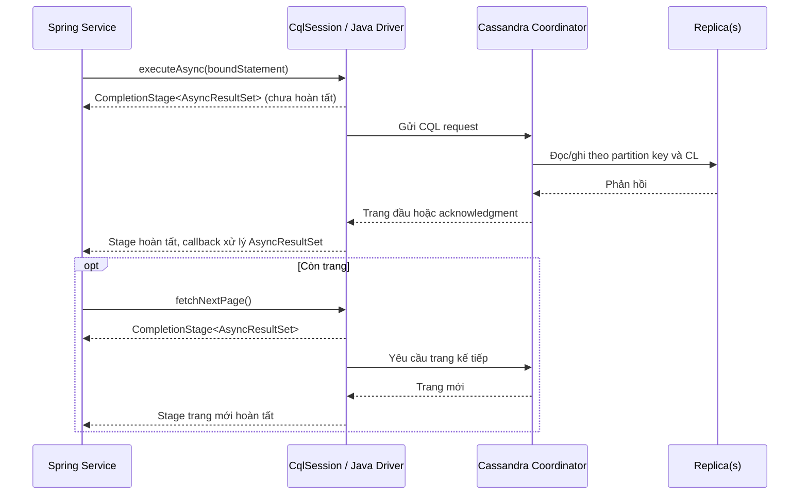
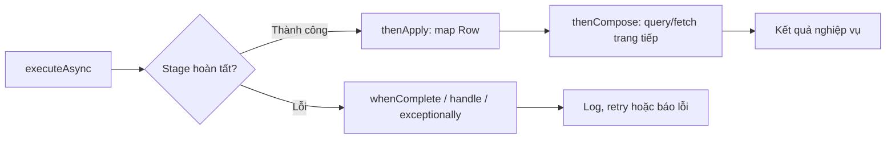

# CompletionStage và AsyncResultSet tại lớp Java Driver trong Spring Data Cassandra

Trong **Spring Data Cassandra**, lớp repository và `CassandraTemplate` giúp ứng dụng ánh xạ entity, xây query và xử lý dữ liệu Cassandra. Khi cần điều khiển trực tiếp một luồng **truy cập bất đồng bộ (asynchronous access)**, lớp **Apache Cassandra Java Driver 4.x** cung cấp một mô hình cốt lõi: gọi `CqlSession.executeAsync(...)` để nhận **`CompletionStage<AsyncResultSet>`**, sau đó kết hợp các callback để đọc kết quả, chuyển trang và xử lý lỗi mà không chặn luồng chờ I/O.

Hai kiểu Java rất dễ bị hiểu nhầm:

- **`CompletionStage<T>`** là mô tả một phép tính **có kết quả về sau**, cho phép nối các bước xử lý và truyền lỗi. Nó không phải chính kết quả truy vấn, không phải một `Thread` mới cho mỗi request và không có nghĩa toàn bộ pipeline đã hoàn tất khi method trả về.
- **`AsyncResultSet`** là kết quả **của một lần phản hồi trang** trong API truy vấn bất đồng bộ. Nó cung cấp `currentPage()`, `hasMorePages()`, `fetchNextPage()`, `one()`, `wasApplied()` và metadata thực thi. Việc có một `AsyncResultSet` **không đồng nghĩa đã tải hết mọi hàng**.

Bài học thuộc chương **Truy cập bất đồng bộ** của module `SPRING_DATA_CASSANDRA`: làm việc với Apache Cassandra qua entity mapping, repository, CassandraTemplate và CQL; thiết kế bảng theo truy vấn, partition key, consistency, paging và hiệu năng trong cơ sở dữ liệu phân tán. Mục tiêu là xây được DAO bất đồng bộ có hợp đồng rõ ràng, giới hạn tài nguyên, xử lý timeout/retry đúng và phân trang thực sự không blocking.

> **Nguyên tắc xuyên suốt:** `executeAsync` và `fetchNextPage` là các thao tác bất đồng bộ. **Không gọi `get()`, `join()` hoặc `session.execute()` ngay bên trong callback chạy trên driver I/O thread.** Chỉ xử lý dữ liệu nhẹ tại callback; chuyển công việc CPU/blocking nặng sang executor riêng. Với tập kết quả dài, luôn kiểm soát **page size, số trang và dung lượng dữ liệu tích lũy**.

## 1. Phân biệt synchronous, asynchronous và reactive

Cùng một câu CQL có thể được truy cập qua các phong cách API khác nhau:

| Mô hình | API tiêu biểu | Kiểu kết quả | Cách chờ/tiếp tục |
|---|---|---|---|
| Đồng bộ (sync) | `session.execute(statement)` | `ResultSet` | Caller chờ thực thi; việc duyệt có thể lấy trang kế tiếp |
| Bất đồng bộ (async) | `session.executeAsync(statement)` | `CompletionStage<AsyncResultSet>` | Nối callback; trang sau cần gọi tường minh `fetchNextPage()` |
| Reactive | `ReactiveCassandraOperations` hoặc reactive API của Driver | `Mono`/`Flux` hoặc reactive result | Publisher, subscription, backpressure theo cơ chế reactive |
| Spring repository mapped | `CassandraRepository` | Entity/`List`/`Slice` tùy method | Không mặc nhiên là driver async chỉ vì tên method |
| Spring template mapped | `CassandraTemplate` | Entity/collection hoặc kết quả mapped | Mapping và conversion do Spring đảm nhiệm |

**Async và reactive không đồng nghĩa.** Một `CompletionStage` đại diện cho **một completion**; `Flux` có thể phát **nhiều item** theo demand. Chuyển từ stage thành publisher mà không hiểu số trang và lỗi có thể khiến ứng dụng chỉ xử lý trang đầu tiên hoặc buffer toàn bộ kết quả.

Java Driver 4.x tách rõ `ResultSet` (sync) và `AsyncResultSet` (async), tránh việc vô tình kích hoạt fetch đồng bộ khi developer tưởng đang duyệt bất đồng bộ. Với Spring Boot, thường inject **một `CqlSession` được framework quản lý** để tái sử dụng; không mở session mới cho mỗi HTTP request.

## 2. Luồng thực thi từ Spring service đến replica

Một request bất đồng bộ có thể được nhìn theo sơ đồ:



Các đặc điểm:

1. `executeAsync` trả về stage **mà không đợi tất cả hàng của truy vấn**.
2. Completion thành công nghĩa là request/page hiện tại đã nhận phản hồi theo semantics của driver và consistency level.
3. Câu SELECT có thể còn các trang chưa fetch; chỉ khi xử lý hết `hasMorePages()` mới có thể coi quá trình đọc tất cả trang là xong.
4. Với INSERT/UPDATE/DELETE không conditional, thường không có hàng nghiệp vụ để duyệt; completion biểu thị **acknowledgment**, không phải “mọi replica đã hội tụ”.
5. Nếu request/page thất bại, stage hoàn tất ngoại lệ; callback thành công không chạy.
6. Các thành phần cluster có thể chậm hoặc lỗi; ứng dụng cần deadline, retry policy và quan sát từng giai đoạn.

**Không đồng nhất bất đồng bộ với song song không giới hạn.** Driver có thể tiếp nhận nhiều request, nhưng ứng dụng phải điều tiết số in-flight, hàng đợi và tốc độ đầu vào để không làm quá tải coordinator hoặc replica.

## 3. Chuẩn bị bảng phục vụ truy vấn có paging

Ví dụ một dịch vụ xem đơn hàng theo khách và tháng. Bảng được thiết kế theo query, với full partition key được cung cấp ở mỗi lần đọc:

```sql
CREATE TABLE orders_by_customer_month (
    customer_id uuid,
    bucket_month date,
    placed_at timestamp,
    order_id uuid,
    state text,
    total_minor bigint,
    PRIMARY KEY ((customer_id, bucket_month), placed_at, order_id)
) WITH CLUSTERING ORDER BY (
    placed_at DESC,
    order_id DESC
);
```

Giải thích:

- `(customer_id, bucket_month)` là **composite partition key**; hai giá trị xác định một partition.
- `placed_at` và `order_id` là **clustering columns** cho phép đọc đơn mới nhất trước trong partition.
- `state` và `total_minor` là regular columns; không tự trở thành các điều kiện lọc/sort toàn bảng hiệu quả.
- Query có `WHERE customer_id = ? AND bucket_month = ?` tránh scan xuyên mọi khách/tháng.

```sql
SELECT order_id, placed_at, state, total_minor
FROM orders_by_customer_month
WHERE customer_id = ?
  AND bucket_month = ?;
```

Đọc theo toàn bộ một partition có thể trả hàng trăm hoặc hàng nghìn row. Vì vậy **paging** rất quan trọng. Nhưng nếu partition có hàng triệu row, tombstone nhiều hoặc hot partition, chỉ dùng async + page size nhỏ không đủ: cần xem lại bucketing, sharding và retention.

Ví dụ trong bài dùng Java Driver 4.x với các package `com.datastax.oss.driver.api.core.*`. Code áp dụng cho project có dependency tương ứng; tên package của Driver 4.x vẫn giữ tiền tố này.

## 4. Cách gọi executeAsync đầu tiên

Câu CQL có bind parameters nên được prepare và tái sử dụng:

```java
import java.time.LocalDate;
import java.util.UUID;
import java.util.concurrent.CompletionStage;

import com.datastax.oss.driver.api.core.CqlSession;
import com.datastax.oss.driver.api.core.cql.AsyncResultSet;
import com.datastax.oss.driver.api.core.cql.BoundStatement;
import com.datastax.oss.driver.api.core.cql.PreparedStatement;

public final class OrderAsyncReader {
    private final CqlSession session;
    private final PreparedStatement query;

    public OrderAsyncReader(CqlSession session) {
        this.session = session;
        this.query = session.prepare(
            "SELECT order_id, placed_at, state, total_minor " +
            "FROM orders_by_customer_month " +
            "WHERE customer_id = ? AND bucket_month = ?"
        );
    }

    public CompletionStage<AsyncResultSet> firstPage(
            UUID customerId, LocalDate month) {

        if (customerId == null || month == null) {
            throw new IllegalArgumentException("Missing partition key");
        }

        BoundStatement statement = query.bind(customerId, month)
            .setPageSize(50);

        return session.executeAsync(statement);
    }
}
```

Ở đây:

1. `PreparedStatement` được tạo một lần ở vòng đời DAO, không prepare lại mỗi request.
2. `query.bind(customerId, month)` tạo bound statement với **đủ partition key**.
3. `setPageSize(50)` trả statement mới; Driver 4.x dùng statement objects theo kiểu immutable.
4. `executeAsync(statement)` trả ngay một stage sẽ hoàn tất với `AsyncResultSet` trang đầu hoặc một lỗi.

**Chú ý Spring lifecycle:** constructor chứa `session.prepare(...)` là thao tác **đồng bộ**, chấp nhận được trong giai đoạn khởi tạo bean trên thread cho phép blocking; không gọi constructor này từ một driver I/O callback. Với startup hoàn toàn async, cần chuẩn bị statement qua API async và quản lý lifecycle riêng.

## 5. CompletionStage<T>: vai trò và các method thiết yếu

`CompletionStage<T>` là interface trong `java.util.concurrent`. Nó mô tả chuỗi tính toán sẽ chạy khi một stage trước đã hoàn tất.

| Method | Mục đích | Kết quả |
|---|---|---|
| `thenApply(fn)` | Chuyển đổi một giá trị `T` thành `U` bằng hàm đồng bộ, thường nhẹ | `CompletionStage<U>` |
| `thenCompose(fn)` | Nối một phép tính khác **trả về stage**, tránh stage lồng nhau | `CompletionStage<U>` |
| `thenAccept(fn)` | Chỉ tiêu thụ giá trị thành công, không trả data | `CompletionStage<Void>` |
| `thenRun(fn)` | Thực hiện hành động sau thành công, không nhận kết quả | `CompletionStage<Void>` |
| `whenComplete((value, err))` | Quan sát cả success/failure, phù hợp logging/metrics | Stage mang kết quả/error |
| `handle((value, err))` | Chuyển cả hai trạng thái thành một kết quả mới | `CompletionStage<U>` |
| `exceptionally(fn)` | Phục hồi từ lỗi bằng giá trị fallback | `CompletionStage<T>` |
| `thenApplyAsync(fn, executor)` | Chạy công việc tiếp theo trên executor chọn trước | `CompletionStage<U>` |
| `toCompletableFuture()` | Cầu nối đến API `CompletableFuture`, cần thận trọng với blocking/cancel | `CompletableFuture<T>` |

Sơ đồ:



Điểm dễ nhầm: `thenApply` nhận một hàm trả về **giá trị**, còn `thenCompose` nhận một hàm trả về **CompletionStage**. Dùng `thenApply(rs -> rs.fetchNextPage())` tạo kiểu `CompletionStage<CompletionStage<AsyncResultSet>>`, thường không phải thứ cần.

```java
CompletionStage<AsyncResultSet> first = session.executeAsync(statement);

// Đúng: nối thẳng stage của trang kế tiếp.
CompletionStage<AsyncResultSet> second =
    first.thenCompose(page -> {
        if (!page.hasMorePages()) {
            return java.util.concurrent.CompletableFuture.completedFuture(page);
        }
        return page.fetchNextPage();
    });
```

Ví dụ này chỉ **tìm trang thứ hai** nếu có; nó **chưa** xử lý/giữ các hàng trang đầu. Một pagination pipeline đầy đủ phải tiêu thụ trang đầu trước khi fetch trang sau.

## 6. AsyncResultSet chỉ mang trang hiện tại

API quan trọng:

| Thành phần | Ý nghĩa | Cạm bẫy |
|---|---|---|
| `currentPage()` | Trả iterable các `Row` **của trang hiện tại** | Không tự fetch trang sau |
| `one()` | Lấy một row kế tiếp ở trang hiện tại, hoặc `null` khi hết trang | Có thể tiêu thụ row; không dùng lẫn với việc duyệt lại cùng page |
| `remaining()` | Số row còn lại trong trang hiện tại | Không phải tổng số row của mọi trang |
| `hasMorePages()` | Cho biết còn trang kế tiếp hay không | Cần kiểm tra trước `fetchNextPage()` |
| `fetchNextPage()` | Gửi yêu cầu đọc trang sau, trả stage mới | Không được lặp vô điều kiện; lỗi có thể xảy ra ở mỗi trang |
| `getExecutionInfo()` | Metadata cho lần thực thi/trang tương ứng | Không nên coi mọi trang cùng coordinator/latency |
| `getColumnDefinitions()` | Metadata tên và kiểu cột | Không tương đương entity mapping của Spring |
| `wasApplied()` | Kết quả áp dụng của conditional mutation (LWT) | Với mutation thường, không phải bằng chứng uniqueness/business invariant |

Một phép đọc sai thường gặp:

```java
CompletionStage<Integer> wrongCount =
    session.executeAsync(statement)
        .thenApply(rs -> {
            int count = 0;
            for (var row : rs.currentPage()) {
                count++;
            }
            return count; // Chỉ đếm trang đầu, không phải toàn bộ query!
        });
```

Một sai lầm khác là tưởng `AsyncResultSet` hoạt động như `ResultSet` đồng bộ có thể `for` qua toàn bộ rows một cách trong suốt. Không đúng: `currentPage()` chỉ tương ứng response hiện tại.

**Không dùng `one()` rồi lại duyệt `currentPage()` với kỳ vọng thấy lại row vừa tiêu thụ.** Result/page iterable có trạng thái, và việc truy cập nên được quản lý trong một luồng xử lý tuần tự cho mỗi page. Tách các bước mapping qua nhiều callback đồng thời trên cùng page có thể tạo lỗi khó kiểm soát.

## 7. Truy vấn chỉ trả về một row: thenApply và Optional

Nếu điều kiện xác định một row duy nhất, `one()` là thuận tiện:

```sql
CREATE TABLE orders_by_id (
    order_id uuid PRIMARY KEY,
    customer_id uuid,
    state text,
    total_minor bigint
);
```

DAO:

```java
import java.util.Optional;
import java.util.UUID;
import java.util.concurrent.CompletionStage;

import com.datastax.oss.driver.api.core.cql.Row;

public record OrderSnapshot(
    UUID orderId,
    UUID customerId,
    String state,
    long totalMinor
) {}

public CompletionStage<Optional<OrderSnapshot>> findById(UUID orderId) {
    if (orderId == null) {
        throw new IllegalArgumentException("orderId is required");
    }

    return session.executeAsync(findByIdPrepared.bind(orderId))
        .thenApply(rs -> {
            Row row = rs.one();
            if (row == null) {
                return Optional.<OrderSnapshot>empty();
            }
            return Optional.of(new OrderSnapshot(
                row.getUuid("order_id"),
                row.getUuid("customer_id"),
                row.getString("state"),
                row.getLong("total_minor")
            ));
        });
}
```

Đoạn này giả định `session` và `findByIdPrepared` đã được inject/prepare trong DAO, record đặt ở file Java thích hợp. Nếu `total_minor` nullable, cần kiểm tra `row.isNull("total_minor")` trước khi gọi `getLong` hoặc dùng `Long` nullable theo hợp đồng nghiệp vụ.

**Vì sao không fetch thêm trang?** Truy vấn bằng **primary key đơn** chỉ có tối đa một row logic. Với truy vấn lấy một partition nhiều clustering rows, không được tùy tiện dùng `one()` rồi bỏ qua `hasMorePages()` nếu API cần toàn bộ dữ liệu.

Đối với method trả `CompletionStage<Optional<T>>`, caller có thể nối tiếp xử lý:

```java
CompletionStage<String> label =
    dao.findById(orderId).thenApply(optional ->
        optional.map(OrderSnapshot::state).orElse("NOT_FOUND"));
```

Không gọi `join()` chỉ để lấy một giá trị từ stage rồi biến method trở lại đồng bộ.

## 8. Đọc toàn bộ trang bằng currentPage() và fetchNextPage()

Một cách đơn giản để **biểu diễn đầy đủ lifecycle của paging** là xây method trả `CompletionStage<List<OrderSummary>>`, lần lượt xử lý mỗi trang rồi fetch trang kế.

DTO:

```java
import java.time.Instant;
import java.util.UUID;

public record OrderSummary(
    UUID orderId,
    Instant placedAt,
    String state,
    long totalMinor
) {}
```

Phương thức chuyển `Row`:

```java
private OrderSummary toSummary(Row row) {
    return new OrderSummary(
        row.getUuid("order_id"),
        row.getInstant("placed_at"),
        row.getString("state"),
        row.getLong("total_minor")
    );
}
```

Lần lượt fetch các trang:

```java
import java.util.ArrayList;
import java.util.List;
import java.util.concurrent.CompletableFuture;
import java.util.concurrent.CompletionStage;

import com.datastax.oss.driver.api.core.cql.AsyncResultSet;
import com.datastax.oss.driver.api.core.cql.Row;

private CompletionStage<List<OrderSummary>> collectPages(
        AsyncResultSet page,
        List<OrderSummary> collected,
        int maxRows) {

    for (Row row : page.currentPage()) {
        if (collected.size() >= maxRows) {
            return CompletableFuture.completedFuture(
                List.copyOf(collected));
        }
        collected.add(toSummary(row));
    }

    if (page.hasMorePages()) {
        return page.fetchNextPage()
            .thenCompose(next -> collectPages(next, collected, maxRows));
    }

    return CompletableFuture.completedFuture(
        List.copyOf(collected));
}

public CompletionStage<List<OrderSummary>> recentOrders(
        UUID customerId, LocalDate month) {

    if (customerId == null || month == null) {
        throw new IllegalArgumentException("Partition key required");
    }

    int maxRows = 200;

    return session.executeAsync(
        findByCustomerMonth.bind(customerId, month).setPageSize(50)
    ).thenCompose(first ->
        collectPages(first, new ArrayList<>(), maxRows));
}
```

Các field `session` và `findByCustomerMonth` phải được định nghĩa trong DAO như ở mục 4. Code minh họa một **consumer tuần tự** của mỗi page. Nó không có concurrency trên cùng `collected` list: method chỉ tiếp tục xử lý khi stage trang kế đã hoàn tất.

### Giới hạn của phương pháp tích lũy List

Mặc dù `maxRows = 200` giới hạn số phần tử cuối cùng, một request cho page có thể nhận nhiều row hơn số còn thiếu trong `maxRows`. Đó là lý do cần chọn `pageSize` phù hợp với giới hạn. Với API trả một trang UI, thường **không nên fetch toàn bộ 200 row rồi cắt theo giao diện**; thay vào đó, nên xây API **một trang + continuation token**.

Đặc biệt, không dùng một `ArrayList` không giới hạn để collect hàng triệu rows. Nếu cần export/streaming, hãy xử lý **mỗi trang rồi giải phóng trang đó** hoặc chuyển đến một pipeline có backpressure.

## 9. Paging không có offset: page size khác LIMIT

Với Cassandra:

| Cơ chế | Tác dụng |
|---|---|
| `setPageSize(50)` ở Driver | Mục tiêu kích thước **mỗi network page**; server có thể trả ít/nhiều hơn |
| `LIMIT 50` trong CQL | Giới hạn **tổng số row** của câu query |
| `AsyncResultSet.hasMorePages()` | Cho biết còn trang khác trong kết quả hiện tại |
| `fetchNextPage()` | Fetch trang kế theo paging state do driver quản lý |
| Paging state | Continuation của query, **forward only**; không phải số trang cố định |
| `OFFSET` | Cassandra không có offset paging hiệu quả như SQL quan hệ; emulation có chi phí lớn |

Một query có `LIMIT 20` mà `setPageSize(5)` có thể cần nhiều round trips để trả tối đa 20 row. Ngược lại, `setPageSize(20)` **không giới hạn toàn bộ kết quả ở 20 row**.

Page size không thể chữa query thiếu partition key, hot partition, tombstone-heavy scan hoặc `ALLOW FILTERING` rộng. Thiết kế bảng theo access pattern và giới hạn tổng khối lượng đọc vẫn quan trọng nhất.

### Paging state và tính đúng ngữ cảnh

Với API phân trang dạng stateless, server có thể lấy continuation token từ metadata:

```java
// Sau khi nhận một AsyncResultSet:
var next = resultSet.getExecutionInfo().getSafePagingState();
```

`next` là kiểu `PagingState` có thể là `null` khi không còn trang. Khi resume, phải gắn token vào **cùng một câu query, bind values và ngữ cảnh phù hợp**; driver có cơ chế safe paging-state verification, nhưng ứng dụng vẫn phải bảo vệ tenant/user authorization.

**Không tin paging token do client tự sửa.** Nên mã hóa/ký/token hóa phù hợp, giới hạn thời hạn và gắn với query, tenant và role. Không coi token là một số thứ tự trang có thể tăng tùy ý; không được tái sử dụng trên một CQL statement khác chỉ vì cùng bảng.

## 10. Xử lý một trang rồi trả dữ liệu cho HTTP client

Trong API danh sách “xem trang kế”, có thể trả **dữ liệu một trang** và continuation token thay vì collect tất cả.

Một DTO khái niệm:

```java
public record PageResponse<T>(
    java.util.List<T> items,
    boolean hasMore,
    String nextToken
) {}
```

Luồng xử lý:

```text
HTTP GET /customers/{id}/orders?month=...&pageToken=...
    |
    v
Validate tenant/customer/month + token
    |
    v
Prepared SELECT với WHERE đủ partition key
    |
    v
Driver executeAsync(statement + paging state)
    |
    v
Map currentPage → DTO list
    |
    v
hasMorePages ? serialize/sign continuation : null
    |
    v
Trả PageResponse ngay; không fetch trang kế nếu chưa được yêu cầu
```

Đừng đưa nguyên văn `PagingState` hoặc token chứa thông tin nhạy cảm ra ngoài nếu chưa có chính sách bảo vệ. Cách serialize/deserialize cụ thể phụ thuộc driver và thiết kế giao thức ứng dụng; test end-to-end bằng cùng phiên bản Driver/Cassandra thật.

Trong hệ phân tán, paging **không phải transaction snapshot**. Nếu row mới được thêm, xóa hoặc TTL hết hạn giữa hai request trang, client có thể nhìn thấy thứ tự/kết quả khác kỳ vọng. Nếu cần snapshot nhất quán cho báo cáo, phải thiết kế snapshot/versioning hoặc một hệ thống phân tích phù hợp.

## 11. thenApply, thenCompose và lỗi lồng stage

Một ví dụ gồm hai truy vấn phụ thuộc:

1. Đọc một `order_id` từ bảng đơn.
2. Sau đó truy vấn bảng chi tiết thanh toán bằng ID đó.

Sai:

```java
CompletionStage<CompletionStage<AsyncResultSet>> nested =
    session.executeAsync(findOrder.bind(orderId))
        .thenApply(rs -> {
            Row order = rs.one();
            return session.executeAsync(
                findPayments.bind(order.getUuid("order_id")));
        });
```

Sai ở kiểu kết quả và bỏ qua null: `thenApply` làm stage lồng trong stage. Đúng:

```java
CompletionStage<AsyncResultSet> payments =
    session.executeAsync(findOrder.bind(orderId))
        .thenCompose(rs -> {
            Row order = rs.one();
            if (order == null) {
                return CompletableFuture.failedFuture(
                    new IllegalArgumentException("Order not found"));
            }
            return session.executeAsync(
                findPayments.bind(order.getUuid("order_id")));
        });
```

Ví dụ dùng `CompletableFuture.failedFuture` (Java 9+). Với Java 8 phải tạo một `CompletableFuture` rồi gọi `completeExceptionally`.

**Quan trọng:** query thứ hai phải có access path hợp lệ theo primary key của bảng payments. `thenCompose` không biến một CQL query thiếu partition key thành hợp lệ. Tốt nhất, query phụ thuộc chỉ được thực thi khi input có thể được kiểm chứng và không vi phạm authorization.

## 12. whenComplete, handle và exceptionally: không nuốt lỗi

Một lỗi thường gặp:

```java
// Sai khi bỏ qua stage trả về và không xử lý failure ở nơi nào khác.
session.executeAsync(statement).thenAccept(rs -> {
    System.out.println("Rows in first page: " + rs.remaining());
});
```

Nếu request thất bại, callback `thenAccept` **không chạy**, và nếu stage mới bị bỏ qua, lỗi có thể không được log/quan sát theo mong muốn.

### whenComplete: quan sát mà vẫn giữ trạng thái

```java
CompletionStage<AsyncResultSet> observed =
    session.executeAsync(statement)
        .whenComplete((rs, error) -> {
            if (error != null) {
                metrics.recordFailure(error);
            } else {
                metrics.recordSuccess();
            }
        });

return observed;
```

`metrics` là dependency minh họa, callback nên **rất nhẹ**. Đừng để `recordFailure` ném exception ngoài ý muốn vì stage quan sát có thể bị ảnh hưởng.

### handle: biến success/error thành outcome

```java
public record QueryOutcome<T>(
    T value, Throwable failure
) {
    public boolean succeeded() {
        return failure == null;
    }
}

CompletionStage<QueryOutcome<AsyncResultSet>> outcome =
    session.executeAsync(statement)
        .handle((rs, error) ->
            new QueryOutcome<>(rs, error));
```

Từ đây caller phải **xem failure**; không coi mọi `QueryOutcome` là thành công chỉ vì stage đã hoàn tất bình thường.

### exceptionally: fallback phải phù hợp hợp đồng

```java
CompletionStage<Optional<OrderSnapshot>> maybe =
    findById(orderId).exceptionally(error -> {
        logQueryFailure(error);
        return Optional.empty(); // Chỉ đúng nếu API cố ý coi lỗi như không có dữ liệu!
    });
```

Ví dụ trên **không phù hợp** cho API mà lỗi truy vấn phải được trả là 5xx/retry thay vì 404. Phân biệt `not found` và `query failed` là yêu cầu đúng đắn nghiệp vụ. Trong nhiều trường hợp, nên **truyền lỗi lên caller** sau khi log/metrics, không đổi nó thành kết quả rỗng.

**Điểm tinh tế:** callback `whenComplete` hoặc `handle` có thể tự ném exception. Phải giữ và quan sát **stage kết quả** chứ không chỉ stage gốc nếu callback thực hiện logic có thể thất bại.

## 13. Không được blocking trên driver I/O thread

Java Driver 4.x thường chạy callback đơn giản trên thread đã hoàn tất stage, nhiều trường hợp là **Netty I/O thread**. Các thao tác sau trong callback có thể phá throughput hoặc gây deadlock:

```java
// Sai: gọi API đồng bộ trong callback async của Driver.
session.executeAsync(firstStatement)
    .thenApply(rs -> {
        return session.execute(secondStatement); // Không làm vậy.
    });
```

Tương tự:

```java
// Sai: block chờ một stage bên trong callback.
session.executeAsync(firstStatement)
    .thenApply(rs ->
        session.executeAsync(secondStatement)
            .toCompletableFuture()
            .join());
```

Driver có thể phát hiện một số lời gọi sync từ driver thread và ném ngoại lệ để tránh deadlock. `join()` hay `get()` trong callback cũng làm thread không thể phục vụ các I/O completion khác.

### Đúng: nối async bằng thenCompose

```java
CompletionStage<AsyncResultSet> combined =
    session.executeAsync(firstStatement)
        .thenCompose(rs -> session.executeAsync(secondStatement));
```

Không tạo một thread mới cho từng query và không dùng `CompletableFuture.supplyAsync(() -> session.execute(...))` làm chiến lược chuẩn để “giả async”. Cách đúng là dùng **API async của Driver**.

## 14. Offload tác vụ nặng bằng executor riêng

Mapping vài field từ một row thường đủ nhẹ để chạy ngay trên callback. Nhưng parsing JSON lớn, mã hóa ảnh, tính toán nhiều MB, gọi HTTP blocking hoặc ghi file phải được chuyển khỏi driver I/O thread.

```java
import java.util.concurrent.CompletionStage;
import java.util.concurrent.Executor;

public CompletionStage<Report> buildReport(
        BoundStatement statement,
        Executor workerExecutor) {

    return session.executeAsync(statement)
        .thenApplyAsync(rs -> {
            // Công việc CPU nặng trên executor riêng.
            return expensiveReportFromPage(rs.currentPage());
        }, workerExecutor);
}
```

`workerExecutor` là một executor được cấu hình và quản lý vòng đời ở Spring; `Report` và `expensiveReportFromPage` là các kiểu nghiệp vụ minh họa.

Các lưu ý:

- Một executor **có giới hạn số thread và hàng đợi** quan trọng hơn chỉ gọi `thenApplyAsync`.
- Nếu có nhiều trang, `expensiveReportFromPage` ở ví dụ chỉ xử lý trang hiện tại. Cần logic `fetchNextPage` tường minh cho toàn kết quả.
- Không tự động dùng `ForkJoinPool.commonPool` cho mọi tác vụ blocking lâu dài.
- Việc offload giúp **không giữ driver I/O thread**, nhưng không làm lượng dữ liệu/tài nguyên biến mất.
- Với rất nhiều trang, xử lý từng trang tuần tự hoặc pipeline có backpressure, không ném mọi trang vào executor vô hạn.

## 15. Paging kiểu chuỗi bất đồng bộ không chặn thread

Một mẫu xử lý **mỗi trang trên worker executor**, sau đó mới fetch trang kế, có thể trả `CompletionStage<Void>` khi toàn bộ pipeline đã xong:

```java
import java.util.concurrent.CompletableFuture;
import java.util.concurrent.CompletionStage;
import java.util.concurrent.Executor;

private CompletionStage<Void> processPages(
        AsyncResultSet page,
        Executor cpuExecutor,
        java.util.function.Consumer<OrderSummary> sink) {

    return CompletableFuture.runAsync(() -> {
        for (Row row : page.currentPage()) {
            sink.accept(toSummary(row));
        }
    }, cpuExecutor).thenCompose(ignored -> {
        if (!page.hasMorePages()) {
            return CompletableFuture.completedFuture(null);
        }
        return page.fetchNextPage()
            .thenCompose(next ->
                processPages(next, cpuExecutor, sink));
    });
}

public CompletionStage<Void> streamPartition(
        UUID customerId, LocalDate month,
        Executor cpuExecutor,
        java.util.function.Consumer<OrderSummary> sink) {

    BoundStatement statement =
        findByCustomerMonth.bind(customerId, month).setPageSize(100);

    return session.executeAsync(statement)
        .thenCompose(first ->
            processPages(first, cpuExecutor, sink));
}
```

**Điều kiện quan trọng:** `sink.accept(...)` có thể thực hiện I/O hoặc blocking trên `cpuExecutor`, chứ không trên driver thread. Nhưng sink cần hỗ trợ thất bại, tính nhất quán và durability phù hợp. Ví dụ xử lý **từng trang theo thứ tự** nên không dispatch vô hạn các trang mới trước khi trang trước xử lý xong.

Không gọi nó là “streaming vô hạn ít bộ nhớ” nếu chính `sink` giữ mọi kết quả vào một `List` vô hạn. Nếu downstream lưu dữ liệu chậm, nên kiểm soát queue, rate và retry; tùy hệ thống có thể dùng Reactor, publisher hoặc một pipeline tích hợp với durable storage.

## 16. Tối đa bao nhiêu request đang bay cùng lúc?

`executeAsync` không tự tạo một giới hạn concurrency **theo yêu cầu nghiệp vụ**. Một vòng lặp phát một triệu async requests có thể làm client, connection pools, queue và coordinator quá tải.

Anti-pattern:

```java
for (Event event : events) {
    session.executeAsync(insertPrepared.bind(
        event.accountId(), event.day(),
        event.occurredAt(), event.eventId(),
        event.payload()
    )); // Không theo dõi stage, không có max in-flight.
}
```

Hậu quả tiềm ẩn:

- Không thu thập lỗi từng event; vòng lặp kết thúc không có nghĩa ghi đã xong.
- Pending queue/in-flight tăng; driver có thể bắt đầu throttle hoặc từ chối request.
- Một partition nóng bị ghi đồng thời dồn dập.
- Retry sau timeout khó đối soát và có thể tạo trùng event.
- JVM giữ nhiều payload/stages chưa hoàn tất.

**Giải pháp:** đặt giới hạn số in-flight, có upstream backpressure và thu thập **mỗi completion**. Với nguồn hàng đợi Kafka/stream, phải chỉ ACK offset/event sau khi đã đạt hợp đồng ghi mong muốn.

## 17. Ví dụ bounded async với Semaphore và completion tracking

Một ví dụ **producer thread** có giới hạn `maxInFlight` và đợi tất cả stage đã gửi kết thúc:

```java
import java.util.concurrent.CompletionStage;
import java.util.concurrent.Phaser;
import java.util.concurrent.Semaphore;
import java.util.concurrent.atomic.AtomicInteger;

public record WriteSummary(int acknowledged, int failed) {}

public WriteSummary ingest(
        Iterable<Event> source,
        int maxInFlight) throws InterruptedException {

    if (maxInFlight < 1) {
        throw new IllegalArgumentException("maxInFlight must be positive");
    }

    Semaphore permits = new Semaphore(maxInFlight);
    Phaser pending = new Phaser(1);
    AtomicInteger acknowledged = new AtomicInteger();
    AtomicInteger failed = new AtomicInteger();

    try {
        for (Event event : source) {
            permits.acquire(); // Chỉ gọi trên thread được phép block.
            pending.register();

            try {
                CompletionStage<AsyncResultSet> stage =
                    session.executeAsync(
                        bindInsertWithStableEventId(event));

                stage.whenComplete((rs, error) -> {
                    try {
                        if (error == null) {
                            acknowledged.incrementAndGet();
                        } else {
                            failed.incrementAndGet();
                            recordFailure(event.eventId(), error);
                        }
                    } finally {
                        permits.release();
                        pending.arriveAndDeregister();
                    }
                });
            } catch (RuntimeException ex) {
                failed.incrementAndGet();
                recordFailure(event.eventId(), ex);
                permits.release();
                pending.arriveAndDeregister();
            }
        }
    } finally {
        pending.arriveAndAwaitAdvance();
    }

    return new WriteSummary(
        acknowledged.get(), failed.get());
}
```

`Event`, `bindInsertWithStableEventId` và `recordFailure` là thành phần ứng dụng cần triển khai. Hàm `recordFailure` phải **nhanh và không ném exception** trong callback; trong production, ghi thất bại vào một queue/durable outcome store theo quy trình riêng. Nếu nó có thể ném lỗi, cần chặn lỗi trong handler để tránh mất slot và mất thông tin báo cáo.

Những điểm thiết kế:

1. `Semaphore` giới hạn in-flight requests theo **số completion đang chờ**, không phải số item trong toàn bộ upstream.
2. `Phaser` cho phép producer chờ tất cả request đã đăng ký hoàn tất trước khi báo summary.
3. `whenComplete` phải **luôn giải phóng permit và deregister** dù request thành công/thất bại.
4. `permits.acquire()` và `pending.arriveAndAwaitAdvance()` **blocking**: chỉ dùng ở thread điều phối riêng, **không** đưa vào callback của Driver hoặc reactive event loop.
5. Nếu quá trình bị interrupted, caller cần quản lý event chưa submit và shutdown; skeleton này không thay một message broker/durable queue.
6. Số in-flight nhỏ không bảo đảm upstream buffer nhỏ: source và retry queue cũng phải bounded.

**Nhận xét:** Đây là mẫu điều phối cho **nhiều query độc lập**, không phải CQL BATCH. Khi có yêu cầu atomicity nhiều row cùng partition hoặc eventual completion nhiều partition, phải chọn kỹ thuật phù hợp chứ không chỉ thay batch bằng async.

## 18. Write ACK, LWT và wasApplied()

Với mutation bình thường:

```java
CompletionStage<AsyncResultSet> saved =
    session.executeAsync(insertBound);
```

Khi `saved` thành công, Driver nhận acknowledgment theo statement consistency. Điều đó **không có nghĩa**:

- Mọi replica đã hội tụ.
- Mọi bảng projection liên quan đều đã được cập nhật.
- Không có ghi cạnh tranh với timestamp cao hơn.
- Một uniqueness constraint nghiệp vụ được tự động áp dụng.

Với **LWT/conditional mutation**, `AsyncResultSet.wasApplied()` giúp biết điều kiện có áp dụng không:

```sql
INSERT INTO orders_by_id (
    order_id, customer_id, state, total_minor
) VALUES (?, ?, ?, ?)
IF NOT EXISTS;
```

```java
CompletionStage<Boolean> created =
    session.executeAsync(
        conditionalInsert.bind(
            orderId, customerId, "NEW", amountMinor)
    ).thenApply(AsyncResultSet::wasApplied);
```

`true` nghĩa conditional statement được áp dụng; `false` nghĩa điều kiện không được thỏa (và có thể có thông tin hiện trạng trong result). Với statement **không conditional**, `wasApplied()` thường trả `true` và **không dùng nó để kết luận về uniqueness hay một phép kiểm tra điều kiện chưa từng tồn tại**.

Một LWT có thể tốn thêm latency và cần serial consistency phù hợp (`SERIAL`/`LOCAL_SERIAL`), không phải một ghi async mặc định. Việc dùng `executeAsync` không làm mất hay tăng guarantee của LWT, mà chỉ đổi cách đợi kết quả trên client.

## 19. Lỗi trong truy cập async: timeout không đồng nghĩa chưa ghi

Cassandra là hệ phân tán; khi client nhận `WriteTimeoutException` hoặc lỗi network, một phần replica có thể đã nhận mutation. Vì vậy:

| Kết quả từ stage | Có thể kết luận gì? | Không được kết luận gì? |
|---|---|---|
| Thành công của SELECT | Đã nhận trang hiện tại theo CL | Toàn bộ trang còn lại đã được fetch |
| Thành công của INSERT bình thường | Đủ ACK theo CL | Mọi replica và projection đều đã hội tụ |
| Thành công của LWT, `wasApplied()=false` | Điều kiện không áp dụng | Database/server lỗi chỉ vì kết quả false |
| Completion lỗi timeout | Request chưa được xác nhận đầy đủ | Mutation chắc chắn chưa apply ở đâu |
| Completion lỗi khi fetch trang N | Trang N thất bại | Các trang 1..N-1 chưa từng được đọc |
| Callback mapping ném exception | Stage xử lý có thể thất bại | CQL nhất thiết đã thất bại |
| Stage bị cancel ở client | Caller không tiếp tục đợi kết quả | Server chắc chắn dừng mutation |

**Retry có điều kiện:**

- Với `INSERT` idempotent có primary key ổn định và payload cố định, có thể thiết kế retry an toàn hơn.
- Với `counter = counter + 1`, retry sau timeout có thể tăng thêm một lần.
- Với update trạng thái cạnh tranh, timestamp và LWT có vai trò riêng.
- Với TTL, retried mutation có thể làm thay đổi thời điểm hết hạn, tùy query và chính sách timestamp/TTL.
- Với các side effect khác (gửi email, thu tiền), không được retry cả pipeline mà không có idempotency key hoặc cơ chế deduplication.

**Không dùng `exceptionally(err -> completedEmptyList())` để che timeout thành “không có dữ liệu”** nếu hợp đồng API phân biệt lỗi và kết quả rỗng.

## 20. CompletionException, exception chain và phân loại lỗi

Lỗi truyền qua `CompletionStage` có thể được bọc trong `CompletionException`. Khi chuyển sang `CompletableFuture.join()` ở một test hoặc boundary cho phép blocking, caller cũng thường nhận `CompletionException`. Cần xem **root cause** một cách có kiểm soát:

```java
import java.util.concurrent.CompletionException;

static Throwable unwrapCompletion(Throwable error) {
    Throwable current = error;
    while (current instanceof CompletionException
            && current.getCause() != null) {
        current = current.getCause();
    }
    return current;
}
```

Trong ứng dụng thật, có thể cần xử lý `ExecutionException` (khi gọi `get()`), driver-specific errors như `AllNodesFailedException`, `ReadTimeoutException`, `WriteTimeoutException` và các lỗi validation/mapping Java.

Không retry mọi `Throwable`. Cần phân biệt:

- **InvalidQueryException** / cú pháp, schema hoặc input sai: retry y hệt thường không có ích.
- **Timeout/unavailable**: có thể cần retry, nhưng phải xem idempotency, RF/CL và sức khỏe cluster.
- **Overloaded/too many requests**: cần backoff, điều chỉnh concurrency/rate.
- **Mapping/codec exception**: sửa code/schema, không retry liên tục.
- **Callback failure**: có thể do logic ứng dụng, không phải Cassandra.

Nếu dùng retry policy tích hợp của Driver, hãy hiểu precedence giữa policy, idempotence hint, execution profile và retry nghiệp vụ để không tạo retry storm ở nhiều tầng.

## 21. Cancellation, deadline và session lifecycle

`CompletionStage` không có `cancel()` như một API trừu tượng. Có thể gọi `toCompletableFuture()` để tương tác với một `CompletableFuture`, nhưng **cancel một future phía client không đồng nghĩa Cassandra chắc chắn ngừng thao tác đã gửi**.

```java
CompletableFuture<AsyncResultSet> future =
    session.executeAsync(bound).toCompletableFuture();

// Không được suy ra từ future.cancel(true) rằng server đã rollback.
future.cancel(true);
```

Tùy implementation Driver, cancel có thể ảnh hưởng future/completion hơn là một giao thức abort server-side. Hãy đặt request timeout/deadline và retry budget, đồng thời thiết kế mutation idempotent nếu cần.

### CqlSession phải sống đủ lâu

Không mở rồi đóng session cho từng HTTP request:

```java
// Anti-pattern: tạo session mới cho một lần truy vấn.
try (CqlSession s = CqlSession.builder().build()) {
    return s.executeAsync(statement);
}
```

Phương thức trên đóng session trước khi async stage có cơ hội hoàn tất; ngoài ra tạo session liên tục rất tốn kém. Trong Spring Boot, sử dụng singleton `CqlSession` được framework quản lý. Với ứng dụng CLI chạy một lần, chỉ đóng session **sau khi các stage đã hoàn tất**.

`CqlSession` có thể được đóng bất đồng bộ bằng `closeAsync()` khi cần quản lý thủ công, nhưng đóng khi còn in-flight requests cần có chiến lược drain/shutdown hợp lý. Trong Spring app, thường để container quản lý lifecycle.

## 22. Spring Data Cassandra: khi nào dùng Driver trực tiếp?

Trong một ứng dụng có cả repository, `CassandraTemplate` và Driver, nên phân ranh giới rõ:

| Yêu cầu | API nên xem xét |
|---|---|
| CRUD entity thông thường với mapping và converter | `CassandraRepository` / `CassandraTemplate` |
| Query mapped có `QueryOptions`/`Pageable` theo version | Repository hoặc Template thích hợp |
| CQL custom, cần điều khiển `CompletionStage<AsyncResultSet>` | `CqlSession.executeAsync` |
| Dòng reactive end-to-end và backpressure item-level | `ReactiveCassandraOperations`, `ReactiveCassandraTemplate` |
| Ghi nhiều mutation cùng partition theo semantics batch | `CassandraBatchOperations` hoặc `BatchStatement` |
| Cần kiểm soát driver paging state, warnings, coordinator | Driver `AsyncResultSet`/`ExecutionInfo` |
| Cần mapping entity nhưng async performance đặc thù | Cân nhắc reactive mapping hoặc DAO tự map có kiểm chứng |

Đừng coi `CassandraTemplate` là wrapper tự động trả `CompletionStage` chỉ vì dùng Driver 4.x bên dưới. Nhiều API Template truyền thống là **imperative**. Ngược lại, dùng Driver trực tiếp nghĩa là phải chịu trách nhiệm bind, codec, mapping và xử lý null/TTL/consistency mà Spring Data có thể đã hỗ trợ ở tầng cao.

### Ví dụ service dùng DAO async

```java
import java.time.LocalDate;
import java.util.List;
import java.util.UUID;
import java.util.concurrent.CompletionStage;

import org.springframework.stereotype.Service;

@Service
public class OrderReadService {
    private final OrderAsyncDao dao;

    public OrderReadService(OrderAsyncDao dao) {
        this.dao = dao;
    }

    public CompletionStage<List<OrderSummary>> recent(
            UUID authenticatedCustomerId,
            LocalDate month) {
        return dao.listRecent(authenticatedCustomerId, month);
    }
}
```

`OrderAsyncDao` là lớp ứng dụng triển khai các method từ `CqlSession`; tên `authenticatedCustomerId` nhắc rằng **partition key/tenant phải đến từ context được cấp quyền**, không tin input tự khai. Chuyển `CompletionStage` lên HTTP controller cần xem framework có hỗ trợ return type và lifecycle async cụ thể hay không; không nên block bằng `join()` để “cho chạy”.

## 23. QueryOptions ở Driver và Spring Data: page size/CL/timeout

Ở Driver, cấu hình statement:

```java
import java.time.Duration;

import com.datastax.oss.driver.api.core.DefaultConsistencyLevel;
import com.datastax.oss.driver.api.core.cql.BoundStatement;

BoundStatement bound = query.bind(customerId, month)
    .setPageSize(100)
    .setConsistencyLevel(DefaultConsistencyLevel.LOCAL_QUORUM)
    .setTimeout(Duration.ofSeconds(3));

CompletionStage<AsyncResultSet> stage =
    session.executeAsync(bound);
```

Ba option độc lập:

- `pageSize`: số row mục tiêu **mỗi trang**; không phải tổng LIMIT.
- `consistencyLevel`: số/phạm vi replica cần đáp ứng cho request/trang; xem RF và DC.
- `timeout`: giới hạn chờ của request theo driver; timeout không chứng minh mutation chưa đến server.

Trong Spring Data Cassandra, `QueryOptions` là một class ở tầng Spring dùng để truyền một số tùy chọn xuống infrastructure theo API được hỗ trợ. **Đừng nhầm `QueryOptions` của Spring với `BoundStatement` option của Java Driver**; chúng khác package/lifecycle và không phải mọi option được áp dụng như nhau ở mọi version.

### Lựa chọn local DC

Với RF=3 trong `dc1`, `LOCAL_QUORUM` cần hai replica tại local DC; nhưng chỉ định `local-datacenter` trên driver không có nghĩa mọi request đã mặc định `LOCAL_QUORUM`. Cần kiểm tra execution profile/statement config thực tế.

Với request chỉ đọc một partition nóng, nâng CL có thể làm latency tăng, nhưng giảm CL không giải quyết chi phí đọc tombstone/wide partition. Cần vừa thiết kế primary key, vừa đánh giá consistency đúng yêu cầu nghiệp vụ.

## 24. AsyncResultSet và quan sát quá trình đọc

`AsyncResultSet.getExecutionInfo()` cung cấp metadata của lần thực thi, ví dụ coordinator, số lần thử, warnings và paging state theo API version. Có thể lấy thông tin cho metric/trace:

```java
CompletionStage<Void> observed =
    session.executeAsync(bound)
        .thenAccept(rs -> {
            var info = rs.getExecutionInfo();
            recordCoordinator(info.getCoordinator());
            recordWarnings(info.getWarnings());
        });
```

`recordCoordinator`/`recordWarnings` là các helper minh họa, phải **nhẹ** và không ném exception trong callback. Nếu gọi trace lookup đồng bộ như `getQueryTrace()` trong callback driver I/O thread, có thể gây blocking; dùng API async nếu cần, và chỉ bật tracing có chọn lọc.

Các metric hữu ích:

1. Số in-flight requests (và cap thực tế).
2. Latency p50/p95/p99 theo query type, table và page.
3. Thời gian hoàn tất toàn bộ một multi-page operation.
4. Số pages fetched, rows returned và bytes xử lý.
5. Timeout, unavailable, retry count và speculative execution.
6. Driver request throttling/queue depth.
7. Hot partition, tombstone scan, compaction backlog.
8. Số lần bỏ dở paging giữa chừng.
9. Lỗi callback/mapping ở phía ứng dụng.
10. Tỷ lệ timeouts dẫn tới retry vs dead-letter/reconciliation.

Không ghi raw CQL bind values, paging token hoặc dữ liệu khách hàng vào log debug production. Paging token có thể cần được coi là dữ liệu nhạy cảm về ngữ cảnh query.

## 25. Kiểm thử thực hành: một trang và nhiều trang

Chỉ thực hiện trên **keyspace test riêng**, không chạy truy vấn tải lớn trên production.

### Bước 1 — Tạo keyspace và bảng

```sql
CREATE KEYSPACE IF NOT EXISTS async_lab
WITH replication = {
    'class': 'NetworkTopologyStrategy',
    'dc1': 1
};

CREATE TABLE IF NOT EXISTS async_lab.orders_by_customer_month (
    customer_id uuid,
    bucket_month date,
    placed_at timestamp,
    order_id uuid,
    state text,
    total_minor bigint,
    PRIMARY KEY ((customer_id, bucket_month), placed_at, order_id)
) WITH CLUSTERING ORDER BY (
    placed_at DESC,
    order_id DESC
);
```

`dc1` phải khớp tên DC của môi trường lab; RF=1 chỉ để học API, không kiểm tra quorum/failover. Không thay RF/khởi động lại cluster production để làm bài học.

### Bước 2 — Seed ít nhất 12 rows một partition

Tạo 12 order ID khác nhau cho cùng `customer_id` và `bucket_month`, timestamp `placed_at` tăng dần. Có thể dùng các INSERT chuẩn bị trước bằng Java Driver để tránh viết CQL dài; đảm bảo tất cả 12 rows thuộc **cùng partition**.

### Bước 3 — Truy vấn với page size 4

```java
BoundStatement select = prepared.bind(customerId, month)
    .setPageSize(4);

CompletionStage<AsyncResultSet> first =
    session.executeAsync(select);
```

Khi stage đầu hoàn tất, đọc `currentPage()` và kiểm tra `hasMorePages()`. Lặp `fetchNextPage()` theo một helper `thenCompose` cho đến hết. Không khẳng định số row của mỗi trang luôn **chính xác** bằng 4: page size là hướng dẫn, không phải một cam kết tuyệt đối.

### Bước 4 — Tách việc đọc trang và thời điểm hoàn tất

Tạo hai phép thử:

- Stage đầu hoàn tất và caller đọc được **chỉ trang đầu**.
- Stage đầy đủ ở `collectPages(...)` hoàn tất sau khi mọi trang được xử lý.

Đo riêng latency của hai phép này. Kết luận “query đã đọc toàn bộ partition” chỉ đúng với stage thứ hai, không đúng với stage đầu.

### Bước 5 — Thử câu query chỉ một row

Tạo thêm bảng `orders_by_id` với primary key `order_id`, kiểm tra `rs.one()` trả row hoặc `null`. Không giả định một select theo `customer_id + bucket_month` trả tối đa một row.

### Bước 6 — Thử callback ném lỗi

Cho một mapping function cố ý ném `IllegalArgumentException`:

```java
CompletionStage<Integer> mapped =
    session.executeAsync(select)
        .thenApply(rs -> {
            throw new IllegalArgumentException("Simulated mapping error");
        });

mapped.whenComplete((value, error) -> {
    // Assert error != null trong test.
});
```

Lỗi này không chứng minh Cassandra đã thất bại; nó nằm ở tầng callback ứng dụng. Kiểm thử phải quan sát **stage sau mapping**, không chỉ stage trả trực tiếp từ `executeAsync`.

### Bước 7 — Thử điều kiện LWT

Một `INSERT ... IF NOT EXISTS` dùng prepared statement, gọi hai lần với cùng ID. Phép đầu `wasApplied()` có thể true, phép thứ hai false khi row đã tồn tại. Chạy trên keyspace test, không biến nó thành bài benchmark tốc độ ghi thông thường.

### Bước 8 — Thử in-flight cap

Gửi nhiều INSERT với mã `Semaphore` ở mục 17. Theo dõi số request đang chạy và xác minh không vượt K. Một test đúng phải **đợi completion** và ghi nhận thất bại, không đo mỗi thời gian vòng for gửi request.

## 26. Khung JUnit cho DAO bất đồng bộ

Ví dụ khung integration test khi Spring Boot đã cung cấp `CqlSession` test và DAO:

```java
import static org.junit.jupiter.api.Assertions.*;

import java.time.Duration;
import java.util.List;
import java.util.concurrent.TimeUnit;

import org.junit.jupiter.api.Test;

class AsyncOrderDaoIntegrationTest {

    @Test
    void readsAllPagesWithoutBlockingDriverCallback() throws Exception {
        // Setup: seed 12 rows trong cùng partition.
        // DAO đang dùng pageSize=4 và collection limit đủ lớn.

        List<OrderSummary> rows = dao.listRecent(customerId, month)
            .toCompletableFuture()
            .get(15, TimeUnit.SECONDS);

        assertEquals(12, rows.size());
    }
}
```

`dao`, `customerId`, `month` và seed fixture là các thành phần cần triển khai. `get(15, TimeUnit.SECONDS)` **chỉ chấp nhận được ở luồng của một test/boundary đồng bộ**, không đặt trong callback hoặc driver I/O thread. Timeout 15 giây là ví dụ cho lab, không phải production default.

### Những ca nên có

| Ca | Kỳ vọng |
|---|---|
| Query trả 0 row | `one()` trả `null` hoặc List rỗng theo hợp đồng |
| Query trả 1 row | Mapping DTO đúng CQL type và null handling |
| 12 rows, page size 4 | Toàn bộ 12 row được duyệt qua các stage trang |
| Không gọi `fetchNextPage()` | Chỉ thấy trang hiện tại |
| Error ở trang thứ 2 | Stage toàn pipeline thất bại/được ghi nhận, không âm thầm trả partial |
| Error trong mapper | Stage sau `thenApply` thất bại dù query stage thành công |
| Callback blocking sai | Test code review/guard không gọi `execute()` hoặc `join()` trong callback |
| LWT `wasApplied()` false | Bị phân biệt với CQL error |
| Concurrent writes cùng key | Không mặc định hoàn tất theo thứ tự submit |
| Cancel sau dispatch | Không giả định mutation server rollback |
| In-flight cap K | Không vượt giới hạn; mỗi completion trả slot |
| RF/CL không phù hợp | Unavailable/timeout được xử lý, không đổi thành “không có row” |
| Ngắt source/shutdown | Outstanding outcomes được drain hoặc lưu để replay |

Không dùng test RF=1 để chứng minh behavior của `LOCAL_QUORUM` khi replica lỗi hoặc hội tụ multi-DC.

## 27. Lỗi thiết kế thường gặp

| Lỗi | Vì sao nguy hiểm | Cách làm đúng |
|---|---|---|
| Gọi `executeAsync` rồi không giữ stage | Không biết completion hoặc failure | Return/compose/observe stage |
| Duyệt `currentPage()` rồi coi là toàn bộ rows | Mất các trang sau | `hasMorePages()` + `fetchNextPage()` |
| Dùng `thenApply` cho method trả stage | Stage lồng nhau, caller khó xử lý | `thenCompose` |
| Gọi `session.execute()` trong callback | Có thể block driver I/O thread/deadlock | Dùng `executeAsync` và compose |
| Gọi `join()` trong callback | Giữ driver thread chờ I/O | Truyền stage liên tục |
| CPU work nặng trong callback | Giảm throughput, tăng p99 | `thenApplyAsync` + bounded executor |
| Dùng `all()`/List lớn không giới hạn | OOM và memory spike | Paging theo nhu cầu, maxRows hoặc streaming |
| `setPageSize(20)` rồi tưởng là `LIMIT 20` | Trả nhiều dữ liệu hơn dự kiến | CQL LIMIT hoặc maxRows đúng hợp đồng |
| Gửi 1 triệu futures cùng lúc | Hàng đợi/pending quá tải | In-flight cap + backpressure |
| Có in-flight cap nhưng upstream queue vô hạn | Vẫn có thể OOM | Bounded queue/durable source |
| Thấy timeout và retry counter | Có thể double increment | Idempotency/dedup phù hợp |
| Chuyển DB error thành Optional.empty | Hiểu nhầm sự cố thành 404 | Phân biệt error với not found |
| Tin cancel future là rollback | Server có thể đã ghi | Deadline + reconciliation |
| Đóng session ngay khi stage chưa xong | Query lỗi/cleanup race | Long-lived session, drain khi shutdown |
| Dùng paging token không kiểm tra tenant | Rò rỉ/đọc chéo dữ liệu | Token gắn query/auth context |
| Nghĩ async giải quyết hot partition | Chỉ tăng request song song tới cùng key | Thiết kế partition/bucket/shard |
| Gọi `wasApplied` để chứng minh insert thường unique | Không có conditional semantics | `IF NOT EXISTS` khi cần LWT |
| Đếm stage tạo ra làm throughput | Không đo ACK thực tế | Đo completed ops/sec, latency, errors |

## 28. Checklist trước khi đưa async DAO vào production

1. **Query-driven design:** SELECT có đủ partition key và clustering restrictions phù hợp chưa?
2. **Đúng API:** dùng `CqlSession.executeAsync` thay vì bọc `execute` sync vào thread pool?
3. **Prepared statement:** chỉ prepare một lần, bind values có type CQL đúng?
4. **Stage lifecycle:** mọi stage đều được return/await tại boundary hoặc quan sát lỗi đúng?
5. **Paging:** hiểu `currentPage` chỉ là một trang, có chủ động fetch các trang sau khi cần?
6. **Tổng dữ liệu:** có maxRows, LIMIT, continuation hoặc streaming để tránh giữ dữ liệu vô hạn?
7. **Threading:** không blocking trong callback, CPU work nặng được offload hợp lý?
8. **Executor:** có giới hạn thread/queue, không sinh pool mới per request?
9. **Bounded concurrency:** có in-flight limit và release permit ngay cả khi lỗi?
10. **Upstream backpressure:** source/queue có bounded/durable không?
11. **Ordering:** có nhiều mutation cùng cell cần serialize hoặc LWT?
12. **Timeout:** có request timeout và overall operation deadline; lỗi từng page được truyền?
13. **Retry:** đã phân loại idempotent vs counter/LWT và không retry storm?
14. **Cancellation:** không dựa vào cancel future như rollback giao dịch?
15. **Consistency/RF:** CL, local DC, replication và failover đáp ứng nhu cầu?
16. **Entity mapping:** nếu dùng Driver trực tiếp, đã test row mapper, codec, null và timestamp?
17. **Security:** bind marker cho giá trị, kiểm tra tenant authorization và paging token?
18. **Observability:** metrics latency p95/p99, pages, in-flight, throttle, failures và warnings?
19. **Shutdown:** session được quản lý vòng đời, outstanding requests được drain/replay?
20. **Integration tests:** có 0/1/nhiều page, error trang sau, mapper failure và cancellation?
21. **Data quality:** paging không được xem là snapshot, TTL/concurrent writes đã được xét?
22. **SLO:** benchmark throughput **acknowledged** và memory, không chỉ tốc độ submit?

**Kết luận:** Trong Java Driver 4.x, `CompletionStage` là phương tiện **tổ hợp các bước bất đồng bộ và truyền lỗi**, còn `AsyncResultSet` là **kết quả của một trang** cần xử lý thông qua `currentPage()`, `hasMorePages()` và `fetchNextPage()`. Một ứng dụng đúng không block driver callback, không bỏ qua lỗi stage, không gửi request vô hạn và không để kết quả nhiều trang tích tụ không giới hạn trong RAM. Với Spring Data Cassandra, chọn Driver async khi cần kiểm soát sâu CQL/paging/metadata, hoặc dùng repository/template/reactive operations khi mapping và backpressure ở tầng cao phù hợp hơn. **Dù chọn API nào, partition key, consistency, paging, retry, authorization và khả năng vận hành cluster vẫn quyết định tính đúng đắn và hiệu năng.**

## Tài liệu tham khảo

- [Apache Cassandra Java Driver 4 — Asynchronous Programming](https://apache.github.io/cassandra-java-driver/4.18.1/core/async/): `CompletionStage`, callback threading và error handling.
- [Apache Cassandra Java Driver 4 — Paging](https://apache.github.io/cassandra-java-driver/4.18.1/core/paging/): `AsyncResultSet`, `currentPage`, `fetchNextPage` và paging state.
- [Apache Cassandra Java Driver 4 — AsyncResultSet API](https://apache.github.io/cassandra-java-driver/4.18.1/api/com/datastax/oss/driver/api/core/cql/AsyncResultSet.html): giao diện kết quả truy vấn bất đồng bộ.
- [Apache Cassandra Java Driver 4 — AsyncPagingIterable API](https://apache.github.io/cassandra-java-driver/4.18.1/api/com/datastax/oss/driver/api/core/AsyncPagingIterable.html): duyệt page, `one` và `remaining`.
- [Apache Cassandra Java Driver 4 — Request Throttling](https://apache.github.io/cassandra-java-driver/4.18.1/core/throttling/): điều tiết request và giới hạn hàng đợi.
- [Apache Cassandra — Data Modeling](https://cassandra.apache.org/doc/stable/cassandra/developing/data-modeling/): thiết kế bảng theo truy vấn và primary key.
- [Spring Data Cassandra — CassandraTemplate](https://docs.spring.io/spring-data/cassandra/reference/cassandra/template.html): entity mapping, query và CRUD.
- [Spring Data Cassandra — Reactive Support](https://docs.spring.io/spring-data/cassandra/reference/cassandra/reactive-cassandra.html): reactive operations và mô hình streaming.
- [Java SE — CompletionStage](https://docs.oracle.com/en/java/javase/17/docs/api/java.base/java/util/concurrent/CompletionStage.html): `thenApply`, `thenCompose`, `handle`, `whenComplete`.
