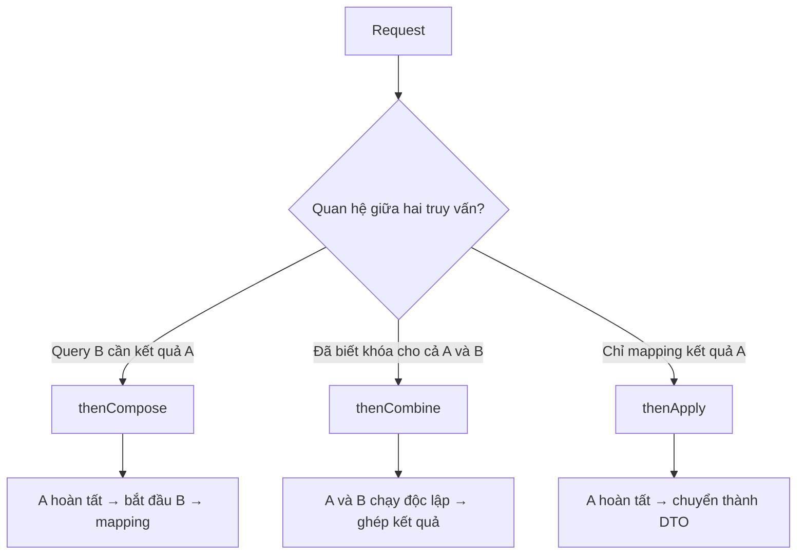
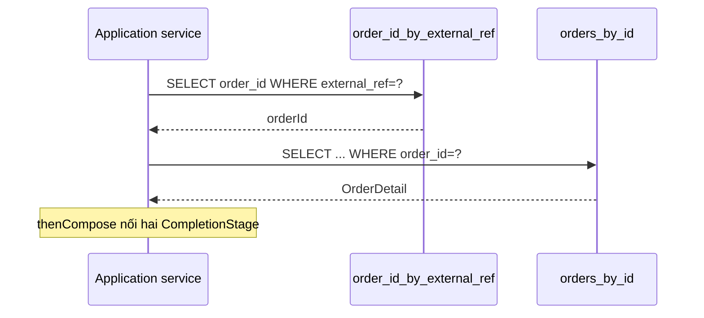
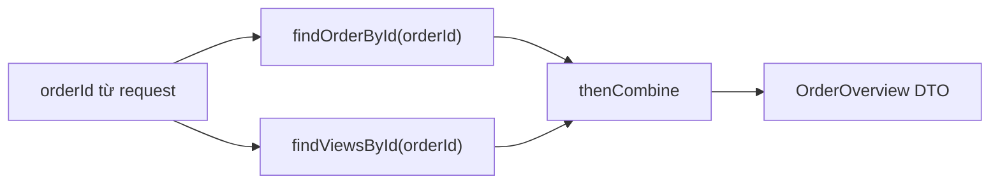
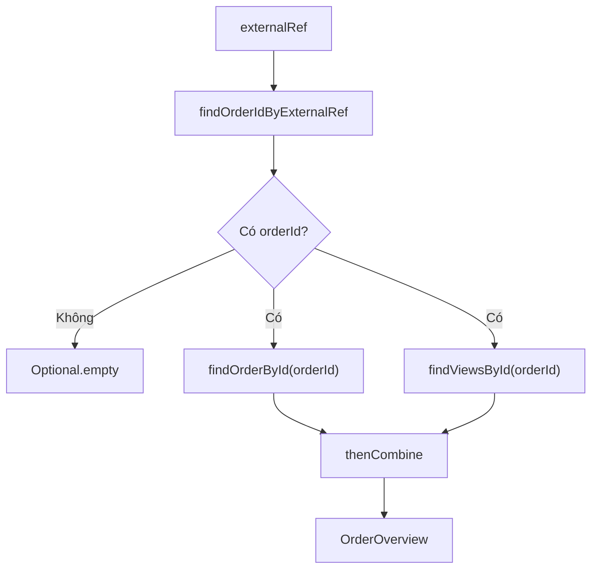

# Phối hợp tác vụ bằng thenCompose và thenCombine

## 1. Khi một API cần nhiều truy vấn Cassandra

Trong **Spring Data Cassandra**, ứng dụng Java thường truy cập Apache Cassandra bằng repository, `CassandraTemplate`, các câu CQL qua `CqlTemplate` hoặc trực tiếp bằng **Java Driver**. Ngoài API đồng bộ, Java Driver 4.x cung cấp `CqlSession.executeAsync(...)`, trả về `CompletionStage<AsyncResultSet>` để ứng dụng tiếp tục xử lý **khi Cassandra có kết quả** mà không cần chặn thread hiện tại để đợi I/O.

Điều đó hữu ích với các endpoint phải phối hợp nhiều nguồn dữ liệu:

- Nhận `externalRef` từ API, tra ra `orderId`, rồi lấy chi tiết đơn: **truy vấn thứ hai phụ thuộc kết quả truy vấn thứ nhất**.
- Có sẵn `orderId`, đồng thời đọc thông tin đơn và số lượt xem từ hai bảng: **hai truy vấn độc lập**, có thể chạy song song.
- Tải một page sự kiện, rồi chỉ khi cần mới tải page tiếp theo: **bước tiếp theo phụ thuộc trạng thái page trước**.
- Đọc nhiều read model, kết hợp thành DTO cho HTTP response nhưng vẫn phải tôn trọng **partition key, consistency và độ mới dữ liệu**.

Ba phương thức Java thường bị nhầm:

| Phương thức | Hàm đầu vào | Kiểu kết quả | Khi nào dùng? |
| --- | --- | --- | --- |
| `thenApply(fn)` | `T -> U` | `CompletionStage<U>` | Biến đổi **giá trị** đã có, không khởi tạo tác vụ bất đồng bộ phụ thuộc |
| `thenCompose(fn)` | `T -> CompletionStage<U>` | `CompletionStage<U>` | **Nối tuần tự**: chỉ có thể tạo tác vụ thứ hai sau khi biết kết quả thứ nhất |
| `thenCombine(other, fn)` | `(T, U) -> V` | `CompletionStage<V>` | **Ghép hai tác vụ độc lập** đã được khởi chạy, khi cả hai có kết quả |



**Mục tiêu:** sử dụng đúng `thenCompose` và `thenCombine` với API asynchronous của Cassandra, tránh `CompletionStage<CompletionStage<T>>`, không blocking driver I/O threads, giới hạn số request in-flight, phân biệt kết quả không tìm thấy với lỗi, và kiểm thử những luồng phụ thuộc/phối hợp nhiều bảng.

## 2. Phần chuẩn bị: thiết kế ba bảng theo truy vấn

Ví dụ ứng dụng cần tra cứu đơn theo ID, tra ID từ mã bên ngoài và đọc thống kê lượt xem:

```sql
-- Chỉ dùng SimpleStrategy/RF=1 cho môi trường học local một node.
CREATE KEYSPACE IF NOT EXISTS shop_async
WITH replication = {
    'class': 'SimpleStrategy',
    'replication_factor': 1
};

-- Tra cứu chi tiết bằng primary key.
CREATE TABLE IF NOT EXISTS shop_async.orders_by_id (
    order_id uuid PRIMARY KEY,
    customer_id uuid,
    status text,
    total_amount decimal,
    created_at timestamp
);

-- Tra từ external reference tới ID.
CREATE TABLE IF NOT EXISTS shop_async.order_id_by_external_ref (
    external_ref text PRIMARY KEY,
    order_id uuid
);

-- Số lượt xem là counter: bảng riêng, không trộn cột thường ngoài PK.
CREATE TABLE IF NOT EXISTS shop_async.order_views_by_id (
    order_id uuid PRIMARY KEY,
    view_count counter
);
```

Seed dữ liệu:

```sql
INSERT INTO shop_async.orders_by_id
    (order_id, customer_id, status, total_amount, created_at)
VALUES (
    11111111-1111-4111-8111-111111111111,
    22222222-2222-4222-8222-222222222222,
    'PAID',
    199000.00,
    '2026-11-25T08:00:00Z'
);

INSERT INTO shop_async.order_id_by_external_ref
    (external_ref, order_id)
VALUES (
    'PAY-2026-001',
    11111111-1111-4111-8111-111111111111
);

UPDATE shop_async.order_views_by_id
SET view_count = view_count + 5
WHERE order_id = 11111111-1111-4111-8111-111111111111;
```

Ba bảng có **đường đọc theo primary key rõ ràng**:

```sql
SELECT order_id
FROM shop_async.order_id_by_external_ref
WHERE external_ref = ?;

SELECT order_id, customer_id, status, total_amount
FROM shop_async.orders_by_id
WHERE order_id = ?;

SELECT view_count
FROM shop_async.order_views_by_id
WHERE order_id = ?;
```

**Bất đồng bộ không làm một CQL sai trở nên hiệu quả.** Nếu thay query bằng `SELECT ... WHERE status='PAID'` trên bảng chỉ có partition key `order_id`, câu lệnh vẫn cần một đường truy cập được hỗ trợ (bảng theo truy vấn/index thích hợp), không thể chữa bằng `thenCompose` hoặc `thenCombine`.

Các bảng là **read models độc lập**; một request ghép dữ liệu từ nhiều bảng không tự nhận snapshot ACID toàn hệ thống. Ví dụ total_amount có thể mới hơn giá trị thống kê, hoặc bảng lookup đã được ghi nhưng bảng chính chưa đồng bộ vì quy trình ghi bị lỗi.

## 3. Từ `CqlSession.executeAsync` đến `CompletionStage`

Trong Java Driver 4.x:

```java
CompletionStage<AsyncResultSet> stage = session.executeAsync(boundStatement);
```

Lời gọi này **trả về trước khi toàn bộ I/O hoàn tất**. Một callback có thể đọc `AsyncResultSet.one()` hoặc duyệt `currentPage()` sau khi stage hoàn tất. Nếu có nhiều page, `fetchNextPage()` trả **một `CompletionStage<AsyncResultSet>` khác**.

Các kiểu chủ đạo:

```text
CqlSession
  executeAsync(Statement)
      ↓
CompletionStage<AsyncResultSet>
      ↓ thenApply(...)
CompletionStage<Optional<Order>>
      ↓ thenCompose(...) hoặc thenCombine(...)
CompletionStage<DTO>
```

`CompletionStage<T>` biểu diễn **kết quả sẽ có sau** của một tác vụ. `CompletableFuture<T>` là một implementation phổ biến có thêm các phương thức tạo/hoàn tất/hủy và tiện ích `allOf`. Khi thiết kế adapter persistence, ưu tiên khai báo return type **`CompletionStage<T>`** nếu caller chỉ cần phối hợp; dùng `CompletableFuture<T>` khi phải giao tiếp với API yêu cầu kiểu cụ thể.

### 3.1. Chuẩn bị statement một lần

Không prepare lại mỗi request:

```java
// Không nên đặt trong mỗi lượt HTTP:
PreparedStatement ps = session.prepare(
    "SELECT status FROM shop_async.orders_by_id WHERE order_id = ?"
);
```

Tốt hơn, tạo prepared statement khi adapter được khởi tạo hoặc dùng một cơ chế cache có kiểm soát, rồi `bind` giá trị của từng request. `CqlSession` là tài nguyên dùng chung được Spring quản lý; không tự tạo/đóng session ở mỗi lần gọi.

**Lưu ý:** `session.prepare(...)` là một thao tác **đồng bộ** tại thời điểm khởi tạo bean. Ví dụ dưới đây chấp nhận việc đó ở bootstrap, không có nghĩa toàn bộ vòng đời ứng dụng hoàn toàn non-blocking. Nếu bootstrap cần phi đồng bộ, Java Driver cũng có `prepareAsync(...)`, nhưng phải phối hợp startup/readiness đúng cách.

## 4. Adapter bất đồng bộ đầy đủ với Spring và Java Driver

Ví dụ sau dùng Java 17+, Spring Boot và Java Driver 4.x. `CqlSession` được Spring cấu hình cho keyspace `shop_async` hoặc sử dụng tên bảng đầy đủ như trong CQL.

### 4.1. Các record của tầng đọc

```java
import java.math.BigDecimal;
import java.util.UUID;

public record OrderDetail(
    UUID orderId,
    UUID customerId,
    String status,
    BigDecimal totalAmount
) {}

public record OrderViewCount(long count) {}

public record OrderOverview(
    OrderDetail order,
    long viewCount
) {}
```

Các record dùng để **trả dữ liệu đọc**, không phải entity mà repository sẽ `save` lại. Với bảng chứa các field nullable, cần thiết kế nullability cho record phù hợp yêu cầu API.

### 4.2. Triển khai `AsyncOrderReader`

```java
import java.util.Optional;
import java.util.UUID;
import java.util.concurrent.CompletionStage;

import com.datastax.oss.driver.api.core.CqlSession;
import com.datastax.oss.driver.api.core.cql.BoundStatement;
import com.datastax.oss.driver.api.core.cql.PreparedStatement;
import com.datastax.oss.driver.api.core.cql.Row;
import org.springframework.stereotype.Repository;

@Repository
public class AsyncOrderReader {

    private final CqlSession session;
    private final PreparedStatement findIdByRefStatement;
    private final PreparedStatement findOrderStatement;
    private final PreparedStatement findViewsStatement;

    public AsyncOrderReader(CqlSession session) {
        this.session = session;

        findIdByRefStatement = session.prepare("""
            SELECT order_id
            FROM shop_async.order_id_by_external_ref
            WHERE external_ref = ?
            """);

        findOrderStatement = session.prepare("""
            SELECT order_id, customer_id, status, total_amount
            FROM shop_async.orders_by_id
            WHERE order_id = ?
            """);

        findViewsStatement = session.prepare("""
            SELECT view_count
            FROM shop_async.order_views_by_id
            WHERE order_id = ?
            """);
    }

    public CompletionStage<Optional<UUID>> findOrderIdByExternalRef(
            String ref) {

        BoundStatement bound = findIdByRefStatement.bind(ref)
            .setIdempotent(true);

        return session.executeAsync(bound).thenApply(result -> {
            Row row = result.one();
            return row == null
                ? Optional.empty()
                : Optional.of(row.getUuid("order_id"));
        });
    }

    public CompletionStage<Optional<OrderDetail>> findOrderById(UUID id) {
        BoundStatement bound = findOrderStatement.bind(id)
            .setIdempotent(true);

        return session.executeAsync(bound).thenApply(result -> {
            Row row = result.one();
            if (row == null) {
                return Optional.empty();
            }
            return Optional.of(new OrderDetail(
                row.getUuid("order_id"),
                row.getUuid("customer_id"),
                row.getString("status"),
                row.getBigDecimal("total_amount")
            ));
        });
    }

    public CompletionStage<Optional<OrderViewCount>> findViewsById(UUID id) {
        BoundStatement bound = findViewsStatement.bind(id)
            .setIdempotent(true);

        return session.executeAsync(bound).thenApply(result -> {
            Row row = result.one();
            if (row == null) {
                return Optional.empty();
            }

            // Counter chưa được ghi có thể chưa có cell sống;
            // chính sách view-count của ứng dụng coi thiếu là 0.
            long count = row.isNull("view_count")
                ? 0L
                : row.getLong("view_count");

            return Optional.of(new OrderViewCount(count));
        });
    }
}
```

**Những đặc điểm quan trọng:**

1. `executeAsync` được gọi trên **cùng `CqlSession` dùng chung**.
2. Mỗi truy vấn có một **prepared CQL shape cố định**, và mỗi request dùng `bind` riêng.
3. `thenApply` chỉ chuyển `Row` thành object, không tạo thêm lượt truy cập database.
4. `Row == null` nghĩa là không tìm thấy hàng ở câu query đó; khác với một cell được chọn nhưng trả `null`.
5. Counter không có giá trị sống được hiển thị là `0` **theo quy tắc của ứng dụng trong ví dụ**, không suy rằng Cassandra đã lưu cell số 0.
6. Mọi query đều định vị **partition key**, không trông chờ `ALLOW FILTERING`.

Nếu class sử dụng keyspace mặc định thay vì prefix đầy đủ, phải xác nhận cấu hình `spring.cassandra.keyspace-name` và `spring.cassandra.local-datacenter` trùng môi trường thật. Với production nhiều replica, consistency, timeout và execution profile phải được cấu hình theo workload.

## 5. `thenApply`: chuyển đổi một giá trị, không bắt đầu truy vấn phụ thuộc

Nhìn lại:

```java
return session.executeAsync(bound).thenApply(result -> {
    Row row = result.one();
    return row == null ? Optional.empty()
                       : Optional.of(row.getString("status"));
});
```

Hàm truyền cho `thenApply` nhận `AsyncResultSet` và **trả ra một giá trị** `Optional<String>`.

Nếu chỉ cần kiểm tra trạng thái hiển thị:

```java
CompletionStage<String> label = reader.findOrderById(orderId)
    .thenApply(maybeOrder -> maybeOrder
        .map(OrderDetail::status)
        .orElse("Không tìm thấy đơn"));
```

`thenApply` thích hợp cho những biến đổi nhanh: ánh xạ row, kiểm tra `Optional`, tạo DTO nhỏ, định dạng một nhãn. Nó **không nhất thiết thực thi callback trên một thread pool mới**. Callback không có hậu tố `Async` có thể chạy trên thread vừa hoàn tất stage, bao gồm thread liên quan tới callback của driver.

### Phản mẫu: `thenApply` trả thêm một Future

```java
// Chạy được về mặt kiểu, nhưng tạo nested stage khó dùng.
CompletionStage<CompletionStage<Optional<OrderDetail>>> nested =
    reader.findOrderIdByExternalRef(ref).thenApply(maybeId ->
        maybeId
            .map(reader::findOrderById)
            .orElseGet(() ->
                java.util.concurrent.CompletableFuture.completedFuture(
                    Optional.empty()
                )
            )
    );
```

Kiểu `CompletionStage<CompletionStage<T>>` có nghĩa **tác vụ bên ngoài hoàn tất vẫn chưa có kết quả cuối**; caller còn phải giải quyết tác vụ bên trong. Nếu callback sinh một Future/stage mới và kết quả cuối phụ thuộc vào nó, hãy dùng `thenCompose`.

## 6. `thenCompose`: nối hai truy vấn khi truy vấn sau cần kết quả trước

Use case: người dùng chỉ biết `externalRef`. Ta phải:

1. Tra `order_id_by_external_ref` theo khóa `external_ref`.
2. Khi có `orderId`, mới có đủ khóa để đọc `orders_by_id`.
3. Nếu không có mã tham chiếu, không phát truy vấn thứ hai.



### 6.1. Code sử dụng `thenCompose`

```java
import java.util.Optional;
import java.util.concurrent.CompletableFuture;
import java.util.concurrent.CompletionStage;

public CompletionStage<Optional<OrderDetail>> findByExternalRef(String ref) {
    return reader.findOrderIdByExternalRef(ref)
        .thenCompose(maybeId -> maybeId
            .map(reader::findOrderById)
            .orElseGet(() ->
                CompletableFuture.completedFuture(Optional.empty())
            )
        );
}
```

Trong đoạn code:

- Stage thứ nhất có kiểu `CompletionStage<Optional<UUID>>`.
- Function đưa vào `thenCompose` có kiểu **`Optional<UUID> -> CompletionStage<Optional<OrderDetail>>`**.
- Khi mã không tồn tại, `completedFuture(Optional.empty())` trả một stage **đã hoàn tất**, không gọi Cassandra thêm.
- Khi mã tồn tại, `reader.findOrderById(...)` tạo tác vụ async thứ hai.
- Toàn bộ method có kiểu **`CompletionStage<Optional<OrderDetail>>`**, không lồng hai stage.

**Tính tuần tự là yêu cầu dữ liệu, không phải giới hạn của Future:** không thể bắt đầu query thứ hai sớm hơn khi chưa biết `orderId`. Không dùng `thenCombine` để ép chạy song song hai tác vụ nếu truy vấn sau phụ thuộc kết quả truy vấn trước.

### 6.2. Cẩn thận với null và exceptional completion

Hàm trả cho `thenCompose` phải trả một `CompletionStage` **không null**. Nếu viết:

```java
// Sai: nhánh không tìm thấy trả null thay vì CompletionStage.
return reader.findOrderIdByExternalRef(ref)
    .thenCompose(maybeId -> maybeId.isPresent()
        ? reader.findOrderById(maybeId.get())
        : null
    );
```

thì callback gây lỗi khi rơi vào nhánh null. Dùng `CompletableFuture.completedFuture(Optional.empty())` hoặc `CompletableFuture.failedFuture(...)` tùy ngữ nghĩa:

- **Không có hàng:** giá trị thông thường `Optional.empty()`.
- **Lỗi Cassandra, không đủ replica, timeout:** hoàn tất stage **exceptionally**; không được biến tất cả thành “không tìm thấy đơn”.

Nếu truy vấn thứ nhất bị lỗi, callback `thenCompose` **không chạy** và stage cuối báo lỗi. Nếu truy vấn thứ hai lỗi, lỗi đó cũng lan tới stage cuối; ứng dụng xử lý ở HTTP/service boundary.

### 6.3. `thenCompose` không tạo transaction

Hai query có thể cách nhau một khoảng thời gian đáng kể:

```text
t0: externalRef PAY-001 -> orderId A
t1: ứng dụng đọc orderId A
t2: một service khác sửa/xóa order A
t3: ứng dụng SELECT orders_by_id(A)
```

Kết quả có thể là `Optional.empty()` ở bước thứ hai. `thenCompose` chỉ **phối hợp thời điểm khởi chạy**; nó không khóa hai bảng, không tạo snapshot nhất quán và không giữ connection transaction giữa hai câu CQL.

Nếu bảng lookup là read model có thể trễ, application service cần quyết định fallback/retry/reconciliation theo nghiệp vụ; không kỳ vọng việc chaining futures tự giải quyết vấn đề.

## 7. `thenCombine`: ghép hai truy vấn thực sự độc lập

Use case: API đã nhận `orderId` và muốn trả:

- Chi tiết đơn từ `orders_by_id`.
- Số lượt xem từ `order_views_by_id`.

Hai câu query **đều đã đủ primary key ngay từ đầu**, vì vậy có thể phát cả hai trước khi đợi kết quả:



### 7.1. Code `thenCombine`

```java
import java.util.Optional;
import java.util.UUID;
import java.util.concurrent.CompletionStage;

public CompletionStage<Optional<OrderOverview>> overview(UUID orderId) {
    CompletionStage<Optional<OrderDetail>> orderStage =
        reader.findOrderById(orderId);

    CompletionStage<Optional<OrderViewCount>> viewsStage =
        reader.findViewsById(orderId);

    return orderStage.thenCombine(viewsStage,
        (maybeOrder, maybeViews) -> maybeOrder.map(order -> {
            long views = maybeViews
                .map(OrderViewCount::count)
                .orElse(0L); // Thiếu hàng counter -> hiển thị 0.

            return new OrderOverview(order, views);
        })
    );
}
```

**Hai truy vấn đã được khởi chạy** ở hai dòng gọi `reader...` phía trên. `thenCombine` không phải phương thức tự tạo network concurrency; nó **chờ cả hai stage có kết quả thông thường** rồi kết hợp bằng một hàm.

Chi tiết:

- Nếu không có đơn hàng, kết quả cuối là `Optional.empty()` dù số lượt xem có tồn tại.
- Nếu không có hàng counter, ví dụ áp dụng quy tắc **hiển thị 0**.
- Nếu một query báo lỗi, không coi nó giống `Optional.empty()`; stage kết hợp sẽ hoàn tất exceptionally.
- Có thể xuất hiện **thời điểm dữ liệu khác nhau** giữa hai bảng; `OrderOverview` không phải một snapshot ACID.
- Khi không có đơn, truy vấn metrics đã được gửi và có thể là chi phí thừa. Đó là **trade-off của việc chạy độc lập**; nếu nhiều ID không tồn tại, cân nhắc `thenCompose` để chỉ đọc metrics sau khi xác nhận có order.

### 7.2. `thenCombine` không tự sắp thứ tự kết quả

Hai truy vấn có thể hoàn thành theo bất kỳ thứ tự nào:

```text
Order query:   ────────────────●
View query:    ───────●
Combine:                       ───●
```

Hàm `(maybeOrder, maybeViews) -> ...` luôn nhận đối số thứ nhất từ `orderStage`, đối số thứ hai từ `viewsStage`, **không phụ thuộc stage nào trả trước**. Callback chỉ chạy khi đủ dữ liệu cần kết hợp.

### 7.3. Một lỗi phổ biến: tạo stage thứ hai bên trong callback

```java
// Đây là truy vấn PHỤ THUỘC, không phải hai tác vụ chạy song song.
return reader.findOrderById(id).thenCompose(maybeOrder ->
    reader.findViewsById(id).thenApply(maybeViews -> {
        // ...
        return maybeOrder;
    })
);
```

Đoạn trên trì hoãn việc đọc metrics **đến sau khi** order hoàn tất, dù có sẵn `id` từ đầu. Nếu dữ liệu độc lập và cần cả hai, dùng `thenCombine` có thể giảm **critical-path latency**. Nhưng nếu muốn tránh đọc metrics cho order không tồn tại, kiểu tuần tự có thể tốt hơn.

## 8. So sánh bằng sơ đồ thời gian và chi phí

Giả sử `A` mất 20 ms, `B` mất 40 ms, bỏ qua overhead và contention:

```text
thenCompose (B cần kết quả A):
  A:  [------ 20 ms ------]
  B:                     [----------- 40 ms -----------]
  tổng critical path ≈ 60 ms

thenCombine (A và B độc lập):
  A:  [------ 20 ms ------]
  B:  [----------- 40 ms -----------]
  tổng critical path ≈ 40 ms
```

Các con số chỉ là ví dụ lý thuyết, **không phải benchmark Cassandra**. Khi chạy thực tế, RPC overhead, scheduling, số connection in-flight, coordinator, replica, consistency level, partition hotspot và server load đều có thể thay đổi.

| Tiêu chí | `thenCompose` | `thenCombine` |
| --- | --- | --- |
| Query B cần dữ liệu A? | **Có thể có** | **Không nên** |
| Khi nào bắt đầu B? | Sau khi A hoàn tất và callback được gọi | Khi code tạo `stageB`, thường ngay từ đầu |
| Latency critical path | Thường xấp xỉ A + B nếu tuần tự | Thường xấp xỉ `max(A, B)` nếu thực sự song song |
| Tải đồng thời lên cluster | Có thể thấp hơn | Có thể cao hơn |
| Có thể bỏ B khi A không có dữ liệu? | Dễ dàng | B đã khởi chạy, không tự dừng |
| Có bảo đảm snapshot xuyên bảng? | **Không** | **Không** |
| Có bảo đảm thứ tự kết quả không? | B luôn bắt đầu sau A | Kết hợp theo vị trí stage, không theo thời gian trả |

**Latency thấp hơn không đồng nghĩa tổng tải thấp hơn.** `thenCombine` có thể tạo hai request in-flight cho mỗi HTTP request. Nếu service nhận 10.000 request/s, việc tăng fan-out mà không có giới hạn có thể làm cluster nghẽn và **p99 tệ hơn** dù latency nhỏ ở bài test một người dùng.

## 9. Kết hợp chuỗi nhiều bước: `thenCompose` và `thenCombine` cùng nhau

Một use case phức tạp hơn: đầu vào là `externalRef`; sau khi tra được `orderId`, cần song song đọc order và metrics.



Code:

```java
import java.util.Optional;
import java.util.concurrent.CompletableFuture;
import java.util.concurrent.CompletionStage;

public CompletionStage<Optional<OrderOverview>> overviewByRef(String ref) {
    return reader.findOrderIdByExternalRef(ref)
        .thenCompose(maybeId -> maybeId
            .map(this::overview)
            .orElseGet(() ->
                CompletableFuture.completedFuture(Optional.empty())
            )
        );
}
```

`this::overview` là method ở phần 7, tự khởi chạy hai đọc độc lập và `thenCombine`. Như vậy:

1. `thenCompose` nối **lookup ID → đọc dữ liệu theo ID**.
2. Khi đã có ID, `thenCombine` phối hợp **hai lượt đọc độc lập**.
3. Đầu ra vẫn là một `CompletionStage<Optional<OrderOverview>>` phẳng.

Đây là mẫu phối hợp phổ biến khi một API có **dependency graph** gồm cả nhánh tuần tự và song song. Thiết kế luồng bằng cách vẽ **khóa nào có sẵn ở bước nào** trước khi chọn hàm CompletableFuture.

## 10. Xử lý exception mà không biến lỗi thành “không có dữ liệu”

Các stage có hai dạng hoàn tất chính:

- **Hoàn tất bình thường:** chứa `Optional<OrderDetail>` có hoặc không có giá trị.
- **Hoàn tất exceptionally:** ví dụ Cassandra timeout, `Unavailable`, lỗi mapping/driver hoặc callback Java ném exception.

Nếu `thenCompose` nhận một stage lỗi, callback tạo query kế tiếp không chạy. Nếu `thenCombine` có một nhánh lỗi, stage kết quả cũng không thể tạo DTO bình thường từ hai giá trị; nhánh còn lại **không tự được hủy** và có thể tiếp tục chạy.

### 10.1. `whenComplete` để quan sát, không mặc nhiên phục hồi

```java
CompletionStage<Optional<OrderOverview>> stage = overview(orderId);

return stage.whenComplete((value, error) -> {
    if (error != null) {
        // Ghi metric/log gọn, không blocking, không lộ dữ liệu nhạy cảm.
        metrics.recordFailure("order-overview");
    } else {
        metrics.recordSuccess("order-overview");
    }
});
```

Trong ví dụ, `metrics` là dependency quan sát được inject vào service. `whenComplete` thích hợp với side effect quan sát **ngắn và an toàn**. Nếu callback ném exception mới, nó có thể làm stage phụ thuộc kết thúc khác dự tính; không nên đặt logic phức tạp hoặc blocking I/O ở đây.

### 10.2. `handle`/`exceptionally` phải có chính sách rõ

Giả sử dashboard chấp nhận **số lượt xem không khả dụng**, nhưng không chấp nhận thiếu dữ liệu đơn. Có thể xử lý riêng nhánh metrics:

```java
public record ViewDisplay(boolean available, Long count) {
    static ViewDisplay unavailable() {
        return new ViewDisplay(false, null);
    }
}

CompletionStage<ViewDisplay> viewsForDashboard =
    reader.findViewsById(orderId)
        .handle((maybeViews, error) -> {
            if (error != null) {
                // Tăng metric degraded-read; không tự coi lỗi là count=0.
                return ViewDisplay.unavailable();
            }
            long count = maybeViews
                .map(OrderViewCount::count)
                .orElse(0L);
            return new ViewDisplay(true, count);
        });
```

Giờ UI có thể hiện “chưa tải được số lượt xem” thay vì số **0 sai**. Tuy nhiên:

- Chỉ dùng fallback này cho trường **không thiết yếu** theo hợp đồng sản phẩm.
- Đối với thanh toán, trạng thái đơn, quyền truy cập hoặc tồn kho, không được che lỗi Cassandra bằng giá trị mặc định tùy ý.
- Cần ghi metric cảnh báo và có cơ chế phục hồi; degraded response không thay thế vận hành cluster.
- `handle` chạy cả trên thành công và thất bại, nên logic phân loại phải chính xác.

### 10.3. Không dùng `.join()` hoặc `.get()` trong callback

Phản mẫu:

```java
return reader.findOrderById(id).thenApply(maybeOrder -> {
    // Không blocking thread hoàn tất stage để đợi một request mới.
    var views = reader.findViewsById(id)
        .toCompletableFuture()
        .join();
    return maybeOrder;
});
```

Callback này có thể được gọi trên thread xử lý hoàn tất request của driver. `.join()` chặn thread cho tới khi request metrics hoàn tất, gây nghẽn hoặc deadlock trong một số cách cấu hình callback/executor. Hãy dùng **`thenCompose` hoặc `thenCombine`** để diễn đạt dependency thay vì khóa thread.

## 11. Thread thực thi callback: không chặn driver I/O

Các method `thenApply`, `thenCompose`, `thenCombine` **không có hậu tố `Async`**. Hàm callback có thể chạy trên thread đã hoàn tất stage hoặc thread trực tiếp hoàn tất future; không nên giả định nó tự tạo worker thread của Spring.

Vì thế:

- **Phù hợp trong callback nhẹ:** đọc `Row`, tạo DTO nhỏ, kiểm tra `Optional`, cộng vài số đơn giản.
- **Không phù hợp:** gọi HTTP sync, `Thread.sleep`, đọc file dung lượng lớn, serialize payload khổng lồ, xử lý CPU nặng, gọi `future.join()` đợi Cassandra.
- Với tác vụ CPU nặng thật sự, dùng `thenApplyAsync(..., executor)` hoặc `thenCombineAsync(..., executor)` với **executor do ứng dụng quản lý và giới hạn hàng đợi**.

Ví dụ đưa phép tính nặng sang executor riêng:

```java
import java.util.concurrent.CompletionStage;
import java.util.concurrent.Executor;

public CompletionStage<Report> analyzeAsync(
        CompletionStage<RawData> dataStage,
        Executor analysisExecutor) {

    return dataStage.thenApplyAsync(
        data -> expensiveCpuTransformation(data),
        analysisExecutor
    );
}
```

`RawData`, `Report`, `expensiveCpuTransformation` ở đây là kiểu và hàm minh họa; nó **không tạo I/O blocking** trên driver callback thread. Không dùng mặc định `ForkJoinPool.commonPool()` cho mọi tác vụ nặng mà không có capacity planning: hệ thống cần điều tiết concurrency ở cả Cassandra lẫn worker executor.

Một executor nhỏ với bounded queue thường dễ theo dõi hơn việc tạo thread mới cho mỗi request. Khi kết thúc ứng dụng, shutdown executor theo lifecycle của Spring và không đóng session trước khi các request cần thiết hoàn tất.

## 12. Giới hạn fan-out và số request đồng thời

`thenCombine` hữu ích khi cần ghép **hai hoặc vài** kết quả độc lập. Nhưng nếu một API cố đọc 10.000 partition một lúc bằng `allOf`, bạn có thể làm ngập connection pool/replica/coordinator.

### 12.1. Ghép danh sách nhỏ đã được giới hạn

Với một danh sách ID **đã được kiểm tra giới hạn**, ta có thể khởi chạy những lượt đọc độc lập:

```java
import java.util.List;
import java.util.Optional;
import java.util.UUID;
import java.util.concurrent.CompletableFuture;
import java.util.concurrent.CompletionStage;

public CompletionStage<List<OrderDetail>> readSmallBatch(
        List<UUID> ids, AsyncOrderReader reader) {

    if (ids.size() > 20) {
        throw new IllegalArgumentException("Tối đa 20 orderIds");
    }

    List<CompletableFuture<Optional<OrderDetail>>> futures = ids.stream()
        .map(reader::findOrderById)
        .map(CompletionStage::toCompletableFuture)
        .toList();

    CompletableFuture<?>[] all = futures.toArray(
        CompletableFuture[]::new
    );

    return CompletableFuture.allOf(all).thenApply(ignored ->
        futures.stream()
            .map(CompletableFuture::join) // Tất cả đã hoàn tất bình thường.
            .flatMap(Optional::stream)
            .toList()
    );
}
```

`join()` **chỉ xuất hiện sau** khi `allOf` hoàn tất bình thường, nên các future đã có kết quả và không còn phải đợi I/O. Đây là một ngoại lệ có kiểm soát; nó **không phải** pattern khuyến khích `join()` tùy ý trong callbacks. Nếu một query lỗi, `allOf` hoàn tất exceptionally và callback `thenApply` không chạy.

Giới hạn 20 chỉ là con số minh họa. Production cần limit theo budget latency, cluster capacity, tenant, timeout và số HTTP request đồng thời; **20 fan-out mỗi request nhân với 1.000 request in-flight** đã có thể tạo tải lớn.

### 12.2. Fan-out lớn cần concurrency cap

Nếu cần quét hàng trăm bucket/partition:

1. Tách thành các nhóm công việc có kích thước giới hạn.
2. Dùng semaphore/queue/bulkhead hoặc một scheduler có capacity rõ ràng.
3. Chỉ gửi số lượng Cassandra requests đang bay trong giới hạn.
4. Thu thập kết quả theo từng nhóm/cursor và có cơ chế backpressure.
5. Dừng hoặc trả lỗi sau deadline thay vì để backlog tăng vô hạn.
6. Nếu là công việc analytics/export lớn, cân nhắc luồng xử lý riêng thay vì fan-out đồng bộ từ một HTTP request.

`CompletableFuture.allOf` chỉ **phối hợp các future đã được tạo**. Nó không tự đặt concurrency cap, không giới hạn số partition và không bảo đảm Cassandra đã có snapshot chung ở thời điểm đọc.

## 13. Phân trang bất đồng bộ: `fetchNextPage` đi với `thenCompose`

`AsyncResultSet` trong Java Driver cho phép truy cập page hiện tại bằng `currentPage()`. Nếu còn nhiều page, `fetchNextPage()` trả `CompletionStage<AsyncResultSet>`. Đây là ví dụ điển hình của **dependency tuần tự**: chỉ khi đã xử lý page hiện tại và cần thêm hàng, ta mới quyết định lấy page tiếp.

Schema ví dụ:

```sql
CREATE TABLE IF NOT EXISTS shop_async.order_events_by_id (
    order_id uuid,
    occurred_at timestamp,
    event_id uuid,
    event_type text,
    PRIMARY KEY ((order_id), occurred_at, event_id)
) WITH CLUSTERING ORDER BY (occurred_at DESC, event_id ASC);
```

CQL giới hạn vào một partition:

```sql
SELECT occurred_at, event_id, event_type
FROM shop_async.order_events_by_id
WHERE order_id = ?
LIMIT ?;
```

### 13.1. Ví dụ tải tối đa 100 events mà không chặn thread

```java
import java.time.Instant;
import java.util.ArrayList;
import java.util.List;
import java.util.UUID;
import java.util.concurrent.CompletableFuture;
import java.util.concurrent.CompletionStage;

import com.datastax.oss.driver.api.core.cql.AsyncResultSet;
import com.datastax.oss.driver.api.core.cql.Row;

public record OrderEvent(
    UUID eventId, Instant occurredAt, String eventType
) {}

private CompletionStage<List<OrderEvent>> collectPages(
        AsyncResultSet page,
        List<OrderEvent> collected,
        int maxRows) {

    for (Row row : page.currentPage()) {
        if (collected.size() >= maxRows) {
            break;
        }
        collected.add(new OrderEvent(
            row.getUuid("event_id"),
            row.getInstant("occurred_at"),
            row.getString("event_type")
        ));
    }

    if (collected.size() >= maxRows || !page.hasMorePages()) {
        return CompletableFuture.completedFuture(
            List.copyOf(collected)
        );
    }

    return page.fetchNextPage().thenCompose(
        nextPage -> collectPages(nextPage, collected, maxRows)
    );
}
```

Trong adapter, gọi:

```java
int maxRows = 100;
var bound = eventsStatement.bind(orderId, maxRows)
    .setPageSize(20)
    .setIdempotent(true);

return session.executeAsync(bound)
    .thenCompose(firstPage ->
        collectPages(firstPage, new ArrayList<>(), maxRows)
    );
```

`eventsStatement` là `PreparedStatement` được chuẩn bị một lần từ query trên; `session` và `orderId` có sẵn trong adapter. Đoạn `collectPages` được gọi **theo một chuỗi tuần tự** nên danh sách `collected` không bị nhiều callback đồng thời thay đổi. Nếu triển khai concurrent page processing khác, phải thiết kế lại việc chia sẻ bộ nhớ.

**Cần phân biệt:**

- `LIMIT 100` giới hạn tổng số hàng CQL cho query.
- `setPageSize(20)` định kích thước page mục tiêu, **không có nghĩa cả API chỉ trả 20 hàng**.
- `hasMorePages()`/`fetchNextPage()` thể hiện state paging của driver.
- Paging state không phải offset tự do; token API phải gắn với query, bind parameters, tenant/partition và phiên bản truy vấn.

Nếu endpoint chỉ muốn trả **một page** cho mỗi HTTP request, đừng gọi `collectPages` tới khi hết dữ liệu; trả page hiện tại với cursor opaque được kiểm soát. Việc tải nhiều page trong một request có thể làm tăng latency và memory, dù mọi thao tác đều bất đồng bộ.

## 14. HTTP boundary: không block servlet thread để đợi Cassandra

Trong một Spring MVC application, controller có thể trả một `CompletableFuture` để framework xử lý kết quả khi hoàn tất, thay vì gọi `join()` trên request thread:

```java
import java.util.UUID;
import java.util.concurrent.CompletableFuture;

import org.springframework.http.ResponseEntity;
import org.springframework.web.bind.annotation.GetMapping;
import org.springframework.web.bind.annotation.PathVariable;
import org.springframework.web.bind.annotation.RestController;

@RestController
public class OrderOverviewController {

    private final OrderReadService service;

    public OrderOverviewController(OrderReadService service) {
        this.service = service;
    }

    @GetMapping("/orders/{id}/overview")
    public CompletableFuture<ResponseEntity<OrderOverview>> getOverview(
            @PathVariable UUID id) {

        return service.overview(id)
            .thenApply(maybeOverview ->
                maybeOverview
                    .map(ResponseEntity::ok)
                    .orElseGet(() -> ResponseEntity.notFound().build())
            )
            .toCompletableFuture();
    }
}
```

`OrderReadService` ở đây cung cấp `CompletionStage<Optional<OrderOverview>> overview(UUID)` như phần 7. Với controller thực tế cần có `@ExceptionHandler`/`ControllerAdvice` để chuyển **lỗi Cassandra** thành HTTP response phù hợp, phân quyền theo tenant và giới hạn lưu lượng; ví dụ chỉ minh họa **non-blocking composition tại controller**.

**Không viết:**

```java
// Chặn thread xử lý HTTP khi Cassandra chưa phản hồi.
OrderOverview value = service.overview(id)
    .toCompletableFuture()
    .join()
    .orElseThrow();
```

Đặc biệt, với Spring WebFlux, nên cân nhắc **ReactiveCassandraTemplate/ReactiveCassandraRepository** và `Mono`/`Flux` khi cần backpressure, lifecycle/cancellation theo reactive pipeline. Reactor `flatMap`/`zip` có ý nghĩa phối hợp tương tự nhưng **không phải** `thenCompose`/`thenCombine` và không tự dùng chung cơ chế thread. Không pha trộn reactive với blocking `join()` chỉ vì muốn có kiểu Java đồng bộ.

## 15. Timeout, deadline, cancellation và retry

### 15.1. Có nhiều mức timeout

| Mức | Ví dụ | Ý nghĩa |
| --- | --- | --- |
| Cassandra/Driver request timeout | Execution profile hoặc statement option | Ngân sách chờ request với driver/server theo cấu hình |
| Application deadline | Toàn bộ luồng lookup + detail + metrics | Ngân sách tổng cho use case |
| HTTP/gateway timeout | Client hoặc reverse proxy không chờ thêm | Không có nghĩa Cassandra request đã bị hủy/rollback |
| Retry budget | Giới hạn số lần thử bổ sung | Chặn amplification khi cluster chậm |

Hai truy vấn nối bằng `thenCompose` có thể cùng tiêu thụ thời gian của một request; nếu mỗi query có timeout 2 giây nhưng deadline HTTP chỉ 2 giây, không thể suy rằng toàn bộ pipeline chắc chắn hoàn tất trong 2 giây.

### 15.2. `.orTimeout()` không phải thao tác rollback

Với một `CompletableFuture` do ứng dụng quản lý, Java cung cấp `orTimeout(...)` và `completeOnTimeout(...)` tùy yêu cầu. Nhưng timeout ở future là **hành vi quan sát** của client; không chứng minh underlying Cassandra mutation dừng hoặc chưa được áp dụng.

Đối với các **lệnh ghi**, đặc biệt counter increment, conditional LWT, list append hoặc các side effects khác, retry sau timeout có thể dẫn tới ghi lặp hoặc **kết quả chưa xác định**. Khi phối hợp nhiều truy vấn:

- Nếu chỉ có các phép đọc idempotent, có thể thiết kế bounded retry ở tầng phù hợp theo SLO.
- Nếu có **ghi**, phân loại từng thao tác, dùng stable request ID/ledger và đối soát khi cần.
- Không tự coi việc cancel một future là **DELETE, rollback hoặc cancellation server-side thành công**.
- Nếu một nhánh của `thenCombine` thất bại, nhánh kia có thể đã hoàn tất hoặc còn đang chạy.
- Không tự retry **toàn bộ** pipeline có ghi khi chỉ nhánh sau bị lỗi; dễ lặp các bước đã thành công.

### 15.3. Bounded retry và backoff

Hãy thiết kế một **retry owner**: driver, adapter hoặc service, tránh tất cả các tầng cùng retry vô hạn. Với các thao tác cho phép retry, cần deadline tổng, số lần tối đa, jitter, theo dõi retry count và phân biệt `Timeout`, `Unavailable`, rate limit và lỗi mapping.

`setIdempotent(true)` chỉ là lời khai báo với driver về tính an toàn khi thực hiện lại; không tự tạo idempotency nghiệp vụ. Một `INSERT` sinh UUID mới ở mỗi lần retry hoặc counter `+1` **không trở nên an toàn** chỉ vì chạy bất đồng bộ.

## 16. Kiểm soát consistency khi ghép nhiều read models

Ví dụ:

```text
orders_by_id        -> thông tin đơn
order_views_by_id   -> số lượt xem
```

Hai query có thể dùng consistency khác nhau theo use case. `LOCAL_QUORUM` cho một lượt đọc và `LOCAL_ONE` cho lượt đọc khác **không tạo snapshot nguyên tử chung**; chúng chỉ điều khiển điều kiện phản hồi của từng truy vấn.

Nếu service vừa:

```text
1. Ghi trạng thái PAID vào orders_by_id
2. Ghi projection vào orders_by_customer_day
3. Đọc hai bảng đồng thời để tạo response
```

thì `thenCombine` không đảm bảo bước 2 đã thành công hoặc read model thứ hai đã hội tụ. Phải kiểm soát thứ tự nghiệp vụ và **idempotency/reconciliation** bằng workflow; `@Transactional` của Spring không tự tạo giao dịch ACID xuyên các bảng Cassandra.

**Khi nào cần `thenCompose` để giữ thứ tự ghi?**

```java
return writeSourceOfTruth(orderId)
    .thenCompose(ignored -> updateReadModel(orderId))
    .thenApply(ignored -> buildResponse());
```

Sơ đồ này chỉ mô tả **thứ tự**; `writeSourceOfTruth`, `updateReadModel`, `buildResponse` là các hàm minh họa. Nếu cập nhật read model thất bại sau khi nguồn sự thật ghi thành công, source không tự được rollback. Service phải lưu trạng thái cần đối soát và quyết định response đúng.

**Không dùng `thenCombine` cho hai ghi phụ thuộc nghiệp vụ** chỉ để giảm latency nếu bước sau cần cam kết của bước trước. Nếu hai lệnh ghi độc lập thật sự, chạy song song vẫn không cho phép suy ra tính nguyên tử/khả năng rollback.

## 17. Quan sát hiệu năng: đo nhiều chiều thay vì chỉ thời gian Future

Để xác định lời ích và chi phí của composition, nên đo:

| Nhóm metric | Ý nghĩa |
| --- | --- |
| Latency query lookup theo `externalRef` | Chi phí bước đầu của `thenCompose` |
| Latency query by `orderId` | Chi phí đọc bảng chính |
| Latency query metrics | Chi phí bảng counter/read model |
| End-to-end p50/p95/p99 | Độ trễ thực API sau composition |
| In-flight Cassandra requests | Tải do `thenCombine`/fan-out tạo ra |
| Timeout, unavailable, retries | Độ ổn định và retry amplification |
| Callback executor queue/CPU | Tìm blocking callback hoặc quá tải mapping |
| Hot partition, số partition/endpoint | Tìm bottleneck do data model |
| Read model divergence/age | Phân biệt lỗi phối hợp future với consistency lag |
| Page fetch count và bytes returned | Kiểm soát chi phí pagination |

Không log nguyên chuỗi `externalRef`, `orderId` hoặc dữ liệu khách hàng vào metric labels có cardinality không giới hạn. Dùng correlation ID, query-family label, sampling và cấu hình tracing có kiểm soát.

### Phân tích một request chậm

1. Xem `thenCompose` có chuỗi phụ thuộc nhiều bước không.
2. Xem `thenCombine` có thực sự khởi chạy các stage độc lập trước không.
3. Kiểm tra coordinator/replica/consistency và partition key của từng query.
4. Kiểm tra có `join()`, `get()`, sleep hoặc synchronous I/O trong callback không.
5. Đo executor queue, request in-flight và connection/pool saturation.
6. Kiểm tra page fetch, `LIMIT`, payload và số partition phải đọc.
7. Nếu một bảng chưa có read model mới, xử lý replication/reconciliation thay vì đổ lỗi cho future composition.

## 18. Kiểm thử `thenCompose` và `thenCombine`

### 18.1. Unit test điều kiện khởi chạy

Với `thenCompose`, dùng hai `CompletableFuture` có thể tự hoàn tất:

```java
CompletableFuture<Optional<UUID>> idFuture =
    new CompletableFuture<>();

CompletableFuture<Optional<OrderDetail>> orderFuture =
    new CompletableFuture<>();

// Trong stub, findOrderIdByExternalRef trả idFuture.
// findOrderById trả orderFuture và tăng biến đếm số lần gọi.

CompletionStage<Optional<OrderDetail>> result =
    service.findByExternalRef("PAY-001");

// Trước khi idFuture hoàn tất:
// assert findOrderById chưa được gọi.

idFuture.complete(Optional.of(orderId));

// Sau khi có ID:
// assert findOrderById được gọi đúng 1 lần.
// result vẫn chưa hoàn tất nếu orderFuture chưa complete.

orderFuture.complete(Optional.of(order));

// assert result có order tương ứng.
```

Đoạn này là **test outline**; `service`, `orderId`, `order` và stub được tạo trong test fixture. Nó kiểm tra **thứ tự dependency**, không cần Cassandra thật.

Test thêm nhánh `idFuture.complete(Optional.empty())`: phải trả `Optional.empty()` và **không gọi** `findOrderById`. Test lỗi stage đầu: callback tra order không chạy; lỗi lan đến caller.

### 18.2. Unit test chạy hai nhánh độc lập

Với `thenCombine`:

1. Stub `findOrderById` trả `orderFuture` chưa hoàn tất.
2. Stub `findViewsById` trả `viewsFuture` chưa hoàn tất.
3. Gọi `service.overview(id)` và xác nhận **cả hai method đã được gọi**.
4. Chỉ hoàn tất `viewsFuture`: stage cuối **chưa** có DTO.
5. Hoàn tất `orderFuture`: stage cuối ghép đúng order và view count.
6. Đảo thứ tự hoàn tất: kết quả phải như nhau.
7. Cho một future hoàn tất exceptionally: stage cuối phải báo lỗi, không tự cho `0` trừ khi hợp đồng đã cấu hình fallback.
8. Cho order `Optional.empty()` với metrics có giá trị: response không được tạo order ảo.

Các test có thể sử dụng `CompletableFuture` để kiểm soát **thứ tự hoàn tất**, tránh `Thread.sleep` dễ flaky.

### 18.3. Integration test với Cassandra thật

Một test Spring Boot cùng Cassandra test instance nên:

- Tạo schema ba bảng và seed dữ liệu như phần 2.
- Kiểm tra `findByExternalRef` trả đúng order và ID không tồn tại không tạo query phụ vô ích theo logic service.
- Kiểm tra `overview(orderId)` ghép đúng dữ liệu hai bảng.
- Thử khi **chỉ có order** nhưng không có counter row; xác nhận quy tắc hiển thị 0.
- Thử khi **chỉ có counter row** nhưng không có order; không tạo `OrderOverview` ảo.
- Thử lỗi statement, thiếu keyspace hoặc disconnect, đảm bảo stage hoàn tất exceptionally.
- Với paging, seed nhiều events cùng `order_id`, so sánh thứ tự và số lượng giữa các page.
- Trên cluster nhiều replica, đo consistency/timeout/read-model staleness thay vì suy từ môi trường RF=1.

Unit test không chứng minh `Row` mapping, CQL `WHERE` hay driver paging đúng; integration test phải sử dụng **đúng phiên bản Spring Data Cassandra và Java Driver** của dự án.

## 19. Các lỗi thiết kế thường gặp

| Cách làm sai | Hậu quả | Cách làm đúng |
| --- | --- | --- |
| `thenApply` trả `CompletionStage<T>` | Tạo nested future, khó propagate kết quả | Dùng `thenCompose` |
| Gọi `thenCombine` khi query B cần kết quả A | Không có khóa để phát query B | `thenCompose` trước, rồi combine khi độc lập |
| Khởi chạy B bên trong callback A dù B đã biết key | Tăng critical-path latency không cần thiết | Tạo cả hai stage trước `thenCombine` |
| `.join()` trong callback driver | Có thể block I/O/callback thread | Compose stages thay vì đợi sync |
| Ném mọi lỗi vào `Optional.empty()` | Che timeout như “không tìm thấy đơn” | Phân biệt empty result và exceptional completion |
| Lỗi metrics mặc định hiển thị `0` | Hiển thị dữ liệu sai như sự thật | Trả `available=false` nếu degraded |
| `thenCombine` tự được hiểu là transaction | Hai bảng có thể lệch thời điểm và trạng thái | Idempotency/reconciliation theo use case |
| Fan-out 10.000 CQL cùng lúc | Bão request, tăng p99/timeout | Concurrency cap, bucket/cursor |
| `.setPageSize(20)` tưởng API trả đúng 20 | Driver có thể fetch tiếp | `LIMIT`, cursor và giới hạn kết quả rõ |
| Future timeout coi như ghi không thành công | Retry có thể tạo side effect trùng | Unknown outcome, request ID và đối soát |
| Tạo `CqlSession` mỗi HTTP request | Tốn connection/threads và khó quản lý | Inject một session dùng chung |
| Callback heavy CPU trên driver thread | Delay hoàn tất các I/O khác | Bounded executor dùng `thenApplyAsync` |
| Khai báo `@Async` cho mọi method rồi gọi blocking CQL | Tăng thread nhưng không dùng driver async thực sự | Dùng `executeAsync`/reactive đúng mô hình |
| Dùng `ALLOW FILTERING` vì có Future | Query phân tán vẫn nặng | Thiết kế bảng theo partition key |

## 20. Bài tập thực hành

**Bài 1 — Phân loại.** Với ba use case “đọc ID → đọc order”, “đọc order và metrics theo cùng ID” và “đọc một page rồi lấy page kế”, hãy chọn `thenApply`, `thenCompose` hoặc `thenCombine` và vẽ dependency graph.

**Bài 2 — Sửa nested future.** Cho code `CompletionStage<CompletionStage<OrderDetail>>` được tạo bởi `thenApply` bên trong gọi `findOrderById`. Viết lại bằng `thenCompose` để trả `CompletionStage<OrderDetail>`.

**Bài 3 — Lookup theo external reference.** Tạo bảng `order_id_by_external_ref` và `orders_by_id` đúng primary key. Viết adapter `executeAsync` và service `findByExternalRef`. Test `externalRef` không tồn tại để đảm bảo **không phát query thứ hai**.

**Bài 4 — Đọc song song.** Có sẵn `orderId`, gọi bất đồng bộ hai câu `SELECT` theo ID từ hai bảng. Dùng `thenCombine` tạo `OrderOverview`. Test đảo thứ tự hoàn tất của hai future.

**Bài 5 — Khi nào tránh song song?** Nếu 95% external references không tồn tại, hãy đánh giá lợi ích của `thenCompose` so với khởi chạy sẵn cả order/metrics. Chi phí request thừa ảnh hưởng cluster ra sao?

**Bài 6 — Phân biệt lỗi và dữ liệu thiếu.** Cho `findViewsById` trả `Optional.empty()` và một lần khác ném timeout. Hãy thiết kế response để **thiếu counter** có thể hiển thị 0, còn **timeout** hiển thị unavailable, không trộn hai trường hợp.

**Bài 7 — Đếm fan-out.** Endpoint nhận 50 IDs và mỗi HTTP request đồng thời tạo 50 Cassandra requests. Với 200 HTTP requests in-flight, số request CQL có thể đang bay là bao nhiêu? Đề xuất cap và lịch xử lý theo nhóm.

**Bài 8 — Async paging.** Bảng `order_events_by_id` có 300 events. Dùng `currentPage()`, `hasMorePages()`, `fetchNextPage()` và `thenCompose` để tải tối đa 60 events, page size 20. Giải thích khác nhau giữa `LIMIT` và page size.

**Bài 9 — Thread blocking.** Một callback `thenApply` gọi REST sync mất 2 giây. Vì sao điều này nguy hiểm với driver I/O threads? Viết lại bằng adapter async riêng hoặc `thenApplyAsync` có bounded executor khi phù hợp.

**Bài 10 — Partial failure.** Sau khi LWT cập nhật source-of-truth thành công, service dùng `thenCompose` cập nhật read model nhưng request thứ hai timeout. Kết quả cuối có được coi là transaction rollback không? Thiết kế reconciliation và response phù hợp.

**Bài 11 — Deadline.** Hai query phụ thuộc A/B mỗi query có timeout 2 giây, HTTP deadline 2,5 giây. Tại sao tổng pipeline không chắc hoàn tất trong 2,5 giây? Nêu cách thiết kế deadline tổng.

**Bài 12 — Đo hiệu năng.** Benchmark query tuần tự và song song theo cùng dataset, RF, consistency và concurrency. Thu thập p50/p95/p99, in-flight CQL, errors, bytes/page fetches, hot partitions và executor queue.

### Câu hỏi tự kiểm tra

1. `thenApply`, `thenCompose`, `thenCombine` nhận function và trả kiểu gì?
2. Vì sao `thenApply` đôi khi tạo `CompletionStage<CompletionStage<T>>`?
3. Khi nào nên tránh chạy song song hai truy vấn?
4. `thenCombine` có tự phát query CQL thứ hai không?
5. Nếu một nhánh của `thenCombine` lỗi, nhánh còn lại có tự bị hủy không?
6. Vì sao callback `thenApply` không nên gọi `.join()` để chờ Cassandra?
7. `Row == null`, một cell null và exceptional completion khác nhau thế nào?
8. Tại sao `Optional.empty()` không thay thế kết quả timeout?
9. Vì sao một `OrderOverview` từ hai bảng không phải snapshot ACID?
10. `AsyncResultSet.fetchNextPage()` trả kiểu gì và vì sao dùng `thenCompose`?
11. `setPageSize(20)` và `LIMIT 20` khác nhau ra sao?
12. `CompletableFuture.allOf` có tự giới hạn số request cùng lúc không?
13. Cần làm gì nếu mapping callback phải thực hiện CPU work nặng?
14. Timeout/cancel một Future có chứng minh mutation Cassandra đã rollback không?
15. Hai query chạy song song luôn nhanh hơn mọi workload hay không?
16. Vì sao cần integration test trên Cassandra thật ngoài unit test với Future?

## Kết luận

Trong **Spring Data Cassandra**, `thenCompose` và `thenCombine` giúp ứng dụng phối hợp các **`CompletionStage` từ Java Driver `CqlSession.executeAsync`** mà không phải chặn thread để đợi từng truy vấn. **`thenCompose`** dành cho dependency thật sự — phải tra `orderId` trước rồi mới đọc đơn — và tránh nested future. **`thenCombine`** dành cho các nhánh đã biết đủ primary key ngay từ đầu, có thể đọc đồng thời và ghép thành DTO khi cả hai hoàn tất; đây là lựa chọn đổi **critical-path latency** lấy **nhiều request in-flight hơn**. `thenApply` chỉ nên dùng cho mapping giá trị nhẹ. Các API này **không thay đổi ngữ nghĩa Cassandra**: truy vấn vẫn phải theo partition key, kết quả nhiều bảng không là snapshot giao dịch, timeout ghi có thể có kết quả chưa rõ và paging phải được giới hạn. Hãy xử lý exceptional completion riêng với `Optional.empty()`, tránh blocking trên driver callbacks, dùng executor/bulkhead phù hợp, giới hạn fan-out và kiểm thử cả thứ tự hoàn tất, lỗi, cạnh tranh lẫn độ trễ p95/p99 trước khi triển khai.
