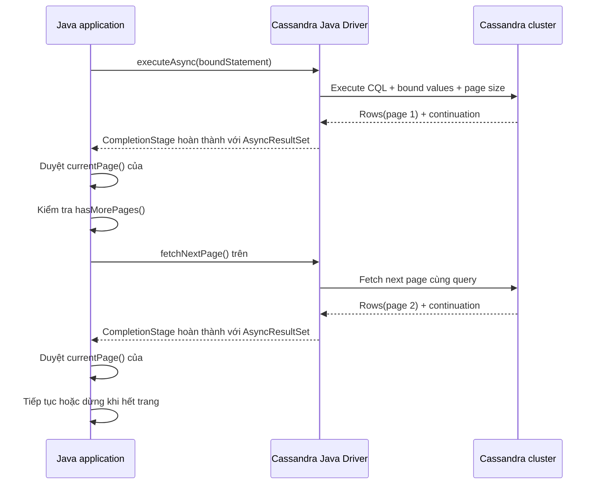

# Đọc tiếp các trang kết quả bất đồng bộ

Khi truy vấn một bảng lớn trong **Apache Cassandra**, client thường không nhận toàn bộ kết quả trong một lần phản hồi. Server và **Apache Cassandra Java Driver** có cơ chế **paging** để lấy lần lượt các phần kết quả. Với đường truy cập **bất đồng bộ**, thao tác lấy trang kế tiếp được thể hiện bằng một lời gọi không chặn luồng, thay vì một vòng lặp đồng bộ tự lấy tiếp dữ liệu.

Trong Java Driver 4.x, các API trọng tâm là:

- `CqlSession.executeAsync(statement)` trả về `CompletionStage<AsyncResultSet>`.
- `AsyncResultSet.currentPage()` cho phép duyệt các hàng **đã nằm trong trang hiện tại**.
- `AsyncResultSet.hasMorePages()` thông báo còn trang có thể fetch tiếp.
- `AsyncResultSet.fetchNextPage()` trả về `CompletionStage<AsyncResultSet>` cho **trang tiếp theo**, không chặn để đợi mạng.

Đây là kiến thức nền cho việc xây API “Xem thêm”, đọc dữ liệu hàng loạt có kiểm soát, hoặc kết hợp với Reactor `Flux`. Tuy nhiên, một chương trình gọi `executeAsync` **chưa tự động trở thành** hệ thống non-blocking hiệu quả nếu sau đó dùng `join()`, `get()` hoặc gom hàng triệu hàng vào bộ nhớ. Cách nối các `CompletionStage`, kiểm soát số trang đang xử lý, xử lý cursor và áp dụng backpressure là những phần thiết yếu.

Bài thuộc chương **Truy cập bất đồng bộ** của module **SPRING_DATA_CASSANDRA**, gắn với entity mapping, repository, `CassandraTemplate`, truy vấn CQL, partition key, consistency, paging và hiệu năng trong môi trường dữ liệu phân tán. Nội dung tập trung đúng chủ đề **“Đọc tiếp các trang kết quả bất đồng bộ”**, từ đọc từng page đến HTTP cursor, Reactive Streams và kiểm thử.

## 1. Mục tiêu học tập

Sau bài học, bạn có thể:

1. Phân biệt **kết quả bất đồng bộ** với **tự động nạp toàn bộ các trang**.
2. Dùng `executeAsync`, `currentPage`, `hasMorePages`, `fetchNextPage` theo đúng trình tự.
3. Giải thích vì sao `fetchNextPage()` trả một **kết quả trang mới** và cần được xử lý bất đồng bộ.
4. Viết DAO trả về đúng **một page** mà không vô tình tải hết truy vấn.
5. Viết hàm nối nhiều page bằng `CompletionStage.thenCompose` với giới hạn bộ nhớ và số lượng dữ liệu.
6. Chuyển chuỗi trang thành Reactor `Flux` theo cách không chặn và không fetch trước vô hạn.
7. Phân biệt **paging bên trong cùng một request** và **paging state cho request HTTP tiếp theo**.
8. Xây cursor chứa đủ query identity, partition key, điều kiện lọc và thông tin phiên bản, có xác thực.
9. Hiểu khác biệt giữa **page size**, `LIMIT`, `Slice` và số bản ghi thực tế trong một page.
10. Xử lý page rỗng, tombstone, timeout, cancellation, retry và thay đổi dữ liệu giữa các page.
11. Kiểm chứng bằng integration test trên Cassandra thật, không chỉ mock `CompletionStage`.
12. Biết khi nào chọn Java Driver async, reactive repository hay đường đọc đồng bộ.

## 2. Tình huống: đọc đăng ký khóa học của một học viên

Một ứng dụng học tập cần API:

```http
GET /tenants/{tenantId}/students/{studentId}/enrollments?from=2026-11-01T00:00:00Z&until=2026-12-01T00:00:00Z&pageSize=20
```

Màn hình muốn hiển thị các đăng ký khóa học gần đây của **một học viên thuộc một tenant**, theo thời gian mới nhất trước. API có thể trả 20 bản ghi đầu và một token để người dùng lấy thêm.

Giả sử keyspace `learning` đã được tạo:

```sql
CREATE TABLE IF NOT EXISTS learning.enrollments_by_student (
    tenant_id uuid,
    student_id uuid,
    enrolled_at timestamp,
    enrollment_id uuid,
    course_id uuid,
    enrollment_status text,
    PRIMARY KEY ((tenant_id, student_id), enrolled_at, enrollment_id)
) WITH CLUSTERING ORDER BY (enrolled_at DESC, enrollment_id ASC);
```

| Cột | Vai trò | Tác động đến paging |
| --- | --- | --- |
| `tenant_id` | Thành phần partition key thứ nhất | Xác định tenant của query/cursor |
| `student_id` | Thành phần partition key thứ hai | Không dùng token của học viên A cho B |
| `enrolled_at` | Clustering column thứ nhất | Thứ tự gần đây → trước đây |
| `enrollment_id` | Clustering column thứ hai | Phân biệt hàng cùng timestamp |
| `course_id` | Regular column | Dữ liệu trả về |
| `enrollment_status` | Regular column | Không tự lọc toàn bộ cluster nếu chưa có access path |

Truy vấn nền tảng:

```sql
SELECT course_id, enrolled_at, enrollment_id, enrollment_status
FROM learning.enrollments_by_student
WHERE tenant_id = ?
  AND student_id = ?
  AND enrolled_at >= ?
  AND enrolled_at < ?;
```

Câu CQL cung cấp **đầy đủ partition key** và giới hạn khoảng trên clustering column đầu tiên. Đây là điều kiện cần để Cassandra đọc một đường truy vấn được thiết kế trước.

**Async paging không bù đắp một thiết kế bảng sai.** Nếu đổi câu query thành `WHERE enrollment_status = 'ACTIVE'` mà bảng không có access path tương ứng, gọi `executeAsync` vẫn có thể bị từ chối hoặc trở nên tốn kém; nó không biến truy vấn thiếu khóa thành hiệu quả.

## 3. Đồng bộ và bất đồng bộ: khác nhau ở đâu?

### 3.1. ResultSet đồng bộ

Một lời gọi đồng bộ:

```java
ResultSet result = session.execute(statement);

for (Row row : result) {
    process(row);
}
```

Có thể chặn thread trong lúc chờ request. Ngoài ra, trong Java Driver đồng bộ, việc duyệt `ResultSet` có thể **tự động fetch thêm page** khi iterator cần nhiều hàng hơn. Nếu lập trình viên dùng vòng lặp để dựng `List`, mã có thể tải hết một tập dữ liệu lớn mà không nhận ra.

### 3.2. AsyncResultSet

Lời gọi bất đồng bộ:

```java
CompletionStage<AsyncResultSet> stage =
    session.executeAsync(statement);
```

`stage` là đại diện cho kết quả sẽ có sau khi driver/server hoàn thành một lần thực thi cần thiết để cung cấp trang đầu. Thread gọi không cần chờ mạng theo cách blocking.

Sau khi stage hoàn thành:

```java
stage.thenAccept(page -> {
    for (Row row : page.currentPage()) {
        process(row);
    }
});
```

Đoạn này chỉ duyệt **trang hiện tại**. Việc dùng `currentPage()` **không tự gửi request để lấy các trang còn lại**.

Muốn đọc trang sau phải gọi rõ ràng:

```java
CompletionStage<AsyncResultSet> next =
    page.fetchNextPage();
```

Và sử dụng **AsyncResultSet mới** mà stage đó trả lại.

### 3.3. Bảng đối chiếu

| Nhu cầu | ResultSet đồng bộ | AsyncResultSet bất đồng bộ |
| --- | --- | --- |
| Gửi request đầu | `execute` | `executeAsync` |
| Kiểu trả về | `ResultSet` | `CompletionStage<AsyncResultSet>` |
| Truy cập hàng hiện có | `one()`, iterator và các API sync | `currentPage()` |
| Fetch trang tiếp | Iterator có thể tự fetch và chặn | **Gọi `fetchNextPage()` tường minh** |
| Kiểm tra còn trang | Thông tin paging sync theo API | `hasMorePages()` |
| Dữ liệu của page mới | Có thể nạp vào result sync | **AsyncResultSet mới** |
| Thread chờ network | Có thể bị chặn | Có thể tránh blocking nếu không gọi `get/join` |
| Backpressure | Do ứng dụng tự quản lý | Do ứng dụng tự quản lý hoặc tích hợp Reactive Streams |
| API HTTP cursor | Phải đóng gói paging state | Cũng phải đóng gói paging state |

**Bất đồng bộ không tự đảm bảo throughput cao hơn**. Hiệu quả phụ thuộc query model, số request đồng thời, network, page size, CPU xử lý rows, heap và áp lực lên Cassandra.

## 4. Vòng đời của một chuỗi trang bất đồng bộ



Ba quy tắc:

1. **Một lần `executeAsync` không đồng nghĩa toàn bộ query đã được materialize.** Nó cung cấp một `AsyncResultSet` để đọc trang hiện tại.
2. **`currentPage()` chỉ biểu diễn page hiện tại**, không phải tập rows của mọi page.
3. **`fetchNextPage()` là một thao tác async riêng**, cần được nối đúng với kết quả trước đó; không lấy trang thứ ba bằng cách đọc lại object trang thứ nhất.

### 4.1. Mô hình trạng thái

```text
START
  |
  v
executeAsync(statement)
  |
  v
AsyncResultSet page
  |
  +--> consume page.currentPage()
  |
  +--> page.hasMorePages() == false --> DONE
  |
  +--> page.hasMorePages() == true
            |
            v
       page.fetchNextPage()
            |
            v
       AsyncResultSet nextPage
            |
            +--> consume nextPage.currentPage()
            +--> ... lặp với nextPage ...
```

Nếu không gọi `fetchNextPage` khi còn dữ liệu, bạn chỉ lấy trang đầu. Nếu gọi nó nhiều lần đồng thời trên cùng object mà không có contract rõ, mã dễ tạo request thừa, khó kiểm soát thứ tự kết quả và tiêu thụ tài nguyên không cần thiết. **Cách mặc định nên là fetch tuần tự mỗi chuỗi query**.

## 5. Page size không phải LIMIT hay số trang

Cassandra hỗ trợ hai lớp giới hạn khác nhau:

- **`LIMIT N`:** giới hạn số hàng tối đa của **toàn bộ truy vấn**.
- **Page size:** số hàng mục tiêu của một lần fetch, có thể cấu hình trên statement.
- **Paging state:** trạng thái tiếp tục query từ vị trí chưa đọc.
- **HTTP page token:** giá trị do API ứng dụng phát hành để client yêu cầu lần tiếp theo; có thể chứa/bọc paging state.

| CQL và cấu hình | Ý nghĩa |
| --- | --- |
| `SELECT ...` với `setPageSize(20)` | Driver có thể fetch lần lượt nhiều page ~20 hàng cho cả query |
| `SELECT ... LIMIT 20` với `setPageSize(20)` | Tổng query tối đa 20 hàng, thường không cần nhiều page |
| `SELECT ... LIMIT 100` với `setPageSize(20)` | Tổng tối đa 100 hàng, có thể được chia nhiều page |
| `setPageSize(100)` rồi chỉ lấy 20 hàng ở Java | Không tương đương pageSize 20; dễ phát sinh xử lý cursor sai |
| Client hỏi “page 57” | Không có offset pagination tổng quát giá rẻ tương ứng |

Page size là **mục tiêu fetch**, không phải cam kết chính xác luôn có N hàng. Server có thể trả ít hàng hơn do giới hạn kích thước phản hồi, điều kiện dữ liệu hoặc khi gần kết thúc truy vấn.

### 5.1. Không suy ra hasMorePages từ số hàng

Sai:

```java
boolean hasNext = items.size() == pageSize;
```

Đúng về mặt API:

```java
boolean hasNext = page.hasMorePages();
```

Một page có đúng 20 hàng vẫn có thể là page cuối. Một page có ít hàng hơn page size vẫn có thể còn continuation trong một số tình huống đọc. **Tin vào thông tin driver trả về, không đoán từ list length.**

### 5.2. Trang rỗng chưa chắc là hết dữ liệu

Khi Cassandra phải đọc qua tombstones, TTL expiry hoặc các trạng thái storage phức tạp, có những tình huống page hiện tại có ít hoặc không có live rows nhưng query vẫn có thể còn dữ liệu ở phía sau.

Bộ điều khiển paging **không được** kết luận “empty currentPage = end”. Chỉ dừng khi:

- `hasMorePages()` trả `false` đối với luồng đọc trong cùng request; hoặc
- cursor/continuation được xác nhận là không còn theo API trả trang.

Nếu endpoint muốn trả đúng 20 **live items** thay vì một Cassandra fetch, cần một chính sách fetch bổ sung có **giới hạn**, không vòng lặp vô hạn qua các page rỗng.

## 6. DAO không chặn: lấy đúng một Cassandra page

Đây là ví dụ trọng tâm. Service nhận tenant/student, khoảng thời gian và page size, sau đó trả **một trang hiện tại cùng paging state cho lần đọc sau**.

### 6.1. DTO

```java
import java.time.Instant;
import java.util.List;
import java.util.UUID;

public record EnrollmentItem(
        UUID courseId,
        Instant enrolledAt,
        UUID enrollmentId,
        String status) {
}

public record EnrollmentPage(
        List<EnrollmentItem> items,
        String nextDriverPagingState) {
}
```

Trong dự án Java, đặt mỗi `public record` vào source file riêng hoặc điều chỉnh visibility thích hợp.

`nextDriverPagingState` là **raw driver paging state** dành cho code nội bộ. Không trực tiếp coi nó là token HTTP an toàn cho ứng dụng multi-tenant.

### 6.2. Chuẩn bị query một lần và đọc async

```java
import java.time.Instant;
import java.util.ArrayList;
import java.util.List;
import java.util.Objects;
import java.util.UUID;
import java.util.concurrent.CompletionStage;

import com.datastax.oss.driver.api.core.CqlSession;
import com.datastax.oss.driver.api.core.cql.AsyncResultSet;
import com.datastax.oss.driver.api.core.cql.BoundStatement;
import com.datastax.oss.driver.api.core.cql.PagingState;
import com.datastax.oss.driver.api.core.cql.PreparedStatement;
import com.datastax.oss.driver.api.core.cql.Row;

public class AsyncEnrollmentDao {

    private final CqlSession session;
    private final CompletionStage<PreparedStatement> prepared;

    public AsyncEnrollmentDao(CqlSession session) {
        this.session = Objects.requireNonNull(session);

        this.prepared = session.prepareAsync("""
            SELECT course_id, enrolled_at,
                   enrollment_id, enrollment_status
            FROM learning.enrollments_by_student
            WHERE tenant_id = ?
              AND student_id = ?
              AND enrolled_at >= ?
              AND enrolled_at < ?
            """);
    }

    public CompletionStage<EnrollmentPage> fetchOnePage(
            UUID tenantId,
            UUID studentId,
            Instant fromInclusive,
            Instant untilExclusive,
            int pageSize,
            String incomingDriverPagingState) {

        Objects.requireNonNull(tenantId, "tenantId");
        Objects.requireNonNull(studentId, "studentId");
        Objects.requireNonNull(fromInclusive, "fromInclusive");
        Objects.requireNonNull(untilExclusive, "untilExclusive");

        if (!fromInclusive.isBefore(untilExclusive)) {
            throw new IllegalArgumentException("Invalid time window");
        }
        if (pageSize < 1 || pageSize > 100) {
            throw new IllegalArgumentException("Invalid page size");
        }

        return prepared.thenCompose(ps -> {
            BoundStatement bound = ps
                .bind(tenantId, studentId,
                      fromInclusive, untilExclusive)
                .setPageSize(pageSize);

            if (incomingDriverPagingState != null) {
                PagingState state =
                    PagingState.fromString(incomingDriverPagingState);
                bound = bound.setPagingState(state);
            }

            return session.executeAsync(bound);
        }).thenApply(this::mapOnePage);
    }

    private EnrollmentPage mapOnePage(AsyncResultSet page) {
        List<EnrollmentItem> items = new ArrayList<>();

        for (Row row : page.currentPage()) {
            items.add(new EnrollmentItem(
                row.getUuid("course_id"),
                row.getInstant("enrolled_at"),
                row.getUuid("enrollment_id"),
                row.getString("enrollment_status")
            ));
        }

        PagingState next = page.hasMorePages()
            ? page.getExecutionInfo().getPagingState()
            : null;

        if (page.hasMorePages() && next == null) {
            throw new IllegalStateException(
                "Driver reported more pages without paging state");
        }

        return new EnrollmentPage(
            List.copyOf(items),
            next == null ? null : next.toString()
        );
    }
}
```

Phân tích từng phần:

1. `session.prepareAsync(...)` trả về một stage được **tái sử dụng**, tránh chuẩn bị CQL mỗi request.
2. `prepared.thenCompose(...)` chỉ bắt đầu execute sau khi prepare thành công, **không dùng `get()` hoặc `join()`**.
3. Các `BoundStatement` được dựng **riêng cho mỗi request**, giữ đúng kiểu và thứ tự bind values.
4. `setPageSize(pageSize)` trả statement tương ứng; trong Java Driver 4.x cần dùng kết quả setter, không bỏ qua đối tượng trả về.
5. `PagingState.fromString(...)` chỉ khôi phục token driver; việc xác thực cursor HTTP phải làm trước ở tầng API.
6. `session.executeAsync(bound)` chỉ thực hiện đường đọc bất đồng bộ đến một trang `AsyncResultSet`.
7. `currentPage()` duyệt đúng những hàng của trang hiện tại. **Không có `fetchNextPage()` trong method này**.
8. `hasMorePages()` quyết định có continuation; `getExecutionInfo().getPagingState()` cung cấp trạng thái dùng cho query tiếp theo nếu được driver hỗ trợ/trả về.
9. `thenApply(...)` ánh xạ một page thành DTO, không giữ toàn bộ dữ liệu của cả query trong heap.

**Lưu ý phiên bản:** Tên class/API ở đây theo Java Driver 4.x thông dụng. Hãy biên dịch và integration test trên BOM Spring Boot, Spring Data Cassandra và Java Driver thực tế. Với ứng dụng có nhiều phiên bản Driver khác nhau, không tự giả định mọi paging state string tương thích dài hạn.

### 6.3. Vì sao không nên fetch trước trong mapOnePage?

Mục tiêu của method là **trả một page cho một HTTP request**. Nếu gọi `fetchNextPage()` bên trong `mapOnePage`, bạn vô tình:

- Tăng số lần gọi Cassandra dù người dùng chưa nhấn “Xem thêm”.
- Có thể thực hiện công việc đọc thừa trên partition lớn.
- Phải xử lý thêm lỗi từ page 2 trước khi trả page 1.
- Khó định nghĩa continuation nếu request bị hủy giữa chừng.

Trường hợp sản phẩm cần một response đúng 20 bản ghi mặc dù mỗi Cassandra page có ít live rows, hãy tạo một lớp orchestration **có giới hạn số page/row** riêng, thay vì thay đổi ngầm hành vi của DAO.

### 6.4. Không lặp lại String CQL theo tham số

Không nên viết:

```java
// Không dùng cách nối giá trị vào CQL.
String cql = "SELECT * FROM learning.enrollments_by_student "
           + "WHERE student_id = " + studentId;
```

Ngoài rủi ro injection/kiểu dữ liệu, query đó còn thiếu đầy đủ partition key của bảng ví dụ. Dùng prepared statement vừa đảm bảo binding vừa làm **query identity ổn định** cho continuation.

## 7. Đọc tiếp trong cùng một request bằng fetchNextPage

Không phải mọi hệ thống đều muốn một HTTP request tương ứng một Cassandra page. Batch job hoặc nội bộ service có thể cần xử lý nhiều page liên tục mà không chặn thread.

Ví dụ đơn giản:

```java
CompletionStage<AsyncResultSet> first =
    session.executeAsync(statement);

CompletionStage<AsyncResultSet> second = first.thenCompose(page -> {
    for (Row row : page.currentPage()) {
        process(row);
    }

    if (!page.hasMorePages()) {
        return java.util.concurrent.CompletableFuture
            .completedFuture(page);
    }

    return page.fetchNextPage();
});
```

Code trên **xử lý trang đầu**, rồi fetch trang thứ hai nếu còn. Nó **không xử lý rows của trang thứ hai**, trừ khi bạn nối thêm một stage vào `second`. Đây là chỗ dễ nhầm giữa “đã fetch page” và “đã xử lý dữ liệu trong page”.

Để đọc hết, cần lặp với chính đối tượng `AsyncResultSet` được trả về từ `fetchNextPage()`.

### 7.1. Sử dụng thenCompose, không chờ blocking

```java
// Đúng hướng:
return page.fetchNextPage()
           .thenCompose(next -> processNext(next));

// Anti-pattern:
AsyncResultSet next =
    page.fetchNextPage().toCompletableFuture().join();
```

`thenCompose` **flatten** các stages, phù hợp khi callback lại tạo một request async. Nếu dùng `thenApply(page -> page.fetchNextPage())`, kiểu kết quả trở thành stage lồng nhau và mã điều phối khó hiểu hơn.

Việc dùng `join()` có thể chặn thread. Nếu callback chạy trên driver I/O/completion thread, cách làm đó có thể tạo nghẽn nghiêm trọng.

## 8. Thu thập nhiều trang có giới hạn

Đôi khi cần thu một danh sách có kích thước biết trước ở tầng job/service. Ví dụ export tối đa 1.000 enrollment cho một người dùng. Khi đó có thể nối tiếp từng `fetchNextPage()` và **giới hạn tổng số hàng**.

Đoạn sau là helper đặt trong một class có method `toItem(Row)`:

```java
import java.util.ArrayList;
import java.util.List;
import java.util.concurrent.CompletableFuture;
import java.util.concurrent.CompletionStage;

import com.datastax.oss.driver.api.core.cql.AsyncResultSet;
import com.datastax.oss.driver.api.core.cql.Row;

public CompletionStage<List<EnrollmentItem>> collectBounded(
        CompletionStage<AsyncResultSet> first,
        int maxRows) {

    if (maxRows < 1) {
        throw new IllegalArgumentException("maxRows must be positive");
    }

    ArrayList<EnrollmentItem> buffer = new ArrayList<>();

    return first.thenCompose(page ->
        appendPages(page, buffer, maxRows));
}

private CompletionStage<List<EnrollmentItem>> appendPages(
        AsyncResultSet page,
        ArrayList<EnrollmentItem> buffer,
        int maxRows) {

    for (Row row : page.currentPage()) {
        if (buffer.size() >= maxRows) {
            return CompletableFuture.failedFuture(
                new IllegalStateException(
                    "Result exceeds configured row limit"));
        }

        buffer.add(toItem(row));
    }

    if (!page.hasMorePages()) {
        return CompletableFuture.completedFuture(
            List.copyOf(buffer));
    }

    return page.fetchNextPage().thenCompose(next ->
        appendPages(next, buffer, maxRows));
}
```

Ở đây `maxRows` là **hạn mức bảo vệ**, không phải cursor để tiếp tục từ giữa một page. Nếu dữ liệu thực sự vượt giới hạn, method **fail** thay vì âm thầm cắt ở hàng thứ 1.000 rồi phát paging state của page kế tiếp (vì như vậy có thể bỏ sót các hàng chưa được tiêu thụ trong current page).

Một số lưu ý:

- `buffer` là biến **riêng của một lời gọi**; không share với các request khác.
- Chỉ một chuỗi fetch tiếp theo được tạo tại mỗi bước.
- Không dùng `collectBounded` cho exports không giới hạn.
- Với số lượng hàng rất lớn, nên **xử lý từng page và flush ra sink có backpressure**, thay vì giữ trong `ArrayList`.
- Đệ quy theo `CompletionStage` phù hợp ví dụ có giới hạn; với quá nhiều page, cân nhắc state machine/stream processor để tránh chuỗi completion sâu và cải thiện quản lý lifecycle.
- Nếu một page rất lớn đã vượt maxRows, method phát hiện và fail; nên đặt page size phù hợp ngay từ đầu để giới hạn chi phí.

### 8.1. Hàm map một Row

```java
private EnrollmentItem toItem(Row row) {
    return new EnrollmentItem(
        row.getUuid("course_id"),
        row.getInstant("enrolled_at"),
        row.getUuid("enrollment_id"),
        row.getString("enrollment_status"));
}
```

Mapper nên đơn giản và không blocking. Không gọi HTTP, đọc file, ngủ thread hoặc truy vấn database khác ngay trong một callback chạy trên driver event loop.

### 8.2. Nếu muốn xử lý mỗi page mà không giữ toàn bộ rows?

Có thể viết một interface `PageConsumer` nhận từng page và trả `CompletionStage<Void>`, cho phép chờ async sink hoàn tất rồi mới fetch trang sau.

Ý tưởng:

```text
fetch page 1
  -> await async sink(page 1)
  -> fetch page 2
  -> await async sink(page 2)
  -> ...
```

**“Await” ở đây là liên kết CompletionStage, không phải chặn thread.** Nếu sink chậm hơn Cassandra, quy trình tuần tự này giảm việc đẩy nhanh quá nhiều kết quả vào bộ nhớ.

## 9. HTTP cursor: đọc một trang trong mỗi request

Với API có nút “Xem thêm”, không nhất thiết dùng `fetchNextPage()` trong cùng request. Có thể trả dữ liệu trang đầu và **paging state** cho request kế tiếp.

### 9.1. Lượt đầu

```http
GET /tenants/T1/students/S1/enrollments?from=2026-11-01T00:00:00Z&until=2026-12-01T00:00:00Z&pageSize=20
```

Phản hồi minh họa:

```json
{
  "items": [
    {
      "courseId": "11111111-1111-1111-1111-111111111111",
      "enrolledAt": "2026-11-25T09:00:00Z",
      "enrollmentId": "22222222-2222-2222-2222-222222222222",
      "status": "ACTIVE"
    }
  ],
  "nextPageToken": "opaque-signed-application-cursor"
}
```

Token ở trên là **placeholder minh họa**, không phải một `PagingState` hợp lệ có thể truyền trực tiếp vào Java Driver.

### 9.2. Lượt tiếp theo

```http
GET /tenants/T1/students/S1/enrollments?from=2026-11-01T00:00:00Z&until=2026-12-01T00:00:00Z&pageSize=20&cursor=opaque-signed-application-cursor
```

Service thực hiện:

1. Xác thực người gọi và quyền truy cập `tenantId`/`studentId`.
2. Xác minh chữ ký/mã hóa của cursor ứng dụng và hạn dùng.
3. Kiểm tra cursor thuộc **cùng query identity** với request.
4. Lấy raw `driverPagingState` từ payload đã được xác thực.
5. Bind **cùng câu CQL và cùng tham số**.
6. Gắn `setPagingState(...)` trên statement mới.
7. Gọi `executeAsync` để lấy **một page tiếp theo**.
8. Trả items và cursor mới nếu còn tiếp.

Đây là một lượt `executeAsync` **mới** cho request HTTP mới; khác với việc gọi `fetchNextPage()` liên tục trên cùng object `AsyncResultSet` bên trong một request.

### 9.3. Khi nào dùng cách nào?

| Tiêu chí | `fetchNextPage()` trong một request | `setPagingState(...)` qua nhiều HTTP requests |
| --- | --- | --- |
| Vòng đời | Một luồng async còn tồn tại trong service | Mỗi request có một statement/async execution mới |
| Trạng thái | `AsyncResultSet` hiện tại | Opaque paging state do API lưu/trả |
| Trải nghiệm | Batch job, streaming, internal pipeline | Nút “Xem thêm”, infinite scroll |
| Thời gian sống | Thường giới hạn một tác vụ | Có thể kéo dài nhiều request/giây/phút |
| Trách nhiệm bảo mật token | Không nhất thiết expose state ra ngoài | **Bắt buộc** bảo vệ cursor HTTP |
| Điều kiện truy vấn | Cùng query tự nhiên | Phải kiểm tra cùng CQL, bind values, filter, tenant |
| Hủy giữa chừng | Dừng xử lý/fetch mới | Request sau có thể không bao giờ đến |
| Khả năng resume qua deploy | Không dựa vào object cũ | Cần query version/TTL/token policy |

Không trộn hai cơ chế theo cách phát paging state **sau khi đã fetch/truy cập một phần trang kế tiếp** mà không quản lý chính xác các hàng đã tiêu thụ.

## 10. Paging state phải gắn với CQL và tham số

Một paging state không phải “page number” hoặc một UUID có thể dùng với mọi truy vấn. Nó đại diện cho continuation trong phạm vi **cùng statement và các bind values**.

Ví dụ:

```text
Page 1:
  CQL:
    SELECT ... FROM enrollments_by_student
    WHERE tenant_id=? AND student_id=?
      AND enrolled_at>=? AND enrolled_at<?
  bindings:
    tenant = T1
    student = S1
    from = 2026-11-01T00:00:00Z
    until = 2026-12-01T00:00:00Z

Page 2 đúng:
  cùng CQL + cùng T1/S1/from/until + paging state P1

Page 2 sai:
  cùng CQL nhưng student = S2 + paging state P1
```

### 10.1. Những thay đổi phải reset cursor

- Đổi tenant hoặc student.
- Đổi `from`/`until`.
- Đổi `WHERE` hoặc điều kiện lọc.
- Đổi `SELECT`/projection.
- Đổi bảng, keyspace hoặc schema truy vấn.
- Đổi hướng sắp xếp/clustering route.
- Đổi query implementation sau deployment nếu nó thay đổi ý nghĩa continuation.
- Đổi page size khi contract API yêu cầu giữ nguyên.
- Dùng token của một repository method cho method khác.

Java Driver có thể xác minh paging state có phù hợp với statement; nhưng **validation của driver không thay authorization và query contract ở tầng API**.

### 10.2. Cursor wrapper có version

Payload logic minh họa:

```json
{
  "v": 1,
  "queryId": "enrollments-by-student-v1",
  "tenantId": "aaaaaaaa-aaaa-aaaa-aaaa-aaaaaaaaaaaa",
  "studentId": "bbbbbbbb-bbbb-bbbb-bbbb-bbbbbbbbbbbb",
  "from": "2026-11-01T00:00:00Z",
  "until": "2026-12-01T00:00:00Z",
  "pageSize": 20,
  "expiresAt": "2026-11-25T10:00:00Z",
  "driverPagingState": "<opaque-driver-state>"
}
```

**Không gửi JSON trần rồi tin rằng client sẽ không sửa nó.** Cần dùng HMAC/signature hoặc AEAD để kiểm tra tính toàn vẹn, và mã hóa nếu cần ẩn thông tin nội bộ. Một lựa chọn khác là server-side cursor store với token ID ngẫu nhiên, TTL và access control.

Chữ ký bảo vệ **tính toàn vẹn**, không tự che nội dung. Hãy giới hạn kích thước token, chống parser abuse, hỗ trợ key rotation và không log nguyên raw state.

### 10.3. Token hỏng/hết hạn thì sao?

Một API nên trả lỗi rõ ràng, ví dụ HTTP 400/409 theo contract, thay vì:

- Âm thầm trả lại page đầu.
- Trả 500 với stack trace của driver.
- Thử một query khác khi token không khớp.
- Bỏ tenant check vì paging state đã được ký.
- Tự “sửa” hoặc suy ngược offset từ bytes của token.

Nếu query version cũ đã ngừng hỗ trợ, cho phép client **bắt đầu lại từ trang đầu** bằng request không có cursor, thay vì cố dịch state tùy ý.

## 11. Reactor Flux: biến các page thành stream không chặn

Spring Data Cassandra có **Reactive Cassandra** dựa trên Reactive Streams/Reactor. Với một DAO Java Driver async, bạn cũng có thể chuyển các trang thành `Flux` và để downstream tiêu thụ rows.

### 11.1. Adapter tối giản có lazy subscription

```java
import com.datastax.oss.driver.api.core.CqlSession;
import com.datastax.oss.driver.api.core.cql.AsyncResultSet;
import com.datastax.oss.driver.api.core.cql.BoundStatement;
import com.datastax.oss.driver.api.core.cql.Row;
import reactor.core.publisher.Flux;
import reactor.core.publisher.Mono;

public class AsyncPageFluxAdapter {

    private final CqlSession session;

    public AsyncPageFluxAdapter(CqlSession session) {
        this.session = session;
    }

    public Flux<Row> stream(BoundStatement statement) {
        return Flux.defer(() ->
            Mono.fromCompletionStage(session.executeAsync(statement))
                .flatMapMany(this::rows));
    }

    private Flux<Row> rows(AsyncResultSet page) {
        return Flux.fromIterable(page.currentPage())
            .concatWith(Flux.defer(() ->
                page.hasMorePages()
                    ? Mono.fromCompletionStage(page.fetchNextPage())
                        .flatMapMany(this::rows)
                    : Flux.empty()));
    }
}
```

Giải thích:

1. `Flux.defer(...)` tạo một lần thực thi `executeAsync` **khi có subscriber**, thay vì gọi Cassandra ngay lúc xây publisher.
2. `Mono.fromCompletionStage(...)` chuyển completion/exception của driver thành tín hiệu của Reactor.
3. `Flux.fromIterable(page.currentPage())` phát từng row thuộc **page đang có**.
4. `concatWith(...)` duy trì thứ tự page.
5. `Flux.defer(...)` ở nhánh tiếp theo chỉ gọi `fetchNextPage()` khi luồng đi đến phần continuation.
6. `hasMorePages() == false` kết thúc stream.
7. Nhánh lỗi từ `executeAsync`/`fetchNextPage` đi vào `onError` của Flux.

Đây là một cách tích hợp **minh họa**. Với production cần kiểm tra backpressure/cancellation và phạm vi request theo đúng phiên bản Reactor + Java Driver đang dùng.

### 11.2. Backpressure không có nghĩa server trả mỗi lần đúng một row

Reactive Streams có cơ chế demand. Tuy vậy, Cassandra paging fetch **theo page**, không phải một round-trip cho từng `Row`.

Ví dụ downstream yêu cầu chỉ một item, driver vẫn có thể đã nhận một page với nhiều hàng. Backpressure giúp ứng dụng **không phải request toàn bộ các page ngay lập tức**, nhưng không bảo đảm số bytes đọc từ Cassandra bằng đúng số items downstream yêu cầu.

### 11.3. Hủy subscription không đảo ngược query đã gửi

Khi client HTTP ngắt kết nối hoặc downstream `cancel()`:

- Việc ngừng subscribe/tiêu thụ có thể hạn chế các `fetchNextPage()` **chưa được gọi**.
- Một CQL request **đã gửi** đến Cassandra có thể vẫn đang chạy/đã hoàn thành.
- Cancellation của `Mono` không phải lệnh rollback các reads đã xảy ra.
- Không hứa rằng `cancel()` sẽ lập tức thu hồi mọi network/server resource trong mọi phiên bản.

Do đó vẫn cần statement request timeout, API deadline, giới hạn page count và tải đồng thời.

### 11.4. Không gọi block() trong reactive pipeline

Sai:

```java
Flux<Row> rows = adapter.stream(statement);

List<Row> allRows = rows.collectList().block();
```

Dùng `block()` trong WebFlux event loop làm mất lợi ích non-blocking. `collectList()` trên một stream không giới hạn còn có rủi ro giữ toàn bộ kết quả trong memory.

Tốt hơn:

```java
return adapter.stream(statement)
    .map(this::toItem)
    .doOnError(this::recordFailure);
```

Đoạn này là thân method reactive đã có `toItem` và `recordFailure`; không có blocking terminal operation. Nếu thật sự cần tổng hợp, đặt **giới hạn business rõ** và chọn operator phù hợp.

## 12. ReactiveCassandraRepository khác adapter driver async

Spring Data Cassandra cung cấp reactive repository và `ReactiveCassandraTemplate` trong phạm vi phiên bản tương ứng. Chúng giúp truy cập dữ liệu đã được entity mapping mà không phải tự viết toàn bộ `Row` mapper.

Ví dụ entity `EnrollmentByStudent` với primary key `StudentEnrollmentKey` đã được mapping phù hợp:

```java
import java.util.UUID;

import org.springframework.data.cassandra.repository.ReactiveCassandraRepository;
import org.springframework.data.cassandra.repository.Query;

import reactor.core.publisher.Flux;

public interface ReactiveEnrollmentRepository
        extends ReactiveCassandraRepository<
            EnrollmentByStudent, StudentEnrollmentKey> {

    @Query("""
        SELECT *
        FROM learning.enrollments_by_student
        WHERE tenant_id = ?0
          AND student_id = ?1
        """)
    Flux<EnrollmentByStudent> findForStudent(
        UUID tenantId, UUID studentId);
}
```

Đây là ví dụ phương thức reactive query có đầy đủ partition key. Spring Data có thể điều phối việc đọc qua các page ở tầng abstraction; tuy nhiên **người dùng API Flux không trực tiếp nhận được đối tượng `AsyncResultSet` hoặc raw paging state từ method này**.

### 12.1. Khi nào chọn reactive repository?

Chọn khi:

- Ứng dụng đã dùng WebFlux/Reactor.
- Query tương đối đơn giản và entity mapping rõ.
- Cần pipeline `Flux`/`Mono` mà không cần thao tác trực tiếp với paging state.
- Muốn tận dụng Spring Data converters, repositories và exception translation.

Chọn driver async trực tiếp khi:

- API phải phát hành **cursor HTTP** do ứng dụng kiểm soát.
- Cần đọc chính xác một page và theo dõi `ExecutionInfo` của nó.
- Cần phối hợp page fetch với một async sink đặc thù.
- Cần kiểm soát rõ CQL, request options, paging state và telemetry.
- Reactive repository version đang dùng không expose cấu trúc continuation theo contract sản phẩm.

### 12.2. Không coi Flux là đối tượng giữ toàn bộ kết quả

`Flux<T>` mô tả một nguồn phát có thể được subscribe. Nó **không đồng nghĩa List<T> trong memory**. Nhưng:

```java
Mono<List<EnrollmentByStudent>> all =
    repository.findForStudent(tenantId, studentId)
              .collectList();
```

nếu toàn bộ query có hàng triệu rows, việc subscribe `all` vẫn có thể cần một danh sách khổng lồ. **Toán tử `collectList()` mới là điểm gom dữ liệu**, bất kể query ban đầu có non-blocking hay không.

### 12.3. Không trộn paging state giữa API khác nhau

Nếu một `ReactiveCassandraRepository` method sinh CQL khác DAO tự viết, paging state của DAO **không mặc nhiên tương thích** với method repository. Cả query template, projections và các bind values phải được giữ nguyên. Nếu cần một cursor ổn định, nên gói toàn bộ paging flow trong một abstraction có query identity cố định.

## 13. Nối CompletionStage và luồng thực thi

### 13.1. thenApply so với thenCompose

```java
CompletionStage<AsyncResultSet> first =
    session.executeAsync(statement);

// map một page -> giá trị không async.
CompletionStage<Integer> size =
    first.thenApply(page -> {
        int count = 0;
        for (Row ignored : page.currentPage()) {
            count++;
        }
        return count;
    });

// Tạo một request async mới -> thenCompose.
CompletionStage<AsyncResultSet> next =
    first.thenCompose(page ->
        page.hasMorePages()
            ? page.fetchNextPage()
            : java.util.concurrent.CompletableFuture
                .completedFuture(page)
    );
```

`thenApply` phù hợp transformation đồng bộ, nhẹ. `thenCompose` phù hợp callback trả lại `CompletionStage<...>`.

### 13.2. Callback có thể chạy trên thread nhạy cảm

Java Driver có các thread xử lý I/O/completions. Không nên giả định mọi callback của `CompletionStage` chạy trên một worker pool riêng đủ rộng cho công việc nặng.

Không làm trong callback:

- `Thread.sleep`.
- Blocking HTTP call.
- Đọc/ghi file lớn.
- Gọi `join()` để đợi một request Cassandra khác.
- Deserialize JSON khổng lồ hoặc CPU-heavy transformation không giới hạn.
- Chạy business rule chậm trên hàng triệu rows.

Nếu cần xử lý nặng, dùng executor/scheduler **được cấu hình và giới hạn**, chuyển workload khỏi driver I/O threads. Ví dụ Java:

```java
CompletionStage<Report> report = session.executeAsync(statement)
    .thenApplyAsync(
        page -> cpuHeavyReport(page.currentPage()),
        reportExecutor
    );
```

`reportExecutor` là `Executor` được ứng dụng quản lý, có giới hạn queue và lifecycle phù hợp. Đừng tạo executor vô hạn trên từng request chỉ để đẩy vấn đề sang thread pool khác.

### 13.3. Một query sequence nên fetch tuần tự

Bởi `AsyncResultSet` là continuation của một query, thông thường nên:

```text
page 1 -> consume/ack process -> fetch page 2
       -> consume/ack process -> fetch page 3
```

Nếu cần đồng thời hóa, hãy phân biệt **đồng thời nhiều query độc lập** với **parallel hóa các trang của một query**. Việc tự gọi fetch nhiều lần trên cùng page không phải một cơ chế “parallel paging” đơn giản.

Khi xử lý song song nhiều partition, cần concurrency limit và tôn trọng hot partitions để không đẩy quá nhiều request vào cùng nhóm replica.

## 14. Backpressure thực tế: producer nhanh hơn consumer

Một chuỗi async có thể đọc nhanh hơn downstream xử lý:

```text
Cassandra page 1: 50 rows
Kafka sink: xử lý 10 rows/s
Cassandra page 2: có thể fetch sau khi sink đã chấp nhận page 1
```

Nếu lập trình viên làm:

```java
// Sai về kiểm soát tài nguyên nếu producer không giới hạn.
pages.forEach(page ->
    asyncSink.sendAll(page.currentPage()));
```

mà không chờ các stages của sink, hàng nghìn tasks có thể được tạo rất nhanh, khiến queue/heap tăng dù driver async.

Chiến lược tốt hơn:

1. Chọn page size hợp lý.
2. Chờ sink hoàn thành page hiện tại bằng `CompletionStage.thenCompose`.
3. Chỉ sau đó gọi `fetchNextPage`.
4. Giới hạn số page/rows/deadline tối đa của một job.
5. Áp dụng retry/idempotency riêng cho sink; đừng coi “read lại page” tự động đúng với mọi side effect.
6. Đo throughput và backlog của cả Cassandra lẫn sink.

### 14.1. Buffering và prefetch

Một số reactive operators hỗ trợ `prefetch` hoặc `buffer`. Chúng có thể làm tăng memory và số requests in-flight, tùy implementation.

Không mặc định rằng cấu hình `prefetch=256` nghĩa Cassandra chỉ gửi 256 bytes hoặc chỉ 256 rows. Đơn vị demand, kích thước row, page size và số request đang bay là các đại lượng khác nhau.

### 14.2. Giới hạn theo page và deadline

Một production job nên có hợp đồng:

```text
maxPages:    200
maxRows:     10_000
pageSize:    50
deadline:    30 seconds
concurrency: 1 per query sequence
```

Các số chỉ **minh họa**, phải được chọn theo workload và SLA. Nếu vượt giới hạn, service nên trả lỗi/quyết định chuyển sang batch job khác thay vì tiếp tục đọc vô hạn.

## 15. Lỗi, timeout và retry của trang kế tiếp

`fetchNextPage()` có thể thất bại dù page đầu đã thành công. Khi đó, ứng dụng phải phân biệt:

- **Lỗi của trang đầu:** chưa có dữ liệu nào được consumer nhận.
- **Lỗi của trang N:** những trang trước có thể đã được xử lý hoặc thậm chí ghi ra sink.
- **Timeout không xác định:** request có thể đã xử lý ở server nhưng response bị mất.
- **Token không phù hợp:** client thay CQL/bind values hoặc deploy đổi query version.
- **Data error:** schema/mapper thay đổi, row có kiểu không tương thích.

### 15.1. Không nuốt lỗi rồi coi query đã hết

Sai:

```java
return page.fetchNextPage()
    .exceptionally(error -> null);
```

Việc trả `null` khi fetch lỗi khiến caller dễ nhầm đó là hết dữ liệu. Nếu đang xuất báo cáo, có thể silently truncate dataset.

Tốt hơn, để stage hoàn thành **exceptionally**, log/metric có kiểm soát và chuyển lỗi thành trạng thái API rõ ràng. Nếu muốn tiếp tục từ cursor, cần lưu **cursor của trang đã xử lý thành công gần nhất**, và đảm bảo downstream có idempotency khi retry.

### 15.2. Retry việc đọc khác retry side effects

Đọc CQL thường không làm thay đổi dữ liệu, nhưng consumer có thể:

- Gửi notification.
- Ghi CSV/upload.
- Cập nhật index.
- Publish Kafka events.
- Chạy job reconciliation.

Nếu lỗi sau page 3 và job đọc lại từ page 2, các side effects của page 2 có thể lặp. **Cassandra paging state không tạo exactly-once cho các thao tác downstream**.

Thiết kế checkpoint theo đơn vị page/bucket và event IDs, với sink idempotent/dedup nếu cần.

### 15.3. Timeout và cancellation

Driver có request timeout; phía API còn có HTTP deadline. Dùng `CompletableFuture.orTimeout(...)` hoặc Reactor `timeout(...)` có thể giúp giới hạn thời gian *chờ ở tầng ứng dụng*, nhưng không mặc định mọi thao tác CQL đã gửi sẽ bị hủy ở server.

Hãy chọn thời gian phù hợp để tránh server tiếp tục nhận workload mà API đã không còn cần, đồng thời theo dõi requests đang bay và xử lý resource cleanup theo version driver.

### 15.4. Exception handling ví dụ

```java
return dao.fetchOnePage(
        tenantId, studentId, from, until, pageSize, rawState)
    .exceptionally(error -> {
        // Ghi log an toàn, gồm queryId và loại exception.
        recordReadFailure("enrollment-page-v1", error);

        // Không phát dữ liệu page rỗng giả.
        throw new java.util.concurrent.CompletionException(error);
    });
```

Đây là trích đoạn trong service có `recordReadFailure` và các biến đã được khai báo. Ứng dụng có thể dùng `handle`/`whenComplete` để phân biệt quan sát lỗi với chuyển đổi exception, tránh bọc `CompletionException` lồng nhiều lần. **Điểm chính: failure không phải end-of-pagination.**

## 16. Warnings, tracing và observability theo từng trang

Mỗi lần fetch có thể có `ExecutionInfo` tương ứng với page đó. Với Java Driver 4.x, có thể đọc server warnings từ execution info:

```java
page.getExecutionInfo().getWarnings();
```

Nếu một truy vấn đi qua nhiều tombstones, server có thể phát cảnh báo ở page N, không nhất thiết page đầu.

### 16.1. Quan sát từng page

```java
private void recordPageMetrics(AsyncResultSet page, int pageNumber) {
    int rows = 0;

    for (Row ignored : page.currentPage()) {
        rows++;
    }

    List<String> warnings =
        page.getExecutionInfo().getWarnings();

    observe("enrollment-query-v1",
            pageNumber, rows, warnings);
}
```

Đây là snippet minh họa, với `observe` do hệ thống metrics định nghĩa. **Không log nguyên nội dung CQL đã chứa PII/UUID nhạy cảm hoặc raw paging state** vào nơi không được bảo vệ.

### 16.2. Tracing không mặc định bật mọi request

CQL tracing hữu ích khi chẩn đoán query chậm, fan-out hoặc tombstone scanning. Nhưng tracing tạo thêm lưu trữ và công việc cho cluster.

Với production:

- Dùng sampling có kiểm soát.
- Tập trung vào query fingerprint, page number, latency.
- So sánh các percentiles p95/p99.
- Theo dõi read timeouts, server warnings, heap/CPU và SSTables per read.
- Không mở tracing cho mọi HTTP request khi cluster đang chịu tải.

### 16.3. Các metric quan trọng

| Metric | Câu hỏi |
| --- | --- |
| Page fetch latency | Page nào chậm? |
| Pages per logical query | Một request/job thường phải lấy bao nhiêu page? |
| Rows per page | Page size có phù hợp dữ liệu thực? |
| Bytes per page | Row payload có quá lớn không? |
| Pending async requests | Có tích lũy in-flight requests không? |
| Driver I/O thread utilization | Callback có đang block event loop? |
| Tombstone warnings | Có đang quét nhiều dấu xóa để tìm live rows? |
| Retry/timeout count | Mạng/cluster có quá tải không? |
| Cancellation rate | Nhiều client bỏ ngang trong lúc query? |
| Heap/buffer growth | Có đang materialize hết data ngoài ý muốn? |
| Cursor mismatch/expiry | Client dùng state sai hoặc deploy đổi query? |

## 17. Consistency và dữ liệu thay đổi giữa các page

Async paging **không tạo snapshot transaction**. Giữa page 1 và page 2, dữ liệu có thể được thêm, sửa, xóa hoặc hết TTL.

Ví dụ:

```text
T0: Page 1 trả enrollment A, B, C.
T1: Enrollment D được thêm với enrolled_at mới hơn A.
T2: Page 2 được fetch.
```

Dù cùng query/paging state, danh sách quan sát được không mặc định là ảnh chụp bất biến của dữ liệu tại T0.

Các trường hợp cần xem xét:

- Insert mới xuất hiện trước vị trí đã đọc.
- Delete/TTL khiến hàng không còn live.
- Update regular columns thay đổi status hiển thị.
- Replica/consistency khác nhau có thể thấy thời điểm áp dụng mutation khác nhau.
- Ghi với clustering key mới về mặt vật lý là hàng khác, có thể thay thứ tự dữ liệu.

### 17.1. LOCAL_QUORUM không tạo snapshot kéo dài

Mức `LOCAL_QUORUM` hoặc `LOCAL_ONE` ảnh hưởng số replica cần xác nhận theo topology/replication factor. Chúng **không biến nhiều page thành một transaction snapshot** kéo dài vài phút qua các request HTTP.

Nếu yêu cầu kiểm toán cần danh sách bất biến, có thể phải tạo **materialized snapshot nghiệp vụ hoặc danh sách IDs phiên bản hóa**, không chỉ giữ raw driver paging state.

### 17.2. Time anchor là một kỹ thuật hạn chế, không phải snapshot

Có thể gắn một `anchorTime` khi page đầu bắt đầu và yêu cầu mọi page chỉ đọc sự kiện có `enrolled_at < anchorTime`. Nó giúp tránh một số hàng mới xuất hiện ở đầu danh sách làm thay đổi trải nghiệm.

Nhưng nó không bảo vệ khỏi update/delete hàng cũ, timestamp nghiệp vụ được backfill hoặc sự khác biệt do replica. Do đó **anchor chỉ giới hạn phạm vi, không thay isolation**.

## 18. Tombstone và page rỗng: trường hợp phải kiểm tra kỹ

Cassandra có thể phải quét nhiều tombstones/expired cells để tìm các hàng sống phù hợp. Điều này làm một page tốn nhiều thời gian dù có rất ít dữ liệu trả về.

Ví dụ logic:

```text
Page 1:
  Live rows: 15
  Tombstones scanned: nhiều
  hasMorePages = true

Page 2:
  Live rows: 0
  Tombstones scanned: nhiều
  hasMorePages = true

Page 3:
  Live rows: 4
  hasMorePages = false
```

Đây chỉ là **mô phỏng hành vi có thể gặp**; số rows và cảnh báo thực tế phụ thuộc server/driver/schema.

### 18.1. Không dừng vì currentPage rỗng

Sai:

```java
if (!page.currentPage().iterator().hasNext()) {
    return CompletableFuture.completedFuture(List.of());
}
```

Nếu `hasMorePages() == true`, vẫn có thể còn live rows phía sau. Phải xử lý đúng continuation hoặc chấp nhận trả **page rỗng có nextPageToken** theo contract API.

### 18.2. Khi HTTP API muốn luôn có 20 items

Một số UI không chấp nhận page rỗng dù có token. Service có thể gọi thêm `fetchNextPage` đến khi:

- tích lũy đủ 20 live items;
- driver báo không còn page;
- đạt `maxAdditionalPages`;
- đạt deadline/cost budget.

Nhưng phải giải quyết **cursor nằm giữa page**. Nếu đã đọc một phần `currentPage` và phát raw paging state của **page kế tiếp**, những rows chưa được dùng trong page hiện tại có thể bị bỏ qua.

Hai lựa chọn rõ ràng:

1. Trả **toàn bộ page hiện tại** (có thể khác 20), không cắt giữa page.
2. Xây cursor ứng dụng có **buffer các hàng chưa dùng** hoặc một keyset continuation đã được thiết kế đúng, nếu contract bắt buộc trang HTTP đúng 20.

Không tự cắt `List` và tưởng `ExecutionInfo.getPagingState()` là token cho “hàng kế tiếp chính xác” khi đã bỏ một phần hàng ở giữa page.

## 19. Hiệu năng: page size và đồng thời hóa

### 19.1. Page size quá nhỏ

Khi page size = 1 mà có hàng chục nghìn rows, cần nhiều lượt request để đọc hết query. Điều này có thể tăng network overhead, tail latency và chi phí orchestration.

### 19.2. Page size quá lớn

Khi page size = 10.000, mỗi response có thể lớn, tăng memory và thời gian ánh xạ. Nó còn làm việc hủy subscription kém hiệu quả hơn vì nhiều dữ liệu đã được fetch sẵn.

### 19.3. Dữ liệu và topology quyết định mức tối ưu

Không có page size “20 là nhanh nhất” cho mọi bảng. Hãy đánh giá:

- Kích thước mỗi row/column.
- Kích thước partition và clustering order.
- Độ chọn lọc và access path.
- Tombstones/TTL.
- Replication factor và consistency level.
- Network latency giữa app và datacenter.
- Tốc độ sink/consumer.
- Số query sequences đồng thời.
- Memory và request timeout budget.

### 19.4. Đừng dùng async để làm fan-out vô hạn

Ví dụ không nên:

```java
// Anti-pattern: tạo hàng nghìn query in-flight không giới hạn.
for (UUID studentId : millionsOfStudents) {
    session.executeAsync(buildQuery(studentId));
}
```

Async giúp thread không bị block, nhưng **Cassandra vẫn phải xử lý toàn bộ CQL**. Dùng semaphore/queue/reactive `flatMap(..., concurrency)` có giới hạn và theo dõi pending requests để tránh quá tải replica/coordinator.

Ví dụ Reactor khái niệm:

```java
Flux.fromIterable(studentIds)
    .flatMap(id -> Mono.fromCompletionStage(
        dao.fetchOnePage(tenantId, id, from, until, 50, null)
    ), 8);
```

`8` là giới hạn concurrency **minh họa**, không phải giá trị khuyến nghị. Để query chỉ bắt đầu khi có demand/subscription, bọc hàm gọi async trong `Mono.defer`. Không dùng hàng triệu `CompletionStage` eager ngay khi dựng pipeline.

## 20. Trường hợp nào không cần tự quản lý fetchNextPage?

Nếu ứng dụng chỉ cần:

- Tìm một entity theo primary key.
- Đọc danh sách rất nhỏ có giới hạn query rõ.
- Dùng reactive repository `Flux` và không cần HTTP cursor riêng.
- Gọi một API nội bộ vốn đã có abstraction paging đáng tin cậy.

thì không nhất thiết tự viết recursion qua `fetchNextPage`.

Ngược lại, khi cần:

- Stream dài có xử lý page-by-page.
- Điều khiển mức độ fetch và backpressure.
- Xuất dữ liệu lớn có checkpoint.
- Truyền continuation qua nhiều HTTP requests.
- Đo warnings/tracing ở từng page.

Java Driver async cung cấp sự kiểm soát cụ thể hơn. **Sự kiểm soát đó đi kèm trách nhiệm** về cursor, memory, thread use và error handling.

## 21. Integration test với Cassandra thật

Một test dùng `CompletableFuture.completedFuture(mockPage)` chỉ xác nhận logic điều phối Java. Nó **không chứng minh** CQL, page size, token hay driver tiếp tục đúng trên Apache Cassandra.

Cần test integration bằng **Testcontainers Cassandra** hoặc cluster test cô lập, sử dụng đúng Java Driver/Spring Data versions.

### 21.1. Chuẩn bị fixture nhiều trang

1. Tạo keyspace `learning` và bảng `enrollments_by_student`.
2. Insert 50–100 enrollment cùng `(tenantId, studentId)`, timestamp/ID duy nhất.
3. Insert các enrollment của student khác trong cùng tenant.
4. Insert dữ liệu ở tenant khác.
5. Chọn `pageSize = 5` hoặc `10` để tạo nhiều page.
6. Chạy `executeAsync`, duyệt `currentPage`, rồi lặp `fetchNextPage`.
7. Xác minh đủ IDs mong đợi, không duplicate/missing trong **dataset tĩnh**.
8. Kiểm tra thứ tự `enrolled_at DESC` và timestamp trùng được phân biệt bằng `enrollment_id`.
9. Thử HTTP paging state với cùng query/bind values.
10. Thử đổi tenant/student/from/until; API wrapper phải từ chối token.

### 21.2. Test một page với DAO

Ví dụ đoạn thân test:

```java
import java.time.Instant;
import java.util.UUID;

import static org.assertj.core.api.Assertions.assertThat;

CompletionStage<EnrollmentPage> result = dao.fetchOnePage(
    tenantId,
    studentId,
    Instant.parse("2026-11-01T00:00:00Z"),
    Instant.parse("2026-12-01T00:00:00Z"),
    5,
    null
);

// Ở test đồng bộ, có thể chờ có timeout.
// Không áp dụng .join()/get() trong production event loop.
EnrollmentPage first = result.toCompletableFuture()
    .get(10, java.util.concurrent.TimeUnit.SECONDS);

assertThat(first.items()).isNotEmpty();
assertThat(first.items().size()).isLessThanOrEqualTo(5);
```

Dùng blocking `get` trong **test thread** có timeout là một cách kiểm chứng chấp nhận được; điều đó khác việc blocking trong WebFlux/driver callback trên production. Nếu server có điều kiện trả page ít hơn size, test không nên yêu cầu `items.size() == 5` trong mọi hoàn cảnh.

### 21.3. Test đọc tiếp đến hết bằng CompletionStage

Một integration test có thể gọi helper `collectBounded` với `maxRows` lớn hơn số fixture. Sau khi hoàn tất, so sánh danh sách `enrollmentId` với tập đã seed.

Nếu không muốn dùng blocking trong test, có thể dùng `StepVerifier` khi chuyển completion stage thành Reactor publisher; nhưng test vẫn phải có timeout để tránh treo.

### 21.4. Test token của page tiếp theo

Kịch bản:

1. Page 1 không có incoming state.
2. Nếu `nextDriverPagingState != null`, gọi lại `fetchOnePage` với **cùng** query values và token đó.
3. Kiểm tra page 2 chứa phần tiếp theo của dữ liệu.
4. Lặp đến khi không còn next token.
5. Xác minh không lặp ID và tổng count đúng với fixture tĩnh.

Không được dùng token của student A cho student B; kiểm tra **API wrapper tự từ chối**, thay vì chỉ hy vọng Java Driver báo lỗi.

### 21.5. Kiểm tra page cuối và page rỗng

Test:

- Không có row.
- Ít hơn một page.
- Đúng bằng page size.
- Nhiều hơn page size một hàng.
- Có timestamp trùng.
- Có TTL hết hạn/tombstones.
- Có hàng xóa giữa hai page.
- Có token hỏng/hết hạn.

Nếu test tombstone cảnh báo, đừng đòi warning xuất hiện với chỉ vài rows; thresholds phụ thuộc Cassandra server version và test config.

### 21.6. Test backpressure/cancellation

Với Flux adapter, dùng StepVerifier hoặc subscriber test để xác nhận:

- Có thể lấy lần lượt nhiều rows.
- Luồng kết thúc khi hết pages.
- Lỗi fetch trang N phát `onError`.
- Cancel trước khi cần trang sau không tự phát sinh vô hạn requests.
- Mapper không chạy blocking trên I/O threads.
- Không dùng `collectList` cho dataset lớn không giới hạn.

Một test đơn node xác minh cú pháp và logic paging, **không tái hiện đầy đủ** tail latency, replica failure hoặc consistency của cluster nhiều node. Khi mục tiêu là throughput/backpressure dưới tải, cần benchmark topology đại diện.

## 22. Các lỗi thường gặp

| Triệu chứng | Nguyên nhân | Cách xử lý |
| --- | --- | --- |
| Chỉ đọc được page đầu | Chỉ duyệt `currentPage()`, không gọi `fetchNextPage()` | Nối stage khi `hasMorePages()` |
| Gọi fetch nhưng không thấy rows tiếp | Không xử lý object `AsyncResultSet` trả về | Duyệt `next.currentPage()` |
| Callback chặn và throughput giảm | `join()/get()/block()` trên driver/WebFlux thread | Dùng `thenCompose`/Reactor operators |
| RAM tăng theo số hàng | `collectList()` hoặc gom mọi page không giới hạn | Xử lý stream/page có cap và backpressure |
| HTTP page 2 trả dữ liệu sai | Reuse state với CQL/bind/filter khác | Ràng buộc query identity/cursor |
| Có page rỗng rồi mất hàng | Dừng khi `currentPage()` rỗng | Chỉ dừng khi hết continuation |
| Dùng `rows.size() == pageSize` làm hasNext | Suy đoán sai | Dùng `hasMorePages()`/paging state |
| Duyệt Flux `take(20)` rồi mất continuation | Cắt giữa current page mà chỉ giữ next-page token | Thiết kế cursor buffer hoặc trả whole page |
| Một lần subscribe lại gửi query | `Flux.defer` tạo cold publisher | Làm rõ semantics, cache khi thực sự cần |
| Query được gửi trước khi subscribe | Tạo `CompletionStage` eager ngoài `defer` | Bọc lời gọi trong `Mono.defer` |
| Map callback làm nghẽn I/O | CPU/I/O blocking trong `thenApply` | Offload có executor giới hạn |
| Page N thất bại nhưng API coi là end | Nuốt exception thành list rỗng | Propagate error, checkpoint/retry rõ |
| Hủy subscription nhưng DB vẫn tốn tải | Request in-flight không bị rollback | Deadline, request timeout, metrics |
| p99 chậm dù async | Partition lớn, tombstone, coordinator load | Sửa query/schema, đo Cassandra read path |
| Paging state không chạy sau deploy | Query/driver version thay đổi | Version hóa cursor, trả expired |
| Dữ liệu trùng/thiếu giữa nhiều pages | Mutation đồng thời, không có snapshot | Định nghĩa consistency/snapshot contract |
| Reactive repository khác DAO | CQL/projection khác, không share token được | Mỗi query có cursor riêng |
| Async fan-out làm cluster timeout | Quá nhiều requests in-flight | Concurrency limit/backpressure |
| Page size rất lớn | Response nặng, memory pressure | Benchmark và chọn kích thước hợp lý |

### 22.1. Trình tự debug

1. Kiểm tra CQL thực tế có đầy đủ partition key không.
2. Kiểm tra `pageSize`, `LIMIT` và liệu có nhiều rows hay không.
3. Xác minh chương trình xử lý từng `AsyncResultSet.currentPage()`.
4. Kiểm tra `hasMorePages()` và `fetchNextPage()` được nối đúng bằng `thenCompose`.
5. Xác nhận không dùng `join/get/block` trên production event loop.
6. Đối chiếu query identity và token nếu request tiếp theo dùng raw paging state.
7. Kiểm tra warnings, timeouts, driver request metrics và p95/p99 latency.
8. Xác định có TTL/tombstones, hot partition hoặc concurrent writes không.
9. Tái hiện trên Cassandra test với dữ liệu nhiều page.
10. Chỉ sau đó điều chỉnh page size/concurrency/implementation.

## 23. Bài tập thực hành

Bảng:

```sql
CREATE TABLE learning.messages_by_conversation (
    tenant_id uuid,
    conversation_id uuid,
    sent_at timestamp,
    message_id uuid,
    sender_id uuid,
    body text,
    PRIMARY KEY ((tenant_id, conversation_id), sent_at, message_id)
) WITH CLUSTERING ORDER BY (sent_at DESC, message_id ASC);
```

Yêu cầu:

```text
GET /tenants/{tenantId}/conversations/{conversationId}/messages?pageSize=25&cursor=...
```

Hãy trả lời:

1. Partition key của bảng là gì? Vì sao phải bind cả tenant và conversation?
2. `pageSize=25` khác `LIMIT 25` như thế nào?
3. `executeAsync(statement)` trả về loại dữ liệu Java gì?
4. `AsyncResultSet.currentPage()` có tự fetch tất cả page còn lại không?
5. Dùng method nào để kiểm tra còn trang?
6. Dùng method nào để fetch trang tiếp theo mà không block?
7. Tại sao dùng `thenCompose` khi callback trả một `CompletionStage` mới?
8. Một callback gọi `fetchNextPage().toCompletableFuture().join()` có nguy cơ gì?
9. Khi fetch page 2 thành công, phải đọc rows từ object nào?
10. Nếu page hiện tại không có live rows nhưng `hasMorePages() == true`, có được kết thúc không?
11. Vì sao `items.size() == 25` không xác nhận chắc còn page tiếp?
12. Khi client chuyển từ conversation A sang B, token của A có được dùng tiếp không?
13. Vì sao paging state phải đi kèm query version, tenant và filter trong HTTP cursor?
14. Ký HMAC khác mã hóa token thế nào?
15. Trong một Flux từ driver, vì sao cần `Flux.defer` để query không chạy trước lúc subscribe?
16. `Flux.fromIterable(currentPage())` có tự làm Cassandra đọc đúng một row mỗi request không?
17. Vì sao `collectList()` nguy hiểm khi lịch sử tin nhắn có hàng triệu rows?
18. Nếu consumer chậm, khi nào nên gọi `fetchNextPage`?
19. `cancel()` có chắc hủy toàn bộ CQL đang thực thi trên server không?
20. Nếu page 3 timeout sau khi page 1–2 được gửi tới Kafka, cần chính sách retry như thế nào?
21. Nếu có tin nhắn mới chen vào đầu danh sách, paging state có tạo snapshot không?
22. Vì sao `LOCAL_QUORUM` không tạo transaction snapshot nhiều page?
23. Khi TTL của tin nhắn hết hạn, page size nhỏ có tự tránh tombstone-heavy reads không?
24. Nếu HTTP response muốn luôn đúng 25 messages nhưng Cassandra page trả 30, vì sao cắt còn 25 rồi giữ next paging state có thể bỏ sót 5 rows?
25. Khi nào `ReactiveCassandraRepository` đủ phù hợp mà không cần tự quản lý driver state?
26. Những metric nào cho thấy paging đang gây quá tải?
27. Integration test cần seed bao nhiêu loại partition và những trường hợp cursor nào?
28. Thử nghiệm nào giúp chứng minh cancellation không gây fetch vô hạn?
29. Vì sao concurrency limit quan trọng dù mọi truy vấn đều dùng `executeAsync`?
30. Khi nào nên ưu tiên một export job có checkpoint thay vì HTTP trả quá nhiều pages?

**Hướng giải:** Query luôn theo `(tenant_id, conversation_id)`. Với Java Driver 4.x, `executeAsync` trả `CompletionStage<AsyncResultSet>`; duyệt `currentPage` rồi kiểm tra `hasMorePages` và nối `fetchNextPage`. Không dùng blocking `join` trong callback/event loop. HTTP cursor cần gắn với query, bind values, tenant, filter và version. Reactor `Flux` hỗ trợ non-blocking nhưng không tự tạo snapshot/exactly-once, và không thay partition-key design.

## 24. Checklist code review và production

- [ ] Đã kiểm tra CQL phù hợp partition key/clustering.
- [ ] Đã phân biệt page size, LIMIT và paging state.
- [ ] `executeAsync` được sử dụng không kèm blocking `get/join` trong production event loop.
- [ ] Chỉ đọc `currentPage` khi muốn đúng một page.
- [ ] Có `hasMorePages` trước khi gọi `fetchNextPage`.
- [ ] Trang mới được xử lý từ **AsyncResultSet mới**.
- [ ] `thenCompose` được dùng cho các thao tác phát sinh stages bất đồng bộ.
- [ ] Không gọi nhiều fetch song song không có lý do trên cùng continuation.
- [ ] Không dừng vì page rỗng nếu vẫn còn state.
- [ ] Không suy ra hasNext chỉ từ row count.
- [ ] Không cắt giữa page rồi phát next-page state làm mất hàng.
- [ ] API cursor được xác thực, gắn query identity/tenant/user/filter.
- [ ] Cursor có hạn dùng, query version và giới hạn kích thước.
- [ ] Không log raw paging state hoặc PII.
- [ ] Không dùng raw cursor khác query/DAO/repository.
- [ ] Callback không làm I/O blocking/CPU-heavy trên driver threads.
- [ ] Reactor stream có backpressure, concurrency cap và cancellation policy.
- [ ] Không `collectList` một query không giới hạn.
- [ ] Có row/page/deadline budgets theo business.
- [ ] Error trang N được truyền đúng, không coi là end-of-stream.
- [ ] Retry side effects có checkpoint/idempotency.
- [ ] Đã xác định semantics khi dữ liệu thay đổi giữa pages.
- [ ] Consistency level được chọn phù hợp RF/DC, không giả định snapshot.
- [ ] Đã kiểm tra tombstone warnings/hot partition.
- [ ] Có metrics page latency, in-flight, heap và p95/p99.
- [ ] Có integration test Cassandra thật cho nhiều pages và token.
- [ ] Có test cancellation/backpressure và driver version compatibility.

## 25. Ghi nhớ

**Đọc trang bất đồng bộ trong Cassandra là một chuỗi thao tác tường minh**: `executeAsync` → xử lý `currentPage` → kiểm tra `hasMorePages` → `fetchNextPage` → xử lý `AsyncResultSet` mới. Cần dùng `CompletionStage.thenCompose` hoặc các operator Reactor để nối các bước mà **không block thread**.

**Có hai cách continuation khác nhau:** `fetchNextPage` giữ dòng đọc trong cùng tác vụ, còn `PagingState` có thể cho phép API khôi phục query ở request HTTP tiếp theo. Trong cả hai trường hợp, cursor vẫn gắn với **cùng CQL, cùng bind values, cùng filter và cùng quyền truy cập**. Page size không phải LIMIT; page rỗng không nhất thiết có nghĩa là hết kết quả.

**Non-blocking không đồng nghĩa miễn phí.** Cassandra vẫn phải làm công việc đọc, hòa giải replica và đi qua tombstones nếu có. Luồng xử lý cần giới hạn concurrency, memory, pages, deadlines, biết xử lý cancellation/failure và đo hiệu năng thật. Spring Data Cassandra giúp mapping/repository, nhưng **thiết kế bảng theo truy vấn, partition key, consistency và paging contract** vẫn quyết định tính đúng đắn và khả năng mở rộng.

### Tài liệu tham khảo

- [Apache Cassandra Java Driver 4 — Paging](https://docs.datastax.com/en/developer/java-driver/4.17/manual/core/paging/)
- [Apache Cassandra Java Driver 4 — Asynchronous Programming](https://docs.datastax.com/en/developer/java-driver/4.17/manual/core/async/)
- [Apache Cassandra Java Driver 4 — AsyncResultSet API](https://docs.datastax.com/en/latest-java-driver-api/com/datastax/oss/driver/api/core/cql/AsyncResultSet.html)
- [Apache Cassandra Java Driver 4 — Prepared Statements](https://docs.datastax.com/en/developer/java-driver/4.17/manual/core/statements/prepared/)
- [Spring Data Cassandra — Repositories](https://docs.spring.io/spring-data/cassandra/reference/repositories.html)
- [Spring Data Cassandra — Reactive Infrastructure](https://docs.spring.io/spring-data/cassandra/reference/cassandra/reactive-cassandra-template.html)
- [Spring Data Cassandra — Query Methods](https://docs.spring.io/spring-data/cassandra/reference/cassandra/repositories/query-methods.html)
- [Apache Cassandra — CQL Data Manipulation](https://cassandra.apache.org/doc/stable/cassandra/developing/cql/dml.html)
