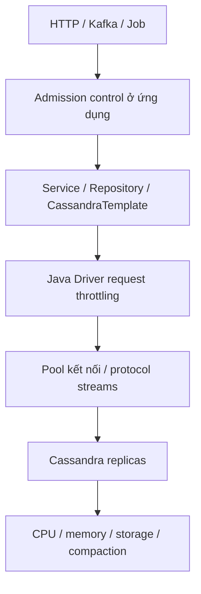

# Giới hạn số yêu cầu đang thực hiện

## Mục tiêu học tập

Khi chuyển từ truy cập Cassandra đồng bộ sang bất đồng bộ, chúng ta thường thấy lời gọi Java trả về ngay một `CompletionStage`, `CompletableFuture`, `Mono` hoặc `Flux`. Điều đó giúp thread ứng dụng không phải đứng chờ phản hồi, nhưng **không có nghĩa Cassandra có thể xử lý số lượng truy vấn đồng thời không giới hạn**. Nếu một API cho phép tạo hàng chục nghìn câu CQL cùng lúc, queue ở driver, kết nối và node Cassandra vẫn có thể quá tải; hệ thống thậm chí chậm hơn so với khi có giới hạn rõ ràng.

Trong chương **Truy cập bất đồng bộ** của module `SPRING_DATA_CASSANDRA`, bài này tập trung vào câu hỏi: **làm sao giới hạn số yêu cầu Cassandra đang được thực hiện, không chặn thread một cách vô ích và không làm mất kiểm soát khi có timeout, retry hoặc phân trang?**

Spring Data Cassandra cung cấp nhiều đường truy cập như entity mapping, repository, `CassandraTemplate`, reactive API và truy vấn CQL thông qua Java Driver. Dù chọn API nào, việc giới hạn concurrency phải đi cùng thiết kế bảng theo truy vấn, partition key, consistency, paging và đo hiệu năng của hệ thống dữ liệu phân tán.

Sau bài, bạn có thể:

- Phân biệt **concurrency**, **throughput**, **in-flight**, **queue depth**, **latency** và **backpressure**.
- Tính nhu cầu concurrency sơ bộ theo throughput và thời gian phản hồi, không nhầm với số thread.
- Viết một gateway bất đồng bộ dùng `Semaphore.tryAcquire()` và `CompletionStage` để giới hạn số truy vấn đang chờ kết quả.
- Hiểu vì sao giới hạn ở HTTP controller, service, driver và Cassandra node có phạm vi khác nhau.
- Cân nhắc cơ chế **request throttling** của Java Driver, queue có giới hạn và chính sách **fail fast**.
- Dùng `Flux.flatMap(mapper, concurrency)` trong Reactor để giới hạn số publisher đang được subscribe.
- Phân biệt **logical operation**, **một trang CQL** và **lệnh fetch trang tiếp** trong `AsyncResultSet`.
- Xử lý timeout, cancellation, retry, hot partition, nhiều instance và các thao tác ghi **non-idempotent**.
- Thiết kế dashboard, thử tải và kiểm thử xác nhận giới hạn thực sự có hiệu lực.

## 1. Bất đồng bộ không đồng nghĩa với vô hạn năng lực

Hình dung một ứng dụng có 2.000 request HTTP đi vào cùng lúc. Mỗi request phải đọc lịch sử sự kiện của một người dùng từ Cassandra:

```text
2.000 HTTP requests
       |
       v
2.000 service calls
       |
       v
2.000 session.executeAsync(...)
       |
       v
Java Driver / connection pools / Cassandra nodes
```

Nếu 2.000 lời gọi được phát đi ngay, chúng có thể không dùng 2.000 thread chờ. Nhưng các tài nguyên vẫn phải được quản lý:

- Driver tạo và theo dõi những request chưa hoàn tất.
- Các kết nối có giới hạn request đồng thời và băng thông.
- Node Cassandra sử dụng CPU, bộ nhớ, I/O, network và các hàng đợi nội bộ.
- Các truy vấn chậm chiếm chỗ lâu hơn và làm request mới bị dồn.
- Retry có thể tạo **thêm** request khi hệ thống vốn đã quá tải.
- Result mapping có thể làm phình bộ nhớ nếu giữ quá nhiều response cùng lúc.

**Async giải quyết mô hình chờ của thread, không giải quyết khả năng phục vụ tối đa của Cassandra.**

### So sánh ba cách điều phối

| Cách triển khai | Hành vi dưới tải | Rủi ro |
| --- | --- | --- |
| Đồng bộ, thread-per-request, giới hạn worker thread | Số thread phần nào giới hạn đồng thời. | Thread bị chặn, thread pool cạn khi truy vấn chậm. |
| Bất đồng bộ, phát mọi request không giới hạn | Thread không cần chờ nhưng số CQL in-flight có thể rất lớn. | Queue, timeout, OOM, áp lực lên Cassandra. |
| Bất đồng bộ với giới hạn in-flight và admission control | Chỉ một lượng công việc nhất định được gửi đi. | Phải thiết kế cách chờ/từ chối khi hết chỗ. |

Trong phần lớn API online, cách thứ ba dễ kiểm soát tải và hành vi lỗi hơn.

## 2. Nắm chắc sáu khái niệm

| Thuật ngữ | Ý nghĩa | Ví dụ |
| --- | --- | --- |
| **Concurrency** | Số công việc đang hoạt động đồng thời. | 100 truy vấn đang chờ Cassandra trả kết quả. |
| **In-flight request** | Request đã được phát đi nhưng chưa hoàn tất theo ranh giới đo đã chọn. | Đã gọi `executeAsync`, chưa nhận page/result hoặc exception. |
| **Throughput** | Số công việc hoàn tất trong một đơn vị thời gian. | 800 truy vấn/giây. |
| **Latency** | Thời gian một công việc phải chờ. | p95 latency 120 ms. |
| **Queue depth** | Số yêu cầu đang chờ **được phép thực hiện**, chưa gửi đi hoặc chưa có slot. | 300 request chờ permit. |
| **Backpressure/admission control** | Cơ chế làm upstream giảm tốc độ hoặc từ chối khi downstream không đủ năng lực. | Giới hạn đồng thời 64, queue tối đa 128 rồi trả quá tải. |

### Không đồng nhất số HTTP request với số CQL request

Một HTTP request có thể:

1. Đọc một hàng theo partition key.
2. Đọc danh sách 20 hàng.
3. Ghi một trạng thái.
4. Đọc tiếp 3 trang.

Như vậy **1 HTTP request có thể tạo nhiều CQL operations**, có khi đồng thời. Ngược lại một job nền có thể phát hàng nghìn request mà không có HTTP request nào.

Khi đặt giới hạn, cần định nghĩa rõ đối tượng được đếm:

```text
HTTP requests đang xử lý
        !=
logical operations đang xử lý
        !=
driver CQL requests in-flight
        !=
rows đang đọc
        !=
fetch pages đã được thực hiện
```

Một semaphore tại HTTP controller chỉ bảo vệ đường HTTP đó; một scheduled job khác vẫn có thể truy vấn Cassandra trực tiếp nếu không đi qua cùng gateway.

## 3. Vì sao concurrency tăng khi Cassandra chậm?

Một quan hệ dùng để **ước lượng** là định luật Little trong trạng thái tương đối ổn định:

\[
L \approx \lambda W
\]

Trong đó:

- `L`: số công việc trung bình đang nằm trong hệ thống.
- `λ`: throughput trung bình của hệ thống, tính bằng công việc/giây.
- `W`: thời gian trung bình một công việc nằm trong hệ thống, tính bằng giây.

Ví dụ minh họa:

```text
Throughput = 500 truy vấn/giây
Latency trung bình = 0,040 giây

Số công việc trung bình ≈ 500 × 0,040 = 20
```

Nếu Cassandra chậm đi:

```text
Throughput mong muốn = 500 truy vấn/giây
Latency trung bình = 0,400 giây

Concurrency cần để giữ throughput đó ≈ 200
```

Nhưng **không được kết luận rằng tăng concurrency từ 20 lên 200 sẽ khôi phục throughput**. Khi node đã bão hòa, thêm request có thể làm độ trễ cao hơn nữa, tạo queue và cuối cùng timeout hàng loạt.

### Ba điều không nên rút ra từ công thức

1. Công thức không xác định trực tiếp **capacity tối đa an toàn** của một cluster.
2. Giá trị trung bình không phản ánh hết p95/p99 và những đợt tải tăng đột ngột.
3. Muốn chọn giới hạn thực tế cần benchmark, đo queue và kiểm tra cả những truy vấn chậm/hot partition.

Hãy dùng công thức để **hiểu mối quan hệ**, sau đó xác định concurrency limit bằng số liệu tải thật.

## 4. Các tầng có thể giới hạn in-flight



Mỗi tầng có mục tiêu khác nhau:

| Tầng | Giới hạn được gì? | Điều nó không tự giải quyết |
| --- | --- | --- |
| API gateway | Request đến từ bên ngoài, theo client/tenant. | Các job nội bộ gọi Cassandra không qua gateway. |
| Service/gateway | Số logical operations gửi qua điểm truy cập chung. | Truy vấn đi vòng qua gateway, retry do driver hoặc code khác. |
| Reactor operator | Số publisher nội bộ được subscribe tại một đoạn pipeline. | Tổng toàn ứng dụng nếu có nhiều pipeline/instance độc lập. |
| Java Driver throttler | Công việc thực thi/đợi trong phạm vi session/driver được cấu hình. | Giới hạn toàn hệ thống qua nhiều JVM. |
| Cassandra cluster | Tài nguyên vật lý, hạn mức thực thi và replica. | Không tự cho API một chính sách nghiệp vụ fail fast thân thiện. |

**Nên kết hợp nhiều lớp phù hợp**, ví dụ quota ở API, concurrency cap ở service và request throttler ở driver. Nhưng không nên đặt ba queue vô hạn nối tiếp nhau, vì chúng khiến latency khó dự đoán.

## 5. Chọn chính sách khi hết slot

Một limiter cần trả lời: khi tất cả permit đang bận, request mới sẽ làm gì?

### 5.1. Từ chối ngay (fail fast)

```text
inFlight < LIMIT -> nhận công việc và gửi CQL
inFlight = LIMIT -> từ chối ngay, không tạo queue vô hạn
```

Ưu điểm:

- Bộ nhớ và số request chưa hoàn tất được kiểm soát.
- Caller biết rõ hệ thống đang quá tải.
- Dễ thiết lập deadline và metrics.
- Phù hợp endpoint latency thấp, caller có cơ chế giảm tải.

Đánh đổi: nếu burst ngắn và có khả năng phục hồi nhanh, một số yêu cầu có thể bị từ chối dù đáng lẽ chờ một chút sẽ được phục vụ.

### 5.2. Chờ trong hàng đợi có giới hạn

```text
64 slot đang chạy
128 yêu cầu chờ trong queue
Yêu cầu thứ 129 khi queue đã đầy -> từ chối
```

Ưu điểm: hấp thụ burst ngắn. Nhược điểm: request có thể hết HTTP deadline **ngay trong queue**, trước khi được gửi đến Cassandra.

Cần thống nhất:

- Kích thước queue tối đa.
- Timeout chờ slot.
- Tổng deadline của request.
- Chính sách fairness hoặc ưu tiên theo tenant.
- Hành vi khi caller hủy request.

**Queue có giới hạn vẫn không phải miễn phí.** Nếu thời gian chờ nhiều hơn phần lớn SLA, thà trả lỗi quá tải sớm còn hơn tạo một hàng đợi chắc chắn thất bại.

### 5.3. Giảm tốc độ upstream

Với stream nội bộ, có thể để downstream chỉ yêu cầu thêm dữ liệu khi còn năng lực xử lý. Với HTTP client thông thường, API có thể trả `429 Too Many Requests` hoặc `503 Service Unavailable` theo bản chất quá tải, kèm chính sách retry thích hợp.

Không nên trả mã lỗi khiến client **đồng loạt retry ngay lập tức**; thêm jitter, backoff và giới hạn phía caller để tránh *retry storm*.

## 6. Ví dụ bảng CQL phục vụ truy vấn có giới hạn

Giả sử người dùng xem các sự kiện gần nhất của một thiết bị trong ngày:

```sql
CREATE TABLE events_by_device_day (
    tenant_id uuid,
    device_id uuid,
    event_day date,
    occurred_at timestamp,
    event_id uuid,
    event_type text,
    summary text,
    payload blob,
    PRIMARY KEY (
        (tenant_id, device_id, event_day),
        occurred_at,
        event_id
    )
) WITH CLUSTERING ORDER BY (occurred_at DESC, event_id ASC);
```

Schema được thiết kế theo truy vấn:

- Partition key `(tenant_id, device_id, event_day)` giúp định vị đúng phạm vi.
- Clustering order cho phép lấy sự kiện gần đây theo thời gian.
- `event_id` phân biệt các sự kiện trùng timestamp.
- `payload` có thể lớn nên API danh sách nên tránh SELECT nếu không cần.

Truy vấn:

```sql
SELECT occurred_at, event_id, event_type, summary
FROM events_by_device_day
WHERE tenant_id = 11111111-1111-4111-8111-111111111111
  AND device_id = 22222222-2222-4222-8222-222222222222
  AND event_day = '2026-11-25';
```

**Giới hạn concurrency không sửa một query có thiết kế sai.** Nếu truy vấn thiếu partition key, quét nhiều partition, phải xử lý tombstone dày đặc hoặc đọc một blob hàng MB mỗi row, việc tăng request slots chỉ làm hệ thống quá tải nhanh hơn.

### Liên hệ với phân trang

Một partition có thể chứa nhiều sự kiện, vì thế ứng dụng thường cấu hình page size và đọc tiếp khi cần. Nhưng **page size là số hàng mỗi lượt fetch**, còn concurrency limit là **số request/fetch đang thực thi**. Hai giới hạn khác nhau và phải được kiểm soát riêng.

## 7. Java Driver 4.x: gọi CQL bất đồng bộ

Java Driver 4.x cung cấp `CqlSession.executeAsync(...)`:

```java
import com.datastax.oss.driver.api.core.CqlSession;
import com.datastax.oss.driver.api.core.cql.AsyncResultSet;
import com.datastax.oss.driver.api.core.cql.BoundStatement;
import com.datastax.oss.driver.api.core.cql.PreparedStatement;

// Giả định session được Spring quản lý và injected.
PreparedStatement query = session.prepare("""
    SELECT occurred_at, event_id, event_type, summary
    FROM events_by_device_day
    WHERE tenant_id = ?
      AND device_id = ?
      AND event_day = ?
    """);

BoundStatement bound = query.bind(tenantId, deviceId, eventDay)
        .setPageSize(50);

CompletionStage<AsyncResultSet> stage = session.executeAsync(bound);
```

Ở đây, các import `CompletionStage` và các biến `tenantId/deviceId/eventDay` cần được định nghĩa trong lớp sử dụng.

Điểm cần nhớ:

1. Lời gọi trả `CompletionStage` **trước khi truy vấn hoàn tất**.
2. Kết quả sẽ có **một trang hiện tại** của `AsyncResultSet`, không mặc định tải toàn bộ partition.
3. Future hoàn tất thành công hoặc thất bại theo execution của driver.
4. Nếu ứng dụng khởi tạo hàng nghìn future như thế trong một vòng lặp, nó vẫn tạo áp lực lên hệ thống.
5. Không gọi `join()` hoặc `get()` trên thread I/O/event loop để biến đường async thành chặn.

**Prepared statement không có nghĩa mỗi lời gọi được phép chạy vô hạn.** Chúng chỉ giảm overhead parse/prepare và giúp bind tham số đúng cách.

## 8. Semaphore.tryAcquire: giới hạn mà không chặn thread

Một mô hình đơn giản là dùng `Semaphore` với số permit cố định. Khác với `acquire()`, `tryAcquire()` trả kết quả ngay; khi hết permit, ứng dụng có thể **từ chối thay vì chặn thread**.

### Gateway giới hạn 64 CQL executions in-flight

```java
import java.util.concurrent.CompletableFuture;
import java.util.concurrent.CompletionStage;
import java.util.concurrent.RejectedExecutionException;
import java.util.concurrent.Semaphore;

import com.datastax.oss.driver.api.core.CqlSession;
import com.datastax.oss.driver.api.core.cql.AsyncResultSet;
import com.datastax.oss.driver.api.core.cql.BoundStatement;

import org.springframework.stereotype.Component;

@Component
public final class BoundedCassandraAsyncGateway {

    private static final int MAX_IN_FLIGHT = 64;

    private final CqlSession session;
    private final Semaphore permits = new Semaphore(MAX_IN_FLIGHT);

    public BoundedCassandraAsyncGateway(CqlSession session) {
        this.session = session;
    }

    public CompletionStage<AsyncResultSet> execute(
            BoundStatement statement) {

        if (!permits.tryAcquire()) {
            return CompletableFuture.failedFuture(
                    new RejectedExecutionException(
                            "Cassandra in-flight limit reached"));
        }

        CompletionStage<AsyncResultSet> stage;
        try {
            stage = session.executeAsync(statement);
        } catch (RuntimeException failure) {
            permits.release();
            return CompletableFuture.failedFuture(failure);
        }

        return stage.whenComplete((page, error) -> {
            // Release cho cả success và exceptional completion.
            // Callback này phải nhẹ, không làm việc blocking.
            permits.release();
        });
    }
}
```

Giới hạn này áp dụng cho **một bean trong một JVM** và những lời gọi đi qua phương thức `execute(...)`. Nó không tự giới hạn:

- Các truy vấn gọi `CqlSession` trực tiếp bên ngoài gateway.
- Những ứng dụng khác dùng cùng Cassandra cluster.
- Những fetch tiếp từ `AsyncResultSet.fetchNextPage()` nếu không được điều phối qua limiter.
- Các request được driver tạo bổ sung do retry/speculative execution tùy cấu hình.

### Vì sao release trong whenComplete?

Nếu chỉ release ở nhánh thành công:

```java
// Không đúng:
stage.thenAccept(page -> permits.release());
```

thì khi truy vấn thất bại, permit có thể bị giữ mãi, tạo **permit leak** và khiến hệ thống từ chối các request sau đó dù Cassandra đã hồi phục.

Callback `whenComplete` chạy ở cả hai trường hợp:

```text
executeAsync
    |
    +-- SUCCESS ------------> release
    |
    +-- EXCEPTION ----------> release
```

Cũng cần giải phóng permit nếu `executeAsync(...)` **ném ngoại lệ đồng bộ trước khi trả stage**, như nhánh `catch` trong ví dụ.

### Vì sao không chờ permit bằng acquire()?

`Semaphore.acquire()` sẽ chặn thread đến khi có slot. Nếu được gọi trên thread event loop của Netty/driver hoặc Reactor, nó có thể làm nghẽn đường xử lý hoàn tất request — chính là thứ cần để giải phóng permit.

Với API bất đồng bộ, ưu tiên:

- `tryAcquire()` và trả tín hiệu quá tải; hoặc
- một **hàng đợi bất đồng bộ có giới hạn**, chỉ đưa vào driver khi có slot.

Không gọi `acquire()` trên event loop và hy vọng “vì Cassandra là async nên không sao”.

## 9. Ranh giới của semaphore: một trang khác một logical query

Ở gateway trên, permit được giữ tới khi `executeAsync` hoàn tất **trang kết quả hiện tại**. Nhưng với CQL có nhiều trang, một logical query có thể tiếp tục:

```java
CompletionStage<AsyncResultSet> firstPage =
        gateway.execute(boundStatement);

CompletionStage<AsyncResultSet> nextPage =
        firstPage.thenCompose(page -> {
            if (page.hasMorePages()) {
                return page.fetchNextPage();
            }
            return CompletableFuture.completedFuture(page);
        });
```

Đoạn mã minh họa **một vấn đề**: `page.fetchNextPage()` **không đi qua `gateway.execute(...)`** ở ví dụ. Nếu 1.000 client đồng thời fetch trang tiếp, semaphore đầu chỉ đếm lần `executeAsync` ban đầu; các fetch tiếp có thể không được giới hạn như mong muốn.

### Hai cách chọn phạm vi permit

**Cách A — Giới hạn từng lần fetch CQL:** mỗi thao tác `executeAsync` và `fetchNextPage` đều phải được bảo vệ bởi một cơ chế limiter tương ứng. Điều này giúp kiểm soát số request đang chờ từng page; phải thiết kế adapter cho cả hai thao tác.

**Cách B — Giới hạn cả logical query:** giữ một permit từ trang đầu tới khi hoàn tất toàn bộ quá trình đọc/giải phóng tài nguyên. Dễ hiểu ở mức nghiệp vụ nhưng một consumer chậm hoặc bị bỏ dở có thể giữ slot rất lâu, vì vậy cần deadline, cancellation và lifecycle chính xác.

Không có lựa chọn nào đúng cho mọi hệ thống. Với API “Xem thêm”, mỗi HTTP request thường chỉ trả một trang, nên cách giới hạn per-page có thể dễ kiểm soát hơn. Với job xuất dữ liệu dài, có thể cần giới hạn **cả số job song song lẫn số fetch mỗi job**.

### Không gọi fetchNextPage tùy tiện

`AsyncResultSet.currentPage()` cho phép duyệt những hàng của trang hiện tại. `hasMorePages()` cho biết có thể fetch tiếp. `fetchNextPage()` là **lời gọi bất đồng bộ mới** cần kiểm soát tài nguyên.

Không coi `setPageSize(50)` là “tổng số hàng tối đa sẽ được đọc”. Nếu code cứ fetch cho đến khi không còn trang, tổng số hàng có thể rất lớn.

## 10. Đảm bảo fetch trang tiếp cũng được giới hạn

Một hàm wrapper đơn giản có thể dùng cùng semaphore cho cả `executeAsync` và `fetchNextPage`:

```java
import java.util.concurrent.CompletableFuture;
import java.util.concurrent.CompletionStage;
import java.util.concurrent.RejectedExecutionException;
import java.util.concurrent.Semaphore;
import java.util.function.Supplier;

import com.datastax.oss.driver.api.core.cql.AsyncResultSet;

public final class AsyncPageLimiter {

    private final Semaphore permits;

    public AsyncPageLimiter(int maxConcurrentFetches) {
        if (maxConcurrentFetches <= 0) {
            throw new IllegalArgumentException("limit must be positive");
        }
        this.permits = new Semaphore(maxConcurrentFetches);
    }

    public CompletionStage<AsyncResultSet> run(
            Supplier<CompletionStage<AsyncResultSet>> call) {

        if (!permits.tryAcquire()) {
            return CompletableFuture.failedFuture(
                    new RejectedExecutionException("Too many Cassandra fetches"));
        }

        CompletionStage<AsyncResultSet> stage;
        try {
            stage = call.get();
        } catch (RuntimeException error) {
            permits.release();
            return CompletableFuture.failedFuture(error);
        }

        return stage.whenComplete((value, error) -> permits.release());
    }
}
```

Sau khi tạo một instance `limiter` dùng chung, ứng dụng có thể gọi:

```java
CompletionStage<AsyncResultSet> first =
        limiter.run(() -> session.executeAsync(statement));

CompletionStage<AsyncResultSet> second = first.thenCompose(page -> {
    if (!page.hasMorePages()) {
        return CompletableFuture.completedFuture(page);
    }
    return limiter.run(page::fetchNextPage);
});
```

Hai đoạn minh họa giả định biến `session`/`statement`/`limiter` đã được tạo đúng vòng đời. Mỗi lần fetch phải **đi qua cùng instance limiter**, không tạo một `new AsyncPageLimiter(...)` cho mỗi request; nếu làm vậy, mỗi request sẽ có quota riêng và tổng toàn service không được bảo vệ.

### Một hạn chế quan trọng

Trong ví dụ, permit được release ngay khi mỗi page fetch hoàn tất, **trước khi toàn bộ hàng của page được xử lý**. Nếu mapping/serialization tốn CPU hoặc bộ nhớ, limiter chỉ bảo vệ thời gian chờ database, không bảo vệ toàn pipeline.

Một hệ thống có thể cần **hai giới hạn riêng**:

- Giới hạn fetch requests để bảo vệ Cassandra/driver.
- Giới hạn xử lý và lưu kết quả để bảo vệ heap/CPU của service.

Không dùng một con số “64” rồi giả định nó kiểm soát cả query, mapping, JSON serialization và hàng đợi downstream.

## 11. Driver request throttling: phòng tuyến chung cho CQL

Java Driver 4.x có cơ chế **request throttling** ở cấp driver/session. Một loại throttler có thể giới hạn concurrent requests và số phần tử chờ trong queue. Nó hữu ích khi ứng dụng có nhiều code path gọi driver, bởi không phải lập trình viên nào cũng đi qua một gateway viết tay.

Ví dụ cấu hình HOCON dạng tham khảo cho dòng Java Driver 4.x có hỗ trợ:

```hocon
datastax-java-driver {
  advanced.throttler {
    class = ConcurrencyLimitingRequestThrottler
    max-concurrent-requests = 64
    max-queue-size = 128
  }
}
```

**Cần đối chiếu cú pháp, tên class, key cấu hình và semantics với phiên bản Java Driver/Spring Boot đang dùng.** Đây là cấu hình minh họa nguyên tắc; không nên áp dụng con số 64/128 như mặc định production.

### Cơ chế hoạt động ở mức khái niệm

```text
Request đi vào driver
         |
         v
   [Throttler]
         |
   +-----+----------------+
   |                      |
Có slot                 Hết slot
   |                      |
   v                      v
Execute             Queue còn chỗ?
   |                 |         |
   v               Có         Không
Result/error         |         |
   |                 v         v
Release            Chờ      Từ chối
   |
Nhận request mới từ queue
```

Khi có queue, **thời gian chờ queue phải được tính vào trải nghiệm end-to-end**. Driver có thể có các loại timeout khác nhau: timeout của request, timeout khi chờ throttler hoặc deadline mà service tự đặt. Không nên suy diễn một cấu hình timeout sẽ tự bảo vệ mọi tầng.

### Vì sao driver throttler chưa đủ?

Giả sử một service có:

- 4 pod chạy độc lập.
- Mỗi pod có một `CqlSession` và giới hạn 64 request.

Tổng số driver operations có thể in-flight gần **4 × 64 = 256** trong điều kiện tải và định nghĩa đếm tương ứng. Đó không phải global limit 64 cho toàn bộ hệ thống.

Ngoài ra, retry, speculative execution hoặc những kết nối phục vụ nhiều ứng dụng khác có thể khiến số hoạt động trên cluster không trùng hoàn toàn với **logical operations** trong một session.

**Muốn giới hạn toàn cluster, phải xem tổng ngân sách concurrency của các instance và workload**, không chỉ một cấu hình trong một JVM.

## 12. Backpressure với Reactor và Reactive Spring Data Cassandra

Trong hệ sinh thái Spring, một số ứng dụng sử dụng `ReactiveCassandraRepository`, `ReactiveCassandraTemplate` hoặc một adapter trả về `Mono`/`Flux`. Đường reactive giúp biểu diễn dòng dữ liệu và nhu cầu tiêu thụ, nhưng **reactive không đồng nghĩa luôn có giới hạn số request CQL**.

### Ví dụ flatMap không giới hạn được chọn chủ đích

```java
Flux.fromIterable(deviceIds)
    .flatMap(deviceId -> repository.findByDeviceId(deviceId))
    .collectList();
```

Đoạn code minh họa, giả định method repository thực sự trả về một publisher phản ứng hợp lệ và truy vấn theo bảng/khóa được thiết kế. Nếu nguồn `deviceIds` rất lớn, số inner publisher được subscribe phụ thuộc mặc định operator/thư viện và yêu cầu upstream. **Không nên dựa vào mặc định để bảo đảm một trần concurrency cụ thể của hệ thống**.

### Đặt concurrency tường minh

```java
int maxConcurrentQueries = 16;

Flux<EventSummary> results = Flux.fromIterable(deviceIds)
    .flatMap(
        deviceId -> eventService.readSummaries(deviceId),
        maxConcurrentQueries
    );
```

Ở đây `eventService.readSummaries(deviceId)` được giả định trả `Flux<EventSummary>` bất đồng bộ và phải tự dùng đúng partition key theo schema. `flatMap(mapper, 16)` giới hạn số **inner publishers đang được subscribe đồng thời ở đoạn pipeline đó**, không nhất thiết tương đương một giới hạn driver request toàn service.

Vì:

- Mỗi publisher có thể thực hiện **nhiều CQL requests** để fetch pages.
- Nhiều subscription đến cùng pipeline có thể chạy song song.
- Các controller, background jobs và service khác có pipeline riêng.
- Các thao tác side-effecting có thể được subscribe nhiều lần nếu code không kiểm soát.

Nên dùng concurrency limit ở operator **và** driver/application limiter khi yêu cầu bảo vệ Cassandra nghiêm ngặt.

### flatMap, flatMapSequential và concatMap

| Operator | Tác dụng chính | Khi cân nhắc |
| --- | --- | --- |
| `flatMap(mapper, concurrency)` | Chạy nhiều inner publishers, phát kết quả theo thời điểm nhận. | Truy vấn độc lập, không đòi thứ tự phát theo input. |
| `flatMapSequential(mapper, concurrency)` | Có thể thực thi nhiều inner publishers nhưng giữ thứ tự phát theo nguồn. | Cần giữ thứ tự trả về nhưng vẫn cho phép overlap. |
| `concatMap(mapper)` | Nối từng inner publisher theo thứ tự, không chủ đích chồng lấn các inner. | Khi thao tác phụ thuộc thứ tự hoặc cần giảm concurrency tối đa. |

**Giữ thứ tự phát kết quả không nhất thiết tạo giao dịch tuần tự hóa ở Cassandra.** Cần phân biệt thứ tự luồng Reactor với consistency hoặc LWT.

### limitRate và onBackpressureBuffer có phải semaphore?

Không. `limitRate(...)` ảnh hưởng cách downstream phát tín hiệu yêu cầu dữ liệu tới upstream; nó **không phải hợp đồng chung rằng Cassandra chỉ có đúng N CQL requests in-flight**.

`onBackpressureBuffer(...)` có thể giữ thêm phần tử chờ downstream. Nếu cấu hình buffer vô hạn, đây là một nguồn tăng heap. Việc “thêm buffer” không giải quyết Cassandra bão hòa.

### Không block thread event loop

Tránh:

```java
// Không làm trong event loop:
Mono.fromCallable(() -> syncCassandraRepository.findById(id).orElseThrow())
    .map(...);
```

Đoạn phản ví dụ che một lời gọi blocking trong pipeline mà không thay đổi bản chất của nó. Nếu bắt buộc dùng API blocking, phải cô lập workload ở scheduler thích hợp với giới hạn rõ ràng; không đặt blocking I/O trên Netty/driver event loop.

Ưu tiên reactive/async API thật khi dự án muốn xử lý tải bất đồng bộ.

## 13. Timeout không đồng nghĩa Cassandra request đã dừng

Đây là một trong những bẫy quan trọng nhất khi đặt concurrency limit.

Giả sử ứng dụng gọi:

```java
CompletableFuture<AsyncResultSet> future =
        session.executeAsync(statement).toCompletableFuture();

future.orTimeout(300, TimeUnit.MILLISECONDS);
```

`orTimeout(...)` khiến **future ở phía Java** hoàn tất lỗi nếu quá thời gian. Nhưng điều đó **không chứng minh** Cassandra đã ngừng thực thi truy vấn, mọi gói tin đã biến mất, hay tài nguyên server đã được giải phóng. Tùy cách driver thực hiện cancellation/timeout, request thực tế có thể vẫn đang được xử lý.

### Vì sao điều này ảnh hưởng semaphore?

Giả sử semaphore release khi **future public được báo timeout**:

```text
T0: gửi 64 requests -> giữ 64 permits
T1: phía service timeout hết 64
T2: release 64 permits
T3: gửi thêm 64 requests mới

Nhưng T1 không chắc 64 requests cũ đã dừng trên Cassandra.
=> Áp lực thực tế có thể vượt ngân sách 64 mong muốn.
```

Điều này gọi là **logical timeout khác với underlying completion**.

### Cách thiết kế an toàn hơn

- Khi có thể, gắn permit vào **completion của operation driver đang theo dõi**, không chỉ vào một future đã được wrapper timeout bên ngoài.
- Đặt request timeout phù hợp ở tầng driver để giới hạn thời gian chờ của driver.
- Khi caller bỏ đi, quyết định rõ có cố hủy operation hay tiếp tục quan sát completion để release.
- Hiểu rằng cancellation không nhất thiết là **server-side abort**.
- Theo dõi cả số caller đang chờ và số driver operations chưa có completion.

Một chính sách timeout chỉ được coi là hợp lệ nếu **nghĩa của permit và cách release khớp với tài nguyên thực sự cần bảo vệ**.

## 14. Cancellation và giải phóng tài nguyên

Trong pipeline reactive, caller có thể ngắt kết nối HTTP hoặc hủy subscription. Nếu code tạo một phép `executeAsync` rồi xử lý:

```java
// Cảnh báo về ý tưởng, không phải code đầy đủ:
Mono.fromCompletionStage(session.executeAsync(statement))
    .timeout(Duration.ofMillis(300))
    .doFinally(signal -> permits.release());
```

thì một signal như `CANCEL`/`TIMEOUT` có thể kích hoạt release **trước khi hoạt động CQL nền thực sự kết thúc**. Nếu mục tiêu là giới hạn driver request in-flight, cách release này có thể quá sớm.

Ngược lại, nếu một logical workflow giữ permit đến hết toàn bộ lifecycle nhưng caller có thể bỏ dở mà không có cleanup, permit có thể bị rò rỉ.

### Hai phạm vi cần phân biệt

| Phạm vi | Khi nào release? | Rủi ro nếu sai |
| --- | --- | --- |
| Caller subscription / logical HTTP request | Khi workflow xử lý xong/hủy theo contract. | Giữ tài nguyên ứng dụng quá lâu nếu không cleanup. |
| Underlying CQL execution/fetch | Khi driver operation kết thúc theo trạng thái quan sát được. | Release sớm làm vượt giới hạn tải Cassandra. |

Nhiều hệ thống cần **hai bộ đếm/limiter riêng** để hiểu hai phạm vi này, thay vì một semaphore cố làm cả hai nhiệm vụ.

Không nên hứa rằng `CompletableFuture.cancel(true)` hoặc Reactor cancellation luôn dừng ngay truy vấn trên node Cassandra. Cần đối chiếu chính xác cách driver phiên bản thực tế xử lý cancellation và request timeout.

## 15. Retry và speculative execution có thể nhân tải

Giả sử client định phát 100 logical read requests. Nếu mỗi request được retry thêm một lần do timeout, Cassandra có thể nhận nhiều hơn 100 attempts. Nếu speculative execution được bật, driver còn có thể thực hiện attempt bổ sung để giảm latency tail trong những điều kiện cấu hình cho phép.

```text
100 logical requests
       |
       +--> 100 initial attempts
       |
       +--> retry attempts
       |
       +--> speculative attempts (nếu cấu hình)
       |
       v
Tổng hoạt động thực tế trên cluster
có thể lớn hơn số logical requests
```

Vì thế, dù semaphore bảo vệ 100 **logical operations** ở tầng service, tổng số attempts driver gửi có thể khác. Muốn kiểm soát tải, phải xem metrics driver và cấu hình retry/speculative execution, không chỉ biến `inFlight` trong code application.

### Rủi ro với ghi non-idempotent

Một số câu lệnh như increment counter là **non-idempotent**. Nếu request trước đã được áp dụng nhưng phản hồi mất, retry có thể làm tăng số đếm lần nữa. Với thao tác ghi có điều kiện/LWT hoặc workflow nhiều hệ thống, outcome sau timeout cũng cần chính sách riêng.

Khi bind statement:

```java
BoundStatement counterUpdate = preparedCounterIncrement
        .bind(pageId, day)
        .setIdempotent(false);
```

Đây là một phần tín hiệu cho driver về cách retry an toàn, không phải cơ chế dedup xuyên HTTP, queue hoặc các service. Một concurrency limiter không được tự retry tất cả lỗi với giả định read/write đều vô hại.

### Khi Cassandra chậm, retry nên làm gì?

Không nên:

```text
Timeout tăng -> retry nhiều hơn
             -> cluster nhận thêm request
             -> latency tăng
             -> timeout tiếp tục tăng
```

Nên thiết kế:

- Retry budget trên mỗi logical operation.
- Backoff/jitter và deadline chung.
- Chỉ retry các loại lỗi/statement **an toàn theo idempotency contract**.
- Circuit breaker hoặc load shedding khi áp lực kéo dài.
- Giới hạn số retry đang được thực thi, không để attempt phụ đi vòng qua mọi hạn mức.

**Rate limit, concurrency limit và retry policy cần vận hành như một bộ**, không phải ba thành phần riêng tự tăng tải để cố tối ưu thành công.

## 16. Nhiều instance: tính tổng ngân sách đúng phạm vi

Giả sử có 6 instance của service, mỗi instance giữ tối đa 80 CQL operations in-flight.

```text
Instance 1: max 80
Instance 2: max 80
Instance 3: max 80
Instance 4: max 80
Instance 5: max 80
Instance 6: max 80
-------------------
Tổng lý thuyết: 480 operations
```

Đây là trần tổng của các limiter ứng dụng **nếu tất cả 6 instance cùng tải hết** và mọi truy vấn đều đi qua đúng limiter; nó **không** tính các service khác, retry/speculative attempts, background jobs hoặc đường truy vấn bỏ qua limiter.

### Khi autoscaling làm số request tăng

Nếu HPA tăng từ 6 lên 12 pods mà mỗi pod vẫn có 80 slots, tổng concurrency tiềm năng có thể tăng gấp đôi. Autoscaling có thể làm **Cassandra chịu tải lớn hơn**, không nhất thiết cải thiện throughput nếu cluster đã bão hòa.

Một số chiến lược:

1. Có **ngân sách concurrency cấp ứng dụng** dựa trên tải thật của Cassandra.
2. Chia ngân sách theo số instance mục tiêu và mức dự phòng.
3. Đo tổng CQL in-flight, QPS, saturation và latency xuyên các instance.
4. Có load shedding hoặc rate limit ở ingress cho các tenant gây quá tải.
5. Khi cần global quota chặt, cân nhắc cơ chế admission control tập trung hoặc phân phối token, cùng chính sách khi thành phần này lỗi.

Một distributed semaphore có chi phí và nguy cơ điểm nghẽn riêng. Không nên triển khai nó mặc định nếu chỉ cần bảo vệ load ở mức gần đúng bằng limiter per-instance và giám sát.

## 17. Tránh starvation giữa các tenant và workload

Một API đa tenant có thể có tenant A gửi 10.000 request và tenant B chỉ gửi 10 request. Nếu cả hai dùng **một queue FIFO lớn**, tenant B có thể phải chờ lâu dù chỉ có nhu cầu nhỏ.

Có thể cân nhắc kết hợp:

- Global in-flight cap cho toàn service.
- Per-tenant cap hoặc quota theo nhóm người dùng.
- Phân loại tác vụ: request tương tác, batch export, background cleanup.
- Queue riêng/ưu tiên phù hợp SLA và fairness.
- Mức từ chối sớm cho workload ưu tiên thấp khi hệ thống gần bão hòa.

### Ví dụ ngân sách minh họa

```text
Global cap: 120 concurrent operations
Interactive reserve: 80 slots
Background export: tối đa 24 slots
Maintenance: tối đa 16 slots
```

Đây là mô hình ý tưởng, **không phải con số mặc định**. Nếu cấu hình phân lớp, phải bảo đảm tổng hạn mức, cách mượn slot nhàn rỗi và bảo vệ workload quan trọng được thực hiện nhất quán.

### Hạn mức không thay thế quyền truy cập

Cho phép tối đa 10 request/tenant không bảo đảm query có đủ `tenant_id` trong partition key hoặc không truy cập dữ liệu tenant khác. **Authorization và query scoping là cơ chế độc lập**; cần kiểm tra quyền trước khi tạo công việc và ràng buộc khóa ở CQL đúng schema.

## 18. Hot partition và truy vấn chậm: không có một con số đúng cho tất cả

Một giới hạn global 64 giúp ngăn 10.000 request cùng chạy, nhưng nếu cả 64 request đều nhắm một partition nóng hoặc query tốn kém, cluster vẫn có thể nghẽn.

Ví dụ:

```text
Request A..Z:
  WHERE tenant_id=T1
    AND device_id=D1
    AND event_day=2026-11-25
```

Mọi truy vấn cùng một partition, làm nóng cùng tập replica. Trong khi một thiết bị khác chỉ có ít traffic, tài nguyên vẫn bị phần lớn request A..Z chiếm.

Các hướng xử lý:

1. Thiết kế bucket/shard theo workload và cardinality, không tạo partition quá lớn.
2. Cân nhắc **per-key concurrency cap** cho partition cực nóng khi dữ liệu thống kê cho thấy cần thiết.
3. Chỉ SELECT những cột cần dùng; tránh blob lớn trong list API.
4. Chọn page size phù hợp và kiểm soát số page fetch.
5. Giảm truy vấn phụ/đếm tổng không cần thiết.
6. Theo dõi tombstone, compaction, GC, network và replica latency.

**Không có giới hạn concurrent requests nào biến truy vấn quét toàn bảng hoặc hot partition thành thiết kế tối ưu.** Cần sửa cả mẫu truy vấn lẫn điều phối tải.

## 19. Chọn con số giới hạn bằng thử tải

Không nên sao chép `MAX_IN_FLIGHT = 64` từ ví dụ rồi coi đó là mức tối ưu.

### Quy trình benchmark đề xuất

1. Xác định workload: tỷ lệ read/write, kích thước hàng, CL, page size, số partition và tỷ lệ hot key.
2. Đặt mục tiêu SLO: p95/p99 latency, throughput, timeout, error budget.
3. Chạy với concurrency thấp để có baseline.
4. Tăng concurrency theo các bước có kiểm soát.
5. Tại mỗi bước đo throughput, latency, CPU/IO node, queue depth, retry và timeout.
6. Xác định **điểm bão hòa** khi tăng concurrency không tăng throughput tương xứng nhưng latency/error tăng.
7. Chọn giới hạn vận hành với **headroom**, không đặt ngay ở mức bắt đầu bão hòa.
8. Chạy lại bài test khi schema, workload, replication, topology hoặc cấu hình driver thay đổi.

### Ví dụ kết quả minh họa, không phải benchmark thật

| In-flight cap | Throughput quan sát | p95 latency | Nhận xét |
| ---: | ---: | ---: | --- |
| 16 | 300 req/s | 45 ms | Chưa tận dụng hết năng lực. |
| 32 | 540 req/s | 65 ms | Tăng throughput có kiểm soát. |
| 64 | 690 req/s | 100 ms | Có thể chấp nhận tùy SLO. |
| 128 | 720 req/s | 280 ms | Bắt đầu bão hòa; ít lợi ích thêm. |
| 256 | 680 req/s | 950 ms | Quá tải, throughput suy giảm. |

**Các số này chỉ để diễn giải xu hướng**. Không phải thông số đo từ Cassandra hoặc khuyến nghị production. Mỗi schema/cluster/query khác nhau cần thử tải riêng.

### Ghi nhận metric gì?

| Metric | Ý nghĩa |
| --- | --- |
| Số CQL in-flight ở application | Limiter có giữ đúng trần không? |
| Số request bị từ chối | Có vượt ngân sách, cần scale hay sửa workload? |
| Queue depth và queue wait time | Latency có bị mất trong queue không? |
| Driver requests in-flight/throttled | Driver có là điểm nghẽn không? |
| p50/p95/p99 Cassandra latency | Hành vi tail latency dưới tải. |
| Retry/speculative attempt count | Tổng load có vượt logical requests không? |
| Số fetch/page và rows/page | Paging có tạo nhiều request bất ngờ? |
| CPU, I/O, network, GC trên node | Cluster đang bão hòa tài nguyên nào? |
| Error/timeout/unavailable rate | Mức độ quá tải hoặc thiếu replica. |
| Hot partition/tombstone | Truy vấn chậm do mô hình dữ liệu nào? |

Đừng chỉ đo latency của `session.executeAsync(...)` mà quên thời gian chờ queue hoặc mapping/serialization của ứng dụng. Người dùng quan tâm **end-to-end latency**.

## 20. Thiết kế API trả lỗi quá tải rõ ràng

Giả sử service đang phục vụ một endpoint:

```text
GET /tenants/{tenantId}/devices/{deviceId}/events
    ?day=2026-11-25
    &size=50
```

Endpoint có thể gặp ba nhóm lỗi khác nhau:

| Lỗi | Nguyên nhân | Hành vi gợi ý |
| --- | --- | --- |
| **Local admission rejected** | Limiter ứng dụng không còn slot. | Trả mã quá tải xác định (ví dụ 429 hoặc 503 theo hợp đồng), có backoff. |
| **Driver throttler queue full** | Driver hết concurrent capacity và queue. | Quan sát/retry có giới hạn, tránh đẩy tải mạnh hơn. |
| **Cassandra timeout/unavailable** | Truy vấn thực thi không hoàn tất theo điều kiện/CL. | Phân loại request idempotent, outcome và mức lỗi; không coi là slot rejection. |

Nếu limiter chủ động từ chối **trước khi gọi Cassandra**, application có thể biết request CQL **chưa được gửi qua limiter đó**. Nhưng khi request đã vào driver, một timeout hoặc disconnect thường không đủ để khẳng định thao tác ghi chưa xảy ra.

### Mẫu mapping lỗi ở tầng service

```text
Limiter còn permit?
    |
    +-- Không --> 503/429 theo contract
    |             retry policy + jitter
    |
    +-- Có  --> gửi CQL
                |
                +-- Success  --> trả dữ liệu
                +-- Exception/timeout
                    --> xử lý theo loại statement,
                        idempotency, trạng thái driver
```

Nếu caller là job nền, có thể lưu tác vụ vào queue có giới hạn và tiếp tục sau, nhưng **không** biến lỗi quá tải thành một vòng `while(true)` retry tức thì.

### Tránh giữ permit khi làm việc không liên quan

Một HTTP request có thể:

1. Kiểm tra quyền truy cập.
2. Gọi dịch vụ ngoài để lấy metadata.
3. Gửi một câu CQL.
4. Serialize JSON.

Nếu chỉ muốn giới hạn Cassandra in-flight, thường nên acquire permit **ngay trước khi gửi CQL** và release theo lifecycle CQL, không giữ từ đầu đến cuối HTTP request. Các việc khác có thể cần limiter riêng.

Ngược lại, nếu điều kiện là “mỗi tenant chỉ được xử lý 20 workflow đồng thời”, permit cấp nghiệp vụ có phạm vi rộng hơn là hợp lý. **Chọn ranh giới theo thứ bạn thật sự muốn bảo vệ.**

## 21. Những lỗi triển khai phổ biến

| Triệu chứng | Nguyên nhân thường gặp | Hướng khắc phục |
| --- | --- | --- |
| Dùng async nhưng p99 tăng rất cao | Phát quá nhiều truy vấn, queue dồn, Cassandra bão hòa. | Đặt cap và queue có giới hạn; đo latency/throughput. |
| Hết permit mãi sau vài exception | Chỉ release ở nhánh success. | Release trong completion path có cả lỗi, kiểm thử sync throw. |
| Nhiều request vẫn chạy dù limit=64 | Mỗi request tạo semaphore riêng. | Dùng limiter **chung** cho scope mong muốn. |
| Limit áp cho trang đầu nhưng không cho trang sau | `fetchNextPage()` đi vòng qua limiter. | Giới hạn cả fetches hoặc cả logical query. |
| Request bị timeout nhưng node vẫn rất tải | Timeout public không hủy underlying CQL. | Phân biệt caller lifecycle với driver completion. |
| `doFinally` release sớm | Subscription cancel trước underlying operation hoàn tất. | Theo dõi đúng ranh giới release; không tự coi cancel là server abort. |
| Queue lớn khiến lỗi tăng | Phần lớn request hết SLA khi còn chờ queue. | Giảm queue, fail fast và đo queue wait. |
| Tăng số pod nhưng Cassandra chậm hơn | Tổng in-flight potential tăng theo replica app. | Cân bằng per-pod budget với tổng cluster load. |
| Tenant nhỏ bị chậm vì tenant lớn | Chung queue/permit không có fairness. | Per-tenant/admission policy. |
| Thêm retry làm timeout tăng | Retry storm/speculative attempts nhân tải. | Retry budget, idempotency, backoff, load shedding. |
| Reactor pipeline có Flux nhưng vẫn block | Gọi repository đồng bộ hoặc `join()` trên event loop. | Dùng async/reactive thực hoặc cô lập blocking IO. |
| Query chậm dù ít in-flight | Hot partition, tombstone, quét dữ liệu, CL quá đắt. | Sửa schema/query, đo Cassandra, không chỉ chỉnh cap. |
| Counter tăng đôi sau lỗi mạng | Retry non-idempotent write. | Không retry mù quáng, thiết kế operation ID/reconciliation. |
| Job export làm API online chậm | Dùng chung toàn bộ slots không có phân loại workload. | Hạn mức riêng cho background/interactive. |

### Trình tự debug đề xuất

1. **Định nghĩa in-flight đang đếm:** HTTP, CQL execute, page fetch hay logical job?
2. **Kiểm tra scope limiter:** một method, một bean, một JVM, một pod hay toàn hệ thống?
3. **Tìm đường bypass:** repository, driver direct, `fetchNextPage`, retry, scheduled job.
4. **Kiểm tra release:** success, exceptional completion, synchronous exception, caller cancel và timeout.
5. **Kiểm tra queue:** kích thước, thời gian chờ, tỷ lệ từ chối.
6. **Kiểm tra driver:** throttler, pool, retry/speculative settings và phiên bản.
7. **Kiểm tra CQL:** partition key, page size, cột chọn, tombstone, hot partitions.
8. **Đo end-to-end:** throughput, p95/p99, error rate, node saturation.
9. **Điều chỉnh budget:** tăng hoặc giảm có kiểm soát và thử lại với workload đại diện.

Không bắt đầu bằng “tăng timeout lên 60 giây” nếu thật ra Cassandra đang xếp hàng quá nhiều request; chỉ kéo dài thời gian chờ có thể làm tăng số in-flight.

## 22. Kiểm thử limiter và đường truy cập Cassandra

Để kiểm thử một limiter, có thể dùng unit test với **các `CompletableFuture` được điều khiển bằng tay** rồi kiểm thử tích hợp với Cassandra thực. Hai cấp test kiểm tra những thứ khác nhau.

### 22.1. Unit test giới hạn in-flight

Giả sử limiter có `maxConcurrent=2` và backend giả chỉ hoàn tất khi test yêu cầu:

```text
T0: submit operation A -> accepted, pending
T1: submit operation B -> accepted, pending
T2: submit operation C -> rejected

T3: complete A
T4: submit operation D -> accepted

T5: fail B exceptionally
T6: submit operation E -> accepted
```

Các assert quan trọng:

- Không bao giờ có hơn 2 operation **đã được nhận và chưa hoàn tất** trong phạm vi limiter.
- C không gọi backend khi hết slot.
- A success giải phóng một permit.
- B error cũng giải phóng một permit.
- D/E có thể đi tiếp khi slot được trả lại.

Unit test nên tách **số request nhận vào limiter** khỏi **số request đã gọi backend** để tránh nhầm request bị từ chối là request Cassandra đang chạy.

### 22.2. Test lỗi đồng bộ trước khi có future

Trong gateway `tryAcquire → executeAsync`, hãy mô phỏng trường hợp hàm phát request ném `RuntimeException` **trước khi trả `CompletionStage`**.

Kỳ vọng:

```text
acquire permit   -> thành công
backend call     -> throw đồng bộ
catch            -> release
next operation   -> vẫn có thể lấy permit
```

Nếu thiếu nhánh `catch/release`, permit sẽ bị rò rỉ dù backend chưa thực thi một truy vấn nào.

### 22.3. Test exceptional completion bất đồng bộ

Cho backend trả một future đang pending rồi hoàn tất exceptional:

```java
CompletableFuture<AsyncResultSet> pending = new CompletableFuture<>();

// Truyền pending vào fake async backend được dùng bởi limiter.
// Sau khi đã chiếm một permit:
pending.completeExceptionally(
        new RuntimeException("Simulated database failure"));

// Assert: một permit được trả và future public báo lỗi.
```

Đây là **pseudocode test harness**, không phải class integration test hoàn chỉnh. Điều quan trọng là kiểm tra permit trả ngay cả khi error được báo **sau** khi method async đã trả.

### 22.4. Test timeout không dừng underlying work

Cho backend giữ một future pending. Ở phía caller, tạo một timeout wrapper để trả lỗi sớm, **nhưng đừng hoàn tất future backend**.

Kỳ vọng theo mục tiêu “giới hạn backend in-flight”:

- Caller có thể đã nhận timeout.
- Underlying operation vẫn được tính là outstanding đến khi thực sự kết thúc theo ranh giới đã chọn.
- Không cấp thêm slot dựa đơn thuần vào callback hủy của caller.

Test này giúp phát hiện lỗi release sớm khi dùng `orTimeout` hoặc `doFinally` sai chỗ.

### 22.5. Test fetchNextPage đi qua limiter

Cho nhiều logical queries đều nhận trang đầu có `hasMorePages()==true`. Nếu `fetchNextPage()` gọi driver trực tiếp và bỏ qua limiter, test phải phát hiện số fetch outstanding vượt trần.

Đặc biệt, chỉ đo số lần `session.executeAsync` sẽ **không bắt được** các request fetch trang sau. Tạo metric/test wrapper cho cả những lời gọi đó.

### 22.6. Test Reactor concurrency

Giả sử nguồn có 100 IDs, mỗi lời gọi giả tới Cassandra trả `Mono` chỉ hoàn tất khi test điều khiển. Dùng:

```java
source.flatMap(this::readOneAsMono, 4);
```

Trong một subscription, theo dõi số inner publishers active và xác nhận không vượt 4. Sau đó tạo **hai subscriptions đồng thời** để chứng minh rằng mỗi subscription có thể có budget riêng và không tự tạo global cap 4.

Nếu cần cap chung, bổ sung limiter ở tầng gateway/driver và kiểm tra tổng.

### 22.7. Integration test với Cassandra thật

| Ca thử | Điều cần quan sát |
| --- | --- |
| Query theo partition key hợp lệ | Latency và kích thước page ổn định ở tải cơ sở. |
| 10× request burst so với cap | Số in-flight được kiểm soát; phần dư bị chờ/từ chối theo chính sách. |
| Driver queue đầy | Exception/throttling được ứng dụng phân loại đúng. |
| Một số node chậm hoặc lỗi | Timeout không làm permit leak hay retry storm. |
| Query có nhiều pages | Fetch tiếp được giới hạn, không tải toàn partition vô hạn. |
| Một partition rất nóng | Đánh giá p95/p99, không chỉ concurrency global. |
| Nhiều pod cùng gửi | Đánh giá tổng concurrency và giới hạn cluster. |
| Background export chạy cùng HTTP | Interactive SLO vẫn nằm trong ngân sách dự kiến. |
| Ghi non-idempotent gặp timeout | Không retry mù quáng dẫn tới double effect. |
| Thay CL giữa các môi trường | Đo lại độ trễ và khả dụng, không giữ nguyên cap theo cảm tính. |

Không nên dùng test giả lập 10.000 thread blocking chỉ để chứng minh một API async nhanh; điều cần đo là **thực tế số CQL operations, queue, latency và năng lực phục vụ của Cassandra**.

## 23. Bài tập vận dụng

**Câu 1 — Async có tự giới hạn không?** Một controller tạo 5.000 `CompletableFuture` gọi `executeAsync` mà không có limiter. Vì sao server có thể quá tải dù số thread ứng dụng thấp?

**Gợi ý:** Future không chiếm thread chờ theo cách đồng bộ, nhưng driver, pool, Cassandra replicas, queue và bộ nhớ vẫn phải theo dõi/xử lý công việc thực.

**Câu 2 — Little's Law.** Throughput ổn định là 200 req/s và latency trung bình 50 ms. Số yêu cầu trong hệ thống xấp xỉ bao nhiêu?

**Gợi ý:** `200 × 0,050 = 10`. Đó là ước lượng trung bình, không phải trần an toàn production.

**Câu 3 — Release khi exception.** Semaphore có 10 permit. Code chỉ release ở nhánh success. Sau 10 request trả lỗi, chuyện gì xảy ra?

**Gợi ý:** Có thể leak toàn bộ permit và từ chối mãi về sau. Release cần được gắn với cả success và exceptional completion.

**Câu 4 — tryAcquire hay acquire?** Vì sao không nên gọi `Semaphore.acquire()` trên event loop của Reactor/driver?

**Gợi ý:** Nó có thể chặn thread cần thiết cho I/O completion, làm nghẽn hoặc tạo deadlock gián tiếp. Dùng nonblocking admission control.

**Câu 5 — Trang tiếp.** Một gateway giới hạn `session.executeAsync` nhưng gọi `AsyncResultSet.fetchNextPage()` trực tiếp. Hạn chế nào còn tồn tại?

**Gợi ý:** Những fetch tiếp không được tính vào limiter, nên tổng page fetch in-flight có thể vượt trần dự kiến.

**Câu 6 — Reactor.** `flatMap(mapper, 8)` có bảo đảm toàn cluster chỉ có 8 request CQL không?

**Gợi ý:** Không. Nó giới hạn inner publishers của đoạn pipeline trong một subscription; một publisher có thể tạo nhiều CQL operations và có nhiều subscription/instance khác.

**Câu 7 — Timeout.** HTTP client đã nhận 504 nhưng underlying CQL chưa hoàn tất. Nếu release permit ngay khi HTTP timeout, rủi ro là gì?

**Gợi ý:** Request mới được gửi trong khi request cũ vẫn có thể dùng tài nguyên cluster, làm concurrency thực vượt budget.

**Câu 8 — Nhiều instance.** Có 5 pod, mỗi pod max 40 CQL in-flight. Trong điều kiện tất cả dùng hết budget và không có hoạt động khác, trần tổng là bao nhiêu?

**Gợi ý:** `5 × 40 = 200` logical operations theo cách tính của limiter, không tính retries/speculative attempts hoặc service ngoài.

**Câu 9 — Retry.** Cassandra đang quá tải và các request thường timeout. Có nên bật retry vô hạn để tăng tỉ lệ thành công không?

**Gợi ý:** Không. Retry storm có thể nhân tải. Cần budget, deadline, backoff, idempotency và load shedding.

**Câu 10 — Counter.** Một lệnh `UPDATE views=views+1` timeout. Limiter còn slot nên có nên tự gửi lại ngay không?

**Gợi ý:** Không. Increment non-idempotent; kết quả request đầu chưa rõ. Cần chính sách xử lý outcome hoặc reconciliation.

**Câu 11 — Query sai.** 64 request đồng thời đều truy vấn một partition có rất nhiều tombstone. Chỉ giảm concurrency xuống 32 có đủ giải quyết nguyên nhân không?

**Gợi ý:** Có thể giảm áp lực tức thời, nhưng vẫn phải sửa workload/schema, retention, partition design và kiểm tra tombstone.

**Câu 12 — Queue.** Queue chờ limiter có 10.000 phần tử, còn HTTP timeout là 1 giây. Vì sao điều này có thể gây tác dụng ngược?

**Gợi ý:** Phần lớn request có thể hết SLA trước khi được chạy; queue chiếm bộ nhớ, tăng latency và che dấu áp lực cần load shedding.

**Câu 13 — Autoscaling.** HPA nhân đôi số pod nhưng cap mỗi pod giữ nguyên. Điều gì phải kiểm tra trước khi kết luận hệ thống xử lý nhanh hơn?

**Gợi ý:** Tổng concurrency tiềm năng trên Cassandra tăng; cần kiểm tra saturation, tail latency và CL của cluster.

**Câu 14 — Thứ tự.** Dùng `flatMapSequential` để giữ thứ tự response có tự bảo đảm mọi ghi Cassandra được tuyến tính hóa không?

**Gợi ý:** Không. Thứ tự phát kết quả của Reactor khác với consensus/LWT hay transactional consistency của dữ liệu.

**Câu 15 — Scope.** Một limiter cấp application có max 50, nhưng một scheduled job gọi trực tiếp `CqlSession` bên ngoài limiter. Có thể tuyên bố max Cassandra requests toàn ứng dụng luôn ≤50 không?

**Gợi ý:** Không. Cần kiểm soát mọi đường CQL hoặc có driver-level cap thích hợp, rồi tính cả nhiều instance.

## 24. Checklist triển khai production

Trước khi đưa một đường truy cập Cassandra bất đồng bộ vào production, hãy trả lời:

1. **Đếm cái gì?** Một HTTP request, logical query, một driver attempt hay một page fetch?
2. **Giới hạn tại đâu?** API, service, Reactor pipeline, Java Driver, từng pod hay toàn hệ thống?
3. **Khi hết slot thì sao?** Fail fast, queue có giới hạn hay áp backpressure lên upstream?
4. **SLA và deadline?** Thời gian chờ queue có nằm trong ngân sách end-to-end không?
5. **Ai release?** Success, exception, sync throw, timeout và cancel có lifecycle rõ không?
6. **Phân trang?** `fetchNextPage()` có bị bỏ qua khỏi limiter không?
7. **Retry?** Có retry budget, jitter và phân biệt idempotent/non-idempotent không?
8. **Nhiều instance?** Tăng pod có làm tổng concurrency tiềm năng vượt năng lực cluster không?
9. **Isolation?** Tenant/batch/hot partition có thể chiếm toàn bộ permit không?
10. **Query-driven design?** CQL có đủ partition key, chọn đúng cột và page size hợp lý không?
11. **Consistency?** Regular/serial CL có được chọn theo nhu cầu nghiệp vụ và topology không?
12. **Quan sát được?** Có metric in-flight, queue, rejected, timeout, attempts và p95/p99 không?
13. **Kiểm thử lỗi?** Có test exceptional completion, cancellation và node chậm không?
14. **Thử tải?** Concurrency limit đã được chọn từ benchmark với headroom chưa?

Nếu không trả lời được câu 1 hoặc 2, **không nên vội chọn con số 64 hay 128**. Trước tiên phải xác định ranh giới tài nguyên mà limiter muốn bảo vệ.

## Tổng kết

**Bất đồng bộ làm việc chờ Cassandra không cần chiếm thread ứng dụng, nhưng không làm Cassandra có năng lực xử lý vô hạn.** Muốn hệ thống ổn định, cần giới hạn **số yêu cầu thực sự đang thực hiện (in-flight)**, thiết kế queue có giới hạn hoặc fail fast, và bảo vệ cả những lời gọi phát sinh do paging, retry, speculative execution và background jobs.

Trong ứng dụng Spring Data Cassandra, có thể bắt đầu từ `Semaphore.tryAcquire()` với `CompletionStage`, dùng driver request throttler, hoặc đặt `flatMap(mapper, concurrency)` tại các pipeline Reactor. Mỗi kỹ thuật có **phạm vi đếm khác nhau**; không được nhầm số inner subscriptions, số logical operations, số CQL attempts hay số request trên toàn cluster. Đặc biệt, timeout/cancellation ở caller **không tự bảo đảm underlying CQL đã dừng**, nên release permit phải gắn với lifecycle đúng.

Giới hạn concurrency chỉ thực sự hiệu quả khi kết hợp với **bảng thiết kế theo truy vấn, partition key phù hợp, paging có kiểm soát, consistency đúng yêu cầu và quan sát hiệu năng**. Hãy chọn budget bằng thử tải có headroom, đo p95/p99, queue/rejection, retries và saturation; với workload non-idempotent như counter, càng không được dùng retry mù quáng để che lấp quá tải. Một hệ thống async tốt là hệ thống **biết nhận bao nhiêu việc, biết từ chối khi cần và giải phóng tài nguyên đúng lúc**.
