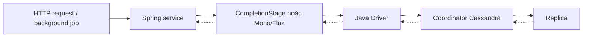
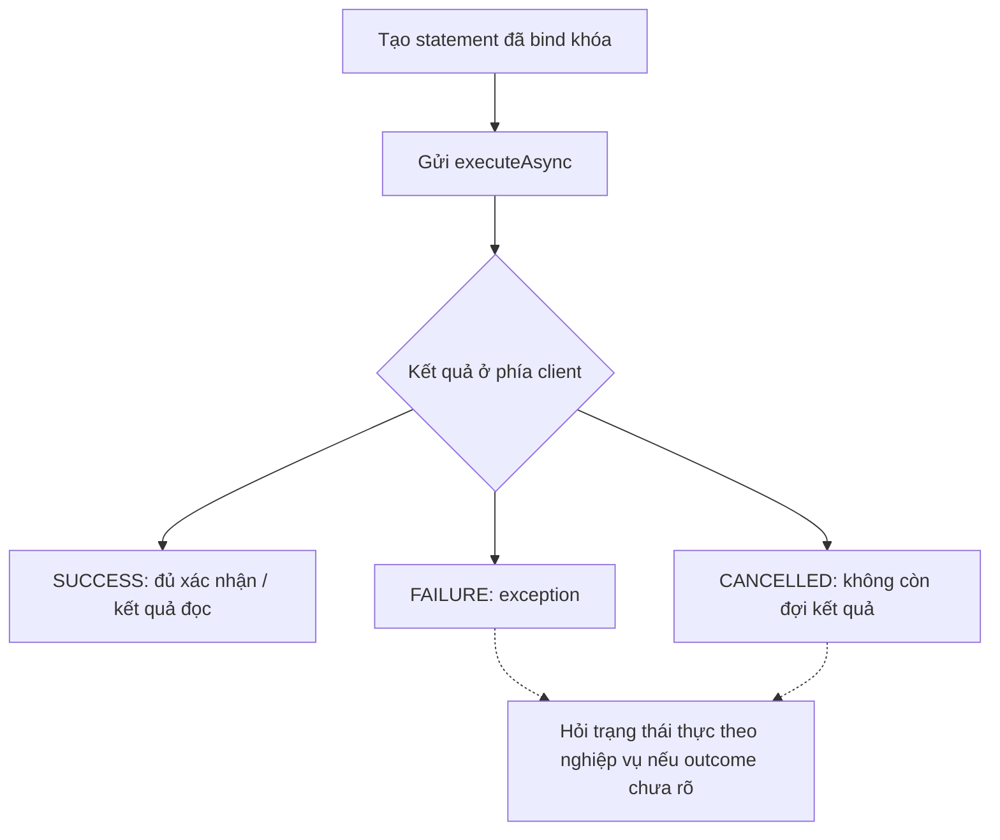
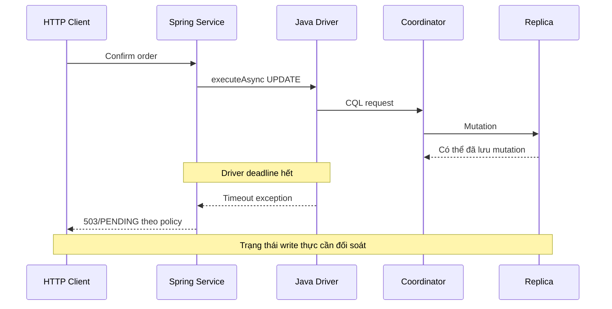
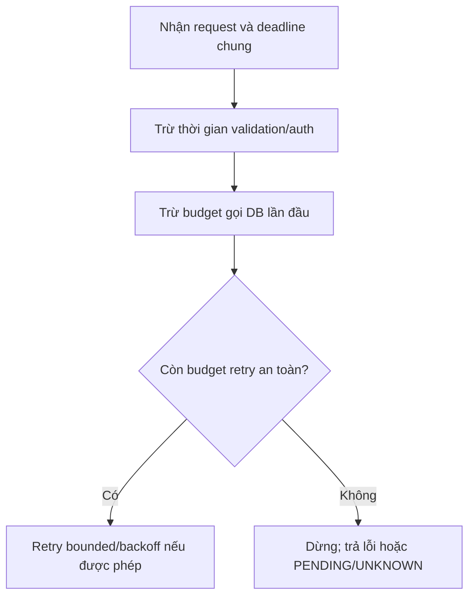
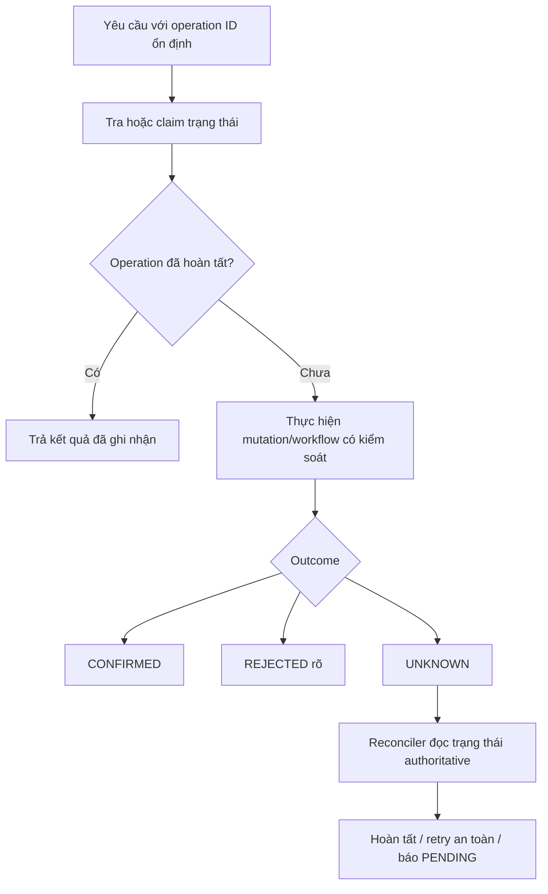
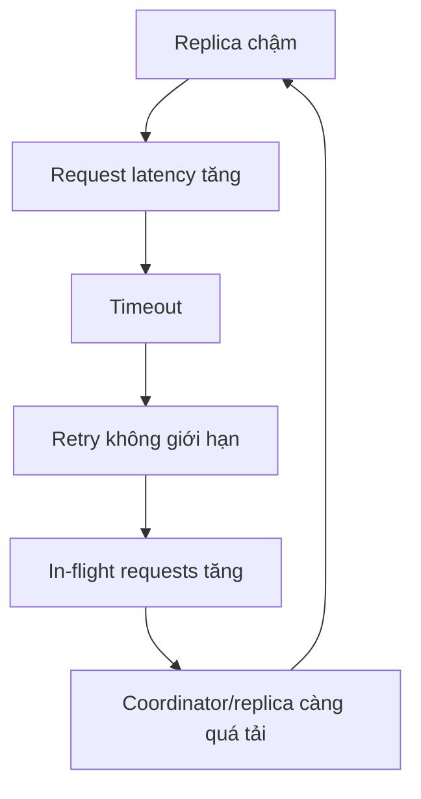
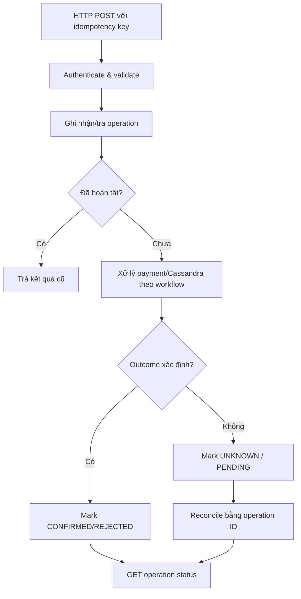

# Lỗi, thời gian chờ và hủy tác vụ

Khi dùng **Spring Data Cassandra** hoặc **Cassandra Java Driver** theo kiểu bất đồng bộ, một HTTP request có thể kết thúc trước khi một CQL request được áp dụng đầy đủ trên cluster. Một phép gọi `executeAsync(...)` có thể trả về ngay một `CompletionStage`, nhưng điều đó **không có nghĩa** truy vấn đã thành công, thao tác ghi đã bền vững hay sẽ được tự động hủy nếu client ngắt kết nối.

Bài thuộc chương **Truy cập bất đồng bộ** trong module **SPRING_DATA_CASSANDRA**: truy cập Apache Cassandra bằng entity mapping, repository, `CassandraTemplate` và CQL; xây bảng theo mẫu đọc, partition key, consistency level và paging để kiểm soát hiệu năng trên hệ dữ liệu phân tán.

Ta tập trung vào ba nhóm hành vi thường bị nhầm lẫn:

1. **Lỗi:** Query có thể thất bại vì schema, replica không đủ, timeout, kết nối hoặc logic chuyển đổi dữ liệu. Phải phân biệt lỗi **chắc chắn không được chấp nhận** với kết quả **chưa xác định**.
2. **Thời gian chờ:** Timeout có thể phát sinh ở HTTP gateway, service, Java Driver hoặc coordinator Cassandra. Hết deadline ở một tầng **không chứng minh** mutation đã được rollback tại tầng khác.
3. **Hủy tác vụ:** Hủy `CompletableFuture`, đóng subscription Reactor hoặc client HTTP disconnect có thể dừng việc **chờ/tiêu thụ kết quả**; đó không phải lời cam kết rằng Cassandra dừng thực thi CQL hay hoàn tác một write đã gửi đi.

> **Thông điệp chính:** Trong ứng dụng Cassandra bất đồng bộ, hãy tách **kết quả của tác vụ Java**, **kết quả yêu cầu CQL**, và **trạng thái nghiệp vụ thật**. Đặc biệt với write, một timeout hoặc cancellation thường phải được xử lý như **outcome có thể chưa rõ**, không tự hiểu là “chưa ghi”.

## 1. Bất đồng bộ thực sự thay đổi điều gì?

Một API đồng bộ kiểu:

```java
OrderById order = repository.findById(key).orElseThrow();
```

có thể giữ thread gọi trong thời gian đợi Cassandra. Một API driver bất đồng bộ:

```java
CompletionStage<AsyncResultSet> future =
    session.executeAsync(statement);
```

trả về một **đại diện cho kết quả sẽ có sau**, cho phép ứng dụng kết hợp callbacks mà không phải chặn thread yêu cầu trong toàn bộ thời gian chờ.

**Nhưng không đồng nghĩa:**

- Query chạy trong transaction khác có khả năng rollback tự động.
- Cassandra hỗ trợ vô hạn số truy vấn song song.
- Gọi `future.cancel(...)` hủy được mutation đã áp dụng trên replica.
- Java Driver tự retry mọi thao tác mà không có rủi ro.
- `CompletionStage` có backpressure như một reactive stream.
- Mọi lỗi được biến thành `Optional.empty()` hoặc `Mono.empty()`.
- Paging tự động nạp toàn bộ dữ liệu khi stage đầu tiên hoàn thành.

### Một đường truy cập bất đồng bộ



Mỗi đường kết nối có thể bị ngắt, timeout hoặc hủy. Vì vậy “tác vụ đã kết thúc ở service” **không luôn tương đương** “cluster không làm gì thêm”.

## 2. Bốn ranh giới cần phân biệt

| Ranh giới | Điều kiểm soát | Ví dụ |
| --- | --- | --- |
| **HTTP / caller deadline** | Client hoặc gateway còn đợi response bao lâu | Browser đóng tab, gateway trả 504 |
| **Application future/subscription** | Code còn quan tâm đến kết quả, còn giữ observer không | `CompletableFuture.cancel`, `Disposable.dispose` |
| **Driver request** | CQL đã được gửi, timeout/retry/routing nào áp dụng | `CqlSession.executeAsync` |
| **Replica & storage** | Mutation có được replica áp dụng/xác nhận theo CL không | `UPDATE` có thể đã lưu dù client timeout |

Nếu một hủy tác vụ xảy ra ở lớp thứ hai, nó **không tạo ngược thời gian** để làm biến mất mutation đã qua lớp thứ tư.

### Mô hình vòng đời



Không phải mọi `FAILURE` đều cần đối soát. Ví dụ CQL sai cú pháp hoặc permission bị từ chối rõ ràng thường có cách xử lý khác với write timeout. Phân loại lỗi là trách nhiệm của tầng service.

## 3. Query-first design vẫn là điều kiện tiên quyết

Bất đồng bộ chỉ thay đổi **cách chờ kết quả**, không biến một query sai partition key thành query hiệu quả.

Ta dùng bảng:

```sql
CREATE TABLE IF NOT EXISTS commerce_ks.orders_by_id (
    tenant_id uuid,
    order_id uuid,
    status text,
    updated_at timestamp,
    total_amount decimal,
    PRIMARY KEY ((tenant_id, order_id))
);
```

Hai cột `tenant_id` và `order_id` tạo một **composite partition key**; query point lookup cần đủ cả hai:

```sql
SELECT status, updated_at, total_amount
FROM commerce_ks.orders_by_id
WHERE tenant_id = ?
  AND order_id = ?;
```

Câu `SELECT` này có đường truy cập theo key. Nếu thay bằng `WHERE status = 'PAID'` khi `status` chỉ là regular column, việc gọi `executeAsync` hay `Flux` **không sửa** giới hạn CQL hay làm mất chi phí lọc toàn cluster. Vẫn cần index phù hợp hoặc read model theo mẫu đọc.

### Bảng minh họa thao tác ghi

```sql
UPDATE commerce_ks.orders_by_id
SET status = ?,
    updated_at = ?
WHERE tenant_id = ? AND order_id = ?;
```

Đây là ordinary update/upsert theo key, **không phải** conditional transaction. Nếu chuyển trạng thái nghiệp vụ phải kiểm tra status cũ, cần mutation có `IF`/LWT hoặc quy trình khác.

## 4. Java Driver 4: một point read bất đồng bộ

Ví dụ dùng Java 17+, Java Driver 4 và `CompletionStage`:

```java
import java.math.BigDecimal;
import java.time.Instant;
import java.util.Optional;
import java.util.UUID;
import java.util.concurrent.CompletionStage;

import com.datastax.oss.driver.api.core.CqlSession;
import com.datastax.oss.driver.api.core.DefaultConsistencyLevel;
import com.datastax.oss.driver.api.core.cql.AsyncResultSet;
import com.datastax.oss.driver.api.core.cql.BoundStatement;
import com.datastax.oss.driver.api.core.cql.PreparedStatement;
import com.datastax.oss.driver.api.core.cql.Row;

public final class AsyncOrderReader {

    private final CqlSession session;
    private final PreparedStatement findById;

    public AsyncOrderReader(CqlSession session) {
        this.session = session;
        this.findById = session.prepare("""
            SELECT status, updated_at, total_amount
            FROM commerce_ks.orders_by_id
            WHERE tenant_id = ? AND order_id = ?
            """);
    }

    public CompletionStage<Optional<OrderSummary>> find(
            UUID tenantId, UUID orderId) {

        BoundStatement statement = findById
            .bind(tenantId, orderId)
            .setConsistencyLevel(
                DefaultConsistencyLevel.LOCAL_QUORUM
            )
            .setIdempotent(true);

        return session.executeAsync(statement)
            .thenApply(result -> {
                Row row = result.one();
                if (row == null) {
                    return Optional.empty();
                }
                return Optional.of(new OrderSummary(
                    row.getString("status"),
                    row.getInstant("updated_at"),
                    row.getBigDecimal("total_amount")
                ));
            });
    }

    public record OrderSummary(
        String status,
        Instant updatedAt,
        BigDecimal totalAmount
    ) {}
}
```

Trong đoạn code:

- `PreparedStatement` được chuẩn bị một lần khi khởi tạo component, không chuẩn bị lại cho từng HTTP request.
- `BoundStatement` mang **đủ partition key** và consistency policy cho request.
- `setIdempotent(true)` phù hợp với **point SELECT không có side effect**; phải kiểm tra query thật nếu thay đổi.
- `executeAsync` trả một stage, `thenApply` xử lý kết quả **sau khi stage hoàn thành**.
- Với point lookup này, một row ở trang đầu là đủ. Với truy vấn nhiều hàng, `AsyncResultSet` là giao diện **paging**, không chỉ là danh sách tất cả row.
- Nếu Cassandra trả lỗi, stage hoàn thành **exceptionally**; `thenApply` không chạy bình thường, lỗi được lan truyền.

### Đừng block ngay sau executeAsync

```java
// Nên tránh trong request path được thiết kế non-blocking:
AsyncResultSet result = session.executeAsync(statement)
    .toCompletableFuture()
    .join();
```

`join()` khiến thread gọi phải đợi kết quả; nếu gọi trên event-loop của web/reactive stack, nó có thể làm nghẽn xử lý request khác. Chỉ block ở điểm được thiết kế có chủ ý, chẳng hạn công cụ quản trị đồng bộ hoặc test, kèm timeout và policy tương ứng.

**Bất đồng bộ có ích khi toàn bộ đường xử lý không vô tình quay lại blocking.**

## 5. CompletionStage hoàn thành thành công, lỗi hay bị hủy

Về mặt Java:

- **Success:** Stage có giá trị `AsyncResultSet` hoặc giá trị được map.
- **Exceptional completion:** Stage mang exception của driver hoặc của callback.
- **Cancellation:** Một `CompletableFuture`/view có thể chuyển sang trạng thái cancelled; điều này liên quan **vòng đời future tại client**, không tự là trạng thái hủy server request.

`CompletionStage` là interface cho composition; không phải mọi implementation cho phép `cancel` trực tiếp. `CompletableFuture` mới có `cancel(...)`.

### Callback và lan truyền exception

```java
CompletionStage<Optional<AsyncOrderReader.OrderSummary>> stage =
    reader.find(tenantId, orderId);

stage.whenComplete((value, error) -> {
    if (error != null) {
        // Ghi metric/phân loại lỗi; tránh log dữ liệu nhạy cảm.
        return;
    }
    // value có thể Optional.empty(): không có row.
});
```

**`Optional.empty()` chỉ dành cho trường hợp “query thành công nhưng không có row”** trong ví dụ. Nếu stage lỗi, code không nên catch-all rồi trả empty, vì sẽ biến một outage Cassandra thành HTTP 404.

### CompletionException là wrapper

Khi ghép stage, callback có thể thấy `CompletionException`; khi dùng một số API blocking có thể thấy `ExecutionException`. Hãy lấy root cause trước khi phân loại:

```java
import java.util.concurrent.CompletionException;
import java.util.concurrent.ExecutionException;

public static Throwable unwrapCompletion(Throwable error) {
    Throwable current = error;
    while ((current instanceof CompletionException
            || current instanceof ExecutionException)
            && current.getCause() != null) {
        current = current.getCause();
    }
    return current;
}
```

Đây là **helper để phân loại nguyên nhân**, không được xóa mất stack trace hoặc context. Không unwrap vô hạn với mọi loại exception tùy ý; mã chỉ bóc hai wrapper quen thuộc.

### Không dùng exceptionally để che lỗi quan trọng

```java
// Dễ gây lỗi nghiệp vụ nếu coi lỗi hạ tầng là "không có đơn":
return session.executeAsync(statement)
    .thenApply(this::mapRow)
    .exceptionally(error -> Optional.empty());
```

Với hệ thống đơn hàng, trả “không thấy đơn” vì `WriteTimeout`, `Unavailable` hoặc network failure là **sai về ngữ nghĩa**. Hãy map lỗi thành response có kiểm soát, báo pending hoặc trả 5xx tùy hợp đồng.

## 6. Phân loại lỗi: không phải exception nào cũng giống nhau

| Nhóm lỗi | Ví dụ điển hình | Điều nên suy luận |
| --- | --- | --- |
| **Input/schema** | Invalid query, sai column/table, bind type không hợp lệ | Sửa lập trình/schema; retry y hệt thường vô ích |
| **Authorization** | Không có quyền keyspace/table, credentials lỗi | Không tự hạ CL hay retry vô hạn |
| **Unavailable** | Coordinator không có đủ replica thích hợp cho CL | Không đủ điều kiện xác nhận lúc đánh giá |
| **Read timeout** | Không đủ read response trong timeout | Read thất bại; không được coi là “row không tồn tại” |
| **Write timeout** | Không đủ write ack/điều kiện trong timeout | **Outcome mutation có thể chưa rõ** |
| **Driver/client timeout** | Request vượt deadline của driver | Không biết chắc server còn đang thực hiện gì |
| **Connection/transport** | Kết nối bị đóng, mạng gián đoạn, node mất kết nối | Phụ thuộc request đã gửi/được chấp nhận tới đâu |
| **Overload** | Coordinator/replica quá tải, too many requests | Cần backpressure, capacity và retry có giới hạn |
| **Mapping/codec** | Java type không khớp CQL column | Sửa codec/mapping; không phải lỗi replica |
| **Cancellation** | Subscription bị dispose hoặc future bị cancel | Observer không còn đợi; **không chứng minh rollback** |

Java Driver có các exception families như `UnavailableException`, `ReadTimeoutException`, `WriteTimeoutException`, `DriverTimeoutException` và `AllNodesFailedException` trong các phiên bản tương ứng. **Chi tiết class, wrapper và thông tin request execution có thể khác theo driver release**. Spring Data còn có thể dịch lỗi sang nhóm `DataAccessException`, nên tầng service cần kiểm chứng exception thật ở phiên bản đang dùng.

### Một tập trạng thái nghiệp vụ hữu ích

```text
CONFIRMED
  Client nhận thành công theo CL, mutation/query đã đạt điều kiện tương ứng.

REJECTED
  Request được từ chối rõ vì invalid input/CQL/permission/condition.

UNKNOWN
  Timeout, transport loss hoặc cancellation sau khi request có thể đã gửi;
  không đủ bằng chứng để quyết định mutation chưa được áp dụng.
```

Với read, outcome unknown có nghĩa “không có kết quả tin cậy để trả”; với write, có thêm vấn đề **mutation đã có thể được áp dụng**. Hai trường hợp cần xử lý khác nhau.

## 7. Read timeout và write timeout có ranh giới khác nhau

### Read timeout

Nếu point read quá hạn:

```text
Client gửi SELECT theo key
  -> coordinator hỏi replica
  -> chưa có đủ kết quả trong deadline
  -> read future hoàn thành lỗi
```

Không có row được trả về cho client. Nhưng điều đó **không chứng minh row không tồn tại**. Không biến timeout thành dữ liệu null/empty trong code xử lý đơn hàng, thanh toán hoặc phân quyền.

Một retry **có điều kiện** có thể phù hợp với `SELECT` thuần, có idempotence và deadline còn đủ; nhưng không nên tạo retry storm khi cluster đang quá tải.

### Write timeout

Nếu mutation quá hạn:

```text
Client gửi UPDATE status=PAID
  -> một hoặc nhiều replica có thể đã áp dụng
  -> ack đến chậm hoặc đường response hỏng
  -> write future hoàn thành lỗi
```

Từ phía client, **không thể kết luận “write chắc chắn thất bại nên retry toàn bộ nghiệp vụ”**. Đặc biệt nếu workflow gọi payment gateway rồi mới lưu Cassandra, retry cả workflow có thể thu tiền hai lần.

### Một timeline minh họa



Không coi `503` là “rollback” và cũng không hứa một request đã được xác nhận chỉ vì một replica có mutation. Cần phân biệt **đã đạt CL** với **đã có một phần tác động**.

## 8. Ba loại timeout không nên trộn

| Timeout | Ai định nghĩa? | Khi hết thời gian thì sao? |
| --- | --- | --- |
| **HTTP/gateway deadline** | Client, load balancer, API gateway | Caller có thể nhận 504 hoặc đóng kết nối, trong khi service/driver vẫn đang xử lý |
| **Application deadline** | Service, Reactor `timeout` hoặc logic job | Tầng service kết thúc chờ/đánh dấu lỗi; mutation đã gửi vẫn có thể tiếp tục |
| **Driver request timeout** | Java Driver config/statement | Stage kết thúc lỗi hoặc driver ngừng chờ theo cơ chế; không tự bảo đảm server rollback |

Cassandra còn có các **server-side timeout** và mức timeout riêng cho read/write/batch/conditional operations theo cấu hình/phiên bản. Các tầng này có thể có deadline khác nhau.

### “Timeout 2 giây” không phải SLA của end-to-end request

Ví dụ:

```text
Gateway timeout:           3 giây
Application timeout:       2.5 giây
Driver request timeout:    2 giây
Retry/backoff:             có thể cộng thời gian
Mapping/business logic:    vẫn tiêu tốn thời gian
```

Nếu service gọi thêm hệ thống thanh toán, tổng deadline còn phải chia cho cả nó. Không nên để mỗi dependency tự có deadline 5 giây rồi mong API end-to-end 3 giây vẫn luôn đạt SLO.

### Deadline budget

Thay vì reset timeout mới mỗi lần retry, service nên xem **còn bao nhiêu thời gian trong deadline chung**. Khi chỉ còn 20 ms, gửi thêm một write không idempotent có thể tạo side effect ngoài ý muốn mà caller không còn thời gian nhận kết quả.



## 9. Cấu hình request timeout trong Spring Boot / Java Driver

Ví dụ Spring Boot với nhóm `spring.cassandra` trong các phiên bản hỗ trợ:

```yaml
spring:
  cassandra:
    contact-points:
      - 127.0.0.1:9042
    local-datacenter: dc_hcm
    keyspace-name: commerce_ks
    request:
      consistency: LOCAL_QUORUM
      timeout: 2s
```

Đây là **cấu hình minh họa**, không phải giá trị production mặc định. Phải kiểm tra tên property/precedence của **Spring Boot, Spring Data Cassandra và Java Driver** đang dùng; đồng thời cấu hình auth, TLS và contact points thật.

Nếu cấu hình trực tiếp DataStax Java Driver 4, dạng HOCON tương ứng có thể là:

```hocon
datastax-java-driver {
  basic.request {
    timeout = 2 seconds
    consistency = LOCAL_QUORUM
  }
}
```

**Không đặt cả hai kiểu cấu hình rồi mặc định biết cái nào thắng.** Hãy xác nhận effective driver configuration và statement options, vì các source có precedence riêng.

### Timeout theo từng statement

Một số phiên bản Java Driver 4 hỗ trợ thiết lập request timeout ở cấp statement/options:

```java
BoundStatement statement = findById.bind(tenantId, orderId)
    .setConsistencyLevel(
        DefaultConsistencyLevel.LOCAL_QUORUM
    );
```

Lựa chọn timeout per-statement cần dùng **API tương ứng với driver release**, rồi test timeout thực thay vì giả định setter nào cũng có ở mọi version. Với bài này, default request timeout là điểm bắt đầu đơn giản để minh họa.

### Thời gian timeout không phải ngưỡng consistency

Nếu DC local RF3 chỉ còn một replica có thể đáp ứng, `LOCAL_QUORUM` cần hai. Tăng driver timeout từ 2 giây lên 20 giây **không tạo thêm replica**. Cần khôi phục node, thay topology hoặc áp dụng degraded mode có chủ ý theo business policy — không chữa `Unavailable` bằng cách tăng chờ.

## 10. Hủy CompletableFuture có thực sự hủy CQL?

`CompletionStage` không cung cấp API hủy bắt buộc. Nếu chuyển sang `CompletableFuture`, ta có thể gọi `cancel(...)`:

```java
import java.util.concurrent.CompletableFuture;

CompletableFuture<AsyncResultSet> future =
    session.executeAsync(statement).toCompletableFuture();

boolean cancelled = future.cancel(true);
```

**Điều biết chắc:** `cancel(...)` có thể làm CompletableFuture chuyển trạng thái cancelled nếu nó chưa hoàn thành; code phụ thuộc có thể nhận `CancellationException`. `mayInterruptIfRunning=true` **không phải lệnh CQL `CANCEL`** hay lệnh buộc replica hoàn tác mutation.

**Điều không được hứa:** Cassandra ngừng query ngay, request không còn tiêu tốn tài nguyên, batch không hoàn tất, hay write chưa được áp dụng.

Tùy implementation, cancellation có thể ảnh hưởng tác vụ phía driver hoặc resource phía client khác nhau. Phải đối chiếu Java Driver version. Điểm quan trọng cho nghiệp vụ luôn là: **cancellation không được dùng như bằng chứng commit/rollback**.

### Cancel một dependent future khác cancel source

```java
CompletionStage<AsyncResultSet> source =
    session.executeAsync(statement);

CompletableFuture<Boolean> mapped = source
    .thenApply(rs -> rs.one() != null)
    .toCompletableFuture();

mapped.cancel(true);
```

Đoạn ví dụ minh họa **future phụ thuộc**: `mapped` chỉ chuyển kết quả trang hiện tại thành tín hiệu có hay không có hàng đầu tiên. Việc cancel `mapped` không tạo một hợp đồng rằng `source` hoặc request Cassandra đã được hủy. Với truy vấn nhiều hàng, phải xử lý `AsyncResultSet` đúng semantics paging, không dùng cách này để kết luận đã duyệt toàn bộ kết quả.

### Hủy trước khi gửi khác hủy sau khi gửi

- **Trước khi tạo/gửi request:** Ứng dụng có thể bỏ hẳn việc gọi `executeAsync`, do đó không gửi CQL.
- **Sau khi gọi `executeAsync`:** Driver có thể đã đưa request lên mạng. Hủy observer không thể chứng minh request chưa đến coordinator.
- **Sau response success:** Hủy một future đã hoàn thành thường không mang lại undo.
- **Sau timeout:** Dù client không còn chờ, mutation có thể đang được áp dụng hoặc cần reconciliation.

## 11. Cancellation của một read và một write không giống nhau

### Với SELECT

Nếu user cuộn trang rồi chuyển màn hình, service không cần các kết quả đọc tiếp. Có thể dừng **tiêu thụ rows/fetch thêm pages** để tránh làm việc không cần thiết.

Tuy nhiên, trang CQL đã được gửi trước đó có thể tiếp tục xử lý trên server trong một khoảng thời gian. Nên thiết kế page size, deadline và backpressure sao cho chi phí của request dư thừa vẫn chịu được.

### Với UPDATE

Nếu user đóng tab ngay sau khi bấm “Xác nhận thanh toán”, việc cancel response future **không được dùng để hủy ý định thanh toán đã được chấp nhận**. Giao dịch có thể đã chạy tới gateway, CQL write hoặc một trong các bước nghiệp vụ.

Một thiết kế tốt có thể:
1. Nhận một **operation ID** ổn định.
2. Xác thực/ghi nhận yêu cầu theo contract.
3. Xử lý business operation với trạng thái riêng.
4. Cho client tra kết quả qua ID, kể cả sau khi HTTP disconnect.
5. Dùng idempotency/reconciliation cho các side effects.

### Hủy không tương đương rollback

```text
User đóng màn hình  ->  HTTP request bị hủy
Service ngừng chờ   ->  future/subscription bị cancel
Cassandra           ->  mutation đã gửi có thể đã/đang thực hiện
```

Đừng đặt tên method là `cancelOrderWrite()` nếu nó chỉ gọi `future.cancel(true)`. Tên đúng hơn có thể là `stopWaitingForResult()`, còn hủy một đơn hàng thực sự phải là **mutation nghiệp vụ riêng**.


## 12. Spring Data Reactive: Mono và Flux biểu diễn điều gì?

Spring Data Cassandra cung cấp đường truy cập **reactive** qua các abstraction như `ReactiveCassandraRepository` và `ReactiveCassandraTemplate` trong các phiên bản hỗ trợ. Reactor biểu diễn:

- `Mono<T>`: 0 hoặc 1 phần tử thành công, hoặc error.
- `Flux<T>`: 0 đến nhiều phần tử, hoặc error.
- `subscribe()` bắt đầu hoặc kết nối quá trình tiêu thụ tùy loại publisher.
- `cancel/dispose`: subscriber không còn muốn nhận thêm tín hiệu.
- `onError`: terminal signal, không phải một giá trị `null`.

Cần phân biệt **Reactive Streams demand/cancellation** với **Cassandra driver request**. Một reactive publisher có thể dừng phát phần tử và ngừng fetch trang tiếp, nhưng không thể hứa rằng CQL đã gửi sẽ bị rollback.

### Repository reactive

Ví dụ entity `OrderById` với composite key `OrderKey` đã map đúng schema:

```java
import org.springframework.data.cassandra.repository.ReactiveCassandraRepository;

public interface ReactiveOrderRepository
        extends ReactiveCassandraRepository<OrderById, OrderKey> {
}
```

Một service đọc:

```java
import reactor.core.publisher.Mono;

public final class ReactiveOrderService {

    private final ReactiveOrderRepository repository;

    public ReactiveOrderService(ReactiveOrderRepository repository) {
        this.repository = repository;
    }

    public Mono<OrderById> findOrder(OrderKey key) {
        return repository.findById(key);
    }
}
```

`findById` có thể hoàn thành:

- `onNext(order)` rồi `onComplete` khi tìm thấy.
- `onComplete` không có item khi không tìm thấy.
- `onError(exception)` khi query/driver/mapping lỗi.

**Không chuyển `onError` thành `Mono.empty()`** ở đường đọc quan trọng, vì sẽ đánh đồng outage với “không tồn tại”.

### ReactiveCassandraTemplate

Một đường gọi tương ứng, tùy phiên bản Spring Data Cassandra:

```java
Mono<OrderById> result =
    reactiveCassandraTemplate.selectOneById(key, OrderById.class);
```

Đây là ví dụ **đường gọi trong service** đã inject template, không phải một chương trình độc lập. Để bảo đảm timeout/CL override thực sự áp dụng, cần kiểm tra API và driver configuration trên đúng release.

### Khi nào dùng template, repository hoặc raw driver?

| Công cụ | Phù hợp khi | Cần lưu ý |
| --- | --- | --- |
| `ReactiveCassandraRepository` | CRUD/derived queries theo mapping entity, service đã dùng Reactor | Tên method không sửa query sai partition; CL/timeout vẫn nằm ở request/driver |
| `ReactiveCassandraTemplate` | Truy vấn linh hoạt cần Spring mapping | Query options và API có thể khác theo version |
| `CqlSession.executeAsync` | Cần kiểm soát cụ thể CQL, prepared statements, CL, idempotence, paging | Tự map Row/cell, phân loại lỗi, quản lý deadline |
| `CassandraTemplate` đồng bộ | Tầng nghiệp vụ đồng bộ thực sự cần mapping đơn giản | Không gọi trực tiếp trên event-loop nếu thao tác chặn thread |

**Spring Data reactive không làm Cassandra tự có transaction reactive xuyên partition.** Semantics CQL vẫn quyết định.

## 13. Kết nối CompletionStage với Reactor

Giả sử bạn muốn dùng Java Driver trực tiếp nhưng trả `Mono` cho WebFlux.

```java
import java.util.UUID;

import com.datastax.oss.driver.api.core.CqlSession;
import com.datastax.oss.driver.api.core.cql.BoundStatement;
import com.datastax.oss.driver.api.core.cql.PreparedStatement;

import reactor.core.publisher.Mono;

public final class DriverToReactorReader {

    private final CqlSession session;
    private final PreparedStatement findStatus;

    public DriverToReactorReader(CqlSession session) {
        this.session = session;
        this.findStatus = session.prepare("""
            SELECT status
            FROM commerce_ks.orders_by_id
            WHERE tenant_id = ? AND order_id = ?
            """);
    }

    public Mono<String> findStatus(UUID tenantId, UUID orderId) {
        return Mono.defer(() -> {
            BoundStatement bound = findStatus.bind(
                tenantId, orderId
            );

            return Mono.fromCompletionStage(
                session.executeAsync(bound)
            );
        }).flatMap(result -> {
            var row = result.one();
            return row == null
                ? Mono.empty()
                : Mono.justOrEmpty(row.getString("status"));
        });
    }
}
```

Ở đây:

- `Mono.defer` tạo/gửi request **khi publisher được subscribe**, thay vì gửi từ lúc service xây Mono.
- `Mono.fromCompletionStage` kết nối future/stage với Reactor theo API phiên bản Reactor đang chạy.
- Nếu subscriber hủy, Reactor có thể ngừng chờ/hủy phần future tùy adapter và implementation; **không bảo đảm CQL đã gửi dừng trên server**.
- `Mono.empty` chỉ tương ứng với thành công nhưng không có row/status trong ví dụ.
- CQL chuẩn bị một lần, bind khóa ở mỗi subscription.
- Nếu Mono được subscribe nhiều lần, **mỗi subscription có thể tạo request mới**. Điều này đặc biệt nguy hiểm khi đổi từ `SELECT` sang `UPDATE` hoặc counter increment.

### Cold publisher và nguy cơ double-write

```java
Mono<?> write = Mono.defer(() ->
    Mono.fromCompletionStage(session.executeAsync(updateStatement))
);

write.subscribe();
write.subscribe();
```

Đây là **hai subscriptions** và có thể sinh **hai CQL writes**. Với ordinary `SET status = 'PAID'`, một retry cần xem timestamp/TTL/cạnh tranh. Với `counter = counter + 1`, hai subscriptions có thể trực tiếp tăng hai lần.

Nếu cần chia sẻ một kết quả giữa nhiều consumer, phải hiểu semantics của `cache()`/`share()`/multicasting, vòng đời publisher và độ bền operation. Không dùng `cache()` như một cơ chế exactly-once bền vững: cache trong memory mất khi process restart.

## 14. Reactor timeout và hủy subscription

Một đoạn service WebFlux:

```java
import java.time.Duration;
import java.util.concurrent.TimeoutException;

import reactor.core.publisher.Mono;

Mono<String> response = reader.findStatus(tenantId, orderId)
    .timeout(Duration.ofSeconds(2))
    .onErrorMap(
        TimeoutException.class,
        error -> new IllegalStateException(
            "Cassandra read did not meet service deadline", error
        )
    );
```

`timeout(Duration.ofSeconds(2))` là deadline của **reactive chain tại tầng ứng dụng**. Khi hết hạn, Reactor phát lỗi timeout và hủy upstream subscription theo operator semantics. Nó **không** tạo yêu cầu “xóa mutation đã ghi” ở Cassandra.

**Lưu ý:** Ví dụ ở đây dùng `IllegalStateException` làm lỗi minh họa. Ở web API thật, nên dùng loại exception và handler phù hợp (ví dụ 503/504), lưu correlation ID và tránh trả thông tin nội bộ cho client.

### Timeout của Mono khác driver timeout

Cùng một `Mono` có thể nhận hai loại lỗi khác nhau:

1. Reactor `TimeoutException` vì operator `timeout` chạy trước.
2. Exception từ Java Driver vì request Cassandra vượt timeout hoặc không đủ replica.

Nếu chỉ nhìn message “timeout”, rất dễ kết luận sai và áp dụng retry không phù hợp. Cần lưu **source/stage** của timeout trong metric và logs.

### Hủy khi client HTTP disconnect

Trong WebFlux, khi client ngắt kết nối, downstream có thể cancel subscription. Nếu upstream là query đọc stream, cancel sớm giúp dừng nhu cầu fetch thêm dữ liệu; nếu upstream đã gửi write thì cancel không đủ để khẳng định write chưa áp dụng.

**Không mặc định** rằng HTTP 499/closed connection của gateway là trạng thái rollback. Với mutation quan trọng, operation cần lifecycle riêng và API truy vấn trạng thái.

## 15. Error mapping: onErrorResume phải có mục đích

Có hai hành vi rất khác:

```java
// SAI ở các API quan trọng: che mọi lỗi Cassandra thành không có đơn.
Mono<OrderById> order = repository.findById(key)
    .onErrorResume(error -> Mono.empty());
```

và:

```java
// Chỉ cung cấp fallback khi business policy cho phép dùng cache stale.
Mono<OrderById> order = repository.findById(key)
    .onErrorResume(error -> {
        if (isTransientInfrastructureError(error)) {
            return cache.findLastKnownOrder(key);
        }
        return Mono.error(error);
    });
```

`isTransientInfrastructureError` và `cache.findLastKnownOrder` là **API minh họa do dự án tự định nghĩa**, không phải method có sẵn trong Spring Data. Cần hạn chế fallback theo đúng use case, không trả dữ liệu cũ cho quyết định phân quyền, tồn kho hay thanh toán nếu policy không cho phép.

### Một chiến lược phản hồi rõ ràng

| Operation | Không thấy row | Timeout/hạ tầng | Cancellation |
| --- | --- | --- | --- |
| Đọc đơn theo ID | 404 hoặc empty theo hợp đồng | 503/504, không tự biến thành 404 | Caller ngừng chờ; dừng fetch không cần thiết |
| Lấy gợi ý nội dung | Có thể trả danh sách rỗng | Có thể dùng cache stale nếu policy cho phép | Dừng phát kết quả |
| Ghi trạng thái thanh toán | Không phải “not found” nếu update đã gửi | PENDING/UNKNOWN + reconciliation | Không tự rollback; tra theo operation ID |
| Tăng counter | Không áp dụng | UNKNOWN, không retry mù | Có thể đã tăng, cần đo/chấp nhận sai lệch |
| LWT đổi trạng thái | `[applied] = false` là conflict | Timeout có thể cần query/reconcile | Không suy “chưa applied” từ cancel |

Đừng dùng cùng một `onErrorResume` cho toàn bộ repository. Hợp đồng lỗi phải được phân loại theo **read, write, LWT, counter** và mức độ quan trọng.

## 16. Retry: chỉ sau khi hiểu idempotency

Một retry có thể khởi tạo **một CQL request mới**, không chỉ “xin lại response cũ”. Do đó cần xác định query có thể lặp an toàn hay không.

### Phân nhóm thao tác

| Thao tác | Có thể retry? | Điều kiện |
| --- | --- | --- |
| Point `SELECT` theo key | Thường có thể | Giới hạn lần, deadline, tránh overload |
| `INSERT` cùng giá trị, key ổn định | Có thể xem xét | Timestamp/TTL, writer cạnh tranh, side effects |
| `UPDATE status = 'PAID'` | Tùy contract | Không phá trạng thái mới hơn, TTL/timestamp |
| `UPDATE counter = counter + 1` | **Không tự động retry** | Không idempotent |
| LWT `IF status = 'PENDING'` | Cần diễn giải riêng | Outcome unknown, applied/not-applied, Paxos |
| Logged multi-partition batch | Cần thận trọng | Timeout có thể đã được batchlog chấp nhận; retry không phải rollback |
| Request kích hoạt thanh toán ngoài DB | Không retry mù | Payment operation id và idempotency xuyên hệ |

### Reactor retryWhen cho read thuần

```java
import java.time.Duration;

import reactor.core.publisher.Mono;
import reactor.util.retry.Retry;

Mono<String> read = reader.findStatus(tenantId, orderId)
    .retryWhen(
        Retry.backoff(2, Duration.ofMillis(100))
            .filter(this::isRetryableReadFailure)
    );
```

`isRetryableReadFailure(Throwable)` là hàm **do service định nghĩa**, phải lọc lỗi tạm thời và loại input/schema/permission/cancellation. Đây là **ví dụ cấu trúc**, chưa phải retry policy production hoàn chỉnh: phải thêm deadline toàn operation, jitter, request concurrency và metric phù hợp.

**Không copy `retryWhen` này sang counter increment, payment workflow hoặc LWT** mà chưa có kiểm soát idempotency.

### Hai tầng retry có thể cộng dồn

Một request có thể bị retry bởi:

1. Java Driver retry policy.
2. Reactor `retryWhen`.
3. HTTP client/API gateway.
4. Job queue hoặc message consumer.

Nếu mỗi tầng retry ba lần, số attempt thực tế có thể lớn hơn dự tính. Hãy chọn **một chính sách tổng thể** và đo attempt count, tránh retry storm khi cluster quá tải.

## 17. Idempotency key và write outcome chưa xác định

Đối với nghiệp vụ quan trọng, cần **operation ID ổn định** được tái sử dụng giữa các lần retry của cùng yêu cầu.

Ví dụ:

```text
operation_id = "confirm-order-2222-v3"
tenant_id    = ...
order_id     = ...
action       = "CONFIRM_PAID"
request_hash = ...
```

Một bảng lưu trạng thái operation có thể được thiết kế như:

```sql
CREATE TABLE IF NOT EXISTS commerce_ks.order_operations_by_id (
    tenant_id uuid,
    operation_id text,
    order_id uuid,
    state text,
    requested_at timestamp,
    PRIMARY KEY ((tenant_id, operation_id))
);
```

Một conditional claim có thể là:

```sql
INSERT INTO commerce_ks.order_operations_by_id (
    tenant_id, operation_id, order_id, state, requested_at
)
VALUES (?, ?, ?, 'PENDING', ?)
IF NOT EXISTS;
```

**Quan trọng:** Đây mới là **bước claim danh tính operation**, chưa bảo đảm cả workflow thanh toán đã thực hiện exactly-once. Nếu claim thành công nhưng service chết trước khi ghi đơn, phải có worker/reconciler phục hồi; nếu thanh toán đã xảy ra nhưng DB write bị timeout, phải đối chiếu với payment system bằng cùng ID.

### Luồng recovery đơn giản hóa



Không tạo một biến Java `boolean success` rồi coi nó là bằng chứng phân tán sau khi có timeout. **Operation lifecycle** cần tồn tại bền vững ngoài thời gian sống của HTTP request.

## 18. LWT và điều kiện được áp dụng

Khi cần chuyển trạng thái theo điều kiện:

```sql
UPDATE commerce_ks.orders_by_id
SET status = 'PAID'
WHERE tenant_id = ?
  AND order_id = ?
IF status = 'PENDING';
```

Java Driver trả kết quả có thông tin `[applied]`. Với query điều kiện, request thành công nhưng `[applied] = false` là một **kết quả nghiệp vụ**, không phải network failure.

```java
CompletionStage<Boolean> applied = session.executeAsync(casStatement)
    .thenApply(AsyncResultSet::wasApplied);
```

Phần code giả định `casStatement` là một statement `UPDATE ... IF` đã bind đúng key và cấu hình regular/serial CL phù hợp với Cassandra version.

### Nếu LWT bị timeout?

Khi timeout ở phía client, không thể suy điều kiện đã hay chưa được áp dụng. Retry ngay có thể gặp `[applied] = false` vì lần trước đã thành công, hoặc vì writer khác đã thay đổi status.

Đừng gắn “not applied” từ một lần retry thành kết luận chắc rằng operation ban đầu thất bại. Hãy đối soát **state/operation ID/version**, nhất là với thanh toán hoặc các bước không được làm hai lần.

### Serial consistency không phải timeout

`SERIAL` và `LOCAL_SERIAL` điều khiển phạm vi/semantics của pha serial/Paxos; **regular CL** như `LOCAL_QUORUM` điều khiển những pha xác nhận thường. Đây không phải hai kiểu timeout. Không đổi từ `SERIAL` xuống `LOCAL_SERIAL` chỉ để chữa query chậm mà chưa hiểu writes ở nhiều datacenter.

## 19. AsyncResultSet: completion của trang đầu chưa phải hết dữ liệu

`AsyncResultSet` đại diện kết quả bất đồng bộ với paging:

- `currentPage()`: các row trong trang hiện tại.
- `hasMorePages()`: còn khả năng fetch trang sau.
- `fetchNextPage()`: trả một stage cho trang tiếp.
- `one()`: thuận tiện cho trường hợp lấy một row từ trang hiện tại.

Một query timeline:

```sql
CREATE TABLE IF NOT EXISTS commerce_ks.order_events_by_customer_day (
    tenant_id uuid,
    customer_id uuid,
    bucket_day date,
    event_time timestamp,
    event_id uuid,
    event_type text,
    PRIMARY KEY (
        (tenant_id, customer_id, bucket_day),
        event_time,
        event_id
    )
) WITH CLUSTERING ORDER BY (event_time DESC, event_id DESC);
```

```sql
SELECT event_time, event_id, event_type
FROM commerce_ks.order_events_by_customer_day
WHERE tenant_id = ?
  AND customer_id = ?
  AND bucket_day = ?;
```

Một stage hoàn thành với **trang đầu**, không đồng nghĩa driver đã đọc mọi event trong partition.

### Fetch trang tiếp khi thật sự cần

```java
CompletionStage<AsyncResultSet> first =
    session.executeAsync(boundTimelineStatement);

CompletionStage<AsyncResultSet> second = first.thenCompose(page -> {
    if (!page.hasMorePages()) {
        return java.util.concurrent.CompletableFuture
            .completedFuture(page);
    }
    return page.fetchNextPage();
});
```

Đây là ví dụ **chỉ fetch tối đa một trang thêm**, không phải hàm collect toàn bộ data. Đường thực tế nên gắn page size, page processing, backpressure và giới hạn số trang/công việc.

### Nếu caller hủy giữa các trang?

Hãy **dừng phát sinh lời gọi `fetchNextPage()` mới** khi không còn consumer. Điều này tránh tải không cần thiết. Nhưng những trang đã được yêu cầu trước lúc cancel **có thể còn đang xử lý**, và kết quả đọc từng trang không phải snapshot bất biến trong lúc dữ liệu thay đổi.

### Cẩn thận với recursive fetch

Viết một hàm `thenCompose` đệ quy fetch hàng triệu trang rồi collect tất cả vào `List` có thể gây:

- Áp lực heap/memory.
- Quá nhiều in-flight requests nếu không kiểm soát.
- Timeout chain sau thời gian dài.
- Thiếu điểm dừng khi client disconnect.
- Không có giới hạn work theo request.
- Mất tính ổn định khi có concurrent writes/TTL.

Tốt hơn là **consumer-driven demand** và cursor/page state rõ ràng, không biến async thành bulk scan vô hạn.

## 20. Backpressure và giới hạn số request song song

Một trong những lỗi vận hành lớn nhất là tưởng `executeAsync` rẻ nên tạo hàng chục nghìn futures tức thì.

```java
// Cần tránh: tạo toàn bộ requests không giới hạn.
List<CompletionStage<AsyncResultSet>> stages = keys.stream()
    .map(key -> session.executeAsync(statementFor(key)))
    .toList();
```

Code trên có thể đẩy nhiều request vào driver trước khi ứng dụng bắt đầu chờ kết quả. Cassandra phải xử lý load ở coordinator/replica, gây queue, timeouts và làm tăng tỷ lệ retry.

### Giới hạn concurrency

Với Reactor:

```java
import reactor.core.publisher.Flux;

Flux<OrderById> orders = Flux.fromIterable(keys)
    .flatMap(
        key -> repository.findById(key),
        16
    );
```

Ở đây `16` là **mức concurrency minh họa**, không phải giới hạn tối ưu cho mọi cluster. Phải đo theo partition distribution, bytes/row, driver connection pool, CPU, GC, P95/P99 và số replica.

Nếu cần bảo toàn thứ tự theo input, `flatMap` có thể phát kết quả **không theo thứ tự input**; cân nhắc `concatMap`, `flatMapSequential` hoặc thiết kế hợp đồng khác, và hiểu chi phí trễ tương ứng.

### Backpressure không sửa hot partition

Nếu tất cả 16 request đều nhắm vào cùng partition nóng, `flatMap(...,16)` vẫn có thể gây contention. Cần thiết kế schema/bucket/shard theo query và phân tán tải. **Giới hạn concurrency là phòng vệ, không thay thế data modeling.**

## 21. CompletionStage callbacks có thể chặn thread quan trọng

Một callback bất đồng bộ không nên làm việc CPU nặng hoặc I/O chặn trên thread callback của driver.

```java
session.executeAsync(statement).thenApply(result -> {
    // Map ít dữ liệu: thông thường chấp nhận được.
    return result.one();
});
```

Còn:

```java
session.executeAsync(statement).thenApply(result -> {
    // Sai trong ví dụ: gọi dịch vụ ngoài/đọc file/chạy blocking I/O nặng.
    blockingPaymentGatewayCall();
    return result.one();
});
```

có thể làm nghẽn executor hoặc thread thực hiện completion. Cách tách loại công việc:

- Callback ngắn để map row/ghi metric nhẹ.
- CPU nặng dùng executor được quản lý/giới hạn, có quan sát queue.
- Blocking I/O chuyển sang scheduler thích hợp, không chạy trên event-loop.
- Side effects ngoài Cassandra có workflow idempotent riêng, không ẩn trong callback không được giám sát.
- `thenApplyAsync` không tự tốt nếu dùng common pool không được giới hạn theo workload; nên truyền executor được cấu hình.

### Completion của future không bảo đảm callback được chạy đúng một lần trong toàn nghiệp vụ

Một callback gắn trên một future cụ thể có quy tắc thực thi của Java; nhưng **request nghiệp vụ** có thể bị gửi nhiều lần từ HTTP retry, re-subscribe hoặc job replay. Không dùng tính chất callback của một object làm guarantee exactly-once trên mọi phiên bản của một workflow.


## 22. HTTP disconnect, background job và cancellation token

Một API cần phân biệt **công việc có thể bỏ** với **công việc đã nhận trách nhiệm hoàn tất**.

### Truy vấn chỉ để hiển thị

Ví dụ user cuộn lịch sử đơn, query trang tiếp đã gửi. Khi user đóng màn hình:

- Có thể dừng subscription và **không fetch trang tiếp**.
- Có thể bỏ kết quả đến muộn vì không còn consumer.
- Tránh lưu state/cursor thuộc session đã ngừng.
- Vẫn theo dõi số request đã gửi nhưng không còn được sử dụng.

Nếu query đang chạy phía Cassandra, cancellation từ client có thể không lập tức dừng server. Cần page size, query budget và index/partition path đúng ngay từ đầu.

### Command làm thay đổi trạng thái

Ví dụ API `POST /orders/{id}/confirm`:

1. Nhận yêu cầu và xác thực tenant/quyền.
2. Tạo/nhận **idempotency key**.
3. Ghi nhận operation hoặc thực hiện claim theo workflow.
4. Kích hoạt các bước ghi/đối soát.
5. Cho caller tra trạng thái qua operation ID.

Nếu user ngắt kết nối giữa bước 4, **không tự động rollback theo cancellation**. Một operation đã được hệ thống chấp nhận cần **lifecycle độc lập với observer HTTP**, hoặc một quy tắc hủy nghiệp vụ rõ ràng.

### Cancellation token nên diễn đạt điều gì?

Một token của ứng dụng nên cho phép code ở điểm an toàn kiểm tra:

```text
if (requestAlreadyCancelled && cqlNotSentYet) {
    skipSending();
}
```

Đây là **giả mã**, không phải Java API có sẵn. Khi CQL đã gửi, token có thể ngừng bước đọc/compute **không cần thiết** nhưng không tự “undo” mutation.

### Không close shared CqlSession để cancel một request

`CqlSession` thường là tài nguyên dùng chung do Spring quản lý. Đóng session để hủy một query có thể ảnh hưởng **mọi request khác** của service và vẫn không bảo đảm mutation đã gửi bị rollback.

Muốn kiểm soát tải, dùng deadline, bounded concurrency, query cancellation phù hợp mức driver hỗ trợ và giới hạn request tại ingress; không phá shared session chỉ vì một caller đã disconnect.

## 23. Circuit breaker, bulkhead và degraded mode

Một Cassandra cluster đang quá tải có thể khiến async futures tồn đọng. Nếu service tiếp tục gửi thêm request và retry vô hạn, hệ thống có thể rơi vào vòng lặp:



Ba nhóm phòng vệ:

| Cơ chế | Mục đích | Giới hạn |
| --- | --- | --- |
| **Concurrency limit/bulkhead** | Giới hạn request đang gửi/đợi | Nếu mọi request cùng hot partition, vẫn có thể nghẽn |
| **Circuit breaker** | Tạm từ chối một số request khi dependency lỗi liên tục | Không sửa lỗi dữ liệu hoặc rollback write |
| **Rate limit/backpressure** | Giữ tải đầu vào trong ngưỡng chịu được | Cần theo dõi queue, dropped events và SLA |
| **Deadline budget** | Tránh công việc đã quá hạn | Không tự hủy write đã tới replica |
| **Fallback có điều kiện** | Phục vụ dữ liệu cache/stale khi business cho phép | Không phù hợp mọi use case |

### Đừng áp dụng một fallback chung

- `GET /recommendations` có thể dùng cache stale nếu sản phẩm chấp nhận.
- `GET /orders/{id}` khi Cassandra timeout nên báo lỗi hạ tầng thay vì 404.
- `POST /payments/confirm` khi outcome unknown có thể trả trạng thái `PENDING` và operation ID, không báo “đã hủy”.
- `POST /counters/views` có thể chấp nhận thiếu/đếm lệch nhỏ theo policy, nhưng không tự retry counter.
- Kiểm tra quyền truy cập không được dùng một cache stale nếu điều đó có thể cấp quyền sai.

**Circuit breaker bảo vệ năng lực đáp ứng, không sửa tính nhất quán của dữ liệu.**

## 24. Observability: biết lỗi ở tầng nào

Nếu mọi lỗi đều được log dưới tên `Cassandra timeout`, team sẽ khó phân biệt:
- Một query chậm do partition rất lớn.
- Một read ở `LOCAL_QUORUM` thiếu replica.
- Một HTTP gateway deadline kết thúc trước driver timeout.
- Một future bị hủy khi user đóng tab.
- Một write đã áp dụng nhưng response mất trên mạng.
- Một retry gây over-count với counter.

### Các metric nên có

| Metric/nhãn | Điều cần quan sát |
| --- | --- |
| `operation` | `get-order`, `confirm-order`, `read-timeline`, `increment-counter` |
| `outcome` | `confirmed`, `rejected`, `unknown`, `cancelled-observer` |
| `error_category` | invalid, unavailable, read-timeout, write-timeout, driver-timeout, transport, overload, mapping |
| `client_deadline_ms` | Budget phía service còn lại |
| `request_latency_ms` | Thời gian driver request và app path |
| `consistency_level` | CL dùng cho request, có override hay không |
| `attempt_count` | Tổng số attempts sau driver và app retry |
| `active_in_flight` | Số truy vấn chưa hoàn tất |
| `cancelled_subscription_count` | Bao nhiêu consumer dừng sớm |
| `pages_fetched` | Có over-fetch do paging không |
| `rows_returned / bytes_estimate` | Có trả dữ liệu thừa không |
| `operation_unknown_age` | Bao lâu có write outcome chưa rõ |
| `reconciliation_count` | Số write đã được xác minh sau timeout |

Các metric cần dùng **nhãn cardinality thấp**. Không đưa `order_id`, `tenant_id`, email hoặc CQL bind values vào label metric khiến hệ giám sát bùng cardinality và rò dữ liệu.

### Logging hữu ích

```text
event=cassandra_async_failure
operation=confirm-order
attempt=1
cl=LOCAL_QUORUM
stage=driver
category=write_timeout
outcome=unknown
correlation_id=<opaque id>
elapsed_ms=...
```

Đây là **mẫu log minh họa**. Không log plaintext payment reference, token, mật khẩu, PII hay raw CQL chứa bind values. Nếu cần drill-down, dùng trace ID/correlation ID hoặc key đã được bảo vệ theo chính sách.

### Phân biệt app latency với Cassandra latency

```text
HTTP elapsed time
  = auth/validation
  + application queue
  + driver queue/network/Cassandra processing
  + mapping/serialization
  + retry/backoff
  + response overhead
```

Không suy Cassandra chậm chỉ vì HTTP P99 cao. Ngược lại, server-side tracing hay driver request metrics là bằng chứng hữu ích để xác định bottleneck ở replica, coordinator hay driver.

## 25. Kiểm thử tích hợp: lỗi thực tế không thể chứng minh bằng mock

Một unit test chỉ mock `CompletionStage` hoàn thành lỗi có thể kiểm tra error mapping, nhưng **không** chứng minh được write timeout nghĩa gì với Cassandra, node failure tác động tới CL nào hay cancellation có dừng server query không.

### Test A — read success, empty và lỗi độc lập

1. Tạo keyspace test và bảng `orders_by_id`.
2. Seed một row đúng composite key.
3. Gọi `executeAsync` và assert stage thành công, map đúng `status`.
4. Query khóa chưa tồn tại, assert `Optional.empty()` hoặc `Mono.empty()`.
5. Mô phỏng read timeout/lỗi mạng, assert **onError/exceptional completion**, không được trả empty.
6. Kiểm tra logs/metrics không chứa dữ liệu nhạy cảm.

### Test B — exception wrapper

1. Tạo một `CompletableFuture` hoàn thành exceptionally với `CompletionException` bọc một lỗi test.
2. Gọi `unwrapCompletion`.
3. Assert root cause đúng.
4. Không dùng test này để suy toàn bộ exception classes của driver ở production.
5. Kiểm tra error mapper giữ stack trace/correlation ID.

### Test C — driver và application timeout

1. Cấu hình một timeout driver ngắn trên test.
2. Tạo môi trường có request chậm an toàn và có kiểm soát.
3. So với `Mono.timeout` ngắn hơn timeout driver.
4. Kiểm tra **nguồn lỗi** được phân loại khác nhau.
5. Không assert chỉ dựa vào chuỗi message, vì version khác có thể thay wording.
6. Đảm bảo service không để request in-flight tăng vô hạn sau timeout.

### Test D — cancellation SELECT

1. Gửi một query đọc có paging.
2. Subscribe rồi cancel sau trang đầu hoặc khi user ngừng tiêu thụ.
3. Xác nhận service **không gọi `fetchNextPage()` thêm** sau khi cancel theo pipeline được kiểm thử.
4. Không assert Cassandra chắc chắn đã hủy trang đang in-flight nếu driver không cam kết.
5. Đo số trang đã fetch và resource use.

### Test E — write timeout / ambiguous outcome

Trên cluster test đủ RF/topology:

1. Seed order có status `PENDING`.
2. Gửi update `status=PAID`.
3. Dùng fault injection/network proxy có kiểm soát để làm response thất lạc hoặc timeout.
4. Xác minh service gắn outcome `UNKNOWN`, không tự coi là rollback.
5. Đọc/đối soát trạng thái sau khi cluster ổn định.
6. Kiểm tra workflow retry không gọi payment gateway hai lần.

### Test F — LWT

1. Seed `status=PENDING`.
2. Gửi `UPDATE ... IF status='PENDING'`.
3. Assert `[applied]=true`.
4. Gửi lại, assert điều kiện không còn thỏa khi status đã đổi.
5. Mô phỏng mất response rồi xác minh service không suy từ `[applied]=false` ở lần retry rằng lần trước chưa được áp dụng.
6. Kiểm tra serial consistency policy theo deployment.

### Test G — counter non-idempotency

1. Seed counter key mới.
2. Gửi `+1` hai lần có chủ đích, quan sát tổng tăng hai.
3. Tạo giả lập timeout sau lần gửi thứ nhất.
4. Xác minh policy không retry tự động nếu nghiệp vụ không chấp nhận over-count.
5. Nếu có ledger, test reconciliation/rebuild.

### Test H — concurrency và backpressure

1. Tạo danh sách nhiều point-read keys.
2. Thử `flatMap(..., 4)`, `flatMap(..., 16)` và mức cao hơn trên test cluster.
3. Đo throughput, P95/P99 và in-flight count.
4. Thử query hot partition so với keys phân bố đều.
5. Không chạy benchmark phá tải trên production để kiểm tra tài liệu.

## 26. Unit test Reactor bằng StepVerifier: ranh giới của test

`StepVerifier` hữu ích để kiểm tra cách một pipeline phản ứng với success/error/cancel. Nhưng **virtual time không mô phỏng một cluster Cassandra** và không chứng minh server dừng mutation.

### Test timeout của publisher không phát kết quả

```java
import java.time.Duration;
import java.util.concurrent.TimeoutException;

import reactor.core.publisher.Mono;
import reactor.test.StepVerifier;

Mono<String> neverResponds = Mono.<String>never()
    .timeout(Duration.ofSeconds(2));

StepVerifier.create(neverResponds)
    .expectError(TimeoutException.class)
    .verify(Duration.ofSeconds(5));
```

Test này kiểm tra **Reactor operator timeout**, không phải Java Driver hay CQL. Thời gian thực có thể tạo test chậm; trong dự án có thể dùng `StepVerifier.withVirtualTime(...)` khi publisher được tạo trong supplier đúng semantics, nhưng không suy từ đó latency Cassandra thật.

### Test cancellation dừng tiêu thụ

```java
import java.util.concurrent.atomic.AtomicBoolean;

import reactor.core.publisher.Flux;
import reactor.test.StepVerifier;

AtomicBoolean cancelled = new AtomicBoolean(false);

Flux<Integer> source = Flux.range(1, 100)
    .doOnCancel(() -> cancelled.set(true));

StepVerifier.create(source, 0)
    .thenRequest(2)
    .expectNext(1, 2)
    .thenCancel()
    .verify();

assert cancelled.get();
```

`assert` ở đây là biểu thức Java truyền thống và sẽ kiểm tra nếu assertions được bật. Trong project test có thể thay bằng JUnit/AssertJ assertion rõ ràng. Test chỉ chứng minh **subscription cancel signal** xuất hiện, không chứng minh Cassandra query đang chạy đã bị dừng.

### Khi nào cần integration test?

Khi cần biết:

- Driver timeout ném exception nào trên version đang dùng.
- Spring Data dịch exception theo cách nào.
- CL/serial CL thực sự được gửi.
- Query/driver có fetch trang tiếp sau cancellation không.
- Replica còn thực thi mutation sau khi client timeout không.
- Backpressure giúp cluster chịu tải ở mức nào.

Khi ấy mock/virtual-time test không đủ: phải chạy với Cassandra test topology tương ứng.

## 27. Case study: người dùng nhấn xác nhận rồi đóng tab

**Bối cảnh:** API `POST /orders/{id}/confirm` sử dụng WebFlux và Cassandra. Gateway timeout 3 giây, driver timeout 2 giây, service gọi payment gateway bên ngoài. Người dùng nhấn xác nhận rồi đóng tab sau 1 giây.

### Thiết kế dễ mắc lỗi

```text
HTTP POST
  -> charge payment gateway
  -> Mono.fromCompletionStage(cassandra UPDATE)
  -> doOnCancel(() -> cancel future)
  -> hiểu là thanh toán thất bại và tự rollback/thu lại lần sau
```

Sai ở nhiều điểm:

- Gateway payment có thể đã charge.
- Cassandra write có thể đã áp dụng dù subscription cancel.
- `future.cancel` không cung cấp transaction rollback.
- Re-subscribe của cold Mono có thể gửi mutation lần nữa.
- Không có operation ID để đối soát.

### Thiết kế có kiểm soát



Nếu user đóng tab, HTTP observer mất nhưng operation có trạng thái bền vững và có quy trình hoàn tất/đối soát. Ví dụ này **không tự cung cấp exactly-once chỉ bởi một bảng Cassandra**; mỗi bước ngoài DB phải có idempotency phù hợp.

### Quy định rõ trách nhiệm của HTTP endpoint

- `202 Accepted` + operation ID có thể phù hợp khi xử lý bất đồng bộ và trạng thái chưa cuối.
- `200/201` chỉ khi outcome được xác nhận theo business contract.
- `409 Conflict` cho một điều kiện nghiệp vụ không thỏa, không dùng để báo outage.
- `503/504` cho sự cố hạ tầng khi không thể hoàn tất/khẳng định, kèm cơ chế tra lại nếu request có thể đã được chấp nhận.
- Không chuyển một `CancellationException` thuần client thành “đơn hàng đã được hủy”.

HTTP status cụ thể phải tuân thủ API contract, không có ánh xạ một-một mặc định từ Cassandra exception.

## 28. Bảng lỗi thường gặp và nguyên nhân

| Hiện tượng | Nguyên nhân có thể | Cách điều tra |
| --- | --- | --- |
| `executeAsync` trả nhanh nhưng HTTP sau đó timeout | Stage chỉ là lời hứa tương lai; request/mapping/retry còn chạy | Đo end-to-end vs driver latency |
| `join()` làm WebFlux chậm hàng loạt | Blocking event-loop | Bỏ blocking, trả Mono/CompletionStage |
| Cassandra timeout bị biến thành 404 | `onErrorResume(... empty)` hoặc catch-all | Tách not-found và lỗi hạ tầng |
| Write đã đổi dù frontend báo timeout | Request đã tới replica, response mất/trễ | Reconcile theo operation ID |
| Retry làm counter tăng hai | Counter non-idempotent | Tắt retry mù, ledger/dedup |
| Cancel Mono nhưng CQL write vẫn áp dụng | Hủy subscription không rollback | Thiết kế business operation lifecycle |
| Query bị lặp khi subscribe hai lần | Cold publisher tạo request mỗi subscription | Quản lý subscriptions, operation identity |
| `ReadTimeout` ở `LOCAL_QUORUM` khi node lỗi | Không đủ phản hồi/replica chậm | Xem RF, CL, topology, metrics |
| `Unavailable` dù timeout tăng | Thiếu replica đáp ứng CL | Khôi phục replica, không chỉ tăng timeout |
| `AllNodesFailedException` | Driver không tìm được node xử lý thành công | Phân tích per-node causes, routing, auth/network |
| Response time tăng sau retryWhen | Retry cộng thêm attempts/backoff | Có deadline tổng và retry budget |
| AsyncResultSet chỉ trả một phần dữ liệu | Chỉ đọc trang hiện tại | Kiểm tra `hasMorePages`/`fetchNextPage` |
| API fetch hàng nghìn trang dù client rời đi | Không gắn cancellation/demand vào paging | Dừng request trang mới sau cancel |
| `flatMap` trả kết quả đảo thứ tự | Concurrency, không giữ input order | Dùng operator/order contract phù hợp |
| `flatMap` quá lớn làm Cassandra quá tải | Không giới hạn in-flight requests | Bounded concurrency/backpressure |
| LWT timeout rồi retry thấy not-applied | Lần đầu có thể đã thành công | Tra state/version/operation ID |
| Callback blocking làm driver chậm | I/O nặng trong completion callback | Tách executor/scheduler được quản lý |
| Không biết error từ Reactor hay driver | Gộp mọi lỗi thành “timeout” | Ghi stage, exception type, request metadata |
| Hủy bằng cách close shared session | Toàn bộ request khác bị ảnh hưởng | Không đóng session cho một request |
| Cache stale dù Cassandra đã cập nhật | Cache invalidation/TTL | Kiểm tra toàn tuyến đọc, không chỉ CL |

## 29. Bài tập tự kiểm tra

### Bài 1 — stage đã được trả có nghĩa write thành công chưa?

`session.executeAsync(update)` trả `CompletionStage<AsyncResultSet>` ngay. Có thể trả HTTP 200 trước khi stage hoàn thành không?

<details>
<summary>Đáp án gợi ý</summary>

Không nên coi stage đã được tạo là thành công. Phải quan sát completion và phân loại outcome theo CL/business contract. Một write timeout có thể cần trạng thái PENDING/UNKNOWN và reconciliation.

</details>

### Bài 2 — một SELECT bị timeout

`repository.findById(key)` phát lỗi `ReadTimeout`. Service biến nó thành `Mono.empty()` và trả 404. Sai ở đâu?

<details>
<summary>Đáp án gợi ý</summary>

Timeout không chứng minh row không tồn tại. Trả 404 che giấu outage và có thể gây quyết định nghiệp vụ sai. Cần phân biệt success-with-no-row với onError.

</details>

### Bài 3 — future.cancel(true)

Caller gọi `future.cancel(true)` ngay sau gửi một `UPDATE`. Có chắc mutation chưa áp dụng ở Cassandra không?

<details>
<summary>Đáp án gợi ý</summary>

Không. Cancel future liên quan việc chờ và trạng thái completion phía client, không cung cấp rollback server. Cần kiểm tra operation outcome nếu write quan trọng.

</details>

### Bài 4 — hai subscriptions vào Mono.defer

Một `Mono.defer(() -> Mono.fromCompletionStage(session.executeAsync(counterUpdate)))` được subscribe hai lần. Counter có thể tăng hai lần không?

<details>
<summary>Đáp án gợi ý</summary>

Có. `defer` tạo/đăng ký request mới cho mỗi subscription. Counter increment không idempotent. Cần thiết kế request lifecycle và event identity, không tin rằng một biến Mono tương đương một operation duy nhất.

</details>

### Bài 5 — timeout hai tầng

Reactor `timeout(1s)` và driver timeout 3 giây. Sau 1 giây service ngừng chờ. Có chắc driver/server đã ngừng không?

<details>
<summary>Đáp án gợi ý</summary>

Không. Reactor phát timeout và cancel subscription, nhưng request đã gửi có thể còn chạy tùy adapter/driver/server. Phải phân biệt application deadline với driver/server outcome.

</details>

### Bài 6 — retryWhen cho counter

Một worker dùng `retryWhen(Retry.backoff(3,...))` cho `UPDATE views = views + 1` khi timeout. Có thể đếm trùng không?

<details>
<summary>Đáp án gợi ý</summary>

Có. Timeout không chứng minh lần trước chưa increment; mỗi retry có thể thực hiện thêm một delta. Cần bỏ retry mù và dùng event ID/ledger hoặc chấp nhận sai lệch theo business policy.

</details>

### Bài 7 — pagination sau cancel

Service dùng `AsyncResultSet.fetchNextPage()` theo vòng lặp. User ngắt kết nối sau trang hai. Có nên tiếp tục fetch trang 3–100 không?

<details>
<summary>Đáp án gợi ý</summary>

Không nếu đó chỉ là query hiển thị không còn consumer. Cần dừng gọi fetchNextPage mới; nhưng những trang đã gửi trước đó có thể còn chạy, và cancellation không có nghĩa server query đã rollback.

</details>

### Bài 8 — LWT not-applied sau timeout

`UPDATE ... IF status='PENDING'` bị timeout. Retry trả `[applied]=false`. Có chắc operation đầu chưa thành công?

<details>
<summary>Đáp án gợi ý</summary>

Không. Lần đầu có thể đã áp dụng, khiến lần hai không còn thỏa điều kiện; cũng có thể writer khác thay state. Cần đối soát operation ID/version và business state.

</details>

### Bài 9 — 10.000 futures cùng lúc

Service gọi `executeAsync` cho 10.000 keys rồi gom vào `CompletableFuture.allOf(...)`. Điều gì cần lo?

<details>
<summary>Đáp án gợi ý</summary>

Có thể tạo quá nhiều in-flight requests và queue ở driver/coordinator, làm latency và timeout tăng. Dùng bounded concurrency/backpressure, chia work thành lô phù hợp và đo tải theo partition.

</details>

### Bài 10 — HTTP client disconnect khi thanh toán

Client đóng tab sau khi gửi yêu cầu thanh toán. Service cancel subscription và báo operation đã rollback. Đây có phải thiết kế đúng?

<details>
<summary>Đáp án gợi ý</summary>

Không. Payment gateway/Cassandra có thể đã xử lý. Hủy observer không phải business cancellation. Nên dùng idempotency key, operation lifecycle bền vững và API tra trạng thái/reconciliation.

</details>

## 30. Checklist trước khi triển khai truy cập Cassandra bất đồng bộ

- [ ] Phân biệt `CompletionStage` được tạo với **query đã hoàn thành thành công**.
- [ ] Dùng đầy đủ partition key/clustering schema, không dùng async để che query sai thiết kế.
- [ ] Dùng prepared statements, bind đúng type và tái sử dụng `CqlSession`.
- [ ] Không gọi `join()/get()` trên event-loop hay luồng được thiết kế non-blocking.
- [ ] Hiểu `Mono.empty()` khác `Mono.error(...)` và không biến timeout thành 404.
- [ ] Bóc `CompletionException`/`ExecutionException` có kiểm soát trước khi phân loại.
- [ ] Ghi nhận error category, timeout source và correlation ID.
- [ ] Có deadline end-to-end phù hợp HTTP, service, driver và Cassandra.
- [ ] Không suy tăng timeout sẽ sửa thiếu replica ở CL quorum.
- [ ] Hủy `CompletableFuture`/Reactor subscription **không được coi là rollback CQL**.
- [ ] Với read không còn consumer, dừng fetch trang mới.
- [ ] Với write quan trọng, giữ **operation ID/idempotency** độc lập với HTTP observer.
- [ ] Không đóng shared `CqlSession` để hủy một query.
- [ ] Không retry counter increment hoặc side effect tài chính khi outcome unknown.
- [ ] Có policy riêng cho read retry, ordinary write, LWT, batch và counters.
- [ ] Kiểm tra driver retry, Reactor retry, HTTP retry và job replay có thể cộng dồn.
- [ ] Đặt `setIdempotent(true/false)` phù hợp với statement thật.
- [ ] Hiểu resubscribe cold Mono có thể gửi CQL lần nữa.
- [ ] Không dùng `onErrorResume` catch-all để che outage thành dữ liệu rỗng.
- [ ] Có fallback/degraded mode theo đúng business policy, đặc biệt cho phân quyền/thanh toán.
- [ ] Với LWT, kiểm tra `[applied]` và xử lý timeout/unknown riêng.
- [ ] Paging dùng `currentPage()/hasMorePages()/fetchNextPage()` theo demand thực tế.
- [ ] Có giới hạn page size, số trang, bytes và in-flight requests.
- [ ] Giới hạn `flatMap` concurrency; hiểu khác biệt giữa thứ tự phát và input order.
- [ ] Không chạy I/O chặn hoặc CPU nặng trong callback/driver event-loop.
- [ ] Có metrics P95/P99, retries, in-flight, cancellations và unknown operation age.
- [ ] Đã kiểm thử empty/success/error/cancel bằng unit test Reactor/CompletionStage.
- [ ] Đã kiểm thử timeout, node failure, ambiguous writes và failover trên Cassandra test cluster.
- [ ] Không chạy fault injection phá tải trên production ngoài quy trình được duyệt.
- [ ] Có runbook để tìm lỗi giữa HTTP, cache, app, driver, coordinator và replica.
- [ ] Đã phân biệt “task bị cancel”, “request timeout” và “business operation được hủy”.

**Kết luận:** Truy cập Cassandra bất đồng bộ giúp service không phải giữ thread chờ kết quả và có thể điều khiển demand, paging và concurrency hiệu quả hơn. Nhưng **async không thay đổi semantics của Cassandra**: timeout không tự tạo rollback, cancellation không chứng minh write chưa áp dụng và retry có thể nhân đôi side effects khi mutation không idempotent. Trong **Spring Data Cassandra**, hãy phân loại lỗi theo tầng, thiết kế deadline chung, giới hạn work in-flight, hủy những lần đọc không còn consumer, và quản lý những lần ghi quan trọng bằng **operation ID, consistency policy, idempotency và reconciliation**. Khi tách bạch **vòng đời future/subscription** với **trạng thái thật trên replica**, ứng dụng vừa linh hoạt vừa có ranh giới đúng đắn trong môi trường phân tán.


