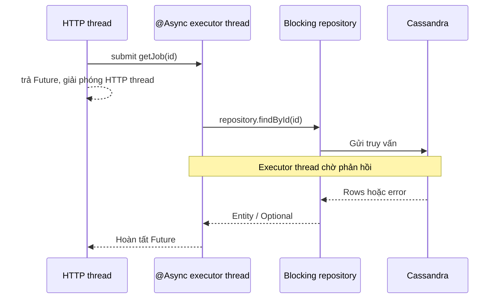
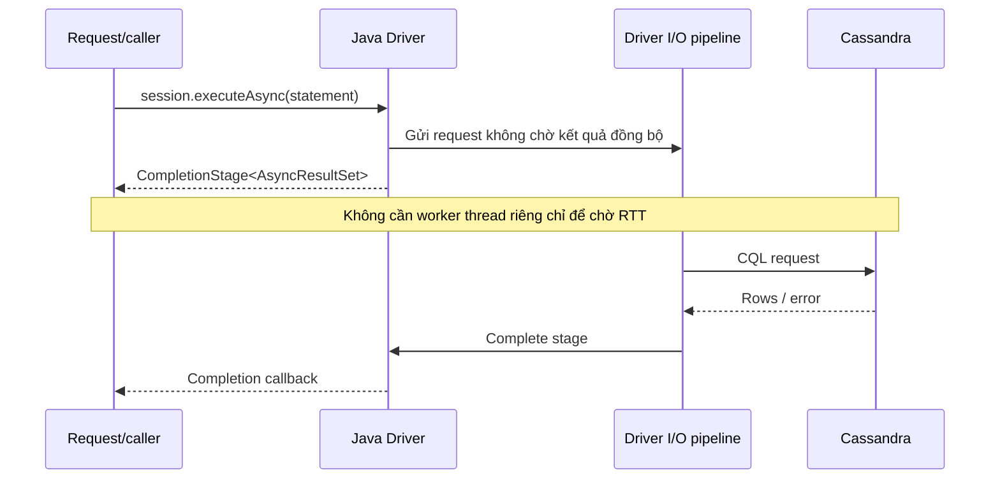
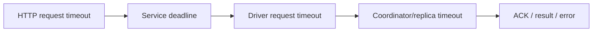
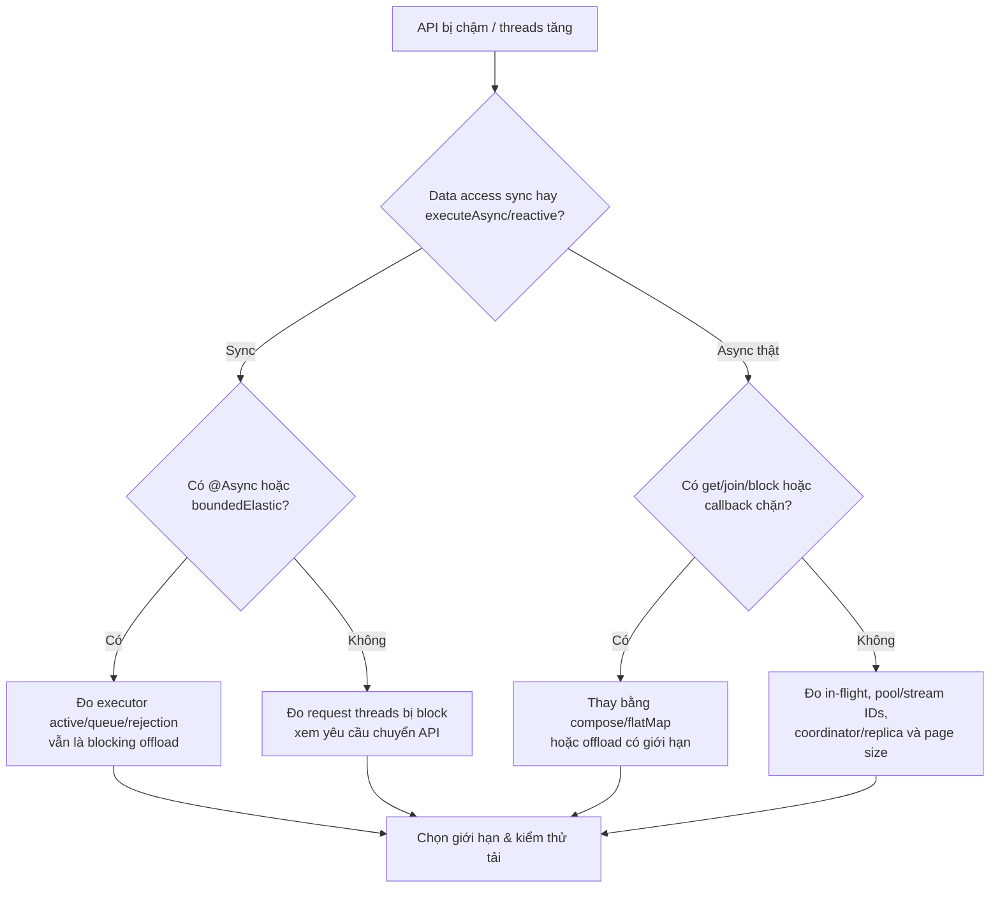

# Phân biệt truy cập bất đồng bộ thực với bọc lời gọi chặn bằng @Async

## 1. Vấn đề: cùng trả Future, tại sao hiệu năng khác nhau?

Một API Spring Boot truy vấn Cassandra có thể trả kết quả theo nhiều cách:

- Hàm repository đồng bộ `findById(...)`: thread gọi **chờ** cho tới khi dữ liệu về.
- Hàm được đánh dấu `@Async` và trả `CompletableFuture<...>`: **thread gọi** có thể trả về sớm, nhưng **thread trong executor** vẫn có thể chờ lời gọi repository đồng bộ.
- Java Driver `CqlSession.executeAsync(...)`: request Cassandra được gửi qua đường I/O bất đồng bộ; khi chờ phản hồi, không cần giữ một thread ứng dụng riêng chỉ để chờ.
- `ReactiveCassandraRepository`: trả `Mono`/`Flux` và vận hành qua giao diện reactive; khi dùng đúng đường reactive, việc chờ I/O không giống offload lời gọi blocking sang một thread pool.

Hai chữ “async” trong **asynchronous to caller** và **non-blocking I/O** không đồng nghĩa. Trả `CompletableFuture` chỉ là **hình dạng kết quả**; cần biết bên trong có thread nào vẫn bị giữ để chờ I/O.

Bài thuộc chương **Truy cập bất đồng bộ**, module `SPRING_DATA_CASSANDRA`: truy cập Apache Cassandra với mapping entity, repository, `CassandraTemplate`, truy vấn CQL, thiết kế bảng theo truy vấn, partition key, consistency, paging và hiệu năng trong hệ phân tán.

### Tình huống

Một dịch vụ nhận nhiều request hỏi trạng thái xử lý job:

```text
GET /jobs/{jobId}
  -> tìm row theo job_id
  -> trả status, updated_at
```

Cassandra trả lời sau một khoảng RTT và thời gian đọc/replica coordination. Nếu chờ đồng bộ, mỗi request có thể chiếm một thread trong khoảng đó. Nếu đưa nó vào `@Async`, HTTP thread có thể được trả về, nhưng task chạy trong executor vẫn giữ một thread. Nếu dùng **driver async thực sự**, chờ I/O thường không cần một thread ứng dụng per request.

**Mục tiêu bài học:** hiểu đúng cơ chế, biết chọn API, tránh biến luồng “không chặn” thành chuỗi chờ đồng bộ, và đo được sự khác biệt thay vì chỉ nhìn method signature.

## 2. Bốn mô hình cần phân biệt

| Kiểu truy cập | Ví dụ | Thread nào chờ Cassandra? | Có non-blocking I/O ở đường dùng của ứng dụng? |
| --- | --- | --- | --- |
| **Đồng bộ** | `repository.findById(id)`, `CassandraTemplate.selectOne(...)` | Thread gọi bị giữ tới khi kết quả về. | **Không** theo hợp đồng synchronous API. |
| **Offload blocking với @Async** | `@Async` + `repository.findById(id)` | Thread executor chạy method bị giữ khi gọi repository. | **Không**; chỉ chuyển nơi bị chặn. |
| **Async Java Driver** | `CqlSession.executeAsync(statement)` | Không cần một worker thread chờ trọn RTT; completion được xử lý khi I/O hoàn tất. | **Có** ở điểm chờ kết quả từ driver async. |
| **Reactive Cassandra** | `ReactiveCassandraRepository.findById(id)` | Publisher được thực thi qua non-blocking Cassandra access; không một thread request chờ theo cách synchronous repository. | **Có** nếu toàn bộ pipeline giữ non-blocking. |

Cần thêm một mô hình trung gian:

```java
Mono.fromCallable(() -> blockingRepository.findById(id))
    .subscribeOn(Schedulers.boundedElastic());
```

Đây là **reactive wrapper quanh code blocking**. Nó có thể hợp lý khi tích hợp thư viện chưa có async API; tuy nhiên, thread của `boundedElastic` vẫn chờ trong `findById`. **Trả `Mono` không tự biến I/O bên trong thành non-blocking.**

Tương tự:

```java
CompletableFuture.supplyAsync(
    () -> blockingRepository.findById(id), blockingExecutor
);
```

cũng chỉ offload một lời gọi chặn, dù dùng `CompletableFuture`.

### Ba câu hỏi đánh giá một “async API”

1. **Lời gọi nào gửi CQL và nhận kết quả?** API đồng bộ của Spring, `CqlSession.executeAsync`, hay Reactive Cassandra?
2. **Trong lúc chờ network/replica, có thread ứng dụng nào đang chặn ở `get/join/block` hoặc trong repository sync không?**
3. **Khi tạo 1.000 request đồng thời, giới hạn tài nguyên là số worker threads, số driver in-flight requests, dung lượng queue, hay tất cả?**

Trả lời bằng call graph và metrics, không dựa vào tên class hoặc chữ `Async`.

## 3. Sơ đồ thread: @Async không giống executeAsync

### 3.1. Một method @Async gọi repository đồng bộ



Một executor giới hạn **16 threads** không thể xử lý hàng trăm lời gọi đang cùng bị chặn mà không phát sinh queue/rejection. `@Async` có thể cải thiện responsiveness và isolation của HTTP layer, nhưng vẫn tiêu thụ worker thread trong suốt thời gian chờ I/O.

### 3.2. Driver executeAsync



Điểm khác biệt: **chờ kết quả bằng continuation**, không phải giữ một thread application per request đang sleep/chặn.

Nhưng non-blocking **không đồng nghĩa zero-thread**: driver vẫn có event-loop/I/O threads, timers và threads xử lý callback; JSON serialization, mapping, authorization và business logic vẫn tiêu thụ CPU. Nếu callback làm công việc chặn, nó có thể làm nghẽn chính threads quan trọng ấy.

## 4. Chuẩn bị schema CQL và entity đơn giản cho bài thực hành

Bảng được thiết kế để đọc **một job theo ID**, không quét toàn cluster:

```sql
-- RF=1 chỉ dành cho môi trường lab một node, DC=dc1.
CREATE KEYSPACE IF NOT EXISTS learning
WITH replication = {
  'class': 'NetworkTopologyStrategy',
  'dc1': 1
};

CREATE TABLE IF NOT EXISTS learning.job_status_by_id (
    job_id uuid PRIMARY KEY,
    status text,
    updated_at timestamp
);
```

Dữ liệu mẫu:

```sql
INSERT INTO learning.job_status_by_id (
    job_id, status, updated_at
) VALUES (
    11111111-1111-1111-1111-111111111111,
    'COMPLETED',
    '2026-11-25T09:00:00.000Z'
);

SELECT job_id, status, updated_at
FROM learning.job_status_by_id
WHERE job_id = 11111111-1111-1111-1111-111111111111;
```

Đặc điểm:

- `job_id` là **partition key**; mỗi truy vấn `WHERE job_id=?` xác định một partition.
- `status` là cột thường; `updated_at` là CQL `timestamp`, nên ở Java dùng `Instant`.
- `SELECT` có đầy đủ partition key; không cần `ALLOW FILTERING`.
- Trong production nhiều tenant, phải thiết kế định danh và kiểm tra **authorization** theo tenant. UUID biết được không tự cấp quyền; nếu yêu cầu truy vấn theo tenant, có thể thiết kế composite partition key hoặc bảng theo query pattern.
- RF/CL được cấu hình riêng. Không coi lab RF=1 là phép đo chịu lỗi của cluster RF=3.

### 4.1. Mapping entity dùng với blocking repository

```java
package com.example.jobs.domain;

import java.time.Instant;
import java.util.UUID;

import org.springframework.data.cassandra.core.mapping.Column;
import org.springframework.data.cassandra.core.mapping.PrimaryKey;
import org.springframework.data.cassandra.core.mapping.Table;

@Table("job_status_by_id")
public class JobStatus {

    @PrimaryKey("job_id")
    private UUID jobId;

    private String status;

    @Column("updated_at")
    private Instant updatedAt;

    protected JobStatus() {
    }

    public UUID getJobId() { return jobId; }
    public String getStatus() { return status; }
    public Instant getUpdatedAt() { return updatedAt; }
}
```

Một blocking repository:

```java
package com.example.jobs.repository;

import java.util.UUID;
import org.springframework.data.cassandra.repository.CassandraRepository;
import com.example.jobs.domain.JobStatus;

public interface JobStatusRepository
        extends CassandraRepository<JobStatus, UUID> {
}
```

`CassandraRepository` là API đồng bộ. Method `findById` trả `Optional<JobStatus>` và caller đợi thao tác hoàn thành. Dùng repo này từ một thread khác **không làm driver access trở thành non-blocking**.

### 4.2. Spring Boot configuration

```yaml
spring:
  cassandra:
    contact-points: 127.0.0.1
    port: 9042
    local-datacenter: dc1
    keyspace-name: learning
    schema-action: NONE
```

`schema-action: NONE` vì schema được tạo bằng CQL/migration. Khi app chạy trong container khác, `127.0.0.1` là container ứng dụng chứ không phải container Cassandra; dùng hostname reachable từ network. `local-datacenter` phải đúng topology thực tế.

## 5. Trường hợp A: lời gọi đồng bộ trực tiếp

Service nhỏ nhất:

```java
package com.example.jobs.service;

import java.util.Optional;
import java.util.UUID;

import org.springframework.stereotype.Service;

import com.example.jobs.domain.JobStatus;
import com.example.jobs.repository.JobStatusRepository;

@Service
public class BlockingJobLookup {

    private final JobStatusRepository repository;

    public BlockingJobLookup(JobStatusRepository repository) {
        this.repository = repository;
    }

    public Optional<JobStatus> get(UUID id) {
        return repository.findById(id); // CHẶN thread gọi.
    }
}
```

Call stack:

```text
HTTP thread
  -> BlockingJobLookup.get(id)
    -> JobStatusRepository.findById(id)
      -> synchronous Cassandra access
        -> chờ I/O và response
      <- Optional<JobStatus>
  <- HTTP response
```

Với ứng dụng MVC truyền thống và lưu lượng vừa phải, đây **không nhất thiết là thiết kế sai**. Nó có luồng xử lý đơn giản và dễ debug. Vấn đề xuất hiện khi số concurrent waits vượt capacity của request threads, khi API cần fan-out nhiều truy vấn, hoặc khi áp dụng mô hình reactive event loop mà vẫn gọi repository sync.

**Không tối ưu theo phong trào.** Chọn async/non-blocking khi yêu cầu throughput, concurrency, latency hoặc kiến trúc thực sự cần, và đo trước/sau.

## 6. Trường hợp B: @Async bọc repository đồng bộ

### 6.1. Cấu hình executor riêng cho blocking Cassandra calls

Một executor có giới hạn giúp tránh để các tác vụ chặn Cassandra chiếm dụng không kiểm soát pool dùng chung:

```java
package com.example.jobs.config;

import java.util.concurrent.Executor;
import java.util.concurrent.ThreadPoolExecutor;

import org.springframework.context.annotation.Bean;
import org.springframework.context.annotation.Configuration;
import org.springframework.scheduling.annotation.EnableAsync;
import org.springframework.scheduling.concurrent.ThreadPoolTaskExecutor;

@Configuration
@EnableAsync
public class BlockingAsyncConfiguration {

    @Bean("blockingCassandraExecutor")
    public Executor blockingCassandraExecutor() {
        ThreadPoolTaskExecutor executor =
            new ThreadPoolTaskExecutor();

        executor.setCorePoolSize(8);
        executor.setMaxPoolSize(16);
        executor.setQueueCapacity(100);
        executor.setThreadNamePrefix("cassandra-blocking-");
        executor.setRejectedExecutionHandler(
            new ThreadPoolExecutor.AbortPolicy()
        );
        executor.initialize();

        return executor;
    }
}
```

Các số **8/16/100** chỉ là ví dụ. Trong production, chọn pool size và queue bound theo concurrency, RTT, tài nguyên Cassandra và SLO; theo dõi **active threads, queue length, rejected tasks**. Tránh queue vô hạn vì nó có thể che overload rồi làm latency tăng dần.

### 6.2. Method @Async vẫn chặn thread worker

```java
package com.example.jobs.service;

import java.util.Optional;
import java.util.UUID;
import java.util.concurrent.CompletableFuture;

import org.springframework.scheduling.annotation.Async;
import org.springframework.stereotype.Service;

import com.example.jobs.domain.JobStatus;
import com.example.jobs.repository.JobStatusRepository;

@Service
public class OffloadedJobLookup {

    private final JobStatusRepository repository;

    public OffloadedJobLookup(JobStatusRepository repository) {
        this.repository = repository;
    }

    @Async("blockingCassandraExecutor")
    public CompletableFuture<Optional<JobStatus>> get(UUID id) {
        Optional<JobStatus> result =
            repository.findById(id); // CHẶN executor thread.

        return CompletableFuture.completedFuture(result);
    }
}
```

**Quan sát chính xác:**

- Caller gọi method qua **Spring proxy** và nhận `CompletableFuture` khi task được submit.
- Worker executor chạy `repository.findById` **đồng bộ**; nó bị giữ cho đến khi Cassandra trả về hoặc có lỗi/timeout.
- `completedFuture(result)` không làm I/O bên trong bất đồng bộ; nó chỉ bọc **giá trị đã được lấy xong** trong một future.
- Exception được truyền qua future nếu method thực thi theo contract `@Async`; caller phải xử lý failed completion.
- Nếu task bị queue đầy/rejected, đây là lỗi **capacity**; ứng dụng nên trả busy/backpressure phù hợp, không tự queue tiếp vô hạn.

### 6.3. @Async phụ thuộc Spring proxy

Một lỗi điển hình:

```java
@Service
public class WrongSelfInvocation {

    public void handler() {
        getBlockingInBackground(); // Gọi trong cùng object.
    }

    @Async("blockingCassandraExecutor")
    public CompletableFuture<Void> getBlockingInBackground() {
        doBlockingDatabaseWork();
        return CompletableFuture.completedFuture(null);
    }

    private void doBlockingDatabaseWork() {
        // Ví dụ minh họa lời gọi blocking.
    }
}
```

Với cấu hình `@Async` proxy-based thông thường, lời gọi **`this.getBlockingInBackground()`** nội bộ không đi qua proxy, nên annotation có thể không được áp dụng. Khi đó code có thể chặn ngay thread gọi.

Giải pháp: gọi từ bean khác qua proxy Spring, hoặc thiết kế ranh giới service rõ ràng; kiểm tra cơ chế proxy/AspectJ khi cấu hình khác mặc định. **Đừng suy luận từ annotation rằng mọi đường gọi đều chạy trên executor**.

### 6.4. @Async có ích trong trường hợp nào?

- Tách một công việc blocking dài khỏi HTTP request thread trong ứng dụng MVC.
- Isolation một thư viện sync chưa có async API bằng **executor chuyên dụng**.
- Chuyển một workload sang background processing **có giới hạn**, nơi không kỳ vọng throughput cao vô hạn.
- Chuyển đổi dần hệ thống legacy, trước khi thay cả tầng persistence.

Nhưng `@Async` **không phải lời giải gốc cho I/O thread consumption**. Nếu database latency tăng, worker threads vẫn bị chiếm lâu hơn, queue tăng, task bị reject và p99 latency có thể xấu.

## 7. @Async khác CompletableFuture.supplyAsync như thế nào?

Một đoạn khác thường được gọi là “async”:

```java
public CompletableFuture<Optional<JobStatus>> getAsync(UUID id) {
    return CompletableFuture.supplyAsync(
        () -> repository.findById(id),
        blockingExecutor
    );
}
```

Nó và `@Async` có điểm chung: **cả hai thực thi lời gọi blocking trên một executor thread**. Khác biệt chính:

| Tiêu chí | `@Async` | `CompletableFuture.supplyAsync` |
| --- | --- | --- |
| Ai dispatch task? | Spring AOP/proxy khi invocation đi qua proxy. | Method gọi Java API trực tiếp. |
| Executor | Khai báo `@Async("...")` hoặc cấu hình mặc định. | Nên truyền `Executor` tường minh. |
| Vấn đề self-invocation | Có với proxy-based `@Async`. | Không có vấn đề proxy, vì tự submit task. |
| Context thread-local | Không tự bảo đảm Security/MDC/transaction context. | Cũng không tự bảo đảm. |
| Lời gọi Cassandra sync bên trong | Vẫn blocking worker. | Vẫn blocking worker. |
| Khi nào phù hợp | Ranh giới managed service/task của Spring. | Orchestration Java trực tiếp, có executor tách biệt. |

**Tránh dùng `CompletableFuture.supplyAsync(...)` không truyền executor** cho hàng loạt Cassandra blocking calls, vì nó mặc định dùng common pool (theo điều kiện API) và có thể tranh tài nguyên với công việc khác. Nếu cần offload blocking, luôn có **concurrency budget** rõ ràng.

## 8. Trường hợp C: Java Driver executeAsync thật sự

Java Driver 4.x có API:

```java
CompletionStage<AsyncResultSet> stage =
    session.executeAsync(boundStatement);
```

Ở đây, `CompletionStage` đại diện kết quả sẽ có trong tương lai. Trong lúc chờ phản hồi Cassandra, ứng dụng **không** phải giữ một thread riêng đang block trên `ResultSet`.

### 8.1. DTO và gateway đọc một hàng

DTO:

```java
package com.example.jobs.dto;

import java.time.Instant;
import java.util.UUID;

public record JobView(
    UUID jobId,
    String status,
    Instant updatedAt
) {
}
```

Gateway hoàn chỉnh về phần đọc, dùng prepared statement:

```java
package com.example.jobs.gateway;

import java.time.Duration;
import java.util.Iterator;
import java.util.Optional;
import java.util.UUID;
import java.util.concurrent.CompletionStage;

import com.datastax.oss.driver.api.core.CqlSession;
import com.datastax.oss.driver.api.core.DefaultConsistencyLevel;
import com.datastax.oss.driver.api.core.cql.AsyncResultSet;
import com.datastax.oss.driver.api.core.cql.BoundStatement;
import com.datastax.oss.driver.api.core.cql.PreparedStatement;
import com.datastax.oss.driver.api.core.cql.Row;

import com.example.jobs.dto.JobView;

public final class AsyncJobGateway {

    private final CqlSession session;
    private final PreparedStatement findById;

    public AsyncJobGateway(CqlSession session) {
        this.session = session;

        // Prepare đồng bộ một lần khi khởi tạo.
        // Không prepare lại cho mỗi request HTTP.
        this.findById = session.prepare(
            "SELECT job_id, status, updated_at " +
            "FROM learning.job_status_by_id WHERE job_id = ?"
        );
    }

    public CompletionStage<Optional<JobView>> find(UUID id) {
        if (id == null) {
            throw new IllegalArgumentException("jobId bat buoc");
        }

        BoundStatement statement = findById.bind(id)
            .setConsistencyLevel(
                DefaultConsistencyLevel.LOCAL_QUORUM)
            .setTimeout(Duration.ofSeconds(2))
            .setIdempotent(true);

        return session.executeAsync(statement).thenApply(result -> {
            Iterator<Row> rows = result.currentPage().iterator();

            if (!rows.hasNext()) {
                return Optional.<JobView>empty();
            }

            Row row = rows.next();

            return Optional.of(new JobView(
                row.getUuid("job_id"),
                row.getString("status"),
                row.getInstant("updated_at")
            ));
        });
    }
}
```

Phân tích từng bước:

1. `session.prepare(...)` chạy **một lần khi tạo gateway**; ví dụ không cố nói rằng khởi tạo bean là bất đồng bộ 100%. Khi cần chuẩn bị trong luồng runtime cũng có `prepareAsync(...)`, nhưng phải quản lý cache và lifecycle.
2. `bind(id)` tạo statement có kiểu; query có đầy đủ **partition key** và không dùng `ALLOW FILTERING`.
3. `executeAsync(...)` là điểm chuyển sang **I/O bất đồng bộ**; method nhận `CompletionStage` mà không chờ hoàn tất network.
4. `thenApply(...)` ánh xạ **một hàng nhỏ**, chi phí CPU thấp; ví dụ không chạy file I/O, HTTP blocking hoặc `Thread.sleep` trong callback.
5. Câu query tìm một hàng theo primary key, nên chỉ cần kiểm tra current page; không có mục tiêu đọc hàng nghìn rows.
6. `LOCAL_QUORUM` là ví dụ CL. Trên RF=1 lab, local quorum = 1; production phải chọn theo RF/topology và yêu cầu consistency.
7. `setIdempotent(true)` ở đây áp dụng cho **SELECT** không có side effect. Không sao chép nhãn này sang CQL counter increment hay LWT có semantics khác mà không đánh giá.
8. `setTimeout(...)` giới hạn thời gian chờ theo driver policy; không bảo đảm thao tác ghi đã được rollback nếu một method khác dùng async write.

**Điểm then chốt:** Gateway này **không gọi `.get()`, `.join()` hoặc `.block()`** trước khi trả `CompletionStage`.

### 8.2. Chuyển lỗi qua CompletionStage

Ví dụ client/service:

```java
CompletionStage<Optional<JobView>> stage = gateway.find(jobId);

CompletionStage<String> message =
    stage.thenApply(opt -> opt
        .map(job -> "status=" + job.status())
        .orElse("not found")
    );

CompletionStage<String> reported =
    message.whenComplete((value, error) -> {
        if (error != null) {
            // Log exception type + correlation ID, không log PII.
        }
    });
```

`whenComplete(...)` **quan sát** kết quả/lỗi; không mặc nhiên chuyển một lỗi Cassandra thành giá trị “not found”. `Optional.empty()` chỉ là kết quả query **thành công nhưng không có row**; timeout/unavailable phải được xử lý riêng.

Các exception trong callback có thể làm stage downstream hoàn tất lỗi. Khi quan sát qua `CompletableFuture.join()` trong test/adapter chặn, lỗi có thể được bọc trong `CompletionException`; cần phân biệt cause và xử lý theo contract.

### 8.3. Spring MVC trả future mà không cần @Async

Trong Spring MVC, controller có thể trả một `CompletableFuture` để request được xử lý qua cơ chế async request của MVC:

```java
package com.example.jobs.api;

import java.util.UUID;
import java.util.concurrent.CompletableFuture;

import org.springframework.http.ResponseEntity;
import org.springframework.web.bind.annotation.GetMapping;
import org.springframework.web.bind.annotation.PathVariable;
import org.springframework.web.bind.annotation.RequestMapping;
import org.springframework.web.bind.annotation.RestController;

import com.example.jobs.dto.JobView;
import com.example.jobs.gateway.AsyncJobGateway;

@RestController
@RequestMapping("/jobs")
public class JobController {

    private final AsyncJobGateway gateway;

    public JobController(AsyncJobGateway gateway) {
        this.gateway = gateway;
    }

    @GetMapping("/{id}")
    public CompletableFuture<ResponseEntity<JobView>> get(
            @PathVariable UUID id) {

        return gateway.find(id)
            .thenApply(ResponseEntity::of)
            .toCompletableFuture();
    }
}
```

`ResponseEntity.of(Optional)` trả `200` khi có row và `404` khi query thành công mà không có row. Nếu driver trả timeout/unavailable, stage lỗi phải đi qua **error handling** của controller, không được đổi thành 404.

**Không có `@Async` trong controller hay gateway.** Đây là đường truy vấn bất đồng bộ thông qua Java Driver rồi trả future cho Spring MVC. Tuy vậy, request serialization và xử lý response ở tầng framework vẫn cần CPU/threads; “non-blocking Cassandra I/O” không có nghĩa mọi byte trong hệ thống được xử lý không thread.

## 9. Những cách vô tình phá lợi ích của executeAsync

### 9.1. Gọi join ngay trong service

```java
// ANTI-PATTERN: lập tức biến async stage thành blocking wait.
AsyncResultSet result = session.executeAsync(statement)
    .toCompletableFuture()
    .join();
```

Mặc dù dùng `executeAsync`, thread gọi **đợi cho tới khi stage hoàn tất**. Ở tầng request, hiệu quả gần lại một lời gọi đồng bộ và còn thêm complexity.

Thay bằng **composition**:

```java
return session.executeAsync(statement)
    .thenApply(this::mapSmallResult);
```

`mapSmallResult` ở đây là helper giả định chỉ đọc/mapping nhanh current page. Khi cần xử lý nhiều thao tác phụ thuộc, dùng `thenCompose` thay vì gọi `join` trong callback.

### 9.2. Gọi Future.get() ở cùng request thread

```java
// ANTI-PATTERN tương tự:
AsyncResultSet result = session.executeAsync(statement)
    .toCompletableFuture()
    .get();
```

`get()` là blocking wait. Không nên gọi trong controller/event-loop chỉ để “lấy Row cho dễ”. Ở ranh giới ứng dụng batch/script đồng bộ, việc chờ có thể hợp lý, nhưng phải gọi đúng tên: **block ở ranh giới**, không gọi đó là end-to-end non-blocking.

### 9.3. Chặn trong completion callback

```java
// ANTI-PATTERN: callback có thể chạy trên thread driver/completion.
return session.executeAsync(statement)
    .thenApply(result -> {
        try {
            Thread.sleep(1000); // Cố tình chặn completion thread: SAI.
        } catch (InterruptedException ex) {
            Thread.currentThread().interrupt();
            throw new IllegalStateException(ex);
        }
        return result;
    });
```

Đoạn code trên cố ý minh họa **anti-pattern**, không phải giải pháp nên triển khai: **không chạy thao tác chặn trong callback**. Một callback `thenApply` không mặc nhiên có một executor riêng; nó có thể chạy ở thread hoàn tất stage hoặc ngay thread gọi nếu stage đã hoàn tất.

Khi transform nặng thực sự cần CPU:

```java
return session.executeAsync(statement)
    .thenApplyAsync(
        this::heavyCpuTransform,
        boundedCpuExecutor
    );
```

`boundedCpuExecutor` là executor có giới hạn riêng, và `heavyCpuTransform` là helper nghiệp vụ giả định. Việc tách CPU giúp không kéo dài công việc trên thread I/O, nhưng vẫn phải giới hạn queue/backpressure.

### 9.4. Gắn @Async lên method vốn gọi executeAsync

```java
@Async("blockingCassandraExecutor")
public CompletableFuture<Optional<JobView>> find(UUID id) {
    return gateway.find(id).toCompletableFuture();
}
```

Trường hợp này thường chỉ thêm một bước dispatch qua executor, dù gateway đã dùng driver async. Nó **không biến I/O thành “async hơn”** và có thể tăng context switching/độ phức tạp. `@Async` chỉ nên thêm nếu có lý do rõ ràng như tách công việc blocking/CPU khác hoặc boundary đặc thù.

### 9.5. Bọc một Future trong một Future khác

```java
// Không cần supplyAsync để chờ một stage đã async:
CompletableFuture<Optional<JobView>> awkward =
    CompletableFuture.supplyAsync(
        () -> gateway.find(id).toCompletableFuture().join(),
        blockingExecutor
    );
```

Code trên tạo **một worker chỉ để join** kết quả từ một API non-blocking, đánh mất lợi ích. Trả thẳng stage hoặc compose bằng `thenApply/thenCompose`.

## 10. Composition: hai query phụ thuộc và nhiều query độc lập

### 10.1. Hai query phụ thuộc dùng thenCompose

Giả sử cần lấy job, sau đó tra thông tin tiếp theo dựa trên kết quả (đây là mô hình helper giả định):

```java
CompletionStage<JobDetails> result = gateway.find(id)
    .thenCompose(opt -> {
        if (opt.isEmpty()) {
            return CompletableFuture.failedFuture(
                new JobNotFoundException(id)
            );
        }
        return detailsGateway.fetch(opt.get().jobId());
    });
```

Ở đây:

- `gateway.find` trả stage không chặn.
- `detailsGateway.fetch` cũng phải trả stage non-blocking mới giữ được lợi ích.
- `thenCompose` **làm phẳng** stage bên trong. Dùng `thenApply` để tạo `CompletionStage<CompletionStage<T>>` thường không phải điều mong muốn.
- `JobDetails`, `JobNotFoundException` và `detailsGateway` là type/helper minh họa; cần khai báo trong dự án thực tế.
- Dù compose đúng, hai query vẫn có **latency cộng dồn** vì query thứ hai phụ thuộc kết quả query thứ nhất.

### 10.2. Hai query độc lập có thể chạy đồng thời

```java
CompletionStage<Optional<JobView>> a = gateway.find(jobA);
CompletionStage<Optional<JobView>> b = gateway.find(jobB);

CompletionStage<DashboardPair> pair =
    a.thenCombine(b, (left, right) ->
        new DashboardPair(left, right)
    );
```

`DashboardPair` là DTO minh họa. Hai lời gọi I/O được phát đi trước khi join kết quả bằng `thenCombine`, không cần một worker thread chờ từng query.

**Không đồng nghĩa “bắn vô hạn request”.** Nếu có 10.000 job IDs, tạo 10.000 query cùng lúc có thể vượt capacity driver, coordinator hoặc replica. Phải giới hạn in-flight, queue và deadline ngay cả khi dùng async thật.

### 10.3. Khi cần giữ thứ tự kết quả

Thực thi query song song có thể hoàn thành **khác thứ tự input**. Nếu API yêu cầu thứ tự ban đầu, cần giữ index hoặc dùng toán tử/collection có chính sách order rõ ràng; không tự dựa vào thứ tự callback hoàn tất.

## 11. Async pagination: currentPage không tự đồng nghĩa toàn bộ kết quả

Truy vấn theo một partition có thể trả nhiều hơn một fetch page. Với Java Driver 4.x:

```java
CompletionStage<AsyncResultSet> first =
    session.executeAsync(statement);

CompletionStage<AsyncResultSet> second =
    first.thenCompose(result -> {
        if (result.hasMorePages()) {
            return result.fetchNextPage();
        }
        return CompletableFuture.completedFuture(result);
    });
```

Đây là minh họa **fetch trang sau**, chưa phải một thuật toán trả toàn bộ kết quả: phải tiêu thụ `currentPage()` trước khi chuyển sang next page, nếu không ứng dụng dễ bỏ sót rows.

### 11.1. Thu thập tối đa N hàng, có paging bất đồng bộ

```java
import java.util.ArrayList;
import java.util.List;
import java.util.concurrent.CompletableFuture;
import java.util.concurrent.CompletionStage;

import com.datastax.oss.driver.api.core.CqlSession;
import com.datastax.oss.driver.api.core.cql.AsyncResultSet;
import com.datastax.oss.driver.api.core.cql.BoundStatement;
import com.datastax.oss.driver.api.core.cql.Row;

public final class AsyncPageCollector {

    private AsyncPageCollector() {
    }

    public static CompletionStage<List<String>> collectStatuses(
            AsyncResultSet page, List<String> collected, int limit) {

        for (Row row : page.currentPage()) {
            if (collected.size() >= limit) {
                break;
            }
            collected.add(row.getString("status"));
        }

        if (collected.size() >= limit || !page.hasMorePages()) {
            return CompletableFuture.completedFuture(
                List.copyOf(collected)
            );
        }

        return page.fetchNextPage().thenCompose(next ->
            collectStatuses(next, collected, limit)
        );
    }

    public static CompletionStage<List<String>> load(
            CqlSession session, BoundStatement statement, int limit) {

        if (limit <= 0 || limit > 500) {
            throw new IllegalArgumentException("limit khong hop le");
        }

        return session.executeAsync(statement)
            .thenCompose(first ->
                collectStatuses(first, new ArrayList<>(), limit)
            );
    }
}
```

Đoạn này minh họa thuật toán **chỉ giữ tối đa 500 giá trị trong RAM** theo giới hạn ứng dụng. Khi dùng trong dự án thực, gọi trên query có cột `status` đã chọn và giữ dữ liệu/tài nguyên thuộc một lần gọi riêng biệt; `collected` chỉ được thay đổi tuần tự trong chuỗi fetch page, không chia sẻ giữa các request. Đây không phải một utility “phân trang HTTP hoàn chỉnh”: nó bỏ phần còn lại nếu dừng giữa fetch page và **không** phát ra paging state ứng dụng.

Cần hiểu:

- `setPageSize(25)` gợi ý số row cho **mỗi lần fetch**, không đặt giới hạn tổng số row của query.
- `LIMIT 100` trong CQL là giới hạn **toàn query**.
- `fetchNextPage` trả `CompletionStage`; không cần `join`.
- `currentPage()` chỉ chứa trang hiện tại; không dùng `Iterable<Row>` của một trang như thể tất cả row đã có.
- Khi xây HTTP cursor bằng driver paging state, phải xử lý chính xác vị trí trong current page, giữ **cùng statement/bind values**, bảo vệ token và không để client sửa.
- Nếu cần API “đọc tiếp từ event cuối”, keyset cursor với **đầy đủ clustering key** có thể phù hợp hơn, nhưng không tự tạo snapshot bất biến.
- Với dữ liệu rất lớn, **trả từng page/stream có backpressure**, không collect cả partition vào một list.

### 11.2. Async không sửa query thiếu partition key

Chuyển:

```sql
SELECT status FROM learning.job_status_by_id;
```

từ `execute` sang `executeAsync` không làm nó trở thành truy vấn tốt hơn. Nếu query scan nhiều partition, nó vẫn tạo tải lớn cho cluster; async chỉ thay đổi cách **ứng dụng chờ kết quả**.

Với bảng theo thời gian, định nghĩa partition/bucket rõ, dùng equality trên partition key, giới hạn clustering range và page size. Không thêm `ALLOW FILTERING` vì muốn code “có thể async”.

## 12. Trường hợp D: ReactiveCassandraRepository và WebFlux

Spring Data Cassandra cung cấp đường Reactive Repository/Template khi dự án sử dụng reactive stack. Từ API có thể thấy sự khác biệt:

```java
// Synchronous repository:
Optional<JobStatus> job = blockingRepo.findById(id);

// Reactive repository:
Mono<JobStatus> jobMono = reactiveRepo.findById(id);
```

`Mono` không đồng nghĩa “đã hoàn tất”; nó đại diện pipeline lazy/có subscription. Khi dùng đúng **Reactive Cassandra** làm data source, I/O Cassandra chạy theo đường async thay vì gọi repository đồng bộ trên worker.

### 12.1. Dependency riêng cho reactive stack

Ví dụ Gradle:

```groovy
dependencies {
    implementation 'org.springframework.boot:spring-boot-starter-data-cassandra-reactive'
    implementation 'org.springframework.boot:spring-boot-starter-webflux'
}
```

Trong bài học, coi đây là **biến thể ứng dụng** để học Reactive Cassandra, không yêu cầu bật đồng thời cả starter blocking và reactive nếu chưa cần. Dự án có thể có các thành phần hỗn hợp, nhưng cần biết đường nào dùng API nào.

### 12.2. Reactive repository và service

```java
package com.example.jobs.reactive;

import java.util.UUID;
import org.springframework.data.cassandra.repository.ReactiveCassandraRepository;
import com.example.jobs.domain.JobStatus;

public interface ReactiveJobStatusRepository
        extends ReactiveCassandraRepository<JobStatus, UUID> {
}
```

```java
package com.example.jobs.reactive;

import java.util.UUID;
import org.springframework.stereotype.Service;
import reactor.core.publisher.Mono;

import com.example.jobs.domain.JobStatus;

@Service
public class ReactiveJobLookup {

    private final ReactiveJobStatusRepository repository;

    public ReactiveJobLookup(ReactiveJobStatusRepository repository) {
        this.repository = repository;
    }

    public Mono<JobStatus> get(UUID id) {
        // Không block(), get(), join() ở đây.
        return repository.findById(id);
    }
}
```

### 12.3. Controller WebFlux không gọi block()

```java
package com.example.jobs.reactive;

import java.util.UUID;

import org.springframework.http.ResponseEntity;
import org.springframework.web.bind.annotation.GetMapping;
import org.springframework.web.bind.annotation.PathVariable;
import org.springframework.web.bind.annotation.RequestMapping;
import org.springframework.web.bind.annotation.RestController;

import reactor.core.publisher.Mono;

import com.example.jobs.domain.JobStatus;

@RestController
@RequestMapping("/reactive/jobs")
public class ReactiveJobController {

    private final ReactiveJobLookup lookup;

    public ReactiveJobController(ReactiveJobLookup lookup) {
        this.lookup = lookup;
    }

    @GetMapping("/{id}")
    public Mono<ResponseEntity<JobStatus>> get(
            @PathVariable UUID id) {

        return lookup.get(id)
            .map(ResponseEntity::ok)
            .defaultIfEmpty(ResponseEntity.notFound().build());
    }
}
```

Request handler **trả publisher**; framework subscribe và xử lý hoàn tất/lỗi. Không gọi:

```java
// ANTI-PATTERN trong luồng WebFlux:
JobStatus job = reactiveRepo.findById(id).block();
```

`block()` biến luồng reactive trở lại blocking, và trên event-loop nó có thể gây nghẽn hoặc bị framework cảnh báo/từ chối. Không dùng `block()` để “lấy object” trong controller reactive.

### 12.4. Reactor wrapper quanh blocking repository vẫn là blocking I/O

```java
import reactor.core.publisher.Mono;
import reactor.core.scheduler.Schedulers;

Mono<JobStatus> wrapped = Mono.fromCallable(() ->
        blockingRepo.findById(id).orElse(null)
    )
    .subscribeOn(Schedulers.boundedElastic());
```

Đây là kỹ thuật **offload** có thể chấp nhận khi code legacy không có non-blocking API. Nó khác `ReactiveCassandraRepository`: một thread trong boundedElastic vẫn chờ Cassandra. Nếu dùng lâu dài, cần đo saturation/queue, đặt giới hạn concurrency và có lộ trình thay hoặc cô lập workload.

### 12.5. Bridge CompletionStage -> Reactor mà không chặn

Nếu đã có gateway `AsyncJobGateway.find(id)`, chuyển nó thành Mono:

```java
import reactor.core.publisher.Mono;

Mono<JobView> jobMono = Mono
    .fromCompletionStage(() -> gateway.find(id))
    .flatMap(optional -> Mono.justOrEmpty(optional));
```

Vì supplier được gọi theo subscription, đây là một pipeline **lazy**. Gateway trả `CompletionStage` không chặn. Nếu dùng `Mono.fromFuture(CompletableFuture.supplyAsync(() -> blockingRepo.findById(...)))`, backend vẫn là **blocking offload**; loại wrapper không thay đổi cơ chế Cassandra I/O.

### 12.6. Backpressure và concurrency trong Reactor

Khi có danh sách các ID, giới hạn số query in-flight:

```java
import java.util.UUID;
import reactor.core.publisher.Flux;

Flux<JobStatus> jobs = Flux.fromIterable(jobIds)
    .flatMap(id -> reactiveRepo.findById(id), 8);
```

`8` là **mức concurrency ví dụ**, không phải cấu hình khuyến nghị cho mọi cluster.

- `flatMap` cho phép query hoàn thành **không theo thứ tự input**.
- `flatMapSequential` có thể giữ thứ tự emission nhưng phải buffer những phần về sớm.
- `concatMap` giữ thứ tự theo xử lý tuần tự, nhưng throughput có thể thấp hơn.
- Backpressure cấp publisher không thay cho **trần request concurrency**, fetch page size, query limit và memory budget.
- Đừng bật `onBackpressureBuffer()` vô hạn để xử lý overload; chỉ dời quá tải từ Cassandra sang RAM.


## 13. Thread pool, in-flight requests và hàng đợi: giới hạn không biến mất

### 13.1. Dùng @Async với blocking repository có hệ số chờ

Giả sử trung bình Cassandra mất `250 ms` cho một request và hệ thống nhận `120 request/giây`. Theo quan hệ Little's Law trong điều kiện steady state:

\[
L \approx \lambda \times W
\]

trong đó:

- `L`: số thao tác trung bình đang đồng thời trong hệ thống.
- `λ`: thông lượng arrival/completion (request/giây) khi hệ thống ổn định.
- `W`: thời gian mỗi thao tác chiếm phần pipeline đang xét (giây).

Với các số minh họa: `120 × 0,25 ≈ 30` thao tác đang chờ I/O đồng thời. Nếu chỉ có **16 worker threads** và mỗi task chặn suốt lượt truy vấn, thread pool không thể đồng thời giữ tất cả 30 thao tác đang đợi; queue có thể tăng khi arrival rate tiếp tục vượt năng lực.

Đây **không** phải phép chứng minh rằng pool 30 threads là “đủ cho production”. Còn cần tính tail latency, CPU mapping, network, retry, request bursts và giới hạn server.

### 13.2. Driver async xử lý cùng lượng I/O khác về thread ownership

Với `executeAsync`, 30 request đang in-flight có thể được theo dõi bởi driver mà không giữ 30 application worker threads chỉ để đợi. Tuy nhiên:

- Coordinator/replicas vẫn phải **xử lý 30 request**.
- Driver vẫn có giới hạn in-flight, connection, stream IDs, timeout và bộ nhớ cho response.
- Mapping/serialize kết quả vẫn tiêu thụ CPU.
- Nếu mở 10.000 request đồng thời, non-blocking client không khiến cluster đột nhiên có 10.000 lần capacity.
- Mỗi fetch page tiếp theo tạo thêm công việc network và phải được điều phối.

**Non-blocking tiết kiệm tài nguyên ở tầng chờ**, không miễn phí tài nguyên toàn hệ thống.

### 13.3. So sánh khi latency tăng đột biến

| Hiện tượng | `@Async + blocking repository` | `executeAsync/Reactive Cassandra` |
| --- | --- | --- |
| Cassandra tăng RTT từ 100 ms lên 1 s | Worker threads bị giữ lâu hơn, queue có thể phình. | In-flight stages kéo dài; số thread ứng dụng chờ không tăng tuyến tính theo pending request. |
| API fan-out 20 truy vấn độc lập | Cần worker threads đủ cho các lời gọi blocking nếu song song. | Có thể compose nhiều async requests, nhưng vẫn cần trần in-flight. |
| Kết quả rất lớn | Thread worker còn chặn nếu API sync fetch tiếp. | Có thể fetch page bất đồng bộ; vẫn cần giới hạn buffers và CPU. |
| Driver/cluster bị quá tải | Nhiều task bị queue/reject. | Có thể bị throttle/reject/time out ở driver hoặc cluster. |
| Callback dùng `Thread.sleep` | Thread executor/continuation bị chặn. | Có thể chặn thread hoàn tất hoặc event-loop rất nguy hiểm. |
| API chỉ có vài truy vấn/giây | Đường sync có thể đơn giản và đủ. | Async không mặc định giảm network RTT hay business latency. |

Đừng dùng thread count làm KPI duy nhất. Đo **completed requests/s, p95/p99 latency, error rate, saturation và Cassandra-side workload** để so sánh.

## 14. Giới hạn số request đang bay khi dùng executeAsync

Ngay cả khi không chặn thread, ứng dụng vẫn nên có **concurrency budget**. Một cách đơn giản là từ chối sớm khi quá nhiều truy vấn chưa hoàn tất.

### 14.1. Ví dụ semaphore không chặn

```java
package com.example.jobs.gateway;

import java.time.Duration;
import java.util.UUID;
import java.util.concurrent.CompletableFuture;
import java.util.concurrent.CompletionStage;
import java.util.concurrent.RejectedExecutionException;
import java.util.concurrent.Semaphore;

import com.datastax.oss.driver.api.core.CqlSession;
import com.datastax.oss.driver.api.core.cql.AsyncResultSet;
import com.datastax.oss.driver.api.core.cql.BoundStatement;
import com.datastax.oss.driver.api.core.cql.PreparedStatement;

public final class LimitedAsyncGateway {

    private final CqlSession session;
    private final PreparedStatement query;
    private final Semaphore permits = new Semaphore(32);

    public LimitedAsyncGateway(CqlSession session) {
        this.session = session;
        this.query = session.prepare(
            "SELECT job_id, status, updated_at " +
            "FROM learning.job_status_by_id WHERE job_id = ?"
        );
    }

    public CompletionStage<AsyncResultSet> read(UUID jobId) {
        if (jobId == null) {
            throw new IllegalArgumentException("jobId bat buoc");
        }

        // Không gọi permits.acquire(): acquire() có thể block.
        if (!permits.tryAcquire()) {
            return CompletableFuture.failedFuture(
                new RejectedExecutionException(
                    "Too many Cassandra requests in flight"
                )
            );
        }

        try {
            BoundStatement statement = query.bind(jobId)
                .setTimeout(Duration.ofSeconds(2))
                .setIdempotent(true);

            return session.executeAsync(statement)
                .whenComplete((value, error) -> permits.release());
        } catch (RuntimeException ex) {
            // Bảo đảm không rò permit nếu executeAsync ném lỗi sync.
            permits.release();
            return CompletableFuture.failedFuture(ex);
        }
    }
}
```

**Ý nghĩa:** `tryAcquire()` không chờ; khi đã có 32 request đang in-flight, caller nhận failure stage. `whenComplete(...)` giải phóng permit khi stage hoàn tất dù thành công hay lỗi.

Giới hạn này là **local cho một instance gateway/JVM**, không tự giới hạn tổng lượng request của 100 pods. Trong hệ thống phân tán còn cần rate limiting, quota, capacity planning và theo dõi cluster-wide load.

### 14.2. Những điểm cần hoàn thiện trước production

- `32` chỉ là ví dụ; benchmark theo p95/p99, driver pool và replica capacity.
- Cần phân biệt overload/rejection với not found; API có thể trả `429` hoặc `503` theo contract.
- Đảm bảo từng request **nhả permit đúng một lần** kể cả cancellation/exception; test các đường lỗi.
- `whenComplete` ở trên chỉ giải phóng một permit, chi phí nhỏ; không đặt công việc chặn trong callback.
- Nếu caller cancel stage mà request đã được gửi, **không mặc định Cassandra dừng truy vấn**; cần hiểu lifecycle và theo dõi request còn đang xử lý.
- Tránh giữ lock hoặc semaphore permit trong suốt nhiều công việc khác không liên quan query.
- Với reactive, dùng concurrency bound của toán tử (ví dụ `flatMap(..., 8)`) và queue/backpressure ở các ranh giới input.

### 14.3. Queue hữu hạn hay từ chối sớm?

Nếu hệ thống thường xuyên vượt giới hạn:

- **Queue ngắn/hữu hạn** có thể giúp hấp thụ burst nhỏ, nhưng làm request đợi và dễ vượt deadline.
- **Fail fast** giúp báo tải cao và bảo vệ downstream, nhưng client cần backoff/retry phù hợp.
- **Rate limiting theo tenant** giảm nguy cơ một tenant chiếm toàn bộ capacity.
- **Bulkhead** có thể tách các nhóm query quan trọng (read status) khỏi tác vụ nền (export/scan).

Không chọn queue size chỉ để giảm số lỗi log: một queue dài có thể làm tất cả request chậm hơn và gây retry storm.

## 15. Timeout: async không miễn trừ trạng thái chưa chắc chắn

### 15.1. Có nhiều deadline



Một request có thể hết hạn tại HTTP gateway trước khi driver trả kết quả, hoặc driver hết hạn trước khi Cassandra xong việc. Trong ứng dụng, phải **chọn budget tổng**, không tùy tiện retry nhiều lần cho tới khi vượt hết thời gian của người dùng.

| Lớp | Ví dụ | Điểm cần nhớ |
| --- | --- | --- |
| HTTP/gateway | 5 giây | Client có thể ngắt nhưng Cassandra đã nhận CQL. |
| Service timeout | 4 giây | Gồm validation, query, mapping, retry, serialization budget. |
| Driver timeout | `setTimeout(Duration.ofSeconds(2))` | Kết thúc chờ theo driver policy; không phải transaction rollback. |
| Server-side read/write timeout | Phụ thuộc Cassandra config/workload | Replica/coordinator không đáp ứng đủ điều kiện trong hạn. |
| Reactive operator timeout | `Mono.timeout(Duration)` | Có thể hủy subscription downstream; **không bảo đảm hủy mutation Cassandra đã gửi**. |

Con số thời gian trong bảng chỉ để giải thích budget, không phải cấu hình mặc định hay SLO được khuyến nghị cho mọi ứng dụng.

### 15.2. SELECT timeout khác “không tìm thấy”

Với `AsyncJobGateway.find(id)`:

- Query thành công, không có row → `Optional.empty()` hoặc `Mono.empty()`.
- Query thất bại do timeout/unavailable → stage/Publisher **lỗi**, không được đổi thành empty result rồi trả 404.
- Input ID không hợp lệ → validation error.
- Không có quyền truy cập ID → authorization error, không phụ thuộc vào việc row có tồn tại.

Hãy tránh:

```java
// ANTI-PATTERN: che lỗi hạ tầng thành dữ liệu không có.
return gateway.find(jobId)
    .exceptionally(error -> Optional.empty());
```

Code này không phân biệt timeout và not found, làm dashboard có thể báo job “không tồn tại” khi Cassandra đang quá tải.

### 15.3. Async write timeout: kết quả không chắc chắn

Giả sử service gọi:

```java
CompletionStage<AsyncResultSet> write =
    session.executeAsync(updateBoundStatement);
```

Nếu stage lỗi do `WriteTimeoutException` hay mất kết nối, không thể suy ra từ lỗi ấy rằng mutation **chưa được ghi**. Một số replica có thể đã xử lý xong; việc trả kết quả thất bại có thể xảy ra sau khi mutation đã gửi.

Các hướng cần xét:

1. Dùng **business operation ID** ổn định khi ghi.
2. Xác định statement có **idempotent** thật sự không.
3. Nếu unknown outcome, kiểm tra/readback hoặc đối soát theo consistency policy.
4. Retry/backoff trong giới hạn deadline và theo lỗi cụ thể.
5. Không retry counter `total = total + 1` một cách mù quáng; phép tăng counter không idempotent.
6. Với LWT `IF version = ?`, phân biệt `[applied]=false` (conflict) với timeout (chưa chắc chắn).

**Non-blocking I/O chỉ thay cách chờ**, không thay đổi semantics ghi của Cassandra.

### 15.4. Cancellation không phải rollback

Gọi `CompletableFuture.cancel(true)`, cancel một `Mono` hoặc làm client disconnect có thể ngừng việc **chờ/truyền kết quả** ở tầng ứng dụng. Nó không bảo đảm một mutation đã gửi tới Cassandra bị rút lại.

Với thao tác có side effect, xây **reconciliation** hoặc idempotent command model; đừng lấy cancellation làm cơ chế transaction.

## 16. Xử lý exception và trả lỗi nhất quán

### 16.1. CompletableFuture và CompletionException

Khi kết quả đi qua `CompletionStage`, các tầng xử lý có thể nhìn thấy `CompletionException` bao quanh cause gốc khi gọi `join` hoặc khi callback có lỗi.

Mô hình xử lý:

```java
CompletionStage<Optional<JobView>> stage =
    gateway.find(jobId);

return stage.whenComplete((value, failure) -> {
    if (failure != null) {
        // Ghi metrics/tracing, unwrap cause khi cần.
        // Không biến lỗi thành Optional.empty().
    }
});
```

Đây là ví dụ **quan sát lỗi**, chưa xử lý HTTP status. Tầng controller có thể dùng exception handler/controller advice để map timeout, unavailable, invalid query, CAS conflict thành mã lỗi phù hợp.

### 16.2. Tách loại lỗi

| Kết quả | Ý nghĩa | Phản hồi ứng dụng gợi ý |
| --- | --- | --- |
| `Optional.empty()` sau query thành công | Không có dữ liệu theo khóa/query. | `404` nếu tài nguyên không tồn tại theo hợp đồng. |
| Driver read timeout | Không lấy được kết quả kịp hạn. | `503`/`504` theo ranh giới API, có retry policy. |
| Driver unavailable | Thiếu replica đáp ứng CL. | Lỗi hạ tầng/khả dụng; không đổi thành 404. |
| `InvalidQueryException` | Sai CQL/schema/bind types. | Sửa code/config; thường không retry nguyên xi. |
| `[applied] = false` với LWT | Điều kiện ghi không thỏa. | `409`/`412` tùy contract optimistic concurrency. |
| Write timeout | Mutation có thể đã áp dụng, trạng thái chưa rõ. | Readback/idempotency/reconciliation. |
| Executor queue rejection (`@Async`) | Pool blocking offload quá tải. | Throttle/fail-fast/bulkhead; không gọi repository blocking trên event-loop để “cứu”. |
| Concurrency permit rejection | Quá nhiều request async đang bay. | Trả overload rõ ràng hoặc queue hữu hạn. |

Mã HTTP phụ thuộc gateway và chính sách sản phẩm; bảng nêu **hướng phân loại**, không bắt buộc một mã duy nhất cho mọi trường hợp.

### 16.3. Không dùng onErrorResume mặc định nuốt mọi lỗi

```java
// ANTI-PATTERN: biến mọi lỗi Cassandra thành "không có job".
return reactiveRepo.findById(id)
    .onErrorResume(error -> Mono.empty());
```

Nếu cần fallback, chọn **nhánh lỗi cụ thể**, có metrics và hợp đồng rõ: fallback cache có thể trả dữ liệu cũ với nhãn stale, nhưng không được ngầm hứa đây là trạng thái live từ quorum.

## 17. Context xuyên thread: MDC, Security và transaction

### 17.1. @Async đổi thread, ThreadLocal không tự đi theo

Trong Spring, một số ngữ cảnh như:

- MDC/logging correlation ID.
- `SecurityContextHolder` khi dùng thread-local strategy.
- Request-scope data.
- TransactionSynchronizationManager và các thread-bound contexts.

có thể gắn với **thread gọi**. Khi `@Async` chuyển sang executor thread, chúng không tự động được kế thừa theo cách an toàn trong mọi cấu hình.

Nếu dùng một shared pool và copy context thủ công sai, rủi ro còn tệ hơn: **tenant/correlation ID của request trước rò sang request sau**.

Nguyên tắc:

1. Truyền những dữ liệu nghiệp vụ quan trọng (tenant ID, request ID, permission decision, version) như **tham số tường minh** khi có thể.
2. Sử dụng `TaskDecorator` hoặc cơ chế context propagation được cấu hình và kiểm thử nếu cần copy logging/security context.
3. Luôn khôi phục/xóa context sau task để tránh rò dữ liệu qua thread reuse.
4. Không dựa vào việc `@Async` tự kế thừa transaction hoặc Spring Security principal.
5. Cassandra không cung cấp transaction ACID đa partition chỉ vì app có `@Transactional`; async boundary lại càng không tự mang transaction scope từ thread gọi.

### 17.2. CompletionStage cũng không bảo đảm callback chạy cùng thread

Callback `thenApply` có thể chạy trên thread hoàn tất stage hoặc thread khác tùy completion state. Vì vậy, không xem MDC/Security thread-local là luôn còn nguyên trong callback.

Với Reactor, có **Reactor Context** cho dữ liệu đi cùng subscriber, nhưng không phải mọi ThreadLocal tự hiện diện trong mỗi operator. Dùng context propagation phù hợp, kiểm thử tracing/security và không dùng ThreadLocal như nguồn chân lý của tenant authorization.

### 17.3. Bảo mật không dựa vào kiểu Future

`executeAsync` không thay authorization. Trước khi query:

- Xác minh caller được quyền truy cập job/tenant.
- Bind đủ partition key, không truy vấn global rồi lọc tenant ở Java.
- Giới hạn số IDs/fan-out theo user.
- Che PII trong logs/traces.
- Không để callback sử dụng context của tenant khác do thread reuse.

## 18. Event-loop không được chứa blocking business code

Truy cập Cassandra non-blocking là một phần của pipeline. Những đoạn sau vẫn có thể làm nghẽn event-loop hoặc completion threads:

| Hoạt động | Nguy cơ | Cách xử lý |
| --- | --- | --- |
| `Thread.sleep(...)` | Chặn thread. | Dùng scheduling/timer bất đồng bộ, không sleep trong callback. |
| `Files.readAllBytes(...)` trên file lớn | Chặn file I/O và tăng RAM. | Offload sang I/O pool bounded hoặc dùng I/O phù hợp. |
| Gọi HTTP client đồng bộ | Chặn thread chờ network khác. | Dùng HTTP client async/reactive hoặc offload tạm thời. |
| `repository.findById(...)` đồng bộ | Chờ Cassandra. | Dùng reactive repo/driver async hoặc boundedElastic như biện pháp chuyển tiếp. |
| `Future.get/join` | Chờ stage, mất non-blocking. | `thenCompose`, `flatMap` hoặc trả stage. |
| `Mono.block()` | Chờ subscription hoàn tất. | Compose Publisher. |
| JSON mapping cực nặng / mã hóa CPU lớn | Chiếm event-loop/driver callback lâu. | Dùng executor/scheduler bounded chuyên CPU nếu thật sự cần. |
| Lock dài / synchronized nhiều tranh chấp | Serialization/đợi mutex. | Thiết kế lại critical section, phân vùng state. |

### Tách công việc blocking trong Reactor khi chưa thay được thư viện

```java
Mono<JobStatus> legacy = Mono
    .fromCallable(() ->
        blockingRepo.findById(id).orElse(null)
    )
    .subscribeOn(Schedulers.boundedElastic());
```

Đây là một **giải pháp quá độ** hợp lệ nếu biết giới hạn pool/queue và không có driver non-blocking path ngay. Nhưng hiệu năng vẫn phụ thuộc threads được cấp cho blocking waits.

Nếu một controller WebFlux vừa gọi reactive Cassandra, vừa chạy JDBC sync, thư viện file sync và một HTTP client sync, toàn endpoint **không phải end-to-end non-blocking** dù method cuối cùng trả `Mono`.

## 19. Consistency, partition key và paging không thay đổi vì async

### 19.1. Thay execute bằng executeAsync không đổi RF/CL

| Yếu tố | Bản chất | Async có làm thay đổi? |
| --- | --- | --- |
| RF và replica placement | Topology/keyspace/partition key | **Không**. |
| `LOCAL_ONE`/`LOCAL_QUORUM` | Điều kiện số replica phản hồi ở local DC | **Không**; phải đặt/configure riêng. |
| LWT `IF version = ?` | Conditional write/cơ chế đồng thuận | **Không**; callback chỉ quan sát `[applied]` và lỗi. |
| `counter` increment | Mutation không idempotent | **Không**; retry async vẫn có thể cộng hai lần. |
| TTL/tombstone | Vòng đời giá trị và chi phí đọc | **Không**; async chỉ giúp caller không chờ đồng bộ. |
| Partition/clustering key | Định tuyến và thứ tự hàng | **Không**. |
| Paging state/keyset cursor | Cách tiếp tục một query/list | **Không**; vẫn cần semantics đúng. |

Nếu cần **read-after-write**:

```java
return asyncWrite(statement)
    .thenCompose(ignored -> asyncRead(sameKey));
```

Hai helper trong mẫu này phải thật sự trả `CompletionStage` và write stage hoàn tất thành công trước khi read bắt đầu. Chỉ ghép thứ tự bằng `thenCompose` là **điều kiện cần**, không thay việc chọn write/read CL phù hợp, xử lý timestamp cạnh tranh và cache. Với RF=3 một DC, cặp `LOCAL_QUORUM` write/read có quorum overlap theo các giả định bình thường; khác DC hoặc write CL thấp có thể khác.

### 19.2. Ghi đồng thời và optimistic locking vẫn cần kiểm soát

Hai async writes có thể đua nhau. Nếu cần ngăn lost update:

- Dùng version-aware persistence theo `@Version` trên các đường hỗ trợ.
- Hoặc CQL LWT `UPDATE ... IF version = ?` và kiểm tra `[applied]`.
- Phân biệt conflict với timeout không chắc chắn.
- Không tự coi `CompletableFuture.allOf` hay `Mono.when` là một transaction.
- Với nhiều partition/bảng, cần idempotency/reconciliation/outbox hoặc workflow đúng mô hình.

### 19.3. Non-blocking không biện minh quét partition lớn

Trả `Flux` cho `SELECT *` quét hàng triệu rows có thể giữ request sống rất lâu, làm tăng in-flight, memory buffers và replica load. Bảng Cassandra vẫn phải được thiết kế **theo mẫu truy vấn**, có partition key hợp lệ, range trên clustering và giới hạn phù hợp.

Khi stream nhiều trang, cần xác định client cancellation, timeout, consistency per fetch, và sự thay đổi dữ liệu giữa các trang; không hứa snapshot bất biến.

## 20. Kiểm thử: chứng minh thread bị chặn hay không

### 20.1. Kiểm thử @Async là offload chứ không phải driver non-blocking

Dùng một repository giả lập có `CountDownLatch` để giữ `findById` chưa hoàn tất trong test:

```java
// Ý tưởng cho test chạy qua Spring-managed @Async proxy:
CountDownLatch entered = new CountDownLatch(1);
CountDownLatch release = new CountDownLatch(1);

when(repository.findById(jobId)).thenAnswer(invocation -> {
    entered.countDown();
    release.await();
    return Optional.empty();
});

CompletableFuture<Optional<JobStatus>> stage =
    offloadedJobLookup.get(jobId);

assertTrue(entered.await(1, TimeUnit.SECONDS));
assertFalse(stage.isDone()); // Worker đang chờ trong repo.

release.countDown();
assertTrue(stage.get(2, TimeUnit.SECONDS).isEmpty());
```

Đây là **test sketch**: cần setup mock, Spring context/proxy, imports JUnit/Mockito và `finally` bảo đảm release latch để tránh treo test khi assertion thất bại.

Nó chứng minh:

1. Caller nhận future trước khi thao tác blocking trong worker hoàn tất.
2. Một worker vẫn bị giữ tại `release.await()`/repository call.
3. Nếu gọi `@Async` qua self-invocation hoặc tự `new OffloadedJobLookup`, test có thể chạy blocking ngay trong caller; đó là lý do phải test qua Spring bean/proxy.

Nó **không** chứng minh truy vấn driver thật có non-blocking hay không; mục đích là phát hiện sự khác nhau giữa caller async và I/O non-blocking.

### 20.2. Kiểm thử Java Driver async bằng incomplete stage

Mock `CqlSession.executeAsync` trả một `CompletableFuture<AsyncResultSet>` **chưa hoàn tất**, sau đó gọi method gateway:

```java
CompletableFuture<AsyncResultSet> pending =
    new CompletableFuture<>();

when(session.executeAsync(any(BoundStatement.class)))
    .thenReturn(pending);

CompletionStage<Optional<JobView>> result =
    gateway.find(jobId);

// Hàm trả về stage dù chưa có dữ liệu từ DB.
assertFalse(result.toCompletableFuture().isDone());

// Hoàn tất pending bằng AsyncResultSet mock có currentPage(),
// kiểm tra result được map đúng.
// Có thể completeExceptionally(...) để kiểm tra lỗi propagated.
```

Đây là **phác thảo test**: phải stub chuẩn `PreparedStatement.bind` trong constructor, `AsyncResultSet.currentPage` và row mapping. Không cần mock quá chi tiết nếu integration test với Cassandra thật đã kiểm chứng đường data access.

Cũng cần đọc code để xác nhận method không gọi `join/get`. Một test fake stage chỉ chứng minh **control flow không đợi stage tại lời gọi**, không phải đo performance network thực tế.

### 20.3. Integration test trên Cassandra thật

Kiểm thử ít nhất:

- Query theo primary key có row → trả `JobView` đúng.
- Query theo key không có row → thành công với Optional/Mono empty.
- Query timeout/unavailable → stage/Publisher lỗi, **không** bị đổi thành empty.
- Hai requests song song → kết quả không nhầm ID; prepared statement được tái dùng an toàn.
- Fetch result nhiều trang → không bỏ sót hàng, không gọi blocking wait trong collector.
- Cancel subscription/future khi request đã gửi → theo dõi semantics, không khẳng định mutation rollback.
- Với read-after-write, composition thực hiện write xong mới read; RF/CL/replica phù hợp.
- `@Async` được gọi qua Spring proxy với executor bounded; queue rejection được xử lý.
- Reactor code không gọi `block` trên event-loop.

Dùng keyspace/container/cluster thử nghiệm riêng. **Không fault-inject lên production** để “chứng minh” trường hợp mất replica.

### 20.4. Kiểm thử tải có baseline rõ ràng

Một so sánh công bằng nên giữ nguyên:

1. Cùng câu CQL, cùng prepared statements, cùng `SELECT` projection.
2. Cùng partition distribution, kích thước response và page size.
3. Cùng cluster, RF, local DC, CL, data volume và read/write workload.
4. Cùng request-rate profile (steady + burst) và thời gian đo đủ dài.
5. Cùng timeout/retry policy nếu đang so sánh backend mechanism.
6. Cùng giới hạn in-flight/concurrency được công khai.
7. Không dùng query full scan cho một implementation rồi query theo PK cho implementation khác.

Đo **p50/p95/p99 latency, throughput thành công, timeout/reject rate, CPU, heap, GC, thread count, pool queue, driver in-flight và Cassandra coordinator/replica metrics**.

## 21. Quan sát và chẩn đoán production

### 21.1. Những metrics quan trọng

| Metric | `@Async` blocking offload | Driver/Reactive async |
| --- | --- | --- |
| Số active worker threads | Rất quan trọng; thread bị giữ khi sync query. | Không phải giới hạn chờ I/O chính nếu thật sự non-blocking. |
| Executor queue/rejections | Dấu hiệu saturation đầu tiên. | Nếu có CPU executor/offload, vẫn phải theo dõi riêng. |
| Pending CompletionStage/Reactive subscriptions | Có nhưng không phản ánh đúng worker occupancy. | Rất quan trọng để biết số request đang in-flight. |
| Driver in-flight requests, timeouts | Vẫn cần đo. | Vẫn cần đo. |
| Coordinator latency và replica health | Vẫn là yếu tố gốc quyết định Cassandra latency. | Vẫn là yếu tố gốc quyết định Cassandra latency. |
| Application p95/p99 và throughput | Kiểm tra queue + blocking duration. | Kiểm tra in-flight budget + completion duration. |
| Event-loop blocked warnings | Không phải lúc nào có event loop MVC. | Cần giám sát đặc biệt khi dùng WebFlux/reactive. |
| Retry count / CL / read timeout | Không được quên. | Không được quên. |

### 21.2. Dấu hiệu code còn blocking

- Thread dump/JFR cho thấy nhiều threads đứng ở synchronous data access/`CompletableFuture.join`.
- `cassandra-blocking-*` executor active đạt max, queue liên tục dài.
- Reactor phát hiện blocking call trên non-blocking scheduler; event-loop p99 tăng khi có CPU callback nặng.
- Controller method trả `Mono` nhưng call tree có `repository.findById` sync hoặc HTTP/JDBC sync.
- `executeAsync` xuất hiện trong source nhưng method caller ngay sau đó `get/join`.
- Một callback `thenApply` gọi thư viện sync như file hoặc HTTP client.
- Retrying async writes làm Cassandra overload; non-blocking I/O vẫn tạo work ở server.

### 21.3. Trình tự khoanh vùng



**Đừng chẩn đoán từ thread name đơn lẻ.** Một thread với tên “async” vẫn có thể đang block, còn driver event-loop có thể đang quá tải CPU hoặc mapping. Cần nhìn cả stack trace và số liệu throughput/latency.

## 22. Anti-pattern và cách thay thế

| Anti-pattern | Vì sao có vấn đề? | Thay thế |
| --- | --- | --- |
| `@Async` trên method gọi `repository.findById` rồi quảng bá là non-blocking Cassandra | Worker vẫn chờ I/O. | Gọi đúng là blocking offload; dùng `executeAsync` hoặc Reactive Cassandra khi cần non-blocking. |
| `CompletableFuture.completedFuture(repository.findById(id))` không có offload | Repository chạy **trước** khi tạo future; caller bị chặn. | Dùng driver async; nếu buộc sync, offload bounded rõ ràng. |
| `supplyAsync(...repo.findById...)` với common pool mặc định | Pool chia sẻ bị chặn bởi Cassandra, khó capacity isolation. | Executor chuyên biệt bounded hoặc reactive/driver async. |
| `executeAsync(...).join()` ngay sau khi gọi | Caller chờ, làm mất non-blocking. | Compose `thenApply/thenCompose`. |
| Gọi `Thread.sleep`/HTTP blocking trong `thenApply` | Callback có thể làm nghẽn I/O/completion thread. | Async client hoặc executor CPU/I/O bounded. |
| `Mono.just(blockingRepo.findById(id))` | Blocking diễn ra **trước** khi tạo publisher. | `Mono.fromCallable(...).subscribeOn(boundedElastic())` như biện pháp quá độ, hoặc Reactive Repository. |
| `reactiveRepo.findById(id).block()` trong WebFlux | Chặn event-loop/caller. | Trả `Mono` trực tiếp và compose operators. |
| `@Async` self-invocation trong cùng bean | Không qua Spring proxy, annotation có thể không chạy. | Bean boundary rõ và test qua proxy. |
| Unlimited `CompletableFuture.allOf` cho 10.000 IDs | Overload driver/cluster. | Bounded concurrency, queue, backpressure và rate limiting. |
| `flatMap` không giới hạn trên nguồn rất lớn | In-flight fanout quá cao. | `flatMap(mapper, concurrency)` và query/page budgets. |
| Dùng `onErrorResume(e -> Mono.empty())` cho mọi lỗi | Timeout biến thành “not found”. | Phân loại lỗi, emit domain errors và metrics. |
| Retry counter write sau timeout như SELECT | Có thể double increment. | Idempotency/reconciliation/event-based aggregation. |
| Xem cancel là rollback | Cassandra có thể đã áp dụng mutation. | Readback/idempotency theo request ID. |
| Chỉ tăng thread pool để sửa query scan lớn | Giữ nhiều thread chờ một truy vấn tốn kém. | Sửa partition key/query/data model trước. |
| Chỉ đo average latency | p99/queue/timeout có thể xấu trong burst. | Benchmark cùng workload, theo dõi p95/p99/saturation. |

## 23. Bài tập và ma trận kiểm thử

### Bài 1 — Xác định đúng thread bị giữ

Cho ba đoạn:

```java
// A
Optional<JobStatus> a = blockingRepo.findById(id);

// B
@Async("blockingCassandraExecutor")
CompletableFuture<Optional<JobStatus>> get(UUID id) {
    return CompletableFuture.completedFuture(
        blockingRepo.findById(id)
    );
}

// C
CompletionStage<AsyncResultSet> c =
    session.executeAsync(statement);
```

Trả lời:

- A: thread gọi bị chặn.
- B: khi đi qua Spring proxy, thread caller nhận future; executor thread vẫn chặn trong repository.
- C: driver trả stage bất đồng bộ; không có lý do giữ một worker ứng dụng chỉ để chờ I/O, **nếu caller không `join/get`**.
- Trong cả ba: Cassandra vẫn thực thi query; cần partition key, CL, timeout và giới hạn concurrency.

### Bài 2 — Chuyển callback blocking thành composition

Đoạn sai:

```java
return gateway.find(id).thenApply(opt ->
    detailsGateway.fetch(opt.get().jobId())
        .toCompletableFuture()
        .join()
);
```

Hãy viết lại bằng `thenCompose`, xử lý optional empty và lỗi riêng. Kiểm tra type kết quả không phải `CompletionStage<CompletionStage<T>>` và không có `join`.

### Bài 3 — Reactive wrapper hay reactive thật?

Phân loại:

```java
// 1
Mono.fromCallable(() -> blockingRepo.findById(id))
    .subscribeOn(Schedulers.boundedElastic());

// 2
reactiveRepo.findById(id);

// 3
Mono.fromCompletionStage(() -> gateway.find(id));

// 4
Mono.just(blockingRepo.findById(id));
```

Kỳ vọng:

- (1) Offload blocking, vẫn dùng một thread để chờ Cassandra.
- (2) Reactive Cassandra thật nếu repository là `ReactiveCassandraRepository`.
- (3) Adapt kết quả driver async; không blocking nếu gateway thực sự non-blocking.
- (4) Blocking chạy ngay khi tạo `Mono.just`, không an toàn cho event-loop.

### Bài 4 — Cấu hình executor và load

Dùng `@Async` blocking service với 8 core, 16 max, queue 100 (chỉ trong lab):

1. Tăng số concurrent requests với latency mô phỏng.
2. Đo active workers, queue size, rejection và p95.
3. Chuyển cùng câu CQL sang `executeAsync` với concurrency budget 32.
4. Đo thread occupancy, driver in-flight, p95/p99 và timeout.
5. Chứng minh dữ liệu/CL/partition giống nhau giữa hai đường; không suy luận “async luôn nhanh hơn” chỉ từ một lần chạy.
6. Khi server đạt capacity, cả hai đường đều có thể timeout.

### Bài 5 — Timeout, cancellation và ghi

Gửi một câu `INSERT` có business ID ổn định qua `executeAsync` trên lab. Mô phỏng client timeout sau khi request đã gửi; phân tích vì sao không thể kết luận insert chưa applied. Thiết kế readback/idempotency, không retry với ID mới.

So sánh với `counter total = total + 1`: giải thích vì sao tự retry phép tăng có nguy cơ double count.

### Bài 6 — Fetch nhiều trang mà không block

Với bảng có partition key và clustering columns, tạo hơn 100 rows trong một partition lab. Dùng `setPageSize(25)`, `AsyncResultSet.currentPage()`, `hasMorePages()` và `fetchNextPage()` để lấy giới hạn **100 rows** không dùng `join/get` trong service.

Giải thích vì sao method trả `CompletionStage<List<Row>>` có thể non-blocking khi chờ fetch, nhưng **collect 1 triệu rows vào RAM** vẫn là thiết kế sai.

### Bài 7 — Kiểm tra context và security

Gửi hai request của hai tenant vào cùng executor. Kiểm tra correlation IDs và authorization không bị rò qua thread reuse. Làm tương tự trên callback `CompletionStage`, dùng context/parameter propagation có kiểm soát.

### Ma trận kỳ vọng

| Ca | Điều cần xác minh |
| --- | --- |
| `@Async` được gọi qua Spring proxy | Caller nhận future, repo blocking chạy trên executor. |
| `@Async` self-invocation | Chú giải có thể không được áp dụng trong proxy mode. |
| Executor queue đầy | Có rejection hoặc policy overload rõ, không queue vô hạn. |
| `executeAsync` với stage chưa hoàn tất | Gateway trả stage mà không chờ. |
| `executeAsync + join` | Thread caller chặn; bị phát hiện trong code review/test. |
| `ReactiveCassandraRepository` | Mono/Flux không chứa blocking repository calls. |
| `Mono.just(blockingCall())` | Blocking xảy ra ngay khi tạo publisher. |
| `Mono.fromCallable(...).subscribeOn(boundedElastic())` | Blocking được offload, **không** phải DB non-blocking. |
| Query không có row | Empty result qua đường thành công, không timeout. |
| Driver timeout/unavailable | Được phân loại lỗi, không chuyển thành 404. |
| Callback có I/O blocking | Được tách khỏi driver I/O/completion thread. |
| Fanout vượt in-flight limit | Request bị hạn chế/báo overload, không làm heap tăng vô hạn. |
| Paging nhiều trang | Không skip/duplicate do mishandling currentPage/paging state. |
| Read-after-write qua async stages | Write completion xảy ra trước read; CL/RF và race được xét. |
| Counter/LWT timeout | Không retry mù; xử lý unknown outcome/conflict riêng. |
| Client cancellation | Không tuyên bố rollback Cassandra. |
| Multi-DC | CL/local DC được kiểm tra, async không thay topology. |
| Load test | So cùng CQL/CL/partition/response, đo throughput và tail latency. |

## 24. Checklist trước khi chọn kiến trúc

- [ ] Xác định async nghĩa là **không chặn caller** hay **non-blocking I/O**; ghi chính xác trong tài liệu kỹ thuật.
- [ ] Biết API data access thực sự dùng `CassandraRepository/CassandraTemplate` sync, `CqlSession.executeAsync` hay Reactive Cassandra.
- [ ] Nếu dùng `@Async`, có `@EnableAsync`, Spring proxy boundary và executor chuyên dụng bounded.
- [ ] Đã test `@Async` không bị self-invocation và exception được truyền qua future.
- [ ] Không dùng common pool cho lượng lớn blocking Cassandra operations.
- [ ] Không gọi `get/join/block` trong request handlers hoặc driver completion callbacks.
- [ ] Callback không làm file/HTTP/JDBC I/O blocking hoặc CPU work quá lớn trên I/O thread.
- [ ] Nếu buộc tích hợp blocking legacy trong WebFlux, dùng offload bounded và theo dõi saturation.
- [ ] Khi dùng reactive repository, toàn pipeline downstream được kiểm tra về blocking operators.
- [ ] Có giới hạn concurrent queries, in-flight stages, queue length và rate limit theo tenant.
- [ ] Có query budgets: partition key, clustering ranges, CQL LIMIT, driver page size và memory.
- [ ] Timeout của HTTP/service/driver/cluster phù hợp với deadline; không retry vượt budget.
- [ ] Không xem future cancellation là rollback mutation; write timeout được xử lý như unknown outcome.
- [ ] Với counter và LWT, có chiến lược idempotency/conflict/recovery riêng.
- [ ] Context MDC/security/correlation/tenant được truyền và dọn an toàn qua thread/scheduler boundaries.
- [ ] Consistency level, RF, local DC và read-after-write semantics không bị thay đổi ngoài ý muốn.
- [ ] Có test không-row, timeout, cancel, pagination, concurrency/rejection và read/write lỗi.
- [ ] Có metrics executor saturation, driver in-flight, p95/p99, timeout, retry, event-loop blocking và Cassandra replica health.
- [ ] So sánh benchmark trên **cùng CQL, cùng data distribution và cùng CL**, không kết luận dựa vào số thread.
- [ ] Chọn synchronous API khi đủ đơn giản/đáp ứng SLO; chọn non-blocking khi concurrency/kiến trúc thực sự cần và đã đo được lợi ích.

## 25. Tài liệu tham khảo

Khi triển khai, đối chiếu **đúng phiên bản** Spring Boot, Spring Data Cassandra, Cassandra và Java Driver:

- [Spring Framework — @Async và asynchronous execution](https://docs.spring.io/spring-framework/reference/integration/scheduling.html): Spring proxy, executor, return types và exception handling.
- [Spring Data Cassandra Reference](https://docs.spring.io/spring-data/cassandra/reference/): synchronous/repository, reactive Cassandra, query methods, mapping và paging.
- [Apache Cassandra Java Driver 4.x — Asynchronous API](https://apache.github.io/cassandra-java-driver/4.18.0/core/async/): `executeAsync`, `CompletionStage`, `AsyncResultSet` và non-blocking data access.
- [Apache Cassandra Java Driver 4.x — Paging](https://apache.github.io/cassandra-java-driver/4.18.0/core/paging/): current page, fetch next page, page size và paging state.
- [Project Reactor Reference](https://projectreactor.io/docs/core/release/reference/): `Mono`, `Flux`, `flatMap`, scheduling, backpressure và context.
- [Apache Cassandra — CQL data manipulation](https://cassandra.apache.org/doc/latest/cassandra/developing/cql/dml.html): partition key restrictions, query patterns và các thao tác đọc/ghi.

**Kết luận:** `@Async` có thể làm một lời gọi Spring Data Cassandra **bất đồng bộ đối với thread gọi**, nhưng nếu bên trong vẫn dùng `CassandraRepository` hoặc `CassandraTemplate` đồng bộ thì **một executor thread vẫn chờ I/O**. `CqlSession.executeAsync(...)` và Reactive Cassandra cung cấp đường truy cập Cassandra không chặn lúc đợi network khi được compose đúng; gọi `get/join/block` hoặc đặt code blocking trong callback có thể xóa bỏ lợi ích đó. Dù chọn đường nào, hiệu năng và tính đúng vẫn phụ thuộc **partition key, consistency, giới hạn in-flight, timeout, paging, retry/idempotency, backpressure, observability và kiểm thử tải thực tế**.
