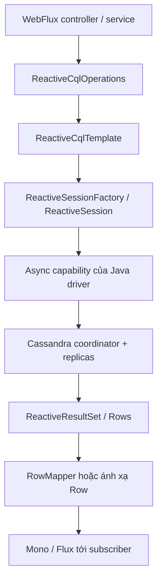
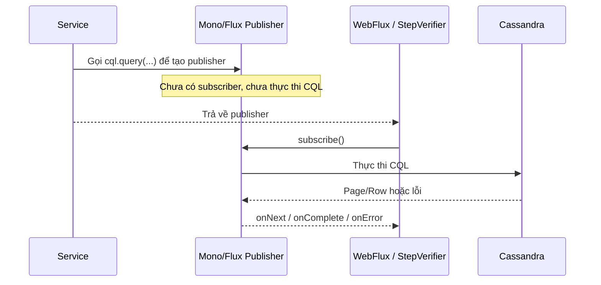

# ReactiveCqlTemplate cho CQL cấp thấp

Trong **Spring Data Cassandra**, không phải lúc nào lập trình viên cũng muốn truy cập database thông qua entity và repository. Có lúc ứng dụng cần chạy một câu **CQL đặc thù**, chỉ lấy vài cột, tăng một counter, đọc metadata từ `system.local`, gọi truy vấn tối ưu theo partition key, hoặc tự ánh xạ kết quả thành DTO nhẹ. Nếu hệ thống xây dựng trên **Spring WebFlux** hay Project Reactor, ta còn muốn biểu diễn thao tác đó dưới dạng **`Mono`** hoặc **`Flux`**, thay vì chặn thread trong lúc chờ Cassandra.

**`ReactiveCqlTemplate`** là công cụ CQL cấp thấp của Spring Data Cassandra. Nó nhận **CQL/Statement**, xử lý các vấn đề chung như chuẩn bị và bind tham số, thực thi thông qua hạ tầng Cassandra reactive, ánh xạ từng `Row` bằng callback và chuyển ngoại lệ driver thành hệ ngoại lệ `DataAccessException` của Spring. Nó **không mặc nhiên ánh xạ entity dựa trên `@Table`/`@Column`** như `ReactiveCassandraTemplate`.

Bài thuộc chương **Truy cập phản ứng** của module **SPRING_DATA_CASSANDRA** — học truy cập Apache Cassandra bằng entity mapping, repository, CassandraTemplate và CQL, đồng thời thiết kế bảng theo truy vấn, partition key, consistency, paging và hiệu năng phù hợp hệ dữ liệu phân tán. Ta sẽ viết DAO reactive với `ReactiveCqlOperations`, chạy `SELECT`, `INSERT`, `UPDATE`, `DELETE`, prepared CQL, tùy chọn page size, Reactor error handling và integration test.

> Ví dụ tham chiếu **Spring Data Cassandra 4.5.x**, Java driver 4.x, Java 17+ và một Cassandra server hỗ trợ CQL tương ứng. Không giả định Java driver tự là một thư viện Reactive Streams thuần: Spring Data xây dựng API reactive dựa trên khả năng **asynchronous** của driver và hạ tầng Reactive Streams. Chỉ dùng keyspace/bảng thử nghiệm, không tự bật schema creation ở production.

## 1. Mục tiêu học tập

Sau bài này, bạn có thể:

1. Giải thích vai trò và ranh giới của **`ReactiveCqlTemplate`** so với `CqlTemplate`, `ReactiveCassandraTemplate` và reactive repository.
2. Cấu hình hoặc inject **`ReactiveCqlOperations`**/**`ReactiveCqlTemplate`** từ Spring context.
3. Hiểu `Mono<T>`, `Flux<T>`, **composition**, **subscription** và vì sao không dùng `block()` trong luồng reactive.
4. Thực thi `INSERT`/`UPDATE`/`DELETE` bằng **`execute(String, Object...)`** và đọc kết quả `Mono<Boolean>` đúng nghĩa.
5. Đọc một giá trị bằng `queryForObject`, một row bằng `queryForMap`/`queryForRows`, nhiều row bằng `query` với `RowMapper`.
6. Dùng **bind markers `?`** và prepared statements, tránh ghép giá trị người dùng vào câu CQL.
7. Tùy biến truy vấn bằng `Statement<?>`, **page size**, `LIMIT` và consistency level mà không quét dữ liệu ngoài ý muốn.
8. Phân biệt **`ReactiveResultSet.rows()`** với **`availableRows()`** và biết rằng paging không tạo snapshot transaction.
9. Sử dụng `flatMap`/`then`/`onErrorMap`/`doOnError`/`timeout` đúng cách, không nuốt lỗi và không retry mutation thiếu idempotency.
10. Viết integration test qua `StepVerifier` chứng minh publisher chạy khi subscribe và dữ liệu thật được ghi/đọc đúng.

## 2. ReactiveCqlTemplate ở tầng nào?

Có ba tầng truy cập phổ biến:

| API | Trả về | Ai viết CQL? | Mapping |
|---|---|---|---|
| **`CqlTemplate`** | Giá trị/`List` đồng bộ | Ứng dụng | Tự chọn column, `RowMapper`, callback |
| **`ReactiveCqlTemplate`** | **`Mono`/`Flux`** | **Ứng dụng** | `RowMapper` hoặc đọc `Row` trực tiếp; không tự mapping entity |
| **`ReactiveCassandraTemplate`** | **`Mono`/`Flux`** | Framework với `Query`/`Criteria`, hoặc nhận Statement | Có Cassandra entity mapping, converter và annotations |
| **Reactive repository** | `Mono`/`Flux` | Framework từ phương thức/`@Query` | Entity/projection theo repository |

**Quy tắc chọn:**

- Cần CQL gần với server, lấy `Row`, map scalar, tăng counter, làm ad-hoc query: dùng **`ReactiveCqlTemplate`**.
- Cần persist/đọc entity có `@Table`, `@PrimaryKey`, converter, query DSL: dùng **`ReactiveCassandraTemplate`**.
- CRUD/domain queries thông thường: reactive repository thường ngắn gọn hơn.
- Chỉ cần đồng bộ và đang ở ứng dụng imperative: `CqlTemplate` có thể đủ; không bọc lời gọi blocking bằng `Mono.just(...)` rồi tự nhận là non-blocking.

### 2.1. Kiến trúc luồng dữ liệu



Ở phía ứng dụng, ta xây dựng **publisher** qua `Mono`/`Flux`. Khi subscriber của WebFlux hoặc test kích hoạt chuỗi, thao tác Cassandra được thực thi. Có sự điều phối giữa luồng đọc, backpressure và các yêu cầu fetch page; tuy nhiên **không** nên nhầm “reactive” với “query luôn sử dụng ít CPU” hay “Cassandra luôn trả dữ liệu tức thì”.

### 2.2. Những điều ReactiveCqlTemplate làm và không làm

**Có làm:**

- Thực thi CQL ở chế độ reactive.
- Cung cấp overload dùng tham số bind và statement của driver.
- Hỗ trợ `RowMapper`, callback và `ReactiveResultSet`.
- Giúp dịch `DriverException` thành các ngoại lệ Spring có ý nghĩa hơn.
- Tái sử dụng hạ tầng session đã cấu hình; template **thread-safe sau khi khởi tạo**.

**Không tự làm:**

- Tạo partition key, index hoặc read model đúng nghiệp vụ.
- Tự chuyển `Row` thành entity gắn `@Table` như tầng mapping cao hơn.
- Biến mọi query thành prepared statement khi bạn chỉ truyền **CQL string tĩnh không tham số**.
- Giới hạn tổng số row chỉ vì có `Flux`.
- Cung cấp transaction SQL/rollback xuyên nhiều partition.
- Bảo đảm tất cả publisher được thực thi nếu không có subscription.

## 3. Mono, Flux và thời điểm thực thi

### 3.1. Mono cho tối đa một tín hiệu dữ liệu

`Mono<T>` biểu diễn **0 hoặc 1 phần tử**, hoặc hoàn thành trống, hoặc lỗi:

```java
Mono<Boolean> applied = cql.execute(
    "UPDATE sdc_reactive_lab.messages_by_thread " +
    "SET body = ? " +
    "WHERE tenant_id = ? AND thread_id = ? " +
    "AND created_at = ? AND message_id = ?",
    "New body", tenantId, threadId, createdAt, messageId
);
```

Ở đây `applied` là **publisher**, không phải `boolean` đã được tính. Nếu chương trình không subscribe hoặc không trả publisher cho framework, không nên kỳ vọng CQL đã chạy.

### 3.2. Flux cho nhiều row

`Flux<T>` biểu diễn **0 đến nhiều phần tử**:

```java
Flux<String> bodies = cql.queryForFlux(
    "SELECT body FROM sdc_reactive_lab.messages_by_thread " +
    "WHERE tenant_id = ? AND thread_id = ? LIMIT ?",
    String.class,
    tenantId, threadId, 20
);
```

`Flux` cung cấp khả năng tiêu thụ kết quả dần dần, nhưng **không** bảo đảm query chỉ đọc 20 row nếu CQL không giới hạn như ví dụ; Reactor demand và giới hạn truy vấn CQL là **hai khái niệm khác nhau**.

### 3.3. Composition trước, subscription sau



Ví dụ **sai** trong service WebFlux:

```java
// Không nên: tạo publisher rồi bỏ, không ai subscribe.
public void saveMessage(MessageDto dto) {
    cql.execute(
        "INSERT INTO sdc_reactive_lab.messages_by_thread " +
        "(tenant_id, thread_id, created_at, message_id, body) " +
        "VALUES (?, ?, ?, ?, ?)",
        dto.tenantId(), dto.threadId(), dto.createdAt(),
        dto.messageId(), dto.body()
    );
}
```

Cách **đúng** là trả publisher cho caller:

```java
public Mono<Boolean> saveMessage(MessageDto dto) {
    return cql.execute(
        "INSERT INTO sdc_reactive_lab.messages_by_thread " +
        "(tenant_id, thread_id, created_at, message_id, body) " +
        "VALUES (?, ?, ?, ?, ?)",
        dto.tenantId(), dto.threadId(), dto.createdAt(),
        dto.messageId(), dto.body()
    );
}
```

### 3.4. Không block hoặc subscribe thủ công trong request handler

Hai anti-pattern:

```java
// Anti-pattern 1: chặn thread WebFlux.
Boolean result = cql.execute("...").block();

// Anti-pattern 2: tự subscribe, mất khả năng điều khiển kết quả/lỗi.
cql.execute("...").subscribe();
```

Ở controller/service reactive, nên **return Mono/Flux** và để WebFlux quản lý subscription, cancellation và phản hồi. `block()` có thể gây stall hoặc lỗi trên scheduler không cho phép blocking. `subscribe()` thủ công dễ tạo side effect không được phối hợp với HTTP response, tracing, security context hoặc xử lý lỗi.

**Ngoại lệ hợp lý:** `StepVerifier` trong test là subscriber có chủ đích; startup job độc lập có thể có cơ chế subscription/lifecycle riêng nhưng phải thiết kế rõ ràng.

## 4. Chuẩn bị Cassandra lab theo partition key

Ta dùng bài toán lưu tin nhắn trong từng cuộc hội thoại của tenant. Mỗi thread là một **partition**; `created_at` và `message_id` là clustering columns.

### 4.1. Keyspace và bảng

```sql
CREATE KEYSPACE IF NOT EXISTS sdc_reactive_lab
WITH replication = {
    'class': 'SimpleStrategy',
    'replication_factor': 1
};

CREATE TABLE IF NOT EXISTS sdc_reactive_lab.messages_by_thread (
    tenant_id uuid,
    thread_id uuid,
    created_at timestamp,
    message_id uuid,
    body text,
    author_id uuid,
    PRIMARY KEY (
        (tenant_id, thread_id),
        created_at,
        message_id
    )
) WITH CLUSTERING ORDER BY (
    created_at DESC,
    message_id ASC
);
```

**Lưu ý:** `SimpleStrategy` với RF=1 chỉ để thử nghiệm một node, không phải cấu hình production nhiều datacenter.

Thiết kế khóa:

- **Partition key**: cặp `(tenant_id, thread_id)`. Muốn liệt kê tin nhắn của thread phải biết **cả hai**.
- **Clustering columns**: `created_at`, `message_id`; tạo thứ tự trong partition và phân biệt tin nhắn có timestamp trùng.
- **Regular columns**: `body`, `author_id`; không được dùng để định tuyến truy vấn theo primary key.
- **Read pattern**: xem N tin nhắn mới nhất của một thread theo clustering order.

### 4.2. Nạp dữ liệu thử

```sql
INSERT INTO sdc_reactive_lab.messages_by_thread
(tenant_id, thread_id, created_at, message_id, body, author_id)
VALUES (
    11111111-1111-1111-1111-111111111111,
    22222222-2222-2222-2222-222222222222,
    '2026-11-25T08:00:00Z',
    aaaaaaaa-aaaa-aaaa-aaaa-aaaaaaaaaaaa,
    'Xin chao',
    99999999-9999-9999-9999-999999999999
);

INSERT INTO sdc_reactive_lab.messages_by_thread
(tenant_id, thread_id, created_at, message_id, body, author_id)
VALUES (
    11111111-1111-1111-1111-111111111111,
    22222222-2222-2222-2222-222222222222,
    '2026-11-25T08:01:00Z',
    bbbbbbbb-bbbb-bbbb-bbbb-bbbbbbbbbbbb,
    'Bat dau bai reactive',
    99999999-9999-9999-9999-999999999999
);

INSERT INTO sdc_reactive_lab.messages_by_thread
(tenant_id, thread_id, created_at, message_id, body, author_id)
VALUES (
    11111111-1111-1111-1111-111111111111,
    22222222-2222-2222-2222-222222222222,
    '2026-11-25T08:02:00Z',
    cccccccc-cccc-cccc-cccc-cccccccccccc,
    'CQL truc tiep va Reactor',
    88888888-8888-8888-8888-888888888888
);
```

Sau khi seed trên một partition mới, query sau có **ba row**, mới nhất trước:

```sql
SELECT tenant_id, thread_id, created_at,
       message_id, body, author_id
FROM sdc_reactive_lab.messages_by_thread
WHERE tenant_id = 11111111-1111-1111-1111-111111111111
  AND thread_id = 22222222-2222-2222-2222-222222222222
LIMIT 20;
```

`LIMIT 20` giới hạn tổng row trả về. Nếu chỉ thiết lập page size 20 nhưng **không có `LIMIT`**, query có thể còn nhiều page khác.

### 4.3. Vì sao không tạo một bảng bất kỳ rồi ALLOW FILTERING?

Một query như `WHERE body = 'Xin chao'` không thể chạy hiệu quả trên bảng trên nếu không có index/read model phù hợp. `ReactiveCqlTemplate` chỉ thay **API truy cập**, **không thay mô hình dữ liệu Cassandra**. Tốc độ phản hồi phải đến từ partition key và clustering phù hợp, không phải từ việc chuyển `List` thành `Flux`.

## 5. Chuẩn bị ứng dụng Spring

### 5.1. Dependency

Với Spring Boot 3.x tương thích với Spring Data Cassandra 4.5, dependency thường dùng là:

```xml
<dependency>
    <groupId>org.springframework.boot</groupId>
    <artifactId>spring-boot-starter-data-cassandra-reactive</artifactId>
</dependency>
```

Nếu triển khai HTTP reactive, thêm starter WebFlux:

```xml
<dependency>
    <groupId>org.springframework.boot</groupId>
    <artifactId>spring-boot-starter-webflux</artifactId>
</dependency>
```

**Quản lý phiên bản:** dùng Spring Boot BOM tương thích với release train Spring Data đã chọn; không tùy ý ghép Spring Boot rất mới và Spring Data 4.5 mà chưa kiểm tra matrix compatibility.

### 5.2. Cấu hình kết nối

```yaml
spring:
  cassandra:
    contact-points: 127.0.0.1
    port: 9042
    local-datacenter: datacenter1
    keyspace-name: sdc_reactive_lab
```

`datacenter1` chỉ là ví dụ; xác minh bằng `SELECT data_center FROM system.local;` trong môi trường thật. Với production cần TLS, authentication, credentials từ secret manager, timeouts và connection policy thích hợp.

**Không dùng `ReactiveCqlTemplate` để tự tạo keyspace ở mỗi lần ứng dụng khởi động**. DDL/migration nên thuộc quy trình triển khai có kiểm soát.

### 5.3. ReactiveSessionFactory và bean template

`ReactiveCqlTemplate` có constructor nhận **`ReactiveSessionFactory`**. Nếu framework/configuration đã cung cấp bean, chỉ cần inject; nếu chưa, có thể cấu hình bean:

```java
import org.springframework.context.annotation.Bean;
import org.springframework.context.annotation.Configuration;

import org.springframework.data.cassandra.ReactiveSessionFactory;
import org.springframework.data.cassandra.core.cql.ReactiveCqlTemplate;

@Configuration(proxyBeanMethods = false)
public class ReactiveCqlConfiguration {

    @Bean
    ReactiveCqlTemplate reactiveCqlTemplate(
        ReactiveSessionFactory sessionFactory
    ) {
        return new ReactiveCqlTemplate(sessionFactory);
    }
}
```

Chỉ khai báo bean này **nếu ứng dụng chưa tự có bean tương đương**; `AbstractReactiveCassandraConfiguration` có thể tạo sẵn `reactiveCqlTemplate()`. `ReactiveSessionFactory` nên là bean quản lý bởi Spring, không tạo `CqlSession` mới cho từng truy vấn.

### 5.4. Ưu tiên inject interface

```java
import org.springframework.data.cassandra.core.cql.ReactiveCqlOperations;
import org.springframework.stereotype.Repository;

@Repository
public class LowLevelMessageDao {

    private final ReactiveCqlOperations cql;

    public LowLevelMessageDao(ReactiveCqlOperations cql) {
        this.cql = cql;
    }
}
```

`ReactiveCqlTemplate` implements **`ReactiveCqlOperations`**. Inject interface giúp test/mock/stub thuận tiện, giảm coupling vào implementation. Template có thể **dùng chung giữa nhiều thread** sau khi cấu hình xong; chỉ nên tạo publisher và statement theo request.

## 6. CQL thấp tầng: execute với INSERT, UPDATE và DELETE

### 6.1. INSERT có bind marker

`ReactiveCqlOperations.execute(String, Object...)` trả **`Mono<Boolean>`**. Khi có varargs arguments, Spring Data sử dụng **prepared statement** và bind các giá trị theo vị trí.

```java
import java.time.Instant;
import java.util.UUID;

import reactor.core.publisher.Mono;
import org.springframework.data.cassandra.core.cql.ReactiveCqlOperations;

public class MessageWriteDao {

    private static final String INSERT = """
        INSERT INTO sdc_reactive_lab.messages_by_thread
        (tenant_id, thread_id, created_at, message_id, body, author_id)
        VALUES (?, ?, ?, ?, ?, ?)
        """;

    private final ReactiveCqlOperations cql;

    public MessageWriteDao(ReactiveCqlOperations cql) {
        this.cql = cql;
    }

    public Mono<Boolean> insert(
        UUID tenantId, UUID threadId, Instant createdAt,
        UUID messageId, String body, UUID authorId
    ) {
        return cql.execute(
            INSERT,
            tenantId, threadId, createdAt,
            messageId, body, authorId
        );
    }
}
```

**Ý nghĩa:**

- `execute(...)` biểu diễn một thao tác CQL write trong publisher.
- Các đối số Java được bind theo đúng thứ tự dấu `?`.
- `Mono<Boolean>` phát kết quả **sau khi subscription và statement hoàn tất**.
- Với `INSERT` **không có `IF`**, giá trị `true` thường nghĩa statement không điều kiện được áp dụng theo semantics CQL, **không** chứng minh row chưa tồn tại.
- Cassandra `INSERT` có semantics **upsert** theo primary key; nếu cần tạo-dành-riêng, cân nhắc `IF NOT EXISTS` và kiểm tra applied flag.

### 6.2. UPDATE phải cung cấp khóa đầy đủ

```java
private static final String UPDATE_BODY = """
    UPDATE sdc_reactive_lab.messages_by_thread
    SET body = ?
    WHERE tenant_id = ?
      AND thread_id = ?
      AND created_at = ?
      AND message_id = ?
    """;

public Mono<Boolean> updateBody(
    UUID tenantId, UUID threadId, Instant createdAt,
    UUID messageId, String newBody
) {
    return cql.execute(
        UPDATE_BODY,
        newBody, tenantId, threadId, createdAt, messageId
    );
}
```

Đây là fragment nối vào `MessageWriteDao` có `cql` từ ví dụ trước. Vì table có composite partition key và hai clustering columns, một update đúng một message cần cung cấp đầy đủ **`tenant_id`, `thread_id`, `created_at`, `message_id`**.

**Không hiểu UPDATE trả true là “chắc chắn có row cũ”**. Cassandra UPDATE thường là upsert; một khóa chưa tồn tại có thể tạo dữ liệu nếu câu lệnh hợp lệ. Muốn check precondition phải dùng LWT hoặc giải pháp nghiệp vụ riêng.

### 6.3. DELETE theo primary key

```java
private static final String DELETE_ONE = """
    DELETE FROM sdc_reactive_lab.messages_by_thread
    WHERE tenant_id = ?
      AND thread_id = ?
      AND created_at = ?
      AND message_id = ?
    """;

public Mono<Boolean> deleteOne(
    UUID tenantId, UUID threadId, Instant createdAt, UUID messageId
) {
    return cql.execute(
        DELETE_ONE, tenantId, threadId, createdAt, messageId
    );
}
```

DELETE tạo **tombstone**; `true` không bảo đảm row từng tồn tại hoặc bytes đã được xóa vật lý ngay. Cần lưu ý TTL, write timestamp, retry và consistency khi nhận một kết quả đọc khác mong đợi.

### 6.4. Khi không cần Boolean, dùng then()

Ở service command, có thể chỉ cần completion:

```java
public Mono<Void> insertAndComplete(MessageDto message) {
    return cql.execute(
        INSERT,
        message.tenantId(), message.threadId(), message.createdAt(),
        message.messageId(), message.body(), message.authorId()
    ).then();
}
```

`then()` bỏ qua giá trị `Boolean` nhưng **vẫn truyền lỗi** downstream. Không dùng `then()` nếu lệnh có `IF NOT EXISTS`/`IF ...` mà nghiệp vụ cần kiểm tra `false`; lúc đó phải phân nhánh theo applied flag.

## 7. SELECT trả nhiều row: query + RowMapper

### 7.1. DTO mỏng không dùng entity mapping

`ReactiveCqlTemplate` hoạt động CQL thấp tầng; ta tự ánh xạ `Row` thành DTO:

```java
import java.time.Instant;
import java.util.UUID;

public record MessageDto(
    UUID tenantId,
    UUID threadId,
    Instant createdAt,
    UUID messageId,
    String body,
    UUID authorId
) {}
```

`MessageDto` là một Java record, **không cần `@Table`, `@Column`, `@PrimaryKey`**. Chính DAO chịu trách nhiệm chọn tên cột và parse kiểu.

### 7.2. RowMapper của Spring Data Cassandra

```java
import org.springframework.data.cassandra.core.cql.RowMapper;

public final class MessageRowMapper
        implements RowMapper<MessageDto> {

    @Override
    public MessageDto mapRow(
        com.datastax.oss.driver.api.core.cql.Row row, int rowNum
    ) {
        return new MessageDto(
            row.getUuid("tenant_id"),
            row.getUuid("thread_id"),
            row.getInstant("created_at"),
            row.getUuid("message_id"),
            row.getString("body"),
            row.getUuid("author_id")
        );
    }
}
```

Chú ý:

- `RowMapper` nằm trong package **`org.springframework.data.cassandra.core.cql`**.
- `Row` của Java driver được truy cập bằng các getter typed như `getUuid`, `getInstant` và `getString`.
- Không dùng `row.getString("created_at")` nếu cột là CQL `timestamp` rồi mong framework tự chuyển thành `Instant`.
- Null của regular column có thể hợp lệ; DTO cần quy ước null handling nếu field bắt buộc.
- Mapping chạy trên luồng phát row; tránh I/O blocking hoặc xử lý CPU rất nặng trong `mapRow`.

### 7.3. DAO dùng query(String, RowMapper, args...)

```java
import java.util.UUID;

import reactor.core.publisher.Flux;
import org.springframework.data.cassandra.core.cql.ReactiveCqlOperations;

public class MessageReadDao {

    private static final String RECENT = """
        SELECT tenant_id, thread_id, created_at,
               message_id, body, author_id
        FROM sdc_reactive_lab.messages_by_thread
        WHERE tenant_id = ? AND thread_id = ?
        LIMIT ?
        """;

    private final ReactiveCqlOperations cql;
    private final MessageRowMapper mapper = new MessageRowMapper();

    public MessageReadDao(ReactiveCqlOperations cql) {
        this.cql = cql;
    }

    public Flux<MessageDto> recent(
        UUID tenantId, UUID threadId, int maxRows
    ) {
        if (tenantId == null || threadId == null) {
            return Flux.error(
                new IllegalArgumentException("Thieu partition key")
            );
        }
        if (maxRows < 1 || maxRows > 100) {
            return Flux.error(
                new IllegalArgumentException("LIMIT phai tu 1..100")
            );
        }

        return cql.query(
            RECENT, mapper,
            tenantId, threadId, maxRows
        );
    }
}
```

**Cần hai phần khóa phân vùng.** `WHERE thread_id = ?` riêng lẻ không phù hợp access pattern của bảng. `LIMIT ?` được bind để giới hạn kết quả server trả; ứng dụng validate `maxRows` để không cho request tùy ý đòi hàng triệu bản ghi.

**Thứ tự:** Cassandra trả row theo clustering order trong partition, nên query có thể dùng để xem tin nhắn mới nhất trước. Không suy rộng thứ tự này thành global order nhiều partition.

### 7.4. Query nhiều row không mặc định trả List

`cql.query(...)` trả `Flux<MessageDto>`. Nếu endpoint thật sự cần một danh sách nhỏ, có thể:

```java
Mono<List<MessageDto>> page = dao.recent(
    tenantId, threadId, 20
).collectList();
```

Chỉ `collectList()` khi đã **giới hạn/kiểm soát** tổng row. Với query không có `LIMIT`, thao tác này có thể materialize toàn bộ kết quả trong heap, làm mất lợi ích streaming và tăng áp lực bộ nhớ.

## 8. Các biến thể SELECT cấp thấp

### 8.1. queryForRows: lấy Row để tự map

Nếu mapping đơn giản, không cần tạo một class `RowMapper`:

```java
Flux<MessageDto> messages = cql.queryForRows(
    """
    SELECT tenant_id, thread_id, created_at,
           message_id, body, author_id
    FROM sdc_reactive_lab.messages_by_thread
    WHERE tenant_id = ? AND thread_id = ?
    LIMIT ?
    """,
    tenantId, threadId, 20
).map(row -> new MessageDto(
    row.getUuid("tenant_id"),
    row.getUuid("thread_id"),
    row.getInstant("created_at"),
    row.getUuid("message_id"),
    row.getString("body"),
    row.getUuid("author_id")
));
```

`queryForRows` trả **`Flux<com.datastax.oss.driver.api.core.cql.Row>`**. Hãy chuyển thành DTO gần nơi truy cập DB; không đẩy `Row`/các loại driver-specific tới Web API nếu có thể tránh.

### 8.2. queryForObject: một cột, một row

Ví dụ truy vấn `COUNT(*)` của một partition trong lab:

```java
Mono<Long> count = cql.queryForObject(
    """
    SELECT COUNT(*)
    FROM sdc_reactive_lab.messages_by_thread
    WHERE tenant_id = ? AND thread_id = ?
    """,
    Long.class,
    tenantId, threadId
);
```

`queryForObject(String, Class<T>, Object...)` kỳ vọng **một hàng/một cột** (ở đây `COUNT(*)`). Trường hợp số hàng hoặc cột không đúng sẽ gây `IncorrectResultSizeDataAccessException` theo contract. Với giá trị CQL `null`, reactive method có thể trả `Mono.empty()`.

**Chú ý hiệu năng:** `COUNT(*)` trong Cassandra cần đếm các row liên quan; không nên đặt vào hot path của API chỉ để lấy tổng số tin nhắn mỗi lần mở trang. Nếu cần counters chính xác/ước lượng theo yêu cầu nghiệp vụ, thiết kế read model/aggregation riêng.

### 8.3. queryForMap: một row linh hoạt

```java
Mono<java.util.Map<String, Object>> one = cql.queryForMap(
    """
    SELECT body, author_id
    FROM sdc_reactive_lab.messages_by_thread
    WHERE tenant_id = ? AND thread_id = ?
      AND created_at = ? AND message_id = ?
    """,
    tenantId, threadId, createdAt, messageId
);
```

`queryForMap` thích hợp cho truy vấn ad-hoc không có model cố định, nhưng phải nhớ:

- Kỳ vọng **một row**; nhiều hoặc không có row có thể tạo lỗi result-size.
- `Map` mất ưu thế type-safety so với DTO.
- Null-value semantics và tên key cần được xử lý rõ khi đưa qua API.

### 8.4. queryForFlux: nhiều giá trị cùng một cột

```java
Flux<String> bodies = cql.queryForFlux(
    """
    SELECT body
    FROM sdc_reactive_lab.messages_by_thread
    WHERE tenant_id = ? AND thread_id = ?
    LIMIT ?
    """,
    String.class,
    tenantId, threadId, 20
);
```

`queryForFlux(..., String.class, ...)` phù hợp truy vấn **một cột** trả nhiều row. Đừng truyền `MessageDto.class` và mong thư viện tự map mọi cột vào record; đó là nhiệm vụ của `RowMapper` hoặc tầng entity mapping cao hơn.

### 8.5. Truy vấn theo khóa nhưng muốn Mono.empty nếu không tồn tại

Một truy vấn exact-key có thể không có row. Thay vì ép `queryForObject`, dùng:

```java
Mono<MessageDto> byKey = cql.queryForRows(
    """
    SELECT tenant_id, thread_id, created_at,
           message_id, body, author_id
    FROM sdc_reactive_lab.messages_by_thread
    WHERE tenant_id = ? AND thread_id = ?
      AND created_at = ? AND message_id = ?
    """,
    tenantId, threadId, createdAt, messageId
).next().map(row -> new MessageDto(
    row.getUuid("tenant_id"),
    row.getUuid("thread_id"),
    row.getInstant("created_at"),
    row.getUuid("message_id"),
    row.getString("body"),
    row.getUuid("author_id")
));
```

Ở đây `next()` chuyển `Flux<Row>` thành `Mono<Row>` lấy phần tử đầu tiên và **có thể rỗng** nếu không có bản ghi. Dùng khi CQL đã truy vấn **đúng khóa**, nên dự kiến tối đa một row. Nếu query đáng ra phải trả chính xác một kết quả và 0 row là lỗi nghiệp vụ, chọn API và xử lý lỗi rõ ràng.

## 9. Prepared CQL và bind parameters

### 9.1. Khi nào Spring chuẩn bị statement?

Tài liệu Spring Data Cassandra phân biệt:

- `query("SELECT ...", mapper)` với **CQL tĩnh** không có bind arguments thường gửi dạng statement trực tiếp, không yêu cầu chuẩn bị trước.
- `query("SELECT ... WHERE id = ?", mapper, id)` với args sử dụng **prepared statement**, bind args theo thứ tự.
- `execute("UPDATE ... WHERE id = ?", arg1, id)` tương tự sử dụng prepared.
- API có `ReactivePreparedStatementCreator`, `PreparedStatementBinder` để kiểm soát quá trình chuẩn bị/bind khi cần.

`PreparedStatement` được **cache trong Java driver 4.x**; phần lớn ứng dụng không cần tự xây thêm một cache câu prepared theo string.

### 9.2. Đừng tự ghép input thành CQL

**Không nên:**

```java
String cql = "SELECT body FROM messages_by_thread " +
    "WHERE tenant_id = " + userProvidedTenant +
    " AND thread_id = " + userProvidedThread;
```

Ngay cả khi UUID thường không chứa dấu nháy, việc nối input vào CQL vẫn dễ sai format, tạo query thay đổi liên tục, khó parameterize, và là thói quen nguy hiểm nếu sau đó dùng `text`.

**Nên:**

```java
Flux<String> bodies = cql.queryForFlux(
    """
    SELECT body
    FROM sdc_reactive_lab.messages_by_thread
    WHERE tenant_id = ? AND thread_id = ?
    LIMIT ?
    """,
    String.class,
    tenantId, threadId, 20
);
```

CQL chứa **cấu trúc cố định**, tham số truyền dưới dạng typed values. Driver và server xử lý binding với metadata của prepared statement.

### 9.3. PreparedStatementCreator và Binder

Khi cần kiểm soát sự chuẩn bị, Spring Data 4.5 hỗ trợ overload:

```java
import reactor.core.publisher.Flux;
import org.springframework.data.cassandra.core.cql.ReactiveCqlOperations;

public Flux<String> findBodiesWithCallbacks(
    ReactiveCqlOperations cql,
    UUID tenantId,
    UUID threadId
) {
    return cql.query(
        session -> session.prepare("""
            SELECT body
            FROM sdc_reactive_lab.messages_by_thread
            WHERE tenant_id = ? AND thread_id = ?
            LIMIT 20
            """),
        prepared -> prepared.bind(tenantId, threadId),
        (row, rowNum) -> row.getString("body")
    );
}
```

Ở đây:

1. **ReactivePreparedStatementCreator** gọi `session.prepare(CQL)` qua `ReactiveSession`.
2. **PreparedStatementBinder** tạo bound statement với `tenantId`, `threadId`.
3. **RowMapper** chuyển từng `Row` thành `String`.
4. `query(...)` trả `Flux<String>` để caller subscribe.

Không cần sử dụng callback cho mỗi query: overload CQL + varargs đủ với đa số trường hợp. Callback phù hợp khi muốn áp statement settings đặc thù hoặc kiểm soát binder theo metadata.

### 9.4. CQL parameter binding không thay authorization

`tenantId` được bind đúng kiểu không đồng nghĩa người gọi có quyền đọc tenant đó. Tầng API phải **xác thực người dùng**, lấy tenant scope từ security context đáng tin cậy và kiểm tra quyền truy cập. Không đặt `tenantId` từ raw path vào query rồi coi việc có WHERE là multi-tenancy isolation.

## 10. Cấu hình page size, LIMIT và ReactiveResultSet

### 10.1. Page size không phải LIMIT

Trong Cassandra:

- **`LIMIT 20`**: giới hạn tổng số row mà query trả về.
- **Page size/fetch size 20**: số row mục tiêu được lấy trong **một trang từ driver/server**, chưa phải tổng giới hạn.
- **`Flux`**: cách tiêu thụ kết quả theo tín hiệu `onNext` và demand; không có nghĩa các phần tử đều đã ở bộ nhớ ngay từ đầu.
- **Paging state**: vị trí tiếp tục truy vấn giữa các trang, **không phải snapshot transaction bất biến**.

| Thiết lập | Giới hạn tổng row? | Có thể fetch thêm page? |
|---|---|---|
| `LIMIT 20`, page size 100 | Có, tối đa 20 | Thường một trang nếu đủ |
| `LIMIT 1000`, page size 50 | Có, tối đa 1000 | Có thể nhiều trang |
| Không `LIMIT`, page size 50 | **Không** | Có thể tiếp tục nhiều page |
| `flux.take(20)` sau query không LIMIT | Chỉ hạn chế phần tử downstream | Driver có thể đã fetch một page lớn hơn và server vẫn xử lý query phù hợp |

### 10.2. Per-statement page size

Java driver 4.x cho phép cấu hình `setPageSize`:

```java
import com.datastax.oss.driver.api.core.cql.SimpleStatement;

SimpleStatement statement = SimpleStatement.newInstance(
    """
    SELECT tenant_id, thread_id, created_at,
           message_id, body, author_id
    FROM sdc_reactive_lab.messages_by_thread
    WHERE tenant_id = ? AND thread_id = ?
    LIMIT ?
    """,
    tenantId, threadId, 100
).setPageSize(25);

Flux<MessageDto> messages = cql.query(
    statement, new MessageRowMapper()
);
```

`Statement<?>` được `ReactiveCqlOperations.query(...)` chấp nhận. `SimpleStatement` dùng query string và bound values theo driver; để tối ưu những query chạy lặp lại, có thể dùng overload prepared của Spring hoặc chuẩn bị statement riêng.

**Java driver statements là immutable**: `setPageSize(25)` trả về statement mới, vì vậy phải **chain hoặc gán kết quả**, không gọi setter rồi bỏ đi.

### 10.3. Template-level page size

`ReactiveCqlTemplate` cũng có cấu hình `setPageSize(int)` (phương thức `setFetchSize` cũ đã deprecated):

```java
@Bean
ReactiveCqlTemplate reactiveCqlTemplate(
    ReactiveSessionFactory factory
) {
    ReactiveCqlTemplate template = new ReactiveCqlTemplate(factory);
    template.setPageSize(64);
    return template;
}
```

Đoạn code này chỉ nên dùng thay thế cấu hình bean ở mục 5 nếu ứng dụng chưa có bean tương đương. Page size cần được đánh giá theo chiều rộng row, SLA và tải; `64` chỉ là ví dụ.

### 10.4. ReactiveResultSet.rows() và availableRows()

Ở cấp thấp hơn:

```java
import org.springframework.data.cassandra.ReactiveResultSet;

Mono<ReactiveResultSet> resultSet = cql.queryForResultSet(
    """
    SELECT tenant_id, thread_id, created_at,
           message_id, body, author_id
    FROM sdc_reactive_lab.messages_by_thread
    WHERE tenant_id = ? AND thread_id = ?
    LIMIT ?
    """,
    tenantId, threadId, 100
);

Flux<MessageDto> allRows = resultSet.flatMapMany(
    result -> result.rows()
        .map(row -> new MessageDto(
            row.getUuid("tenant_id"),
            row.getUuid("thread_id"),
            row.getInstant("created_at"),
            row.getUuid("message_id"),
            row.getString("body"),
            row.getUuid("author_id")
        ))
);
```

**`ReactiveResultSet`** có hai method quan trọng:

| Method | Ý nghĩa |
|---|---|
| **`rows()`** | `Flux<Row>` tự xử lý **transparent paging**, lấy các trang tiếp theo theo reactive demand |
| **`availableRows()`** | `Flux<Row>` chỉ của **chunk/page đang có**, không tự fetch hết các trang sau |

`availableRows()` hữu ích khi bạn chủ động xây cơ chế tiếp trang, nhưng phải hiểu paging state và lifetime của result set. Trong phần lớn bài học mapping nhiều row, dùng `cql.query(...)` hoặc `result.rows()` đơn giản và ít lỗi hơn.

`ReactiveResultSet` có **execution info** và column definitions; đây là abstraction cấp thấp, **không thread-safe** theo JavaDoc. Không giữ một result set rồi chia nhiều subscriber/threads tùy ý.

### 10.5. Backpressure không sửa được CQL tốn kém

`Flux` có cơ chế demand/backpressure giúp ứng dụng kiểm soát tốc độ tiêu thụ row. Nhưng nó **không**:

- Biến `SELECT *` toàn bảng thành đọc một partition.
- Loại bỏ chi phí index scan/tombstone hoặc coordinator fan-out.
- Bảo đảm driver đã fetch đúng từng row một thay vì theo page.
- Giữ một snapshot nhất quán xuyên nhiều page trong khi có concurrent writers.
- Thay cho `LIMIT`, bucketing và paging token ở API.

Cần phối hợp **đường truy vấn theo partition**, `LIMIT`, page size, giới hạn concurrency và quan sát p95/p99 thực tế.

## 11. Reactive composition cho service nghiệp vụ

### 11.1. flatMap: ghi xong rồi đọc lại

Ví dụ chỉ đọc message sau khi mutation đã được thực thi:

```java
public Mono<MessageDto> createThenRead(MessageDto dto) {
    return writeDao.insert(
        dto.tenantId(), dto.threadId(), dto.createdAt(),
        dto.messageId(), dto.body(), dto.authorId()
    ).flatMap(applied -> {
        if (!applied) {
            return Mono.error(
                new IllegalStateException("Write khong duoc ap dung")
            );
        }
        return readDao.findByPrimaryKey(
            dto.tenantId(), dto.threadId(),
            dto.createdAt(), dto.messageId()
        );
    });
}
```

Phương thức `findByPrimaryKey` ở đây là một helper DAO được định nghĩa theo `queryForRows(...).next()` như mục 8.5. Vì `flatMap` chỉ gọi sau khi upstream phát kết quả, chuỗi biểu diễn **thứ tự async** mà không block.

**Tuy nhiên:** insert thường là upsert, `applied=true` không chứng minh đây là bản ghi mới duy nhất. Và một `SELECT` sau write còn phụ thuộc read/write consistency cùng cạnh tranh từ writer khác.

### 11.2. thenMany: write hoàn tất rồi phát danh sách

```java
public Flux<MessageDto> writeAndList(
    MessageDto dto, int limit
) {
    return writeDao.insert(
        dto.tenantId(), dto.threadId(), dto.createdAt(),
        dto.messageId(), dto.body(), dto.authorId()
    ).thenMany(
        readDao.recent(dto.tenantId(), dto.threadId(), limit)
    );
}
```

`thenMany` không dùng Boolean kết quả; nếu lệnh là **conditional insert** mà `false` mang nghĩa thất bại, cách này có thể che giấu điều kiện không đạt. Với CAS/LWT, **kiểm tra applied flag trước khi tiếp tục**.

### 11.3. Không tự tạo nested subscriptions

**Sai:**

```java
return writeDao.insert(...).doOnNext(ok -> {
    readDao.recent(tenantId, threadId, 20)
        .subscribe(); // Side effect không quản lý.
});
```

**Đúng về mặt cấu trúc:**

```java
return writeDao.insert(...)
    .flatMapMany(ok ->
        ok
            ? readDao.recent(tenantId, threadId, 20)
            : Flux.error(new IllegalStateException("CAS failed"))
    );
```

Hai đoạn dùng biến/callsite giả định đã có để minh họa **Reactor operators**, không phải code copy chạy độc lập. Khi kết hợp publisher, dùng `flatMap`/`flatMapMany`/`concatMap`/`then` thay cho `subscribe()` lồng.

### 11.4. flatMap có thể đồng thời hóa nhiều thao tác

`Flux.fromIterable(commands).flatMap(command -> cql.execute(...))` có thể tạo nhiều request đang chạy song song. Điều này có lợi với partition độc lập nhưng cần **giới hạn concurrency** và retry policy:

```java
Flux<Boolean> results = Flux.fromIterable(commands)
    .flatMap(
        cmd -> writeDao.insert(
            cmd.tenantId(), cmd.threadId(), cmd.createdAt(),
            cmd.messageId(), cmd.body(), cmd.authorId()
        ),
        8 // Tối đa 8 inner publisher chạy đồng thời.
    );
```

Không áp dụng tự động cho những message cần **thứ tự cập nhật** trong cùng row. Nếu cần xử lý tuần tự trong một luồng, cân nhắc `concatMap`; dù vậy thứ tự gọi Java **không biến các write Cassandra thành CAS** trước các writer khác.

## 12. Điều kiện CAS/LWT qua execute: Mono<Boolean> rất hữu ích

### 12.1. UPDATE có IF

Khi điều kiện nghiệp vụ cần chuyển message từ `DRAFT` sang `PUBLISHED` chỉ nếu trạng thái hiện tại đúng, ta cần LWT/conditional CQL. Bảng mẫu không có `status`, nên tạo **bảng trạng thái riêng**:

```sql
CREATE TABLE IF NOT EXISTS sdc_reactive_lab.documents_by_id (
    document_id uuid PRIMARY KEY,
    status text,
    body text
);

INSERT INTO sdc_reactive_lab.documents_by_id
(document_id, status, body)
VALUES (
    ffffffff-ffff-ffff-ffff-ffffffffffff,
    'DRAFT',
    'Ban nhap'
);
```

CQL CAS:

```sql
UPDATE sdc_reactive_lab.documents_by_id
SET status = 'PUBLISHED'
WHERE document_id = ffffffff-ffff-ffff-ffff-ffffffffffff
IF status = 'DRAFT';
```

### 12.2. ReactiveCqlTemplate phản hồi applied flag

```java
public Mono<Boolean> publishDocument(UUID documentId) {
    return cql.execute(
        """
        UPDATE sdc_reactive_lab.documents_by_id
        SET status = ?
        WHERE document_id = ?
        IF status = ?
        """,
        "PUBLISHED", documentId, "DRAFT"
    );
}
```

- **`true`**: LWT condition được chấp nhận (`[applied]=true`).
- **`false`**: điều kiện không thỏa (`[applied]=false`), ví dụ đã `PUBLISHED` hoặc row không ở `DRAFT`.
- **`onError`**: lỗi driver, timeout, cluster unavailable, invalid CQL v.v.; **không** đồng nghĩa `false`.

Không có bảo đảm HTTP response đến caller nếu client timeout; một LWT có thể đã thực hiện nhưng client không biết. Cần idempotency/đối soát với operation ID khi nghiệp vụ yêu cầu.

### 12.3. Đổi Boolean thành kết quả nghiệp vụ

```java
public Mono<Void> publishOrConflict(UUID documentId) {
    return publishDocument(documentId)
        .flatMap(applied -> {
            if (applied) {
                return Mono.<Void>empty();
            }
            return Mono.error(
                new org.springframework.dao
                    .OptimisticLockingFailureException(
                        "Document khong con la DRAFT"
                    )
            );
        });
}
```

**Phân biệt:** Đây là **CAS tự viết bằng CQL**, không phải `@Version` tự động từ `ReactiveCassandraTemplate`. `ReactiveCqlTemplate` không tự hiểu entity version; nó chỉ gửi CQL condition mà bạn viết.

### 12.4. LWT không dùng custom write timestamp

Với conditional mutation, Cassandra giới hạn custom timestamp. Không thêm `USING TIMESTAMP` tùy tiện vào query có `IF` để “giữ thứ tự” — quy tắc server cho LWT khác ghi thường. Ngoài ra, **LWT có chi phí phối hợp** và mức `SERIAL`/`LOCAL_SERIAL` phù hợp; không dùng cho mọi mutation khi không cần invariant.

## 13. Một trường hợp tốt cho CQL cấp thấp: counter

Spring Data Cassandra reference xem `ReactiveCqlTemplate` phù hợp với **counter increments** hoặc ad-hoc CRUD, vì những thao tác này thường có CQL cụ thể mà entity mapping không mang lại nhiều lợi ích.

### 13.1. Tạo bảng counter riêng

```sql
CREATE TABLE IF NOT EXISTS sdc_reactive_lab.message_metrics (
    tenant_id uuid,
    metric_name text,
    total counter,
    PRIMARY KEY ((tenant_id), metric_name)
);
```

Bảng có regular key columns và **counter column** `total`. Không trộn counter với regular non-key data trong cùng bảng.

### 13.2. Tăng counter reactive

```java
public Mono<Boolean> incrementMetric(
    UUID tenantId, String metricName
) {
    return cql.execute(
        """
        UPDATE sdc_reactive_lab.message_metrics
        SET total = total + 1
        WHERE tenant_id = ? AND metric_name = ?
        """,
        tenantId, metricName
    );
}
```

Đây là CQL counter update ở tầng thấp, không cần Java entity có `@Version`. Nhưng:

- Counter increment **không idempotent**: retry sau timeout có thể tăng thêm lần nữa.
- Không dùng counter như “đếm tuyệt đối không bao giờ sai” nếu workflow có retry/duplicates mà không có thiết kế riêng.
- Không đặt TTL cho counter theo quy tắc regular column.
- Nếu cần thống kê chính xác theo nghiệp vụ, có thể cần event IDs, deduplication và reconciliation bên ngoài counter.

### 13.3. Đọc một counter

```java
Mono<Long> value = cql.queryForObject(
    """
    SELECT total
    FROM sdc_reactive_lab.message_metrics
    WHERE tenant_id = ? AND metric_name = ?
    """,
    Long.class,
    tenantId, "messages_received"
);
```

Đây là ví dụ `queryForObject` một row/một column; nếu counter row chưa từng được tạo, cần xử lý hợp đồng zero/missing của API chứ không giả định mọi query trả `0L`.

## 14. Xử lý lỗi reactive và timeout

### 14.1. Ngoại lệ được truyền qua onError

`ReactiveCqlTemplate` chuyển các lỗi driver phù hợp thành **`DataAccessException`** của Spring. Lỗi trong publisher sẽ được gửi bằng **`onError`** sau subscription, không nhất thiết throw ngay tại lúc gọi method trả `Mono`.

Ví dụ:

```java
public Flux<MessageDto> recentWithLogging(
    UUID tenantId, UUID threadId
) {
    return readDao.recent(tenantId, threadId, 20)
        .doOnError(error ->
            logger.warn(
                "Cassandra read failed for thread {}",
                threadId, error
            )
        );
}
```

`logger` ở đây là logger của service. Trong production cần tránh ghi body/tin nhắn hoặc dữ liệu nhạy cảm vào log; chỉ giữ correlation ID, operation type, latency và khóa đã được che/kiểm soát.

### 14.2. onErrorResume cần có chính sách rõ

**Không nên:**

```java
return readDao.recent(tenantId, threadId, 20)
    .onErrorResume(error -> Flux.empty());
```

Code này biến **database unavailable** thành “thread không có tin nhắn”, làm người dùng và hệ thống monitoring hiểu sai.

Nếu có fallback thật sự, chỉ bắt **loại lỗi xác định**, có metric và business contract:

```java
return readDao.recent(tenantId, threadId, 20)
    .onErrorMap(
        org.springframework.dao.DataAccessException.class,
        ex -> new MessageReadFailureException(
            "Khong doc duoc Cassandra", ex
        )
    );
```

`MessageReadFailureException` là exception do ứng dụng tự định nghĩa. Không nên tự retry mọi lỗi mapping, invalid query hoặc authorization.

### 14.3. Timeout ở Reactor và timeout của driver khác nhau

```java
Mono<MessageDto> message = readDao.findByPrimaryKey(
    tenantId, threadId, createdAt, messageId
).timeout(java.time.Duration.ofSeconds(2));
```

`timeout(...)` của Reactor đặt giới hạn thời gian **đối với chuỗi publisher**. Nó có thể cancel subscription và báo `TimeoutException`, nhưng **không chứng minh Cassandra server chưa thực thi query/mutation**. Driver cũng có per-request timeout/cấu hình riêng.

Với **mutation**, đặc biệt counter và LWT, timeout dẫn tới kết quả có thể **chưa xác định**; không tự retry vô hạn.

### 14.4. Retry có điều kiện

Với query **chỉ đọc** và có đường xử lý lỗi tạm thời rõ ràng, retry có thể hợp lý nếu giới hạn số lần, backoff và timeout tổng:

```java
import java.time.Duration;
import reactor.util.retry.Retry;

Flux<MessageDto> result = readDao.recent(
    tenantId, threadId, 20
).retryWhen(
    Retry.backoff(2, Duration.ofMillis(100))
        .filter(error -> isTransientReadError(error))
);
```

`isTransientReadError` là predicate ứng dụng phải tự định nghĩa theo những lỗi có thể retry; đừng mặc định mọi `RuntimeException` là tạm thời. Với writes, phải biết **idempotency** và tác dụng của timestamp/TTL trước khi retry.

## 15. Sử dụng trong Spring WebFlux

Controller chỉ **trả publisher** để framework subscribe:

```java
import java.util.UUID;

import org.springframework.http.ResponseEntity;
import org.springframework.web.bind.annotation.*;

import reactor.core.publisher.Flux;
import reactor.core.publisher.Mono;

@RestController
@RequestMapping("/api/tenants/{tenantId}/threads/{threadId}")
public class MessageController {

    private final MessageReadDao readDao;

    public MessageController(MessageReadDao readDao) {
        this.readDao = readDao;
    }

    @GetMapping("/messages")
    public Flux<MessageDto> recent(
        @PathVariable UUID tenantId,
        @PathVariable UUID threadId,
        @RequestParam(defaultValue = "20") int limit
    ) {
        return readDao.recent(tenantId, threadId, limit);
    }

    @GetMapping("/messages/by-key")
    public Mono<ResponseEntity<MessageDto>> byKey(
        @PathVariable UUID tenantId,
        @PathVariable UUID threadId,
        @RequestParam java.time.Instant createdAt,
        @RequestParam UUID messageId
    ) {
        return readDao.findByPrimaryKey(
            tenantId, threadId, createdAt, messageId
        )
        .map(ResponseEntity::ok)
        .defaultIfEmpty(ResponseEntity.notFound().build());
    }
}
```

**Lưu ý để ví dụ hoàn chỉnh:**

- `MessageReadDao` cần định nghĩa helper `findByPrimaryKey` theo mẫu `queryForRows(...).next()` ở mục 8.5.
- Đoạn controller minh họa routing; production phải thêm **authentication/authorization**, validate tenant access, rate limit và response bounds.
- `@RequestParam Instant` yêu cầu client gửi định dạng timestamp hợp lệ và mapping Spring WebFlux tương thích.
- Không dùng `subscribe()`/`block()` trong controller; framework quản lý subscription và HTTP response lifecycle.

### 15.1. Streaming HTTP không đồng nghĩa stream vô hạn

Trả `Flux<MessageDto>` có thể khiến WebFlux phát dữ liệu dưới dạng streaming, tùy content negotiation/codec. Nhưng API không nên trả tất cả tin nhắn của một thread không giới hạn chỉ vì reactive.

Thiết kế endpoint có:

- `LIMIT` được validate tại service/DAO.
- Page size driver phù hợp.
- Rate limiting và tenant authorization.
- Quy tắc tiếp trang/paging state nếu lượng dữ liệu lớn.
- Timeout/cancellation handling.

Nếu cần pagination qua nhiều HTTP requests, **paging state phải được quản lý an toàn**, bảo vệ opaque token và không đổi query/bind giữa các trang; paging không phải snapshot bất biến.

## 16. So sánh với ReactiveCassandraTemplate và reactive repository

### 16.1. Khi muốn entity mapping

Với entity Java:

```java
@Table("messages_by_thread")
public class MessageEntity {
    // Composite primary key và các regular columns...
}
```

Tầng `ReactiveCassandraTemplate` có thể đọc/ghi trực tiếp thông qua mapping context và converter, ví dụ:

```java
Flux<MessageEntity> values = reactiveCassandraTemplate.select(
    org.springframework.data.cassandra.core.query.Query.query(
        org.springframework.data.cassandra.core.query.Criteria
            .where("tenant_id").is(tenantId),
        org.springframework.data.cassandra.core.query.Criteria
            .where("thread_id").is(threadId)
    ).limit(20),
    MessageEntity.class
);
```

Đoạn này giả định `MessageEntity` có mapping primary key hợp lệ và `reactiveCassandraTemplate` được inject; chỉ để so sánh abstraction. Trong khi đó, với **`ReactiveCqlTemplate`**, ứng dụng chủ động viết `SELECT` và `RowMapper`.

### 16.2. Bảng đối chiếu chi tiết

| Tiêu chí | ReactiveCqlTemplate | ReactiveCassandraTemplate | Reactive repository |
|---|---|---|---|
| Viết CQL | Trực tiếp | Có thể dùng DSL hoặc Statement | Thông qua derived method/`@Query` |
| Trả Reactor publisher | Có | Có | Có |
| Entity mapping annotations | **Không tự áp dụng** | Có | Có |
| RowMapper tùy chỉnh | Trực tiếp, thuận tiện | Thường dùng converter/mapping | Thường entity/projection |
| Counter/ad-hoc CQL | Thích hợp | Có thể dùng API thấp tầng | Không phải luôn tiện nhất |
| Cần query theo partition key | **Có** | **Có** | **Có** |
| Tự tạo cross-partition transaction | Không | Không | Không |
| LWT | Viết CQL `IF` trực tiếp | Có API mapping/options tùy trường hợp | Có qua các đường phù hợp, ví dụ `@Version` |

**Đừng nhầm `ReactiveCqlTemplate` với `ReactiveCassandraTemplate.getReactiveCqlOperations()`**. Nếu ứng dụng đã có `ReactiveCassandraTemplate`, có thể truy cập tầng CQL qua `getReactiveCqlOperations()` mà không nhất thiết tạo một bean duplicate.

### 16.3. Khi nào nên chuyển tầng API?

Một DAO đang dùng nhiều `RowMapper` dài hàng trăm dòng cho các entity ổn định có thể được đơn giản hóa bằng mapping `ReactiveCassandraTemplate`. Ngược lại, nếu chỉ cần query counters, schema metadata hoặc một số cột rất nhỏ, dùng `ReactiveCqlTemplate` sẽ rõ control CQL hơn.

**Đừng đổi tầng API chỉ vì performance assumption**. Cả hai vẫn dùng driver/Cassandra bên dưới; hãy đo CQL được tạo, partition access, page size, serialization và end-to-end latency.

## 17. Kiểm thử bằng StepVerifier và Cassandra thật

### 17.1. Vì sao phải kiểm thử reactive bằng subscriber?

Một test kiểu:

```java
Mono<Boolean> pending = writeDao.insert(...);
// Không subscribe, không verify -> chưa kiểm chứng DB.
```

không đủ, vì chỉ tạo publisher. Dùng **`StepVerifier`** (reactor-test) để kích hoạt và kiểm tra tín hiệu.

Dependency test (nếu chưa có trong BOM/test starter):

```xml
<dependency>
    <groupId>io.projectreactor</groupId>
    <artifactId>reactor-test</artifactId>
    <scope>test</scope>
</dependency>
```

### 17.2. Integration test Insert → Read → Update → Delete

```java
import static org.assertj.core.api.Assertions.assertThat;

import java.time.Instant;
import java.time.temporal.ChronoUnit;
import java.util.UUID;

import org.junit.jupiter.api.Test;
import org.springframework.beans.factory.annotation.Autowired;
import org.springframework.boot.test.context.SpringBootTest;

import reactor.test.StepVerifier;

@SpringBootTest
class MessageReactiveCqlIT {

    @Autowired
    private MessageWriteDao writeDao;

    @Autowired
    private MessageReadDao readDao;

    @Test
    void shouldWriteReadUpdateDeleteWithReactiveCql() {
        UUID tenantId = UUID.randomUUID();
        UUID threadId = UUID.randomUUID();
        UUID messageId = UUID.randomUUID();
        UUID authorId = UUID.randomUUID();

        // CQL timestamp có độ phân giải millisecond.
        Instant createdAt = Instant.now()
            .truncatedTo(ChronoUnit.MILLIS);

        StepVerifier.create(
            writeDao.insert(
                tenantId, threadId, createdAt,
                messageId, "Before", authorId
            )
        )
        .expectNext(true)
        .verifyComplete();

        StepVerifier.create(
            readDao.findByPrimaryKey(
                tenantId, threadId, createdAt, messageId
            )
        )
        .assertNext(row -> {
            assertThat(row.body()).isEqualTo("Before");
            assertThat(row.messageId()).isEqualTo(messageId);
        })
        .verifyComplete();

        StepVerifier.create(
            writeDao.updateBody(
                tenantId, threadId, createdAt, messageId,
                "After"
            )
        )
        .expectNext(true)
        .verifyComplete();

        StepVerifier.create(
            readDao.findByPrimaryKey(
                tenantId, threadId, createdAt, messageId
            )
        )
        .assertNext(row ->
            assertThat(row.body()).isEqualTo("After")
        )
        .verifyComplete();

        StepVerifier.create(
            writeDao.deleteOne(
                tenantId, threadId, createdAt, messageId
            )
        )
        .expectNext(true)
        .verifyComplete();

        StepVerifier.create(
            readDao.findByPrimaryKey(
                tenantId, threadId, createdAt, messageId
            )
        )
        .verifyComplete(); // Không có onNext nếu row đã bị xóa.
    }
}
```

**Để test chạy thật**, cần hoàn thiện hai DAO theo các fragment ở mục 6–8, đánh dấu chúng là bean (`@Repository` hoặc `@Bean`), Cassandra test instance và schema `sdc_reactive_lab` đã được tạo. `@SpringBootTest` tự nó không bật Cassandra server. Có thể dùng Testcontainers để chủ động start/stop một instance dành cho CI.

**Không coi test trên mock là bằng chứng semantics driver/paging/Cassandra.** Mock có ích cho cách dùng Reactor operators, còn integration test mới kiểm tra bind markers, CQL, column types và database.

### 17.3. Test khi query không có row

```java
StepVerifier.create(
    readDao.findByPrimaryKey(
        UUID.randomUUID(),
        UUID.randomUUID(),
        Instant.now().truncatedTo(ChronoUnit.MILLIS),
        UUID.randomUUID()
    )
)
.verifyComplete();
```

Đây là contract `Mono.empty()` cho hàm dùng `queryForRows(...).next()`. Không gộp mọi `onError` thành `Mono.empty()`, vì lỗi connection/database cần được xử lý riêng.

### 17.4. Test LWT applied=false

Tạo document `DRAFT`, gọi `publishDocument` lần thứ nhất:

```java
StepVerifier.create(dao.publishDocument(documentId))
    .expectNext(true)
    .verifyComplete();
```

Lần hai với `IF status = 'DRAFT'`:

```java
StepVerifier.create(dao.publishDocument(documentId))
    .expectNext(false)
    .verifyComplete();
```

**Điều kiện:** Không có writer nào đưa trạng thái về `DRAFT` giữa hai lần gọi. Lưu ý đây là kiểm thử CAS, khác kiểm thử lỗi mạng khiến không nhận được applied flag.

## 18. Debugging và quan sát

### 18.1. Checklist theo thứ tự

1. **Không thấy dữ liệu được ghi:** Có subscriber chưa? Controller có return publisher không? Có ai bỏ qua `Mono` không?
2. **WebFlux bị treo/chậm:** Có `block()`, JDBC, file I/O blocking hoặc CPU-heavy mapping chạy trong event loop không?
3. **Query bị từ chối:** CQL có đủ partition key và đúng kiểu `UUID`/`timestamp`/`int` không?
4. **Driver báo bound variables sai:** Số dấu `?` có khớp thứ tự args không? Có dùng `Long` thay `Integer` cho CQL int không?
5. **Mono rỗng:** Query exact-key có row không? Đang dùng `queryForRows(...).next()` hay `queryForObject` với contract khác?
6. **Read trả quá nhiều:** Có `LIMIT` và paging thích hợp không, hay đang `collectList()` toàn bộ `Flux`?
7. **Duplicate writes:** Có nhiều subscription vào cold publisher hoặc retry thiếu idempotency không?
8. **CQL ghi trả `true` nhưng không đổi:** Có LWW timestamp, concurrent writer, TTL/tombstone hoặc UPDATE sai khóa không?
9. **LWT false:** Precondition chưa đạt; không phải lỗi connection. Đừng tự retry vô điều kiện.
10. **Timeout:** Có thể đã thực thi write, cần đối soát theo primary key/operation ID.

### 18.2. Những metric cần theo dõi

- Latency theo operation CQL: p50/p95/p99.
- Driver request timeout, in-flight requests, connection pool, retry.
- Rows/page, số pages được fetch, kích thước row/bytes.
- Reactor cancellation, backpressure/demand, dropped errors và operator timeouts.
- Số lần service gọi `block()` ngoài ý muốn, event-loop stall.
- Truy vấn sai partition key, secondary index fan-out và `ALLOW FILTERING`.
- Tombstone/read-latency và compaction nếu dữ liệu dùng TTL.
- Tỷ lệ LWT `applied=false` (conflict) phân biệt với driver errors.

Nếu bật debug log cho `org.springframework.data.cassandra.core.cql.ReactiveCqlTemplate`, tránh ghi lộ message body, token hoặc dữ liệu khách hàng; giới hạn mức log/retention theo chính sách bảo mật.

### 18.3. Cân nhắc consistency và query options

Ở mức thấp, `Statement<?>` có thể mang `setConsistencyLevel(...)`, `setPageSize(...)`, `setTimeout(...)`, `setIdempotent(...)` tùy driver API. Những settings này phục vụ nhu cầu cụ thể, không mặc định cải thiện mọi query.

Ví dụ `LOCAL_QUORUM` chỉ phù hợp khi replication/topology đáp ứng, và không thay đổi truy vấn từ multi-partition scan thành partition lookup. Kết hợp consistency với paging, number of replicas, SLA và khả năng chịu tải của cluster.

## 19. Các anti-pattern quan trọng

| Anti-pattern | Vì sao nguy hiểm? | Cách sửa |
|---|---|---|
| Tạo `Mono` rồi bỏ qua | **Không có subscription** nên không có thao tác DB | Return publisher hoặc subscribe bởi execution infrastructure |
| Gọi `block()` trong WebFlux controller | Chặn event-loop, giảm khả năng xử lý concurrent requests | Chain Reactor operators |
| Gọi `subscribe()` trong service | Side effect/lỗi tách khỏi request, khó cancel/tracing | Dùng `flatMap`/`then` và return chain |
| Ghép raw input vào CQL | Query thay đổi, sai escape/binding và rủi ro bảo mật | Bind `?` qua prepared overload |
| Dùng `queryForObject` cho query nhiều row | Vi phạm result cardinality | Dùng `query`/`queryForRows` |
| Dùng `queryForMap` cho domain DTO cố định | Mất type-safety/mapping rõ ràng | Dùng `RowMapper`/record |
| `Flux.collectList()` trên query không `LIMIT` | Có thể giữ nhiều row trong heap | Phân trang/giới hạn tổng dữ liệu |
| Nghĩ page size là limit | Có thể fetch tất cả pages | Thêm `LIMIT` và API pagination |
| Nghĩ `Flux` luôn non-blocking hoàn toàn | Mapper/custom operator có thể block | Tránh blocking I/O trong callbacks |
| Tự động retry mọi write | Có thể nhân đôi counter, dời TTL, thay thứ tự LWW | Chỉ retry khi đã xác định idempotency |
| Coi `execute(...)=true` là row mới | INSERT/UPDATE không IF là upsert | Dùng LWT nếu cần create-if-absent |
| Nuốt lỗi bằng `onErrorResume(...empty)` | Che outage thành “không có dữ liệu” | Phân loại lỗi và trả failure có ý nghĩa |
| Không kiểm tra tenant authorization | Có thể đọc chéo tenant dù CQL hợp lệ | Gắn tenant scope từ security context |
| Chạy `COUNT(*)` cho mỗi trang lớn | Đếm row Cassandra có thể đắt | Read model/counters/pagination |
| Dùng reactive repository nhưng gọi CqlTemplate đồng bộ trong `map` | Blocking không biến mất vì ở trong Flux | Chuyển sang reactive CQL hoặc isolate blocking đúng chỗ |

## 20. Bài tập thực hành

### Bài 1 — Composition và subscription

Viết:

```java
Mono<Boolean> saved = cql.execute(
    """
    INSERT INTO sdc_reactive_lab.documents_by_id
    (document_id, status, body)
    VALUES (?, ?, ?)
    """,
    UUID.randomUUID(), "DRAFT", "Hello"
);
```

**Hỏi:** Nếu chỉ tạo biến `saved` rồi kết thúc method, Cassandra có bắt buộc đã nhận INSERT chưa? Vì sao?

**Đáp án:** Không. Đây là publisher cold; cần một subscriber/chuỗi reactive execution để kích hoạt I/O.

### Bài 2 — Chọn API phù hợp

Bạn cần chạy:

1. `SELECT COUNT(*)` từ một partition.
2. Đọc nhiều dòng thành DTO.
3. Đọc tất cả columns thành `Row`.
4. Tăng counter.
5. Persist entity có `@Table` và custom converters.

**Gợi ý:** `queryForObject`, `query(..., RowMapper)`, `queryForRows`, `execute`, và `ReactiveCassandraTemplate` tương ứng.

### Bài 3 — Thay CQL nối chuỗi bằng bind markers

Đoạn code:

```java
String cql = "SELECT body FROM ... WHERE tenant_id = " + tenant;
```

Hãy viết lại bằng `?` và `queryForFlux(String, String.class, args...)`, đồng thời bổ sung đủ composite partition key.

### Bài 4 — Đọc ba row từ một thread

Từ dữ liệu lab, viết `ReactiveCqlOperations.query(...)` với `MessageRowMapper` để đọc tin nhắn mới nhất trước. Vì sao không cần `ORDER BY created_at DESC` qua nhiều partition?

**Đáp án định hướng:** `created_at` đã là clustering column với thứ tự DESC trong **một partition**, nên query theo đủ `tenant_id`/`thread_id` đã được tổ chức để đọc theo thứ tự mong muốn.

### Bài 5 — queryForRows.next()

Viết helper `Mono<MessageDto> findByPrimaryKey(...)` bằng `queryForRows` và `next()`. Nếu không có row, publisher nên hoàn thành thế nào? Nếu lỗi connection, có nên biến thành empty không?

**Đáp án:** Không có row → `Mono.empty()`. Lỗi connection → `onError`, không che thành empty.

### Bài 6 — Boolean của UPDATE

Một `UPDATE` không có `IF` trả `true`. Điều này có chứng minh row tồn tại trước đó hoặc giá trị đã thắng LWW không?

**Đáp án:** Không. Đó không phải CAS; cần điều kiện LWT hoặc đọc/đối soát riêng nếu nghiệp vụ yêu cầu.

### Bài 7 — Counter retry

Một counter increment bị timeout, hệ thống retry cùng command. Vì sao kết quả có thể tăng hai lần? Đề xuất idempotency/reconciliation phù hợp.

### Bài 8 — Page size và LIMIT

Câu CQL không `LIMIT` nhưng Statement page size 50. Có bảo đảm tổng kết quả tối đa 50 row không?

**Đáp án:** Không. Driver/`ReactiveResultSet.rows()` có thể fetch nhiều page; page size chỉ điều khiển từng lượt đọc, không giới hạn tổng.

### Bài 9 — WebFlux anti-pattern

Sửa code:

```java
@GetMapping("/messages")
public List<MessageDto> get() {
    return dao.recent(tenantId, threadId, 20)
        .collectList()
        .block();
}
```

Hãy trả `Flux<MessageDto>` hoặc `Mono<List<MessageDto>>` trực tiếp và để framework subscribe.

### Bài 10 — CAS và applied flag

Chạy `UPDATE ... IF status = 'DRAFT'` hai lần trên cùng document; dự đoán kết quả `Mono<Boolean>` lần đầu/lần sau, giả định không có writer khác.

### Bài 11 — Test publisher thật

Viết JUnit 5 `StepVerifier` để:

1. Insert một tin nhắn vào Cassandra test cluster.
2. Query exact key và assert `body`.
3. Update `body` bằng CQL reactive.
4. Query lại và assert giá trị mới.
5. Delete rồi kiểm tra `Mono.empty()`.

### Bài 12 — Tối ưu query tốn bộ nhớ

Một endpoint trả `Flux<Row>` từ `SELECT *` không có partition WHERE; caller gọi `collectList()`. Nêu rủi ro và sửa lại schema/query, `LIMIT`, page size, output DTO và rate limit.

### Bài 13 — Multi-tenant authorization

Một controller nhận `tenantId` từ URL và gọi `WHERE tenant_id = ?`. Vì sao prepared statement **chưa đủ** để bảo đảm không đọc tenant khác?

**Đáp án:** Binding chỉ tách dữ liệu khỏi CQL; ứng dụng còn phải xác thực identity và kiểm tra quyền đối với tenant scope đáng tin cậy.

## 21. Câu hỏi tự kiểm tra

1. **`ReactiveCqlTemplate` thuộc package nào?** `org.springframework.data.cassandra.core.cql`.
2. **Interface phù hợp để inject?** `ReactiveCqlOperations`.
3. **`ReactiveCqlTemplate` có tự map `@Table` thành entity như `ReactiveCassandraTemplate` không?** Không.
4. **`execute(String, Object...)` trả gì?** `Mono<Boolean>`.
5. **`query(String, RowMapper, args...)` trả gì?** `Flux<T>`.
6. **`queryForObject` phù hợp cardinality nào?** Một row và một column khi dùng Class<T>, theo API contract.
7. **`queryForRows` trả gì?** `Flux<Row>`.
8. **`queryForMap` trả gì?** `Mono<Map<String,Object>>` cho một row.
9. **`queryForResultSet` trả gì?** `Mono<ReactiveResultSet>`.
10. **CQL có chạy chắc chắn chỉ vì gọi method trả `Mono`?** Không, cần subscription.
11. **Có nên gọi `block()` trong controller WebFlux không?** Không.
12. **Có nên gọi `subscribe()` lồng trong service để làm side effect không?** Không, nên compose và return publisher.
13. **Prepared CQL bind args theo cách nào?** `?` cùng varargs hoặc callback Binder.
14. **CQL string không args có tự là prepared statement không?** Không mặc định; thường là statement tĩnh.
15. **Page size 20 có giới hạn tổng query ở 20 row không?** Không.
16. **`ReactiveResultSet.rows()` có transparent paging không?** Có.
17. **`ReactiveResultSet.availableRows()` có tự fetch page tiếp theo không?** Không, chỉ chunk hiện tại.
18. **Backpressure có thay partition key không?** Không.
19. **`execute(...)=true` với INSERT không IF chứng minh row chưa tồn tại không?** Không.
20. **LWT `[applied]=false` và driver error có cùng ý nghĩa không?** Không.
21. **Counter increment có idempotent khi retry không?** Không.
22. **`Mono.empty()` khác `onError` như thế nào?** Hoàn thành không có giá trị so với thất bại.
23. **`StepVerifier` có tác dụng gì?** Subscribe và kiểm tra signals/completion/error trong test.
24. **ReactiveCqlTemplate có làm query lọc không partition key nhanh hơn không?** Không.
25. **`collectList()` trên Flux không giới hạn có rủi ro gì?** Tăng dùng heap/bộ nhớ và latency.
26. **Có nên dùng CQL `COUNT(*)` mọi request list không?** Thường không, đặc biệt ở tập dữ liệu lớn.
27. **Một request timeout có chắc mutation chưa được áp dụng không?** Không.
28. **Reactive Java driver underlying có loại bỏ mọi I/O blocking tùy chỉnh của ứng dụng không?** Không; custom callbacks vẫn có thể block.
29. **Reactive API có tạo transaction snapshot nhiều partition không?** Không.
30. **Khi nào ưu tiên ReactiveCassandraTemplate?** Khi cần entity mapping/conversion và DSL thay vì tự map Row.

## 22. Tổng kết

- **`ReactiveCqlTemplate`** là abstraction **CQL cấp thấp, reactive** của Spring Data Cassandra; triển khai interface `ReactiveCqlOperations` và được tạo/inject từ `ReactiveSessionFactory`.
- `execute(...)` cho write trả **`Mono<Boolean>`**, `query(...)`/`queryForRows(...)` trả **`Flux`**, `queryForObject` và `queryForMap` trả **`Mono`** theo cardinality tương ứng.
- **Có publisher không đồng nghĩa đã chạy query**: phải có subscription. Trong WebFlux, **trả Mono/Flux** để framework subscribe; tránh `block()`/`subscribe()` thủ công.
- **Prepared statements + bind markers** giúp truyền tham số typed an toàn và tận dụng cache driver, nhưng không thay authorization hay thiết kế partition key.
- **`RowMapper`** ánh xạ từng driver `Row` thành DTO; `ReactiveCqlTemplate` không thay thế entity mapper của `ReactiveCassandraTemplate`.
- **`LIMIT`** kiểm soát tổng row, **page size** kiểm soát từng lượt fetch; `ReactiveResultSet.rows()` xử lý transparent paging còn `availableRows()` chỉ lấy chunk hiện có.
- **Reactor operators** như `flatMap`, `then` và `onErrorMap` cho phép compose bất đồng bộ mà không blocking; retry phải hiểu idempotency, đặc biệt với counter/LWT/TTL.
- Cassandra vẫn tuân thủ **partition key, clustering, consistency, LWW, tombstone và paging** — reactive không tự biến query quét rộng thành rẻ hoặc tạo cross-partition transaction.
- **Kiểm thử StepVerifier trên Cassandra thật** là cách xác minh publisher được subscribe, CQL/binding/mapping chạy đúng và contract kết quả phù hợp.

## Tài liệu tham khảo

1. [Spring Data Cassandra 4.5 — Reactive Infrastructure](https://docs.spring.io/spring-data/cassandra/reference/4.5/cassandra/reactive-cassandra.html): reactive composition/execution, Reactor, ReactiveCqlTemplate và phân biệt ReactiveCassandraTemplate.
2. [Spring Data Cassandra 4.5 — CQL Template API](https://docs.spring.io/spring-data/cassandra/reference/4.5/cassandra/cql-template.html): `queryForObject`, `query`, `execute`, RowMapper và các ví dụ reactive.
3. [Spring Data Cassandra 4.5 — ReactiveCqlTemplate JavaDoc](https://docs.spring.io/spring-data/cassandra/docs/4.5.x/api/org/springframework/data/cassandra/core/cql/ReactiveCqlTemplate.html): constructor, thread safety, method overloads, exception translation.
4. [Spring Data Cassandra 4.5 — ReactiveCqlOperations JavaDoc](https://docs.spring.io/spring-data/cassandra/docs/4.5.x/api/org/springframework/data/cassandra/core/cql/ReactiveCqlOperations.html): chữ ký `execute`, `query`, `queryForRows`, `queryForObject`, `queryForFlux` và `queryForResultSet`.
5. [Spring Data Cassandra 4.5 — ReactiveResultSet JavaDoc](https://docs.spring.io/spring-data/cassandra/docs/4.5.x/api/org/springframework/data/cassandra/ReactiveResultSet.html): transparent paging `rows()`, `availableRows()`, result metadata và `wasApplied()`.
6. [Spring Data Cassandra 4.5 — ReactiveSessionFactory JavaDoc](https://docs.spring.io/spring-data/cassandra/docs/4.5.x/api/org/springframework/data/cassandra/ReactiveSessionFactory.html): tạo reactive session.
7. [Spring Data Cassandra 4.5 — AbstractReactiveCassandraConfiguration](https://docs.spring.io/spring-data/cassandra/docs/4.5.x/api/org/springframework/data/cassandra/config/AbstractReactiveCassandraConfiguration.html): các bean reactive session factory, template.
8. [Spring Data Cassandra — Prepared Statements](https://docs.spring.io/spring-data/cassandra/reference/cassandra/prepared-statements.html): static CQL vs args prepared, `ReactivePreparedStatementCreator`/`PreparedStatementBinder` và driver cache.
9. [Spring Data Cassandra — Persisting Entities](https://docs.spring.io/spring-data/cassandra/reference/4.5/cassandra/template.html): khác biệt template entity mapping với CQL thấp tầng.
10. [Apache Cassandra — CQL DML](https://cassandra.apache.org/doc/stable/cassandra/developing/cql/dml.html): `SELECT`, `INSERT`, `UPDATE`, `DELETE`, `LIMIT` và LWT.
11. [Apache Cassandra — Data Modeling](https://cassandra.apache.org/doc/stable/cassandra/developing/data-modeling/): partition/clustering keys và thiết kế bảng theo access pattern.
12. [Apache Cassandra Java Driver 4.19 — Simple Statements](https://apache.github.io/cassandra-java-driver/4.19.0/core/statements/simple/): bind values và statement options như page size.
13. [Project Reactor — Reactor 3 Reference Guide](https://projectreactor.io/docs/core/release/reference/): cold publishers, backpressure, `flatMap`, `then`, `timeout` và `retryWhen`.
14. [Project Reactor — Testing with StepVerifier](https://projectreactor.io/docs/core/release/reference/testing.html): subscribe và assert các tín hiệu reactive.
