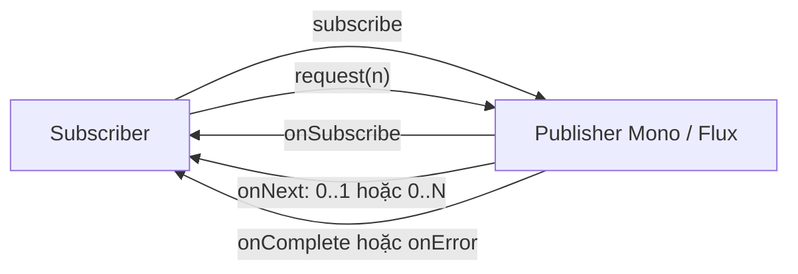
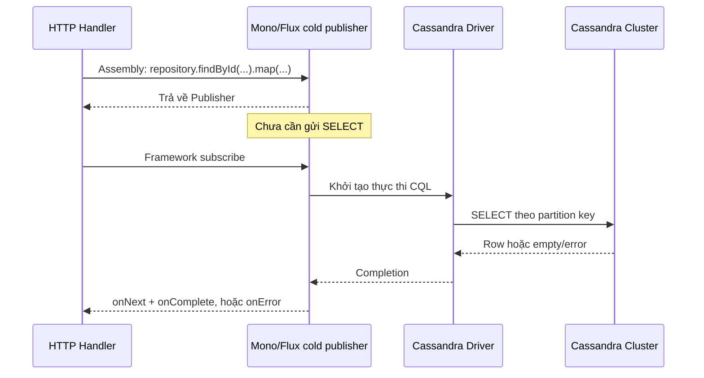
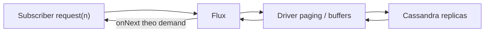

# Mono, Flux và thời điểm thao tác được thực hiện trong Spring Data Cassandra

Trong **Spring Data Cassandra**, một phương thức trả `Mono<T>` hoặc `Flux<T>` thường cung cấp **mô tả một thao tác bất đồng bộ**, không phải dữ liệu đã được đọc xong. Với reactive repository và `ReactiveCassandraTemplate`, các publisher thông thường là **cold**: việc truy cập Cassandra được kích hoạt khi có **subscription**, và một subscription mới có thể thực hiện lại câu CQL.

Sự khác biệt này liên quan trực tiếp tới tính đúng của ứng dụng. Nếu không có subscriber, thao tác ghi có thể **chưa bao giờ được gửi**; nếu subscribe hai lần, ứng dụng có thể **gửi lại cùng mutation**, thay đổi write timestamp, TTL hoặc gặp optimistic-locking conflict. Nếu gọi `block()` trong WebFlux, ứng dụng có thể làm tắc thread dù đã dùng API reactive.

Bài thuộc chương **Truy cập phản ứng**, module **SPRING_DATA_CASSANDRA**. Chúng ta học vòng đời assembly → subscription → signals, cách dùng `Mono`/`Flux` cho entity và truy vấn CQL, cold/hot publishers, `Mono.defer` và future eager, retry, paging/backpressure, giới hạn concurrency, consistency và kiểm thử `StepVerifier`.

> **Phạm vi:** Ví dụ hướng tới Spring Boot 3.x, Spring Data Cassandra Reactive và Project Reactor 3.x. Overload/kiểu trả về có thể thay đổi theo version; hãy đối chiếu API trong dependency thực tế. Các bảng `commerce.*` được giả định đã tạo sẵn bằng migration trong môi trường thử nghiệm.

## 1. Mono và Flux là gì?

Reactive Streams có các vai trò: **Publisher** phát dữ liệu, **Subscriber** tiêu thụ dữ liệu, và **Subscription** điều phối nhu cầu hoặc hủy.

| Kiểu Reactor | Số `onNext` trên một subscription | Tình huống Cassandra |
| --- | --- | --- |
| `Mono<T>` | 0 hoặc 1 phần tử. | `findById`, `selectOneById`, lưu một entity. |
| `Flux<T>` | 0 đến nhiều phần tử. | Danh sách sự kiện trong một partition, query streaming. |
| `Mono<Void>` | Không phát phần tử người dùng; chỉ báo hoàn thành/lỗi. | Chờ một thao tác kết thúc mà không cần dữ liệu trả về. |

Các tín hiệu chuẩn:

- `onSubscribe(subscription)`: subscriber nhận đối tượng yêu cầu dữ liệu/hủy.
- `request(n)`: subscriber thể hiện nhu cầu tối đa tại thời điểm đó.
- `onNext(value)`: phát một giá trị khác `null`.
- `onComplete()`: kết thúc bình thường, kể cả chưa từng có `onNext`.
- `onError(error)`: kết thúc bằng lỗi, loại trừ `onComplete` của subscription đó.

`Mono.empty()` nghĩa là không có giá trị, **không phải `Mono.just(null)`**: Reactor không cho phép phát `null` qua `onNext`.



**Quan trọng:** `Mono` và `Flux` diễn tả số tín hiệu dữ liệu, **không diễn tả số request mạng**. Một `Flux` có thể nhận hàng trong nhiều page Cassandra; một `Mono` có thể cần nhiều bước nội bộ để hoàn tất LWT.

## 2. Assembly, subscription và execution: ba thời điểm khác nhau

Một pipeline reactive thường trải qua:

1. **Assembly:** gọi repository để tạo publisher rồi ghép `map`, `filter`, `switchIfEmpty`.
2. **Subscription:** WebFlux, StepVerifier, worker hoặc code gọi `subscribe`/`block`.
3. **Execution/signals:** nguồn publisher bắt đầu công việc, driver gửi CQL, khi kết quả có mặt thì phát dữ liệu/lỗi/completion.

```java
Mono<OrderById> source = repository.findById(orderId);
Mono<String> status = source
    .map(OrderById::getStatus)
    .defaultIfEmpty("NOT_FOUND");

// Hai dòng trên thường chỉ xây pipeline cold.
// Chưa có cơ sở nói rằng câu SELECT đã hoàn tất.
```

Một subscription trong test có thể được tạo bằng:

```java
// CHỈ minh họa tại ranh giới blocking của test/CLI.
String value = status.block();
```

`block()` **tạo subscription và chặn thread**. Nó không phải công cụ sử dụng trong controller WebFlux hoặc trên Reactor event loop.

### 2.1. Không tuyệt đối hóa chữ “lazy”

Một method tạo publisher vẫn có thể chạy code **đồng bộ** lúc assembly: kiểm tra argument, log, đọc metadata, tạo statement, sinh UUID hoặc thậm chí gọi một API eager nếu tác giả viết như vậy. Vì thế:

- `repository.findById(id)` thường trả publisher lạnh; CQL thực thi khi subscribe.
- `log.info("calling DB")` đặt **ngoài** `Mono.defer` có thể in ra từ lúc tạo publisher.
- `session.executeAsync(statement)` của Java driver **đã bắt đầu** một thao tác async khi được gọi, ngay cả nếu future chưa được ai await.

Hãy hỏi **nguồn publisher được tạo như thế nào**, thay vì chỉ nhìn kiểu trả về là Mono.

### 2.2. Sơ đồ theo thời điểm



## 3. Cold publisher: tại sao subscribe hai lần có thể chạy hai câu CQL?

Publisher lạnh thường khởi tạo một luồng thực thi mới **cho mỗi subscriber**.

```java
Mono<OrderById> read = repository.findById(orderId);

// Mỗi block() là một subscription mới: có thể gửi hai SELECT.
OrderById a = read.block();
OrderById b = read.block();
```

Nếu có ghi/xóa xảy ra giữa hai lần đọc, `a` và `b` có thể khác nhau. Đừng xem một biến `Mono` như một biến đã chứa dữ liệu được cache.

Nguy hiểm hơn là thao tác ghi:

```java
Mono<OrderById> write = repository.save(order);

write.subscribe(); // Có thể gửi mutation lần 1.
write.subscribe(); // Có thể gửi mutation lần 2.
```

- Nếu primary key giống nhau, Cassandra có thể upsert cùng hàng, nhưng write timestamp/TTL vẫn có thể bị thay đổi.
- Nếu dùng `@Version` hoặc LWT, subscription thứ hai có thể bị từ chối do điều kiện version mới không khớp.
- Nếu source tự tạo ID khác nhau theo subscription, có thể tạo hai hàng.
- Nếu có business side effect, thao tác có thể xảy ra hai lần nếu thiếu idempotency.

**Không dùng subscribe nhiều lần làm cách “kiểm tra lại thao tác đã chạy”.** Để kiểm tra kết quả, hãy lưu/combine tín hiệu của một pipeline hoặc truy vấn đối soát có chủ đích.

## 4. Ví dụ thuần Reactor chứng minh khi nào supplier chạy

`Mono.defer` tạo nguồn mới **mỗi lần có subscription**.

```java
import java.util.concurrent.atomic.AtomicInteger;
import reactor.core.publisher.Mono;

AtomicInteger attempts = new AtomicInteger();

Mono<Integer> source = Mono.defer(() -> {
    attempts.incrementAndGet();
    return Mono.just(42);
});

// Assembly: attempts vẫn bằng 0.
System.out.println(attempts.get()); // 0

source.subscribe(System.out::println); // In 42.
System.out.println(attempts.get());     // 1

source.subscribe(System.out::println); // In 42 lần nữa.
System.out.println(attempts.get());     // 2
```

Đoạn này không kết nối Cassandra, nhưng minh họa chính xác **resubscription tạo execution mới**.

Phân biệt:

| Factory | Thời điểm gọi hàm tạo giá trị/nguồn |
| --- | --- |
| `Mono.just(value)` | `value` đã được tính trước lúc tạo Mono. |
| `Mono.fromSupplier(supplier)` | Supplier được gọi khi có subscription. |
| `Mono.defer(() -> publisher)` | Factory tạo publisher được gọi khi có subscription. |
| `repository.findById(id)` | Thường dựng cold publisher khi gọi method; CQL thực thi khi subscribe. |
| `Mono.fromCompletionStage(stage)` với `stage` đã được tạo | Stage có thể đã chạy; việc bọc không đảo ngược thời điểm bắt đầu. |

## 5. Cấu hình reactive Spring Data Cassandra

Trong dự án Maven dùng Spring Boot starter:

```xml
<dependency>
    <groupId>org.springframework.boot</groupId>
    <artifactId>spring-boot-starter-data-cassandra-reactive</artifactId>
</dependency>
```

Nếu HTTP dùng WebFlux, cần thêm:

```xml
<dependency>
    <groupId>org.springframework.boot</groupId>
    <artifactId>spring-boot-starter-webflux</artifactId>
</dependency>
```

WebFlux **không bắt buộc chỉ để dùng Cassandra reactive API**. Một ứng dụng background có thể sử dụng Reactor và reactive repository mà không phơi HTTP endpoint.

Cấu hình kết nối minh họa:

```yaml
spring:
  cassandra:
    contact-points: node-a.internal:9042,node-b.internal:9042
    local-datacenter: dc1
    keyspace-name: commerce
```

Trong hệ thống thực, thêm TLS, authentication/secret và timeout theo chính sách. Spring Boot quản lý `CqlSession` và các bean mapping/session reactive phù hợp theo phiên bản. Không tạo/đóng session trên **mỗi subscription**: session giữ pool kết nối, metadata cluster và tài nguyên nền.

### 5.1. Lớp thường dùng

```java
import org.springframework.data.cassandra.repository.ReactiveCassandraRepository;
import org.springframework.data.cassandra.core.ReactiveCassandraOperations;
import org.springframework.data.cassandra.core.ReactiveCassandraTemplate;
import reactor.core.publisher.Mono;
import reactor.core.publisher.Flux;
```

- **Reactive repository**: abstract CRUD và query theo entity.
- **`ReactiveCassandraTemplate`/`ReactiveCassandraOperations`**: entity mapping và các thao tác Cassandra reactive tường minh.
- **Java driver async**: `CompletionStage`/`AsyncResultSet` để thao tác CQL mức thấp khi cần.

## 6. Query-first schema: Mono một hàng, Flux nhiều hàng

Reactive không loại bỏ luật **partition key** của Cassandra.

Bảng đọc đơn theo ID:

```sql
-- Giả sử keyspace commerce đã tồn tại.
CREATE TABLE commerce.orders_by_id (
    order_id uuid PRIMARY KEY,
    tenant_id text,
    status text,
    total_amount decimal,
    created_at timestamp
);
```

Câu CQL:

```sql
SELECT * FROM commerce.orders_by_id
WHERE order_id = 11111111-1111-1111-1111-111111111111;
```

Một `order_id` là full primary key, nên tối đa một row. Phù hợp `Mono<OrderById>`.

Bảng nhật ký sự kiện theo tenant/ngày:

```sql
CREATE TABLE commerce.events_by_tenant_day (
    tenant_id text,
    event_day date,
    occurred_at timestamp,
    event_id uuid,
    event_type text,
    PRIMARY KEY ((tenant_id, event_day), occurred_at, event_id)
) WITH CLUSTERING ORDER BY (occurred_at DESC, event_id ASC);
```

Truy vấn hợp lệ:

```sql
SELECT * FROM commerce.events_by_tenant_day
WHERE tenant_id = 'shop-42'
  AND event_day = '2026-11-25'
LIMIT 50;
```

Hai thành phần `(tenant_id, event_day)` là **partition key ghép**; câu query có thể trả tối đa 50 hàng, phù hợp `Flux<TenantEvent>`.

Không đúng khi nghĩ `Flux` giúp biến câu sau thành hợp lệ/hiệu quả:

```sql
-- Thiếu event_day; không có full partition key của bảng.
SELECT * FROM commerce.events_by_tenant_day
WHERE tenant_id = 'shop-42';
```

Không dùng `ALLOW FILTERING` để chữa một thiết kế partition key sai trên workload lớn.

## 7. Mapping và repository reactive với Mono

Entity đơn giản:

```java
import java.math.BigDecimal;
import java.time.Instant;
import java.util.UUID;

import org.springframework.data.cassandra.core.mapping.Column;
import org.springframework.data.cassandra.core.mapping.PrimaryKey;
import org.springframework.data.cassandra.core.mapping.Table;

@Table("orders_by_id")
public class OrderById {

    @PrimaryKey("order_id")
    private UUID orderId;

    @Column("tenant_id")
    private String tenantId;

    @Column("status")
    private String status;

    @Column("total_amount")
    private BigDecimal totalAmount;

    @Column("created_at")
    private Instant createdAt;

    public OrderById() {}

    public UUID getOrderId() { return orderId; }
    public void setOrderId(UUID value) { orderId = value; }

    public String getTenantId() { return tenantId; }
    public void setTenantId(String value) { tenantId = value; }

    public String getStatus() { return status; }
    public void setStatus(String value) { status = value; }

    public BigDecimal getTotalAmount() { return totalAmount; }
    public void setTotalAmount(BigDecimal value) { totalAmount = value; }

    public Instant getCreatedAt() { return createdAt; }
    public void setCreatedAt(Instant value) { createdAt = value; }
}
```

Repository:

```java
import java.util.UUID;
import org.springframework.data.cassandra.repository.ReactiveCassandraRepository;

public interface OrderRepository
        extends ReactiveCassandraRepository<OrderById, UUID> {
}
```

Đọc bằng method trả Mono:

```java
import java.util.UUID;
import reactor.core.publisher.Mono;

public class OrderQueryService {
    private final OrderRepository orders;

    public OrderQueryService(OrderRepository orders) {
        this.orders = orders;
    }

    public Mono<OrderById> findById(UUID id) {
        return orders.findById(id);
    }
}
```

Khi chưa có subscriber, method chỉ trả một publisher. Khi được WebFlux/StepVerifier subscribe, truy vấn CQL bắt đầu. Nếu không có row, `Mono` **complete empty**; không phát Java `null`.

### 7.1. Dùng ReactiveCassandraTemplate

```java
import java.util.UUID;
import org.springframework.data.cassandra.core.ReactiveCassandraOperations;
import reactor.core.publisher.Mono;

public class OrderTemplateService {
    private final ReactiveCassandraOperations template;

    public OrderTemplateService(ReactiveCassandraOperations template) {
        this.template = template;
    }

    public Mono<OrderById> load(UUID id) {
        return template.selectOneById(id, OrderById.class);
    }

    public Mono<OrderById> insert(OrderById row) {
        return template.insert(row);
    }
}
```

Tầng template ánh xạ entity/khóa theo metadata; nó vẫn không tự biến `insert` không điều kiện thành create-only. Nếu yêu cầu chống tạo trùng, thiết kế LWT hoặc optimistic protocol phù hợp.

## 8. Flux và truy vấn qua khóa ghép

Mapping khóa:

```java
import java.io.Serializable;
import java.time.Instant;
import java.time.LocalDate;
import java.util.Objects;
import java.util.UUID;

import org.springframework.data.cassandra.core.mapping.PrimaryKeyClass;
import org.springframework.data.cassandra.core.mapping.PrimaryKeyColumn;
import org.springframework.data.cassandra.core.mapping.PrimaryKeyType;

@PrimaryKeyClass
public class TenantEventKey implements Serializable {

    @PrimaryKeyColumn(name = "tenant_id", ordinal = 0,
        type = PrimaryKeyType.PARTITIONED)
    private String tenantId;

    @PrimaryKeyColumn(name = "event_day", ordinal = 1,
        type = PrimaryKeyType.PARTITIONED)
    private LocalDate eventDay;

    @PrimaryKeyColumn(name = "occurred_at", ordinal = 2,
        type = PrimaryKeyType.CLUSTERED)
    private Instant occurredAt;

    @PrimaryKeyColumn(name = "event_id", ordinal = 3,
        type = PrimaryKeyType.CLUSTERED)
    private UUID eventId;

    public TenantEventKey() {}

    public String getTenantId() { return tenantId; }
    public void setTenantId(String v) { tenantId = v; }
    public LocalDate getEventDay() { return eventDay; }
    public void setEventDay(LocalDate v) { eventDay = v; }
    public Instant getOccurredAt() { return occurredAt; }
    public void setOccurredAt(Instant v) { occurredAt = v; }
    public UUID getEventId() { return eventId; }
    public void setEventId(UUID v) { eventId = v; }

    @Override public boolean equals(Object other) {
        if (this == other) return true;
        if (!(other instanceof TenantEventKey)) return false;
        TenantEventKey that = (TenantEventKey) other;
        return Objects.equals(tenantId, that.tenantId)
            && Objects.equals(eventDay, that.eventDay)
            && Objects.equals(occurredAt, that.occurredAt)
            && Objects.equals(eventId, that.eventId);
    }

    @Override public int hashCode() {
        return Objects.hash(tenantId, eventDay, occurredAt, eventId);
    }
}
```

Entity và repository:

```java
import org.springframework.data.cassandra.core.mapping.Column;
import org.springframework.data.cassandra.core.mapping.PrimaryKey;
import org.springframework.data.cassandra.core.mapping.Table;

@Table("events_by_tenant_day")
public class TenantEvent {
    @PrimaryKey
    private TenantEventKey key;

    @Column("event_type")
    private String eventType;

    public TenantEvent() {}

    public TenantEventKey getKey() { return key; }
    public void setKey(TenantEventKey key) { this.key = key; }
    public String getEventType() { return eventType; }
    public void setEventType(String type) { eventType = type; }
}
```

```java
import java.time.LocalDate;
import org.springframework.data.cassandra.repository.Query;
import org.springframework.data.cassandra.repository.ReactiveCassandraRepository;
import reactor.core.publisher.Flux;

public interface TenantEventRepository
        extends ReactiveCassandraRepository<TenantEvent, TenantEventKey> {

    @Query("SELECT * FROM events_by_tenant_day " +
           "WHERE tenant_id = ?0 AND event_day = ?1 LIMIT 50")
    Flux<TenantEvent> findForDay(String tenantId, LocalDate day);
}
```

`?0`/`?1` là cú pháp tham số của `@Query` repository. Với raw driver CQL, bind marker `?` là khái niệm khác.

Tạo pipeline:

```java
Flux<TenantEvent> eventStream = repository.findForDay(
    "shop-42", java.time.LocalDate.parse("2026-11-25")
);
```

Khi subscribe, driver có thể lấy **nhiều page**, còn `Flux` phát từng entity. Không có quy tắc “một `onNext` bằng một round trip”.

## 9. Mono.defer và future eager: khác biệt dễ mắc lỗi

Với driver 4.x:

```java
import com.datastax.oss.driver.api.core.cql.AsyncResultSet;
import java.util.concurrent.CompletionStage;
import reactor.core.publisher.Mono;

CompletionStage<AsyncResultSet> stage = session.executeAsync(statement);

// I/O có thể đã bắt đầu từ executeAsync, trước khi tạo Mono.
Mono<AsyncResultSet> eager = Mono.fromCompletionStage(stage);
```

`Mono.fromCompletionStage` chỉ bọc **stage đã có**. Nếu muốn thao tác async **chỉ khởi động khi có subscription**:

```java
Mono<AsyncResultSet> lazy = Mono.defer(() ->
    Mono.fromCompletionStage(session.executeAsync(statement))
);
```

Với `lazy`, mỗi subscription có thể gọi `executeAsync` mới. Với `eager` bọc một stage đã tạo, nhiều subscriber thường theo dõi **cùng** stage đó, không tự gửi thêm CQL chỉ vì có subscriber thứ hai.

| Biểu thức | Khi tác vụ nguồn bắt đầu | Hai subscriber |
| --- | --- | --- |
| `repository.findById(id)` | Thường khi subscribe cold publisher. | Có thể hai SELECT. |
| `session.executeAsync(stmt)` | Khi gọi method driver. | Chưa liên quan Mono. |
| `Mono.fromCompletionStage(stage)` | Stage có thể đã bắt đầu. | Theo dõi cùng stage đã tạo. |
| `Mono.defer(() -> Mono.fromCompletionStage(session.executeAsync(stmt)))` | Tạo stage mới khi subscribe. | Có thể hai request. |

Cũng cần hiểu `Mono.defer` hoãn việc **tạo publisher**. Nếu factory tự sinh UUID mới:

```java
Mono<OrderById> create = Mono.defer(() -> {
    OrderById row = new OrderById();
    row.setOrderId(UUID.randomUUID());
    row.setStatus("NEW");
    return repository.save(row);
});
```

thì hai subscription có thể tạo **hai UUID và hai đơn hàng khác nhau**. Để bảo đảm nghiệp vụ, phải giữ `operationId` và primary key **cố định qua retry**; dùng LWT/đối soát khi yêu cầu chống trùng.

## 10. Ai thực sự subscribe?

### 10.1. WebFlux sở hữu subscription

```java
import java.util.UUID;
import org.springframework.http.ResponseEntity;
import org.springframework.web.bind.annotation.*;
import reactor.core.publisher.Mono;

@RestController
@RequestMapping("/api/orders")
public class OrderController {
    private final OrderRepository orders;

    public OrderController(OrderRepository orders) {
        this.orders = orders;
    }

    @GetMapping("/{id}")
    public Mono<ResponseEntity<OrderById>> find(@PathVariable UUID id) {
        return orders.findById(id)
            .map(ResponseEntity::ok)
            .defaultIfEmpty(ResponseEntity.notFound().build());
    }
}
```

Controller **trả** publisher, và Spring WebFlux subscribe để tạo HTTP response. Nếu đơn không tồn tại thì publisher empty được chuyển thành 404; nếu Cassandra timeout/Unavailable, lỗi phải được xử lý qua HTTP exception mapping, **không** biến thành 404.

Sai:

```java
// Không nên: fire-and-forget làm mất liên kết giữa DB và HTTP result.
public Mono<String> createWrong(OrderById row) {
    repository.save(row).subscribe();
    return Mono.just("SAVED");
}
```

HTTP có thể trả “SAVED” **trước khi Cassandra xác nhận thao tác**. Lỗi của save cũng bị tách khỏi pipeline do controller trả về.

Đúng về mặt luồng tín hiệu:

```java
public Mono<OrderById> create(OrderById row) {
    return repository.save(row);
}
```

Đoạn này vẫn cần validation, authorization, create-only protocol/idempotency nếu dùng trong API thực tế.

### 10.2. StepVerifier là subscriber của test

`StepVerifier.create(publisher).expectNext(...).verifyComplete()` đăng ký nhận tín hiệu trong `verifyComplete`. Nếu mới gọi `StepVerifier.create` mà chưa gọi verify, test **chưa tiêu thụ** pipeline.

### 10.3. Worker nền cần quản lý vòng đời subscription

Nếu background worker chủ động subscribe, phải xử lý completion/error/timeout, retry, demand, cancellation và shutdown. Với message broker, chỉ ACK thông điệp sau khi kết quả persistence đạt hợp đồng; không fire-and-forget một Mono rồi xem event đã xử lý thành công.

## 11. map, flatMap, then và zip: thời điểm bước sau chạy

### 11.1. map chỉ biến đổi dữ liệu đã phát

```java
public record OrderSummary(UUID orderId, String status) {}

Mono<OrderSummary> result = repository.findById(id)
    .map(row -> new OrderSummary(row.getOrderId(), row.getStatus()));
```

Hàm `map` không được gọi nếu upstream `Mono` empty hoặc error.

### 11.2. flatMap nối một thao tác reactive phụ thuộc

```java
Mono<OrderById> markPaid(UUID id) {
    return repository.findById(id)
        .switchIfEmpty(Mono.error(
            new IllegalArgumentException("Order not found")))
        .flatMap(row -> {
            row.setStatus("PAID");
            return repository.save(row);
        });
}
```

`flatMap` đăng ký vào publisher save sau khi có row. **Không** đồng nghĩa read–modify–write đã có khóa lạc quan: nhiều writer đồng thời có thể ghi đè nếu không có `@Version`/LWT phù hợp.

### 11.3. then chỉ quan tâm hoàn thành

```java
Mono<Void> saveAndFinish(OrderById row) {
    return repository.save(row).then();
}
```

`then()` bỏ phần tử dữ liệu nhưng giữ completion/error. Đừng hiểu `Mono<Void>` hoàn thành đồng nghĩa mọi replica đã đồng bộ hoặc dữ liệu ở bảng đọc khác đã cập nhật.

```java
Mono<OrderById> saveThenRead(OrderById row) {
    return repository.save(row)
        .then(repository.findById(row.getOrderId()));
}
```

Hai thao tác được ghép **theo thứ tự trong pipeline**, nhưng không tạo ACID transaction hay snapshot.

### 11.4. zip cần mỗi nguồn phát một giá trị

```java
Mono<String> statuses = Mono.zip(
    repository.findById(firstId),
    repository.findById(secondId)
).map(tuple ->
    tuple.getT1().getStatus() + "/" + tuple.getT2().getStatus()
);
```

Nếu một `findById` trả `Mono.empty`, `zip` có thể complete empty và cancel nguồn còn lại. Nếu nghiệp vụ cần biết cái nào thiếu, hãy xử lý empty thành một kết quả rõ ràng trước khi zip.

## 12. Hook doOn... cho logging, không phải cơ chế commit

Quan sát pipeline:

```java
public Mono<OrderById> observed(UUID id) {
    System.out.println("Assembly for " + id);

    return repository.findById(id)
        .doOnSubscribe(s -> System.out.println("Subscribed"))
        .doOnNext(row -> System.out.println("Row received"))
        .doOnSuccess(row -> System.out.println(
            row == null ? "Completed empty" : "Completed with value"))
        .doOnError(err -> System.out.println("Cassandra error"))
        .doFinally(signal -> System.out.println("End: " + signal));
}
```

- Dòng `Assembly` có thể chạy **trước subscription**.
- `doOnSubscribe` phản ánh subscription, **không chứng minh CQL đã được ACK**.
- `doOnNext` chạy khi có entity; empty không kích hoạt hook này.
- `doOnSuccess` của Mono được gọi cả khi empty (đối số có thể `null`).
- `doFinally` cũng xảy ra khi cancel; không phải “đã commit”.
- `doOnError` nhận lỗi của pipeline; timeout write không chứng minh rollback.

Hạn chế biến `doOnNext`/`doOnSuccess` thành nơi gửi email/thanh toán vì retry và resubscription có thể làm chạy lại side effect. Nếu cần business event, dùng workflow bền vững và idempotency.

## 13. retry, repeat và nhiều subscription làm tăng số request

```java
Mono<OrderById> read = repository.findById(id)
    .retry(2); // Khi lỗi, tối đa 2 lần retry.
```

Với nguồn lạnh, `retry` có thể làm lại SELECT; một logical call có thể phát sinh tới **ba lần thực thi** khi liên tục lỗi.

```java
Flux<OrderById> again = repository.findById(id)
    .repeat(2); // Phát lại sau completion thành công.
```

`repeat` resubscribe sau complete; nó không chỉ phát lại một object đã cache.

| Trường hợp | Nguy cơ |
| --- | --- |
| Retry SELECT | Tăng tải cluster; đọc có thể thấy dữ liệu mới hơn sau retry. |
| Retry INSERT cùng ID | Có thể upsert lại, refresh TTL hoặc thay timestamp. |
| Retry UPDATE counter | Có thể tăng hai lần, không idempotent. |
| Retry LWT sau timeout | Lần đầu có thể thành công; lần sau trả condition false. |
| Retry khi tạo UUID trong `defer` | Có thể tạo business entity thứ hai. |

**Không** retry mọi exception. Phân loại lỗi tạm thời/vĩnh viễn, giới hạn số lần và deadline, backoff/jitter, giữ khóa nghiệp vụ ổn định. Khi một write timeout, kết quả có thể **chưa xác định**; cần đối soát trước khi quyết định thử lại.

## 14. Cache và share: làm nóng publisher có đánh đổi

```java
Mono<OrderById> cached = repository.findById(id)
    .cache(java.time.Duration.ofSeconds(10));
```

`Mono.cache(Duration)` có thể chia sẻ kết quả hoặc lỗi cho subscriber trong thời hạn cache, tránh truy vấn lại. Nhưng:

- Dữ liệu có thể **stale** trong suốt TTL cache.
- Cache có thể lưu trạng thái empty/error theo quy tắc operator.
- Nếu publisher cached dùng chung giữa nhiều tenant/user, có nguy cơ **lộ dữ liệu** nếu không giới hạn phạm vi và authorization.
- Không dùng cache để giả lập exactly-once cho create/payment workflow.

Với Flux:

```java
Flux<TenantEvent> shared =
    eventRepository.findForDay("shop-42", day).share();
```

`share()` là multicast khi có subscriber đồng thời; **subscriber đến muộn có thể bỏ lỡ phần tử**. Nó không giống replay toàn bộ kết quả đã đọc. Chỉ dùng khi đã thiết kế rõ subscriber lifecycle, cancellation và tính nhất quán dữ liệu.

## 15. Backpressure và paging không đồng nghĩa chỉ đọc đúng n hàng

`Flux` hỗ trợ backpressure thông qua `request(n)`. Tuy nhiên:

- Cassandra/driver thực hiện **paging**; một page thường nhiều row.
- `request(1)` ở Reactor không đồng nghĩa Cassandra chỉ đọc đúng một row hoặc gửi đúng một RPC.
- Driver có thể đã fetch/buffer một số row theo page size.
- PagingState là cursor opaque đọc **tiến**, không phải `OFFSET` tùy ý.
- Nhiều page không tạo snapshot; insert, delete, TTL có thể làm dữ liệu quan sát thay đổi trong lúc paging.



### 15.1. take(20) khác CQL LIMIT 20

```java
Flux<TenantEvent> limited = eventRepository
    .findForDay(tenantId, day)
    .take(20);
```

`take(20)` dừng pipeline sau khi nhận tối đa 20 phần tử và cancel upstream; CQL có thể đã fetch nhiều hơn theo page size. Muốn giới hạn **tổng số hàng truy vấn**, nên đặt `LIMIT` phù hợp ngay trong CQL (ví dụ repository `@Query` phần 8 có `LIMIT 50`).

### 15.2. collectList() có thể làm mất lợi ích streaming

```java
Mono<java.util.List<TenantEvent>> all =
    eventRepository.findForDay(tenantId, day).collectList();
```

`collectList` giữ **toàn bộ phần tử đã nhận** trong RAM để trả một danh sách. Nếu query không giới hạn và một partition có hàng triệu row, vẫn có rủi ro OOM dù API là reactive.

Hãy ưu tiên partition key, CQL LIMIT, page size, response budget và streaming phù hợp. Không dùng `onBackpressureBuffer()` vô hạn để chữa nguồn dữ liệu quá lớn.

### 15.3. Cancel không phải rollback

Khi client disconnect, `take` kết thúc hoặc `timeout` cancel upstream:

- Subscription ngừng đòi thêm dữ liệu, tùy implementation có thể tránh fetch tiếp.
- Những request Cassandra đã gửi **có thể vẫn hoàn tất**.
- Một mutation đã chấp nhận **không được hoàn tác chỉ vì consumer cancel**.

Vì vậy cancellation không thể thay transaction/compensating workflow.

## 16. flatMap concurrency, concatMap và thứ tự nghiệp vụ

Khi ghi nhiều entity:

```java
Flux<OrderById> writes = Flux.fromIterable(orders)
    .flatMap(repository::save, 8);
```

`flatMap(..., 8)` giới hạn số publisher con đang xử lý tại tầng toán tử, nhưng kết quả có thể phát **khác thứ tự input** do request hoàn tất không cùng lúc.

```java
Flux<OrderById> sequential = Flux.fromIterable(orders)
    .concatMap(repository::save);
```

`concatMap` subscribe từng thao tác theo thứ tự trong **một pipeline**, nhưng:

- Không tạo transaction ACID trên nhiều partition.
- Không ngăn writer khác trên JVM/node khác.
- Không bảo đảm cùng lúc các reader nhìn thấy toàn bộ mutation.
- Nếu upstream đã gửi một write rồi gặp lỗi, các thao tác khác không tự rollback.

Nếu cần CAS/state machine, dùng optimistic locking hoặc LWT trên primary key thích hợp. Nếu cần throughput, đo mức concurrency cho phép thay vì phóng vô hạn hàng nghìn query.

## 17. Không block trên WebFlux event loop

Anti-pattern:

```java
public Mono<OrderById> broken(UUID id) {
    OrderById found = repository.findById(id).block();
    return Mono.just(found);
}
```

`block()` chặn thread; có thể bị từ chối trên thread non-blocking. Nếu không tìm thấy row, `found` là `null` và `Mono.just(null)` còn gây lỗi.

Đúng:

```java
public Mono<OrderById> load(UUID id) {
    return repository.findById(id);
}
```

Nếu buộc phải gọi thư viện blocking không liên quan đến Cassandra, tách nó sang scheduler phù hợp:

```java
import reactor.core.scheduler.Schedulers;

Mono<ExternalResult> callLegacy(OrderById row) {
    return Mono.fromCallable(() -> blockingExternalCall(row))
        .subscribeOn(Schedulers.boundedElastic());
}

Mono<ExternalResult> work = repository.findById(id)
    .flatMap(this::callLegacy);
```

`blockingExternalCall` là hàm ứng dụng minh họa. `boundedElastic` là adapter cho code blocking, **không phải lý do tự đưa mọi Cassandra reactive query sang thread pool**. Các hàm map/flatMap không nên thực hiện blocking I/O hoặc CPU nặng trực tiếp trên thread completion của driver.

### 17.1. Reactor Context thay vì giả định ThreadLocal

```java
Mono<OrderById> guarded = Mono.deferContextual(ctx -> {
    String tenant = ctx.get("tenantId");
    return repository.findById(id)
        .filter(order -> tenant.equals(order.getTenantId()));
}).contextWrite(ctx -> ctx.put("tenantId", trustedTenant));
```

`trustedTenant` phải được xác định từ ngữ cảnh xác thực đáng tin cậy. Mã chỉ minh họa `Context` theo subscription: **filter sau khi đọc không thay thế authorization/schema an toàn** trong hệ multi-tenant. Không giả định MDC hoặc SecurityContext dựa trên ThreadLocal tự được truyền qua mọi callback.

## 18. Empty, Error, timeout và unknown outcome

Phân biệt kết quả:

| Kết quả từ publisher | Diễn giải | Hành động |
| --- | --- | --- |
| `Mono.empty()` sau findById | Không thấy hàng theo truy vấn hợp lệ. | Có thể trả HTTP 404. |
| `onNext(row)` rồi complete | Có kết quả được phát. | Trả dữ liệu theo contract. |
| `onError(UnavailableException)` | Không đủ replica/CL tại thời điểm tương ứng. | Báo lỗi hệ thống, kiểm tra RF/CL. |
| `onError(ReadTimeoutException)` | Đọc timeout. | Không coi là “row không tồn tại”. |
| `onError(WriteTimeoutException)` | Ghi chưa nhận đủ ACK trước timeout. | **Không kết luận đã rollback**; đối soát. |
| `onError` do invalid CQL/quyền | Cấu hình/query sai. | Sửa nguyên nhân, không retry mù. |
| Cancel | Downstream ngừng subscription. | Không coi là mutation đã được hủy trên server. |

```java
Mono<OrderById> required = repository.findById(id)
    .switchIfEmpty(Mono.error(
        new IllegalArgumentException("Order not found")));
```

Không làm:

```java
// Sai: biến mọi lỗi Cassandra thành "not found".
Mono<OrderById> hidden = repository.findById(id)
    .onErrorResume(error -> Mono.empty());
```

Timeout ở tầng Reactor:

```java
import java.time.Duration;

Mono<OrderById> bounded = repository.findById(id)
    .timeout(Duration.ofSeconds(3));
```

Hết deadline có thể cancel subscription và phát lỗi, nhưng Cassandra vẫn có thể hoàn tất request đã gửi. Với write, **trạng thái nghiệp vụ lúc này chưa chắc chắn**. Nếu retry qua `retryWhen`, cần phân loại lỗi và idempotency.

## 19. Kiểm thử subscription bằng StepVerifier

Thêm dependency test:

```xml
<dependency>
    <groupId>io.projectreactor</groupId>
    <artifactId>reactor-test</artifactId>
    <scope>test</scope>
</dependency>
```

### 19.1. Unit test chứng minh defer lazy

```java
import static org.junit.jupiter.api.Assertions.assertEquals;

import java.util.concurrent.atomic.AtomicInteger;
import org.junit.jupiter.api.Test;
import reactor.core.publisher.Mono;
import reactor.test.StepVerifier;

class ReactorSubscriptionTest {

    @Test
    void deferRunsOnEachSubscription() {
        AtomicInteger count = new AtomicInteger();
        Mono<Integer> source = Mono.defer(() -> {
            count.incrementAndGet();
            return Mono.just(7);
        });

        assertEquals(0, count.get()); // Chưa subscribe.

        StepVerifier.create(source)
            .expectNext(7)
            .verifyComplete();

        assertEquals(1, count.get());

        StepVerifier.create(source)
            .expectNext(7)
            .verifyComplete();

        assertEquals(2, count.get());
    }
}
```

Đây là test **cơ chế Reactor**, không khẳng định code mapping Cassandra đã đúng.

### 19.2. Integration test repository + Cassandra thật

```java
import static org.junit.jupiter.api.Assertions.*;

import java.math.BigDecimal;
import java.time.Duration;
import java.time.Instant;
import java.util.UUID;

import org.junit.jupiter.api.Test;
import org.springframework.beans.factory.annotation.Autowired;
import org.springframework.boot.test.context.SpringBootTest;

import reactor.core.publisher.Mono;
import reactor.test.StepVerifier;

@SpringBootTest
class ReactiveOrderIntegrationTest {

    @Autowired
    OrderRepository repository;

    @Test
    void saveAndReadUsingSubscriptions() {
        UUID id = UUID.randomUUID();

        OrderById order = new OrderById();
        order.setOrderId(id);
        order.setTenantId("shop-42");
        order.setStatus("NEW");
        order.setTotalAmount(new BigDecimal("150000.00"));
        order.setCreatedAt(Instant.now());

        Mono<OrderById> write = repository.save(order);

        // verify tạo subscription; deadline chỉ dùng ở test.
        StepVerifier.create(write)
            .assertNext(saved ->
                assertEquals(id, saved.getOrderId()))
            .expectComplete()
            .verify(Duration.ofSeconds(10));

        // Subscription độc lập để kiểm chứng bằng SELECT.
        StepVerifier.create(repository.findById(id))
            .assertNext(loaded -> {
                assertEquals("NEW", loaded.getStatus());
                assertEquals("shop-42", loaded.getTenantId());
            })
            .expectComplete()
            .verify(Duration.ofSeconds(10));
    }
}
```

Điều kiện chạy test: có keyspace/bảng thật, session reactive, quyền đọc/ghi, dữ liệu test riêng, mapping đúng và không có writer cạnh tranh cùng key.

**Không dùng `Thread.sleep` rồi tuyên bố đã gửi query.** Hãy đợi tín hiệu reactive bằng StepVerifier có deadline hoặc tiêu thụ publisher theo protocol. Test mock chỉ chứng minh logic signal, chưa chứng minh Cassandra CQL/CL/thao tác thật.

### 19.3. Test Flux theo partition key

```java
@Test
void eventFluxOnlyReadsChosenPartition() {
    StepVerifier.create(
        events.findForDay("shop-42",
            java.time.LocalDate.parse("2026-11-25"))
    )
        .thenConsumeWhile(event -> {
            assertEquals("shop-42", event.getKey().getTenantId());
            return true;
        })
        .expectComplete()
        .verify(Duration.ofSeconds(10));
}
```

Ví dụ nằm trong test class đã inject `TenantEventRepository events`. Để khẳng định có dữ liệu, phải **seed dữ liệu và assert ID cụ thể**: `thenConsumeWhile` cũng có thể pass khi Flux rỗng.

### 19.4. Những test nên thêm

1. Không gọi `verify` → test không tự subscribe.
2. Hai subscription → ghi nhận hai lần execution bằng log/metrics hoặc nguồn thử được kiểm soát.
3. `Mono.empty()` khi không có ID → controller chuyển 404.
4. Lỗi Cassandra → future/publisher phát `onError`, không bị biến thành empty.
5. `Flux.take(n)` và paging → response tối đa n phần tử, không lẫn tenant.
6. `flatMap` concurrency → đo outstanding và giới hạn tài nguyên.
7. `retry` với write → xác minh business ID/idempotency và TTL.
8. Cancel client → không kết luận rollback write.
9. Cache/share → bảo đảm isolation giữa tenant/user.
10. Fault-injection node/CL → cần cluster nhiều replica, một Cassandra container không chứng minh được quorum failure.

## 20. Lỗi thường gặp và checklist triển khai

| Vấn đề | Nguyên nhân | Cách xử lý |
| --- | --- | --- |
| Gọi `save` mà không thấy dữ liệu | Chỉ tạo cold Mono, không subscribe. | Trả pipeline cho WebFlux/worker có owner. |
| Hai SELECT dù chỉ tạo một biến Mono | Hai lần `block`/`subscribe` hoặc `retry`. | Theo dõi subscription; chỉ cache khi cần. |
| Hai đơn do một yêu cầu retry | UUID tạo lại trong `defer` hoặc client retry. | Stable orderId/operationId, protocol idempotency. |
| Trả HTTP 200 trước khi DB xong | Controller tự subscribe rồi trả Mono khác. | Trả Mono thực của thao tác lưu. |
| `Mono.just(null)` lỗi | Reactor không cho phép null. | Dùng `Mono.empty` hoặc `justOrEmpty` phù hợp. |
| `zip` rỗng | Một nguồn Mono không có row. | Xử lý missing trước khi zip. |
| `block()` gây nghẽn WebFlux | Blocking trên event loop. | Trả publisher; dùng scheduler chỉ cho thư viện blocking. |
| Flux đọc hết partition gây OOM | `collectList` hoặc buffer vô hạn. | Partition đúng, CQL LIMIT, paging/stream budget. |
| `request(1)` nhưng query đọc nhiều hơn | Driver fetch theo page. | Phân biệt demand với page size. |
| `flatMap` cho kết quả ngoài thứ tự | Các publisher con đồng thời. | `concatMap` nếu cần tuần tự trong stream. |
| `onErrorResume(Mono.empty)` giấu downtime | Nhầm lỗi DB với không tìm thấy. | Phân loại exception, trả 503/timeout khi phù hợp. |
| Retry counter/TTL khiến dữ liệu sai | Write không chắc idempotent. | Đối soát và protocol retry được chứng minh. |
| `cache()` gây stale/lộ dữ liệu | Cache sai phạm vi tenant, không TTL/invalidation. | Tách phạm vi và quyền, hoặc không cache. |
| `Mono.fromCompletionStage` đã gọi DB sớm | Future nguồn đã được khởi động. | `Mono.defer` quanh `executeAsync`. |
| Test chỉ có `StepVerifier.create` | Chưa verify nên chưa subscribe. | Gọi `verify` có deadline. |

**Checklist trước khi merge một API reactive:**

1. Source là publisher **cold hay hot**? I/O bắt đầu ở đâu?
2. Ai sở hữu **subscription**, completion/error, cancellation và shutdown?
3. Pipeline có `block`, `get`/`join` hoặc blocking I/O trong callback không?
4. Query có đúng **partition key**, CQL LIMIT và schema theo access pattern không?
5. Flux có bị gom vào `collectList` hoặc buffer vô hạn không?
6. Có thể có **nhiều subscriber, retry, repeat, cache/share** không?
7. Ghi dữ liệu có **business ID ổn định** và cơ chế tránh duplicate không?
8. Timeout/cancel có được xử lý như outcome **chưa chắc chắn** khi ghi không?
9. Concurrency `flatMap` có giới hạn và thứ tự nghiệp vụ có được bảo vệ không?
10. Response HTTP có đợi tín hiệu persistence thực sự hoàn tất không?
11. Đã test empty, error, subscription, paging và data consistency chưa?
12. Đã đo p95/p99 latency, outstanding requests, timeout, GC và hot partition chưa?

## 21. Bài tập và tình huống

**A — Chưa subscribe.** Service gọi `repository.save(order)` rồi bỏ kết quả. Có chắc Cassandra đã ghi không? Cần trả gì lên controller?

**B — Hai subscriber.** Một `Mono` của `findById` bị `block()` trong middleware, rồi WebFlux subscribe lần nữa. Có thể có mấy SELECT? Làm cách nào quan sát mà không block?

**C — Future eager.** `session.executeAsync(stmt)` được gọi trước, sau đó bọc bằng `Mono.fromCompletionStage`. Query bắt đầu khi nào? Viết lại để bắt đầu khi subscribe.

**D — Retry create.** `Mono.defer` sinh UUID trong factory, được subscribe hai lần. Vì sao có nguy cơ tạo hai đơn thay vì upsert cùng một đơn?

**E — Empty/error.** Khi `findById` empty, HTTP 404 có hợp lý không? Khi Cassandra trả `UnavailableException`, có nên dùng cùng nhánh 404?

**F — Zip.** `Mono.zip(findById(a), findById(b))` làm gì nếu b không tồn tại? Cần xử lý thế nào nếu vẫn muốn báo kết quả của a?

**G — Paging.** Subscriber `request(1)` nhưng driver page size 50. Có thể khẳng định server chỉ đọc đúng một hàng không?

**H — Cancel write.** Client disconnect khi đang tạo đơn. Liệu subscription cancel có rollback mutation Cassandra không? Hướng đối soát là gì?

**I — CollectList.** API dùng `Flux.collectList()` trên partition triệu hàng. Vì sao reactive không tự tránh OOM?

**J — Concurrency.** `flatMap(repository::save, 8)` có bảo đảm thứ tự nghiệp vụ không? `concatMap` có tạo transaction không?

**K — Cache.** `Mono.cache(Duration.ofMinutes(5))` trên trạng thái thanh toán có những rủi ro gì về freshness và authorization?

**L — Test.** `StepVerifier.create(repository.save(row))` nhưng không gọi `verify`. Đây có phải integration test xác nhận ghi thành công không?

### Gợi ý đáp án

1. Không, với cold publisher thường chưa có subscription. Trả chính `Mono` của save lên WebFlux hoặc worker có quản lý.
2. Có thể là hai SELECT. Dùng `doOnSubscribe`/`doOnNext`/metrics trong cùng pipeline, không `block` để log.
3. `executeAsync` có thể đã gửi query; dùng `Mono.defer(() -> Mono.fromCompletionStage(session.executeAsync(stmt)))`.
4. Mỗi subscription tạo ID mới. Giữ ID/ngữ cảnh nghiệp vụ ổn định qua retry, dùng idempotency/LWT nếu cần create-only.
5. Empty có thể là 404; Unavailable là lỗi cluster, không đồng nghĩa không có row.
6. `zip` có thể complete empty. Chuyển empty sang kết quả explicit bằng `switchIfEmpty` trước khi zip.
7. Không, driver có thể fetch/buffer nhiều row theo page; `request(n)` là tín hiệu demand ở Reactive Streams.
8. Không. Mutation đã gửi có thể hoàn tất; dùng operation ID, đối soát và retry an toàn.
9. `collectList` giữ mọi phần tử trong RAM; cần LIMIT, paging, partition tốt và response budget.
10. `flatMap` cho phép hoàn tất khác thứ tự; `concatMap` tuần tự trong một pipeline, không tạo ACID transaction.
11. Có thể trả stale data, chia sẻ sai tenant và giữ lỗi/empty; cần TTL, cache key/authorization và invalidation.
12. Không. StepVerifier chỉ tạo test scenario; cần `verify` để subscribe và đợi tín hiệu, rồi xác minh DB theo yêu cầu.

**Ghi nhớ:** `Mono` phát **0–1** phần tử, `Flux` phát **0–N** phần tử. Với Spring Data Cassandra Reactive, publisher lạnh thường **chưa gửi CQL lúc assembly** mà thực thi khi có **subscription**. Nhiều subscriber, `retry` hoặc `repeat` có thể thực thi lại; một future đã khởi động không trở lại lazy chỉ vì bọc `Mono`. WebFlux nên sở hữu subscription; ứng dụng phải tránh blocking, giới hạn concurrency và dữ liệu, dùng partition key đúng, phân biệt empty với error và xử lý timeout/cancel của write như **kết quả có thể chưa xác định**.

### Tài liệu tham khảo theo phiên bản

- [Spring Data Cassandra — Repositories](https://docs.spring.io/spring-data/cassandra/reference/cassandra/repositories.html)
- [Spring Data Cassandra — Cassandra template](https://docs.spring.io/spring-data/cassandra/reference/cassandra/template.html)
- [Project Reactor — Mono API](https://projectreactor.io/docs/core/release/api/reactor/core/publisher/Mono.html)
- [Project Reactor — Flux API](https://projectreactor.io/docs/core/release/api/reactor/core/publisher/Flux.html)
- [Project Reactor — Reference](https://projectreactor.io/docs/core/release/reference/)
- [Reactive Streams Specification](https://www.reactive-streams.org/)
- [Apache Cassandra Java Driver 4 — Paging](https://docs.datastax.com/en/developer/java-driver/4.17/manual/core/paging/)
