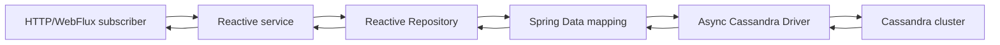

# CRUD, truy vấn dẫn xuất và @Query với kiểu trả về phản ứng

Một ứng dụng Spring cần lấy trạng thái booking, lưu đơn hàng, liệt kê các giao dịch trong một ngày hoặc hiển thị lịch sử theo khách hàng. Với Spring Data Cassandra, lập trình viên có thể viết Repository để thực hiện CRUD, tạo truy vấn từ tên phương thức (**derived query**) hoặc dùng `@Query` để khai báo CQL rõ ràng. Khi ứng dụng sử dụng **Reactive Spring**, những thao tác này thường trả về **`Mono<T>`** hoặc **`Flux<T>`** thay vì trả entity/List ngay tại thời điểm gọi.

Điểm dễ hiểu nhầm: **kiểu trả về phản ứng không thay đổi cách Cassandra phân vùng dữ liệu, giới hạn CQL hay ngữ nghĩa ghi**. Một phương thức `Flux<Booking> findByStatus(...)` không tự biến một truy vấn thiếu partition key thành truy vấn hiệu quả; `save(...)` vẫn có thể là upsert; `Mono<Void>` từ `deleteById(...)` không có nghĩa nhiều bảng được xóa trong một transaction. Reactive giúp tạo luồng I/O bất đồng bộ và kết hợp các bước có backpressure, nhưng ứng dụng vẫn phải thiết kế **bảng theo truy vấn, consistency, paging và kiểm soát tải**.

Bài học thuộc chương **Truy cập phản ứng** của module **`SPRING_DATA_CASSANDRA`**. Module tập trung vào truy cập Apache Cassandra bằng entity mapping, Repository, `CassandraTemplate`, truy vấn CQL, thiết kế partition key, tính nhất quán, paging và hiệu năng của hệ thống dữ liệu phân tán. Bài này hướng dẫn **CRUD, derived queries và `@Query` của Reactive Repository**, không thay thế tài liệu chuyên sâu về Reactor hay transaction Cassandra.

**Sau bài học, bạn có thể:**

1. Giải thích vì sao `Mono<T>` phù hợp với 0–1 kết quả còn `Flux<T>` phù hợp với nhiều kết quả.
2. Tạo `ReactiveCassandraRepository<Entity, ID>` và thực hiện `save`, `findById`, `findAllById`, `existsById`, `count`, `deleteById`.
3. Viết derived query dựa trên **partition key/clustering key**, kể cả composite primary key.
4. Dùng `@Query` với placeholder `?0`, `?1` và CQL `SELECT` rõ ràng.
5. Phân biệt query được Spring Data **suy ra về mặt cú pháp** với query Cassandra **chấp nhận và thực thi hiệu quả**.
6. Kết hợp `map`, `flatMap`, `switchIfEmpty`, `concatMap`, `flatMap(..., concurrency)` và `onErrorResume` có kiểm soát.
7. Hiểu reactive publisher **cold**, subscription, cancellation, paging, backpressure và giới hạn số request in-flight.
8. Kiểm thử các luồng CRUD/query bằng Reactor Test/`StepVerifier` và integration test với Cassandra thật.

## 1. Reactive Repository giải quyết vấn đề nào?

Một Repository đồng bộ có thể trả `Booking` hoặc `List<Booking>` sau khi lời gọi đọc dữ liệu hoàn tất. Nếu coordinator/replica Cassandra còn đang xử lý, thread gọi phải chờ.

Reactive Repository biểu diễn tác vụ dưới dạng **Publisher**:

```java
Mono<BookingById> one = repository.findById(bookingId);
Flux<BookingByDay> many =
        dayRepository.findByKey_TenantIdAndKey_BookingDay(
                tenantId, day);
```

Ở đây `one` và `many` không phải bản ghi được đọc xong. Chúng mô tả **pipeline phát kết quả khi được subscribe**. Tầng WebFlux, `StepVerifier` hoặc một subscriber có trách nhiệm tiêu thụ pipeline.



Ưu điểm kỳ vọng: không phải giữ một thread blocking cho mỗi truy vấn đang chờ I/O, dễ biểu diễn luồng data/error/completion và tích hợp với ứng dụng reactive. **Đánh đổi**: hiểu rõ subscription, lifecycle, scheduler, backpressure và side effects.

## 2. Mono và Flux biểu diễn những kết quả nào?

Reactor cung cấp hai kiểu phổ biến:

| Kiểu | Số phần tử | Ví dụ | Lưu ý |
| --- | ---: | --- | --- |
| `Mono<BookingById>` | 0 hoặc 1 | `findById(id)` | Không tìm thấy thường **hoàn tất rỗng**, không phát `null` |
| `Mono<Boolean>` | 1 kết quả boolean khi thành công | `existsById(id)` | `false` là kết quả hợp lệ, không phải exception |
| `Mono<Long>` | 1 số | `count()` | Đếm toàn bảng có thể rất đắt trên Cassandra |
| `Mono<Void>` | 0 giá trị, tín hiệu hoàn tất | `deleteById(id)` | Hoàn tất không đồng nghĩa transaction đa bảng |
| `Flux<BookingByDay>` | 0 đến nhiều | Query theo tenant/ngày | Có thể đi qua nhiều trang Cassandra |
| `Flux<BookingById>` | 0 đến nhiều | `findAllById(ids)` | Phải giới hạn số ID và số query |

Hai thuật ngữ:

- **`onNext`**: phát một giá trị.
- **`onComplete`**: kết thúc thành công.
- **`onError`**: kết thúc thất bại, ví dụ timeout, lỗi schema hoặc lỗi mapping.

`Mono.empty()` khác `Mono.error(...)`:

```java
Mono<BookingById> notFound = Mono.empty();
Mono<BookingById> storageError =
        Mono.error(new IllegalStateException("Cassandra unavailable"));
```

Không dùng `Mono.just(null)` để biểu diễn “không tìm thấy”: Reactor không cho phép phát `null` như một phần tử thông thường.

## 3. Các thành phần cần có trong dự án

Một dự án Spring Boot dùng Reactive Spring Data Cassandra thường có:

1. **Spring Data Cassandra** với phần hỗ trợ reactive và repository scan phù hợp.
2. **Apache Cassandra Java Driver 4.x** tương thích với phiên bản Spring Data đã chọn.
3. **Project Reactor** (Mono/Flux), và **Spring WebFlux** nếu endpoint HTTP cũng reactive.
4. **CqlSession**, mapping context, conversions và các cấu hình keyspace/connection được Spring quản lý.
5. **Reactor Test** cho `StepVerifier` trong scope test; Cassandra thật/Testcontainers khi kiểm thử integration.

Những dependency cụ thể phải khớp **Spring Boot BOM / release train**; không trộn tùy tiện phiên bản Spring Data và Java Driver. Trong các ví dụ sau, ta sử dụng tên API Reactive Cassandra thường gặp ở các nhánh hiện đại. Khi dự án pin một phiên bản cũ, hãy xác nhận chữ ký và cấu hình repository/mapper của phiên bản ấy.

### Kích hoạt repository

Spring Boot có thể tự cấu hình repository reactive khi dependency và cấu hình phù hợp. Nếu cần khai báo tường minh:

```java
import org.springframework.context.annotation.Configuration;
import org.springframework.data.cassandra.repository.config
        .EnableReactiveCassandraRepositories;

@Configuration
@EnableReactiveCassandraRepositories(
        basePackages = "example.booking.data")
public class ReactiveRepositoryConfiguration {
}
```

Không bật cấu hình trùng lặp một cách tùy tiện nếu Boot đã tự scan; hãy bảo đảm package và beans được tạo đúng. Annotation `@EnableReactiveCassandraRepositories` dành cho reactive repository, khác với cấu hình repository đồng bộ.

## 4. Thiết kế bảng trước khi viết Repository

Giả sử sản phẩm cần hai đường đọc:

1. Tìm một booking theo `booking_id`.
2. Liệt kê booking của **một tenant vào một ngày** theo thứ tự thời gian.

Một bảng hiếm khi phục vụ tốt hai đường đọc khác nhau nếu có partition key khác nhau. Chúng ta thiết kế hai bảng:

```sql
CREATE TABLE IF NOT EXISTS bookings_by_id (
    booking_id uuid PRIMARY KEY,
    tenant_id uuid,
    status text,
    created_at timestamp,
    total_amount_cents bigint
);

CREATE TABLE IF NOT EXISTS bookings_by_tenant_day (
    tenant_id uuid,
    booking_day date,
    created_at timestamp,
    booking_id uuid,
    status text,
    total_amount_cents bigint,
    PRIMARY KEY (
        (tenant_id, booking_day),
        created_at,
        booking_id
    )
) WITH CLUSTERING ORDER BY (
    created_at DESC,
    booking_id ASC
);
```

| Bảng | Partition key | Clustering key | Query phù hợp |
| --- | --- | --- | --- |
| `bookings_by_id` | `booking_id` | Không có | `WHERE booking_id = ?` |
| `bookings_by_tenant_day` | `(tenant_id, booking_day)` | `(created_at, booking_id)` | `WHERE tenant_id = ? AND booking_day = ?`; có thể thêm điều kiện phạm vi thời gian hợp lệ |

**Hai lưu ý:**

- `status` chỉ là cột thường ở cả hai bảng. Một `findByStatus(...)` **không tự** có đường truy vấn tốt.
- Hai bảng là **hai bản sao phục vụ hai query shapes**. Ghi vào bảng này **không tự cập nhật** bảng kia; cần write workflow, event/outbox hoặc reconciliation phù hợp.

Trong ví dụ, `booking_id` là `uuid`. Clustering theo `created_at` để sắp xếp theo thời gian; có thêm `booking_id` để phân biệt các booking cùng thời điểm tạo. Không suy thứ tự thời gian từ UUID ngẫu nhiên.

## 5. Entity cho bảng đọc theo ID

```java
package example.booking.data;

import java.time.Instant;
import java.util.UUID;
import org.springframework.data.cassandra.core.mapping.Column;
import org.springframework.data.cassandra.core.mapping.PrimaryKey;
import org.springframework.data.cassandra.core.mapping.Table;

@Table("bookings_by_id")
public class BookingById {

    @PrimaryKey("booking_id")
    private UUID bookingId;

    @Column("tenant_id")
    private UUID tenantId;

    @Column("status")
    private String status;

    @Column("created_at")
    private Instant createdAt;

    @Column("total_amount_cents")
    private Long totalAmountCents;

    public BookingById() {
    }

    public UUID getBookingId() { return bookingId; }
    public void setBookingId(UUID value) { bookingId = value; }

    public UUID getTenantId() { return tenantId; }
    public void setTenantId(UUID value) { tenantId = value; }

    public String getStatus() { return status; }
    public void setStatus(String value) { status = value; }

    public Instant getCreatedAt() { return createdAt; }
    public void setCreatedAt(Instant value) { createdAt = value; }

    public Long getTotalAmountCents() { return totalAmountCents; }
    public void setTotalAmountCents(Long value) {
        totalAmountCents = value;
    }
}
```

`@Table` xác định bảng; `@PrimaryKey` xác định khóa; `@Column` gắn tên cột cụ thể. Với `timestamp`, ta dùng `Instant`, còn `bigint` dùng `Long`.

**Không gắn thêm một field không có trong schema rồi chờ Spring Data tự tạo cột.** Cassandra cần bảng/column tồn tại và kiểu tương thích; reactive mapping cũng phải tuân schema như khi dùng Repository đồng bộ.

## 6. ReactiveCassandraRepository cho CRUD

Một interface nhỏ đã có nhiều phương thức CRUD:

```java
package example.booking.data;

import java.util.UUID;
import org.springframework.data.cassandra.repository
        .ReactiveCassandraRepository;

public interface BookingByIdRepository
        extends ReactiveCassandraRepository<BookingById, UUID> {
}
```

Các method tiêu biểu:

| Method | Kiểu kết quả | Ý nghĩa |
| --- | --- | --- |
| `save(entity)` | `Mono<BookingById>` | Ghi entity theo contract Spring Data |
| `saveAll(entities)` | `Flux<BookingById>` | Ghi nhiều entity, **không tự thành transaction đa partition** |
| `findById(id)` | `Mono<BookingById>` | Trả tối đa một entity |
| `existsById(id)` | `Mono<Boolean>` | Có tồn tại hay không |
| `findAllById(ids)` | `Flux<BookingById>` | Đọc các ID được chỉ định |
| `findAll()` | `Flux<BookingById>` | Có thể rất nguy hiểm nếu bảng lớn |
| `count()` | `Mono<Long>` | Đếm dữ liệu theo API; chi phí có thể cao |
| `deleteById(id)` | `Mono<Void>` | Xóa theo khóa |
| `delete(entity)` | `Mono<Void>` | Xóa entity theo contract |

**Lưu ý phiên bản:** tên và overload chi tiết của các phương thức có thể thay đổi theo Spring Data release train. Những chữ ký trên thể hiện nhóm API thường gặp; cần biên dịch/integration test trên phiên bản thực tế.

### Vì sao không lạm dụng findAll và count?

Một `Flux` có backpressure **không biến một full table scan thành rẻ**. Cassandra được thiết kế để truy cập hiệu quả khi biết partition key. Dùng `findAll()` để liệt kê hàng triệu booking hoặc `count()` liên tục cho dashboard có thể tăng CPU, I/O, network và tạo tải lan trên cluster. Đối với màn hình thống kê, cân nhắc bảng tổng hợp theo query shape thay vì quét.

## 7. CRUD tạo mới: save là upsert, không phải INSERT có điều kiện

Ví dụ tạo entity:

```java
BookingById booking = new BookingById();
booking.setBookingId(bookingId);
booking.setTenantId(tenantId);
booking.setStatus("PENDING");
booking.setCreatedAt(Instant.now());
booking.setTotalAmountCents(175_000L);

Mono<BookingById> saved = repository.save(booking);
```

Với Cassandra, việc ghi dữ liệu thông thường thường theo semantics **upsert**: khóa đã tồn tại có thể được cập nhật thay vì báo lỗi uniqueness. Vì vậy, `repository.save(...)` **không phải cách bảo đảm duy nhất** rằng “mỗi booking ID chỉ được tạo đúng một lần”.

Nếu yêu cầu là **chỉ tạo khi chưa tồn tại**, cần cơ chế `INSERT ... IF NOT EXISTS`/LWT, `@Version` được framework hỗ trợ trong trường hợp thích hợp hoặc một gateway conditional khác. Và phải **kiểm tra kết quả applied/conflict**; reactive return type tự nó không cung cấp bảo đảm CAS.

### saveAll không phải một transaction SQL

```java
Flux<BookingById> savedMany =
        repository.saveAll(bookings);
```

Đoạn code không bảo đảm nếu entity thứ ba thất bại thì các entity đã lưu trước đó được rollback. Không coi `Flux<BookingById>` là một batch transaction ACID nhiều partition. Nếu cần nhiều projection và side effects, dùng idempotency, retry/reconciliation và workflow phù hợp.

## 8. CRUD đọc: Mono.empty là không tìm thấy

```java
Mono<BookingById> found =
        repository.findById(bookingId);
```

Nếu có hàng, Mono phát một `BookingById` rồi hoàn tất; nếu không có, Mono **hoàn tất rỗng**. Có thể chuyển rỗng thành lỗi nghiệp vụ:

```java
public Mono<BookingById> requireBooking(UUID id) {
    return repository.findById(id)
            .switchIfEmpty(Mono.error(
                    new BookingNotFoundException(id)));
}
```

Ví dụ giả định `BookingNotFoundException` là exception nghiệp vụ được ứng dụng định nghĩa. Không dùng `onErrorResume(error -> Mono.empty())` cho mọi exception: khi Cassandra timeout, **không được** báo “không tìm thấy booking”.

### existsById không phải khóa giao dịch

```java
Mono<Boolean> exists = repository.existsById(bookingId);
```

Nếu code kiểm tra `existsById` rồi mới gọi `save`, có một **cửa sổ race** giữa hai thao tác:

```text
Client A -> existsById(X) = false
Client B -> existsById(X) = false
Client A -> save(X)
Client B -> save(X)
```

Muốn tạo duy nhất hoặc kiểm soát version, phải dùng điều kiện nguyên tử trong Cassandra; không dùng tổ hợp hai reactive methods làm giả transaction.

## 9. CRUD xóa: Mono<Void> không tự xác nhận mọi tác động phụ

```java
Mono<Void> deleted = repository.deleteById(bookingId);
```

`Mono<Void>` phát tín hiệu hoàn tất khi operation được xác nhận theo contract của tầng truy cập. Nó không phát entity đã xóa. Nếu muốn chuỗi xử lý:

```java
Mono<Void> removeAndLog(UUID id) {
    return repository.deleteById(id)
            .then(auditService.recordDeletedAsync(id));
}
```

Đây là **hai thao tác tuần tự**, không phải một transaction Cassandra + audit. Nếu delete thành công còn audit lỗi, delete **không rollback**. Audit/outbox cần phương án idempotent và recovery riêng.

### Có nên xóa trước khi chắc hàng tồn tại?

Cassandra có ngữ nghĩa delete/tombstone riêng. `deleteById` hoàn tất không nhất thiết có nghĩa một hàng đã tồn tại và bị xóa lần đầu. Nếu nghiệp vụ cần “chỉ xóa khi version/owner còn đúng”, dùng conditional delete/LWT thích hợp, không suy thông tin đó từ `Mono<Void>`.

## 10. Cold Publisher: chỉ gọi method chưa phải đã chạy query

Trong mô hình Reactor, nhiều Publisher từ Reactive Repository là **cold**: công việc được kích hoạt khi có subscriber.

```java
Mono<BookingById> pipeline =
        repository.findById(bookingId);

// Chưa có subscriber thì không nên giả định query đã chạy.
```

Trong WebFlux, framework subscribe vào Mono/Flux mà controller trả ra. Trong test, `StepVerifier` cũng subscribe. Nếu tự gọi `subscribe` hai lần trên một pipeline cold, thường sẽ có **hai lần thực thi đường truy cập**:

```java
Mono<BookingById> lookup = repository.findById(bookingId);

lookup.subscribe(this::useForMetrics);
lookup.subscribe(this::useForResponse);
```

Điều này có thể tạo **hai SELECT**. Với read, đó có thể chỉ là overhead; với write non-idempotent, có thể nguy hiểm hơn nhiều. Nếu thật sự cần chia sẻ kết quả trong phạm vi ngắn, cân nhắc cache/share theo contract, nhưng phải hiểu **stale data, memory và lifecycle**.

**Quy tắc ở service:** trả Publisher cho caller thay vì tự subscribe rồi trả ngay một giá trị mặc định.

## 11. Dùng reactive pipeline trong service có kiểm tra tenant

Bảng `bookings_by_id` có partition key `booking_id`, còn `tenant_id` là cột thường. Khi đã tìm theo booking ID, phải xác minh người gọi được quyền xem tenant:

```java
import java.util.UUID;
import reactor.core.publisher.Mono;

public final class BookingLookupService {
    private final BookingByIdRepository repository;

    public BookingLookupService(BookingByIdRepository repository) {
        this.repository = repository;
    }

    public Mono<BookingById> findForTenant(
            UUID bookingId, UUID authenticatedTenantId) {

        return repository.findById(bookingId)
                .switchIfEmpty(Mono.error(
                        new BookingNotFoundException(bookingId)))
                .flatMap(booking -> {
                    if (!authenticatedTenantId.equals(
                            booking.getTenantId())) {
                        return Mono.error(
                            new BookingAccessDeniedException(bookingId));
                    }
                    return Mono.just(booking);
                });
    }
}
```

Các exception ví dụ là class của ứng dụng. Không trả dữ liệu từ một tenant khác chỉ vì người gọi đoán được `booking_id`. Khi mô hình truy vấn thường xuyên có điều kiện tenant, hãy cân nhắc khóa/bảng thiết kế cho tenant thay vì dựa hoàn toàn vào bước kiểm tra sau khi đọc.

### Vì sao flatMap?

Ở đây `flatMap` cho phép mỗi nhánh trả `Mono<BookingById>` hoặc `Mono.error(...)`. Nếu chỉ biến `BookingById` thành DTO đồng bộ, `map` thường gọn hơn.

## 12. Composite key cho query theo tenant/ngày

Bảng `bookings_by_tenant_day` dùng partition key kép và clustering key kép. Spring Data Cassandra có thể ánh xạ qua `@PrimaryKeyClass` và `@PrimaryKeyColumn`:

```java
package example.booking.data;

import java.io.Serializable;
import java.time.Instant;
import java.time.LocalDate;
import java.util.UUID;

import org.springframework.data.cassandra.core.mapping
        .PrimaryKeyClass;
import org.springframework.data.cassandra.core.mapping
        .PrimaryKeyColumn;
import org.springframework.data.cassandra.core.cql
        .PrimaryKeyType;

@PrimaryKeyClass
public class BookingByDayKey implements Serializable {

    @PrimaryKeyColumn(
            name = "tenant_id", ordinal = 0,
            type = PrimaryKeyType.PARTITIONED)
    private UUID tenantId;

    @PrimaryKeyColumn(
            name = "booking_day", ordinal = 1,
            type = PrimaryKeyType.PARTITIONED)
    private LocalDate bookingDay;

    @PrimaryKeyColumn(
            name = "created_at", ordinal = 2,
            type = PrimaryKeyType.CLUSTERED)
    private Instant createdAt;

    @PrimaryKeyColumn(
            name = "booking_id", ordinal = 3,
            type = PrimaryKeyType.CLUSTERED)
    private UUID bookingId;

    public BookingByDayKey() {
    }

    // Bổ sung constructor, getters, setters,
    // equals/hashCode theo quy tắc identity của key.
}
```

**Chú ý về import:** trong các phiên bản Spring Data Cassandra, enum `PrimaryKeyType` thường có package `org.springframework.data.cassandra.core.cql.PrimaryKeyType`; kiểm tra dependency thực tế khi biên dịch. Một số ví dụ tài liệu cũ dùng import khác.

Entity:

```java
package example.booking.data;

import org.springframework.data.cassandra.core.mapping.Column;
import org.springframework.data.cassandra.core.mapping.PrimaryKey;
import org.springframework.data.cassandra.core.mapping.Table;

@Table("bookings_by_tenant_day")
public class BookingByDay {

    @PrimaryKey
    private BookingByDayKey key;

    @Column("status")
    private String status;

    @Column("total_amount_cents")
    private Long totalAmountCents;

    public BookingByDay() {
    }

    public BookingByDayKey getKey() { return key; }
    public void setKey(BookingByDayKey value) { key = value; }
    public String getStatus() { return status; }
    public void setStatus(String value) { status = value; }
    public Long getTotalAmountCents() { return totalAmountCents; }
    public void setTotalAmountCents(Long value) {
        totalAmountCents = value;
    }
}
```

Các ví dụ mapping chưa bao gồm hoàn toàn `equals/hashCode` của key và constructor thuận tiện. Khi triển khai, phải hoàn thiện theo yêu cầu của Spring Data và kiểm tra thứ tự clustering với DDL đã tạo. Đừng tự đổi schema clustering order chỉ bằng cách thêm một annotation trên entity mà không kiểm tra schema thực.

## 13. Reactive Repository trên composite key

```java
package example.booking.data;

import java.time.Instant;
import java.time.LocalDate;
import java.util.UUID;
import reactor.core.publisher.Flux;
import org.springframework.data.cassandra.repository
        .ReactiveCassandraRepository;

public interface BookingByDayRepository
        extends ReactiveCassandraRepository<
                BookingByDay, BookingByDayKey> {

    Flux<BookingByDay> findByKey_TenantIdAndKey_BookingDay(
            UUID tenantId, LocalDate bookingDay);

    Flux<BookingByDay>
    findByKey_TenantIdAndKey_BookingDayAndKey_CreatedAtLessThan(
            UUID tenantId, LocalDate bookingDay, Instant before);
}
```

**Giải thích tên phương thức:**

- `key` là property composite primary key của `BookingByDay`.
- `Key_TenantId` và `Key_BookingDay` biểu diễn đường truy cập property lồng nhau từ `key`; dấu `_` giúp parser thể hiện ranh giới property.
- Hai tham số tenant/day cung cấp **đầy đủ các phần partition key**.
- `Key_CreatedAtLessThan` thêm điều kiện phạm vi trên clustering column đầu tiên `created_at`.
- Vì một ngày có thể có nhiều booking, kiểu trả về phù hợp là `Flux<BookingByDay>`.

**Ràng buộc:** parser derived query và mapping composite key có các chi tiết theo Spring Data version. Nếu method không được phân giải chính xác hoặc CQL được sinh không đạt yêu cầu, dùng `@Query` tường minh và kiểm thử startup/schema/integration. Không khẳng định mọi tổ hợp từ khóa trong Spring Data JPA có thể copy nguyên sang Cassandra.

## 14. Derived query không sửa được data model

Spring Data có thể phân tích tên phương thức thành điều kiện nhưng Cassandra vẫn cần thực thi CQL hợp lệ.

Ví dụ nguy hiểm trên bảng `bookings_by_id`:

```java
// Không phải một query tốt chỉ vì Spring parse được tên:
Flux<BookingById> findByStatus(String status);
```

`status` không thuộc primary key của `bookings_by_id`. Nếu không có index/cách truy cập được hỗ trợ, CQL kiểu `WHERE status = ?` có thể bị Cassandra từ chối hoặc buộc một đường quét/lọc không hiệu quả.

| Tên method | Bảng mục tiêu | Nhận xét |
| --- | --- | --- |
| `findById(bookingId)` | `bookings_by_id` | Point lookup theo partition key |
| `findByKey_TenantIdAndKey_BookingDay(...)` | `bookings_by_tenant_day` | Có đủ composite partition key |
| `findByKey_TenantIdAndKey_BookingDayAndKey_CreatedAtLessThan(...)` | `bookings_by_tenant_day` | Điều kiện clustering hợp lý khi được hỗ trợ |
| `findByStatus("CONFIRMED")` | `bookings_by_id` | Thiếu đường truy vấn theo khóa |
| `findByTenantId(...)` | `bookings_by_id` | `tenant_id` chỉ là cột thường trong bảng này |
| `findByKey_BookingDay(...)` | `bookings_by_tenant_day` | Thiếu `tenant_id` trong partition key |

Nếu sản phẩm thực sự cần “tìm mọi booking đã xác nhận của tenant trong ngày”, hãy cân nhắc **bảng chuyên dụng theo status** hoặc index như SAI nếu đúng phiên bản Cassandra/workload; không lạm dụng `ALLOW FILTERING`.

### Phân biệt derived query và supported query

Một tên method phân tích được ở startup chưa chứng minh query **đúng về hiệu năng**. Ngược lại, một method không parse được có thể lỗi khi tạo bean. **Kiểm thử cả parsing lẫn CQL thực thi trên schema thực**.

## 15. @Query để khai báo SELECT CQL chính xác

Khi đường truy vấn cần điều kiện rõ ràng hoặc derived method quá dài, dùng `@Query`:

```java
package example.booking.data;

import java.time.Instant;
import java.time.LocalDate;
import java.util.UUID;
import reactor.core.publisher.Flux;
import org.springframework.data.cassandra.repository.Query;
import org.springframework.data.cassandra.repository
        .ReactiveCassandraRepository;

public interface BookingByDayQueries
        extends ReactiveCassandraRepository<
                BookingByDay, BookingByDayKey> {

    @Query("""
        SELECT *
        FROM bookings_by_tenant_day
        WHERE tenant_id = ?0
          AND booking_day = ?1
        """)
    Flux<BookingByDay> forTenantDay(
            UUID tenantId, LocalDate bookingDay);

    @Query("""
        SELECT *
        FROM bookings_by_tenant_day
        WHERE tenant_id = ?0
          AND booking_day = ?1
          AND created_at < ?2
        LIMIT 50
        """)
    Flux<BookingByDay> olderThan(
            UUID tenantId, LocalDate bookingDay, Instant before);
}
```

**`?0`, `?1`, `?2`** là positional parameter markers theo quy ước Spring Data Cassandra cho query method: chúng gắn tới tham số phương thức theo chỉ số bắt đầu từ 0. Framework có trách nhiệm bind giá trị; **không dùng string concatenation** từ dữ liệu người dùng để tạo CQL.

### Vì sao giới hạn LIMIT 50?

Khi màn hình chỉ cần một số booking gần nhất, `LIMIT` **ở CQL** giúp giới hạn số hàng trả theo query này. `Flux.take(50)` ở phía client có thể dừng tiêu thụ sớm, nhưng không nên xem nó là thay thế tổng quát cho **query limit phía server**. Cassandra paging có thể đã tải một số hàng/buffer trước khi downstream cancel.

Vì dữ liệu theo `created_at DESC`, query `created_at < before` giúp lấy hàng cũ hơn một mốc. Với dữ liệu có timestamp bằng nhau, cursor chỉ có `created_at` có thể bỏ sót/trùng; cần xem thêm phần paging.

## 16. @Query và binding tham số an toàn

Một CQL query tùy chỉnh đúng nên:

1. Giữ **tên bảng/cột và cấu trúc query tĩnh**.
2. Bind giá trị người dùng qua parameter markers.
3. Chỉ lọc theo các cột mà schema/index hỗ trợ.
4. Không ghép dynamic table/column name từ input tùy ý.
5. Không tự thêm `ALLOW FILTERING` chỉ để “chạy được”.
6. Không tự chuyển một write thành conditional write chỉ vì method trả `Mono<Boolean>`.

Ví dụ:

```java
@Query("""
    SELECT *
    FROM bookings_by_tenant_day
    WHERE tenant_id = ?0
      AND booking_day = ?1
      AND created_at >= ?2
      AND created_at < ?3
    """)
Flux<BookingByDay> betweenCreatedAt(
        UUID tenantId,
        LocalDate bookingDay,
        Instant fromInclusive,
        Instant untilExclusive);
```

Đối với Cassandra, điều kiện phạm vi trên clustering column đầu tiên phải tương thích với thứ tự key và hạn chế CQL của phiên bản đang chạy. Đây là lợi thế của `@Query`: có thể đọc và review **CQL thật** trực tiếp.

### @Query có làm result trở thành Flux không?

`@Query` chỉ định **câu lệnh**; kiểu trả về reactive do chữ ký Repository và abstraction xử lý. Nếu SELECT trả nhiều hàng mà method khai báo `Mono<T>`, behavior phụ thuộc contract ánh xạ/đếm hàng được framework hỗ trợ. Hãy chọn `Flux<T>` cho query đa hàng, `Mono<T>` cho point lookup 0–1 hàng.

## 17. @Query cho point lookup

Ví dụ khi muốn một query rõ cột:

```java
import java.util.UUID;
import reactor.core.publisher.Mono;
import org.springframework.data.cassandra.repository.Query;

@Query("""
    SELECT booking_id, tenant_id, status,
           created_at, total_amount_cents
    FROM bookings_by_id
    WHERE booking_id = ?0
    """)
Mono<BookingById> findDetailedById(UUID bookingId);
```

Đây là full projection đủ các field của `BookingById`. Nếu chỉ SELECT vài cột rồi map vào entity đầy đủ, các field không được chọn có thể là null/default; **đừng save ngược một entity chỉ chứa một phần field** mà không hiểu cách framework xử lý chúng.

Khi muốn tối ưu payload, có thể dùng **interface/DTO projection** mà phiên bản Spring Data Cassandra của bạn hỗ trợ, hoặc `ReactiveCassandraTemplate`/RowMapper/CQL driver để kiểm soát danh sách cột. Đo bytes/CPU thực tế thay vì giả định mọi projection tự giảm SELECT.

## 18. Derived query theo tên method: quy tắc đặt tên

Một số dạng từ khóa quen thuộc trong Spring Data:

| Dạng tên | Ý tưởng | Cảnh báo với Cassandra |
| --- | --- | --- |
| `findBy...` | Tìm nhiều/ít bản ghi theo property | Property phải ánh xạ được và query hợp lệ |
| `findFirstBy...` / `findTopBy...` | Ý định giới hạn kết quả | Kiểm tra CQL sinh ra và ordering |
| `...LessThan` | So sánh nhỏ hơn | Thường phù hợp với clustering range hợp lệ |
| `...GreaterThanEqual` | So sánh lớn hơn hoặc bằng | Phải đúng loại cột và partition key |
| `...And...` | Kết hợp điều kiện | Không thay thế yêu cầu đầy đủ partition key |
| `...OrderBy...` | Yêu cầu sắp xếp | Cassandra chỉ hỗ trợ ORDER BY theo clustering/partition constraints |

**Không phải mọi từ khóa có trong Spring Data Commons/JPA đều được module Cassandra chấp nhận hoặc tạo CQL hiệu quả**. Tránh suy từ `findByNameContaining` hay `findByStatusIgnoreCase` rằng Cassandra sẽ tự có full-text search. Những tính năng đó phụ thuộc index/search layer và phiên bản.

### Ưu tiên tên ngắn, rõ và kiểm thử được

Derived query rất phù hợp với câu đơn giản theo key. Khi tên method dài tới mức khó review chính sách phân vùng, cân nhắc `@Query` để mọi điều kiện CQL xuất hiện tường minh.

## 19. Reactive query vẫn phải tuân thứ tự clustering

Ở bảng `bookings_by_tenant_day`:

```sql
PRIMARY KEY ((tenant_id, booking_day), created_at, booking_id)
```

Query hợp lý:

```sql
SELECT *
FROM bookings_by_tenant_day
WHERE tenant_id = ?
  AND booking_day = ?
  AND created_at < ?
LIMIT 50;
```

Query đáng nghi:

```sql
SELECT *
FROM bookings_by_tenant_day
WHERE tenant_id = ?
  AND booking_day = ?
  AND status = 'CONFIRMED';
```

`status` không là clustering column/index trong schema này, nên query lọc trực tiếp theo status không có đường truy cập được bảo đảm. Ngay cả khi Java khai báo `Flux<BookingByDay>`, Cassandra vẫn có thể từ chối hoặc phải quét/lọc nhiều dữ liệu nếu ép.

### Tránh truy vấn wide partition

Nếu một tenant/ngày có hàng triệu booking, một partition quá lớn có thể gây latency và memory pressure. Khi đó, cân nhắc **bucket theo giờ**, bổ sung shard phù hợp, hoặc mô hình bảng theo đường truy vấn thực tế, và bảo đảm reader không cố materialize toàn bộ Flux vào một list khổng lồ.

## 20. Mono.map và Flux.map: chuyển entity thành DTO

Trong tầng API, không nhất thiết trả nguyên entity:

```java
public record BookingSummary(
        UUID bookingId, String status, Instant createdAt) {
}

Mono<BookingSummary> summary = repository.findById(bookingId)
    .map(booking -> new BookingSummary(
            booking.getBookingId(),
            booking.getStatus(),
            booking.getCreatedAt()));
```

`map` dùng cho **biến đổi đồng bộ** từ một item sang item khác. Với Flux:

```java
Flux<String> statuses = dayRepository
    .findByKey_TenantIdAndKey_BookingDay(tenantId, day)
    .map(BookingByDay::getStatus);
```

**Không nhầm:** map entity thành DTO **sau khi đọc** không chứng minh Cassandra chỉ gửi các cột DTO. Nếu cần giảm network payload, sử dụng `SELECT` chỉ các cột cần thiết với projection/mapping phù hợp.

## 21. flatMap và concatMap: gọi thêm bước bất đồng bộ

Giả sử cần đọc booking rồi gọi một service reactive khác:

```java
Mono<BookingWithPayment> result =
    repository.findById(bookingId)
        .switchIfEmpty(Mono.error(
                new BookingNotFoundException(bookingId)))
        .flatMap(booking ->
            paymentGateway.findByBookingId(booking.getBookingId())
                .map(payment -> new BookingWithPayment(
                        booking, payment)));
```

Các kiểu `BookingWithPayment` và `paymentGateway` là ví dụ của ứng dụng. `flatMap` nhận một item và trả Publisher khác; nó **không chặn** để đợi bằng `block()`.

Với Flux nhiều phần tử, lựa chọn quan trọng:

| Operator | Đặc điểm | Khi nào dùng |
| --- | --- | --- |
| `map` | Biến đổi đồng bộ từng item | DTO nhẹ |
| `flatMap` | Kết hợp các Publisher con, có thể **interleave** kết quả | Truy vấn độc lập, cần throughput |
| `flatMap(fn, concurrency)` | Giới hạn tối đa số Publisher con đang hoạt động | Fan-out cần cap |
| `concatMap` | Xử lý các Publisher con theo thứ tự nối tiếp | Cần giữ thứ tự/cắt concurrency |
| `flatMapSequential` | Cho phép concurrency nhưng giữ thứ tự phát kết quả theo nguồn | Khi order của output quan trọng |

**Không dùng `flatMap` không giới hạn theo cảm tính** trên một Flux chứa hàng chục nghìn booking rồi gọi thêm một CQL/HTTP request cho mỗi item.

## 22. Giới hạn fan-out để tránh quá tải Cassandra

Ví dụ mỗi booking cần một truy vấn bổ sung theo ID:

```java
Flux<BookingDetails> details = dayRepository
    .findByKey_TenantIdAndKey_BookingDay(tenantId, day)
    .take(100)
    .flatMap(
        booking -> detailsGateway.findById(
                booking.getKey().getBookingId()),
        8
    );
```

Giả định `BookingByDayKey` đã có getter `getBookingId()`. Đoạn ví dụ dùng `take(100)` để giới hạn số item upstream mà service tiêu thụ và `flatMap(..., 8)` để giới hạn **8 tác vụ con đồng thời**, thay vì khởi tạo 100 truy vấn một lúc.

**Caveat:**

- `take(100)` là giới hạn **ở Reactor**, không tương đương mọi trường hợp với CQL `LIMIT 100`.
- Cassandra có thể đã tải một trang lớn trước khi downstream dừng.
- Với màn hình/API quan trọng, nên có **LIMIT/page size/cursor ở truy vấn** và giới hạn fan-out riêng.
- Số 8 là giá trị minh họa; phải benchmark theo RF, kích thước dữ liệu, QPS và SLO.

## 23. @Query và vấn đề LIMIT, paging, cursor

Một `Flux` có thể nhận hàng từ nhiều trang nội bộ của driver. Nhưng không được đồng nhất:

```text
Flux<T> của Repository
    = một dòng kết quả có thể có paging phía driver
    ≠ phân trang HTTP với cursor ổn định theo business contract
```

**Với danh sách lớn**, một API thường phải xác định:

1. Số phần tử tối đa/trang.
2. Điều kiện keyset hoặc paging state phù hợp.
3. Clustering order được hỗ trợ.
4. Cách truyền cursor giữa các request, giới hạn tuổi và xác thực cursor.
5. Có thể dữ liệu thay đổi trong lúc duyệt, nên không giả định snapshot bất biến.

Cassandra paging state là **opaque**, phụ thuộc truy vấn/binding và driver/server context; không nên đưa thẳng ra public API không bảo vệ. Đối với một bảng có clustering `created_at`/`booking_id`, cursor theo **cả hai thành phần** thường tránh trùng/bỏ sót hơn cursor chỉ theo timestamp, nhưng CQL keyset phải tuân cú pháp và hạn chế Cassandra thực tế.

### Vì sao Flux.take không là phân trang REST?

`take(20)` kết thúc **subscription hiện tại** sau 20 item; nó không cung cấp vị trí để tiếp tục ở request sau. Muốn trang tiếp theo, phải có thiết kế truy vấn và cursor riêng.

## 24. Backpressure: lợi ích và giới hạn

Reactive Streams cho downstream khả năng điều tiết số item yêu cầu từ Publisher. Tuy nhiên:

- Cassandra driver lấy dữ liệu theo **trang**, không phải một network round trip riêng cho từng item.
- Demand downstream có thể tác động đến việc lấy trang tiếp, nhưng trang đã được tải vẫn tiêu tốn memory/network.
- `Flux` không làm một partition quá lớn, một query sai partition key hoặc hot key trở nên rẻ.
- Một pipeline chứa `collectList()` có thể gom **mọi item** vào RAM nếu không có giới hạn.
- Dừng subscription/cancel không có nghĩa mọi request đã gửi tới cluster đều được hủy chắc chắn.

Ví dụ chống materialize vô hạn:

```java
Mono<List<BookingByDay>> firstTwenty =
    dayRepository.findByKey_TenantIdAndKey_BookingDay(tenantId, day)
        .take(20)
        .collectList();
```

Đây chỉ phù hợp nếu ý định nghiệp vụ thực sự là nhận tối đa 20 items. Khi xây API production, nên kết hợp **query LIMIT/cursor** để tránh tải nhiều dữ liệu không cần thiết.

## 25. Reactive streams không được gọi block() trong request path

Anti-pattern khi viết WebFlux:

```java
public BookingById findBlocking(UUID id) {
    return repository.findById(id).block();
}
```

`block()` khiến thread hiện tại đợi đến khi Publisher hoàn tất. Nếu gọi trên **Netty event loop** hoặc một scheduler không dành cho blocking, ứng dụng có thể bị starvation, latency tăng hoặc bị Reactor cảnh báo/lỗi.

Cách tốt hơn:

```java
public Mono<BookingById> findReactive(UUID id) {
    return repository.findById(id);
}
```

### Có trường hợp được dùng block?

Trong một chương trình console hoặc integration test chạy **ở biên ngoài reactive request path**, đôi khi `block()` được dùng để chờ kết quả. Nhưng trong service/controller reactive, **trả Mono/Flux và compose bằng operators** thường là thiết kế đúng.

**Đừng chuyển một lời gọi JDBC blocking thành “reactive” chỉ bằng `Mono.just(blockingCall())`.** Lời gọi blocking sẽ chạy ngay khi tạo Mono. Nếu bất đắc dĩ tích hợp API blocking, phải dùng deferred execution và scheduler được cấu hình phù hợp, song đó không thay đổi bản chất I/O blocking.

## 26. Error signals: not found, conflict, timeout

Một API CRUD thường có ít nhất ba trạng thái:

| Tình huống | Reactive signal | Ý nghĩa |
| --- | --- | --- |
| Đọc thành công có hàng | `onNext(entity)` rồi `onComplete` | Tìm thấy |
| Đọc thành công không hàng | `onComplete` không có item | Not found |
| Cassandra lỗi/timeout | `onError(error)` | Không xác nhận được kết quả |
| LWT trả `[applied] = false` | Có thể là giá trị/kết quả domain conflict | Không phải timeout |
| Mapping lỗi | `onError(mappingError)` | Không nhất thiết là Cassandra unavailable |

Anti-pattern:

```java
return repository.findById(id)
    .onErrorResume(error -> Mono.empty());
```

Nó làm timeout, permission error, CQL invalid và mapping error **trông giống nhau**: “không có booking”. Điều này đặc biệt nguy hiểm khi một API quyết định hoàn tiền, hủy booking hoặc ghi đè dữ liệu dựa trên trạng thái không tìm thấy.

### Chỉ chuyển lỗi khi đã phân loại

```java
return repository.findById(id)
    .onErrorMap(
        org.springframework.dao.DataAccessException.class,
        cause -> new BookingStorageException(
                "Cannot read booking", cause));
```

`BookingStorageException` là kiểu do ứng dụng định nghĩa. Nếu cần retry, kiểm tra **loại lỗi tạm thời** thực sự của driver/Spring Data; không retry mọi `DataAccessException` (vì có lỗi schema/config không thể tự khỏi).

## 27. Retry trong Reactor không luôn an toàn cho writes

`retryWhen` có thể khiến upstream được **subscribe lại**, và với Publisher cold nó có thể **gửi lại CQL**.

Ví dụ **chỉ dành cho read idempotent**:

```java
import java.time.Duration;
import reactor.util.retry.Retry;

Mono<BookingById> retriedRead = repository.findById(bookingId)
    .retryWhen(
        Retry.backoff(2, Duration.ofMillis(100))
            .filter(this::isTransientReadFailure));
```

Ở đây `isTransientReadFailure` là predicate do ứng dụng định nghĩa, chỉ trả true với những lỗi thực sự đáng retry. Giá trị 2 là số lượt retry tối đa theo cấu hình ví dụ; không phải giá trị khuyến nghị cố định.

**Không copy retry đó sang mọi write:**

- `save` thường là upsert nhưng semantics retry còn liên quan timestamp, generated ID và side effects.
- `INSERT IF NOT EXISTS` sau lần đầu thực sự đã applied có thể trả not-applied khi retry.
- Counter increment **không idempotent**, retry có thể cộng đôi.
- Một write timeout **có thể đã được áp dụng**.
- Retry cả pipeline chứa nhiều bước không giống retry một query đơn.

Nếu có nhiều thao tác ghi, cần **idempotency key, phân loại outcome, reconciliation** và quy tắc retry theo từng bước.

## 28. Timeout và cancellation không có nghĩa rollback

Reactor cung cấp:

```java
Mono<BookingById> bounded = repository.findById(id)
    .timeout(Duration.ofSeconds(2));
```

Đây là timeout của pipeline tại tầng ứng dụng. Nó không chứng minh rằng Cassandra đã dừng CQL trên server. Với write:

```text
Service gửi CQL write
    -> Cassandra có thể đã áp dụng
    -> Reactor timeout/caller cancel
    -> Service không biết chắc outcome cuối cùng
```

Hệ quả:

1. Không coi timeout ghi là “chắc chắn chưa ghi”.
2. Không mặc định retry cùng ý định với ID mới.
3. Với LWT, phân biệt `[applied] = false` và **không nhận được response**.
4. Đối với UI không còn subscriber, tránh chủ động tạo thêm read pages không cần thiết.
5. Ghi nhận request correlation/idempotency key để có thể reconcile.

**Reactive cancellation** là một tín hiệu trong pipeline. Nó không tương đương với transaction rollback của RDBMS.

## 29. @Version và optimistic locking trong reactive repository

Spring Data Cassandra có hỗ trợ optimistic locking dựa trên `@Version` ở các phiên bản phù hợp. Ví dụ entity:

```java
import org.springframework.data.annotation.Version;
import org.springframework.data.cassandra.core.mapping.Column;

@Version
@Column("business_version")
private Long businessVersion;
```

Khi được khai báo đúng trên entity đã mapping với schema có cột `business_version bigint`, và framework hỗ trợ cơ chế này, update với version lỗi thời có thể thất bại bằng một **optimistic-locking error** thay vì ghi đè dữ liệu.

Trong reactive pipeline:

```java
Mono<BookingById> updated = repository.save(changedBooking)
    .onErrorMap(
        org.springframework.dao.OptimisticLockingFailureException.class,
        cause -> new BookingVersionConflictException(cause));
```

`BookingVersionConflictException` là domain exception minh họa. **Không dùng `@Version` trên một entity nhưng lại không thêm cột tương ứng ở bảng.** Và đừng coi `@Version` là transaction đa bảng: nó bảo vệ version ở operation được framework quản lý, không tự cập nhật projection khác.

### Một giới hạn của tên field

Một field `businessVersion` **chỉ mang tên như vậy** không tự được Cassandra dùng làm version check. Phải dùng `@Version` theo contract framework hoặc `IF business_version = ?`/LWT tường minh. Mọi write path liên quan đến cùng invariant phải tuân chính sách đó.

## 30. @Query cho mutation: không suy từ Mono<Boolean>

Một method có `@Query` chứa `UPDATE`/`DELETE` không thể được đánh giá chỉ từ kiểu trả về:

```java
// Không lấy chữ ký này làm khẳng định framework sẽ tự
// đọc [applied] hoặc biến UPDATE thành CAS.
// @Query("UPDATE ... WHERE ...")
// Mono<Boolean> updateSomething(...);
```

Với những thao tác thay đổi dữ liệu, các phiên bản Spring Data Cassandra có thể yêu cầu **`@Modifying`**, loại return phù hợp hoặc API chuyên dụng. Hành vi cụ thể phải kiểm tra ở đúng Spring Data version. **Đừng khai báo một `Mono<Boolean>` và giả định boolean đó luôn là cột `[applied]` của LWT**.

Nếu cần điều kiện rõ ràng, kết quả `[applied]`/current fields, serial consistency và phân loại timeout:

- Cân nhắc **`ReactiveCassandraTemplate`** với API thao tác phù hợp.
- Hoặc dùng **Java Driver `CqlSession.executeAsync(...)`** trong custom gateway, chuyển `CompletionStage` sang Publisher.
- Viết integration test xác minh giá trị trả về cho cả applied/not-applied/timeout.

**CQL là nguồn semantics**, Reactor chỉ là dạng truyền kết quả.

## 31. Khi nào dùng ReactiveCassandraTemplate thay Repository?

Reactive Repository phù hợp với CRUD và query method ổn định. `ReactiveCassandraTemplate` hoặc `ReactiveCassandraOperations` hữu ích khi:

1. Điều kiện query được dựng bằng `Query`/`Criteria` một cách có kiểm soát.
2. Cần operation cụ thể không thuận tiện diễn đạt bằng derived method.
3. Cần kiểm soát mapping/entity class tường minh.
4. Có nhiều biến thể truy vấn được framework hỗ trợ nhưng không muốn viết quá nhiều `@Query`.

Ví dụ đọc một booking:

```java
import java.util.UUID;
import reactor.core.publisher.Mono;
import org.springframework.data.cassandra.core
        .ReactiveCassandraOperations;
import org.springframework.data.cassandra.core.query.Criteria;
import org.springframework.data.cassandra.core.query.Query;

public final class BookingQueryGateway {
    private final ReactiveCassandraOperations operations;

    public BookingQueryGateway(ReactiveCassandraOperations operations) {
        this.operations = operations;
    }

    public Mono<BookingById> find(UUID id) {
        Query query = Query.query(
                Criteria.where("booking_id").is(id));
        return operations.selectOne(query, BookingById.class);
    }
}
```

Đoạn này có CQL semantics tương tự point lookup theo primary key. Nó không làm cho tìm theo một cột thường thành hiệu quả nếu schema không có đường truy cập phù hợp.

**Cần tránh:** chạy `CassandraTemplate` đồng bộ bên trong `Mono.map(...)` trên event loop rồi gọi đó là reactive; hãy chọn `ReactiveCassandraOperations` tương ứng hoặc offload blocking một cách tường minh khi tích hợp hệ legacy.

## 32. Repository và Reactive Template không tạo transaction đa bảng

Giả sử cần ghi:

- `bookings_by_id` phục vụ tra cứu booking.
- `bookings_by_tenant_day` phục vụ lịch sử tenant/ngày.
- Một event cho hệ thống gửi thông báo.

Pipeline:

```java
return byIdRepository.save(byId)
    .then(dayRepository.save(byDay))
    .then(notificationService.publish(event));
```

**Điều xảy ra:** mỗi Publisher được subscribe nối tiếp theo `then`; bước sau chỉ chạy khi bước trước hoàn tất thành công. **Điều không xảy ra:** Cassandra tự gom ba thao tác thành transaction ACID đa partition và rollback tất cả nếu bước ba thất bại.

Nếu cần đảm bảo:

1. Xác định bảng nào là **nguồn sự thật**.
2. Có **event ID/idempotency key** ổn định.
3. Tổ chức retry/reconciliation nếu bảng projection thiếu cập nhật.
4. Có state machine khi workflow nhiều bước hoặc có cạnh tranh.
5. Không chỉ thêm `@Transactional` rồi mặc định semantics transaction quan hệ áp dụng cho Cassandra/HTTP/message broker.

Trong reactive Spring, transaction operator/manager chỉ hoạt động với các tài nguyên/semantics mà nó hỗ trợ; không tạo global rollback cho Cassandra và các hệ thống bên ngoài.

## 33. Controller WebFlux trả Mono/Flux

Một controller REST có thể trả Publisher để Spring WebFlux subscribe và ghi HTTP response khi dữ liệu đến.

```java
import java.util.UUID;
import org.springframework.web.bind.annotation.GetMapping;
import org.springframework.web.bind.annotation.PathVariable;
import org.springframework.web.bind.annotation.RequestMapping;
import org.springframework.web.bind.annotation.RestController;
import reactor.core.publisher.Mono;

@RestController
@RequestMapping("/api/bookings")
public final class BookingController {
    private final BookingLookupService service;

    public BookingController(BookingLookupService service) {
        this.service = service;
    }

    @GetMapping("/{id}")
    public Mono<BookingById> getById(
            @PathVariable UUID id) {
        UUID authenticatedTenantId = currentTenantFromSecurity();
        return service.findForTenant(id, authenticatedTenantId);
    }

    private UUID currentTenantFromSecurity() {
        // Chỉ minh họa: triển khai qua SecurityContext/reactive context.
        throw new UnsupportedOperationException(
                "Wire reactive security context");
    }
}
```

**Đoạn controller trên cố ý để trống cách lấy tenant**, vì cách lấy principal phụ thuộc Spring Security và cấu hình xác thực. Trong production, không gọi một hàm blocking hoặc lấy tenant từ query parameter chưa xác thực. Với WebFlux, thường truyền/đọc thông tin bảo mật theo **reactive security context** và thiết kế type-safe API.

### Map lỗi sang HTTP

Thường dùng một `@RestControllerAdvice`/WebFlux error handler để chuyển:

- Not found → 404.
- Forbidden/tenant mismatch → 403 hoặc 404 theo policy.
- Version conflict → 409 hoặc 412 nếu dùng ETag/If-Match.
- Cassandra unavailable/timeout → 503 hoặc trạng thái retry/reconcile theo contract.

Không xử lý mọi `onError` thành HTTP 404.

## 34. Kiểm thử bằng StepVerifier

`StepVerifier` giúp kiểm tra sequence `onNext/onComplete/onError` mà không cần gọi `block()` trong phần assertions.

Ví dụ test với Repository mock:

```java
import static org.mockito.Mockito.when;
import java.util.UUID;
import org.junit.jupiter.api.Test;
import reactor.core.publisher.Mono;
import reactor.test.StepVerifier;

@Test
void findByIdReturnsBooking() {
    UUID id = UUID.randomUUID();
    BookingById booking = new BookingById();
    booking.setBookingId(id);
    booking.setStatus("PENDING");

    when(repository.findById(id))
            .thenReturn(Mono.just(booking));

    StepVerifier.create(repository.findById(id))
            .expectNextMatches(value ->
                    value.getBookingId().equals(id)
                    && "PENDING".equals(value.getStatus()))
            .verifyComplete();
}
```

Đoạn này giả định `repository` là mock được inject/khởi tạo trong test. Nếu cần kiểm tra logic service (authorization, lỗi, mapping), hãy tạo service bằng mock rồi StepVerifier trên method service, thay vì chỉ gọi lại mock repository.

### Test không có hàng

```java
when(repository.findById(id))
        .thenReturn(Mono.empty());

StepVerifier.create(repository.findById(id))
        .verifyComplete();
```

### Test lỗi

```java
when(repository.findById(id))
        .thenReturn(Mono.error(
                new IllegalStateException("Synthetic failure")));

StepVerifier.create(repository.findById(id))
        .expectError(IllegalStateException.class)
        .verify();
```

**Unit test không chứng minh query Cassandra hợp lệ**. Nó chỉ kiểm tra Reactor pipeline và domain mapping ở tầng mock.

## 35. Integration test bắt buộc cho derived queries và @Query

Với Cassandra thật hoặc môi trường tích hợp tương đương production:

1. Tạo schema như mục 4 trong keyspace test.
2. Ghi dữ liệu theo `booking_id` và tenant/ngày.
3. Verify `repository.findById(id)` trả đúng entity và ID chưa tồn tại trả empty.
4. Verify `save(...)`/`deleteById(...)` có semantics như mong đợi.
5. Verify composite key mapping `BookingByDayKey` và các field CQL.
6. Gọi `findByKey_TenantIdAndKey_BookingDay(...)`; xác nhận parser tạo query đúng và Cassandra chấp nhận.
7. Gọi `findByKey_...CreatedAtLessThan(...)`; xác nhận điều kiện clustering được hỗ trợ.
8. Gọi `@Query forTenantDay` và `olderThan`; kiểm tra bind `?0/?1/?2` và LIMIT.
9. Test dữ liệu nhiều hàng, thứ tự clustering và paging.
10. Test độ lớn partition, throughput, backpressure và cancellation theo workload.
11. Test timeout, reconnect/replica unavailable bằng fault injection **chỉ trên test**.
12. Đảm bảo không có query thiếu partition key hoặc `ALLOW FILTERING` tự ý.

**Đừng kết luận “query an toàn” chỉ vì phương thức được biên dịch.** CQL có thể bị Cassandra từ chối khi chạy, hoặc chạy rất đắt khi gặp dữ liệu lớn.

## 36. Bài thực hành A: CRUD booking theo ID

**Bước 1.** Tạo bảng `bookings_by_id`.

**Bước 2.** Tạo `BookingById` có `@Table`, `@PrimaryKey` và các `@Column` như mục 5.

**Bước 3.** Khai báo `BookingByIdRepository extends ReactiveCassandraRepository<BookingById, UUID>`.

**Bước 4.** Tạo một booking mới, thực hiện:

```java
Mono<BookingById> created = repository.save(booking);
```

**Bước 5.** Sử dụng `StepVerifier` để xác minh một entity được phát và stream hoàn tất.

**Bước 6.** Gọi `findById` cho ID đúng và ID khác; xác minh `Mono<BookingById>` vs empty.

**Bước 7.** Dùng `existsById` và `deleteById`, giải thích vì sao exists+save không thành CAS.

**Bước 8.** Thử upsert một entity cùng ID với status khác; quan sát dữ liệu thay đổi theo semantics write thường. Không chạy trên dữ liệu thật.

**Bước 9.** Bổ sung tenant authorization vào service; không đọc dữ liệu tenant khác chỉ dựa vào ID.

**Bước 10.** Ghi lại các trạng thái **success, empty, error**, tránh tráo chúng qua `onErrorResume`.

## 37. Bài thực hành B: derived query và @Query

**Bước 1.** Tạo bảng `bookings_by_tenant_day` với composite partition key.

**Bước 2.** Tạo `BookingByDayKey`/`BookingByDay` và repository như mục 12–13.

**Bước 3.** Ghi ít nhất 30 booking test cho cùng tenant/ngày, nhiều timestamps và booking IDs; có thêm dữ liệu cho tenant/ngày khác.

**Bước 4.** Gọi:

```java
Flux<BookingByDay> results =
    dayRepository.findByKey_TenantIdAndKey_BookingDay(
            tenantId, bookingDay);
```

Đảm bảo chỉ trả đúng partition, không lọt bản ghi tenant/ngày khác.

**Bước 5.** Gọi derived range query với `CreatedAtLessThan`. Kiểm tra mapping, thứ tự trả về và tình huống timestamp trùng.

**Bước 6.** Viết `@Query` SELECT cùng điều kiện bằng `?0`/`?1`; so sánh kết quả với derived method.

**Bước 7.** Viết `@Query olderThan` kèm `LIMIT 50`; đánh giá server-side limit và throughput.

**Bước 8.** Thử một derived query chỉ theo `status` hoặc thiếu một phần partition key trên keyspace test; ghi nhận lỗi/hạn chế thay vì thêm `ALLOW FILTERING` để che vấn đề.

**Bước 9.** Thiết kế bảng/query shape riêng nếu UI cần lọc theo status.

**Bước 10.** Giải thích tại sao `Flux.take(20)` không cung cấp cursor REST cho trang kế tiếp.

## 38. Bài thực hành C: backpressure, lỗi và retry

**Mục tiêu:** bảo vệ Cassandra trước request burst, phân biệt empty/timeout và không retry write mù.

1. Tạo pipeline `dayRepository.findBy...` và giới hạn kết quả bằng query phù hợp.
2. Gọi thêm một dịch vụ đọc theo `bookingId` bằng `flatMap(..., 8)`; đo số request con in-flight.
3. Chuyển sang `concatMap`; so sánh thứ tự, throughput và latency.
4. Dùng `StepVerifier` để test empty vs error.
5. Thêm `timeout(Duration.ofSeconds(2))` cho read và xử lý lỗi theo loại.
6. Chỉ retry **transient read errors**, giới hạn số lần và thêm backoff.
7. Không áp cùng policy retry cho counter increments hoặc multi-step write workflows.
8. Mô phỏng người dùng hủy subscription; giải thích vì sao không thể tuyên bố đã rollback một write.
9. Đo p95/p99 latency, số request in-flight, heap và số row/page.
10. Thiết kế overload response nếu concurrency vượt mức cluster chịu được.

## 39. Sai lầm thường gặp

| Sai lầm | Hậu quả | Cách sửa |
| --- | --- | --- |
| Coi `Flux` là danh sách đã tải xong | Nhầm thời điểm query chạy | Hiểu subscription/cold publisher |
| Gọi `subscribe()` ngay trong service | Side effects chạy ngoài pipeline trả về | Trả Mono/Flux cho WebFlux/caller |
| Gọi `block()` trong controller | Chặn event loop, tăng latency | Compose/return Publisher |
| Dùng `Mono.just(blockingDao.find())` | Blocking chạy ngay | Dùng reactive API hoặc offload đúng cách |
| Dùng `findAll()` trên bảng lớn | Full scan/tải cluster | Thiết kế bảng theo query/partition key |
| Viết `findByStatus` khi status là cột thường | Query lỗi hoặc đắt | Bảng/index phù hợp |
| Dùng `@Query` ghép input người dùng | Rủi ro injection/query sai | Bind `?0/?1`, query tĩnh |
| Coi `Flux.take` là CQL LIMIT/cursor | Tốn tải, không có trang tiếp | Server-side LIMIT/paging strategy |
| Dùng `collectList()` trên Flux vô hạn | Memory tăng mạnh | Giới hạn rows/pages/bytes |
| `flatMap` không giới hạn fan-out | Quá nhiều CQL đồng thời | Giới hạn concurrency |
| Chuyển mọi lỗi thành `Mono.empty()` | Timeout giống not found | Phân loại onError |
| Retry mọi `save`/write | Ghi lặp/side effects lặp | Idempotency/reconciliation |
| Dùng `existsById` rồi `save` để đảm bảo unique | Race condition | LWT `IF NOT EXISTS` |
| Coi `saveAll` là một transaction | Partial success | Workflow, outbox/retry |
| Coi `@Version` chỉ là field số thường | Mất optimistic lock | Dùng mapping/version theo framework |
| Coi `@Query UPDATE` có `Mono<Boolean>` là LWT | Sai semantics kết quả | Kiểm tra `@Modifying`/LWT contract |
| Không kiểm tra tenant ownership | Lộ dữ liệu | Authorization và data model |
| Không integration test derived query | CQL fail trên Cassandra thật | Test với schema/version chính xác |

## 40. Câu hỏi tự kiểm tra

**Câu 1.** Vì sao `findById` trả `Mono<T>` còn query tenant/ngày trả `Flux<T>`?

<details>
<summary>Gợi ý</summary>

Point lookup theo `booking_id` trả tối đa một hàng; query một partition theo tenant/ngày có thể trả nhiều hàng. `Mono` phát 0–1 item, `Flux` phát 0–n.
</details>

**Câu 2.** `Mono.empty()` có giống `Mono.error(timeout)` không?

<details>
<summary>Gợi ý</summary>

Không. Empty là hoàn tất thành công không có bản ghi; timeout là thất bại. Đánh đồng chúng khiến ứng dụng báo “not found” khi DB đang lỗi.
</details>

**Câu 3.** `ReactiveCassandraRepository.save` có tự đảm bảo `INSERT IF NOT EXISTS` không?

<details>
<summary>Gợi ý</summary>

Không được giả định như vậy. Ghi thông thường trên Cassandra có semantics upsert; unique create cần LWT/cơ chế điều kiện phù hợp.
</details>

**Câu 4.** Tại sao derived method `findByStatus` có thể không chạy tốt?

<details>
<summary>Gợi ý</summary>

Vì `status` là cột thường và không nằm trong partition/clustering key của bảng minh họa. Spring Data parse được tên không tạo ra index hay query access path.
</details>

**Câu 5.** Trong `@Query`, `?0` và `?1` biểu diễn gì?

<details>
<summary>Gợi ý</summary>

Chúng là placeholders tham chiếu tham số phương thức theo vị trí bắt đầu từ 0 trong Spring Data Cassandra, giúp bind giá trị thay vì nối chuỗi CQL.
</details>

**Câu 6.** `Flux.take(20)` có giống `SELECT ... LIMIT 20` và tự cung cấp cursor trang sau không?

<details>
<summary>Gợi ý</summary>

Không. `take` giới hạn số item tiêu thụ phía Reactor; CQL LIMIT là giới hạn phía database; cursor trang sau phải có thiết kế riêng.
</details>

**Câu 7.** `flatMap` và `concatMap` khác nhau điểm nào?

<details>
<summary>Gợi ý</summary>

`flatMap` có thể xử lý nhiều Publisher con đồng thời và interleave kết quả; `concatMap` nối các Publisher theo thứ tự. Với fan-out, có thể giới hạn số tác vụ đồng thời qua `flatMap(fn, concurrency)`.
</details>

**Câu 8.** Một `onErrorResume(error -> Mono.empty())` dùng cho mọi lỗi có vấn đề gì?

<details>
<summary>Gợi ý</summary>

Nó biến lỗi Cassandra, mapping và permission thành “không tìm thấy”. Cần phân loại lỗi và trả domain error phù hợp.
</details>

**Câu 9.** Vì sao `saveAll` và `then(writeB)` không phải transaction?

<details>
<summary>Gợi ý</summary>

Reactor chỉ điều phối Publisher. Cassandra không tự rollback các writes ở nhiều partition/bảng nếu một bước sau thất bại.
</details>

**Câu 10.** `retryWhen` có thể gây gì với một counter increment?

<details>
<summary>Gợi ý</summary>

Resubscription có thể gửi lại increment, làm tăng số đếm hai lần. Counter update không idempotent, nên phải có chính sách retry/đối soát riêng.
</details>

**Câu 11.** `@Query` giúp gì hơn derived method rất dài?

<details>
<summary>Gợi ý</summary>

Nó thể hiện CQL trực tiếp, dễ review partition key, clustering conditions, LIMIT, danh sách cột và binding. Nhưng vẫn phải tuân schema Cassandra.
</details>

**Câu 12.** Reactive Repository có loại bỏ mọi vấn đề hiệu năng Cassandra không?

<details>
<summary>Gợi ý</summary>

Không. Async/nonblocking không sửa được query sai, hot partition, full scan, tombstone hoặc fan-out quá mức. Data modeling và performance limits vẫn là trách nhiệm ứng dụng.
</details>

## 41. Checklist trước khi triển khai

1. **Bảng có được thiết kế theo query shape?** Point lookup khác tenant/day list?
2. Có đủ **partition key** trong mỗi derived query/`@Query` không?
3. Clustering range/ordering có hợp lệ với schema Cassandra không?
4. `Mono` được dùng cho 0–1 item, `Flux` cho nhiều item đúng không?
5. Không dùng `Mono.just(null)` hoặc nuốt timeout thành empty?
6. Phần read có lựa chọn projection phù hợp để không tải thừa cột?
7. `save`/`saveAll` có được hiểu đúng là writes không tự tạo transaction?
8. Unique create có dùng CAS/LWT khi cần thay vì exists-then-save?
9. `@Version`/optimistic locking có đúng schema và dependency version?
10. Không dùng `findAll()`/`count()` thường xuyên trên bảng lớn?
11. Các `@Query` có bind tham số, không nối chuỗi đầu vào?
12. Có query LIMIT và paging/cursor rõ cho danh sách lớn?
13. Đã phân biệt backpressure của Flux với CQL server paging?
14. Có giới hạn rows/bytes/pages và `flatMap` concurrency?
15. Không gọi `block()` hoặc `subscribe()` tùy tiện trong service/WebFlux?
16. Retry chỉ cho lỗi phù hợp, không tự gửi lại non-idempotent write?
17. Timeout/cancel có được hiểu đúng là **không bảo đảm rollback**?
18. Tenant authorization có được áp dụng xuyên suốt pipeline?
19. Spring reactive Repository, converter, Java Driver và schema có cùng phiên bản tương thích?
20. Có StepVerifier **và** integration test thật cho CRUD/derived/`@Query`?
21. Có metrics p95/p99, slow query, retry rate, in-flight, row count và hot keys?
22. Có recovery/reconciliation cho dữ liệu denormalized ở nhiều bảng?

## 42. Ghi nhớ

- **ReactiveCassandraRepository** cung cấp CRUD và hỗ trợ query methods với `Mono`/`Flux`; caller nhận **Publisher**, không phải kết quả đồng bộ.
- **`Mono<T>` phát tối đa một item**, `Flux<T>` có thể phát nhiều item. `Mono.empty()` là không có kết quả, **khác** với timeout/error.
- **`save` thường có ngữ nghĩa upsert của Cassandra**; unique create/optimistic lock phải dùng điều kiện/version phù hợp, không suy từ kiểu reactive.
- **Derived queries chỉ tạo câu truy vấn**, không tự tạo partition key/index. Thiết kế bảng theo query là yêu cầu cốt lõi.
- **`@Query` dùng CQL tường minh và positional binding `?0`/`?1`**, phù hợp query phức tạp hoặc cần review chi tiết.
- **Reactive không loại bỏ chi phí paging/scan**. `Flux.take` không tương đương CQL LIMIT hay cursor REST.
- **`map` biến đổi giá trị**, `flatMap` nối Publisher và cần cap concurrency; `concatMap` giữ thứ tự với đánh đổi throughput.
- **Không block trong WebFlux**, không tự subscribe trong service, không tạo fan-out vô hạn; backpressure phải đi kèm giới hạn query/in-flight.
- **Retry/timeout/cancellation không biến một write thành transaction**; cần idempotency và xử lý outcome chưa rõ.
- **Repository, ReactiveCassandraTemplate và Java Driver** là các mức API. Tính đúng phụ thuộc schema, consistency, giới hạn Cassandra và business invariant.

### Tài liệu tham khảo

- [Spring Data Cassandra – Reactive Cassandra](https://docs.spring.io/spring-data/cassandra/reference/cassandra/reactive-cassandra.html)
- [Spring Data Cassandra – Repository Query Methods](https://docs.spring.io/spring-data/cassandra/reference/cassandra/repositories/query-methods.html)
- [Spring Data Cassandra – Cassandra Repositories](https://docs.spring.io/spring-data/cassandra/reference/cassandra/repositories.html)
- [Spring Data Cassandra – Entity Mapping](https://docs.spring.io/spring-data/cassandra/reference/object-mapping.html)
- [Spring Data Cassandra – Cassandra Template](https://docs.spring.io/spring-data/cassandra/reference/cassandra/template.html)
- [Spring Data Commons – Query Methods](https://docs.spring.io/spring-data/commons/reference/repositories/query-methods-details.html)
- [Project Reactor – Reference Guide](https://projectreactor.io/docs/core/release/reference/)
- [Project Reactor – StepVerifier Testing](https://projectreactor.io/docs/core/release/reference/testing.html)
- [Apache Cassandra – Data Modeling](https://cassandra.apache.org/doc/stable/cassandra/developing/data-modeling/intro.html)
- [Apache Cassandra Java Driver – Paging](https://apache.github.io/cassandra-java-driver/4.18.0/core/paging/)
