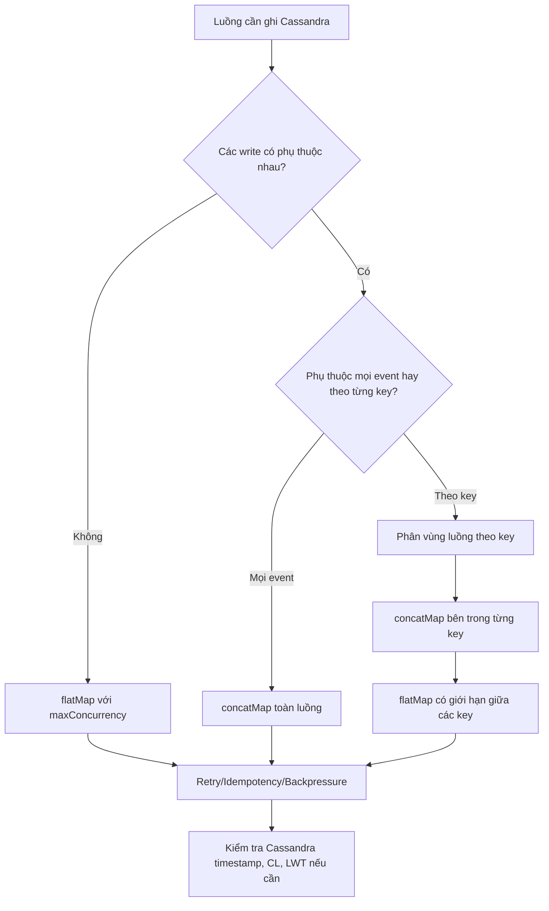
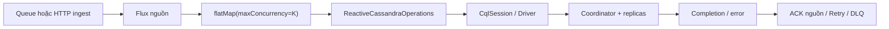

# Phối hợp ghi bằng flatMap hoặc concatMap theo yêu cầu thứ tự trong Spring Data Cassandra

Trong một ứng dụng **Spring Data Cassandra** sử dụng Project Reactor, nhiều yêu cầu ghi thường được biểu diễn bằng `Flux<Event>` và thực thi qua `ReactiveCassandraOperations.insert(...)`, `update(...)` hoặc repository reactive. Khi xử lý từng phần tử của luồng, hai toán tử được dùng nhiều nhất là **`flatMap`** và **`concatMap`**. Chúng cùng biến một event thành một `Publisher` bất đồng bộ, nhưng khác biệt căn bản ở **mức đồng thời và thứ tự bắt đầu/hoàn tất thao tác**.

- **`flatMap`** có thể subscribe vào nhiều inner publishers đồng thời. Các mutation độc lập có thể tận dụng khả năng phân phối qua nhiều partition/replica, nhưng **thứ tự hoàn tất và thứ tự kết quả phát ra không được đảm bảo trùng với thứ tự đầu vào**.
- **`concatMap`** subscribe vào một inner publisher tại một thời điểm, đợi nó kết thúc rồi mới subscribe phần tử tiếp theo. Nó giữ **thứ tự xử lý trong một subscription** với đánh đổi là giảm concurrency trên luồng đó.
- **`flatMapSequential`** cho phép các inner publisher hoạt động **đồng thời**, sau đó **sắp lại thứ tự kết quả phát ra** theo nguồn. Điều này **không có nghĩa các tác dụng phụ ghi Cassandra được thực thi tuần tự**.

Bài thuộc chương **Truy cập phản ứng** của module `SPRING_DATA_CASSANDRA`: truy cập Apache Cassandra bằng entity mapping, repository, CassandraTemplate và CQL. Mục tiêu là phối hợp write pipeline đúng với **query-driven design, partition key, consistency, paging, backpressure, retry và xung đột timestamp** trong cơ sở dữ liệu phân tán.

> **Quy tắc lựa chọn:** Dùng `flatMap(..., maxConcurrency)` khi các mutation **độc lập và có thể hoàn tất không theo thứ tự**; dùng `concatMap` khi **mỗi mutation phải đợi mutation trước đạt completion theo hợp đồng**; nếu chỉ cần tuần tự **theo từng khóa**, xem xét phân vùng luồng theo key thay vì tuần tự toàn bộ. Không nhầm thứ tự phát kết quả Reactor với thứ tự ghi đã được Cassandra chấp nhận, và không coi `concatMap` là distributed transaction.

## 1. Phân biệt ba loại thứ tự

Khi nói “ghi theo thứ tự”, cần chỉ ra **thứ tự nào**:

| Thứ tự | Ví dụ | Phạm vi bảo đảm |
|---|---|---|
| **Thứ tự đầu vào** | Nguồn phát `E1, E2, E3` | Phụ thuộc producer, queue, merge và thứ tự upstream |
| **Thứ tự subscribe/request** | DAO bắt đầu INSERT E1 trước E2 | Do toán tử Reactor và luồng request quyết định |
| **Thứ tự completion/ACK** | Cassandra xác nhận E2 trước E1 | Phụ thuộc I/O, node, topology, CL, timeout |
| **Thứ tự kết quả downstream** | Subscriber nhận outcome E1 rồi E2 | Do `flatMap`/`concatMap`/`flatMapSequential` quyết định |
| **Thứ tự phiên bản cell cuối cùng** | `state = REFUNDED` thắng `state = PAID` | Cassandra xử lý **write timestamp**, tombstone và conflict resolution |

Một kết luận rất quan trọng: **thứ tự outcome downstream không nhất thiết là thứ tự mutation được thực thi hoặc thắng xung đột trong Cassandra**.

Ví dụ nghiệp vụ:

```text
Nguồn gửi lệnh vào cùng tài khoản:
  C1 = set state NEW -> PAID
  C2 = set state PAID -> REFUNDED

Nếu C1/C2 chạy đồng thời:
  C2 có thể được xác nhận hoặc ghi trước C1.

Nếu dùng concatMap:
  C2 chỉ được subscribe sau khi C1 hoàn tất ở phía client.
  Tuy nhiên vẫn phải xét timestamp, retry, producer khác và
  điều kiện nghiệp vụ để bảo đảm trạng thái đúng.
```

Không có toán tử Reactor nào tự tạo isolation giữa nhiều partition, uniqueness cho cột thường hay transaction SQL nhiều bảng trong Cassandra.

## 2. Thiết kế bảng theo đường đọc trước khi tối ưu luồng ghi

Giả sử dịch vụ nhận sự kiện tài khoản và truy vấn danh sách theo tài khoản/ngày:

```sql
CREATE TABLE account_events_by_day (
    tenant_id uuid,
    account_id uuid,
    bucket_day date,
    occurred_at timestamp,
    event_id uuid,
    event_type text,
    amount_minor bigint,
    PRIMARY KEY (
        (tenant_id, account_id, bucket_day),
        occurred_at, event_id
    )
) WITH CLUSTERING ORDER BY (
    occurred_at DESC, event_id DESC
);
```

Đối với bảng này:

- `(tenant_id, account_id, bucket_day)` là **composite partition key**. Thiếu bất kỳ thành phần nào sẽ không định vị cùng một partition.
- `occurred_at` và `event_id` là **clustering columns** tạo thứ tự đọc trong một partition.
- Các event khác `event_id` thường là **row độc lập**; nếu chỉ INSERT và không dùng cùng primary key, chúng ít cạnh tranh trên cùng cell hơn các UPDATE trạng thái.
- Bucket theo ngày giúp tránh một partition tăng mãi theo tuổi tài khoản, nhưng kích thước thực còn phụ thuộc số event/ngày và lưu lượng từng account.
- `event_type` và `amount_minor` là regular columns; reactive không làm chúng thành cột lọc/sắp xếp toàn hệ thống hiệu quả.

CQL đọc tương ứng:

```sql
SELECT occurred_at, event_id, event_type, amount_minor
FROM account_events_by_day
WHERE tenant_id = ?
  AND account_id = ?
  AND bucket_day = ?
LIMIT 20;
```

Đây là truy vấn có **đủ partition key**, sử dụng clustering order. `LIMIT` hạn chế tổng hàng trả về; driver/reactive paging điều khiển **kích thước trang fetch**, không sửa một query thiếu access path.

Nếu yêu cầu nghiệp vụ chuyển trạng thái của một account, có thể dùng bảng trạng thái riêng:

```sql
CREATE TABLE account_state_by_id (
    tenant_id uuid,
    account_id uuid,
    state text,
    last_event_id uuid,
    updated_at timestamp,
    PRIMARY KEY ((tenant_id, account_id))
);
```

Bảng sự kiện append-only và bảng trạng thái mutable có **mục đích khác nhau**. Một chuỗi INSERT event độc lập có thể dùng `flatMap`; một chuỗi UPDATE cùng cell `state` cần kiểm soát thứ tự và điều kiện chặt chẽ hơn.

## 3. ReactiveCassandraOperations và nguyên tắc subscription

Spring Data Cassandra có `ReactiveCassandraOperations` và implementation thường dùng là `ReactiveCassandraTemplate`. Trong các dòng API hiện đại:

```java
import org.springframework.data.cassandra.core.ReactiveCassandraOperations;
import reactor.core.publisher.Flux;
import reactor.core.publisher.Mono;
```

Phương thức `operations.insert(entity)` trả `Mono<T>` ở những bản API tương ứng. Khi viết:

```java
Mono<AccountEventEntity> publisher =
    operations.insert(entity);
```

ta đang **xây một publisher**. Trong mô hình reactive thông thường, I/O chỉ diễn ra khi một subscriber thực sự subscribe và kích hoạt phép thực thi. Ví dụ trong Spring WebFlux, framework có thể subscribe vào publisher mà controller trả về.

Không gọi `.subscribe()` tự phát trong mọi service method rồi trả `void`; cách đó thường khiến caller **không biết lúc nào ghi hoàn tất hoặc thất bại**, khó quản lý request scope và shutdown.

### Phân biệt mapping và side effect

```java
// Chỉ chuyển giá trị trong bộ nhớ.
Flux<String> labels = source.map(Event::eventType);

// Mỗi event sinh ra một Mono I/O độc lập.
Flux<AccountEventEntity> writes =
    source.flatMap(e -> operations.insert(toEntity(e)), 16);
```

`map` phù hợp với **hàm đồng bộ** trả dữ liệu; `flatMap`/`concatMap` phù hợp với **hàm trả Publisher**, ví dụ một lệnh ghi Cassandra.

Một anti-pattern:

```java
// Sai ý đồ: hàm map tự subscribe rồi bỏ mất completion/error.
Flux<Event> bad = source.map(event -> {
    operations.insert(toEntity(event)).subscribe();
    return event;
});
```

Luồng `bad` có thể hoàn tất trong khi các INSERT còn chạy hoặc đã thất bại mà không được ghi nhận. Hãy **return publisher từ lambda** và để Reactor điều phối.

## 4. flatMap: ghi đồng thời khi event độc lập

Với các event có ID ổn định và không cần cùng nhau tạo một group atomic, `flatMap` thường là điểm xuất phát hợp lý:

```java
public Flux<AccountEventEntity> saveIndependent(
        Flux<AccountEventEntity> source,
        ReactiveCassandraOperations operations) {

    int maxConcurrency = 32;

    return source.flatMap(
        entity -> operations.insert(entity),
        maxConcurrency
    );
}
```

Ý nghĩa:

1. Khi có downstream subscription, `flatMap` subscribe vào nhiều `Mono` insert.
2. `maxConcurrency = 32` là trần số **inner publishers đang được subscribe đồng thời** của toán tử này.
3. Completion nào đến trước có thể phát kết quả ra trước; **không cam kết thứ tự event nguồn**.
4. Khi một write thất bại, mặc định lỗi có thể làm pipeline kết thúc và cancel upstream/inner đang hoạt động; những mutation đã gửi vẫn có thể đã được Cassandra áp dụng.
5. `maxConcurrency` không thay thế **rate limiter**, **upstream bounded queue** hoặc giới hạn tải toàn cluster.

Nếu service chạy trên 10 replica và mỗi replica cho 32 write cùng lúc, tổng concurrency toàn hệ thống có thể lớn hơn 32 nhiều lần. Con số này là **giới hạn cục bộ một operator/subscription**, không phải global distributed rate limit.

### Timeline của flatMap

```text
Nguồn:             E1 -------- E2 -------- E3
Subscribe:         |E1|       |E2|        |E3|
I/O:               [----E1-------]
                       [--E2--]
                                    [-E3-]
Outcome downstream:      E2         E3       E1
```

Timeline chỉ minh họa khả năng đổi thứ tự do latency, không phải kết quả benchmark. **Nếu event E1/E2/E3 là các row bất biến khác key, thứ tự outcome đổi có thể chấp nhận được.** Nếu chúng ghi đè cùng `state`, thiết kế phải xét conflict.

## 5. concatMap: tuần tự hóa trong phạm vi một pipeline

Khi một mutation phải hoàn tất **trước khi** mutation tiếp theo bắt đầu, dùng `concatMap`:

```java
public Flux<AccountEventEntity> saveSequential(
        Flux<AccountEventEntity> source,
        ReactiveCassandraOperations operations) {

    return source.concatMap(entity ->
        operations.insert(entity)
    );
}
```

`concatMap` đợi publisher bên trong của E1 hoàn tất rồi mới subscribe vào publisher E2. Nó vẫn là **bất đồng bộ và không bắt buộc giữ một thread chặn chờ**: Reactor nối việc subscribe tiếp theo khi inner publisher phát tín hiệu terminal.

```text
Nguồn:             E1 -------- E2 -------- E3
Subscribe:         |E1|
I/O:               [-----E1-----]
                              |E2|
                              [--E2--]
                                     |E3|
                                     [---E3---]
Outcome downstream:           E1      E2        E3
```

Đánh đổi:

- Đơn giản để suy luận thứ tự trong một subscription.
- Hợp lý khi có phụ thuộc giữa các lệnh ghi liên tiếp.
- **Chỉ một inner Publisher tại một thời điểm**, nên không khai thác toàn bộ khả năng song song của nhiều partition nếu nguồn lớn.
- Một mutation chậm kéo theo mọi event sau nó, gây **head-of-line blocking**.
- Một lỗi mặc định có thể dừng các event chưa được thực thi; cần chính sách error handling rõ.

**Giới hạn quan trọng:** `concatMap` chỉ đảm bảo trình tự subscribe/completion **bên trong luồng đang xét**. Nó không khóa account trên toàn bộ JVM, không điều phối các instance khác, không ngăn một request khác cùng lúc ghi cùng cell, và không biến nhiều ghi thành transaction.

## 6. flatMapSequential: giữ thứ tự kết quả, không giữ thứ tự tác dụng phụ

Có một toán tử dễ bị chọn nhầm:

```java
Flux<AccountEventEntity> orderedResults =
    source.flatMapSequential(
        entity -> operations.insert(entity),
        32
    );
```

Nó cho phép **nhiều INSERT bắt đầu đồng thời** như `flatMap`, nhưng buffer những kết quả đã hoàn tất sớm để **emit đúng thứ tự nguồn**.

```text
Nguồn:              E1      E2      E3
Inner subscribe:    |E1|    |E2|    |E3|     (đồng thời)
Cassandra ACK:                      E3, E2, rồi E1
Downstream emit:                    E1, E2, E3
```

Nếu E1 và E2 UPDATE **cùng cell**, `flatMapSequential` **không đảm bảo E1 được ghi trước E2**; nó chỉ sắp xếp **outcome Java** mà downstream nhìn thấy. Lấy `flatMapSequential` để “đảm bảo ghi theo thứ tự” là một lỗi thiết kế nghiêm trọng.

| Toán tử | Inner subscribe | Outcome phát ra | Có tuần tự hóa side effect? |
|---|---|---|---|
| `flatMap` | Có thể đồng thời | Theo thứ tự hoàn tất | **Không** |
| `concatMap` | Lần lượt, chờ inner trước xong | Theo thứ tự đầu vào | **Có trong một subscription, ở mức bắt đầu sau completion trước** |
| `flatMapSequential` | Có thể đồng thời | Theo thứ tự đầu vào nhờ buffer | **Không** |
| `map` | Đồng bộ theo phần tử, không tự flatten Publisher | Theo dòng dữ liệu đầu vào | Không dùng để chạy I/O publisher |

Giữ thứ tự output không tương đương với đảm bảo tuần tự hóa write tại cơ sở dữ liệu.

## 7. Một sơ đồ quyết định chọn operator



Trước khi quyết định “có phụ thuộc”, phải xác định kiểu mutation:

- **INSERT row sự kiện bất biến có UUID riêng:** thường có thể song song.
- **UPDATE cùng một cell trạng thái:** có thể cần tuần tự hoặc điều kiện CAS/LWT.
- **Cộng counter:** timeout/retry mang rủi ro đếm trùng bất kể toán tử.
- **Hai bảng projection khác nhau:** không có atomicity xuyên nhiều partition nếu chỉ dùng Reactor.
- **Ghi TTL/tombstone:** cần xem write timestamp, expiration và ảnh hưởng của retry.

Operator chỉ quyết định **cách điều phối request trong ứng dụng**; Cassandra vẫn áp semantics của storage engine.

## 8. Reactive mapping: entity và composite primary key

Với bảng `account_events_by_day`, mapping phù hợp có thể dùng `@PrimaryKeyClass`:

```java
import java.io.Serializable;
import java.time.Instant;
import java.time.LocalDate;
import java.util.UUID;

import org.springframework.data.cassandra.core.cql.Ordering;
import org.springframework.data.cassandra.core.mapping.PrimaryKeyClass;
import org.springframework.data.cassandra.core.mapping.PrimaryKeyColumn;
import org.springframework.data.cassandra.core.mapping.PrimaryKeyType;

@PrimaryKeyClass
public class AccountEventKey implements Serializable {

    @PrimaryKeyColumn(name = "tenant_id", ordinal = 0,
        type = PrimaryKeyType.PARTITIONED)
    private UUID tenantId;

    @PrimaryKeyColumn(name = "account_id", ordinal = 1,
        type = PrimaryKeyType.PARTITIONED)
    private UUID accountId;

    @PrimaryKeyColumn(name = "bucket_day", ordinal = 2,
        type = PrimaryKeyType.PARTITIONED)
    private LocalDate bucketDay;

    @PrimaryKeyColumn(name = "occurred_at", ordinal = 3,
        type = PrimaryKeyType.CLUSTERED, ordering = Ordering.DESCENDING)
    private Instant occurredAt;

    @PrimaryKeyColumn(name = "event_id", ordinal = 4,
        type = PrimaryKeyType.CLUSTERED, ordering = Ordering.DESCENDING)
    private UUID eventId;

    // Constructor, getters/setters, equals/hashCode theo giá trị key.
}
```

Entity:

```java
import org.springframework.data.cassandra.core.mapping.Column;
import org.springframework.data.cassandra.core.mapping.PrimaryKey;
import org.springframework.data.cassandra.core.mapping.Table;

@Table("account_events_by_day")
public class AccountEventEntity {
    @PrimaryKey
    private AccountEventKey key;

    @Column("event_type")
    private String eventType;

    @Column("amount_minor")
    private Long amountMinor;

    // Constructor, getters/setters, validation theo contract.
}
```

Khi đưa vào dự án, phải hoàn thiện constructors, accessors, equality và mapping setup tương thích dependency. **Không dùng chỉ `accountId` để nhận diện cùng partition**; trong schema trên còn có `tenantId` và `bucketDay`.

Với object mapping và repository reactive, Spring Data chịu trách nhiệm nhiều phần chuyển đổi entity/cột. Nhưng **cách chọn operator và kiểm soát thứ tự** vẫn là trách nhiệm của service/pipeline.

## 9. Service với hai chiến lược ghi: độc lập và có thứ tự

Giả sử `EventInput` là DTO input đã được kiểm tra quyền và tính hợp lệ; `EventMapper` tạo entity có primary key ổn định.

```java
import java.util.UUID;

public record EventInput(
    UUID tenantId,
    UUID accountId,
    java.time.LocalDate bucketDay,
    java.time.Instant occurredAt,
    UUID eventId,
    String eventType,
    long amountMinor
) {}

public record WriteOutcome(
    UUID eventId,
    boolean acknowledged,
    Throwable failure
) {
    public static WriteOutcome success(UUID id) {
        return new WriteOutcome(id, true, null);
    }

    public static WriteOutcome failed(UUID id, Throwable error) {
        return new WriteOutcome(id, false, error);
    }
}
```

Service reactive:

```java
import org.springframework.data.cassandra.core.ReactiveCassandraOperations;
import org.springframework.stereotype.Service;

import reactor.core.publisher.Flux;
import reactor.core.publisher.Mono;

@Service
public class EventWriteService {

    private final ReactiveCassandraOperations operations;
    private final EventMapper mapper;

    public EventWriteService(
            ReactiveCassandraOperations operations,
            EventMapper mapper) {
        this.operations = operations;
        this.mapper = mapper;
    }

    private Mono<WriteOutcome> writeOne(EventInput input) {
        // defer để cả mapping/validation đồng bộ nằm trong luồng lỗi.
        return Mono.defer(() ->
                operations.insert(mapper.toEntity(input)))
            .map(saved -> WriteOutcome.success(input.eventId()))
            .onErrorResume(error -> Mono.just(
                WriteOutcome.failed(input.eventId(), error)
            ));
    }

    public Flux<WriteOutcome> writeIndependent(
            Flux<EventInput> source, int concurrency) {

        if (concurrency < 1 || concurrency > 256) {
            return Flux.error(new IllegalArgumentException(
                "Invalid concurrency"));
        }
        return source.flatMap(this::writeOne, concurrency);
    }

    public Flux<WriteOutcome> writeInSourceOrder(
            Flux<EventInput> source) {

        return source.concatMap(this::writeOne);
    }
}
```

`EventMapper` và `mapper.toEntity` là lớp ứng dụng, cần mapping và validation cụ thể. `writeOne` cố ý **chuyển lỗi của từng write thành outcome**, nên pipeline có thể tiếp tục với event tiếp theo. **Đó là chính sách nghiệp vụ**, không phải quy tắc bắt buộc: nếu một event hỏng phải dừng toàn bộ luồng, hãy để error propagate thay vì `onErrorResume`.

Cần chú ý `WriteOutcome.failed` **không phải một ACK thành công**. Caller chỉ được commit offset/ACK message của event thất bại sau khi đã lưu một retry/DLQ record bền vững hoặc thực hiện quy trình xử lý được phê duyệt.

### Kết quả của writeOne không phải bằng chứng mọi replica đã hội tụ

`Mono` hoàn tất thành công khi tầng driver/Spring nhận completion theo consistency level. Nó **không chứng minh** toàn bộ replicas đã có dữ liệu, hai bảng projection đã đồng bộ, hay timestamp của mutation thắng mọi writer khác.

## 10. concatMap cho lệnh ghi phụ thuộc trong cùng account

Ví dụ một luồng trạng thái trên cùng account:

```text
S1: account NEW     -> ACTIVE
S2: account ACTIVE  -> FROZEN
S3: account FROZEN  -> CLOSED
```

Nếu service bắt đầu cập nhật S2 trước khi S1 hoàn tất, có thể xảy ra trạng thái ngoài ý muốn. Một pipeline có thứ tự:

```java
Flux<StateCommand> commands = loadOrderedCommands(accountKey);

Flux<StateCommand> acknowledged =
    commands.concatMap(command ->
        operations.update(toStateEntity(command))
            .thenReturn(command)
    );
```

Đoạn này giả định `loadOrderedCommands` cung cấp đúng thứ tự domain, `toStateEntity` map một row trạng thái theo full key, và API `update` phù hợp version. `concatMap` chỉ xác nhận **lệnh trước hoàn tất theo CL** rồi mới subscribe lệnh sau.

**Không coi đoạn này là một state machine an toàn tuyệt đối.** Các trường hợp cần xử lý thêm:

1. Một instance khác có thể cập nhật cùng account song song.
2. Retry/timeout có thể dẫn tới trạng thái client không rõ mutation cũ đã được apply chưa.
3. Cassandra dùng **last-write-wins theo write timestamp** cho cell; clock skew hoặc timestamp được cấp từ nguồn khác có thể làm giá trị “cũ” thắng.
4. Các field khác nhau có thể có timestamp khác nhau nếu update không ghi cùng mutation.
5. Nếu trạng thái phải thỏa điều kiện “chỉ update khi đang ACTIVE”, dùng LWT hoặc một cơ chế optimistic state versioning đáng tin cậy.

**Phân biệt “thứ tự submit” và “điều kiện chuyển trạng thái”.** `concatMap` giúp một nguồn gửi request tuần tự; LWT kiểm tra **điều kiện tại Cassandra** đối với row tương ứng. Hai công cụ giải quyết hai khía cạnh khác nhau.

## 11. Per-key ordering: concatMap trong nhóm, flatMap giữa các nhóm

Tuần tự hóa **toàn bộ** một luồng chứa 1.000 account có thể giảm throughput không cần thiết. Nếu chỉ những sự kiện **cùng account** phụ thuộc nhau, mô hình logic:

```text
Nguồn events
    |
    v
Phân nhóm theo (tenantId, accountId)
    |                     |                       |
    v                     v                       v
Account A            Account B               Account C
concatMap            concatMap               concatMap
A1 -> A2 -> A3       B1 -> B2                 C1 -> C2
    |                     |                       |
    +--------- flatMap có giới hạn giữa nhóm --------+
                            |
                            v
                      Ghi Cassandra
```

Một ví dụ Reactor:

```java
import java.util.UUID;

public record AccountKey(UUID tenantId, UUID accountId) {}

public Flux<WriteOutcome> writeOrderedPerAccount(
        Flux<EventInput> source, int maxActiveGroups) {

    if (maxActiveGroups < 1) {
        return Flux.error(new IllegalArgumentException(
            "maxActiveGroups must be positive"));
    }

    return source
        .groupBy(e -> new AccountKey(e.tenantId(), e.accountId()))
        .flatMap(group ->
            group.concatMap(this::writeOne),
            maxActiveGroups
        );
}
```

Với những điều kiện thích hợp, cách này:

- Duy trì **thứ tự sự kiện trong mỗi group** theo thứ tự mà `groupBy` nhận được.
- Cho phép **các group khác nhau** chạy song song.
- Giới hạn số group đang được subscribe bởi outer `flatMap`.

**Cảnh báo quan trọng:** `groupBy` không miễn phí. Khi số key có cardinality rất cao, nhóm sống lâu hoặc số nhóm vượt khả năng tiêu thụ của downstream, bộ nhớ và backpressure có thể tăng; tổ hợp `groupBy` với `flatMap` concurrency quá thấp thậm chí có nguy cơ stall vì group mới chưa được consume. Không áp ví dụ này không điều kiện cho luồng vô hạn có hàng triệu account khác nhau.

### Những điều kiện phải có

1. **Nguồn đã có thứ tự hợp lệ theo key** trước `groupBy`. Nếu upstream đã dùng `flatMap`/merge làm đảo thứ tự, `groupBy` không khôi phục thứ tự domain.
2. Một account có thể xuất hiện trên **nhiều process/partition của message broker**; groupBy trong một JVM **không** đồng bộ toàn cluster.
3. Chọn chính xác **khóa tuần tự**. Nếu state của account là chung mọi ngày, không group theo `bucketDay`; nếu chỉ cần thứ tự từng partition ngày, khóa khác có thể phù hợp hơn.
4. Với hệ thống nhiều tenant, khóa phải chứa `tenantId` để tránh trộn dữ liệu khác phạm vi.
5. Phải giới hạn **active keys**, queue/buffer và thời gian sống của group bằng thiết kế phù hợp.

Một giải pháp production thường ổn định hơn cho cardinality cao là **partition message stream theo business key**, chỉ một consumer xử lý mỗi partition theo thứ tự, kết hợp bounded concurrency giữa partitions, thay vì tạo một Reactor group tồn tại vô hạn cho mỗi account.

## 12. Nếu nguồn đã mất thứ tự, concatMap không thể phục hồi

Ví dụ một pipeline sai:

```java
Flux<EventInput> unordered =
    originalSource.flatMap(this::enrichRemotely, 32);

Flux<WriteOutcome> writes =
    unordered.concatMap(this::writeOne);
```

Nếu `enrichRemotely(E2)` hoàn thành trước `enrichRemotely(E1)`, `unordered` có thể phát E2 trước E1. `concatMap` ở sau chỉ giữ **thứ tự đã bị đảo của `unordered`**, không tự biết sequence number nghiệp vụ.

Giải pháp tùy yêu cầu:

- Đặt `concatMap` trước đoạn I/O phụ thuộc thứ tự.
- Nếu enrichment độc lập và có thể đồng thời nhưng **muốn giữ thứ tự outcome**, cân nhắc `flatMapSequential` cho **enrichment**, sau đó `concatMap` cho ghi. Lưu ý memory/buffering.
- Nếu cần thứ tự theo khóa, dùng partitioned stream và sequence number đáng tin cậy.
- Nếu không có thứ tự đầu vào tin cậy hoặc nhiều writer độc lập, cần **điều kiện Cassandra** (LWT/version checks) thay vì suy từ thứ tự Flux.

Ví dụ enrichment song song và ghi tuần tự:

```java
Flux<WriteOutcome> result = source
    .flatMapSequential(this::enrichRemotely, 16)
    .concatMap(this::writeOne);
```

Ở đây `enrichRemotely` không được ghi side effects phải tuần tự; nếu nó **cũng ghi Cassandra**, `flatMapSequential` đã tạo side effects đồng thời trước khi `concatMap` bắt đầu, nên vẫn không đạt yêu cầu.

## 13. So sánh throughput, head-of-line blocking và latency

Giả sử 100 event độc lập, mỗi write có round-trip latency trung bình 20 ms trong điều kiện cluster ổn định. Để minh họa chênh lệch:

- `concatMap` toàn luồng khởi chạy lần lượt, nên thời gian completion tổng thường tăng cùng **tổng latency** các write.
- `flatMap(..., 16)` có thể có tối đa 16 write đang chạy, tận dụng I/O song song.
- Nhưng khi concurrency tăng quá cao, cluster/driver dễ bị overload; p95/p99, queue và timeout tăng, throughput cuối cùng **không còn tăng tuyến tính**.

Đây chỉ là mô hình trực giác, **không phải kết quả benchmark thật**.

| Yếu tố | `concatMap` toàn luồng | `flatMap` với K | Per-key `concatMap` + cross-key `flatMap` |
|---|---|---|---|
| Độ đồng thời ở một subscription | 1 inner | Tối đa K inner | 1 inner/key, nhiều key đồng thời |
| Thứ tự outcome | Theo nguồn | Có thể đổi | Theo nguồn **trong từng key** |
| Tải đa partition | Khai thác song song thấp | Khai thác song song cao hơn | Cân bằng theo khóa |
| Event chậm | Chặn mọi event sau | Không nhất thiết chặn event khác | Chặn event cùng key |
| Chi phí buffer | Có thể thấp hơn | Phụ thuộc prefetch/inners | Phụ thuộc số group/queue |
| Rủi ro ghi cùng cell | Vẫn có writer bên ngoài | Cao nếu không kiểm soát | Còn writer khác process/clock skew |
| Trường hợp nên cân nhắc | Một chuỗi phụ thuộc | Events độc lập | Phụ thuộc theo key, key-space được kiểm soát |

**Không sử dụng throughput làm tiêu chí duy nhất.** Nếu kết quả nghiệp vụ đòi trạng thái hợp lệ, một pipeline nhanh nhưng ghi sai thứ tự là lỗi correctness.

## 14. Backpressure: concurrency cap chưa đủ

Một dòng Reactor có thể gồm nhiều lớp:



`flatMap(..., K)` giới hạn số inner publishers đồng thời trong **subscription ấy**, nhưng không tự chặn mọi nguồn cấp dữ liệu hoặc mọi queue khác. Đặc biệt:

- Nguồn event có thể tạo quá nhanh và **buffer vô hạn trước pipeline**.
- `flatMap` có tham số `prefetch` trên một số overload, ảnh hưởng số item được request/buffer từ inner publishers.
- `collectList()` có thể giữ **toàn bộ kết quả** trong RAM dù concurrency nhỏ.
- Retry liên tục có thể tăng tải hơn tốc độ đưa event mới vào.
- Nhiều service instance cùng chạy dẫn đến tổng số in-flight lớn hơn K.
- Một partition nóng có thể chịu nhiều write hơn mức mong muốn dù toàn cluster chưa đầy tải.

Các lớp kiểm soát nên gồm:

1. **Nguồn có thể replay** hoặc bounded input queue.
2. **Giới hạn max concurrency** theo workload và service instance.
3. **Rate limiter** nếu cluster cần trần write/sec.
4. **Bounded scheduler/executor** cho tác vụ CPU/blocking ngoài driver.
5. **Retry budget + exponential backoff** có giới hạn.
6. **Metrics** theo partition/hot key, p95/p99, queue và error.
7. **Quy trình dừng/drain** để không bỏ quên event chưa ACK.

`onBackpressureBuffer` không phải giải pháp an toàn nếu dùng buffer không giới hạn. Với nguồn không tôn trọng backpressure, cần quyết định rõ khi tràn buffer: reject, pause producer, lưu ra durable queue hoặc fail có kiểm soát.

## 15. Error handling: lỗi của một write có nên dừng toàn bộ luồng?

Mặc định, khi một inner publisher của `flatMap` hoặc `concatMap` phát lỗi, Reactor thường phát error ra downstream và kết thúc pipeline; những inner đã dispatch có thể không bị Cassandra “hoàn tác” chỉ vì subscriber bị cancel.

Ví dụ dễ mất dữ liệu:

```java
// Không nên dùng để tuyên bố mọi event đã lưu thành công.
return source
    .flatMap(event -> operations.insert(toEntity(event)), 32)
    .onErrorResume(error -> Flux.empty());
```

Cách này có thể nuốt lỗi toàn pipeline, không lưu thông tin event thất bại và làm caller hiểu nhầm “đã hoàn tất”.

### Lưu outcome riêng cho từng event

```java
Flux<WriteOutcome> outcomes =
    source.flatMap(event ->
        Mono.defer(() -> operations.insert(toEntity(event)))
            .map(saved -> WriteOutcome.success(event.eventId()))
            .onErrorResume(error ->
                Mono.just(WriteOutcome.failed(
                    event.eventId(), error))
            ),
        32
    );
```

Như vậy, một write lỗi có thể tạo outcome failed nhưng không tự làm hỏng toàn bộ stream. Tuy nhiên:

- Source/upstream vẫn có thể lỗi trước khi tới mapper.
- Nếu lưu outcome vào DLQ cũng lỗi, phải có cơ chế report và shutdown phù hợp.
- Nếu event sau phụ thuộc vào event trước, **không được tự tiếp tục như thể event trước đã thành công**; chính sách concatMap/state machine phải quyết định.
- `WriteOutcome.failed` chỉ là dữ liệu Java; event chỉ được đánh dấu đã xử lý ở message broker theo hợp đồng ACK/DLQ thực tế.

**`onErrorContinue` dễ dẫn đến logic khó dự đoán** vì không phải operator nào cũng hỗ trợ như nhau, và có thể bỏ event không mong muốn. Với write quan trọng, thường dễ kiểm toán hơn khi đặt `onErrorResume` **bên trong mỗi inner publisher** và lưu outcome tường minh.

## 16. Retry: thứ tự, idempotency và tác động sau timeout

Một lỗi timeout ở Cassandra không chứng minh mutation chưa được áp dụng. Một số replica có thể đã nhận write trước khi client hết thời gian chờ.

| Mutation | Retry có thể an toàn không? | Lưu ý |
|---|---|---|
| INSERT event với **UUID cố định** và payload bất biến | Có thể thiết kế idempotent | Giữ nguyên primary key, giá trị, timestamp/TTL policy phù hợp |
| UPDATE `state = 'PAID'` | Phụ thuộc nghiệp vụ | Concurrent writer có thể đổi state; cần LWT/versioning nếu có điều kiện |
| UPDATE counter `views = views + 1` | **Không mặc nhiên** | Retry có thể tăng thêm một lần |
| DELETE row theo full key | Có thể phù hợp về logic | Timestamp, tombstone và side effects phải được xét |
| INSERT/UPDATE có TTL | Phụ thuộc expiration policy | Retry có thể làm lệch thời điểm hết hạn |
| LWT `IF state = ?` | Cần xem outcome | Timeout có thể xảy ra sau khi điều kiện đã được áp dụng |
| Ghi hai bảng projection | Không phải một transaction tự động | Reconciliation, outbox hoặc batch có semantics riêng |

Trong một pipeline tuần tự:

```java
Flux<WriteOutcome> result = commands.concatMap(command ->
    writeCommand(command)
        .retryWhen(
            reactor.util.retry.Retry.backoff(
                2, java.time.Duration.ofMillis(100)
            ).filter(this::isTransientAndIdempotent)
        )
);
```

`writeCommand` và `isTransientAndIdempotent` là phương thức domain cần triển khai. Chỉ áp dụng retry khi đã **xác minh mutation idempotent** và lỗi có thể phục hồi. `Retry.backoff` có giới hạn số lần thử lại; trong production còn cần request deadline, jitter, metric và tránh retry storm.

**Cảnh báo:** `concatMap` sẽ **đợi inner retry kết thúc** trước khi chuyển sang command kế. Nếu retry budget kéo dài quá lâu, các command sau bị chặn. Đó có thể là đúng để giữ thứ tự, nhưng phải là một quyết định nghiệp vụ rõ ràng.

Với `flatMap`, nhiều event có thể retry đồng thời và tạo áp lực lên cluster. Không dùng một `retryWhen` bao quanh **toàn bộ Flux** khi việc resubscribe sẽ làm phát lại tất cả event (kể cả những write đã thành công) mà chưa có chính sách idempotency/deduplication.

## 17. LWT giúp kiểm tra điều kiện tại Cassandra, không thay bằng operator

Với bảng `account_state_by_id`, yêu cầu “chỉ chuyển ACTIVE → FROZEN khi state hiện tại là ACTIVE” có thể viết:

```sql
UPDATE account_state_by_id
SET state = 'FROZEN',
    last_event_id = ?
WHERE tenant_id = ?
  AND account_id = ?
IF state = 'ACTIVE';
```

Đây là **lightweight transaction (LWT)**. Nó kiểm tra điều kiện tại Cassandra theo semantics của conditional update, không chỉ dựa vào thứ tự client gửi.

Trong Spring Data Cassandra, để xử lý conditional CQL cụ thể, có thể dùng tầng Reactive CQL/Driver phù hợp phiên bản hoặc API conditional write đã được xác minh. Với Java Driver, kết quả conditional mutation có trường `[applied]`/`wasApplied()`; API reactive phải **đọc và kiểm tra kết quả**, không đơn giản diễn giải “Mono hoàn tất không lỗi” thành “điều kiện đã được áp dụng”.

Phân biệt:

- **`concatMap`:** đảm bảo mỗi inner publisher hoàn tất trước khi subscribe cái tiếp theo **trong một subscription**.
- **LWT:** kiểm tra/điều phối điều kiện tại Cassandra theo phạm vi của statement.
- **`LOCAL_QUORUM`:** ngưỡng replica xác nhận theo local datacenter.
- **Write timestamp:** metadata dùng giải quyết xung đột cell.
- **Domain version/sequence:** thứ tự nghiệp vụ mà hệ thống tự định nghĩa.

Không có một lựa chọn nào **tự thay thế toàn bộ** những lựa chọn còn lại. Nếu mỗi command có sequence number và có nhiều producer, cần mô hình để kiểm chứng sequence với trạng thái hiện tại, không chỉ giữ thứ tự outcome Reactor.

### Vì sao @Transactional không giúp như JPA?

Không gắn `@Transactional` vào một reactive service rồi mặc định Cassandra sẽ có transaction ACID xuyên nhiều bảng/partition như một RDBMS. Spring Data Cassandra không biến nhiều INSERT/UPDATE trong một Flux thành một giao dịch rollback toàn hệ thống. Khi cần atomicity trong một partition, logged/unlogged batch hoặc LWT có các semantics riêng, và vẫn phải tuân giới hạn Cassandra.

## 18. Cassandra last-write-wins và clock skew

Apache Cassandra dùng **write timestamp ở mức cell** để hòa giải phiên bản khi có ghi cạnh tranh. Giá trị timestamp có thể đến từ client/driver hoặc server, tùy request và cấu hình. Nó **không** phải thứ tự mà Reactor emit outcome.

Ví dụ:

```text
Producer A: set state='PAID'     với timestamp 2000
Producer B: set state='REFUNDED' với timestamp 1900
B gửi request sau A hoặc B hoàn tất sau A.

Khi reconcile cùng cell:
  'PAID' có thể thắng vì timestamp 2000 lớn hơn 1900.
```

Dù `concatMap` gửi A rồi B, nếu B có timestamp thấp hơn A do clock skew hoặc timestamp do client cấp, **B không nhất thiết là giá trị cuối cùng**. Thêm một JVM khác ghi cùng key càng làm thứ tự tổng thể khó đảm bảo.

Vì vậy:

- Đồng bộ đồng hồ/NTP và theo dõi clock skew.
- Không cố tạo timestamp tương lai để “ép” thứ tự cập nhật.
- Không lấy giá trị `updated_at` kiểu CQL timestamp làm bằng chứng writetime của mọi cell.
- Khi cần invariant chuyển trạng thái, dùng conditional update/LWT hoặc điều phối domain.
- Khi event bất biến, thiết kế mỗi event có primary key riêng để hạn chế ghi đè cùng cell.

Một pipeline đúng về thứ tự Reactor **vẫn có thể sai nghiệp vụ** nếu không xử lý đúng conflict semantics của Cassandra.

## 19. Consistency, replication và hiểu đúng completion

Giả sử keyspace có replication factor 3 ở một DC:

| Consistency level | Ngưỡng xác nhận thường gặp | Không tự bảo đảm |
|---|---|---|
| `LOCAL_ONE` | Một replica trong DC cục bộ | Mọi replica đã hội tụ |
| `LOCAL_QUORUM` | Hai trong ba replica DC cục bộ | Không có writer khác hoặc clock skew |
| `ALL` | Tất cả replica liên quan của partition | Transaction nhiều partition hoặc thứ tự domain |

Khi `operations.insert(entity)` trả `Mono` completion thành công, đó là kết quả theo consistency/driver policy. **`concatMap` đợi completion này**, không đợi tất cả replica tự hội tụ trên toàn bộ datacenter nếu CL thấp hơn `ALL`.

Trong nhiều DC, một write `LOCAL_QUORUM` ở DC1 có thể hoàn tất trước khi DC2 thấy giá trị mới. Nếu một luồng concatMap ghi ở DC1 nhưng một reader ở DC2 đọc ngay, không thể suy ra read-after-write cross-DC tức thời.

**Thiết kế query và routing quan trọng:** một mutation có đầy đủ partition key giúp driver định tuyến hợp lý; consistency level không sửa một query thiếu partition key hoặc một bảng có hot partition.

## 20. Reactive stream không phải CQL BATCH

Hai khái niệm khác nhau:

```java
// Nhiều request độc lập, được tuần tự hóa ở client.
source.concatMap(e -> operations.insert(e));
```

và:

```sql
BEGIN UNLOGGED BATCH
    INSERT INTO account_events_by_day (...) VALUES (...);
    INSERT INTO account_events_by_day (...) VALUES (...);
APPLY BATCH;
```

`concatMap` không tạo một batch nguyên tử; nếu event thứ ba lỗi, hai event đầu đã ghi **không bị rollback**. Ngược lại, batch có semantics về nhóm mutation, single-partition isolation hoặc logged batchlog completion tùy loại, nhưng **không** tự trở thành transaction ACID đa partition.

| Mục tiêu | Phương án cần xem |
|---|---|
| Nhiều event độc lập, throughput cao | `flatMap(..., K)` |
| Một chuỗi lệnh phải đợi nhau | `concatMap` |
| Song song giữa account, tuần tự trong account | Per-key scheduling/partitioned stream |
| Hai mutation nhỏ cùng partition cần group semantics | Cassandra BATCH thích hợp, kiểm tra type |
| Nhiều partition phải có quy trình hoàn tất | Logged batch nhỏ + reconciliation nếu phù hợp |
| So sánh điều kiện trạng thái | LWT |
| Bulk ingestion nhiều partition | Bounded async/retry/backpressure, không giant BATCH |

Không chọn operator chỉ vì “Batch nghe giống xử lý hàng loạt” hoặc “Reactive luôn nhanh hơn”. Chọn theo **correctness trước, throughput sau**.

## 21. Paging khi đọc trước khi ghi

Một pipeline reactive có thể đọc sự kiện cũ trước khi ghi projection mới:

```java
Flux<AccountEventEntity> existing =
    operations.select(
        "SELECT * FROM account_events_by_day " +
        "WHERE tenant_id = ...", AccountEventEntity.class
    );
```

Đây chỉ là pseudo-query minh họa ý định; **không nối chuỗi tenant input** vào CQL production. Hãy dùng binding/Query API với **đủ partition key** và phân quyền rõ.

Cần lưu ý:

- `Flux` đọc có thể **phát nhiều item qua nhiều trang** của Java Driver.
- `flatMap` có thể ghi từng item ngay khi dữ liệu xuất hiện, song song.
- `concatMap` giữ thứ tự **như publisher nguồn phát**, không hứa đó là thứ tự domain nếu SELECT không có clustering order phù hợp.
- `flatMapSequential` chỉ chỉnh thứ tự downstream sau I/O, không sửa thứ tự mutations.
- Nếu dữ liệu thay đổi khi paging, Cassandra paging **không phải snapshot transaction**.
- Không `collectList()` toàn bộ partition lớn chỉ để sau đó ghi tuần tự, trừ khi số lượng đã giới hạn.

Nếu API đòi thứ tự thời gian, thiết kế clustering key và `ORDER BY` hợp lệ bên trong partition, thay vì sort một tập dữ liệu vô hạn trong RAM.

## 22. Threading: đừng block callback Reactor hoặc driver I/O

Reactive pipeline không cần biến mọi thao tác thành `subscribeOn(Schedulers.boundedElastic())`. `ReactiveCassandraOperations` dùng infrastructure bất đồng bộ; thêm scheduler không có mục đích có thể tăng context switching mà không cải thiện I/O.

Anti-pattern:

```java
// Sai: block mỗi event rồi trả về Mono giả bất đồng bộ.
source.flatMap(event -> {
    operations.insert(toEntity(event)).block();
    return Mono.just(event);
});
```

Hoặc:

```java
// Sai: subscribe riêng, không thể biết lệnh ghi đã hoàn tất.
source.doOnNext(event ->
    operations.insert(toEntity(event)).subscribe()
);
```

Đúng: **return Mono từ lambda** và compose.

Khi mapping/validation là CPU-light, có thể thực hiện trong `map` hoặc mapper của `flatMap`. Nếu phải gọi thư viện blocking (ví dụ legacy JDBC, file I/O), cần cách ly trên bounded scheduler/executor riêng và đánh giá throughput. **Không dùng blocking thread pool để biến Cassandra reactive API thành synchronous.**

Cũng không được giả định việc thêm `publishOn` sẽ sửa thứ tự mutation đã bắt đầu đồng thời: scheduler chọn **thread xử lý signal**, còn `flatMap`/`concatMap` kiểm soát **subscription/concurrency**.

## 23. Test thứ tự operator bằng StepVerifier

Trước khi thử Cassandra thật, nên test **semantics của operator** với những publisher do test điều khiển.

### Kiểm thử concatMap chỉ subscribe event thứ hai sau event thứ nhất

```java
import static org.junit.jupiter.api.Assertions.assertEquals;

import java.util.concurrent.atomic.AtomicInteger;

import org.junit.jupiter.api.Test;

import reactor.core.publisher.Flux;
import reactor.core.publisher.Sinks;
import reactor.test.StepVerifier;

class OperatorOrderTest {

    @Test
    void concatMapSubscribesSequentially() {
        Sinks.One<String> first = Sinks.one();
        Sinks.One<String> second = Sinks.one();
        AtomicInteger subscribed = new AtomicInteger();

        Flux<String> result = Flux.just("A", "B")
            .concatMap(value -> {
                return (value.equals("A") ? first : second)
                    .asMono()
                    .doOnSubscribe(s -> subscribed.incrementAndGet());
            });

        StepVerifier.create(result)
            .then(() -> assertEquals(1, subscribed.get()))
            .then(() -> first.tryEmitValue("saved-A"))
            .expectNext("saved-A")
            .then(() -> assertEquals(2, subscribed.get()))
            .then(() -> second.tryEmitValue("saved-B"))
            .expectNext("saved-B")
            .verifyComplete();
    }
}
```

Ở đây không có Cassandra. Test dùng `Sinks.One` để cố ý giữ completion của A; B chỉ được subscribe sau A. Điều đó kiểm chứng **thứ tự Reactor**, không kiểm chứng timestamp hoặc consistency của Cassandra.

### Kiểm thử flatMapSequential dễ đánh lừa

Với `flatMapSequential`, cả A và B có thể được subscribe trước khi A hoàn tất. B có thể **ghi xong trước**, nhưng kết quả B được buffer, không emit cho đến sau kết quả A. Vì vậy integration test chỉ assert `List<WriteOutcome>` đúng thứ tự sẽ **không chứng minh thứ tự ghi tại Cassandra**.

Nên có test riêng đo thời điểm subscribe/completion (giả lập delay được điều khiển), và test Cassandra thực với điều kiện xung đột/sequence khi cần.

## 24. Integration test với ReactiveCassandraOperations

Test tích hợp nên chạy trên **keyspace riêng có thể dọn dẹp**, không sử dụng cluster production và không tạo load giả trên database đang phục vụ người dùng.

Khung JUnit:

```java
import static org.assertj.core.api.Assertions.assertThat;

import java.time.Duration;
import java.util.List;

import org.junit.jupiter.api.Test;
import reactor.core.publisher.Flux;
import reactor.test.StepVerifier;

class ReactiveEventWriteIntegrationTest {

    @Test
    void independentEventsAreAcknowledged() {
        Flux<EventInput> events = Flux.just(
            fixture("E1"), fixture("E2"), fixture("E3")
        );

        StepVerifier.create(
                service.writeIndependent(events, 3)
                    .collectList()
            )
            .assertNext(outcomes -> {
                assertThat(outcomes).hasSize(3);
                assertThat(outcomes)
                    .allMatch(WriteOutcome::acknowledged);
            })
            .verifyComplete();

        // Read-back theo full primary key từng event.
    }
}
```

`fixture`, `service`, entity mapping và schema là các thành phần cần triển khai trong test project. Mỗi event cần UUID riêng và cùng một hợp đồng dữ liệu rõ ràng. `collectList` phù hợp test **ba phần tử**, không phải pipeline production vô hạn.

**Không assert thứ tự outcome của `flatMap`**. Nếu cần so sánh, đối chiếu tập `eventId` bất kể vị trí trong danh sách.

### Các ca nên có

| Ca | Kỳ vọng |
|---|---|
| Ba INSERT row bất biến khác khóa dùng flatMap | Đều ACK và đọc lại được, không assert completion order |
| Ba INSERT dùng concatMap | Mỗi write bắt đầu sau completion của write trước trong cùng subscription |
| flatMapSequential với inner B nhanh hơn A | Emit A rồi B, nhưng side effects có thể đồng thời |
| Hai UPDATE cùng primary key | Có thể khác kết quả khi timestamp/concurrency khác |
| Per-key groupBy trong tập key nhỏ | Cùng key theo thứ tự nguồn, key khác có thể chạy song song |
| Group key cardinality quá lớn | Có monitoring/giới hạn queue hoặc dùng broker partitioning |
| Một insert lỗi và onErrorResume bên trong | Outcome failed, các event khác xử lý theo policy |
| Lỗi không được bắt | Pipeline kết thúc; không khẳng định các write đã gửi bị rollback |
| Retry idempotent | Không đổi event UUID hoặc payload bất biến ngoài ý muốn |
| Retry counter | Không mặc định an toàn, kiểm soát double-count |
| LWT điều kiện false | Không nhầm false với lỗi driver |
| Consumer cancel | Không suy ra write đã gửi được rollback |
| In-flight cap K | Không vượt ngưỡng trong phạm vi subscription test |
| RF/CL khác nhau | Đánh giá ACK và read-after-write theo replica/DC |
| Paging khi đọc trước ghi | Không mất trang hoặc hiểu nhầm thứ tự dữ liệu |

**StepVerifier** kiểm tra signal và completion; **integration test Cassandra** kiểm tra CQL/schema/mapping và trạng thái DB; **fault test** kiểm tra timeout/network/replica trên lab nhiều node. Không trộn ba loại thành một test không có mục tiêu rõ.

## 25. Benchmark flatMap, concatMap và per-key ordering

Để ra quyết định, dùng dataset và topology đại diện:

1. Tạo keyspace test với RF/CL đúng mục tiêu.
2. Chuẩn bị cùng tập event có **UUID ổn định**, cùng row size, cùng distribution của tenant/account/day.
3. Có hai workload: (A) **append-only độc lập**, (B) **mutation cùng key cần thứ tự**.
4. Warm-up mapping, metadata, connection và prepared statements.
5. Chạy `concatMap` toàn luồng, `flatMap(..., K)` với nhiều K, và per-key serialization (trên tập key được quản lý).
6. Đợi **mọi stage/pipeline completion**, không chỉ đo thời gian producer tạo Flux.
7. Ghi nhận cả outcome failed; không loại bỏ lỗi khỏi phép tính throughput.
8. Dùng cluster monitor và driver metrics để quan sát hot partition, coordinator load và compaction.

### Metric cần thu thập

| Chỉ số | Vì sao quan trọng |
|---|---|
| `acknowledged writes/sec` | Throughput hoàn tất theo consistency |
| p50/p95/p99 latency | Độ trễ và tail latency khi concurrency tăng |
| In-flight requests | Xác nhận cap thực sự hoạt động |
| Pending queue / buffer size | Tránh memory tăng vô hạn |
| Timeout / unavailable / overload | Đánh giá tính ổn định |
| Retry count / retry budget | Phát hiện retry storm |
| CPU, GC, network của ứng dụng | Tác động Reactor, mapping, buffer |
| Replica/coordinator CPU, disk I/O | Tải thật của Cassandra |
| Compaction backlog, tombstone | Chi phí data model và write amplification |
| Hot partitions | Chỉ tăng concurrency không chữa được hotspot |
| State correctness / order violations | Đảm bảo tối ưu không phá invariant nghiệp vụ |

Không so các operator trong những điều kiện khác nhau về RF/CL, dataset hoặc batch semantics rồi gọi kết quả công bằng.

### Khi tăng K không còn giúp

Tăng `flatMap` concurrency có thể cải thiện throughput đến một ngưỡng, sau đó request queue dài lên, p99 tăng, timeout và retry cũng tăng. Chọn K dựa trên **SLO và error budget**, không dựa trên giá trị mặc định cao nhất của một overload Reactor.

## 26. Những sai lầm phổ biến

| Sai lầm | Hậu quả | Cách làm đúng |
|---|---|---|
| Dùng `flatMap` cho chuỗi UPDATE cùng state và mong đúng thứ tự | Có thể đảo mutation/ACK | `concatMap`, per-key serialization và LWT nếu cần |
| Dùng `flatMapSequential` để đảm bảo ghi tuần tự | Chỉ sắp outcome, side effects vẫn đồng thời | `concatMap` cho thứ tự side effects |
| Dùng `concatMap` cho hàng triệu event độc lập | Head-of-line blocking, throughput kém | `flatMap` với K phù hợp |
| `groupBy` hàng triệu key không giới hạn | Buffer/group overhead, stall | Partitioned source hoặc key-space bounded |
| Subscribe trong `doOnNext` hoặc `map` | Fire-and-forget, mất lỗi và completion | Compose returned Mono |
| `block()` trong reactive pipeline | Chặn thread, giảm scalability | Non-blocking chaining |
| Nuốt lỗi toàn pipeline bằng `onErrorResume(... -> empty)` | Mất event không ghi nhận | Per-event outcome/DLQ rõ ràng |
| Retry toàn `Flux` không xét idempotency | Ghi lại event đã thành công | Retry scoped theo event và stable ID |
| Retry counter increment | Double count | Dedup hoặc thay mô hình đếm |
| Coi `concatMap` là transaction | Các write trước đã apply không rollback | LWT/batch/reconciliation theo semantics |
| Coi ACK là mọi replica đã hội tụ | Read khác DC có thể cũ | Hiểu RF/CL và replication |
| Bỏ timestamp/clock skew | Write “sau” có thể thua | Đồng bộ clock, điều kiện state |
| Nhầm `flatMap` concurrency với global rate limit | Tổng tải nhiều instance vượt giới hạn | Phân bổ quota/rate control toàn hệ thống |
| `collectList` trên stream vô hạn | Tăng RAM không giới hạn | Streaming outcomes + bounded buffering |
| Test chỉ assert outcome list đúng thứ tự | Không biết write DB có chạy cùng lúc | Test subscribe timeline và trạng thái Cassandra |
| Bỏ authorization vì đã group theo tenantId | Có thể ghi sai tenant | Validate actor và partition key |
| Dùng async để sửa hot partition | Hotspot còn nặng hơn | Thiết kế bucket/shard theo query |

## 27. Checklist khi phối hợp ghi reactive trong production

1. **Mục tiêu:** cần throughput tối đa hay phải giữ thứ tự trên từng lệnh?
2. **Phụ thuộc:** những mutation nào độc lập, những mutation nào cùng cell/key?
3. **Thứ tự nguồn:** upstream có đảm bảo order theo key không, hay đã qua merge/flatMap?
4. **Partition key:** đã xác minh đủ tenant/account/bucket theo schema?
5. **Operator:** `flatMap`, `concatMap` hay per-key serialization được chọn có căn cứ?
6. **Không nhầm `flatMapSequential`:** có hiểu order downstream khác side effect order?
7. **Concurrency:** `maxConcurrency` có trần và được benchmark theo SLO?
8. **Cardinality:** `groupBy` có giới hạn số key hoạt động/buffer hoặc giải pháp partitioned source?
9. **Backpressure:** upstream queue có bounded/durable, không buffer vô hạn?
10. **Mapping:** entity `@Table`/composite key và converter đúng kiểu CQL?
11. **Subscription:** không tự `subscribe()` trong service hoặc `doOnNext` để ghi?
12. **Threading:** không `block()` hoặc blocking external I/O trên reactor/driver thread?
13. **Error handling:** có per-event outcome và quyết định continue/stop rõ?
14. **Retry:** có kiểm tra idempotency, stable event ID, backoff và retry budget?
15. **Counter/TTL:** đã hiểu retry có thể làm đổi đếm/hết hạn?
16. **Consistency:** RF/CL và multi-DC phù hợp yêu cầu read-after-write?
17. **Timestamp:** clock skew và last-write-wins có thể ảnh hưởng thứ tự nghiệp vụ?
18. **LWT:** khi cần state precondition, đã kiểm tra `IF`/`[applied]`?
19. **Batch:** không nhầm Flux operator với atomic batch/transaction nhiều partition?
20. **Testing:** có StepVerifier theo subscribe order, integration Cassandra và failure lab?
21. **Observability:** p95/p99, outstanding writes, errors, hot partition, compaction?
22. **Shutdown:** có xử lý outstanding events chưa ACK và replay khi restart?
23. **Security:** actor/tenant được xác thực, không tin partition ID hoặc CQL identifier từ input thô?
24. **Documentation:** ghi rõ những guarantee là của Reactor và những guarantee là của Cassandra.

**Kết luận:** Với **Spring Data Cassandra reactive**, `flatMap` phù hợp ghi nhiều mutation độc lập có giới hạn concurrency, còn `concatMap` phù hợp những bước phải đợi nhau theo thứ tự **trong cùng một subscription**. `flatMapSequential` chỉ bảo toàn **thứ tự phát kết quả**, không tuần tự hóa những INSERT/UPDATE đã chạy đồng thời. Khi thứ tự chỉ quan trọng **theo từng account/tenant**, có thể tổ chức per-key pipeline nhưng phải chú ý cardinality, nguồn phân vùng và đồng bộ giữa nhiều instance. Dù dùng toán tử nào, **Cassandra vẫn quyết định conflict qua write timestamp và conditional semantics**, consistency vẫn chỉ định ngưỡng replica, và không có transaction nhiều partition chỉ nhờ Reactor. Một hệ thống đúng cần kết hợp **query-driven schema, partition key, idempotency, backpressure, LWT khi cần, kiểm thử và monitoring**.

## Tài liệu tham khảo

- [Spring Data Cassandra — Reactive Infrastructure](https://docs.spring.io/spring-data/cassandra/reference/cassandra/reactive-cassandra.html): `ReactiveCassandraTemplate`, `ReactiveCassandraOperations` và composition/subscription.
- [Spring Data Cassandra — ReactiveCassandraOperations API](https://docs.spring.io/spring-data/cassandra/docs/current/api/org/springframework/data/cassandra/core/ReactiveCassandraOperations.html): API `insert`, `update` và `select`.
- [Project Reactor — Flux API](https://projectreactor.io/docs/core/release/api/reactor/core/publisher/Flux.html): semantics `flatMap`, `concatMap`, `flatMapSequential` và concurrency.
- [Project Reactor — Reference Guide](https://projectreactor.io/docs/core/release/reference/): backpressure, operator choice và error handling.
- [Project Reactor — StepVerifier](https://projectreactor.io/docs/test/release/api/reactor/test/StepVerifier.html): kiểm thử tín hiệu và thứ tự reactive.
- [Apache Cassandra — Dynamo Architecture](https://cassandra.apache.org/doc/stable/cassandra/architecture/dynamo.html): phân tán, replica, consistency và mutation timestamp.
- [Apache Cassandra — Data Modeling](https://cassandra.apache.org/doc/stable/cassandra/developing/data-modeling/): partition key, clustering và query-driven design.
- [Apache Cassandra — CQL DML](https://cassandra.apache.org/doc/stable/cassandra/developing/cql/dml.html): `INSERT`/`UPDATE`, LWT, timestamp và batch semantics.
