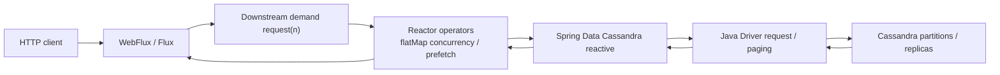
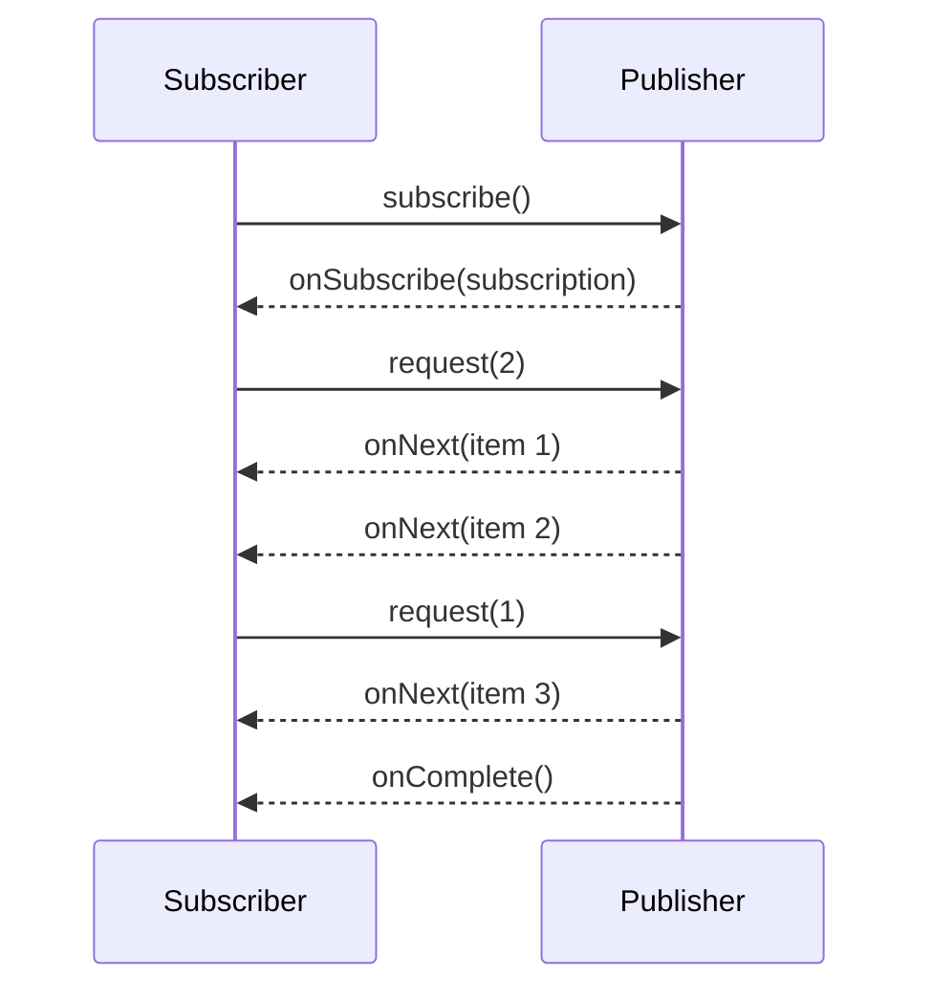

# Giới hạn đồng thời, prefetch và nhu cầu nhận dữ liệu

## 1. Vì sao truy cập reactive vẫn có thể làm quá tải Cassandra?

Trong **Spring Data Cassandra**, ứng dụng có thể đọc dữ liệu Apache Cassandra bằng `ReactiveCassandraRepository`, `ReactiveCassandraTemplate` và các API reactive dựa trên Java Driver. Kết quả thường được biểu diễn bằng **Reactor `Mono<T>` hoặc `Flux<T>`** thay vì chặn một thread để đợi từng truy vấn.

Tuy nhiên, **không chặn thread** và **không tạo quá nhiều công việc cho Cassandra** là hai vấn đề khác nhau. Xét một HTTP endpoint nhận danh sách 2.000 ID bài viết:

```java
return Flux.fromIterable(articleIds)
    .flatMap(repository::findById);
```

Đoạn code rất ngắn nhưng có thể khiến ứng dụng phát nhiều truy vấn vào các partition khác nhau với lượng song song lớn hơn dự tính; tải thực tế còn phụ thuộc phiên bản Reactor, downstream demand, việc request được đăng ký, timeout và driver. Nếu mỗi HTTP request lại làm vậy, số truy vấn in-flight trên toàn hệ thống có thể tăng nhanh.

Ngược lại, giới hạn quá chặt làm các query hoàn toàn độc lập phải chờ nhau, khiến **tail latency** tăng dù cluster còn năng lực.

Muốn thiết kế một API reactive hiệu quả, phải phân biệt:

1. **Nhu cầu nhận dữ liệu (*demand/backpressure*):** downstream đã yêu cầu bao nhiêu phần tử thông qua `request(n)`?
2. **Giới hạn đồng thời (*concurrency*):** có tối đa bao nhiêu publisher con hoặc truy vấn đang được xử lý cùng lúc?
3. **Prefetch:** một operator chủ động yêu cầu trước bao nhiêu phần tử từ upstream/inner publisher để duy trì pipeline?
4. **Cassandra page size:** driver thường lấy dữ liệu từ server theo những page như thế nào?
5. **Giới hạn nghiệp vụ:** endpoint có được yêu cầu hàng nghìn partition hay hàng triệu rows không, bất kể pipeline reactive?



**Thông điệp quan trọng:** `request(10)` không có nghĩa Cassandra chỉ đọc đúng 10 ô dữ liệu trên đĩa; `prefetch(10)` không đồng nghĩa driver page size là 10; `flatMap(..., 8)` không tự áp đặt giới hạn tám truy vấn cho **toàn bộ ứng dụng**.

## 2. Reactive Streams: demand và tín hiệu `request(n)`

Reactive Streams có bốn vai trò thường được nhắc đến:

| Thành phần | Vai trò |
| --- | --- |
| `Publisher<T>` | Nguồn có thể phát phần tử, lỗi hoặc tín hiệu hoàn tất |
| `Subscriber<T>` | Bên nhận phần tử và các tín hiệu vòng đời |
| `Subscription` | Kênh điều khiển `request(n)` và `cancel()` |
| `Processor<T, R>` | Vừa tiêu thụ vừa phát phần tử; trong Reactor thường thao tác qua operator |

Luồng nguyên lý:



`request(n)` biểu diễn **số phần tử yêu cầu**, không biểu diễn:

- Số byte trong cột `payload` hoặc một collection lớn.
- Số Cassandra partitions cần truy cập.
- Số request CQL chính xác được gửi trên mạng.
- Số hàng vật lý/tombstone mà Cassandra phải đọc để trả dữ liệu.
- Một giao dịch, snapshot nhất quán hay cam kết tốc độ ghi.

Một `Row` chứa 10 KB hoặc 5 MB vẫn có thể được tính là **một** phần tử trên luồng Reactor. Vì thế phải kết hợp backpressure với **projection**, giới hạn kích thước hàng và partition, TTL/retention cùng thiết kế bảng theo truy vấn.

### 2.1. `Mono` và `Flux` khác nhau thế nào?

`Mono<T>` phát **tối đa một** phần tử; `Flux<T>` phát **0 đến nhiều** phần tử. Với Cassandra:

- `findById(UUID)` của reactive repository thường là `Mono<Entity>`.
- Một câu đọc danh sách theo partition có thể là `Flux<Entity>`.
- `Mono.empty()` / một `Flux` không phát phần tử biểu thị không có kết quả, **khác** lỗi `Timeout`, `Unavailable` hoặc lỗi mapping.
- Hai luồng `Flux` có thể hoàn tất bất đồng bộ nhưng vẫn được giới hạn bởi tốc độ phát của downstream, prefetch và các bộ đệm nội bộ.

Trong Reactor, một pipeline thường **chỉ bắt đầu thực thi khi được subscribe**; các publisher từ Spring Data Cassandra nhìn chung được thiết kế để khởi tạo I/O khi được đăng ký. Không gọi `subscribe()` thủ công bên trong service chỉ để “kích hoạt query”: như vậy tách truy vấn khỏi vòng đời HTTP, xử lý lỗi và backpressure của caller.

### 2.2. Backpressure không bảo đảm mọi tầng đọc từng hàng đúng lúc

Một driver/nguồn dữ liệu có thể đã **fetch một page** hoặc giữ một số rows trong buffer trước khi downstream yêu cầu thêm. Reactor operators cũng có thể prefetch phần tử. Bởi vậy `request(n)` bảo vệ hợp đồng phát tín hiệu Reactive Streams theo khả năng triển khai, **không phải cam kết một-to-một giữa `request(1)` và một network packet**.

## 3. Schema ví dụ: đọc đúng partition trước khi bàn về concurrency

Giả sử hệ thống tra cứu bài viết theo ID và liệt kê sự kiện của một khách trong một ngày:

```sql
-- Chỉ dùng SimpleStrategy/RF=1 ở môi trường học local một node.
CREATE KEYSPACE IF NOT EXISTS reactive_lab
WITH replication = {
    'class': 'SimpleStrategy',
    'replication_factor': 1
};

CREATE TABLE IF NOT EXISTS reactive_lab.articles_by_id (
    article_id uuid PRIMARY KEY,
    author_id uuid,
    title text,
    status text,
    updated_at timestamp
);

CREATE TABLE IF NOT EXISTS reactive_lab.events_by_customer_day (
    customer_id uuid,
    day_bucket date,
    occurred_at timestamp,
    event_id uuid,
    event_type text,
    payload text,
    PRIMARY KEY ((customer_id, day_bucket), occurred_at, event_id)
) WITH CLUSTERING ORDER BY (occurred_at DESC, event_id ASC);
```

Hai đường đọc cơ bản:

```sql
SELECT article_id, title, status
FROM reactive_lab.articles_by_id
WHERE article_id = ?;

SELECT occurred_at, event_id, event_type
FROM reactive_lab.events_by_customer_day
WHERE customer_id = ? AND day_bucket = ?
LIMIT 100;
```

Truy vấn thứ nhất biết đầy đủ primary key `article_id`. Truy vấn thứ hai biết đầy đủ composite partition key `(customer_id, day_bucket)` và chỉ chọn những cột cần cho danh sách; clustering columns cung cấp thứ tự trong partition.

Ngược lại:

```sql
-- Không tự nhiên hợp lệ/hiệu quả chỉ vì ứng dụng dùng Flux.
SELECT * FROM reactive_lab.articles_by_id
WHERE status = 'PUBLISHED';
```

Nếu bảng không có đường truy cập phù hợp theo `status`, cần index được hỗ trợ và đánh giá theo workload hoặc một **read model thiết kế theo truy vấn**. Reactive/backpressure không thay đổi luật CQL, partition key hay chi phí quét nhiều partition.

### 3.1. Điều gì xảy ra khi yêu cầu đọc nhiều partition?

Nếu cần lấy bài theo 100 ID khác nhau, service có thể thực thi 100 lookup độc lập. Đây là fan-out có thể kiểm soát bằng `flatMap(concurrency)`. Nhưng nếu API cần *“100 bài mới nhất của một tác giả”*, bắt đầu từ danh sách toàn bộ ID rồi fan-out có thể là thiết kế sai: nên có bảng `articles_by_author_day` với partition/clustering phù hợp, sau đó dùng một truy vấn hẹp và paging.

**Không dùng concurrency để chữa data model.** Giảm từ 100 query đồng thời xuống tám query đồng thời chỉ làm chậm tốc độ gây tải; nó không giảm số partition cần đọc.

## 4. Cấu hình và entity reactive trong Spring

Ứng dụng Spring Boot dùng Spring Data Cassandra reactive có thể bổ sung starter:

```xml
<dependency>
    <groupId>org.springframework.boot</groupId>
    <artifactId>spring-boot-starter-data-cassandra-reactive</artifactId>
</dependency>
<dependency>
    <groupId>org.springframework.boot</groupId>
    <artifactId>spring-boot-starter-webflux</artifactId>
</dependency>
```

Để chạy bài học với Cassandra local:

```yaml
spring:
  cassandra:
    contact-points: 127.0.0.1:9042
    local-datacenter: datacenter1
    keyspace-name: reactive_lab
    schema-action: none
```

`datacenter1` là **ví dụ**, phải thay bằng tên local datacenter thật. Trong production, cấu hình replication, profiles, consistency, TLS và credentials theo môi trường; không sao chép `SimpleStrategy`/RF=1 lên cluster nhiều DC.

### 4.1. Entity theo primary key

```java
import java.time.Instant;
import java.util.UUID;

import org.springframework.data.cassandra.core.mapping.Column;
import org.springframework.data.cassandra.core.mapping.PrimaryKey;
import org.springframework.data.cassandra.core.mapping.Table;

@Table("articles_by_id")
public class ArticleById {

    @PrimaryKey("article_id")
    private UUID articleId;

    @Column("author_id")
    private UUID authorId;

    @Column("title")
    private String title;

    @Column("status")
    private String status;

    @Column("updated_at")
    private Instant updatedAt;

    protected ArticleById() {}

    public UUID getArticleId() { return articleId; }
    public String getTitle() { return title; }
    public String getStatus() { return status; }

    // Constructor, setters và accessors khác theo nhu cầu dự án.
}
```

Repository:

```java
import java.util.UUID;

import org.springframework.data.cassandra.repository.ReactiveCassandraRepository;

public interface ReactiveArticleRepository
        extends ReactiveCassandraRepository<ArticleById, UUID> {
}
```

Một lookup:

```java
Mono<ArticleById> article = repository.findById(articleId);
```

`findById` trả `Mono.empty()` nếu không có hàng, còn lỗi kết nối hoặc timeout tạo **error signal**. Với môi trường Spring Data Cassandra reactive, tránh dùng `CassandraRepository` đồng bộ rồi bọc `Mono.just(repository.findById(...))`: cách ấy **đã gọi blocking repository trước khi publisher được tạo**. Ngay cả `Mono.fromCallable(...).subscribeOn(boundedElastic())` chỉ chuyển blocking work sang pool khác, không trở thành native reactive I/O.

### 4.2. ReactiveCassandraTemplate

API template có thể đọc theo khóa bằng câu query:

```java
import java.util.UUID;
import reactor.core.publisher.Flux;
import reactor.core.publisher.Mono;
import org.springframework.data.cassandra.core.ReactiveCassandraTemplate;
import org.springframework.data.cassandra.core.query.Criteria;
import org.springframework.data.cassandra.core.query.Query;

public class ArticleTemplateReader {
    private final ReactiveCassandraTemplate template;

    public ArticleTemplateReader(ReactiveCassandraTemplate template) {
        this.template = template;
    }

    public Mono<ArticleById> find(UUID articleId) {
        Query query = Query.query(
            Criteria.where("article_id").is(articleId)
        );
        return template.selectOne(query, ArticleById.class);
    }
}
```

Các overload/cách đặt options cụ thể phụ thuộc phiên bản Spring Data Cassandra trong BOM của Spring Boot. Không bê nguyên `Pageable` hoặc `MongoTemplate` API từ datastore khác sang Cassandra; với bảng nhiều clustering rows, phải thiết kế truy vấn và paging đúng CQL.

## 5. Ba khái niệm dễ nhầm: demand, concurrency, prefetch

| Thuật ngữ | Điều khiển chủ yếu | Phạm vi | Không bảo đảm |
| --- | --- | --- | --- |
| Downstream demand `request(n)` | Số item mà subscriber muốn nhận | Mỗi subscription và chuỗi operator | Số bytes hoặc số CQL network requests chính xác |
| `flatMap(mapper, concurrency, prefetch)` | Số inner publishers hoạt động và nhu cầu đọc trước từ inner publishers | Thường **mỗi subscription** | Global QPS limit cho mọi HTTP request |
| `limitRate(highTide, lowTide)` | Chia/bố trí lại demand gửi lên upstream | Một đoạn của pipeline | Chặn mọi I/O đã được tạo trước đó |
| Driver page size | Số rows mục tiêu mỗi page Cassandra trả/fetch | Statement/session/request driver | Giới hạn tổng rows hoặc chi phí index scan |
| CQL `LIMIT n` | Số hàng tối đa trả về của câu query | Một CQL query | Chỉ đọc n cell trên đĩa hoặc n network packets |
| Rate limit/admission control | Số request được nhận/xử lý trong một khoảng hoặc số in-flight | API, tenant, service hoặc resource key | Tự tạo snapshot/transaction trong Cassandra |

**Quy tắc:** chọn demand/prefetch để điều tiết **dòng phần tử**; chọn concurrency/admission control để giới hạn **việc đang diễn ra**; chọn CQL `WHERE`/`LIMIT`, partition, projection, paging để giới hạn **công việc của Cassandra**.

## 6. `flatMap(..., concurrency, prefetch)` hoạt động ra sao?

Reactor có overload:

```java
Flux<R> output = source.flatMap(
    value -> publisherFor(value),
    8,   // concurrency
    1    // prefetch
);
```

Giải thích:

- **`concurrency=8`**: tối đa khoảng tám **inner publishers** được subscribe đồng thời cho một subscription của đoạn `flatMap`. Với mỗi inner là một `Mono` dùng để đọc một partition, đây là giới hạn hữu ích đối với số lookup đang xử lý trên đoạn đó.
- **`prefetch=1`**: nhu cầu ban đầu mỗi inner publisher được operator yêu cầu trước ở mức nhỏ. Với inner **`Mono` phát tối đa một item**, thay đổi prefetch thường **ít ý nghĩa về lượng dữ liệu** hơn khi inner là `Flux` nhiều item.
- Những tham số này **không** tự giới hạn tất cả Cassandra requests của hệ thống: 100 HTTP requests đồng thời, mỗi request có `concurrency=8`, vẫn có thể dẫn tới hàng trăm lookup in-flight.
- Kết quả `flatMap` có thể được **phát ra không theo thứ tự đầu vào**, vì các request Cassandra hoàn thành ở thời điểm khác nhau.

### 6.1. Ví dụ đọc nhiều ID có giới hạn

```java
import java.util.List;
import java.util.UUID;
import reactor.core.publisher.Flux;

public Flux<ArticleById> findMany(
        List<UUID> ids,
        ReactiveArticleRepository repository) {

    if (ids.size() > 100) {
        return Flux.error(
            new IllegalArgumentException("Không quá 100 IDs")
        );
    }

    return Flux.fromIterable(ids)
        .flatMap(repository::findById, 8, 1);
}
```

Trong ví dụ này:

1. Input có tối đa 100 ID, đây là **giới hạn số partition** dự kiến cần tra.
2. `flatMap(..., 8, 1)` giúp tránh subscribe hàng loạt 100 `Mono` cùng một lúc từ một downstream subscription.
3. Nếu ID không tồn tại, `findById` trả `Mono.empty()` và không phát ra entity tương ứng; số kết quả có thể nhỏ hơn số ID.
4. Output **không đảm bảo đúng thứ tự ID**.
5. `findById` dùng primary key, không ép Cassandra lọc toàn bảng.

Số 8 và 100 là **giá trị minh họa**, không phải mức tối ưu mặc định. Giá trị phù hợp phải đo theo latency p95/p99, RF, node count, mức tải nền, khả năng kết nối và số subscriptions đồng thời.

### 6.2. Không đặt concurrency bằng “tổng số record dự kiến”

Một phản mẫu:

```java
return Flux.fromIterable(ids)
    .flatMap(repository::findById, ids.size());
```

Với danh sách rất lớn, cách này có thể khiến nhiều truy vấn vào những partition khác nhau được phát cùng lúc. Tăng concurrency đôi khi giảm latency của request nhỏ, nhưng tăng quá mức làm pressure lên coordinator, replica và driver, đặc biệt khi nhiều client chạy song song.

### 6.3. Tại sao giới hạn này không phải global bulkhead?

Giả sử mỗi yêu cầu HTTP được phép tám lookups, nhưng ứng dụng đồng thời xử lý 500 yêu cầu. Mức in-flight lý thuyết của riêng đường này có thể tiến tới **500 × 8 = 4.000** tác vụ, chưa kể retry, những API khác và page fetch.

Muốn ràng buộc **toàn service**, cần thêm admission control/bulkhead/rate limiter có phối hợp giữa các subscriptions và instance (khi cần). Không dùng một `Semaphore.acquire()` blocking ngay trong callback driver để “chặn” tác vụ: nó có thể làm nghẽn thread; nên dùng bộ điều phối phi blocking, queue có sức chứa hoặc giới hạn từ API gateway.

## 7. `flatMap`, `concatMap` và `flatMapSequential`: đúng thứ tự hay giảm latency?

Một API đôi khi phải giữ nguyên thứ tự ID đầu vào, ví dụ UI gửi `A, B, C` và muốn phản hồi theo đúng thứ tự.

```java
Flux<ArticleById> unordered = Flux.fromIterable(ids)
    .flatMap(repository::findById, 8, 1);

Flux<ArticleById> sequential = Flux.fromIterable(ids)
    .concatMap(repository::findById);

Flux<ArticleById> orderedParallel = Flux.fromIterable(ids)
    .flatMapSequential(repository::findById, 8, 1);
```

| Operator | Bắt đầu inner publishers | Thứ tự kết quả | Đánh đổi |
| --- | --- | --- | --- |
| `flatMap` | Có thể nhiều inner đồng thời | **Không bảo đảm** giữ thứ tự nguồn | Thường ít chờ nhau hơn |
| `concatMap` | Tuần tự theo nguồn | **Có** | Latency tăng khi từng lookup phải chờ trước đó |
| `flatMapSequential` | Có thể đồng thời đến `concurrency` | **Có** theo thứ tự nguồn của inner | Có thể phải **buffer** kết quả của inner về trước |

**Không có operator tốt nhất cho mọi use case.** Nếu nguồn IDs có thứ tự nghiệp vụ quan trọng, cân nhắc `flatMapSequential`; nếu không cần thứ tự, `flatMap` đơn giản và có thể giảm critical-path latency.

Nếu một ID không tồn tại, output của cả ba ví dụ có thể bị **thiếu một phần tử**; chỉ giữ thứ tự **những phần tử đã phát**. Nếu API phải trả đúng một kết quả cho mỗi ID, bao gồm lỗi `NOT_FOUND`, hãy map mỗi lookup thành một DTO kiểu `Found/NotFound` thay vì để `Mono.empty()` làm mất vị trí.

## 8. Prefetch là gì và khi nào nó đáng quan tâm?

Prefetch là cơ chế operator **yêu cầu trước** một số phần tử để giữ pipeline không bị ngắt quãng vì chờ từng item. Với một inner `Flux`, `flatMap(..., concurrency, prefetch)` có thể cùng lúc nhận dữ liệu từ nhiều nguồn và buffer phần tử đang đến sớm.

Hình dung:

```text
Source: 10 buckets / partitions
flatMap concurrency = 4
prefetch mỗi inner = 16

           inner bucket A -> tối đa một số item đang được request/buffer
           inner bucket B -> tối đa một số item đang được request/buffer
           inner bucket C -> tối đa một số item đang được request/buffer
           inner bucket D -> tối đa một số item đang được request/buffer

Downstream nhận theo demand, không bắt buộc bằng tốc độ từng nguồn.
```

Các giá trị mô tả **cơ chế request/prefetch ở operator**, không phải một hạn mức bộ nhớ cứng bằng `4 × 16` rows cho toàn bộ pipeline. Nhiều buffer khác, kích thước row, page của Cassandra và những request đang xử lý bên dưới đều góp vào tổng bộ nhớ.

### 8.1. Prefetch cao: thông lượng có thể tốt hơn nhưng dễ tốn bộ nhớ

```java
Flux<EventSummary> stream = Flux.fromIterable(buckets)
    .flatMap(bucket -> readEvents(bucket), 4, 32);
```

`readEvents(bucket)` là hàm minh họa trả `Flux<EventSummary>` đọc một partition phù hợp. Khi downstream chậm, mỗi inner có thể có nhiều item đã được request hoặc đang chờ trong buffer. Nếu `EventSummary` rất lớn, một prefetch cao khiến memory pressure đáng kể.

### 8.2. Prefetch thấp: kiểm soát tốt hơn nhưng có thể thiếu dữ liệu sẵn

```java
Flux<EventSummary> stream = Flux.fromIterable(buckets)
    .flatMap(bucket -> readEvents(bucket), 4, 2);
```

Prefetch nhỏ giảm nhu cầu tích lũy item ở nhiều trường hợp, nhưng có thể khiến nhiều vòng yêu cầu dữ liệu từ upstream hơn và giảm throughput nếu nguồn/callback có độ trễ đáng kể.

**Đo thay vì đoán:** prefetch tối ưu phụ thuộc inner là `Mono` hay `Flux`, item size, tốc độ subscriber, Cassandra paging và kích thước fan-out. Đừng tự tăng `prefetch` với mục tiêu “Cassandra query nhanh hơn”: nó không thay đổi partition key, số hàng phù hợp hoặc khả năng index.

### 8.3. Prefetch không phải `pageSize`

```text
Reactor flatMap prefetch = 16  -> điều tiết demand giữa operators.
Cassandra driver page size=128 -> mục tiêu số rows của một page.
CQL LIMIT 100                   -> giới hạn tổng rows của query.
```

Một `Flux` có thể được nạp từ driver theo page, và page có thể chứa nhiều rows hơn số item mà một subscriber vừa yêu cầu. Do đó không suy rằng `prefetch=1` khiến driver gửi request cho từng row hoặc loại bỏ hoàn toàn buffering.

Khi cần giảm payload, chọn **các cột cần thiết** thay vì `SELECT *`, giới hạn query theo partition/bucket và sử dụng paging/cursor phù hợp với API Spring Data Cassandra/Driver đang dùng.

## 9. `limitRate`: chia lại nhu cầu, không tự giới hạn mọi I/O

Reactor cung cấp:

```java
Flux<ArticleById> result = source
    .limitRate(32);
```

`limitRate(highTide)` điều chỉnh cách request từ downstream được chuyển thành các đợt request lên upstream; overload `limitRate(highTide, lowTide)` cho phép kiểm soát ngưỡng cấp lại demand. Không nên diễn giải `limitRate(32)` như **giới hạn 32 truy vấn Cassandra trên toàn ứng dụng**.

Ví dụ:

```java
Flux<ArticleById> result = Flux.fromIterable(ids)
    .limitRate(16)
    .flatMap(repository::findById, 8, 1);
```

Đoạn này có hai cơ chế:

- `limitRate(16)` định hình nhu cầu cấp lên **nguồn IDs**.
- `flatMap(..., 8, 1)` giới hạn số inner publishers được subscribe đồng thời ở đoạn tương ứng.

Vị trí `limitRate` quan trọng: đặt nó sau một operator đã phát nhiều request/khởi chạy nhiều nhánh sẽ không thể “thu hồi” công việc upstream đã bắt đầu trước đó. Để giới hạn CQL thực tế, thiết kế cạnh `flatMap` và bổ sung bulkhead/rate-limit nếu có nhiều subscriptions song song.

### 9.1. `take(n)` cũng không biến một truy vấn không giới hạn thành miễn phí

```java
return repository.findAll()
    .take(20);
```

Ví dụ này có thể phát tối đa 20 entity về downstream rồi cancel, nhưng **`findAll()` có thể tương ứng một truy vấn toàn bảng không phù hợp**. Cassandra/driver có thể đã làm công việc hoặc fetch page trước khi luồng bị hủy. Không dùng `take(20)` để hợp lý hóa quét toàn bộ bảng trên production.

Tốt hơn là dùng **CQL `WHERE` định vị partition, `LIMIT` hợp lệ và page size** được kiểm soát, sau đó mới sử dụng `.take(...)` như một hàng rào bổ sung ở tầng Reactor.

## 10. Driver paging: cách phối hợp với nhu cầu của Flux

Một câu CQL có `LIMIT 100` chưa chắc được trả trong một gói. Java Driver có thể sử dụng paging để fetch từng phần. Reactive Spring Data Cassandra có thể kết hợp cơ chế này với `Publisher<Row>`/Reactor theo cách triển khai của phiên bản driver/framework.

### 10.1. Phân biệt ba giới hạn

| Biểu thức | Phạm vi thực tế |
| --- | --- |
| `WHERE customer_id=? AND day_bucket=?` | Giới hạn **partition** cần đọc |
| `LIMIT 100` | Giới hạn **tổng số hàng CQL có thể trả** |
| Driver page size 25 | Mục tiêu **số rows mỗi page/fetch** |
| `Flux.take(10)` | Giới hạn **số item được chuyển tiếp cho downstream** |
| `flatMap(concurrency=4,prefetch=8)` | Giới hạn/cấp demand cho các **inner publishers** |

Một truy vấn có thể chọn `LIMIT 100`, driver page size 25 và downstream gọi `take(10)`. Không thể từ ba con số ấy kết luận Cassandra chỉ đọc 10 hàng vật lý. Nhưng nếu client chỉ cần tối đa 10 và truy vấn được hỗ trợ, **đặt `LIMIT 10` trong CQL** là một tối ưu minh bạch hơn.

### 10.2. Ví dụ CQL theo partition và trang

```sql
SELECT occurred_at, event_id, event_type
FROM reactive_lab.events_by_customer_day
WHERE customer_id = ?
  AND day_bucket = ?
LIMIT 100;
```

Truy vấn trên có phạm vi một partition và thứ tự clustering. `payload` không được chọn để giảm bytes; nếu payload lớn, `request(1)` vẫn chỉ có nghĩa một item, không phải một MB. Khi liệt kê nhiều ngày, nên chọn các `day_bucket` một cách có kiểm soát và kết hợp ở application service, không dựa vào filtering rộng.

Với WebFlux, nếu API trả một page duy nhất mỗi HTTP request, hãy thiết kế **cursor/paging state opaque** theo statement và tham số, thay vì tải toàn bộ 100 hàng rồi dùng `skip(offset)` để bắt chước offset pagination. Paging state không phải offset có thể tùy ý dùng lại với filter hoặc CQL khác.

### 10.3. Ví dụ cấu hình page size ở driver

Java Driver hỗ trợ execution profile/request options cho page size; ví dụ HOCON tham khảo:

```hocon
datastax-java-driver {
  basic.request {
    page-size = 128
  }
}
```

Phải xác minh `CqlSession` mà Spring Data Cassandra sử dụng **thực sự nạp cấu hình driver** và không bị ghi đè bởi query-specific options. Đây là setting của **driver**, không phải `prefetch` của Reactor. Mức 128 chỉ để minh họa; chọn theo kích thước row, thời gian server fetch, client memory, query latency và SLO.

## 11. Backpressure với nguồn dữ liệu nhanh và subscriber chậm

Nếu downstream xử lý chậm hơn tốc độ dữ liệu được sản xuất, Reactor có nhiều chiến lược:

- **Giảm nhu cầu hoặc prefetch:** giảm buffering khi upstream hỗ trợ backpressure.
- **Giới hạn concurrency:** giảm số nguồn đang tạo dữ liệu đồng thời.
- **Buffer có hạn:** giữ một số item khi nguồn không giảm tốc kịp.
- **Drop/latest/error:** chỉ dùng khi nghiệp vụ cho phép mất item hoặc cần báo quá tải.
- **Backpressure tới nguồn:** nếu toàn đường đi có khả năng tôn trọng demand, chậm downstream sẽ làm hạn chế việc phát thêm item.

### 11.1. `onBackpressureBuffer` không phải giải pháp vô hạn

```java
return fastPublisher
    .onBackpressureBuffer(256)
    .flatMap(this::processEvent, 8);
```

`fastPublisher` và `processEvent` là các hàm minh họa. Buffer có hạn có thể bảo vệ tốt hơn một buffer không giới hạn, nhưng **256 là số item, không phải 256 bytes**. Nếu mỗi item chứa payload lớn, mức bộ nhớ vẫn có thể đáng kể. Khi buffer đầy, cần hiểu hành vi lỗi/overflow của overload Reactor đang dùng và chuyển thành một phản hồi/metric thích hợp.

**Không đưa cơ chế drop vào dòng thanh toán, trừ tồn kho hoặc ghi audit bắt buộc** chỉ để giảm tải. `onBackpressureDrop` hoặc `onBackpressureLatest` chỉ phù hợp với những tín hiệu **có thể mất hoặc gộp** (ví dụ UI telemetry/preview) theo hợp đồng rõ ràng.

### 11.2. Hot source không giống cold Cassandra read

Một `Flux` đọc Cassandra khi được subscribe có thể tạo query theo demand/driver. Nhưng một nguồn nóng từ message bus, WebSocket hoặc producer ngoài có thể **tiếp tục phát** bất kể subscriber. Nếu nguồn không có cơ chế backpressure tương ứng, chỉ thêm `.limitRate(10)` ở cuối không nhất thiết làm producer ngoài chậm lại. Cần **rate limiting, bounded buffer hoặc chính sách overflow** ngay ở điểm tích hợp nguồn.

## 12. `publishOn`, `subscribeOn` và blocking trong pipeline

Không nên nhầm reactive với việc chạy mọi thứ trên nhiều thread.

```java
return repository.findById(id)
    .map(this::toDto);
```

Nếu `toDto` là phép biến đổi nhẹ, thường không cần chuyển scheduler. Nhưng nếu phải thực hiện CPU work nặng:

```java
return repository.findById(id)
    .publishOn(reactor.core.scheduler.Schedulers.parallel())
    .map(this::expensiveCalculation);
```

Ví dụ này chỉ minh họa **chuyển khối CPU work**. Trong ứng dụng thật, `Schedulers.parallel()` là tài nguyên dùng chung; cần giới hạn workloads và queue nếu biến đổi nặng hoặc dữ liệu lớn, không mặc định offload mọi mapping nhỏ.

Với một thư viện đồng bộ bắt buộc phải gọi:

```java
return Mono.fromCallable(() -> blockingLegacyCall(id))
    .subscribeOn(reactor.core.scheduler.Schedulers.boundedElastic());
```

Đây là **cách cách ly blocking work** sang scheduler phù hợp hơn, **không phải** biến một API Cassandra sync thành native reactive I/O. `boundedElastic` vẫn có thread/queue giới hạn, và nhiều blocking calls có thể gây quá tải. Với Cassandra, ưu tiên `ReactiveCassandraRepository`/`ReactiveCassandraTemplate` thay vì bọc mọi `CassandraRepository.findById` bằng scheduler.

### 12.1. Prefetch của `publishOn` là một chỗ khác

```java
return source
    .publishOn(reactor.core.scheduler.Schedulers.parallel(), 32)
    .map(this::cpuTransform);
```

Tham số `32` ở đây là prefetch của **`publishOn`**, không phải concurrency của `flatMap` hoặc driver page size. Operator có thể có queue giữa upstream và scheduler, vì vậy `publishOn` liên tiếp hoặc có prefetch lớn cũng ảnh hưởng memory và latency.

### 12.2. Tuyệt đối tránh `.block()` giữa luồng WebFlux

Phản mẫu:

```java
return Flux.fromIterable(ids)
    .map(id -> repository.findById(id).block());
```

`block()` làm thread phải chờ I/O và có thể bị Reactor chặn khi dùng trên thread non-blocking, đồng thời đánh mất khả năng backpressure tự nhiên. Dùng `.flatMap(repository::findById, concurrency, prefetch)` để phối hợp bất đồng bộ; không `subscribe()` thủ công rồi ném kết quả vào list dùng chung.

## 13. HTTP/WebFlux: backpressure có đi đến client không?

Ví dụ endpoint nhận danh sách ID có validation:

```java
import java.util.List;
import java.util.UUID;

import org.springframework.http.HttpStatus;
import org.springframework.web.bind.annotation.GetMapping;
import org.springframework.web.bind.annotation.RequestParam;
import org.springframework.web.bind.annotation.ResponseStatus;
import org.springframework.web.bind.annotation.RestController;
import org.springframework.web.server.ResponseStatusException;
import reactor.core.publisher.Flux;

@RestController
public class ArticleController {

    private final ReactiveArticleRepository repository;

    public ArticleController(ReactiveArticleRepository repository) {
        this.repository = repository;
    }

    @GetMapping("/articles/by-ids")
    public Flux<ArticleCard> byIds(@RequestParam List<UUID> ids) {
        if (ids.isEmpty() || ids.size() > 50) {
            throw new ResponseStatusException(
                HttpStatus.BAD_REQUEST, "Số article IDs không hợp lệ"
            );
        }
        return Flux.fromIterable(ids)
            .flatMap(repository::findById, 8, 1)
            .map(a -> new ArticleCard(a.getArticleId(), a.getTitle()));
    }
}

record ArticleCard(UUID articleId, String title) {}
```

**Hợp đồng quan trọng:**

- Endpoint chỉ nhận tối đa 50 IDs; số này cần quyết định theo capacity/SLO.
- Phải xác thực **tenant/authorization** trước khi trả dữ liệu, không chỉ kiểm tra UUID có đúng định dạng.
- Kết quả có thể **khác thứ tự IDs đầu vào** và ít hơn số IDs do hàng không tồn tại.
- Trả `Flux` để WebFlux subscribe, xử lý lifecycle và lỗi; controller không tự gọi `.block()`/`.subscribe()`.
- Một response JSON array có thể đi qua encoder, network buffers, proxy và client libraries; không mặc định mỗi `request(1)` từ Reactor được phản ánh trực tiếp thành client đọc một row trên TCP.

Nếu cần streaming event theo thời gian, có thể dùng **Server-Sent Events (SSE)** với media type phù hợp, nhưng phải thiết kế chính sách ngắt kết nối, slow consumers, bounded buffer và authorization. Không dùng HTTP streaming như cách bỏ qua `LIMIT`, partition key hoặc quota tenant.

## 14. Bất đồng bộ không đồng nghĩa mọi truy vấn là transaction

Một endpoint có thể đọc nhiều bảng và ghép chúng:

```java
Mono<OrderDetail> detail = detailRepository.findById(orderId);
Mono<ViewStats> stats = statsRepository.findById(orderId);

return Mono.zip(detail, stats)
    .map(tuple -> toOverview(tuple.getT1(), tuple.getT2()));
```

Đây là **ví dụ cấu trúc**: `OrderDetail`, `ViewStats`, `toOverview` và hai repository giả định là các thành phần được định nghĩa theo domain. `Mono.zip` phối hợp hai Mono độc lập; nếu một Mono hoàn tất rỗng, `zip` có thể hoàn tất rỗng mà không gọi hàm mapping, nên cần xử lý nhánh dữ liệu thiếu nếu API muốn fallback.

Hai read models Cassandra có thể được cập nhật ở những thời điểm khác nhau. `zip`, `flatMap`, `flatMapSequential` và `thenCombine` không tạo **một snapshot ACID xuyên các bảng**, không tự khóa partition và không làm giảm độ trễ đồng bộ giữa chúng.

### 14.1. Việc ghi cần giữ đúng thứ tự và idempotency

Nếu bước B chỉ được làm sau khi bước A thành công:

```java
return updateSourceOfTruth(orderId)
    .then(updateReadModel(orderId));
```

Đoạn code là **mẫu cấu trúc** với hai hàm giả định trả `Mono<Void>`: Reactor `then(...)` bảo đảm bước tiếp theo được subscribe sau khi bước trước hoàn tất bình thường. Tuy vậy, nếu bước A đã ghi thành công rồi bước B timeout, **A không tự rollback**. Cần workflow, stable request ID, retry và reconciliation theo nghiệp vụ.

Với counter `+1`, list append hay thao tác không idempotent, `retryWhen` mù quáng sau timeout có thể tạo side effects trùng. Các cơ chế demand/concurrency/prefetch **không thay thế chính sách retry**.

## 15. Timeout, retry và cancellation trong Reactive Cassandra

### 15.1. Deadline cho `Mono` và `Flux`

Một truy vấn đơn:

```java
return repository.findById(id)
    .timeout(java.time.Duration.ofSeconds(2));
```

`Mono.timeout(Duration)` đặt giới hạn chờ kết quả cho Mono theo semantics Reactor; nếu vượt hạn, downstream nhận lỗi timeout. **Không suy rằng server đã hủy thao tác hoặc mutation chưa áp dụng**.

Với `Flux`, overload `timeout(Duration)` có thể là **timeout chờ phần tử đầu và khoảng cách giữa những phần tử tiếp theo**, không phải luôn là **deadline tổng của cả stream**. Nếu ứng dụng cần deadline tổng cho một trang response, hãy thiết kế một phép tổng hợp hữu hạn, cancellation/deadline ở HTTP boundary hoặc cơ chế deadline phù hợp; **không `collectList()` vô hạn** chỉ để tận dụng `Mono.timeout`.

### 15.2. Retry `Flux` có thể phát lại phần tử

```java
Flux<ArticleById> stream = source
    .retryWhen(
        reactor.util.retry.Retry.backoff(
            2, java.time.Duration.ofMillis(100)
        )
    );
```

Đây là **minh họa operator**, không phải chính sách retry phù hợp cho mọi query. Khi retry, Reactor **subscribe lại nguồn**; nếu một số items đã được phát trước khi lỗi, subscriber có thể **nhận lại** các items của lần subscribe mới. Với paging Cassandra, state/dữ liệu có thể thay đổi giữa các lần retry.

Ứng dụng phải quyết định:

- Query là **đọc idempotent** hay có side effects?
- Lỗi nào đáng retry (`Unavailable`, timeout do tải) và lỗi nào không (`invalid query`, mapping bug, authorization)?
- Có **deadline tổng**, số lần retry tối đa và jitter chưa?
- Có cần **dedup theo primary key/event ID** khi stream được phát lại không?
- Việc đọc lại một page có còn dùng đúng **paging state và tham số query** không?

Không retry LWT/counter hoặc nhiều bước ghi như thể chúng là SELECT vô hại. Cancellation sau khi client đóng kết nối có thể chặn nhu cầu phát thêm items, nhưng **không bảo đảm network request đã gửi được rollback**.

## 16. `onBackpressure*` không sửa được hotspot và lỗi thiết kế bảng

Một bài viết viral có thể là **một partition nóng** dù API đã dùng reactive và `flatMap(concurrency=4)`. Nếu mọi request đều đọc/cập nhật cùng một partition, dàn đều ở client không thay đổi replica set chịu tải.

Các biện pháp theo thứ tự ưu tiên:

1. Định nghĩa **partition key** đúng với câu truy vấn và kích thước mỗi partition.
2. Giới hạn **số ID/ngày/bucket** API được yêu cầu và khối lượng bytes trả về.
3. Chọn CQL `WHERE`, `LIMIT`, projection và paging đúng ngay ở server.
4. Cài **concurrency per subscription** cho fan-out; dùng **global admission control** nếu cần.
5. Chọn prefetch và buffer theo item size và tốc độ subscriber.
6. Giảm tác vụ CPU/blocking trong callback và bố trí scheduler có giới hạn.
7. Thiết kế **cache/read model/bucket/shard** khi dữ liệu/traffic cho thấy hotspot; đo fan-out của giải pháp mới.
8. Quan sát latency, timeout, queue và pressure trên driver/replica để điều chỉnh.

Chỉ thêm `limitRate`, `onBackpressureBuffer` hoặc `Schedulers.boundedElastic` để che một CQL đang quét rộng **không làm truy vấn ấy rẻ hơn**.

## 17. Đo lường: biết mình giới hạn cái gì

| Nhóm metric | Trả lời câu hỏi |
| --- | --- |
| HTTP request rate, active subscriptions | Có bao nhiêu pipeline đang chạy? |
| In-flight Cassandra requests | Concurrency thực tế đã được kiểm soát chưa? |
| Outstanding demand / request patterns khi debug | Operator đang yêu cầu thêm items như thế nào? |
| Prefetch/queue/buffer occupancy | Có tích lũy item và memory pressure không? |
| Driver page fetch count / rows per query | Có fetch nhiều page dù UI chỉ cần một trang? |
| CQL results và bytes returned | Tối ưu projection/payload có hiệu quả không? |
| p50/p95/p99 query và end-to-end latency | Concurrency tăng có cải thiện p99 hay chỉ tăng tải? |
| Timeout, overload, retry/cancel | Có dấu hiệu quá tải hoặc retry storm không? |
| Partition hot, số partition per request | Bottleneck đến từ data model hay Reactor? |
| Scheduler threads/queue | Có callback blocking hoặc CPU nặng không? |
| GC/heap/allocations | Prefetch/buffer có làm memory tăng không? |

Tên metric cụ thể phụ thuộc phiên bản Spring Boot, Micrometer, Reactor, Cassandra Driver và môi trường giám sát. Không thêm raw UUID/email/token vào metric labels có cardinality cao; dùng query family, tenant group được ẩn danh và log/tracing có chọn lọc.

### 17.1. Kết quả nào cho thấy concurrency đang quá cao?

Một benchmark có thể cho thấy tăng `flatMap` từ 4 → 8 giảm latency trung bình, nhưng 8 → 32 khiến p99, timeout và queue đều tăng. Điều đó chỉ ra đã vượt năng lực hữu ích của cluster hoặc gặp hotspot. Mục tiêu không phải tăng concurrency tối đa mà là **giữ throughput cần thiết trong SLO với đủ headroom khi có lỗi replica**.

### 17.2. Kết quả nào cho thấy prefetch quá cao?

Nếu upstream có thể phát nhanh hơn downstream, heap/buffer occupancy tăng rõ rệt khi `prefetch=128`, trong khi p95/p99 không giảm so với `prefetch=16`, thì mức prefetch lớn không có lợi. Test này phải kiểm soát **kích thước mỗi item** và số inner publishers, vì hai yếu tố ấy ảnh hưởng mạnh tới bộ nhớ.

## 18. Kiểm thử demand bằng `StepVerifier`

Reactor Test cung cấp `StepVerifier` để kiểm soát lượng item được yêu cầu. Dependency test:

```xml
<dependency>
    <groupId>io.projectreactor</groupId>
    <artifactId>reactor-test</artifactId>
    <scope>test</scope>
</dependency>
```

### 18.1. Yêu cầu item theo từng đợt

```java
import org.junit.jupiter.api.Test;
import reactor.core.publisher.Flux;
import reactor.test.StepVerifier;

class DemandTest {

    @Test
    void requestsTwoItemsInTwoSteps() {
        Flux<Integer> source = Flux.just(10, 20, 30);

        StepVerifier.create(source, 0)
            .thenRequest(1)
            .expectNext(10)
            .thenRequest(1)
            .expectNext(20)
            .thenRequest(1)
            .expectNext(30)
            .verifyComplete();
    }
}
```

`StepVerifier.create(source, 0)` thiết lập **initial request = 0**, sau đó test chủ động gọi `thenRequest(1)` từng lần. Đây là kiểm tra semantics Reactive Streams ở Reactor, **không phải bằng chứng driver chỉ lấy đúng ba row/ba packet**.

### 18.2. Quan sát demand qua `doOnRequest`

```java
Flux<Integer> stream = Flux.range(1, 10)
    .doOnRequest(n -> System.out.println(
        "upstream requested " + n
    ))
    .limitRate(3);

StepVerifier.create(stream, 0)
    .thenRequest(2)
    .expectNext(1, 2)
    .thenRequest(1)
    .expectNext(3)
    .thenCancel()
    .verify();
```

`doOnRequest` ở đây chỉ để học cách quan sát demand khi debug. Không log từng request signal của mọi subscription trên production, vì logging có overhead lớn và có thể thay đổi timing. Lưu ý một operator `limitRate` **điều chỉnh yêu cầu lên upstream**, nên số xuất hiện trong log không bắt buộc trùng từng `thenRequest` của subscriber.

## 19. Kiểm thử concurrency và thứ tự kết quả

### 19.1. Dùng publisher điều khiển thủ công

Để chứng minh `flatMap(..., concurrency=2)` không subscribe quá hai inner cùng lúc, có thể tạo nhiều `Mono` chưa hoàn tất bằng `Sinks.One`/`CompletableFuture` và đếm số lần inner được subscribe.

Quy trình:

1. Tạo nguồn `Flux.just(idA, idB, idC, idD)`.
2. Stub `findById` trả `Mono` có thể điều khiển, ghi lại lúc subscribe và khi hoàn tất.
3. Subscribe source qua `flatMap(mapper, 2, 1)`.
4. Chứng minh ban đầu chỉ có tối đa hai **inner đang active**.
5. Hoàn tất `idB` trước `idA`; với `flatMap` kết quả có thể tới theo `B, A`.
6. Sau khi một inner hoàn tất, một inner mới có thể được subscribe; không có nhiều hơn hai active tại cùng thời điểm.
7. Lặp lại với `flatMapSequential(..., 2, 1)` để kiểm tra thứ tự emission theo nguồn.
8. Cho một inner lỗi; kiểm tra hành vi error propagation, các inner khác và cancellation/cleanup.

Test nên dùng **tín hiệu hoàn tất có kiểm soát**, tránh `Thread.sleep` gây flaky. Kiểm thử `Mono` không đánh giá toàn bộ ảnh hưởng của `prefetch`: cần thêm case với inner `Flux` nhiều items nếu muốn quan sát buffering và reorder.

### 19.2. Integration test với Cassandra thật

Trên Cassandra local:

- Tạo schema và seed một số `articles_by_id` khác nhau.
- Dùng `ReactiveCassandraRepository.findById` trong `flatMap` và xác minh kết quả đọc đúng, lỗi không bị biến thành `Mono.empty()`.
- Với bảng `events_by_customer_day`, seed nhiều clustering rows, đo CQL `LIMIT`, page size và số items nhận khi `.take(n)`.
- Thử một read model có cột `payload` lớn; đo memory/bytes returned khi chọn `payload` so với chỉ chọn cột cần thiết.
- Thử fan-out nhiều ID, đo in-flight requests, p95/p99 và thay đổi `concurrency`.
- Thử áp lực downstream chậm với prefetch nhỏ/lớn, theo dõi buffer/heap.

**Test nhiều replica:** nếu muốn xác minh failover, consistency hoặc độ trễ mạng, phải dùng cluster có RF/topology đại diện. Một Cassandra container RF=1 không kiểm tra được hành vi `LOCAL_QUORUM` khi một replica down.

### 19.3. Test cancellation và timeout

1. Subscribe một nguồn có nhiều page, yêu cầu ít item rồi `cancel`.
2. Kiểm tra operator dừng phát thêm item cho subscriber, tài nguyên được giải phóng theo contract.
3. Không khẳng định hủy stage sẽ rollback một mutation Cassandra đã gửi.
4. Tạo `Mono` lỗi timeout và xác nhận endpoint không trả `404 Not Found` sai.
5. Tạo `Flux` đã phát một phần rồi lỗi: kiểm tra retry có làm lặp items và cách API/dedup xử lý.
6. Đánh giá đường quá tải: queue đầy phải báo lỗi hoặc từ chối có kiểm soát, không giữ một buffer vô hạn.

## 20. Những phản mẫu thường gặp

| Phản mẫu | Hậu quả | Hướng thay thế |
| --- | --- | --- |
| `flatMap(repo::findById)` với một danh sách khổng lồ, không cap | Bùng nổ concurrent lookups | Giới hạn số ID và `flatMap(..., concurrency, prefetch)` |
| Tin rằng `concurrency=8` là global limit | Nhiều subscriptions nhân tổng tải | Bulkhead/admission control cấp service |
| Đặt `prefetch=128` để Cassandra chắc chắn nhanh | Có thể tốn RAM mà không giảm I/O | Benchmark inner Flux, item size và page size |
| Coi `request(1)` = một CQL row vật lý được đọc | Sai về driver paging và buffering | Phân biệt demand với page/bytes |
| Dùng `.take(20)` trên `findAll()` thay cho query hẹp | Có thể quét rộng hoặc fetch trước | CQL theo partition key + `LIMIT` |
| Dùng `concatMap` cho tất cả dù có thể song song | Latency cao do tuần tự hóa | `flatMap` nếu không cần thứ tự |
| Dùng `flatMap` khi output phải giữ thứ tự | Kết quả về sai thứ tự kỳ vọng | `flatMapSequential` hoặc `concatMap` |
| `collectList()` trên nguồn lớn/vô hạn | Tích lũy mọi item trên heap | Bounded pages/cursor hoặc streaming |
| `onBackpressureBuffer()` không giới hạn | OOM khi downstream chậm | Bounded buffer, overflow policy |
| `onBackpressureDrop` trên thanh toán/audit | Mất dữ liệu nghiệp vụ | Hàng đợi bền vững/backpressure nguồn |
| `.block()` trong WebFlux | Chặn thread, giảm throughput | Compose bằng `flatMap`, `zip`, `then` |
| `subscribe()` trong service để “chạy nền” | Mất vòng đời request/error handling | Trả Publisher cho caller |
| Dùng `subscribeOn(boundedElastic())` như chữa query sync | Chỉ di chuyển blocking I/O | Reactive repository/template thật |
| `retryWhen` toàn bộ `Flux` sau khi đã emit items | Có thể phát trùng kết quả | Retry scope hẹp/dedup, xử lý paging |
| Timeout Future nghĩa ghi Cassandra bị rollback | Có thể ghi đã áp dụng | Outcome unknown, idempotency/reconciliation |
| Tăng concurrency để chữa hot partition | Replica vẫn quá tải cùng key | Thiết kế partition/bucket/shard hoặc giảm rate |
| Ghép các read models rồi coi snapshot ACID | Dữ liệu có thể đến từ thời điểm khác | Workflow đồng bộ và hiểu eventual consistency |

## 21. Bài tập thực hành

**Bài 1 — Phân biệt ba giới hạn.** Giải thích vì sao `request(10)`, `flatMap(concurrency=10, prefetch=10)` và driver `page-size=10` không phải cùng một cơ chế. Cho một ví dụ trong đó Cassandra vẫn xử lý nhiều hơn 10 cell dù downstream chỉ nhận 10 entities.

**Bài 2 — Đọc nhiều ID.** Viết repository reactive theo `article_id`, rồi xây `findMany(ids)` với tối đa 100 IDs và `flatMap(..., 8, 1)`. Xử lý ID không tồn tại mà không biến timeout thành `404`.

**Bài 3 — Sắp xếp kết quả.** Cho ba ID `A, B, C`, nhưng Cassandra trả `B` rồi `C` rồi `A`. So sánh output của `flatMap`, `concatMap`, `flatMapSequential`; xác định cách phù hợp với UI cần giữ thứ tự IDs.

**Bài 4 — Hot source.** Một WebSocket producer phát 10.000 events/s, downstream chỉ xử lý 1.000/s. `limitRate(100)` có bảo đảm producer tự chậm không? Đề xuất bounded buffer, overflow policy và phản hồi khi quá tải.

**Bài 5 — Prefetch.** Với bốn inner Flux và mỗi item 200 KB, so sánh áp lực bộ nhớ khi prefetch 4 và 64. Tại sao không thể khẳng định memory = `concurrency × prefetch × itemSize` một cách tuyệt đối?

**Bài 6 — Paging.** CQL đọc một partition `events_by_customer_day` với `LIMIT 100`; driver page size 25; downstream `.take(10)`. Những giới hạn này tác động lên nguồn dữ liệu ở các tầng nào? Khi chỉ cần 10 rows, nên thay đổi CQL ra sao?

**Bài 7 — Global bulkhead.** Một server có 400 HTTP requests đang chạy, mỗi request cho tối đa tám inner lookups. Ước lượng mức request in-flight tối đa riêng đường này và đề xuất một cơ chế admission control chung theo service/tenant.

**Bài 8 — Blocking.** Một developer dùng `Flux.fromIterable(ids).map(id -> repository.findById(id).block())`. Phân tích nguy cơ deadlock/throughput và viết lại bằng `flatMap`.

**Bài 9 — Demand với StepVerifier.** Tạo `Flux.range(1,5)`, `StepVerifier.create(source,0)`, yêu cầu lần lượt 2 và 3 items, xác nhận đầy đủ và hoàn tất. Gắn `doOnRequest` để quan sát các đợt demand.

**Bài 10 — Test concurrency.** Dùng `Sinks.One` hoặc các `Mono` điều khiển được để chứng minh `flatMap(...,2,1)` không subscribe hơn hai inner đang active; sau đó so sánh thứ tự với `flatMapSequential`.

**Bài 11 — Retry sau page lỗi.** Một `Flux` đã phát 20 events, sau đó timeout; `retryWhen` subscribe lại từ đầu. API có thể phát trùng những events nào? Đề xuất chiến lược cursor/dedup dựa trên khóa chính.

**Bài 12 — Read model.** Endpoint cần 50 bài mới nhất của một tác giả. So sánh việc dùng hàng nghìn `findById` với bảng `articles_by_author_day` có partition và clustering key. Tại sao thay schema có thể quan trọng hơn tăng concurrency?

**Bài 13 — Metrics.** Thiết kế benchmark đổi `concurrency` 4/8/16/32 và `prefetch` 1/8/32, cùng dataset và RF. Chọn metric để nhận biết điểm p99 xấu đi, heap tăng và retry storm.

**Bài 14 — Failure semantics.** Khi client hủy subscription lúc Cassandra đang xử lý một counter increment, có được kết luận counter không tăng không? Trình bày cách phân biệt cancellation, timeout, applied result và idempotency.

### Câu hỏi tự kiểm tra

1. `request(n)` điều khiển số item hay số byte/network requests?
2. Khi nào `Mono` phù hợp hơn `Flux` cho truy vấn Cassandra?
3. `flatMap` concurrency và prefetch tác động lên các đối tượng nào?
4. Vì sao prefetch của inner `Mono` ít tác động hơn với inner `Flux` dài?
5. `flatMapSequential` đổi lấy điều gì để giữ thứ tự kết quả?
6. `limitRate` có giới hạn toàn ứng dụng hay chỉ định hình demand ở pipeline?
7. Khác biệt giữa `LIMIT`, page size, `.take(n)` là gì?
8. Vì sao Reactive Streams backpressure không thay thế thiết kế partition key?
9. Điều gì xảy ra khi nhiều HTTP subscriptions cùng có concurrency bằng 8?
10. `onBackpressureDrop` có an toàn cho sự kiện thanh toán không?
11. Khi nào dùng `publishOn` và vì sao không lạm dụng `boundedElastic`?
12. Tại sao `.block()` trong callback WebFlux có thể gây nghẽn?
13. `Mono.zip` có tự tạo transaction giữa hai bảng Cassandra không?
14. Timeout/cancel downstream có chứng minh server đã dừng mutation không?
15. Vì sao retry toàn bộ một `Flux` đã phát items có thể làm trùng dữ liệu?
16. Test với `StepVerifier` chứng minh điều gì, và điều gì vẫn cần Cassandra thật?
17. Nếu p50 tốt hơn nhưng p99 xấu đi khi tăng concurrency, nên xem metric nào?
18. Khi nào cần global bulkhead thay vì chỉ `flatMap(concurrency)`?

## Kết luận

Trong **Spring Data Cassandra reactive**, **nhu cầu nhận dữ liệu** (`request(n)`), **giới hạn đồng thời** (`flatMap(..., concurrency, prefetch)`) và **prefetch** là các cơ chế điều tiết luồng Reactor ở những phạm vi khác nhau. Chúng giúp tránh đăng ký quá nhiều truy vấn hoặc buffer quá nhiều phần tử, nhưng **không đồng nghĩa với Cassandra page size, CQL `LIMIT` hay tổng số bytes/partition đã đọc**. `flatMap` cho phép song song nhưng có thể đổi thứ tự, `concatMap` bảo toàn thứ tự bằng tuần tự hóa, còn `flatMapSequential` giữ thứ tự với khả năng buffer. Hãy đặt **giới hạn input và fan-out theo từng request, global admission control khi có nhiều subscriptions, CQL theo partition key, projection và paging hẹp**, đồng thời xử lý lỗi/cancel/retry đúng semantics. Một hệ reactive tốt không chỉ *non-blocking* mà còn có **backpressure có chủ đích, tài nguyên hữu hạn, dữ liệu đúng và p95/p99 ổn định** dưới tải thực.
