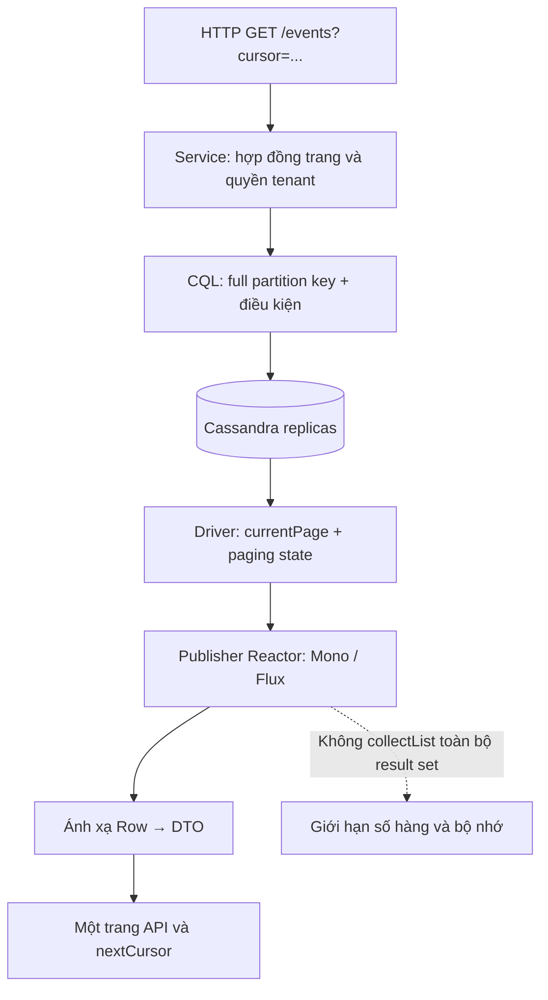

# Đọc theo trang và tránh gom toàn bộ kết quả vào bộ nhớ

Trong **Spring Data Cassandra**, truy vấn trả về `Flux<T>` tạo cảm giác rằng mọi hàng đều được xử lý “từng cái một” và ứng dụng sẽ không bao giờ hết bộ nhớ. Điều đó **không tự động đúng**. Một `Flux` vẫn có thể bị gom thành `List` bằng `collectList()`, bị giữ bởi `cache()` hoặc `sort()`, hoặc bị đọc quá nhanh so với tốc độ xử lý của hệ thống phía sau. Hơn nữa, cơ chế **paging của Apache Cassandra**, **backpressure của Reactor** và **phân trang ở HTTP API** là ba lớp khác nhau.

Bài học thuộc chương **Truy cập phản ứng** của module `SPRING_DATA_CASSANDRA`: sử dụng Spring Data Cassandra với entity mapping, repository, `ReactiveCassandraTemplate` và truy vấn CQL, đồng thời giữ đường đọc hiệu quả với partition key, clustering order, consistency và các giới hạn tài nguyên. Ta sẽ dùng một access pattern cụ thể để giải thích cách đọc hàng theo từng trang, xây API có cursor, xử lý chậm/huỷ và tránh vô tình gom toàn bộ kết quả vào heap.

Các ví dụ hướng tới **Java Driver 4**, **Project Reactor** và Spring Data Cassandra tương ứng. Tên API và khả năng hỗ trợ paging có thể khác giữa các phiên bản; khi triển khai, cần kiểm chứng trên đúng Spring Data/driver thực tế.

## 1. Ba khái niệm thường bị gọi chung là “phân trang”

| Cơ chế | Đơn vị điều khiển | Nó giải quyết gì? | Nó **không** tự giải quyết gì? |
| --- | --- | --- | --- |
| **Cassandra driver paging** | Fetch page của CQL, qua page size và paging state | Không yêu cầu driver lấy toàn bộ result set về trong một lượt mạng | Không đảm bảo API chỉ trả đúng một trang hay ứng dụng không gom mọi page |
| **Reactor backpressure** | Nhu cầu `request(n)` của subscriber với `Flux` | Có thể giúp các publisher tuân thủ nhu cầu, giảm tốc độ đẩy downstream | Không tự biến câu CQL thiếu partition key thành hiệu quả, không biến stream vô hạn thành hữu hạn |
| **API pagination** | Trang dữ liệu trả một lần cho client và cursor tiếp tục | Giới hạn kích thước một HTTP response, định nghĩa cách lấy trang sau | Không tự có nếu chỉ trả `Flux`; cần hợp đồng cursor và quyền truy cập |

Thêm một khái niệm độc lập: **`LIMIT` trong CQL** giới hạn **tổng số hàng** mà câu truy vấn trả về, trong khi **page size** là kích thước mỗi lần fetch mà driver yêu cầu. Hai giá trị có thể bằng nhau nhưng mang ý nghĩa khác nhau.



**Nguyên tắc:** muốn tiết kiệm bộ nhớ phải kiểm soát **bao nhiêu hàng được tải, giữ, buffer và xử lý đồng thời** ở từng lớp. Tên kiểu trả về là `Flux` chưa phải bằng chứng đủ.

## 2. Bắt đầu từ bảng Cassandra được thiết kế theo truy vấn

Giả sử một hệ thống telemetry cần xem 50–100 sự kiện mới nhất của một thiết bị, thuộc một tenant, trong **một ngày UTC**. Bảng:

```sql
CREATE TABLE events_by_device_day (
    tenant_id    text,
    device_id    text,
    event_day    date,
    occurred_at  timestamp,
    event_id     uuid,
    event_type   text,
    payload      text,
    PRIMARY KEY ((tenant_id, device_id, event_day),
                 occurred_at, event_id)
) WITH CLUSTERING ORDER BY (occurred_at DESC, event_id DESC);
```

Trong schema này:

- `(tenant_id, device_id, event_day)` là **partition key ghép**, cho phép xác định replica chứa một bucket sự kiện.
- `occurred_at` và `event_id` là **clustering columns**, giúp tạo thứ tự ổn định trong partition khi nhiều sự kiện có cùng timestamp.
- `payload` có thể lớn; màn hình danh sách thường chỉ cần `occurred_at`, `event_id`, `event_type`, vì vậy nên **SELECT cột cần thiết**.
- `event_day` phải được tính theo **cùng một quy tắc UTC** giữa writer và reader. Một truy vấn nhiều ngày thường phải điều phối **nhiều partition**.

Truy vấn phù hợp:

```sql
SELECT occurred_at, event_id, event_type
FROM events_by_device_day
WHERE tenant_id = ?
  AND device_id = ?
  AND event_day = ?;
```

Truy vấn không phù hợp với schema này:

```sql
-- Không có partition key; kiểu trả về Flux cũng không sửa được.
SELECT * FROM events_by_device_day
WHERE event_type = 'ALARM';
```

Không thêm `ALLOW FILTERING` chỉ để một câu truy vấn toàn cluster trở nên hợp lệ. Nếu sản phẩm cần feed theo `event_type` trên nhiều thiết bị, hãy thiết kế một **read model theo access pattern** hoặc đánh giá loại index được cluster hỗ trợ, với giới hạn rõ ràng.

**Chi phí fan-out không biến mất khi reactive:** `Flux` chỉ mô tả luồng xử lý ở Java; nó không làm Cassandra đọc ít partition hay tự sắp xếp toàn cục.

## 3. `Flux` có thể lười, nhưng pipeline vẫn có thể ngốn bộ nhớ

Trong Project Reactor, publisher từ repository reactive thường là một mô tả thao tác **được kích hoạt khi có subscriber**. Điều này hỗ trợ kết hợp thao tác mà không gọi blocking API ngay tại chỗ khai báo.

Ví dụ:

```java
Flux<EventEntity> stream = repository.findByKeyTenantIdAndKeyDeviceIdAndKeyEventDay(
        tenantId, deviceId, day);

// Stream chưa cần thành List để đưa qua xử lý tiếp.
Mono<Void> finished = stream
        .map(this::toSummary)
        .concatMap(this::sendToAsyncProcessor)
        .then();
```

Ví dụ giả định `toSummary` trả một DTO và `sendToAsyncProcessor` trả `Mono<Void>`. `concatMap` xử lý theo thứ tự và không cần giữ **toàn bộ danh sách** trong Java. Khi thực thi, vẫn phải tính đến cơ chế prefetch/buffer của operator, kích thước page driver và tốc độ downstream; **không được suy ra bộ nhớ luôn hằng số tuyệt đối**.

Một pipeline nguy hiểm:

```java
Mono<List<EventEntity>> allEvents =
        repository.findByKeyTenantIdAndKeyDeviceIdAndKeyEventDay(
                tenantId, deviceId, day)
            .collectList(); // Gom mọi hàng được phát vào một List.
```

`collectList()` cần giữ **mọi item** mà upstream phát cho đến khi hoàn tất. Nếu partition có hàng triệu event hoặc query lấy nhiều page, heap có thể tăng liên tục. Cũng cần tránh `collectMap()`, `sort()`, `cache()` không giới hạn và `buffer()` không có ngân sách rõ ràng trên luồng lớn.

### `block()` không biến code thành an toàn hơn

```java
// Không dùng trên event-loop request của WebFlux:
List<EventEntity> events = repository.findByKeyTenantIdAndKeyDeviceIdAndKeyEventDay(
        tenantId, deviceId, day).collectList().block();
```

Đoạn này có **hai vấn đề**: gom mọi hàng vào list và chặn thread đang thực thi. Trong ứng dụng WebFlux, block trên event loop có thể làm giảm khả năng phục vụ nhiều request đồng thời. Nếu thư viện bắt buộc blocking, hãy cô lập nó ở scheduler phù hợp và giới hạn mức đồng thời, nhưng giải pháp tốt hơn cho đường truy cập Cassandra là dùng API bất đồng bộ/reactive thực sự.

## 4. Backpressure không phải một lệnh `LIMIT` cho Cassandra

Reactive Streams cho phép subscriber truyền nhu cầu `request(n)` lên publisher. Các operator Reactor như `limitRate` ảnh hưởng mẫu yêu cầu item ở tầng stream. Tuy nhiên:

1. **Driver vẫn fetch theo các trang CQL**; một yêu cầu vài item ở Reactor có thể phải đọc một fetch page từ Cassandra.
2. **`limitRate(32)` không tương đương `LIMIT 32`** trong CQL và không bảo đảm cluster chỉ xử lý đúng 32 hàng.
3. `take(50)` có thể hủy subscription sau 50 item; đã có fetch trước/prefetch thì một phần công việc mạng có thể đã diễn ra.
4. `onBackpressureBuffer()` không có giới hạn có thể **chuyển áp lực sang heap**, đúng điều bài này muốn tránh.
5. `flatMap` với quá nhiều concurrency có thể nhân số lượng request/in-flight object; `concatMap` giữ thứ tự nhưng có throughput khác.

Ví dụ xử lý bất đồng bộ với giới hạn concurrency:

```java
public Mono<Void> processEvents(Flux<EventSummary> input) {
    return input
            .flatMap(summary -> processor.process(summary), 8)
            .then();
}
```

`processor.process(...)` giả định trả `Mono<Void>`. Con số `8` là **giới hạn số xử lý đồng thời** tại operator này, không phải giới hạn số hàng trả về từ Cassandra. Khi yêu cầu cần giữ thứ tự theo clustering, chọn `concatMap` hoặc chiến lược ordered concurrency có chủ đích; `flatMap` có thể hoàn tất **khác thứ tự**.

## 5. Repository reactive: thuận tiện nhưng phải kiểm tra query shape

Spring Data Cassandra có giao diện repository reactive cho truy vấn không blocking theo API:

```java
import java.time.LocalDate;
import reactor.core.publisher.Flux;
import org.springframework.data.cassandra.repository.ReactiveCassandraRepository;
import org.springframework.data.cassandra.repository.Query;

public interface EventRepository
        extends ReactiveCassandraRepository<EventEntity, EventKey> {

    // Ví dụ derived query theo các field trong composite key.
    Flux<EventEntity> findByKeyTenantIdAndKeyDeviceIdAndKeyEventDay(
            String tenantId, String deviceId, LocalDate day);

    // Giới hạn rõ tổng số hàng bằng CQL, phục vụ preview nhỏ.
    @Query("SELECT * FROM events_by_device_day " +
           "WHERE tenant_id = ?0 AND device_id = ?1 " +
           "AND event_day = ?2 LIMIT 50")
    Flux<EventEntity> findPreview(
            String tenantId, String deviceId, LocalDate day);
}
```

`EventEntity` và `EventKey` trong ví dụ được định nghĩa ở phần 6. `findPreview` là một query method trả `Flux`, nhưng CQL có **`LIMIT 50`**, nên tổng kết quả truy vấn bị chặn ở 50 hàng. `findBy...` không đặt giới hạn hàng; nếu client liên tục subscribe và tiêu thụ hết, hệ thống có thể đọc cả một partition lớn qua nhiều fetch page.

**Khi nào `Flux` phù hợp?** Khi service cần xử lý tuần tự hoặc đẩy một tập hàng có quy mô đã được ràng buộc. **Khi nào cần API page rõ ràng?** Khi client muốn nhận một trang rồi chủ động yêu cầu trang tiếp theo, hoặc khi cần kiểm soát chặt bộ nhớ và cursor.

Không mặc định rằng một repository reactive trả về `Flux` sẽ tự sinh `Page<T>`/HTTP nextCursor. Không tự dùng `Pageable` như SQL `OFFSET` trong Cassandra: Cassandra sử dụng **paging state**, không có cơ chế offset lớn rẻ và tổng quát.

`ReactiveCassandraTemplate` là lựa chọn khác khi service cần tạo truy vấn qua mapping API thay vì query method cố định. Nó vẫn có thể phát các kết quả dạng reactive, nhưng **không nên suy rằng API template hoặc repository tự expose paging state thích hợp cho HTTP cursor**. Nếu cần kiểm soát chính xác một fetch page và token tiếp tục, có thể viết một read adapter dùng `CqlSession.executeAsync(...)` như mục 8, còn đường ghi/đọc entity thông thường vẫn dùng repository/template. Hai hướng có thể cùng tồn tại trong một service nếu giao diện và trách nhiệm được tách rõ.

## 6. Entity mapping và DTO cho trang dữ liệu nhỏ

Entity phải ánh xạ đủ primary key theo schema:

```java
import java.io.Serializable;
import java.time.Instant;
import java.time.LocalDate;
import java.util.UUID;
import org.springframework.data.cassandra.core.cql.Ordering;
import org.springframework.data.cassandra.core.mapping.PrimaryKeyClass;
import org.springframework.data.cassandra.core.mapping.PrimaryKeyColumn;
import org.springframework.data.cassandra.core.mapping.PrimaryKeyType;

@PrimaryKeyClass
public class EventKey implements Serializable {
    @PrimaryKeyColumn(name = "tenant_id", ordinal = 0,
            type = PrimaryKeyType.PARTITIONED)
    private String tenantId;

    @PrimaryKeyColumn(name = "device_id", ordinal = 1,
            type = PrimaryKeyType.PARTITIONED)
    private String deviceId;

    @PrimaryKeyColumn(name = "event_day", ordinal = 2,
            type = PrimaryKeyType.PARTITIONED)
    private LocalDate eventDay;

    @PrimaryKeyColumn(name = "occurred_at", ordinal = 3,
            type = PrimaryKeyType.CLUSTERED,
            ordering = Ordering.DESCENDING)
    private Instant occurredAt;

    @PrimaryKeyColumn(name = "event_id", ordinal = 4,
            type = PrimaryKeyType.CLUSTERED,
            ordering = Ordering.DESCENDING)
    private UUID eventId;

    public EventKey() {}
    // Bổ sung constructor, getters/setters, equals() và hashCode().
}
```

```java
import org.springframework.data.cassandra.core.mapping.Column;
import org.springframework.data.cassandra.core.mapping.PrimaryKey;
import org.springframework.data.cassandra.core.mapping.Table;

@Table("events_by_device_day")
public class EventEntity {
    @PrimaryKey
    private EventKey key;

    @Column("event_type")
    private String eventType;

    @Column("payload")
    private String payload;

    public EventEntity() {}
    // Bổ sung constructor và getters/setters.
}
```

Đây là hai **khung mapping**, chưa phải source hoàn chỉnh. Cột CQL `timestamp` thường ánh xạ sang Java `Instant`; `event_day date` sang `LocalDate`; `uuid` sang `UUID`. Nếu dùng `Instant` trong clustering key, phải giữ cách chuẩn hóa timestamp nhất quán, tránh việc writer và reader tạo ra các giá trị khóa khác độ chính xác.

API danh sách không nên trả thẳng entity nếu `payload` chứa nội dung lớn hoặc nhạy cảm. Dùng DTO gọn:

```java
import java.time.Instant;
import java.util.UUID;

public record EventSummary(
        Instant occurredAt,
        UUID eventId,
        String eventType) {}
```

Chọn cột tường minh ở CQL có thể giảm dữ liệu truyền qua mạng và số đối tượng Java. **Chỉ đổi entity sang DTO mà vẫn `SELECT *` không bảo đảm đã giảm payload Cassandra**; phải quan sát query thực tế và đo.

## 7. Một trang Cassandra không đồng nghĩa một trang HTTP

Java Driver 4 cho phép đặt `pageSize` trên statement. Ví dụ:

```java
import com.datastax.oss.driver.api.core.cql.SimpleStatement;

SimpleStatement stmt = SimpleStatement.builder(
        "SELECT occurred_at, event_id, event_type " +
        "FROM events_by_device_day " +
        "WHERE tenant_id = ? AND device_id = ? AND event_day = ?")
        .addPositionalValues(tenantId, deviceId, day)
        .setPageSize(100)
        .build();
```

`setPageSize(100)` gợi ý kích thước trang fetch cho server/driver. Nó **không** khiến câu CQL chỉ có 100 hàng tổng cộng. Nếu ứng dụng tiếp tục gọi `fetchNextPage()` cho đến khi hết, toàn bộ result set vẫn có thể được chuyển đến ứng dụng, chỉ là theo nhiều lượt fetch.

Ngược lại:

```sql
SELECT occurred_at, event_id, event_type
FROM events_by_device_day
WHERE tenant_id = ?
  AND device_id = ?
  AND event_day = ?
LIMIT 100;
```

`LIMIT 100` áp giới hạn **tổng** số hàng được trả về. Nếu cần trang tiếp theo sau 100 hàng, không thể đơn giản chạy lại cùng `LIMIT 100` rồi mong một trang mới. Cần một **paging state hợp lệ gắn với truy vấn** hoặc một cơ chế keyset pagination phù hợp schema.

### Vì sao trang fetch có thể không đủ 100 item?

Page size là tham số điều khiển việc fetch, không phải cam kết “mỗi lần nhất định trả đúng 100 hàng”. Số hàng có thể ít hơn vì tập dữ liệu đã hết hoặc do hành vi server/protocol, tombstone, giới hạn tài nguyên và điều kiện thực thi; ứng dụng không được coi **trang thiếu 100** là chắc chắn đã hết nếu driver vẫn báo còn page tiếp theo.

**Chỉ dùng cờ paging state/`hasMorePages()` và hợp đồng API đã định** để quyết định còn trang tiếp theo, không dùng `items.size() < pageSize` như điều kiện kết thúc tổng quát.

## 8. Java Driver 4 + Reactor: trả đúng một fetch page

Khi API cần **một trang tại một thời điểm**, có thể sử dụng `CqlSession.executeAsync(...)` và chuyển `CompletionStage` thành `Mono`. Cách này cho phép lấy `AsyncResultSet.currentPage()` mà **không tự fetch mọi trang**.

Ví dụ lớp đọc một partition:

```java
import java.time.Instant;
import java.time.LocalDate;
import java.util.ArrayList;
import java.util.List;
import java.util.UUID;

import com.datastax.oss.driver.api.core.CqlSession;
import com.datastax.oss.driver.api.core.cql.AsyncResultSet;
import com.datastax.oss.driver.api.core.cql.PagingState;
import com.datastax.oss.driver.api.core.cql.Row;
import com.datastax.oss.driver.api.core.cql.SimpleStatement;
import reactor.core.publisher.Mono;

public final class EventPageReader {
    private static final String CQL =
            "SELECT occurred_at, event_id, event_type " +
            "FROM events_by_device_day " +
            "WHERE tenant_id = ? AND device_id = ? AND event_day = ?";

    private final CqlSession session;

    public EventPageReader(CqlSession session) {
        this.session = session;
    }

    // nextState chỉ dùng nội bộ; không xuất trực tiếp thành API cursor.
    public record PageSlice(
            List<EventSummary> items, PagingState nextState) {}

    public Mono<PageSlice> readPage(
            String tenantId, String deviceId, LocalDate day,
            PagingState pagingState) {

        if (tenantId == null || tenantId.isBlank()
                || deviceId == null || deviceId.isBlank()
                || day == null) {
            return Mono.error(new IllegalArgumentException(
                    "Thiếu partition key"));
        }

        return Mono.defer(() -> {
            SimpleStatement stmt = SimpleStatement.builder(CQL)
                    .addPositionalValues(tenantId, deviceId, day)
                    .setPageSize(100)
                    .build();

            if (pagingState != null) {
                stmt = stmt.setPagingState(pagingState);
            }

            return Mono.fromCompletionStage(session.executeAsync(stmt))
                    .map(this::mapCurrentPage);
        });
    }

    private PageSlice mapCurrentPage(AsyncResultSet rs) {
        List<EventSummary> items = new ArrayList<>();
        for (Row row : rs.currentPage()) {
            items.add(new EventSummary(
                    row.getInstant("occurred_at"),
                    row.getUuid("event_id"),
                    row.getString("event_type")));
        }

        PagingState next = rs.hasMorePages()
                ? rs.getExecutionInfo().getSafePagingState()
                : null;
        return new PageSlice(List.copyOf(items), next);
    }
}
```

**Điểm quan trọng của ví dụ:**

1. `Mono.defer(...)` hoãn **tạo và gửi statement** tới lúc publisher được subscribe; không phát request chỉ vì service tạo `Mono`.
2. `executeAsync` dùng đường bất đồng bộ của Java Driver; **không gọi `session.execute` blocking** trên event loop.
3. `currentPage()` chỉ ánh xạ **trang hiện có trong result set**, không tự lặp `fetchNextPage()` tới hết dữ liệu.
4. `hasMorePages()` quyết định có khả năng tiếp tục. `PagingState` được lấy từ execution info của **trang vừa thực thi**; khi gọi trang sau phải dùng **đúng query shape và bind values**.
5. `PageSlice` giữ **một danh sách nhỏ theo page size**, không gom toàn bộ mọi trang; bộ nhớ vẫn phụ thuộc kích thước hàng và số request đồng thời.
6. Driver/spring phiên bản cụ thể có thể có điểm khác về dạng safe paging state và hỗ trợ truyền lại; hãy kiểm thử API `getSafePagingState()`/`setPagingState(...)` cùng phiên bản trong dự án.

`PagingState` trong ví dụ là đối tượng **nội bộ giữa các lần đọc**. Không trả `PagingState` hay Base64 thô cho client như một token có thể tùy ý sửa. Phần tiếp theo giải thích hợp đồng an toàn hơn.

## 9. Thiết kế API cursor có ràng buộc query và tenant

Ví dụ API:

```text
GET /tenants/{tenantId}/devices/{deviceId}/events
    ?day=2026-11-25&pageSize=100&cursor=...

{
  "items": [
    { "occurredAt": "2026-11-25T10:25:00Z",
      "eventId": "550e8400-e29b-41d4-a716-446655440000",
      "eventType": "TEMP_HIGH" }
  ],
  "nextCursor": "<opaque-signed-token-or-null>"
}
```

Đây là **ví dụ hợp đồng**, không phải một response thực được lấy từ cluster. Với một cursor chứa paging state, cần ràng buộc:

| Thuộc tính trong context/token | Vì sao phải giữ |
| --- | --- |
| `tenantId` đã xác thực | Không cho sử dụng cursor của tenant A để truy vấn tenant B |
| `deviceId`, `day` | Cursor thuộc **đúng partition/filter** ban đầu |
| Query version / projection version | Thay đổi câu CQL hoặc cột có thể khiến paging state không tương thích |
| `pageSize` và các options liên quan | Tránh chuyển cursor sang một hợp đồng fetch khác không được kiểm thử |
| Paging state của driver | Cho phép tiếp tục vị trí của truy vấn đã thực thi |
| Thời điểm phát hành/hết hạn | Giảm rủi ro tái sử dụng token rất cũ |
| Chữ ký chống sửa đổi | Ngăn client đổi các thuộc tính được server tin dùng |

Tối thiểu, token phải được **ký xác thực** và ràng buộc với user/tenant/quyền hiện hành; có thể mã hóa nếu không muốn lộ metadata. Khi nhận cursor:

1. Xác thực principal, tenant và quyền truy cập device.
2. Xác minh chữ ký, thời hạn và giới hạn `pageSize`.
3. Xác minh query identity, bind values và policy khớp request gốc.
4. Khôi phục paging state theo API driver và kiểm tra tính tương thích của statement.
5. Nếu token bị sửa, lỗi thời hoặc không phù hợp, trả lỗi client có chủ đích, **không thử fallback sang scan toàn bộ bảng**.

Không dùng trực tiếp `page=10000` hay SQL `OFFSET 100000`: Cassandra không có đường offset lớn rẻ tương đương cơ sở dữ liệu quan hệ. Paging state cũng không phải khóa định danh hàng, có thể chịu giới hạn khả năng sử dụng khi topology/data/query thay đổi.

## 10. Khi chỉ cần xử lý liên tục nhiều trang ở server

Đôi lúc service không cần trả page cho HTTP client mà phải xử lý nhiều event trong một job. Có thể kết hợp API async của driver và Reactor để phát từng hàng mà không `collectList` toàn kết quả.

```java
import com.datastax.oss.driver.api.core.cql.AsyncResultSet;
import com.datastax.oss.driver.api.core.cql.Row;
import com.datastax.oss.driver.api.core.cql.SimpleStatement;
import reactor.core.publisher.Flux;
import reactor.core.publisher.Mono;

public Flux<EventSummary> streamPartition(
        CqlSession session, String tenantId,
        String deviceId, LocalDate day) {

    return Flux.defer(() -> {
        SimpleStatement stmt = SimpleStatement.builder(
                "SELECT occurred_at, event_id, event_type " +
                "FROM events_by_device_day " +
                "WHERE tenant_id = ? AND device_id = ? AND event_day = ?")
                .addPositionalValues(tenantId, deviceId, day)
                .setPageSize(128)
                .build();

        return Mono.fromCompletionStage(session.executeAsync(stmt))
                .expand(rs -> rs.hasMorePages()
                        ? Mono.fromCompletionStage(rs.fetchNextPage())
                        : Mono.empty())
                .concatMapIterable(AsyncResultSet::currentPage)
                .map(row -> new EventSummary(
                        row.getInstant("occurred_at"),
                        row.getUuid("event_id"),
                        row.getString("event_type")));
    });
}
```

Ví dụ minh họa việc **theo tiếp các fetch page** bằng `expand`. Nó không có nghĩa Reactor bảo đảm tối đa một trang luôn ở trong bộ nhớ ở mọi thời điểm: `expand` có thể có đặc điểm prefetch/queue và cơ chế hủy cần kiểm chứng theo phiên bản Reactor; downstream có thể buffer thêm. Nếu cần một **bảo đảm cứng về số trang đang in-flight**, hãy xây một vòng lặp fetch nối tiếp có điều khiển nhu cầu hoặc tái sử dụng API `readPage` ở mục 8 trong một worker quản lý số trang rõ ràng.

Trong job:

```java
return streamPartition(session, tenantId, deviceId, day)
        .concatMap(summary -> asyncSink.write(summary))
        .then();
```

`asyncSink.write` giả định trả `Mono<Void>`. Pipeline xử lý các phần tử không giữ mọi event ở `List`, nhưng vẫn cần **giới hạn thời gian chạy, tổng số hàng/partition và số job song song**. Nếu cancel giữa chừng, đã có page được driver fetch trước vẫn có thể tiêu tốn tài nguyên; không được xem cancellation là rollback hoặc dừng tức thì mọi I/O.

## 11. Keyset pagination so với driver paging state

Ngoài paging state nội bộ của Cassandra, một số API có thể dùng **keyset cursor**: lưu chính các thành phần clustering key cuối trang để tiếp tục.

Với schema `events_by_device_day`, thứ tự là `occurred_at DESC, event_id DESC`. Nếu chỉ giữ `occurred_at`, nhiều event cùng millisecond có thể bị **trùng hoặc bỏ sót**. Cần cả hai trường `occurred_at` và `event_id`, cùng tenant/device/day:

```text
Cursor keyset minh họa:
{
  "tenant": "tenant-a",
  "device": "device-7",
  "day": "2026-11-25",
  "lastOccurredAt": "2026-11-25T10:25:00Z",
  "lastEventId": "550e8400-e29b-41d4-a716-446655440000"
}
```

Không lấy nguyên ví dụ và ghép `WHERE occurred_at < ? OR event_id < ?` như SQL quan hệ. **CQL có ràng buộc riêng đối với clustering ranges, thứ tự và tuple conditions**. Cần kiểm chứng cú pháp phù hợp với khóa/clustering order/phiên bản Cassandra.

| Cơ chế | Ưu điểm | Giới hạn |
| --- | --- | --- |
| **Paging state** | Đúng vị trí tiếp tục của execution CQL, phù hợp phân trang tuần tự cùng query | Cursor gắn với query/options; phải bảo vệ token và xử lý state lỗi thời |
| **Keyset theo clustering key** | Có thể diễn tả vị trí ở mức dữ liệu, rõ tie-breaker | CQL range và thứ tự phải hợp lệ; dữ liệu cập nhật/xóa có thể làm thay đổi tập kết quả |
| **OFFSET số trang** | Quen với SQL | Không có phương án tổng quát chi phí thấp trong Cassandra |

Với API “trang tiếp theo” của một partition ổn định, paging state là lựa chọn tự nhiên. Với feed có nhiều partition hoặc yêu cầu tiếp tục sau thời gian dài, keyset/thiết kế read model có thể cần được cân nhắc kỹ hơn.

## 12. Paging không tạo snapshot bất biến khi dữ liệu thay đổi

Giả sử client lấy trang 1 lúc 10:00, rồi trang 2 lúc 10:03, trong khi writer vẫn chèn event mới vào đầu partition hoặc xóa event cũ. Cassandra **không cấp một snapshot giao dịch cố định của toàn bộ feed qua nhiều request chỉ vì client dùng cùng paging state**.

Hệ quả cần kiểm thử:

- Một event mới có thể xuất hiện ở đầu danh sách sau khi trang đầu đã được trả; client không nhất thiết nhìn thấy nó khi tiếp tục cursor cũ.
- Event bị xóa hoặc hết hạn TTL có thể thay đổi số hàng/phần dữ liệu của các trang sau.
- Khi lọc/trộn nhiều partition, việc hợp nhất kết quả có thể tạo **trùng/bỏ sót** nếu thiếu một quy tắc thứ tự toàn cục và checkpoint.
- Tăng consistency level không tự biến chuỗi nhiều trang thành một transaction snapshot.

Đối với dashboard, đây có thể là đặc tính chấp nhận được. Với **báo cáo cần tính lặp lại chính xác**, nên xác định cutoff/watermark, nguồn dữ liệu bất biến hoặc quy trình snapshot riêng, thay vì chỉ cố điều chỉnh page size.

## 13. Nhiều ngày và nhiều partition: kiểm soát fan-out

Một service có thể muốn lấy 100 event mới nhất trong **7 ngày**. Vì schema partition theo ngày, service phải truy vấn tối đa 7 partition ngày (hoặc nhiều bucket hơn tùy chiến lược sharding).

**Không có một paging state duy nhất** tự hợp nhất toàn bộ các truy vấn riêng thành một feed được sắp xếp toàn cục. Cần quyết định:

1. Có chấp nhận đọc từng ngày theo thứ tự ưu tiên rồi mới chuyển sang ngày trước không?
2. Mỗi partition dùng page size bao nhiêu, tổng số row tối đa?
3. Có bao nhiêu request/page được phép in-flight đồng thời?
4. Nếu merge nhiều ngày, tie-breaker là gì? Cần sắp xếp bằng `occurred_at + event_id` hay một thứ tự nghiệp vụ khác?
5. Cursor API cần lưu vị trí của **từng partition** hay một read model khác để tránh fan-out?

Một pattern nguy hiểm:

```java
// KHÔNG nên làm khi 7 partition có thể chứa hàng triệu event.
Mono<List<EventSummary>> everything = Flux.fromIterable(days)
        .flatMap(day -> repository
                .findByKeyTenantIdAndKeyDeviceIdAndKeyEventDay(
                        tenantId, deviceId, day)
                .map(this::toSummary))
        .collectList();
```

Đoạn này vừa có thể tạo **nhiều truy vấn đồng thời** (do `flatMap`) vừa giữ toàn bộ các hàng của nhiều ngày trong bộ nhớ. Nếu cần top 100 toàn tuần, hãy thiết kế **merge có giới hạn**, hoặc read model cho feed theo tenant/device/tuần với partition được bucket hợp lý; đo chi phí đọc thay vì dựa vào một `List` khổng lồ.

**Không có tối ưu một dòng code thay thế mô hình hóa partition:** tăng page size, dùng `parallel()` hay chuyển `List` thành `Flux` không biến một truy vấn fan-out thành một point lookup.

## 14. Tránh buffer không giới hạn và quản lý concurrency

Các operator Reactor có thể ảnh hưởng bộ nhớ mạnh:

| Operator/thói quen | Nguy cơ | Thay thế khi phù hợp |
| --- | --- | --- |
| `collectList()` | Giữ toàn bộ item trước khi hoàn tất | Xử lý từng item, hoặc gom **một fetch page có giới hạn** |
| `buffer()` không tham số | Có thể giữ nhiều item tùy luồng | `buffer(n)` có `n` nhỏ và giới hạn upstream |
| `sort()` | Thường phải giữ toàn bộ dữ liệu để sắp xếp | Tận dụng clustering order ở Cassandra, giới hạn tập dữ liệu |
| `cache()` trên Flux lớn | Lưu lại nhiều item trong memory | Cache DTO/summary với TTL và giới hạn dung lượng phù hợp |
| `onBackpressureBuffer()` không giới hạn | Dồn tồn đọng vào heap | Bounded buffer, giảm concurrency hoặc cơ chế điều tiết nguồn |
| `flatMap` không xét concurrency | Quá nhiều inner subscriptions/in-flight | `flatMap(mapper, concurrency)` với ngân sách rõ |
| `block()` trên WebFlux event loop | Chặn thread, tăng tail latency | API reactive/async, không blocking; cô lập blocking bắt buộc |
| Gọi `subscribe()` thủ công trong service | Mất liên kết lifecycle, error/cancellation | Trả `Mono`/`Flux` cho tầng gọi quản lý |

Trong HTTP API, giới hạn **pageSize tối đa ở server**, không tin client gửi `pageSize=1000000`. Giới hạn đồng thời theo user/tenant, kiểm soát timeout, số byte trung bình mỗi row và thời gian giữ connection. 100 hàng có payload vài megabyte có thể vẫn tốn rất nhiều bộ nhớ: page size chỉ là một phần ngân sách.

### Những điều backpressure không thể bảo đảm

Backpressure hoạt động theo khả năng hợp tác của publisher/upstream. Một thư viện bridging driver sang Reactor có thể fetch trước để tối ưu throughput, và các operator có thể queue dữ liệu. Muốn đánh giá đúng, cần **đo heap và số fetch page thực tế** khi downstream cố ý chậm, không chỉ nhìn tên `Flux` hoặc `request(1)`.

## 15. Timeout, lỗi giữa trang và cách tiếp tục

Giả sử trang 1 đã được trả cho client, nhưng trang 2 bị timeout hoặc một replica trở nên unavailable:

- **Không tự lấy trang đầu rồi bỏ 100 hàng** như cách giả lập offset.
- Không mặc định cursor cũ vẫn hợp lệ nếu schema/query shape hay filter đã đổi.
- Không trả một trang trống và `nextCursor=null` khi thực tế là **lỗi chưa đọc xong**; client sẽ hiểu nhầm dữ liệu đã hết.
- Nếu request bị retry, cần bảo đảm **cùng query, bind values, quyền tenant và cursor**; với dữ liệu đang thay đổi, vẫn có thể gặp thay đổi kết quả.
- Phân biệt `timeout`/unavailable với “không có hàng”, và ghi metrics theo page index, request ID, query version.

Trong Reactor, dùng `onErrorResume` chỉ khi có **chính sách fallback hợp lệ**. Ví dụ nguy hiểm:

```java
// SAI VỀ NGỮ NGHĨA: biến lỗi Cassandra thành trang kết thúc.
return pageReader.readPage(tenantId, deviceId, day, state)
        .onErrorReturn(new EventPageReader.PageSlice(
                List.of(), null));
```

Nên trả lỗi API có thể hiểu được, cho phép client retry với cursor cũ khi được phép, hoặc báo partial result theo hợp đồng đã thiết kế. **Một lỗi đọc không chứng minh partition đã hết dữ liệu.**

## 16. Kiểm thử reactive paging đúng những điều khó

Một test chỉ mong `Flux.take(10)` trả 10 entity chưa chứng minh không có request đọc trước hoặc không có buffer lớn. Nên kết hợp test logic, integration test và đo đường fetch:

| Tình huống | Điều cần xác minh |
| --- | --- |
| Cùng partition có 250 event, page size 100 | Lặp page được 250 event, không trùng/thiếu trong bộ dữ liệu **cố định** |
| Một partition chỉ có 37 event | Một page có 37 và **không có next** |
| Trang trả ít hơn page size nhưng `hasMorePages=true` | Service không kết thúc sớm chỉ vì số item |
| Cursor thuộc tenant A được dùng với tenant B | Bị từ chối, không bị thay bind values âm thầm |
| Cursor bị sửa, sai query version hoặc quá hạn | Bị từ chối rõ ràng, không chạy scan dự phòng |
| Downstream xử lý chậm | Heap và số trang in-flight bị giới hạn theo ngân sách |
| Subscriber cancel giữa trang | Không trả dữ liệu sai; I/O đã phát có thể vẫn kết thúc |
| Query không có partition key | Bị từ chối từ thiết kế/test, không thêm `ALLOW FILTERING` |
| Dữ liệu chèn/xóa giữa trang | Hợp đồng không hứa snapshot toàn cục |
| Lỗi đọc trang 2 | Không trả `next=null` như đã hết |
| Nhiều ngày/partition | Số request đồng thời và merge/fan-out có giới hạn |

### StepVerifier cho một trang

```java
import static org.junit.jupiter.api.Assertions.*;
import org.junit.jupiter.api.Test;
import reactor.test.StepVerifier;

@Test
void firstPageHasBoundedItems() {
    StepVerifier.create(
            reader.readPage("tenant-a", "device-7",
                    java.time.LocalDate.of(2026, 11, 25), null))
        .assertNext(page -> {
            assertTrue(page.items().size() <= 100);
            // Kiểm thử nextState bằng fixture có nhiều hơn 1 trang.
        })
        .verifyComplete();
}
```

Đây là **đoạn phương thức test** đặt trong lớp integration test có `reader` được khởi tạo từ `CqlSession` và fixture Cassandra thật. Assert giới hạn một trang không chứng minh đủ mọi thuộc tính. Cần thêm test duyệt hết các trang có dữ liệu cố định để kiểm tra tính toàn vẹn theo primary key, và test fault injection để kiểm tra xử lý lỗi giữa trang.

### Đo memory và số fetch page

Trong một test tải nhỏ nhưng đại diện:

1. Nạp một partition với đủ dữ liệu để có **nhiều trang fetch**, không chỉ một trang.
2. Cho downstream xử lý chậm có kiểm soát; quan sát heap, GC, số subscription, fetch calls và p95/p99.
3. So sánh cách xử lý từng page với cách `collectList()` toàn bộ; cả hai phải đọc **cùng dữ liệu**.
4. Tăng page size theo từng mức rồi đo throughput/bytes/memory; không chọn chỉ bằng cảm giác.
5. Dùng số request đồng thời thực tế, vì mỗi request có thể giữ một page và DTO riêng.
6. Thử cancellation, timeout và sửa cursor/schema để xác nhận không leak resource hay đưa ra trang giả.

Không chạy phép thử cố tình tiêu tốn heap hoặc network trên cluster production. Mock `Flux` có thể kiểm tra operator, nhưng **không mô phỏng đầy đủ driver paging, Cassandra topology hoặc chi phí I/O**.

## 17. Sai lầm phổ biến và cách sửa

| Sai lầm | Hậu quả | Cách làm phù hợp |
| --- | --- | --- |
| `Flux` nghĩa là không bao giờ đầy heap | Operator vẫn có thể gom/buffer vô hạn | Kiểm soát `collectList`, `sort`, `cache`, concurrency và page size |
| `setPageSize(100)` nghĩa là chỉ trả 100 hàng tổng cộng | Ứng dụng có thể fetch tiếp tới hết | `LIMIT` cho giới hạn tổng; paging state cho trang tiếp theo |
| `LIMIT 100` rồi chạy lại để lấy “trang 2” | Lặp trang đầu | Paging state hoặc keyset cursor đúng query |
| Dùng `items.size()<pageSize` để kết luận hết | Trang fetch có thể ngắn nhưng vẫn còn dữ liệu | Kiểm tra `hasMorePages` |
| Trả raw paging state ra URL không bảo vệ | Cursor bị sửa hoặc dùng xuyên tenant | Token ký, kiểm tra identity/query/expiry |
| Tự tạo `OFFSET` bằng cách đọc bỏ N hàng | Chi phí tăng theo N | Cassandra paging/keyset và query design |
| `flatMap` tất cả ngày rồi `collectList` | Fan-out và heap tăng mạnh | Giới hạn số partition/request, merge có giới hạn |
| `block()` trên WebFlux event loop | Giảm khả năng phục vụ đồng thời | Dùng async/reactive API |
| Bỏ lỗi trang 2 rồi trả trang trống | Client mất dữ liệu mà tưởng hết | Phân biệt lỗi với end-of-data |
| Tăng page size để chữa query chậm | Có thể tăng byte/heap/tombstone cost | Đo truy vấn, partition, TTL và replica latency |
| Cancel Flux nghĩa Cassandra ngừng ngay mọi I/O | Fetch đã gửi vẫn có thể hoàn tất | Đo cancellation và kiểm soát in-flight requests |
| Trả thẳng entity chứa `payload` | Lộ trường nội bộ và chuyển dữ liệu lớn | Projection/DTO và SELECT các cột cần thiết |

## 18. Checklist triển khai API reactive có paging

1. **Chốt truy vấn nghiệp vụ:** full partition key, clustering order và số bucket phải đọc.
2. **Chọn hình dạng đầu ra:** DTO chỉ gồm trường API cần và thông tin cần cho cursor.
3. **Phân biệt ba giới hạn:** CQL `LIMIT`, fetch `pageSize`, API `pageSize`.
4. **Không thu thập toàn result:** tránh `collectList`/buffer không giới hạn; nếu gom, chỉ gom **một page có chặn**.
5. **Dùng async/reactive thực sự:** không gọi API blocking trong WebFlux event loop.
6. **Kiểm soát query execution:** một page → `currentPage` → next paging state, không fetch tất cả cho một HTTP response.
7. **Bảo vệ cursor:** ký/ràng buộc tenant, filter, query version, hạn dùng và kích thước trang.
8. **Giới hạn tài nguyên:** page size tối đa, timeout, in-flight pages, concurrency theo tenant và bytes per row.
9. **Phân biệt lỗi với hết dữ liệu:** timeout/unavailable không được chuyển thành trang rỗng giả.
10. **Không hứa snapshot:** dữ liệu thay đổi giữa trang, multi-partition feed cần hợp đồng riêng.
11. **Quan sát trong thực tế:** heap, GC, số fetch, p95/p99, bytes, tombstone, replica latency và cancellation.
12. **Kiểm thử cả tích hợp lẫn fault:** trang ngắn, trang cuối, token sai, cancel, timeout, multi-bucket và downstream chậm.

## 19. Bài tập tình huống

**Tình huống A — `collectList` trên `Flux`.** Developer thay `List<EventEntity>` bằng `Flux<EventEntity>` nhưng controller lại gọi `collectList()` để trả toàn bộ partition có 2 triệu hàng. Có được coi là streaming an toàn bộ nhớ không?

**Đáp án gợi ý:** Không. `collectList()` vẫn giữ tất cả hàng trong `List`; `Flux` chỉ đổi kiểu upstream. Cần giới hạn truy vấn, trả trang hoặc xử lý từng phần tử bằng pipeline không gom toàn bộ.

**Tình huống B — Page size và tổng số hàng.** CQL không có `LIMIT`, driver dùng `setPageSize(100)`, service gọi `fetchNextPage()` đến khi hết. Tổng cộng có 250.000 hàng. Service có thể tải cả 250.000 hàng không?

**Đáp án gợi ý:** Có nếu service tiếp tục fetch tất cả các trang. Page size chỉ chia nhỏ lượt fetch, không chặn tổng; phải giới hạn số trang, `LIMIT` hoặc hợp đồng xử lý streaming.

**Tình huống C — Trang ngắn.** Page size là 100 nhưng trang đầu chỉ có 71 hàng, trong khi `AsyncResultSet.hasMorePages()` là `true`. Nên kết thúc pagination không?

**Đáp án gợi ý:** Không. Không suy ra hết từ kích thước trang; dựa vào cờ paging state/driver và hợp đồng API.

**Tình huống D — Cursor khác tenant.** Client lấy `nextCursor` cho tenant A rồi sửa URL thành tenant B. Có nên chạy query cho B với cursor A không?

**Đáp án gợi ý:** Không. Cursor phải được ký và ràng buộc tenant/filter/query, đồng thời kiểm tra authorization ở lần gọi sau.

**Tình huống E — Trang hai bị timeout.** Service bắt timeout rồi trả `items=[]; nextCursor=null` để client không báo lỗi. Vấn đề?

**Đáp án gợi ý:** Làm sai semantics: client hiểu toàn bộ dữ liệu đã hết. Nên trả lỗi hoặc partial-result contract rõ ràng, bảo toàn cursor hợp lệ để retry.

**Tình huống F — Nhiều ngày.** API muốn “100 event mới nhất tuần này”, truy vấn bảy partition ngày, `flatMap` rồi `collectList` tất cả, cuối cùng sort và lấy 100. Có tối ưu không?

**Đáp án gợi ý:** Không. Fan-out và gom quá nhiều hàng trước khi chọn top K. Cần giới hạn từng partition, merge có ngân sách, hoặc thiết kế read model phục vụ feed nhiều ngày.

**Tình huống G — Backpressure.** Một service gọi `limitRate(16)` rồi khẳng định Cassandra không bao giờ fetch quá 16 hàng một lần. Khẳng định đúng không?

**Đáp án gợi ý:** Không. `limitRate` điều chỉnh nhu cầu item Reactor, còn CQL page size/fetch/prefetch có cơ chế riêng. Cần đo số fetch và bộ nhớ thực tế.

**Tình huống H — Dữ liệu thay đổi giữa hai trang.** Trang đầu đọc lúc 10:00, trang thứ hai lúc 10:03 khi writer vừa thêm/xóa sự kiện. API có thể cam kết snapshot toàn bộ feed ở 10:00 không?

**Đáp án gợi ý:** Không chỉ bằng paging state. Nếu cần snapshot nhất quán theo thời điểm, phải thiết kế nguồn dữ liệu/cutoff hoặc quy trình snapshot riêng.

## Kết luận

**Đọc theo trang và tránh gom toàn bộ kết quả vào bộ nhớ** trong Spring Data Cassandra đòi hỏi kiểm soát đồng thời **mô hình partition**, **kích thước fetch page của Java Driver**, **nhu cầu/backpressure của Reactor** và **hợp đồng trang API**. `Flux` không tự bảo đảm bộ nhớ nhỏ; `collectList`, buffer hoặc fan-out có thể làm mất lợi ích reactive. `setPageSize(n)` cũng không có nghĩa tổng kết quả bị giới hạn ở `n`.

Hãy theo trình tự **thiết kế CQL theo full partition key → SELECT cột cần thiết → giới hạn page size và concurrency → đọc `currentPage`/giữ paging state → bảo vệ cursor theo tenant/query → xử lý cancellation, timeout và dữ liệu thay đổi → đo heap, fetch và p95/p99**. Khi cần xử lý hàng loạt, hãy streaming với ngân sách rõ ràng; khi phục vụ HTTP, hãy trả **từng trang thực sự** thay vì một `Flux` cuối cùng lại bị gom toàn bộ.
