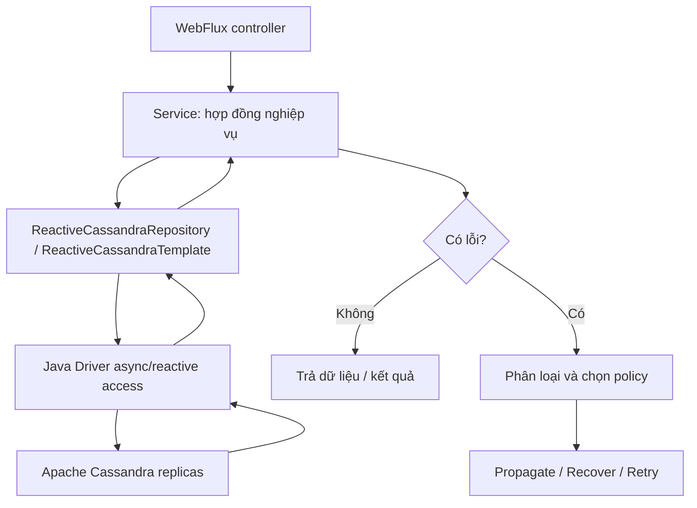

# Truyền lỗi, phục hồi và chính sách thử lại có điều kiện

## Mục tiêu học tập

Với **Spring Data Cassandra**, truy cập dữ liệu theo mô hình phản ứng thường trả về `Mono<T>` hoặc `Flux<T>` của Project Reactor. Ưu điểm là ứng dụng có thể phối hợp thao tác bất đồng bộ, xử lý dòng dữ liệu và quản lý nhu cầu tiêu thụ mà không chặn thread chờ I/O theo mô hình thông thường.

Nhưng **reactive không tự biến truy vấn Cassandra thành an toàn khi lỗi**. Một lỗi có thể phát sinh từ kết nối, timeout, bộ chuyển đổi dữ liệu, quy tắc nghiệp vụ hoặc việc người tiêu dùng ngừng nhận kết quả. Khi dùng `retryWhen(...)`, Reactor **đăng ký lại nguồn dữ liệu**; với Publisher thực hiện truy vấn lúc được subscribe, điều đó có thể gửi lại CQL. Đọc theo khóa thường có rủi ro khác hẳn việc tăng counter, ghi sự kiện mới hoặc thực hiện LWT mà kết quả trước đó chưa rõ.

Bài học thuộc chương **Truy cập phản ứng** của module `SPRING_DATA_CASSANDRA`: truy cập Apache Cassandra bằng entity mapping, repository, `CassandraTemplate` và CQL, thiết kế bảng theo truy vấn, partition key, consistency, paging và hiệu năng phân tán. Trọng tâm bài này là **truyền lỗi đúng ngữ nghĩa, phục hồi có điều kiện và retry theo từng loại thao tác**.

Sau bài, bạn có thể:

- Hiểu vòng đời tín hiệu `onNext`, `onComplete`, `onError` và sự khác biệt giữa lỗi với `Mono.empty()`.
- Sử dụng `doOnError`, `onErrorMap`, `onErrorResume`, `switchIfEmpty` và `retryWhen` đúng trách nhiệm.
- Phân loại lỗi transient, lỗi vĩnh viễn, conflict nghiệp vụ và **outcome chưa xác định**.
- Thiết lập retry có giới hạn, filter, exponential backoff, jitter, timeout và deadline.
- Tránh nhân đôi tác dụng phụ khi resubscribe một Publisher ghi Cassandra, nhất là counter/LWT.
- Xây luồng phục hồi dựa trên dữ liệu mới khi LWT trả conflict xác định.
- Tích hợp `ReactiveCassandraRepository`, `ReactiveCassandraTemplate`, gateway CQL và tầng REST/WebFlux.
- Giám sát, kiểm thử bằng `StepVerifier`, đồng thời kiểm soát concurrency, paging, cancellation và load.

## 1. Một truy vấn reactive trả kết quả như thế nào?

Trong Reactor, `Mono<T>` biểu diễn một kết quả có thể là **0 hoặc 1 phần tử**, còn `Flux<T>` có thể phát **0 đến nhiều phần tử**.

```text
Mono<T> thành công có giá trị:
  onNext(value) → onComplete

Mono<T> không có giá trị:
  onComplete

Mono<T> thất bại:
  onError(exception)

Flux<T>:
  onNext(a) → onNext(b) → ... → onComplete
                                hoặc onError
```

`onError` là một **tín hiệu kết thúc** của subscription đang chạy. Khi đã phát `onError`, một Publisher tuân thủ Reactive Streams không được tiếp tục phát thêm `onNext`/`onComplete` trong chính subscription đó.

Điểm cần phân biệt:

| Tình huống | Tín hiệu phù hợp | Có nhất thiết là lỗi Cassandra? |
| --- | --- | --- |
| Tìm theo ID và thấy entity | `onNext(entity)` rồi `onComplete` | Không. |
| Không có hàng tương ứng | `onComplete` mà không có `onNext` | Không, tùy hợp đồng truy vấn. |
| Server timeout | `onError(timeoutException)` | Có thể liên quan hệ thống Cassandra hoặc mạng. |
| Entity mapping không chuyển được giá trị | `onError(mappingException)` | Lỗi ứng dụng/dữ liệu, không nhất thiết transient. |
| Hai LWT cạnh tranh, một lệnh trả `[applied]=false` | **Kết quả conditional operation**, không mặc định `onError` | Thường là conflict logic cần xử lý. |
| Client đóng kết nối HTTP | Subscription có thể bị cancel | Cancellation không đồng nghĩa rollback Cassandra. |

### Lỗi khác với “không tìm thấy”

Với repository:

```java
Mono<Device> found = repository.findById(deviceId);
```

Thông thường, một ID không tồn tại sẽ tạo `Mono.empty()`, trong khi lỗi đọc Cassandra được gửi qua `onError`. Nếu tùy tiện chuyển mọi lỗi thành `Mono.empty()`, tầng HTTP có thể trả `404 Not Found` mặc dù cluster đang mất kết nối.

**Không đánh đồng “không có dữ liệu” với “không đọc được dữ liệu”.** Hai trạng thái dẫn tới hành động rất khác nhau.

## 2. Ví dụ xuyên suốt: đọc trạng thái thiết bị theo khóa

Giả sử dịch vụ IoT cần đọc trạng thái một thiết bị. Ở môi trường đơn tenant minh họa, bảng có thể là:

```sql
CREATE TABLE device_state_by_id (
    device_id uuid PRIMARY KEY,
    status text,
    last_seen timestamp,
    firmware_version text
);
```

CQL cho đường đọc:

```sql
SELECT device_id, status, last_seen, firmware_version
FROM device_state_by_id
WHERE device_id = 11111111-1111-4111-8111-111111111111;
```

Đường đọc này có **partition key đầy đủ**. Đây là điều kiện tiên quyết để truy vấn Cassandra có chi phí dự đoán được. Retry một truy vấn sai mẫu, quét nhiều partition hoặc phụ thuộc `ALLOW FILTERING` **không** làm nó trở thành thiết kế tốt.

Entity cơ bản:

```java
import java.time.Instant;
import java.util.UUID;

import org.springframework.data.cassandra.core.mapping.Column;
import org.springframework.data.cassandra.core.mapping.PrimaryKey;
import org.springframework.data.cassandra.core.mapping.Table;

@Table("device_state_by_id")
public class Device {
    @PrimaryKey("device_id")
    private UUID id;

    @Column("status")
    private String status;

    @Column("last_seen")
    private Instant lastSeen;

    @Column("firmware_version")
    private String firmwareVersion;

    // Bổ sung constructor, getter/setter theo quy ước dự án.
}
```

Repository phản ứng:

```java
import java.util.UUID;

import org.springframework.data.cassandra.repository.ReactiveCassandraRepository;

public interface DeviceRepository
        extends ReactiveCassandraRepository<Device, UUID> {
}
```

Các ví dụ Java trong bài dùng **Java 17+, Project Reactor và Spring Data Cassandra có hỗ trợ repository reactive**. Tên package, tùy chọn driver và behavior cụ thể cần đối chiếu với phiên bản Spring Boot/Spring Data đang triển khai.

### Multi-tenant cần khóa phù hợp

Nếu ứng dụng phục vụ nhiều tenant, không nhất thiết nên dùng `device_id` đơn độc. Có thể thiết kế primary key kết hợp `tenant_id` và `device_id`, hoặc phương pháp định danh bảo đảm cách ly tương đương. Việc kiểm tra quyền phải diễn ra trong luồng request; retry và fallback không được thay đổi tenant/query scope hoặc trả nhầm cache của người khác.

## 3. Reactive repository không tự retry và không tự phục hồi lỗi

Một phương thức thường thấy:

```java
public Mono<Device> getDevice(UUID id) {
    return repository.findById(id);
}
```

Đoạn mã trên **không quy định**:

- Deadline của request.
- Có thử lại khi read timeout hay không.
- Làm gì khi Cassandra unavailable.
- Có fallback cache khi hệ thống suy giảm hay không.
- Có trả `404` khi không có ID, hay `503` khi đọc lỗi.
- Có log/tracing với correlation ID hay không.

Không phải mọi vấn đề đều nên xử lý bằng một `retryWhen` dùng chung. Cần đặt policy ở tầng service/gateway biết **loại CQL và ngữ nghĩa nghiệp vụ**.

### Phân biệt tầng chịu trách nhiệm



Trong thực tế, framework có thể **dịch exception của driver thành nhóm exception của Spring**. Vì vậy tên exception tại service có thể khác tên exception nguyên bản từ driver; phải kiểm thử đường thực thi thực tế thay vì giả định tất cả đều là một `TimeoutException` Java.

## 4. doOnError: quan sát, không phải nuốt lỗi

Toán tử `doOnError` thực hiện side effect (ví dụ log hoặc metrics) khi phát sinh lỗi nhưng **không thay tín hiệu lỗi bằng giá trị thành công**:

```java
return repository.findById(id)
        .doOnError(ex ->
                log.warn("Cassandra read failed for deviceId={}", id, ex));
```

Điều này hữu ích để ghi nhận lỗi ở gần đường truy cập dữ liệu. Tuy nhiên:

- Không log nguyên query vector, token truy cập, mật khẩu hoặc payload nhạy cảm.
- Tránh log trùng ở mọi tầng gây nhiều dòng cho cùng một request.
- Với reactive, context có thể đi qua nhiều thread; tracing không nên chỉ dựa vào `ThreadLocal` tự đặt.
- Đừng gọi một dịch vụ chặn hoặc I/O blocking trực tiếp trong callback trên event-loop.
- `doOnError` không biến lỗi thành kết quả; subscriber bên dưới vẫn nhận lỗi.

### doOnError không nên chứa nghiệp vụ quan trọng

```java
// Nguy hiểm:
source.doOnError(ex -> chargeCreditCardAgain());
```

Callback trên chỉ phục vụ side effect quan sát; nó có thể chạy khi luồng được đăng ký lại, và không cung cấp transaction bảo vệ tác dụng phụ. Logic đối soát, thanh toán hoặc tạo record cần được mô hình hóa tường minh như những Publisher có idempotency và quản lý trạng thái phù hợp.

## 5. onErrorMap: chuyển lỗi kỹ thuật thành lỗi miền nghiệp vụ

Một tầng service có thể muốn ẩn chi tiết driver khỏi controller và cung cấp loại lỗi có ý nghĩa:

```java
return repository.findById(id)
        .onErrorMap(
                org.springframework.dao.DataAccessException.class,
                error -> new DeviceStorageException(
                        "Cannot read device state", error));
```

Trong đó `DeviceStorageException` là exception **do ứng dụng tự định nghĩa**, lưu nguyên `cause` để phục vụ điều tra.

### Vì sao cần giữ nguyên nguyên nhân?

Nếu chỉ ném:

```java
throw new RuntimeException("Read failed");
```

thì thông tin read timeout, unavailable, invalid query và nguồn stack trace có thể bị mất. Điều này khiến retry classifier và telemetry khó phân biệt nguyên nhân.

Một lớp lỗi domain đơn giản:

```java
public final class DeviceStorageException extends RuntimeException {
    public DeviceStorageException(String message, Throwable cause) {
        super(message, cause);
    }
}
```

**Thứ tự các toán tử quan trọng:** nếu bạn map mọi exception Cassandra thành cùng một loại trước khi kiểm tra retry, `retryWhen.filter(...)` có thể không còn nhìn thấy loại lỗi gốc. Hãy **phân loại đúng trước** hoặc xây classifier duyệt cause chain cẩn thận, không tìm lỗi bằng so sánh chuỗi message.

## 6. onErrorResume: phục hồi có điều kiện

`onErrorResume` cho phép thay nhánh lỗi bằng **một Publisher khác**, ví dụ dữ liệu cache đã được cho phép:

```java
return repository.findById(id)
        .onErrorResume(
                this::isTransientReadFailure,
                error -> cachedDeviceReader.read(id));
```

Ở đây `cachedDeviceReader.read(id)` là **API giả định của ứng dụng**, không phải class có sẵn trong Spring Data Cassandra. Nhánh này chỉ phù hợp nếu:

1. Đường đọc **cho phép dữ liệu cũ** (*stale data*).
2. Cache được phân vùng theo đúng tenant và quyền truy cập.
3. Chỉ những lỗi được phân loại là transient mới kích hoạt fallback.
4. Response cho client cho biết mức độ tươi dữ liệu nếu nghiệp vụ cần.
5. Cache miss không bị coi là dữ liệu Cassandra “không tồn tại” khi thực tế chỉ là lỗi hạ tầng.

### Không che mọi lỗi thành dữ liệu mặc định

```java
// Sai trong nhiều nghiệp vụ:
return repository.findById(id)
        .onErrorReturn(new Device());
```

Đối tượng mặc định có thể không có khóa, trạng thái hoặc metadata đúng. Controller có thể trả HTTP 200 và người dùng tin dữ liệu hợp lệ, trong khi Cassandra đang gặp sự cố.

Tương tự:

```java
// Dễ che lỗi storage thành "không tìm thấy":
return repository.findById(id)
        .onErrorResume(error -> Mono.empty());
```

Nếu controller dùng `switchIfEmpty(...)` để trả `404`, đoạn trên có thể biến outage thành not-found. Fallback phải dựa vào **hợp đồng rõ ràng**, không nhằm “giữ endpoint luôn 200”.

## 7. switchIfEmpty: xử lý không tìm thấy mà không biến nó thành lỗi mạng

Đường đọc theo ID có thể được biểu diễn:

```java
public Mono<Device> getDevice(UUID id) {
    return repository.findById(id)
            .switchIfEmpty(Mono.error(
                    new DeviceNotFoundException(id)));
}
```

Trong đó `DeviceNotFoundException` là exception do ứng dụng định nghĩa. Lệnh trên:

- Nếu repository trả một `Device`: phát giá trị và hoàn tất.
- Nếu repository trả `Mono.empty()`: phát not-found theo hợp đồng service.
- Nếu repository phát lỗi Cassandra: **giữ nguyên lỗi**, không chuyển thành not-found.

### Ví dụ xử lý ở HTTP

Ở tầng WebFlux, policy có thể là:

| Kết quả service | HTTP thường thích hợp | Lưu ý |
| --- | --- | --- |
| Có `Device` | `200 OK` | Chỉ trả thông tin được phép theo quyền. |
| Không có ID sau khi đọc thành công | `404 Not Found` | Không phải outage. |
| Lỗi truy vấn không hợp lệ do code/schema | `500` hoặc mã nội bộ phù hợp | Cần sửa triển khai, không retry. |
| Cassandra tạm unavailable | `503 Service Unavailable` theo hợp đồng | Có thể có `Retry-After` nếu policy xác định. |
| Deadline vượt quá ở server | `504` hoặc mã phù hợp kiến trúc gateway | Không tự suy luận thao tác ghi chưa xảy ra. |
| LWT conflict sau giới hạn retry | `409 Conflict` có thể phù hợp | Cần phân biệt với timeout và lỗi mạng. |

Không có bảng ánh xạ HTTP duy nhất bắt buộc cho mọi hệ thống. Quan trọng là **bảo toàn ý nghĩa lỗi và khả năng client hành động đúng**.

## 8. retryWhen: việc đăng ký lại có thể thực thi lại CQL

Trong Reactor, `retryWhen(...)` tạo một chiến lược **resubscribe** khi nguồn phát `onError` thỏa điều kiện. Đối với Publisher truy cập Cassandra có tính **cold/deferred execution**, một lần subscribe mới có thể chạy lại câu truy vấn.

```text
subscribe #1
    |
    +-- SELECT WHERE device_id = ? --> timeout
    |
retryWhen quyết định thử lại
    |
subscribe #2
    |
    +-- SELECT WHERE device_id = ? --> thành công
```

Từ góc nhìn người gọi, một `Mono<Device>` có thể chỉ phát **một Device cuối cùng**, nhưng Cassandra đã nhận **nhiều yêu cầu**.

### Điều khác biệt quan trọng

```java
Mono<Device> source = repository.findById(id);
return source.retryWhen(retryPolicy);
```

Ý nghĩa là retry **subscription của nguồn Publisher** khi lỗi, không phải “thử render lại response” ở lớp WebFlux.

Để bảo đảm mỗi lần retry bắt đầu từ thao tác đọc mới và các tính toán liên quan:

```java
return Mono.defer(() -> repository.findById(id))
        .retryWhen(retryPolicy);
```

`Mono.defer(...)` tạo lại Publisher khi được subscribe. Nhưng **defer không tự làm một thao tác ghi trở nên an toàn để retry**; nó chỉ xác định thời điểm xây dựng nguồn.

### Cold Publisher khác cached/hot Publisher

Nếu dùng `cache()`:

```java
Mono<Device> cached = repository.findById(id).cache();
```

Reactor có thể chia sẻ kết quả hoặc lỗi đã cache cho nhiều subscriber tùy overload/TTL của `cache()`. Khi đó **không thể đơn giản suy rằng mọi subscription đều tạo một query mới**. Cache còn có nguy cơ trả dữ liệu cũ/tenant sai nếu đặt scope không phù hợp.

Trong bài này, khi nói “retry thực thi lại CQL”, ta đang nói tới **nguồn truy vấn reactive được thực thi lại khi resubscribe**. Hãy hiểu vòng đời Publisher thực tế, không áp dụng một giả định chung cho mọi operator và custom gateway.

## 9. Phân loại lỗi trước khi retry

Một classifier tốt cần xét **loại thao tác** và **ngữ nghĩa lỗi**, không chỉ tên exception.

| Loại tình huống | Đọc theo khóa (SELECT) | Ghi giá trị/điều kiện/counter |
| --- | --- | --- |
| Mất kết nối tạm thời | Có thể retry có giới hạn. | Phải xác định idempotence/outcome trước. |
| Read timeout | Có thể retry nếu deadline cho phép. | Không áp dụng vì đây là lỗi của đọc. |
| Write timeout/unknown outcome | Không áp dụng cho read. | **Không mặc định retry**, vì ghi trước có thể đã xảy ra. |
| Unavailable do thiếu replica | Chỉ retry thận trọng khi khả năng phục hồi thực tế có ý nghĩa. | Không tự hạ CL hoặc lặp vô hạn. |
| Query syntax/invalid CQL | Không retry. | Không retry. |
| Mapping/converter exception | Không retry nếu dữ liệu/code vẫn sai. | Không retry. |
| Permission/authentication error | Không retry theo chính sách transient. | Không retry. |
| `[applied]=false` của LWT | Không phải read error. | Có thể **đọc lại và tính lại**, không lặp nguyên câu ghi. |
| Hết hàng/không thỏa rule | Kết quả nghiệp vụ. | Không retry để ép thành công. |
| Timeout ở tầng Reactor | Có thể do app tự áp deadline. | Không chứng minh server đã hủy ghi. |

### Exception của Spring và driver

Tùy đường gọi, bạn có thể gặp:

- Một số exception nhóm `org.springframework.dao.TransientDataAccessException` sau khi Spring dịch lỗi.
- Exception cụ thể của Java Driver Cassandra cho read timeout, write timeout, unavailable, request timeout.
- `java.util.concurrent.TimeoutException` khi một toán tử Reactor `timeout(...)` chủ động chấm dứt subscription.
- Exception nghiệp vụ do service tự tạo, chẳng hạn `VersionConflictException`.

**Không giả định toàn bộ lỗi Cassandra đều kế thừa một lớp transient của Spring.** Hãy kiểm tra exception/cause chain và phiên bản driver thực tế, đồng thời xác định những lỗi có thể sửa được bằng retry.

## 10. Một chính sách retry an toàn hơn cho SELECT

Mẫu sau áp dụng cho **truy vấn đọc theo khóa**. Nó thử tối đa **hai lần bổ sung** sau lần đầu, có exponential backoff, giới hạn khoảng chờ và chỉ retry các lỗi được chọn.

```java
import java.time.Duration;
import java.util.UUID;
import java.util.concurrent.TimeoutException;

import org.springframework.dao.TransientDataAccessException;
import reactor.core.publisher.Mono;
import reactor.util.retry.Retry;

public Mono<Device> findDeviceWithReadRetry(UUID id) {
    return Mono.defer(() -> repository.findById(id))
            .timeout(Duration.ofSeconds(2))
            .retryWhen(
                    Retry.backoff(2, Duration.ofMillis(80))
                            .maxBackoff(Duration.ofMillis(350))
                            .jitter(0.5)
                            .filter(this::isRetryableReadFailure)
                            .doBeforeRetry(signal ->
                                    metrics.recordReadRetry(
                                            signal.totalRetries() + 1)))
            .switchIfEmpty(Mono.error(
                    new DeviceNotFoundException(id)));
}

private boolean isRetryableReadFailure(Throwable error) {
    return error instanceof TransientDataAccessException
            || error instanceof TimeoutException;
}
```

Trong đoạn mã:

- `repository`, `metrics` và `DeviceNotFoundException` thuộc ứng dụng minh họa.
- `Mono.defer(...)` cho phép tạo truy vấn mới cho từng lần subscribe.
- `timeout(2s)` giới hạn **mỗi lượt** trước khi `retryWhen` quyết định retry.
- `Retry.backoff(2, ...)` cho tối đa **2 retries**, tức nhiều nhất 3 attempts.
- `filter(...)` giới hạn nhóm lỗi được retry.
- `doBeforeRetry(...)` chỉ ghi nhận telemetry, không gửi CQL thủ công.
- `switchIfEmpty(...)` phân biệt not-found sau khi đọc hoàn tất khỏi lỗi Cassandra.

**Chính sách này là mẫu minh họa**, không phải khuyến nghị rằng mọi `TransientDataAccessException` đều nên retry. Production cần classifier theo subtype, driver causes, SLA và query cost thực tế.

### Đừng áp dụng timeout mỗi lượt mà quên deadline tổng

Giả sử mỗi lượt được phép 2 giây, có 2 retries và backoff. Tổng thời gian có thể vượt **6 giây cộng phần chờ**, dù HTTP request chỉ có ngân sách 3 giây.

Có thể đặt deadline cho toàn pipeline:

```java
return Mono.defer(() -> repository.findById(id))
        .timeout(Duration.ofSeconds(2))
        .retryWhen(readRetryPolicy)
        .timeout(Duration.ofSeconds(3));
```

Timeout cuối là ranh giới của **toàn pipeline** (bao gồm retry/backoff). Nhưng nó cũng phát lỗi `TimeoutException` khi hủy subscription; **không phải bằng chứng truy vấn đang chạy ở server được rollback**.

Để tránh các tầng HTTP, application và driver cùng tự retry ngoài dự kiến, cần thiết kế ngân sách tổng và một chủ sở hữu chính sách retry rõ ràng.

## 11. Backoff, jitter và giới hạn tải

Retry ngay tức thì khi cluster đang suy giảm có thể tạo **retry storm**:

```text
1.000 request đọc
    ↓ timeout
1.000 request retry ngay
    ↓ timeout
1.000 request retry tiếp
    ↓ cluster còn quá tải hơn
```

**Exponential backoff** tăng thời gian chờ qua các lần thử, còn **jitter** phân tán thời điểm retry giữa các client. Chúng giảm nguy cơ cùng dồn tải về một thời điểm, nhưng không thể chữa:

- Partition quá lớn hoặc nóng.
- Truy vấn sai khóa, nhiều tombstone.
- Cluster thiếu replica kéo dài.
- Bộ chuyển đổi dữ liệu lỗi.
- Một write không idempotent.

Khi tỷ lệ lỗi cao, nên kết hợp **admission control, rate limit, circuit breaker, bulkhead và monitoring** theo kiến trúc thực tế; không chỉ tăng số lần retry.

### Cấu hình nên xét

| Thông số | Câu hỏi cần trả lời |
| --- | --- |
| Max retries | Mỗi request được gửi tới Cassandra tối đa bao nhiêu lần? |
| Backoff ban đầu | Có giảm được lượng request dồn trong lúc suy giảm không? |
| Max backoff | Có vượt SLA hoặc thời gian chờ người dùng không? |
| Jitter | Có phân tán các client retry cùng lúc không? |
| Retry filter | Chỉ lỗi transient của **thao tác phù hợp** mới được thử lại? |
| Deadline tổng | Có bao gồm toàn bộ attempts và thời gian chờ không? |
| Per-key fairness | Tenant hoặc partition nóng có chiếm hết tài nguyên không? |
| Observability | Có biết attempt nào, timeout loại gì, outcome ra sao? |

Đừng dùng `Retry.indefinitely()` cho các truy vấn Cassandra trên request path: khi cluster có sự cố kéo dài, request có thể chiếm tài nguyên và không bao giờ đưa ra một phản hồi hữu ích.

## 12. Retry ghi dữ liệu: câu hỏi đầu tiên là idempotence

Một lỗi nguy hiểm là lấy policy retry dành cho SELECT gắn vào mọi phương thức repository:

```java
// Rủi ro: viết một policy dùng chung cho mọi loại write.
return repository.save(entity)
        .retryWhen(readRetryPolicy);
```

**Trước khi retry write, phải biết chính xác câu CQL và tác dụng của việc lặp lại.** Một câu UPDATE gán cùng giá trị có thể có đặc tính khác một `INSERT` sinh ID mới, một câu UPDATE dùng TTL/timestamp, một increment counter hoặc một conditional write.

| Loại thao tác | Rủi ro khi gửi lại | Hướng tiếp cận |
| --- | --- | --- |
| `SELECT` theo khóa | Tải đọc tăng, kết quả có thể thay đổi giữa các lần. | Có thể retry transient có giới hạn. |
| Ghi cùng key, cùng giá trị, timestamp/semantics được kiểm soát | Có thể lặp tương đối an toàn **nếu** không có tác dụng phụ và writer cạnh tranh làm thay đổi nghĩa. | Phân tích CQL, LWW/TTL, idempotence rồi mới cho phép retry. |
| `INSERT` tạo UUID ngẫu nhiên trên mỗi attempt | Có thể tạo nhiều hàng khác nhau. | Tạo ID ổn định ngoài vòng retry, thiết kế dedup khi cần. |
| Counter `SET views = views + 1` | Có thể tăng 2 lần khi request đầu đã thành công. | Không retry mù quáng; dùng operation ID và đối soát/phương án khác. |
| LWT `IF version = ?` | Timeout không chứng minh điều kiện bị từ chối. | Phân biệt conflict xác định và outcome unknown. |
| Thao tác thanh toán/tạo đơn qua nhiều hệ thống | Có thể lặp side effect hoặc ghi một phần. | Workflow idempotent, outbox/reconciliation theo kiến trúc. |

### Tại sao cùng một key chưa chắc đủ?

Giả sử một client ghi trạng thái `PAID`, request timeout. Trong lúc ấy service khác chuyển sang `REFUNDED`. Nếu retry lại `PAID` bằng một timestamp ghi **mới hơn**, giá trị có thể ghi đè trạng thái hoàn tiền theo quy tắc LWW, dù input Java ban đầu giống nhau.

Vì vậy không được suy từ “request gửi đúng cùng UUID và status” rằng retry là an toàn về **thứ tự nghiệp vụ**. Idempotence kỹ thuật phải được đánh giá với timestamp, TTL, ghi đồng thời và các hiệu ứng khác.

## 13. Counter: ví dụ rõ nhất về retry không an toàn

Một bảng theo ngày:

```sql
CREATE TABLE page_views_by_day (
    page_id uuid,
    view_day date,
    views counter,
    PRIMARY KEY ((page_id), view_day)
);
```

Phép tăng:

```sql
UPDATE page_views_by_day
SET views = views + 1
WHERE page_id = 11111111-1111-4111-8111-111111111111
  AND view_day = '2026-11-25';
```

Nếu phép tăng đầu tiên thành công ở Cassandra nhưng client không nhận được response:

```text
Ban đầu views=20

Attempt #1:
  Cassandra thực sự cộng +1 -> views=21
  Response bị mất -> ứng dụng thấy timeout

retryWhen đăng ký lại source:
Attempt #2:
  Cassandra cộng thêm +1 -> views=22

Một lượt xem tạo hai lần cộng.
```

Vì counter là **non-idempotent**, không dùng:

```java
// SAI: tự động retry counter increment khi gặp lỗi.
return counterGateway.increment(pageId, day)
        .retryWhen(Retry.backoff(3, Duration.ofMillis(100)));
```

Đặt statement driver `setIdempotent(false)` giúp khai báo ngữ nghĩa cho driver, nhưng **không ngăn** code application tự gọi `retryWhen` hoặc client HTTP gửi lại cùng ý định.

### Một gateway counter bất đồng bộ minh họa

Với Java Driver 4.x, có thể chuyển `CompletionStage` từ `CqlSession.executeAsync(...)` sang Reactor:

```java
import java.time.LocalDate;
import java.util.UUID;

import com.datastax.oss.driver.api.core.CqlSession;
import com.datastax.oss.driver.api.core.cql.BoundStatement;
import com.datastax.oss.driver.api.core.cql.PreparedStatement;

import reactor.core.publisher.Mono;

public final class AsyncCounterGateway {

    private final CqlSession session;
    private final PreparedStatement increment;

    public AsyncCounterGateway(CqlSession session) {
        this.session = session;
        this.increment = session.prepare("""
            UPDATE page_views_by_day
            SET views = views + 1
            WHERE page_id = ?
              AND view_day = ?
            """);
    }

    public Mono<Void> increment(UUID pageId, LocalDate day) {
        return Mono.defer(() -> {
            BoundStatement statement = increment
                    .bind(pageId, day)
                    .setIdempotent(false);

            return Mono.fromCompletionStage(
                    session.executeAsync(statement)).then();
        });
    }
}
```

Đây là **gateway minh họa**, không phải chỉ dẫn ghi counter khi thiếu yêu cầu chính xác. `executeAsync(...)` không chặn chờ kết quả theo cách `execute(...)` đồng bộ. `Mono.defer(...)` trì hoãn việc gọi driver đến lúc subscribe. Nếu ai đó đăng ký lại `increment(...)`, câu CQL **có thể được thực thi lại**; thiết kế phải bảo đảm việc đó không xảy ra ngoài policy cho phép.

### Đừng biến lỗi thành thành công bằng onErrorComplete

```java
// Sai nếu API phải xác nhận chính xác đã ghi được lượt xem:
return counterGateway.increment(pageId, day)
        .onErrorComplete();
```

Luồng trên có thể làm controller trả thành công dù request thực tế timeout. Nếu analytics cho phép bỏ qua một số event, chính sách mất dữ liệu phải được công bố và đo lường rõ; không nên che lỗi chỉ để tránh response lỗi.

## 14. LWT: conflict xác định khác với lỗi mạng

Một use case khác là cập nhật tồn kho bằng **lightweight transaction (LWT)**:

```sql
CREATE TABLE stock_by_sku (
    sku text PRIMARY KEY,
    remaining int,
    version bigint
);
```

Request đọc `remaining=5, version=10`, muốn giữ hai đơn vị:

```sql
UPDATE stock_by_sku
SET remaining = 3,
    version = 11
WHERE sku = 'SKU-001'
IF version = 10;
```

Kết quả LWT có **`[applied]`**:

- `true`: thao tác có điều kiện được chấp nhận.
- `false`: điều kiện không thỏa, thường do writer khác đã đổi trạng thái.
- **Timeout**: client có thể chưa biết LWT đã được áp dụng hay chưa.

Một lệnh trả `[applied]=false` về bản chất là **kết quả dữ liệu**, không mặc định phải tạo `onError`. Tầng service có thể chuyển nó thành exception nghiệp vụ **để kích hoạt riêng vòng retry khi conflict xác định**, nhưng không được map timeout thành loại exception ấy.

### Không thử lại SET cũ với version mới

```text
Ban đầu:
  remaining=5, version=10

Request A giữ 2:
  CAS thành công -> remaining=3, version=11

Request B muốn giữ 3:
  đã đọc (5,10), tính SET remaining=2
  IF version=10 -> applied=false

Retry ĐÚNG:
  đọc lại (3,11)
  tính lại 3-3=0
  SET remaining=0, version=12 IF version=11

Retry SAI:
  giữ SET remaining=2 cũ
  chỉ sửa IF version=11
```

Vòng xử lý cần **đọc lại, tính lại và thử lại**, không chỉ “retry cùng Publisher” khi một điều kiện nghiệp vụ đã thay đổi.

## 15. Reactive CAS: chỉ retry khi xung đột rõ ràng

Giả sử có giao diện gateway:

```java
import reactor.core.publisher.Mono;

public record StockSnapshot(int remaining, long version) {}

public interface ReactiveStockGateway {
    Mono<StockSnapshot> read(String sku);

    // true: LWT applied; false: IF condition did not match.
    // Exception/timeout: để onError truyền đi, KHÔNG đổi thành false.
    Mono<Boolean> compareAndSet(
            String sku,
            int nextRemaining,
            long nextVersion,
            long expectedVersion);
}
```

Với quy ước ấy, service có thể viết:

```java
import java.time.Duration;

import reactor.core.publisher.Mono;
import reactor.util.retry.Retry;

public Mono<ReservationResult> reserve(String sku, int quantity) {
    if (quantity <= 0) {
        return Mono.error(
                new IllegalArgumentException("quantity must be positive"));
    }

    return Mono.defer(() -> gateway.read(sku)
            .switchIfEmpty(
                    Mono.error(new StockNotFoundException(sku)))
            .flatMap(current -> {
                if (current.remaining() < quantity) {
                    return Mono.just(ReservationResult.OUT_OF_STOCK);
                }

                int next = Math.subtractExact(
                        current.remaining(), quantity);
                long version = Math.addExact(current.version(), 1L);

                return gateway.compareAndSet(
                        sku, next, version, current.version())
                    .flatMap(applied -> {
                        if (applied) {
                            return Mono.just(ReservationResult.RESERVED);
                        }
                        return Mono.error(new VersionConflictException());
                    });
            }))
            .retryWhen(Retry.backoff(2, Duration.ofMillis(25))
                    .maxBackoff(Duration.ofMillis(150))
                    .filter(error ->
                            error instanceof VersionConflictException)
                    .onRetryExhaustedThrow((spec, signal) ->
                            new ConflictBudgetExhaustedException()))
            .onErrorResume(
                    ConflictBudgetExhaustedException.class,
                    error -> Mono.just(
                            ReservationResult.CONFLICT_RETRY_EXHAUSTED));
}
```

Trong đó `gateway`, `ReservationResult`, `StockNotFoundException`, `VersionConflictException` và `ConflictBudgetExhaustedException` là các thành phần nghiệp vụ cần khai báo trong dự án. Đoạn mã tập trung vào **thuật toán service**, không phải một class Java độc lập có đủ mọi import và dependency.

### Vì sao vòng này xử lý đúng conflict?

1. `Mono.defer(...)` bao quanh **cả thao tác đọc và phép tính**, nên mỗi lần resubscribe sau conflict sẽ gọi `gateway.read(sku)` lại.
2. Mỗi vòng mới kiểm tra `remaining >= quantity`.
3. Giá trị `nextRemaining` và `nextVersion` được tính từ snapshot **của chính vòng đó**.
4. `compareAndSet(...)` chỉ phát `false` khi nhận được kết quả LWT xác định rằng điều kiện không được áp dụng.
5. `retryWhen.filter(...)` **chỉ** retry `VersionConflictException`, không retry timeout hoặc lỗi hạ tầng.
6. Khi hết số lần retry, error được đổi sang kết quả conflict rõ ràng theo policy.

`Retry.backoff(2, ...)` nghĩa là **hai retries bổ sung sau lần thử đầu tiên**, không phải hai attempts tổng cộng.

### Vì sao không thử lại timeout của LWT?

Một LWT có thể đã áp dụng ở Cassandra, nhưng response bị mất. Nếu gateway phát `onError(timeout)`, service **không biết chắc** lệnh đã commit hay chưa. Đọc lại thấy version tăng cũng không tự chứng minh lần ghi đó thuộc request hiện tại khi có writer khác.

Nếu retry cùng ý định giữ hàng mà không có **operation ID/idempotency protocol**, application có thể trừ hàng hai lần. Vì vậy policy trên **cố ý không retry lỗi timeout**, mà đẩy nó lên tầng xử lý outcome unknown.

### Một gateway chuyển AsyncResultSet.wasApplied()

Java Driver 4.x có API bất đồng bộ. Một method gateway có thể được tổ chức như sau:

```java
import com.datastax.oss.driver.api.core.cql.AsyncResultSet;
import com.datastax.oss.driver.api.core.cql.BoundStatement;
import reactor.core.publisher.Mono;

public Mono<Boolean> compareAndSet(
        String sku,
        int nextRemaining,
        long nextVersion,
        long expectedVersion) {

    return Mono.defer(() -> {
        BoundStatement bound = conditionalUpdate.bind(
                nextRemaining, nextVersion, sku, expectedVersion)
                .setConsistencyLevel(
                        DefaultConsistencyLevel.LOCAL_QUORUM)
                .setSerialConsistencyLevel(
                        DefaultConsistencyLevel.LOCAL_SERIAL);

        return Mono.fromCompletionStage(session.executeAsync(bound))
                .map(AsyncResultSet::wasApplied);
    });
}
```

Đây là **method minh họa đặt trong gateway** đã có `session` và `conditionalUpdate` prepared statement tương ứng:

```sql
UPDATE stock_by_sku
SET remaining = ?, version = ?
WHERE sku = ?
IF version = ?;
```

Kết quả `wasApplied()` được giữ là `Boolean`; exception được truyền qua `onError`. Mức `LOCAL_QUORUM + LOCAL_SERIAL` ở đây là **cấu hình minh họa cho phạm vi local DC thích hợp**. Khi cần điều phối trên nhiều DC, phải xác nhận chính sách serial consistency/routing phù hợp, không mặc định hai local quorum tạo tính tuần tự hóa toàn cục.

## 16. Idempotency không tự xuất hiện từ reactive hoặc LWT

Giả sử API:

```text
POST /reservations
Idempotency-Key: 7b7e2a48-3f9a-4fea-8c28-a7d5bd72990f

Body:
{
  "sku": "SKU-001",
  "quantity": 2
}
```

Nếu một lần giữ hàng timeout nhưng thực tế đã áp dụng, người dùng/cổng API có thể gửi lại cùng yêu cầu. Để tránh giữ hai lần, hệ thống cần quản lý **operation ID ổn định**, trạng thái/nhật ký thực hiện và cách xác minh outcome.

Không đủ nếu chỉ lưu `last_operation_id` trên stock row, vì một operation khác có thể ghi đè field đó trước khi request cũ được retry. Cũng không đủ nếu ghi operation ID vào bảng khác bằng LWT rồi cộng counter ở partition riêng: hai thao tác không tự tạo transaction ACID xuyên các partition.

### Các điều cần quyết định

- Operation ID được sinh ở client hay service và được giữ lại qua retry thế nào?
- Nếu request trùng ID nhưng payload khác, nên từ chối hay trả kết quả nào?
- Record kết quả được giữ bao lâu, có TTL không và hết hạn thì sao?
- Có trạng thái `PENDING/APPLIED/FAILED/UNKNOWN` để đối soát không?
- Nếu ứng dụng crash giữa hai bước ghi, worker nào hoàn tất hoặc bù trừ?
- Ghi nhận sự kiện bên ngoài (email, thanh toán, queue) có idempotency riêng không?

**Reactive pipeline là một mô hình thực thi I/O, không phải một giao thức exactly-once.**

## 17. Đặt recovery ở đâu trong chuỗi operator?

Thứ tự operator thay đổi phạm vi retry/fallback.

### Recovery trước retry

```java
return repository.findById(id)
        .onErrorResume(error -> cachedDeviceReader.read(id))
        .retryWhen(readRetryPolicy);
```

Ở dạng này, lỗi Cassandra **đã được fallback xử lý** có thể không tới `retryWhen` nữa. Ngược lại, nếu fallback cache phát lỗi và phù hợp filter, toàn nhánh có thể bị retry theo các cách không mong muốn.

### Retry trước recovery

```java
return Mono.defer(() -> repository.findById(id))
        .retryWhen(readRetryPolicy)
        .onErrorResume(
                this::isTransientReadFailure,
                error -> cachedDeviceReader.read(id));
```

Ở dạng này, policy ưu tiên **thử lại đọc Cassandra**, rồi mới cân nhắc cache khi lỗi vẫn phù hợp điều kiện. Nhưng chú ý: khi `Retry` đã hết ngân sách, Reactor có thể phát **retry-exhausted exception bọc nguyên nhân**, nên classifier sau retry cần nhận diện wrapper/cause theo API phiên bản hiện tại.

### Đừng để onErrorReturn nằm trước phân loại

```java
// Không phù hợp cho API yêu cầu dữ liệu chính xác:
return repository.findById(id)
        .onErrorReturn(defaultDevice)
        .retryWhen(readRetryPolicy);
```

Sau khi lỗi được thay thành một value, retry không còn có tín hiệu `onError` để kích hoạt. Kết quả có thể là `defaultDevice` với HTTP 200, che toàn bộ sự cố.

**Nguyên tắc:** xác định thứ tự **observe → classify → bounded retry (nếu an toàn) → fallback (nếu được phép) → domain/HTTP mapping**, không dùng một chain operator bất kỳ rồi hy vọng tất cả trường hợp đều hợp lý.

## 18. Cancellation và timeout không đảm bảo server hủy thao tác

Trong WebFlux, client có thể ngừng nghe response hoặc server phát `timeout`:

```text
HTTP request nhận vào
      |
      v
subscribe tới reactive Cassandra Publisher
      |
      +--> CQL đã được gửi tới coordinator
      |
      +--> Client đóng kết nối / subscription bị cancel
      |
      +--> Cassandra vẫn có thể hoàn thành thao tác đã nhận
```

Việc cancel subscription có thể giúp giải phóng tài nguyên ở tầng client tùy driver/operator, nhưng **không thể coi cancellation là rollback của request CQL**.

### Một lỗi không phổ biến nhưng nghiêm trọng

```java
// Nguy hiểm nếu là thao tác trừ tồn hoặc thanh toán:
return gateway.writeReservation(request)
        .timeout(Duration.ofSeconds(1))
        .retryWhen(Retry.max(3));
```

Timeout ở Reactor **không nói thao tác ghi đầu chưa chạy**. Nếu resubscribe, thao tác có thể được gửi lại. Ngay cả khi method tên là `writeReservation`, cần xem CQL thực: liệu nó là ghi thường, LWT, counter increment hay một workflow qua nhiều bảng?

### Client retry ở tầng HTTP

Dù service không có `retryWhen`, một reverse proxy, SDK hoặc ứng dụng mobile vẫn có thể gửi HTTP POST lại. Vì vậy, **không retry ở Reactor** chỉ là một phần của an toàn; idempotency của endpoint phải bao phủ toàn đường đi nếu tác dụng phụ không được phép lặp.

## 19. Dòng Flux, backpressure và paging

Spring Data Cassandra reactive có thể trả `Flux<T>` khi đọc nhiều hàng:

```java
Flux<Device> devices = repository.findAll();
```

Nhưng câu lệnh trên không nói truy vấn có đủ partition key hay không, cũng không đặt một giới hạn nghiệp vụ lên toàn bộ kết quả. Nếu bảng có hàng triệu hàng, stream đó có thể kéo dài và tạo nhiều lượt fetch.

### Backpressure không phải LIMIT

```java
return repository.findAll()
        .limitRate(128);
```

`limitRate(128)` ảnh hưởng **yêu cầu dữ liệu (demand)** giữa các toán tử Reactor; nó không phải tuyên bố CQL `LIMIT 128` và **không bảo đảm server chỉ đọc tối đa 128 hàng**.

Nếu muốn giới hạn kết quả:

- Thiết kế bảng phù hợp với **partition key và clustering order**.
- Dùng query có `WHERE` và `LIMIT` hợp lệ cho nhu cầu.
- Dùng paging/cursor được Spring Data Cassandra và driver hỗ trợ.
- Đặt giới hạn concurrency, số hàng và deadline khi xử lý.

### Dùng take() có đủ?

```java
return someQueryFlux.take(100);
```

`take(100)` kết thúc sau 100 phần tử được phát, nhưng **không thay thế** giới hạn CQL ở phía server hoặc một query-driven schema. Nó có thể cancel upstream sau 100 kết quả; mức độ truy vấn/fetch đã khởi chạy trước đó phụ thuộc driver và operator.

### Retry Flux giữa chừng có thể lặp dữ liệu

```text
Subscription #1:
  onNext(A), onNext(B), onNext(C)
  onError(timeout)

retryWhen -> Subscription #2:
  onNext(A), onNext(B), onNext(C), onNext(D), ...
```

Người tiêu thụ có thể thấy `A, B, C` **hai lần** nếu bạn retry một Flux từ đầu mà không có chiến lược cursor/checkpoint/dedup phù hợp. Điều đó khác Mono SELECT chỉ phát một phần tử sau cùng.

Vì vậy, với export/ETL:

1. Xác định khóa ổn định và thứ tự đọc.
2. Lưu checkpoint/paging state khi cần, bảo đảm context query không đổi.
3. Xây downstream idempotent theo record ID, vì dữ liệu có thể phát lại.
4. Giới hạn số hàng trong một lần xử lý.
5. Phân biệt lỗi trang hiện tại với lỗi query toàn bộ.

`retryWhen` trên **toàn Flux** không phải giải pháp tự động để tiếp tục chính xác từ phần tử cuối đã phát.

## 20. flatMap concurrency và kiểm soát tải Cassandra

Reactive giúp tạo nhiều thao tác bất đồng bộ đồng thời, nhưng không đồng nghĩa nên gửi vô hạn request:

```java
return Flux.fromIterable(deviceIds)
        .flatMap(id -> repository.findById(id));
```

Ở một workload lớn, `flatMap` mặc định có thể tạo mức concurrency/prefetch không phù hợp SLA hoặc tải cluster. Nên đặt giới hạn rõ:

```java
return Flux.fromIterable(deviceIds)
        .flatMap(
                id -> findDeviceWithReadRetry(id),
                16);
```

Giá trị `16` chỉ là **ví dụ minh họa**. Cần đo throughput, p95/p99 latency, request timeout và phân phối partition key. Nếu nhiều ID rơi vào cùng partition nóng, concurrency “16” vẫn có thể gây tải bất hợp lý.

### flatMap và thứ tự

- `flatMap` cho phép các request hoàn thành ngoài thứ tự input.
- `concatMap` tuần tự hóa theo thứ tự nguồn và giảm concurrency, nhưng có thể tăng tổng thời gian.
- `flatMapSequential` có thể giữ thứ tự đầu ra trong khi vẫn cho phép thực thi đồng thời, với đánh đổi buffering.

Chọn operator theo **tính đúng nghiệp vụ**. Không dùng việc hoàn thành gần như đồng thời làm bằng chứng Cassandra cung cấp transaction thứ tự qua các partition.

### Không chặn event loop

```java
// Không dùng trên đường reactive request bình thường:
Device device = repository.findById(id).block();
```

Gọi `block()` có thể chặn thread xử lý và làm mất lợi ích nonblocking. Tương tự, không chuyển sang `CqlSession.execute(...)` đồng bộ bên trong `map(...)` của reactive pipeline mà không có thiết kế scheduler phù hợp.

Nếu phải tích hợp một API blocking, cần tách ra bounded elastic scheduler với concurrency giới hạn và hiểu chi phí; ưu tiên API reactive/async của Spring Data và driver khi có thể.

## 21. Tách lỗi kỹ thuật và lỗi nghiệp vụ

Khi thiết kế service, các exception do ứng dụng định nghĩa giúp tránh “catch tất cả rồi retry”:

```java
public final class DeviceNotFoundException extends RuntimeException {
    public DeviceNotFoundException(Object id) {
        super("Device not found: " + id);
    }
}

public final class VersionConflictException extends RuntimeException {
    public VersionConflictException() {
        super("Version condition was not applied");
    }
}

public final class ConflictBudgetExhaustedException
        extends RuntimeException {
    public ConflictBudgetExhaustedException() {
        super("Too many concurrent updates");
    }
}
```

Các loại lỗi trên phục vụ ba quyết định khác nhau:

- **Not found:** hoàn tất truy vấn nhưng không có ID; không retry để tìm một hàng không tồn tại.
- **Version conflict:** LWT trả không áp dụng; có thể đọc lại rồi tính lại theo luật nghiệp vụ.
- **Conflict budget exhausted:** quá nhiều tranh chấp; báo trạng thái rõ ràng, không tiếp tục vô hạn.

Không đưa timeout, authentication failure hay invalid CQL vào `VersionConflictException` chỉ để tái sử dụng một `retryWhen` tiện lợi.

### Xử lý lỗi theo tầng

| Tầng | Nên làm | Không nên làm |
| --- | --- | --- |
| Gateway Cassandra | Giữ exception/cause, ánh xạ Row/CQL, kết quả LWT. | Nuốt mọi lỗi thành `Mono.empty()`. |
| Service | Phân loại theo thao tác, retry/fallback có điều kiện, luật nghiệp vụ. | Retry mọi write chỉ vì exception là timeout. |
| WebFlux controller/advice | Chuyển domain result/error sang HTTP rõ nghĩa. | Biến lỗi hạ tầng thành 404/200 một cách âm thầm. |
| Monitoring | Ghi attempt, latency, outcome và correlation ID. | Log payload nhạy cảm hoặc phóng đại lỗi do log trùng. |

## 22. Quan sát lỗi và retry trong production

Không có metrics, một endpoint có thể “thành công” sau hai retries nhưng thực tế gây ba lần tải lên Cassandra và tăng p99 latency.

Nên đo:

| Chỉ số | Ý nghĩa |
| --- | --- |
| Attempts/operation | Tổng số lần query thật sự được gửi cho một yêu cầu. |
| Retry attempts theo nguyên nhân | Bao nhiêu lần do timeout, unavailable, resource transient, conflict? |
| Retry success rate | Có bao nhiêu request hồi phục sau retry? |
| Retry-exhausted rate | Bao nhiêu request hết ngân sách trước khi phục hồi? |
| Read/write p50, p95, p99 | Retry có làm latency đuôi tăng? |
| Cassandra timeout/error by CL | CL nào, datacenter nào, node nào liên quan? |
| LWT applied=false ratio | Mức tranh chấp nghiệp vụ; không gộp với lỗi hạ tầng. |
| Unknown-outcome writes | Bao nhiêu thao tác ghi không xác minh được sau timeout? |
| Cancelled subscriptions | Người dùng đóng request hoặc deadline chấm dứt bao nhiêu lần? |
| Fallback/cache hit và độ cũ | Có đang trả quá nhiều dữ liệu stale để che sự cố? |
| Active requests/concurrency | Có đang bão hòa thread, pool hoặc cluster? |

### Trace một thao tác

```text
requestId=R123
tenant=T7
operation=read-device
partitionKeyHash=...

attempt=1
result=read-timeout
elapsed=550ms

attempt=2
result=success
elapsed=120ms

final=success
retryCount=1
```

Thông tin log là ví dụ. Nên dùng **correlation ID và key hash/identifier an toàn** thay vì ghi raw dữ liệu nhạy cảm. Một số dữ liệu như tenant ID hoặc device ID cũng có thể cần giới hạn quyền xem log.

### Reactor Context

Trong reactive pipeline, context như request ID có thể được truyền qua `Reactor Context` thay vì dựa vào `ThreadLocal` trong callback của nhiều scheduler. Cách tích hợp MDC/tracing cụ thể phụ thuộc stack observability của ứng dụng; nên kiểm tra trace xuyên qua retry, fallback, paging và các gateway.

## 23. Kiểm thử bằng StepVerifier và lỗi mô phỏng

**StepVerifier** của `reactor-test` giúp xác minh Publisher phát các tín hiệu nào, nhưng cần phân biệt **unit test logic Reactor** với **integration test Cassandra/driver**.

### 23.1. Retry SELECT chỉ một lần khi transient

Ví dụ unit test với nguồn cold Publisher:

```java
import java.util.concurrent.TimeoutException;
import java.util.concurrent.atomic.AtomicInteger;

import org.junit.jupiter.api.Test;
import reactor.core.publisher.Mono;
import reactor.test.StepVerifier;
import reactor.util.retry.Retry;

import static org.junit.jupiter.api.Assertions.assertEquals;

class ReadRetryTest {

    @Test
    void retriesOnceAfterTransientTimeout() {
        AtomicInteger subscriptions = new AtomicInteger();

        Mono<String> source = Mono.defer(() -> {
            if (subscriptions.incrementAndGet() == 1) {
                return Mono.error(new TimeoutException("temporary"));
            }
            return Mono.just("READY");
        });

        StepVerifier.create(
                source.retryWhen(
                        Retry.max(1)
                                .filter(error ->
                                        error instanceof TimeoutException)))
                .expectNext("READY")
                .verifyComplete();

        assertEquals(2, subscriptions.get());
    }
}
```

Test chứng minh `retryWhen` đăng ký nguồn hai lần và cuối cùng phát một giá trị. Nó **không chứng minh** mọi read timeout từ Cassandra là transient hoặc nên retry theo cùng policy production.

### 23.2. Lỗi không được phép retry

Một test khác nên tạo lỗi dữ liệu/mapping:

```java
AtomicInteger attempts = new AtomicInteger();
Mono<String> invalid = Mono.defer(() -> {
    attempts.incrementAndGet();
    return Mono.error(
            new IllegalArgumentException("Invalid mapped value"));
});

StepVerifier.create(invalid.retryWhen(
        Retry.max(3).filter(error ->
                error instanceof java.util.concurrent.TimeoutException)))
        .expectError(IllegalArgumentException.class)
        .verify();

assertEquals(1, attempts.get());
```

Nếu classifier quá rộng, test này sẽ phát hiện việc retry một lỗi vốn không thể sửa bằng gửi lại cùng query.

### 23.3. onErrorResume không được che lỗi ngoài policy

Kiểm thử cả hai nhánh:

- Khi read timeout và hợp đồng cho phép cache, fallback trả dữ liệu đúng tenant/ID.
- Khi gặp authentication error hoặc invalid query, lỗi được truyền tiếp, không lấy cache.
- Khi repository phát `Mono.empty()`, không kích hoạt fallback chỉ dành cho `onError`.
- Khi cache cũng lỗi, HTTP mapping phải phản ánh kết quả cuối thay vì giả lập `200 OK`.

### 23.4. LWT conflict phải đọc lại

Mock một `ReactiveStockGateway` có lịch sử:

```text
read lần 1 -> remaining=5, version=10
CAS lần 1  -> applied=false

read lần 2 -> remaining=3, version=11
CAS lần 2  -> nhận newRemaining=0, newVersion=12,
              expectedVersion=11
              -> applied=true

Kỳ vọng:
  Reserve result = RESERVED
  Chỉ CAS lần 2 sử dụng snapshot version=11.
  Không gửi lại remaining=2 từ snapshot cũ.
```

Hãy kiểm tra **tham số của từng lần compareAndSet**, không chỉ giá trị cuối. Trong test timeout, mock gateway phát một lỗi timeout ở CAS và xác nhận service **không resubscribe** như xử lý `VersionConflictException`.

### 23.5. Test retry và backoff bằng virtual time

`StepVerifier.withVirtualTime(...)` có thể kiểm tra lịch backoff mà không chờ thực, nếu Publisher và scheduling được tạo đúng trong supplier mà virtual scheduler kiểm soát. Tuy nhiên, virtual time **không mô phỏng** cách node Cassandra timeout, replica mất kết nối, CQL được áp dụng trước khi response mất hoặc behavior của driver retry.

Với những vấn đề đó, cần **integration test/fault injection** trên cluster thử nghiệm theo phiên bản thực.

## 24. Bộ ca integration test cho Spring Data Cassandra

| Ca kiểm thử | Kỳ vọng |
| --- | --- |
| SELECT theo partition key có dữ liệu | `Mono<Device>` phát entity rồi complete. |
| SELECT theo khóa không tồn tại | `Mono.empty()`; chỉ `switchIfEmpty` mới chuyển sang domain not-found. |
| Driver read timeout | Retry nếu classifier/policy cho phép; tối đa đúng số attempts. |
| Invalid CQL/mapping | Không retry; truyền exception có nguyên nhân. |
| Cache fallback với dữ liệu stale | Chỉ xảy ra khi contract cho phép và tenant/scope khớp. |
| `Flux` phát một phần rồi lỗi | Retry toàn luồng có thể phát lại phần đầu; downstream cần dedup/checkpoint. |
| Reactor timeout sau khi write đã gửi | Không coi cancellation là rollback; không retry non-idempotent. |
| Counter increment timeout nhưng server có thể đã nhận | Không tự cộng lại; xử lý unknown outcome. |
| LWT `[applied]=false` | Re-read/recompute có giới hạn, không lặp SET cũ. |
| LWT timeout sau khi đã áp dụng | Không đổi timeout thành false; cần idempotency/outcome handling. |
| Retry vượt deadline request | Pipeline kết thúc theo policy và trả lỗi phù hợp, không giữ request vô hạn. |
| Multi-DC consistency | Kiểm tra read/write theo routing, `LOCAL_QUORUM`/serial CL thực tế. |
| Partition nóng hoặc nhiều tombstone | Quan sát latency và retry amplification dưới tải. |
| Cache/context qua nhiều tenants | Không dùng cursor hoặc fallback từ tenant khác. |

### Test failure injection có kiểm soát

Để chứng minh retry write không an toàn, có thể tạo kịch bản:

```text
1. Gửi một counter increment.
2. Server áp dụng increment.
3. Chặn response ở tầng mạng/test harness.
4. Client nhận timeout.
5. Xác minh application không tự gửi lại increment.
6. Kiểm tra đường nghiệp vụ xử lý outcome unknown.
```

Chỉ làm trong môi trường test, không tạo timeout hoặc timestamp bất thường trên production. Một test đơn giản chỉ mock `Mono.error(new TimeoutException())` **không chứng minh** tình huống server đã ghi nhưng response bị mất.

## 25. Quy trình xử lý lỗi từng bước

Khi một endpoint reactive Cassandra gặp lỗi:

1. **Xác định thao tác:** SELECT theo khóa, truy vấn nhiều hàng, regular write, counter, LWT hay workflow nhiều bảng?
2. **Đọc exception/cause:** transient, permanent, mapping, validation, timeout hay domain conflict?
3. **Xác định outcome:** nếu là write, có biết đã được áp dụng không? Timeout thường không đủ.
4. **Xác định ngữ cảnh:** partition key, tenant, CL, DC, query paging, request/operation ID.
5. **Đánh giá idempotence:** re-subscribe nguồn có thể lặp tác dụng phụ gì?
6. **Chọn hành động:** propagate, fallback có điều kiện, retry có giới hạn hoặc reconciliation.
7. **Giữ deadline tổng:** không để tổng attempts vượt SLA.
8. **Bảo vệ hạ tầng:** concurrency limit, jitter/backoff, tránh retry storm.
9. **Ghi telemetry:** attempt, latency, nguyên nhân và kết quả cuối cùng.
10. **Kiểm thử đường lỗi:** timeout sau write, CAS conflict, cancellation và multi-DC behavior.

### Bảng quyết định ngắn

| Nếu gặp... | Hành động ưu tiên |
| --- | --- |
| `Mono.empty()` từ read by ID | Xử lý not-found; không xem là storage failure. |
| Lỗi mapping/invalid CQL | Propagate và sửa triển khai; không retry. |
| Read transient theo khóa, deadline còn | Bounded `retryWhen` theo filter/backoff/jitter. |
| Read lỗi và có cache được phép dùng | `onErrorResume` có điều kiện, theo scope quyền. |
| Counter write timeout | Unknown outcome; không gửi lại `+1` mù quáng. |
| LWT `[applied]=false` | Đọc lại, kiểm tra lại, tính lại rồi CAS có giới hạn. |
| LWT timeout | Xác minh outcome bằng operation protocol; không coi như conflict. |
| Flux lỗi sau đã phát một số hàng | Xem lại retry toàn luồng, cursor và dedup. |
| Cancellation của HTTP | Không coi là rollback CQL. |
| Nhiều request đang làm cluster quá tải | Backpressure/rate limit/circuit breaker, không tăng retries vô hạn. |

## 26. Bài tập vận dụng

**Câu 1 — Không có dữ liệu.** `repository.findById(id)` hoàn tất mà không phát phần tử. Có nên để `onErrorResume` xử lý như Cassandra timeout không?

**Gợi ý:** Không. `Mono.empty()` không phải `onError`. Dùng `switchIfEmpty` cho chính sách not-found.

**Câu 2 — Lỗi bị che.** `onErrorResume(error -> Mono.empty())` áp lên mọi read, controller dùng empty để trả 404. Điều gì xảy ra khi cluster unavailable?

**Gợi ý:** Một outage có thể bị giả thành dữ liệu không tồn tại. Chỉ fallback theo nhóm lỗi/hợp đồng rõ ràng.

**Câu 3 — Retry count.** `Retry.backoff(2, ...)` có tối đa bao nhiêu lần subscribe khi lần đầu lỗi và hai retries đều được cho phép?

**Gợi ý:** Tối đa ba attempts: một lần đầu và hai retries.

**Câu 4 — Thứ tự operator.** Đặt `onErrorReturn(defaultValue)` trước `retryWhen` có thể ảnh hưởng gì?

**Gợi ý:** Lỗi đã được chuyển thành giá trị, retry không còn nhận `onError` để kích hoạt.

**Câu 5 — Counter.** Counter increment timeout nhưng server có thể đã áp dụng. Có nên gắn `retryWhen(Retry.max(3))` không?

**Gợi ý:** Không. Increment non-idempotent; retry có thể cộng thừa.

**Câu 6 — CAS.** LWT trả `[applied]=false` do version đổi. Có thể retry với cùng `SET remaining` cũ nhưng đổi điều kiện `IF version` không?

**Gợi ý:** Không. Phải đọc lại và tính lại số lượng, luật nghiệp vụ và version từ snapshot mới.

**Câu 7 — LWT timeout.** Nếu request CAS timeout, tại sao không map lỗi thành `VersionConflictException` để dùng lại retry conflict?

**Gợi ý:** Vì CAS có thể đã thành công. Retry cùng ý định có thể tạo tác dụng phụ hai lần.

**Câu 8 — Flux.** Một Flux đã phát 100 hàng rồi lỗi, `retryWhen` chạy lại truy vấn từ đầu. Người tiêu thụ có thể thấy gì?

**Gợi ý:** Có thể nhận lại các hàng đã phát. Cần dedup/cursor/checkpoint và thiết kế downstream idempotent.

**Câu 9 — Backpressure.** `limitRate(128)` có tương đương CQL `LIMIT 128` không?

**Gợi ý:** Không. Một toán tử kiểm soát demand ở Reactor; cái kia giới hạn kết quả CQL.

**Câu 10 — Cancellation.** Client đóng kết nối trước khi nhận response từ một write. Có thể khẳng định Cassandra đã rollback không?

**Gợi ý:** Không. CQL có thể vẫn đang chạy hoặc đã được áp dụng.

**Câu 11 — Multi-tenant.** Fallback cache chỉ khóa theo `deviceId`, trong khi dữ liệu thuộc nhiều tenant. Rủi ro?

**Gợi ý:** Có thể trả dữ liệu tenant khác. Cần gắn tenant/scope quyền trong thiết kế khóa, authz và cache.

**Câu 12 — Deadline.** Một lần SELECT có timeout 2 giây, được retry hai lần và mỗi lần chờ backoff. HTTP deadline chỉ 3 giây. Cần điều gì?

**Gợi ý:** Deadline của toàn pipeline để giới hạn tổng thời gian, cùng ngân sách retry phù hợp.

## Tổng kết

Trong **Spring Data Cassandra reactive**, `onError` là tín hiệu kết thúc một subscription, còn `Mono.empty()` là hoàn tất **không có kết quả**. `doOnError` phục vụ quan sát, `onErrorMap` chuyển ngữ nghĩa lỗi, `onErrorResume` phục hồi có điều kiện, `switchIfEmpty` xử lý không tìm thấy, và `retryWhen` đăng ký lại Publisher khi điều kiện retry thỏa.

**Resubscribe một truy vấn có thể thực thi lại CQL.** Vì thế, retry an toàn cho **SELECT** có thể dùng filter/backoff/jitter/deadline có giới hạn, nhưng **counter increment, regular write có tác dụng phụ và LWT timeout** không được retry mù quáng. Với LWT `[applied]=false`, hãy **đọc lại, tính lại rồi thử lại có điều kiện**; với timeout chưa rõ kết quả, cần idempotency và đường xác minh/đối soát.

Reactive giúp tổ chức I/O và kiểm soát demand, **không tự tạo transaction, exactly-once, snapshot pagination hay query optimization**. Thiết kế đúng vẫn bắt đầu từ partition key, consistency, paging, giới hạn concurrency và mục tiêu nghiệp vụ. Hãy đưa recovery policy về đúng tầng, giữ rõ semantics của từng lỗi, kiểm thử các kịch bản phân tán và quan sát thực tế bằng metrics/tracing trước khi mở rộng tải.
