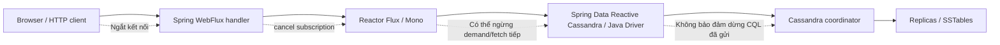
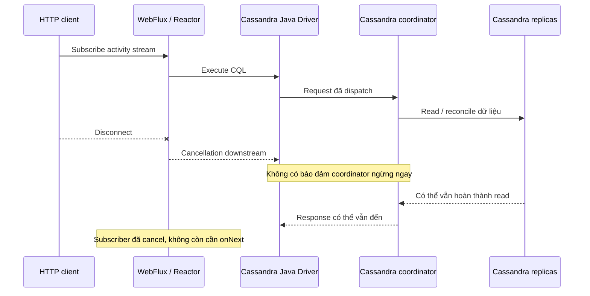
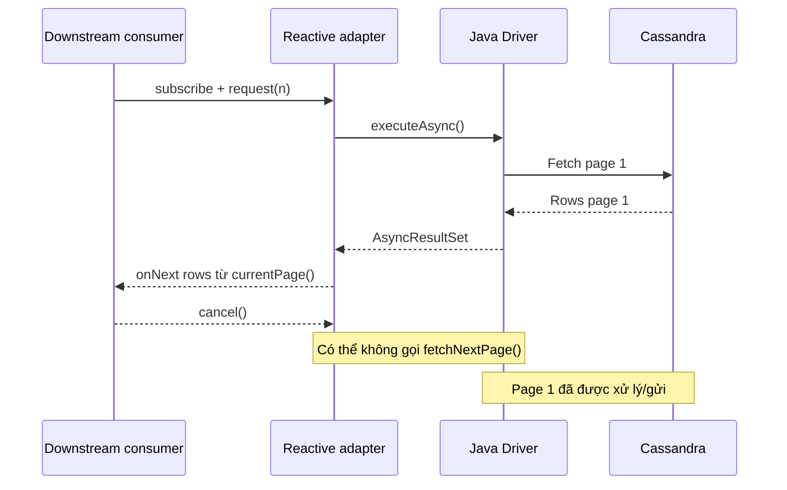
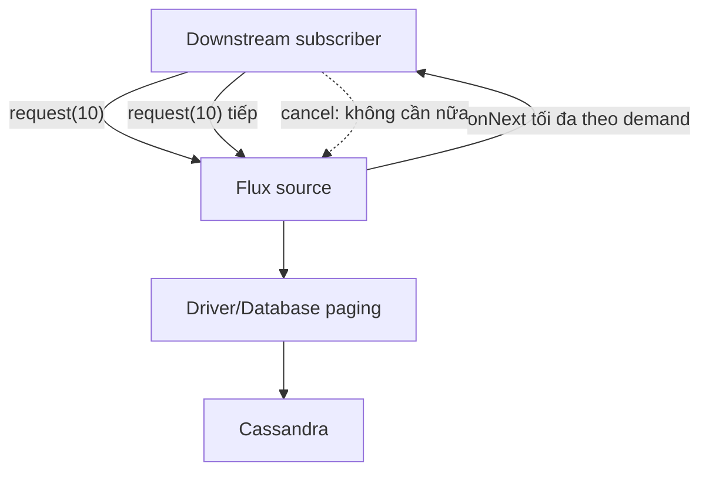

# Hủy đăng ký và giới hạn khả năng hủy tác vụ đang gửi

Trong **Spring Data Cassandra**, một API Reactive có thể trả về `Mono<T>` hoặc `Flux<T>` thay vì chặn thread đến khi Cassandra phản hồi. Một lợi ích của Reactive Streams là **người tiêu thụ có quyền hủy đăng ký** (*cancel subscription*) khi không cần dữ liệu nữa: người dùng đóng tab, client ngắt kết nối, một toán tử `take(20)` đã lấy đủ phần tử, hoặc request vượt quá deadline.

Tuy nhiên, **hủy subscription không đồng nghĩa hủy được tác vụ CQL đã gửi đến Apache Cassandra**. Khi driver đã chuyển câu truy vấn lên mạng, coordinator/replica có thể vẫn xử lý nó. Việc hủy ở Reactor có thể ngăn các tín hiệu tiếp theo được chuyển tới subscriber, giảm fetch/prefetch trong tương lai và giải phóng một số tài nguyên phía client; nó **không phải** lệnh rollback, không phải transaction cancellation và không bảo đảm server dừng đọc/ghi ngay lập tức.

Sự khác biệt này rất quan trọng với truy vấn nhiều trang, hot partition, tombstone-heavy reads và các mutation như `INSERT`, `UPDATE` hoặc counter increments: một request có thể đã thay đổi dữ liệu dù HTTP client không còn chờ phản hồi.

Bài học thuộc chương **Truy cập phản ứng** của module **SPRING_DATA_CASSANDRA**. Phạm vi module là truy cập Apache Cassandra bằng entity mapping, repository, `CassandraTemplate` và CQL; thiết kế bảng theo truy vấn, partition key, consistency, paging và hiệu năng trong hệ phân tán. Bài tập trung trực tiếp vào **“Hủy đăng ký và giới hạn khả năng hủy tác vụ đang gửi”**, phân biệt những lớp có khả năng cancel, cách giữ tài nguyên ở mức an toàn và cách kiểm thử đúng kỳ vọng.

## 1. Mục tiêu học tập

Sau bài này, bạn có thể:

1. Giải thích `Subscription.cancel()` trong Reactive Streams khác gì với hủy request ở HTTP, Java Driver và Cassandra server.
2. Phân biệt **trước khi subscribe**, **sau subscribe nhưng trước lúc gửi CQL**, **sau khi CQL đã gửi** và **sau khi server đã áp dụng mutation**.
3. Dùng Reactor `doOnCancel`, `doFinally`, `take`, `timeout` và `Flux.defer` với ngữ nghĩa đúng.
4. Nhận diện khi một publisher **cold/lazy** và khi code vô tình tạo request **eager/hot** trước lúc được subscribe.
5. Hiểu vì sao `take(1)` hoặc `next()` không bảo đảm Cassandra chỉ đọc một row hay đã dừng xử lý query.
6. Hiểu quan hệ giữa cancellation, **page size**, `AsyncResultSet.fetchNextPage()` và backpressure.
7. Viết ví dụ Spring Data `ReactiveCassandraRepository` và WebFlux mà không gọi `subscribe()` thủ công trong service/controller.
8. Phân biệt hủy read với hủy write; xử lý outcome không chắc chắn, retry và idempotency.
9. Giới hạn request bằng CQL access path, `LIMIT`, page size, deadline, rate limit và concurrency budget.
10. Xây test Reactor kiểm chứng **tín hiệu CANCEL**, đồng thời biết giới hạn của test khi muốn chứng minh Cassandra server đã dừng.
11. Theo dõi metrics cancellation, timeout và requests in-flight mà không nhầm một signal là bằng chứng workload biến mất.
12. Viết một chính sách vận hành khi downstream disconnect hoặc consumer không còn cần kết quả.

## 2. Tình huống xuyên suốt: activity feed của học viên

Ứng dụng có endpoint xem những hoạt động học tập gần đây:

```http
GET /tenants/{tenantId}/students/{studentId}/activities
Accept: text/event-stream
```

Một client mở giao diện và subscribe để nhận các activity items. Sau khi nhận một số sự kiện, người dùng chuyển sang màn hình khác. Browser đóng kết nối. Spring WebFlux có thể phát tín hiệu **cancel** tới subscription của chuỗi Reactive.

Giả sử keyspace `learning` đã được tạo sẵn và bảng đọc như sau:

```sql
CREATE TABLE IF NOT EXISTS learning.activities_by_student (
    tenant_id uuid,
    student_id uuid,
    occurred_at timestamp,
    activity_id uuid,
    activity_type text,
    description text,
    PRIMARY KEY ((tenant_id, student_id), occurred_at, activity_id)
) WITH CLUSTERING ORDER BY (occurred_at DESC, activity_id ASC);
```

| Cột | Vai trò | Ảnh hưởng khi stream/hủy |
| --- | --- | --- |
| `tenant_id` | Partition key 1 | Xác thực phạm vi tenant, định vị partition |
| `student_id` | Partition key 2 | Hủy stream A không được ảnh hưởng query B |
| `occurred_at` | Clustering 1 | Đọc mới nhất trước trong partition |
| `activity_id` | Clustering 2 | Phân biệt sự kiện có cùng thời điểm |
| `activity_type` | Regular column | Dữ liệu trình bày |
| `description` | Regular column | Có thể làm row lớn, ảnh hưởng page size |

Query hợp lệ:

```sql
SELECT occurred_at, activity_id, activity_type, description
FROM learning.activities_by_student
WHERE tenant_id = ?
  AND student_id = ?;
```

Query cung cấp **đầy đủ partition key** và dùng clustering order. Nếu sản phẩm chỉ cần hoạt động bảy ngày gần nhất, thêm range hợp lệ trên `occurred_at`:

```sql
SELECT occurred_at, activity_id, activity_type, description
FROM learning.activities_by_student
WHERE tenant_id = ?
  AND student_id = ?
  AND occurred_at >= ?;
```

**Cancellation không thay query-driven design.** Nếu query bỏ partition key và dùng `ALLOW FILTERING` để scan diện rộng, người dùng đóng trang sau 100 ms không có nghĩa server lập tức ngừng công việc read tốn kém.

### 2.1. Những lúc UI không cần dữ liệu nữa

Có nhiều nguyên nhân:

- Người dùng chuyển route hoặc đóng tab.
- Một request SSE/HTTP streaming bị ngắt.
- Search box thay đổi và UI không cần phản hồi từ query cũ.
- `take(10)` đã nhận đủ 10 phần tử.
- Một pipeline `timeout(Duration.ofSeconds(2))` vượt thời hạn.
- Một downstream service phát hiện dữ liệu không còn được dùng.
- Ứng dụng chủ động huỷ subscription khi shutdown hoặc thay tác vụ.

Các tình huống có thể cùng tạo **cancel signal**, nhưng **không nhất thiết cùng có tác động tại database**.

## 3. Bốn lớp cần phân biệt: Subscriber, Reactor, Driver, Cassandra



| Lớp | Hành động có thể xảy ra | Không được suy ra |
| --- | --- | --- |
| Browser/HTTP | Client không nhận thêm phản hồi | Server chưa ghi dữ liệu |
| WebFlux/Reactor | Subscription bị cancel, downstream ngừng nhận `onNext` | Mọi thao tác async đã chấm dứt |
| Spring Data/Driver | Có thể ngừng phát rows, hủy local future hoặc tránh fetch page chưa cần | Coordinator chắc chắn được thông báo “stop” và ngừng ngay |
| Cassandra coordinator/replicas | Có thể đã đọc, đã trả response hoặc đã áp dụng mutation | Cancellation phía HTTP có rollback |

**Điểm tách rời quan trọng:** Reactive Streams định nghĩa hợp đồng **giữa publisher và subscriber**. Nó không định nghĩa một cơ chế rollback hoặc kill query trong Cassandra.

### 3.1. Tín hiệu nào thuộc Reactive Streams?

Một subscription thường có:

- `onSubscribe(subscription)`: subscriber nhận đối tượng subscription.
- `request(n)`: yêu cầu thêm tối đa n tín hiệu phần tử theo cơ chế demand.
- `onNext(value)`: phần tử được phát.
- `onComplete()`: publisher kết thúc bình thường.
- `onError(error)`: publisher thất bại.
- `cancel()`: subscriber không còn muốn nhận dữ liệu.

**Cancel không phải một terminal signal `onComplete` gửi tới subscriber.** Nó là lời yêu cầu dừng phát theo chiều subscriber → publisher. Code có thể dùng Reactor hooks để quan sát nó, nhưng không nên biến cancel thành “đã thành công” của tác vụ ghi CQL.

### 3.2. Tín hiệu không phải bằng chứng server đã dừng

Một log:

```text
reactor.signal = CANCEL
queryId = student-activity-feed-v1
elapsed = 80 ms
```

chỉ chứng minh pipeline đó đã quan sát cancellation. Nó **không chứng minh** coordinator đã nhận thông điệp hủy, không đo số SSTables được đọc, và không bảo đảm một mutation chưa được áp dụng.

## 4. Vòng đời truy vấn và điểm hủy

Hãy tách request thành bốn giai đoạn.

### 4.1. Giai đoạn A: chưa subscribe

Nếu publisher được tạo **lazy/cold**, chưa có subscription thì chưa cần gửi CQL.

```text
Xây Flux/Mono
  |
  +--> Chưa subscribe
          |
          +--> Chưa có request Cassandra từ publisher lazy
```

Đây là trường hợp application kiểm soát cancellation hiệu quả nhất: **không khởi động công việc chưa cần**.

### 4.2. Giai đoạn B: đã subscribe nhưng chưa dispatch

Sau khi subscribe, framework/driver có thể đang chuẩn bị query, bind statement, đợi connection/concurrency limit hoặc được lập lịch. Nếu cancellation đến **trước khi request CQL được gửi**, implementation có thể tránh dispatch.

Tuy nhiên, giai đoạn này có race: subscription có thể bị cancel ngay khi driver chuẩn bị gửi request. **Không tự khẳng định** cancel trước một log dòng Java nào đó thì CQL chắc chắn chưa rời process.

### 4.3. Giai đoạn C: CQL đã được gửi



Đây là mô hình khái niệm, không khẳng định request cancellation luôn được chuyển thành một message riêng ở protocol. Hành vi cụ thể phụ thuộc driver, version, transport và thời điểm race.

### 4.4. Giai đoạn D: mutation đã được áp dụng

Nếu CQL là `UPDATE` hoặc `INSERT` và replica đã nhận mutation, **hủy subscription không đảo ngược dữ liệu**.

```text
T0: Service subscribe một Mono ghi Cassandra.
T1: Driver gửi UPDATE.
T2: Replica có thể đã áp dụng UPDATE.
T3: HTTP client disconnect; Reactor cancel.
T4: Ứng dụng không nhận kết quả thành công.

Không được kết luận:
  "T3 xảy ra nên UPDATE chắc chắn chưa thực hiện".
```

Đây là nền tảng để thiết kế retry/idempotency cho mọi write theo request HTTP reactive.

## 5. Cold publisher: đừng thực thi CQL trước khi có subscription

Một lỗi thường gặp khi kết hợp Java Driver async với Reactor là **khởi tạo CompletionStage quá sớm**.

### 5.1. Ví dụ eager ngoài ý muốn

```java
// Lời gọi executeAsync xảy ra ngay ở thời điểm tạo stage.
CompletionStage<AsyncResultSet> stage =
    session.executeAsync(statement);

// Dù chưa ai subscribe Mono,
// request Cassandra có thể đã được dispatch.
Mono<AsyncResultSet> result =
    Mono.fromCompletionStage(stage);
```

`Mono.fromCompletionStage(stage)` không khiến một `stage` đã khởi tạo trở lại trạng thái chưa chạy. Nếu HTTP client bỏ request trước khi subscribe mà service đã tạo stage, công việc database vẫn có thể phát sinh.

### 5.2. Dùng defer để tạo request khi subscribe

```java
import reactor.core.publisher.Mono;

Mono<AsyncResultSet> result =
    Mono.defer(() ->
        Mono.fromCompletionStage(
            session.executeAsync(statement)));
```

Ở đây `Flux.defer`/`Mono.defer` làm lời gọi `executeAsync` được thực hiện **khi subscriber đăng ký**.

Tuy vậy, một khi subscribe đã kích hoạt `executeAsync`, việc cancel **không đảo ngược** request đã gửi.

### 5.3. Mỗi subscription có thể tạo một query mới

```java
Mono<AsyncResultSet> query = Mono.defer(() ->
    Mono.fromCompletionStage(session.executeAsync(statement)));

query.subscribe();  // Subscription A: query có thể được gửi.
query.subscribe();  // Subscription B: query có thể được gửi lần nữa.
```

Code chỉ minh họa semantics, **không khuyến khích tự `subscribe()` trong service**. Cold publisher thường phát sinh một execution mới cho mỗi subscription.

Nếu dùng `cache()`, `share()` hoặc chuyển thành hot publisher, quan hệ giữa subscriber và một database request có thể đổi:

- Một subscription cancel không nhất thiết dừng upstream nếu subscriber khác còn dùng.
- Cache có thể giữ kết quả và tài nguyên lâu hơn mong muốn.
- Các toán tử chia sẻ có lifecycle phức tạp khi HTTP clients đến/đi.

**Không dùng `cache()` như một mẹo “chống cancellation”** cho mutation hoặc truy vấn nhạy cảm khi chưa xác định thời gian sống, người dùng/tenant và khả năng lộ dữ liệu.

## 6. Quan sát cancellation bằng Reactor

Reactor có các hook phù hợp:

- `doOnCancel(...)`: callback khi subscription nhận cancel.
- `doFinally(signalType -> ...)`: callback khi chuỗi tại **vị trí đó trong pipeline** kết thúc bằng COMPLETE, ERROR hoặc CANCEL.
- `doOnError(...)`: callback khi có lỗi đi qua.
- `doOnComplete(...)`: callback khi nguồn hoàn thành bình thường.

### 6.1. Ví dụ ghi metrics

```java
import reactor.core.publisher.Flux;
import reactor.core.publisher.SignalType;

Flux<ActivityDto> events = repository
    .findForStudent(tenantId, studentId)
    .map(this::toDto)
    .doOnCancel(() ->
        metrics.increment("activity.stream.cancelled"))
    .doFinally(signal -> {
        if (signal == SignalType.CANCEL) {
            metrics.increment("activity.stream.final.cancel");
        } else if (signal == SignalType.ON_ERROR) {
            metrics.increment("activity.stream.final.error");
        } else if (signal == SignalType.ON_COMPLETE) {
            metrics.increment("activity.stream.final.complete");
        }
    });
```

Đây là đoạn trong class service có `repository`, `metrics`, `toDto` và tham số đã khai báo. Trong production nên dùng tên metrics/tags có cardinality kiểm soát, không đưa UUID học viên/tenant vào label vô hạn.

### 6.2. Vị trí của doFinally làm thay đổi tín hiệu được nhìn thấy

```java
Flux<ActivityDto> source = repository
    .findForStudent(tenantId, studentId)
    .doFinally(signal ->
        record("upstream", signal));

Flux<ActivityDto> firstTen = source
    .take(10)
    .doFinally(signal ->
        record("downstream", signal));
```

Khi `take(10)` lấy đủ phần tử:

- **Upstream** có thể thấy `CANCEL` vì `take` không cần nhận phần tử thứ 11.
- **Downstream sau `take`** thường thấy `ON_COMPLETE`, vì `take` hoàn tất thành công khi đã thu đủ 10 phần tử.

Do đó **không đọc một counter `doFinally(ON_COMPLETE)` ở cuối pipeline rồi kết luận Cassandra đã đọc hết query**. Một operator nằm giữa có thể chủ động cancel upstream sau khi thỏa điều kiện của nó.

### 6.3. Không viết logic nghiệp vụ trong doOnCancel

```java
// Anti-pattern: cancellation không chứng minh ghi Cassandra chưa thành công.
.doOnCancel(() -> refundPayment(orderId))
```

Một callback cancellation không có đủ thông tin để thực hiện hành động bù trừ có ảnh hưởng nghiệp vụ. Nếu viết Cassandra đã thực hiện hoặc đang chạy, cần kiểm tra trạng thái nguồn sự thật và workflow riêng; callback Reactor chỉ nên làm cleanup local và observability phù hợp.

## 7. take, next, timeout và switchMap có thể hủy upstream

### 7.1. take(n)

```java
Flux<ActivityDto> firstTen = repository
    .findForStudent(tenantId, studentId)
    .take(10);
```

`take(10)` chỉ cần 10 phần tử để hoàn thành downstream, vì vậy có thể cancel subscription upstream sau khi đủ.

Nhưng:

- Driver/Cassandra có thể đã fetch một **page lớn hơn 10 rows**.
- Các request CQL hoặc page fetch đang bay không được bảo đảm dừng ngay.
- Phần còn lại của page không được emit không đồng nghĩa server chưa đọc chúng.
- Nếu query vẫn có `ALLOW FILTERING`, `take(10)` không làm index/filter trở nên miễn phí.

### 7.2. next()

```java
Mono<ActivityDto> first = repository
    .findForStudent(tenantId, studentId)
    .map(this::toDto)
    .next();
```

`next()` lấy phần tử đầu tiên rồi không cần luồng tiếp theo. Đối với truy vấn “lấy duy nhất một bản ghi”, **nên thiết kế CQL/primary key và `LIMIT 1` ở server** khi phù hợp, thay vì đọc một query rộng rồi dùng `next()` như chiến lược tối ưu mặc định.

### 7.3. timeout

```java
import java.time.Duration;

Flux<ActivityDto> bounded = repository
    .findForStudent(tenantId, studentId)
    .map(this::toDto)
    .timeout(Duration.ofSeconds(3));
```

`timeout` kích hoạt lỗi timeout ở Reactor nếu nguồn không phát tín hiệu trong khoảng quy định theo semantics của operator. Nó thường **cancel upstream subscription**; downstream nhận lỗi, không phải một phản hồi database bảo đảm chưa thực thi.

Đồng thời cần cấu hình **driver request timeout** và **HTTP/API deadline** phù hợp. Chỉ dùng `Flux.timeout` không chứng minh CQL in-flight đã dừng trên coordinator.

### 7.4. switchMap cho tìm kiếm mới

Khi người dùng đổi filter, `switchMap` có thể bỏ subscription của truy vấn cũ:

```java
Flux<SearchResult> results = searchTerms
    .switchMap(term ->
        searchRepository.find(term));
```

Đoạn là ý tưởng Reactor, trong đó `searchTerms` và `searchRepository` đã được khai báo. Query cũ có thể vẫn đang chạy server-side dù downstream đã chuyển sang term mới.

Với Cassandra, việc cho phép search tùy ý còn cần thiết kế **access path**: `switchMap` chỉ điều phối luồng, không tạo index hoặc full-text search engine.

### 7.5. takeUntil và takeWhile

Những operator dừng theo predicate cũng có thể cancel upstream khi điều kiện thỏa. Tuy nhiên, **dừng phát phần tử** không tự tạo snapshot hoặc token có thể resume từ vị trí bất kỳ. Nếu cần paging giữa HTTP requests, dùng paging state/cursor phù hợp thay vì suy đoán continuation từ số phần tử đã nhận.

## 8. WebFlux: người dùng đóng kết nối thì chuyện gì xảy ra?

Một handler WebFlux có thể trả trực tiếp publisher để framework quản lý subscription.

Ví dụ DTO và repository read path:

```java
import java.time.Instant;
import java.util.UUID;

public record ActivityDto(
        UUID activityId,
        Instant occurredAt,
        String type,
        String description) {
}
```

Entity/primary key của `activities_by_student` cần được ánh xạ đúng như CQL schema, ví dụ `ActivityByStudent` và `StudentActivityKey`.

### 8.1. Reactive repository

```java
import java.util.UUID;
import reactor.core.publisher.Flux;

import org.springframework.data.cassandra.repository.Query;
import org.springframework.data.cassandra.repository.ReactiveCassandraRepository;

public interface ActivityRepository
        extends ReactiveCassandraRepository<
            ActivityByStudent, StudentActivityKey> {

    @Query("""
        SELECT * FROM learning.activities_by_student
        WHERE tenant_id = ?0 AND student_id = ?1
        """)
    Flux<ActivityByStudent> findForStudent(
        UUID tenantId, UUID studentId);
}
```

`@Query` dùng đầy đủ partition key. `ReactiveCassandraRepository` hỗ trợ các truy vấn reactive theo khả năng phiên bản Spring Data Cassandra; tên package, mapping DTO và cấu hình phải được test trên BOM thực tế.

### 8.2. Handler phát Server-Sent Events

```java
import java.util.UUID;

import org.springframework.http.MediaType;
import org.springframework.http.codec.ServerSentEvent;
import org.springframework.web.bind.annotation.GetMapping;
import org.springframework.web.bind.annotation.PathVariable;
import org.springframework.web.bind.annotation.RequestMapping;
import org.springframework.web.bind.annotation.RestController;

import reactor.core.publisher.Flux;
import reactor.core.publisher.SignalType;

@RestController
@RequestMapping("/tenants/{tenantId}/students/{studentId}")
public class ActivityController {

    private final ActivityRepository repository;

    public ActivityController(ActivityRepository repository) {
        this.repository = repository;
    }

    @GetMapping(
        value = "/activities/stream",
        produces = MediaType.TEXT_EVENT_STREAM_VALUE
    )
    public Flux<ServerSentEvent<ActivityDto>> stream(
            @PathVariable UUID tenantId,
            @PathVariable UUID studentId) {

        return repository.findForStudent(tenantId, studentId)
            .map(this::toDto)
            .map(dto -> ServerSentEvent.builder(dto).build())
            .doFinally(signal -> {
                if (signal == SignalType.CANCEL) {
                    // Ghi metrics/log an toàn: stream đã bị cancel.
                }
            });
    }

    private ActivityDto toDto(ActivityByStudent row) {
        return new ActivityDto(
            row.getKey().getActivityId(),
            row.getKey().getOccurredAt(),
            row.getActivityType(),
            row.getDescription()
        );
    }
}
```

Ví dụ giả định entity và key có các getters tương ứng. Trong production cần thêm **authorization** theo tenant/student, giới hạn số hàng/khoảng thời gian, timeout và rate limiting. Không coi đoạn controller là một API đã được bảo vệ đầy đủ.

Khi HTTP client disconnect, WebFlux thường hủy subscription liên quan. Nhưng:

- Một page CQL có thể đã được fetch.
- Network response có thể vẫn đang được driver xử lý.
- Không có bảo đảm coordinator ngừng thực thi ngay.
- `doFinally(CANCEL)` là metrics, không phải database acknowledgement.

### 8.3. Không tự subscribe trong controller

Sai:

```java
@GetMapping("/bad")
public Mono<Void> bad() {
    repository.findAll()
        .subscribe(row -> sendSomewhere(row));

    return Mono.empty();
}
```

Đoạn anti-pattern bỏ qua scope/authorization và làm việc với một subscription **tách khỏi HTTP request**. Nếu client disconnect, framework không còn nắm subscription vừa `subscribe()` thủ công để cancel nó một cách nhất quán. Lỗi cũng khó được trả về cho caller.

Đúng hướng: **trả publisher hoặc kết hợp nó vào publisher trả về** bằng `flatMap`/`then`, không tự `subscribe()` trong request handler trừ khi đang thiết kế một tác vụ nền có lifecycle và ownership riêng.

## 9. Cancellation với Java Driver async và CompletableFuture

Java Driver 4.x có API:

```java
CompletionStage<AsyncResultSet> stage =
    session.executeAsync(boundStatement);
```

Có thể chuyển thành Reactor:

```java
Mono<AsyncResultSet> mono =
    Mono.defer(() ->
        Mono.fromCompletionStage(
            session.executeAsync(boundStatement)));
```

Một số adapter Reactor cố gắng chuyển cancellation tới future/`CompletableFuture` nếu loại stage hỗ trợ. Nhưng **`CompletableFuture.cancel(...)` không đồng nghĩa một giao thức hủy Cassandra query**.

### 9.1. Điều được bảo đảm ở tầng local

Khi cancel:

- Subscriber không còn muốn nhận kết quả.
- Reactor có thể ngừng phát thêm signals cho subscriber đó.
- Driver/adapter có thể đánh dấu local future bị cancel hoặc bỏ qua callback.
- Nếu chưa cần fetch trang tiếp, implementation có thể tránh gọi `fetchNextPage()`.

### 9.2. Điều không được hứa hẹn

Không hứa:

- CQL đã gửi sẽ bị rollback.
- Cassandra coordinator/replicas đã ngừng đọc hoặc ghi.
- Dung lượng network đã sử dụng được thu hồi.
- Mọi query timeout sẽ trở thành `CancellationException`.
- Không có server CPU/I/O nào xảy ra sau thời điểm client cancel.
- Đã hủy thì write chắc chắn thất bại.

Hành vi chi tiết của future cancellation phụ thuộc driver/reactor versions. **Không dựa vào một loại exception để quyết định có nên retry mutation hay không.**

### 9.3. Chú ý race condition

```text
T0: executeAsync được gọi
T1: request được enqueue
T2: downstream cancel
T3: driver gửi hoặc đã gửi request
T4: server xử lý
```

Thứ tự T2/T3 có thể thay đổi giữa các lần chạy, thậm chí dù code Java giống nhau. Một test đơn giản không thể chứng minh một bảo đảm “cancel trước response thì server không làm gì”.

## 10. Cancellation và các trang kết quả

Cassandra trả kết quả theo nhiều page. Java Driver 4.x có:

- `executeAsync(...)` cho page đầu.
- `AsyncResultSet.currentPage()` cho những hàng đang có.
- `AsyncResultSet.hasMorePages()`.
- `AsyncResultSet.fetchNextPage()` cho trang tiếp theo.

Điều này giúp quản lý cancellation một cách **thực dụng**: nếu downstream dừng trước khi cần page 2, ứng dụng có thể **không gọi fetchNextPage**.

### 10.1. Sơ đồ paging



Ở thời điểm cancel, việc giảm tải đáng kể có thể đến từ **không tạo page request tiếp theo**, chứ không phải tin rằng page 1 chưa từng tồn tại.

### 10.2. Adapter từ AsyncResultSet sang Flux

```java
import com.datastax.oss.driver.api.core.CqlSession;
import com.datastax.oss.driver.api.core.cql.AsyncResultSet;
import com.datastax.oss.driver.api.core.cql.BoundStatement;
import com.datastax.oss.driver.api.core.cql.Row;

import reactor.core.publisher.Flux;
import reactor.core.publisher.Mono;

public final class CassandraRowStream {

    private final CqlSession session;

    public CassandraRowStream(CqlSession session) {
        this.session = session;
    }

    public Flux<Row> read(BoundStatement statement) {
        return Flux.defer(() ->
            Mono.fromCompletionStage(
                session.executeAsync(statement))
            .flatMapMany(this::readPage));
    }

    private Flux<Row> readPage(AsyncResultSet page) {
        return Flux.fromIterable(page.currentPage())
            .concatWith(Flux.defer(() ->
                page.hasMorePages()
                    ? Mono.fromCompletionStage(
                        page.fetchNextPage())
                      .flatMapMany(this::readPage)
                    : Flux.empty()));
    }
}
```

**Tại sao ví dụ dùng `defer` hai lần?**

1. `Flux.defer` bên ngoài làm `executeAsync` chạy theo subscription, không eager.
2. `Flux.fromIterable(currentPage())` cho downstream tiêu thụ **rows đã có trong page**.
3. `concatWith` duy trì thứ tự: xử lý page hiện tại rồi đến phần continuation.
4. `Flux.defer` ở nhánh tiếp chỉ gọi `fetchNextPage` khi downstream thực sự cần đi qua ranh giới page.
5. Khi `hasMorePages() == false`, stream hoàn thành.

Đây là adapter **minh họa**, không tuyên bố mỗi lần `request(1)` ở Reactor chỉ khiến Cassandra đọc một row. Server thường fetch một **page** chứa nhiều rows.

### 10.3. Khi take(10) xảy ra giữa page 1

Giả sử page size 100:

```text
Cassandra đã trả page 1: 100 rows.
Downstream: .take(10)
Subscriber nhận 10 rows rồi cancel upstream.

Có thể tránh page 2.
Không thể kết luận Cassandra chỉ đọc 10 rows.
```

Do đó **page size** và số rows cần thiết là hai budget khác nhau. Khi endpoint chỉ muốn 10 hàng, ưu tiên `LIMIT 10`/query thích hợp nếu không cần đọc thêm những rows khác ở các request tiếp theo.

### 10.4. Khi cancel sau khi fetchNextPage đã gọi

Nếu page 2 đang in flight và downstream cancel:

- Adapter có thể ngừng chuyển rows tới subscriber.
- CompletionStage/future có thể được cancel theo cơ chế local.
- Cassandra server vẫn có thể hoàn thành page 2.
- Việc giảm tài nguyên có thể chỉ rõ rệt ở **page 3 trở đi**.

**Không gắn một metric “cancelled 5 queries” với giả định “đã tiết kiệm toàn bộ chi phí của 5 queries”.** Phải đo server-side read workload.

## 11. Paging state và resume không phải cancellation

Một hệ thống có nút “Xem thêm” thường trả **paging state** sau page đầu để client gọi request sau. Việc request HTTP kết thúc bình thường **không phải cancel**.

```text
Request 1:
  executeAsync(query, pagingState=null)
  -> page 1 + nextPagingState
  -> HTTP 200

Request 2:
  executeAsync(cùng query, pagingState=page1.next)
  -> page 2 + nextPagingState
```

Khác với stream SSE bị cancel giữa chừng, đây là **đường phân trang có chủ đích**.

### 11.1. Không dùng cancellation làm cursor

`Subscription.cancel()` không cung cấp offset hay key để biết đã truyền chính xác bao nhiêu rows tới HTTP client. Nếu response bị ngắt sau khi client thấy 7 trong 20 phần tử của một page, một raw paging state trỏ tới **page kế tiếp** có thể bỏ qua 13 rows chưa được client nhận nếu dùng nó một cách máy móc.

Nếu cần resume chính xác từ từng item, phải thiết kế:

- Cursor ứng dụng có buffer/offset trong một page;
- hoặc keyset continuation theo clustering key và thứ tự CQL hợp lệ;
- hoặc workflow checkpoint gắn event ID/sequence theo hợp đồng nghiệp vụ.

**Không biến cancellation bất kỳ thành “đã hoàn tất cả page”.**

### 11.2. Query identity

Paging state gắn với:

- Câu CQL thực tế.
- Các bind values và partition key.
- Điều kiện khoảng thời gian/filter.
- Query version/projection/ordering.
- Ngữ cảnh tenant/student và authorization của API.

Token từ `studentId=A` không được dùng để tiếp tục query của `studentId=B`. Khi downstream cancel và client muốn yêu cầu lại, code vẫn cần xác thực quyền và cursor version, không dùng subscription cũ như một transaction đang treo.

### 11.3. Không có snapshot theo thời gian

Nhiều page không tự tạo một ảnh chụp dữ liệu bất biến. Insert, update, delete, TTL và replica consistency có thể làm kết quả thay đổi giữa hai request.

Hủy giữa chừng rồi bắt đầu đọc lại cũng **không tái tạo chính xác dữ liệu tại thời điểm cũ**. Nếu nghiệp vụ yêu cầu audit snapshot, cần mô hình snapshot/version/event ledger riêng.

## 12. Hủy read và hủy write khác nhau rất nhiều

### 12.1. Read query

Nếu cancellation đến sau khi `SELECT` đã gửi:

- Có thể giảm số page được fetch tiếp.
- Downstream có thể không cần mapper/serializer cho rows tiếp theo.
- Server vẫn có thể đã làm read, consistency reconciliation và scan tombstones cho page đang bay.
- Không có mutation cần rollback, nhưng tài nguyên đã tiêu tốn không nhất thiết được thu hồi.

### 12.2. Write query

Nếu cancellation đến sau khi `INSERT` hoặc `UPDATE` đã gửi:

- Mutation có thể đã được áp dụng trên một hoặc nhiều replicas.
- Client có thể không nhận acknowledgement.
- Retry ngây thơ có thể tạo duplicate event ID/hàng mới, hoặc thêm side effects.
- Cassandra consistency/replication hoạt động theo quy tắc riêng, không theo lifecycle của browser.

Ví dụ:

```java
Mono<AsyncResultSet> write = Mono.defer(() ->
    Mono.fromCompletionStage(
        session.executeAsync(insertStatement)));
```

Nếu browser hủy subscription, **không được** log “ghi thất bại và chưa tồn tại” chỉ từ việc cancel. Cần cơ chế xác nhận kết quả hoặc reconciliation khi outcome không chắc chắn.

### 12.3. Ghi idempotent dựa trên khóa ổn định

Một enrollment nên có `enrollment_id` được tạo **trước khi gửi request**, giữ nguyên khi retry. Nếu mỗi lần timeout/cancel lại tạo UUID khác, Cassandra coi đó là một hàng mới.

Tương tự, nếu CQL có TTL, việc gửi lại có thể thay đổi expiration semantics; nếu dùng write timestamps, concurrent versions có thể ảnh hưởng LWW. **Idempotency không chỉ là một annotation của framework.**

### 12.4. Counter update là ví dụ nguy hiểm

```sql
UPDATE learning.course_view_counters
SET views = views + 1
WHERE tenant_id = ?
  AND course_id = ?;
```

Counter increment **không idempotent**. Nếu request đã đến Cassandra, client cancel/timeout và tự động retry, lượt xem có thể tăng hai lần.

Không dùng `onErrorRetry`, `retryWhen` hoặc HTTP retry tự động cho counter increment mà chưa có chiến lược đảm bảo sự kiện được xử lý đúng mức chấp nhận của sản phẩm. Một `COUNTER BATCH` cũng không tạo exactly-once.

## 13. timeout: hủy ở lớp nào?

Một ứng dụng có thể có nhiều timeout:

| Cơ chế | Phạm vi | Không bảo đảm |
| --- | --- | --- |
| HTTP client timeout | Client ngừng đợi response | Cassandra query không chạy |
| Reverse proxy/gateway timeout | Kết nối client–server đóng | Driver đã dừng CQL |
| Reactor `timeout(Duration)` | Nguồn không phát tín hiệu trong khoảng quy định | Server đã abort request |
| Java Driver request timeout | Deadline ở tầng request driver | Mutation chưa áp dụng |
| Cassandra server-side timeouts | Giới hạn công việc/đợi trên server theo cấu hình | Đã rollback mọi mutation ở nhiều replica |
| Business deadline | Hạn phục vụ một tác vụ | Mọi subtask tự được dừng nếu code không truyền budget |

### 13.1. Ví dụ timeout có vị trí doFinally rõ ràng

```java
Flux<ActivityDto> upstream =
    repository.findForStudent(tenantId, studentId)
        .map(this::toDto)
        .doFinally(signal ->
            metrics.recordUpstreamSignal(signal));

Flux<ActivityDto> response =
    upstream.timeout(Duration.ofSeconds(2))
        .doOnError(TimeoutException.class,
            error -> metrics.increment("activity.timeout"));
```

Phải import `Duration` và `TimeoutException`. Nếu `timeout` xảy ra, operator có thể **cancel upstream** để thay bằng `onError` downstream; do đó hook `doFinally` **ở upstream** có thể thấy CANCEL, còn downstream quan sát lỗi.

Không xem số lượng `doFinally(CANCEL)` bằng số server-side query bị kill. Đó là hai đại lượng khác nhau.

### 13.2. Một deadline không nên tạo retry storm

Khi nhiều requests cùng timeout, mã sau rất nguy hiểm:

```java
// Anti-pattern: retry nóng vô hạn ở thời điểm cluster quá tải.
repository.findForStudent(tenantId, studentId)
    .timeout(Duration.ofMillis(100))
    .retry();
```

Nếu Cassandra đang chậm, retry vô hạn tạo thêm công việc, làm backlog và p99 tệ hơn.

Chính sách tốt hơn:

- Đặt giới hạn số lần retry nhỏ nếu retry thật sự an toàn.
- Dùng backoff có jitter và concurrency cap.
- Không retry non-idempotent writes một cách tự động.
- Quan sát `pending requests` và overload của Cassandra.
- Trả lỗi API rõ ràng khi budget đã hết.
- Dùng circuit breaker/load shedding theo yêu cầu vận hành.

### 13.3. Cancellation và server-side timeouts bổ sung cho nhau

Cancellation giúp giảm công việc ở **những phần chưa bắt đầu**. Driver/server timeouts giới hạn công việc **đã được gửi** theo cơ chế của chúng. Cùng với `LIMIT`, partition-key restrictions, page size và concurrency controls, đây là các lớp bảo vệ bổ sung, không thay thế nhau.

## 14. Backpressure khác cancellation

**Backpressure** cho phép downstream kiểm soát lượng dữ liệu muốn nhận trong một thời điểm. **Cancellation** cho biết downstream không cần dữ liệu nữa.



Cần phân biệt:

- `request(1)` không có nghĩa Java Driver gửi một CQL request chỉ đọc một row.
- Page size có thể khiến driver/server đã xử lý nhiều hàng cùng lúc.
- `limitRate` điều tiết demand trong Reactor, không đổi CQL `LIMIT`.
- `onBackpressureBuffer` có thể làm tăng memory nếu không có giới hạn.
- `cancel` ngừng subscription, không bảo đảm hủy CQL đã dispatch.

### 14.1. Một consumer xử lý chậm

```text
Cassandra fetch page: 100 rows
Downstream HTTP: gửi 10 rows/giây

Nếu producer tiếp tục fetch page 2, 3, 4 ... ngay:
  Buffer có thể tăng nhanh.

Nếu producer chỉ fetch page mới khi page cũ đã tiêu thụ:
  Memory và in-flight requests dễ khống chế hơn.
```

Với `Flux` từ Java Driver, cần giữ cơ chế continuation **lazy**; với reactive repository, cần biết implementation paging/prefetch của phiên bản đang dùng.

### 14.2. Không dùng onBackpressureBuffer vô hạn

```java
// Anti-pattern nếu upstream nhanh hơn consumer trong thời gian dài.
Flux<ActivityDto> queued =
    source.onBackpressureBuffer();
```

Buffer vô hạn có thể gây áp lực heap. Nếu cần buffer, đặt dung lượng, overflow strategy và xem xét dropping có chấp nhận được không (đối với sự kiện nghiệp vụ thường không được tự ý làm mất dữ liệu).

### 14.3. Số request đồng thời

Đối với một danh sách nhiều học viên:

```java
Flux<ActivityDto> all = Flux.fromIterable(studentIds)
    .flatMap(id ->
        repository.findForStudent(tenantId, id)
                  .map(this::toDto),
        8
    );
```

Giá trị `8` là concurrency **minh họa**, cần benchmark. Không tạo một triệu queries in-flight chỉ vì tất cả đều reactive. Một query cancel có thể không dừng request đã gửi; nếu hệ thống thường xuyên tạo rồi cancel nhiều requests, nó vẫn gây tải Cassandra.

## 15. Giới hạn chi phí ở phía CQL trước khi nghĩ đến cancel

Cancellation không thay được những kiểm soát cơ bản:

1. **Partition key đầy đủ** để tránh scan diện rộng.
2. **Clustering restrictions** khi chỉ cần một khoảng thời gian.
3. **`LIMIT`** hợp lệ khi chỉ cần một số hàng tối đa.
4. **Page size** hợp lý với kích thước row và SLA.
5. **Index/SAI** chỉ khi phù hợp server version, selectivity và workload.
6. **Không dựa vào `ALLOW FILTERING`** cho hot path.
7. **Time bucket/shard** nếu partition trở nên quá lớn hoặc quá nóng.
8. **Request timeout/deadline** ở nhiều lớp.
9. **Concurrency limit** theo API/tenant/query type.
10. **Observability** đo workload thực tế.

### 15.1. Vì sao LIMIT quan trọng?

Nếu API chỉ muốn 20 activity items:

```sql
SELECT occurred_at, activity_id, activity_type
FROM learning.activities_by_student
WHERE tenant_id = ?
  AND student_id = ?
LIMIT 20;
```

Câu CQL giới hạn **tổng số hàng kết quả**, trước khi Reactor có thể phát hàng đầu tiên. Nó là một budget phía query, không phải chỉ `.take(20)` ở application.

Tuy nhiên, `LIMIT 20` **không bảo đảm Cassandra chỉ kiểm tra 20 cells/tombstones**. Nếu read phải đi qua nhiều deletion markers, query vẫn có thể chậm.

### 15.2. Page size và LIMIT không giống nhau

| Cấu hình | Ý nghĩa |
| --- | --- |
| `setPageSize(20)` | Mục tiêu ~20 hàng cho một lần fetch |
| CQL `LIMIT 20` | Tổng query tối đa 20 hàng sống trả về |
| Reactor `take(20)` | Downstream chỉ muốn 20 tín hiệu phần tử |
| Reactor `timeout(2s)` | Ngừng chờ tín hiệu theo timeout operator |
| HTTP disconnect | Không còn subscriber/client mong nhận response |

Một API có thể dùng nhiều lớp cùng lúc. Nhưng **không cái nào một mình chứng minh server ngừng làm mọi việc ngay khi cancel**.

## 16. Những operator dễ làm đứt mối liên hệ với HTTP lifecycle

### 16.1. subscribe thủ công

```java
// Sai khi không có lifecycle độc lập quản lý.
void startRead() {
    repository.findForStudent(tenantId, studentId)
        .subscribe(this::publishEvent);
}
```

Subscription được tạo tách rời caller. Nếu HTTP request trả về trước khi nguồn hoàn thành, framework không tự biết để hủy hoặc xử lý lỗi như mong muốn.

### 16.2. cache, share, publish, replay

Những operator chia sẻ có thể làm nhiều subscribers dùng chung upstream, hoặc giữ dữ liệu cho subscriber đến sau. Khi **một** subscriber cancel, upstream có thể tiếp tục để phục vụ subscriber khác; đó có thể là behavior hợp lệ.

Nhưng với dữ liệu đa tenant, **cache keys và quyền truy cập** phải được thiết kế cực kỳ cẩn thận. Không dùng một global `Flux.cache()` cho query chứa dữ liệu học viên mà không có scoping/expiry/access control.

### 16.3. flatMap không giới hạn

`flatMap` có thể tạo nhiều subscriptions con. Cancel ở bên ngoài có thể khiến các nguồn con được cancel, nhưng requests Cassandra đã dispatch bởi từng nguồn con vẫn có thể đang in-flight.

Do đó số request đang bay **trước thời điểm cancel** vẫn có thể lớn. Giới hạn concurrency từ đầu là biện pháp hữu ích hơn kỳ vọng cancel xử lý overload sau đó.

### 16.4. retryWhen và repeat

`retryWhen`/`repeat` tạo subscription mới tới source. Với một cold publisher chứa CQL, mỗi subscription có thể là một **query execution mới**.

Không dùng retry vô hạn để “tự hồi phục cancellation”. Cancel thường là người dùng không muốn kết quả nữa; retry chỉ phù hợp cho các lỗi có chính sách rõ, không phù hợp để chống việc downstream chủ động ngừng nhận.

## 17. Đọc kết quả dài: dừng đúng, không ngốn bộ nhớ

Một pipeline đọc nhiều page thường cần:

- Phát từng row, không `collectList()` toàn bộ.
- Fetch trang kế khi demand thực sự cần.
- Xử lý lỗi page N rõ ràng.
- Giới hạn số hàng/page/deadline.
- Có checkpoint nếu muốn resume.
- Không dùng cancel làm checkpoint.

### 17.1. Mẫu stream có giới hạn số item

```java
Flux<ActivityDto> limited = rowStream
    .read(boundStatement)
    .map(this::toDto)
    .take(500);
```

`take(500)` bảo vệ số item downstream nhận, nhưng **không đủ** để cam kết tối đa 500 rows được Cassandra đọc hoặc dừng mọi page request đang bay. Nếu chỉ cần tối đa 500 hàng từ server, bổ sung `LIMIT 500` trong CQL theo access path phù hợp.

### 17.2. Không collectList một query không giới hạn

```java
// Nguy cơ heap nếu partition có hàng triệu rows.
Mono<List<ActivityDto>> all =
    repository.findForStudent(tenantId, studentId)
              .map(this::toDto)
              .collectList();
```

Dù request bị cancel sau một thời gian, heap có thể đã tích lũy lượng lớn dữ liệu trước đó. Với exports, nên dùng **async sink có backpressure/checkpoint** thay vì một list.

### 17.3. Cancellation và xuất dữ liệu ra bên ngoài

Nếu mỗi row được gửi tới Kafka/object storage, cancel sau page 3 có thể để lại những side effects đã hoàn tất:

```text
Page 1 -> sink thành công
Page 2 -> sink thành công
Page 3 -> sink ghi một phần
Downstream cancel

Không được coi toàn bộ export đã rollback.
```

Cần event IDs, checkpoint, idempotent sink hoặc khả năng resume từ một mốc có ngữ nghĩa rõ. Cassandra paging state không tự tạo transaction xuyên Cassandra và downstream sink.

## 18. Bảng chính sách: hủy khi nào, làm gì?

| Tình huống | Hành vi ở reactive layer | Hành động nên làm ở ứng dụng |
| --- | --- | --- |
| Chưa subscribe | Không khởi động query nếu cold | Dùng `defer` và kiểm tra lifecycle |
| Client đóng SSE | Cancel subscription | Ghi metric, không fetch thêm khi có thể |
| `take(20)` đủ items | Cancel upstream | Dùng `LIMIT 20` khi đúng yêu cầu |
| `timeout` ở Reactor | Cancel upstream, phát lỗi downstream | Kiểm tra driver timeout, trả HTTP status phù hợp |
| Read page N đang bay | Có thể bỏ kết quả local | Không cam kết server đã abort |
| Write đang bay | Outcome không chắc chắn | Dùng event ID ổn định, đối soát/retry có kiểm soát |
| Counter increment | Có thể đã tăng | Không retry mù vì non-idempotent |
| Consumer chậm | Demand ít | Backpressure và page/concurrency budgets |
| Nhiều subscribers dùng share/cache | Một subscriber cancel có thể không dừng upstream | Quản lý cache/session/tenant scope |
| Service shutdown | Dispose subscriptions, đóng resources theo lifecycle | Chờ/drain có hạn các writes quan trọng |
| Query hot partition | Cancel có thể giảm fetch tương lai | Sửa partition/access path, đo p99 |
| Tombstone-heavy query | Client không còn cần rows | Giới hạn query, TTL/compaction và observability |

## 19. Quan sát và đo đúng tác dụng của cancellation

Không nên có một dashboard chỉ hiển thị “đã cancel 10.000 queries” rồi suy ra đã tiết kiệm 10.000 CQL executions.

Các chỉ số cần đối chiếu:

| Chỉ số | Cho biết điều gì? |
| --- | --- |
| Subscription started/cancelled/completed/errored | Lifecycle ở Reactor |
| Number of CQL requests dispatched | Bao nhiêu request thực sự đã gửi |
| In-flight requests sau cancel | Có bao nhiêu request đang chạy tại driver |
| Pages fetched per subscription | Cancel có ngăn future paging không |
| Rows emitted và rows fetched | Khoảng cách giữa nhu cầu client và dữ liệu đã đọc |
| Driver request latency p95/p99 | Cassandra requests có thực sự nhẹ hơn không |
| Server read/write latency | Tải thực tế phía cluster |
| Tombstone scans, SSTables per read | Query có read amplification không |
| Timeout, Unavailable, overloaded errors | Cluster có bị quá tải không |
| Retry count | Cancellation/timeout có tạo request bổ sung không |
| CPU, heap, network | Tải có giảm thực sự không |
| Write discrepancy/reconciliation | Mutation đã gửi có outcome không chắc chắn |

### 19.1. Không đưa tenant/student vào metric tags vô hạn

Dùng query ID như `activities-by-student-v1` và những tags có cardinality giới hạn. Không dùng mỗi UUID học viên làm Prometheus label; số series có thể tăng không kiểm soát.

### 19.2. Phân biệt thời gian hủy

Ghi nhận các mốc:

```text
subscriptionCreatedAt
queryDispatchedAt
cancelObservedAt
driverResponseAt (nếu có)
serverDuration / driverLatency (nếu được đo)
```

Một số mốc không có vì cancellation xảy ra sớm hoặc vì metrics không có sẵn. **Không bịa giá trị thời gian server hoàn thành** từ timestamp của hook `doOnCancel`.

### 19.3. Tracing có kiểm soát

Cassandra tracing có thể hỗ trợ điều tra query tốn kém, nhưng tracing tạo overhead. Hãy dùng sampling trong test hoặc production có kiểm soát, nhất là khi đang kiểm tra tombstone-heavy reads.

Log một query fingerprint, page number, statement type, latency và error class thường hữu ích hơn log raw CQL với bind values chứa PII.

## 20. Test cancellation ở Reactor: cần chứng minh điều gì?

Một test tốt cần nêu rõ **phạm vi kỳ vọng**:

1. Khi subscriber cancel, hook `doOnCancel` nhận tín hiệu.
2. Không có `onNext` được phát tiếp tới subscriber đã cancel.
3. Một publisher lazy chưa subscribe không thực thi query.
4. Với adapter page-by-page, cancel trước khi cần page 2 không chủ động gọi fetch page 2.
5. Lỗi timeout được chuyển thành `onError` theo contract.
6. Không tự động retry non-idempotent write.
7. Test **không** khẳng định Cassandra server đã dừng chỉ vì hook cancel chạy.

### 20.1. Unit test doOnCancel bằng StepVerifier

```java
import static org.assertj.core.api.Assertions.assertThat;

import java.util.concurrent.atomic.AtomicBoolean;

import org.junit.jupiter.api.Test;

import reactor.core.publisher.Flux;
import reactor.test.StepVerifier;
import reactor.test.publisher.TestPublisher;

class CancellationTest {

    @Test
    void cancellationInvokesHook() {
        AtomicBoolean wasCancelled = new AtomicBoolean();

        TestPublisher<String> publisher =
            TestPublisher.create();

        Flux<String> stream = publisher.flux()
            .doOnCancel(() -> wasCancelled.set(true));

        StepVerifier.create(stream, 1)
            .then(() -> publisher.next("first"))
            .expectNext("first")
            .thenCancel()
            .verify();

        assertThat(wasCancelled).isTrue();
    }
}
```

Test này chứng minh **signal handling tại Reactor**, không chứng minh Cassandra nhận được lệnh kill query.

### 20.2. Test laziness bằng Mono.defer

```java
import static org.assertj.core.api.Assertions.assertThat;

import java.util.concurrent.atomic.AtomicInteger;

import reactor.core.publisher.Mono;
import reactor.test.StepVerifier;

AtomicInteger executions = new AtomicInteger();

Mono<String> lazyQuery = Mono.defer(() -> {
    executions.incrementAndGet();
    return Mono.just("ok");
});

assertThat(executions.get()).isZero();

StepVerifier.create(lazyQuery)
    .expectNext("ok")
    .verifyComplete();

assertThat(executions.get()).isEqualTo(1);
```

Đoạn là thân test trong class phù hợp, không cần CqlSession. Nó chứng minh `defer` giúp hoãn code tạo nguồn cho tới subscription. Với driver thật, còn cần xem implementation gọi `executeAsync` bên trong `defer` có dispatch ra network đúng như dự kiến hay không.

### 20.3. Test vị trí doFinally với take

```java
import java.util.concurrent.atomic.AtomicReference;

import reactor.core.publisher.Flux;
import reactor.core.publisher.SignalType;
import reactor.test.StepVerifier;

AtomicReference<SignalType> upstream =
    new AtomicReference<>();

AtomicReference<SignalType> downstream =
    new AtomicReference<>();

Flux<Integer> source = Flux.range(1, 100)
    .doFinally(upstream::set)
    .take(3)
    .doFinally(downstream::set);

StepVerifier.create(source)
    .expectNext(1, 2, 3)
    .verifyComplete();

// Upstream được cancel khi take đủ 3.
// Downstream hoàn thành bình thường.
// Khi dùng doFinally, thứ tự callbacks có thể khiến
// việc đọc trạng thái tức thời cần đồng bộ/đợi trong test.
```

Ví dụ có thể mở rộng bằng Awaitility hoặc cơ chế chờ có giới hạn trước khi assert vào `AtomicReference`. **Điều cần học:** hook nằm hai phía `take` có thể nhận các signal khác nhau.

## 21. Test tích hợp trên Cassandra thật

Một test mock Flux không kiểm tra được CQL, partition key, page size, paging state, replica behavior hoặc driver cancellation internals. Cần **integration test** với Apache Cassandra thật, ví dụ Testcontainers.

### 21.1. Fixture phù hợp

1. Tạo keyspace `learning`.
2. Tạo bảng `activities_by_student` bằng migration.
3. Seed 50–100 hoạt động cho cùng `(tenantId, studentId)` với `occurred_at` khác nhau.
4. Seed hoạt động của student khác và tenant khác.
5. Dùng page size nhỏ, ví dụ 5 hoặc 10, để có nhiều page.
6. Gọi repository/adapter, xác minh rows đúng partition và clustering order.
7. Test `take(3)` chỉ phát 3 items tới subscriber.
8. Instrument adapter để đếm lần gọi `fetchNextPage`.
9. Khi cancel trước khi cần page tiếp, xác minh **code không chủ động fetch thêm**.
10. Thử timeout, mapper error và cancellation trong lúc page N đang bay.
11. Đo latency/in-flight requests, không chỉ số items.
12. Không kết luận server-side query kill từ số lần `doOnCancel`.

### 21.2. Test giới hạn phát rows

```java
import static org.assertj.core.api.Assertions.assertThat;

import java.util.List;

import reactor.test.StepVerifier;

List<ActivityByStudent> emitted = repository
    .findForStudent(tenantId, studentId)
    .take(3)
    .collectList()
    .block(java.time.Duration.ofSeconds(10));

assertThat(emitted).hasSize(3);
```

Đây là **ví dụ trong test thread**: `block(Duration)` có thể chấp nhận cho test tích hợp có timeout, không dùng trong controller/reactive event loop production.

Test trên chứng minh subscriber nhận ba rows (khi fixture có đủ), **không chứng minh Cassandra đã đọc đúng ba rows**. Với Testcontainers một node, không thể suy ra tác động cancellation trên coordinator nhiều node.

### 21.3. Test ngắt HTTP với WebTestClient

Có thể dùng WebTestClient subscribe tới endpoint SSE rồi dispose/cancel client stream, quan sát:

- Hook `doFinally(CANCEL)` tại pipeline WebFlux.
- Không có rows mới được nhận sau khi client dừng.
- Số page fetch sau cancel không tăng không kiểm soát.
- Không có error log cấp nghiêm trọng vô lý chỉ vì client đóng kết nối.

Dùng một test có deadline, fixture hữu hạn và instrumentation. **Đừng tạo test dựa trên việc “coordinator chắc chắn phải dừng đọc trong 100 ms”**, vì không có contract đó.

### 21.4. Test write với outcome không chắc chắn

Với một mutation có event ID ổn định:

1. Phát một ghi qua publisher lazy.
2. Mô phỏng hủy sau lúc dispatch, trước khi response hoàn thành.
3. Kiểm tra service không tự kết luận ghi chưa xảy ra.
4. Đọc lại theo primary key hoặc dùng reconciliation để xác nhận trạng thái thực tế.
5. Test retry dùng cùng ID, không sinh ID mới.
6. Nếu test counter increment, xác minh policy **không tự retry**.
7. Không gây network failure trên production để kiểm chứng.

**Giới hạn:** một test mô phỏng hủy không tạo bảo đảm rằng mọi timing race ngoài production đều tái hiện. Cần policy đúng ngay cả khi không thể biết chắc kết quả cuối cùng từ cancellation alone.

## 22. Tình huống thực tế và cách xử lý

### Tình huống A: người dùng chuyển trang khi đang tải feed

- API reactive đọc nhiều activity rows.
- Browser đóng kết nối sau vài chục items.
- Reactor phát cancel.

**Cách làm:** không tự subscribe, dùng cursor/page budgets, tránh fetch thêm nếu chưa cần, ghi metrics. Không khẳng định server đã ngừng truy vấn ngay.

### Tình huống B: autocomplete đổi từ khóa rất nhanh

- UI phát nhiều term.
- `switchMap` chỉ giữ kết quả term mới.
- Các queries cũ có thể vẫn được dispatch.

**Cách làm:** debounce và distinct ở UI/service, giới hạn concurrency, dùng access path thích hợp. Cancellation giúp giảm phần không dùng, nhưng không thay rate limiting.

### Tình huống C: take(1) trên partition lớn

- Query có hàng triệu rows.
- Java code dùng `Flux.next()`.
- Cassandra vẫn có thể fetch cả page đầu và làm read amplification.

**Cách làm:** chọn clustering query và `LIMIT 1`, xác định partition key và tránh scan/filter.

### Tình huống D: HTTP timeout khi đang ghi enrollment

- Client không nhận ACK.
- Service có thể đã gửi INSERT.
- Browser retry request.

**Cách làm:** dùng enrollment ID ổn định, idempotency, kiểm tra trạng thái nguồn sự thật và xử lý outcome chưa chắc chắn. Không gắn cancellation với rollback.

### Tình huống E: cập nhật counter lượt xem

- Increment `views + 1` được gửi.
- HTTP disconnect.
- Framework tự retry.

**Cách làm:** không retry non-idempotent counter increment mù quáng; cân nhắc event ledger, dedup/reconciliation nếu cần độ chính xác.

### Tình huống F: stream dữ liệu cho một sink chậm

- Sink xử lý 100 rows/s.
- Cassandra fetch rất nhanh.

**Cách làm:** backpressure, page size phù hợp, giới hạn request đang bay và chỉ fetch page kế khi sink sẵn sàng. Cancellation chỉ có ích khi downstream không còn cần dữ liệu.

### Tình huống G: dữ liệu có nhiều tombstone

- Query `LIMIT 20` vẫn mất nhiều giây.
- Client timeout và cancel.
- Server có thể vẫn xử lý read đã gửi.

**Cách làm:** xem warning/metrics/tombstone scans; sửa retention, partition và compaction theo workload. Không tăng page size hoặc thêm `take` như “thuốc chữa”.

### Tình huống H: hai subscriber share cùng Flux

- Subscriber A cancel.
- Subscriber B vẫn đang nghe.
- Upstream có thể vẫn chạy.

**Cách làm:** xác định hot/cold semantics của publisher, isolation giữa tenants và lifecycle của cache/share. Một cancel không nhất thiết đủ để dừng tài nguyên chung.

## 23. Anti-pattern và xử lý lỗi

| Hiện tượng | Sai lầm thường gặp | Hướng sửa |
| --- | --- | --- |
| Client đóng tab nhưng Cassandra vẫn có tải | CQL đã gửi, cancel chỉ ở downstream | Giới hạn query, pages, deadline, concurrency |
| `doFinally(CANCEL)` bị hiểu là rollback | Đồng nhất signal với database outcome | Tách signal metrics khỏi write reconciliation |
| `take(10)` vẫn có nhiều rows được fetch | Server fetch theo page | Giảm page size hoặc dùng CQL LIMIT |
| `next()` trên query rất rộng | Dừng downstream quá muộn | Thiết kế CQL theo khóa và LIMIT 1 |
| Query chạy trước khi subscribe | Tạo CompletionStage eager | Bọc `executeAsync` trong `defer` |
| Service tự `subscribe()` rồi trả Mono.empty | Subscription tách HTTP lifecycle | Trả publisher và compose |
| Hủy một subscriber không dừng upstream | `cache/share` hoặc nhiều subscribers | Định nghĩa sharing/cancel policy |
| `timeout` bị xem là query đã chết | Timeout chỉ ở reactive layer | Driver/server timeouts và metrics |
| Client retry sau cancel tạo duplicate | Không có stable event key | Idempotency/reconciliation |
| Counter tăng hai lần | Retry non-idempotent increment | Không retry mù; event processing đúng |
| `onBackpressureBuffer()` làm heap tăng | Buffer vô hạn | Dùng capacity/overflow strategy |
| `flatMap` tạo hàng nghìn query | Không giới hạn concurrency | Bounded concurrency và rate limiting |
| Page 2 vẫn được fetch sau cancel | Fetch đã bắt đầu/in-flight | Không prefetch vô hạn; quan sát request lifecycle |
| Một page rỗng làm dừng | Nhầm empty page với end | Dùng `hasMorePages`/continuation |
| Cắt HTTP response ở giữa page rồi resume sai | Raw paging state không chứa vị trí trong page | Cursor ứng dụng có buffer/keyset |
| Spring Data reactive bị cho là scan nhanh hơn | Non-blocking không thay access path | Query-driven design và partition key |
| Caching Flux lẫn tenant | Key/cache scope không theo quyền | Tenant/user scoping và TTL |
| StepVerifier PASS nhưng server vẫn xử lý | Test chỉ thấy local signal | Phân biệt unit test và server metrics |
| `retryWhen` làm cluster quá tải | Retry storm khi timeout | Backoff, cap, circuit breaker |
| Missing data khi downstream cancel | Tác vụ xuất đã có side effects một phần | Checkpoint và idempotent sink |

### 23.1. Quy trình chẩn đoán

1. Xác định request là **READ** hay **WRITE**.
2. Xác định CQL được tạo **khi nào**: lúc tạo publisher hay lúc subscribe.
3. Kiểm tra có `subscribe()` thủ công, `cache/share` hoặc eager stage không.
4. Đặt `doOnCancel`/`doFinally` đúng vị trí để thấy signal.
5. Đo số CQL requests **đã dispatch**, không chỉ số subscription canceled.
6. Kiểm tra page size, `LIMIT`, partition key và clustering restrictions.
7. Kiểm tra in-flight requests, latency, warnings và server-side metrics.
8. Xem timeout đang ở HTTP, Reactor, driver hay Cassandra.
9. Với writes, tìm event ID và trạng thái thực tế trước khi quyết định retry.
10. Tái hiện bằng unit test Reactor rồi integration test Cassandra.
11. Thay đổi concurrency/budget và đo lại dưới tải dự kiến.
12. Không hứa cancellation mạnh hơn điều mà driver/server thực sự cung cấp.

## 24. Bài tập thực hành

Cho bảng:

```sql
CREATE TABLE learning.messages_by_conversation (
    tenant_id uuid,
    conversation_id uuid,
    sent_at timestamp,
    message_id uuid,
    sender_id uuid,
    body text,
    PRIMARY KEY ((tenant_id, conversation_id), sent_at, message_id)
) WITH CLUSTERING ORDER BY (sent_at DESC, message_id ASC);
```

Service có endpoint streaming:

```http
GET /tenants/{tenantId}/conversations/{conversationId}/messages/stream
Accept: text/event-stream
```

Và một endpoint tạo tin nhắn bằng CQL `INSERT`.

Hãy trả lời:

1. Partition key của bảng là gì?
2. Vì sao query chỉ có `WHERE conversation_id = ?` không đủ?
3. Khi client đóng SSE, Reactive Streams thường phát tín hiệu nào?
4. `Subscription.cancel()` có trực tiếp là lệnh rollback Cassandra không?
5. Nếu client cancel **trước khi subscribe** một publisher tạo bằng `Flux.defer`, Cassandra đã phải được gọi chưa?
6. Nếu `session.executeAsync(...)` chạy **trước** `Mono.fromCompletionStage(...)`, tại sao cancellation sau đó khó ngăn dispatch?
7. `doOnCancel` khác `doOnComplete` như thế nào?
8. Vì sao `doFinally` ở hai phía `take(5)` có thể thấy tín hiệu khác nhau?
9. Khi `take(5)` đủ items, Cassandra có chắc chỉ đã đọc 5 rows không?
10. CQL `LIMIT 5` khác Reactor `take(5)` như thế nào?
11. Nếu page size 100, `take(5)` có thể giảm công việc của page 1 đến mức nào?
12. Tại sao không được xem `CompletableFuture.cancel` là “server query kill”?
13. Với `AsyncResultSet`, hủy trước khi gọi `fetchNextPage` có thể tiết kiệm phần công việc nào?
14. Nếu page 2 đã in-flight lúc cancel, điều gì có thể vẫn xảy ra?
15. `switchMap` hỗ trợ trải nghiệm search mới ra sao và tại sao query cũ vẫn có thể tốn tài nguyên?
16. Khi `Flux.timeout` xảy ra, downstream nhận `onError` hay `onComplete`?
17. Timeout phía Reactor có thay thế driver request timeout không?
18. Vì sao gọi `subscribe()` trong controller làm khó quản lý lifecycle?
19. Với `cache/share`, một subscriber cancel có chắc dừng upstream dùng chung không?
20. Backpressure `request(1)` có nghĩa Cassandra chỉ đọc một row không?
21. Vì sao `collectList()` có thể phá lợi ích streaming?
22. Khi client cancel sau khi INSERT đã gửi, có thể kết luận tin nhắn chưa tồn tại không?
23. Nếu HTTP retry sinh `message_id` mới, sự cố gì có thể xảy ra?
24. Vì sao counter increment có rủi ro hơn một upsert cùng primary key khi retry?
25. Nếu một response dừng sau 7 trong 20 rows đã fetch, raw paging state có đủ để resume chính xác từ row thứ 8 không?
26. Cancellation có tạo snapshot cố định giữa các trang không?
27. Các metrics nào giúp phân biệt cancel local và server workload thực tế?
28. Test StepVerifier xác nhận điều gì, và điều gì nó không thể xác nhận?
29. Testcontainers một node có đủ chứng minh coordinator nhiều node dừng ngay khi cancel không?
30. Khi tenant lớn có hot partition và nhiều tombstones, giải pháp ưu tiên là tăng `take` hay sửa mô hình dữ liệu?
31. Vì sao phải giới hạn concurrency ngay từ đầu thay vì hy vọng cancel sẽ xử lý overload?
32. Khi export các messages ra một sink, cancellation sau page 3 có rollback hai page đã xuất không?
33. Chính sách nào giúp chống trùng/lost events khi export được resume?
34. Khi nào dùng `ReactiveCassandraRepository`, khi nào cần driver async trực tiếp?
35. Những nguyên tắc bảo mật phải áp dụng khi cache/chia sẻ stream theo tenant?

**Gợi ý:** `cancel()` là tín hiệu của subscription, không phải transaction rollback hoặc bằng chứng coordinator ngừng CQL. `defer` giúp chưa dispatch trước subscribe; `take`/`timeout` có thể ngừng tiêu thụ nhưng page đang bay vẫn có chi phí. Với reads, tránh fetch tiếp khi không cần; với writes, dùng khóa ổn định và reconciliation. Cần kết hợp partition-key design, `LIMIT`, page size, rate limiting, driver timeout và đo server metrics.

## 25. Checklist trước khi triển khai

- [ ] CQL có đầy đủ partition key và clustering predicates hợp lệ.
- [ ] Đã phân biệt cancellation ở Reactive Streams và khả năng hủy CQL in-flight.
- [ ] Publisher được tạo lazy khi cần, không dispatch query trước subscribe.
- [ ] Không tự `subscribe()` trong handler/service khi lifecycle thuộc HTTP.
- [ ] `doOnCancel`/`doFinally` được đặt đúng vị trí để đo signal.
- [ ] Không coi `doFinally(CANCEL)` là “ghi chưa áp dụng” hoặc “server đã dừng”.
- [ ] Đã hiểu `take`/`next` không giới hạn server đọc đúng số rows.
- [ ] Dùng CQL `LIMIT` khi business chỉ cần một số hàng tối đa.
- [ ] Page size được cấu hình phù hợp row size, SLA và network.
- [ ] Không prefetch quá nhiều page khi downstream có thể cancel.
- [ ] Có giới hạn concurrency/rate limit/budget theo request và tenant.
- [ ] Backpressure không bị phá bởi buffer vô hạn.
- [ ] Không `collectList()` một query lớn không giới hạn.
- [ ] Có timeout ở Reactor/driver/API theo mục tiêu, không nhầm semantics.
- [ ] Không retry non-idempotent write hoặc counter increment mù quáng.
- [ ] Mutations có stable business IDs khi cần idempotency.
- [ ] Có chính sách cho outcome không chắc chắn sau cancel/timeout.
- [ ] Có cursor/checkpoint nếu cần resume chính xác.
- [ ] Không dùng raw paging state như offset vào giữa page.
- [ ] Có kiểm soát cache/share theo tenant/user và TTL.
- [ ] Metric labels có cardinality thấp, không leak PII.
- [ ] Có metrics cho subscriber cancel và CQL requests thực sự dispatched.
- [ ] Theo dõi p95/p99, tombstones, page count, in-flight và timeouts.
- [ ] Có unit test StepVerifier cho cancellation/laziness.
- [ ] Có integration test Cassandra thật và hiểu giới hạn một node.
- [ ] Có test hủy HTTP streaming và xử lý error page N.
- [ ] Không dùng cancellation như phương án sửa query thiếu access path.
- [ ] Có kế hoạch vận hành khi client disconnect trong lúc ghi.

## 26. Ghi nhớ

**Hủy đăng ký trong Reactive Streams nghĩa là subscriber không còn muốn nhận tín hiệu.** Reactor có thể dừng phát `onNext`, ngừng tạo request mới khi nguồn lazy và tránh fetch các page chưa cần. Nhưng nếu CQL đã được Java Driver gửi tới Cassandra, **không có bảo đảm chung rằng coordinator sẽ ngừng ngay**, và cancellation không rollback một mutation đã áp dụng.

**Các toán tử `take`, `next`, `timeout` và `switchMap` có thể cancel upstream, nhưng không thay thế thiết kế query.** Cần phân biệt demand của Reactor, số rows trên một Cassandra page, `LIMIT` của CQL và những tác vụ đã in-flight. Với streams dài, dùng backpressure, page size và concurrency limits; với writes, dùng business IDs ổn định, idempotency và reconciliation.

**Tín hiệu CANCEL phải được đo như một sự kiện ở tầng ứng dụng, không phải bằng chứng server đã hủy truy vấn.** Trong Spring Data Cassandra, độ an toàn và hiệu năng vẫn bắt đầu từ partition key, clustering, consistency, paging, TTL/tombstones và chi phí của truy vấn. Kết hợp cancellation với server/driver timeouts, monitoring và integration tests để bảo vệ hệ thống khi downstream không còn cần dữ liệu.

### Tài liệu tham khảo

- [Reactive Streams — Specification](https://www.reactive-streams.org/)
- [Project Reactor Reference — Reactive Programming](https://projectreactor.io/docs/core/release/reference/)
- [Project Reactor — Flux API](https://projectreactor.io/docs/core/release/api/reactor/core/publisher/Flux.html)
- [Project Reactor — Mono API](https://projectreactor.io/docs/core/release/api/reactor/core/publisher/Mono.html)
- [Project Reactor Test — StepVerifier](https://projectreactor.io/docs/test/release/api/reactor/test/StepVerifier.html)
- [Spring Data Cassandra — Reactive CassandraTemplate](https://docs.spring.io/spring-data/cassandra/reference/cassandra/reactive-cassandra-template.html)
- [Spring Data Cassandra — Repositories](https://docs.spring.io/spring-data/cassandra/reference/repositories.html)
- [Spring Framework — WebFlux](https://docs.spring.io/spring-framework/reference/web/webflux.html)
- [Apache Cassandra Java Driver 4 — Paging](https://docs.datastax.com/en/developer/java-driver/4.17/manual/core/paging/)
- [Apache Cassandra Java Driver 4 — Async Programming](https://docs.datastax.com/en/developer/java-driver/4.17/manual/core/async/)
- [Apache Cassandra — CQL Data Manipulation](https://cassandra.apache.org/doc/stable/cassandra/developing/cql/dml.html)
