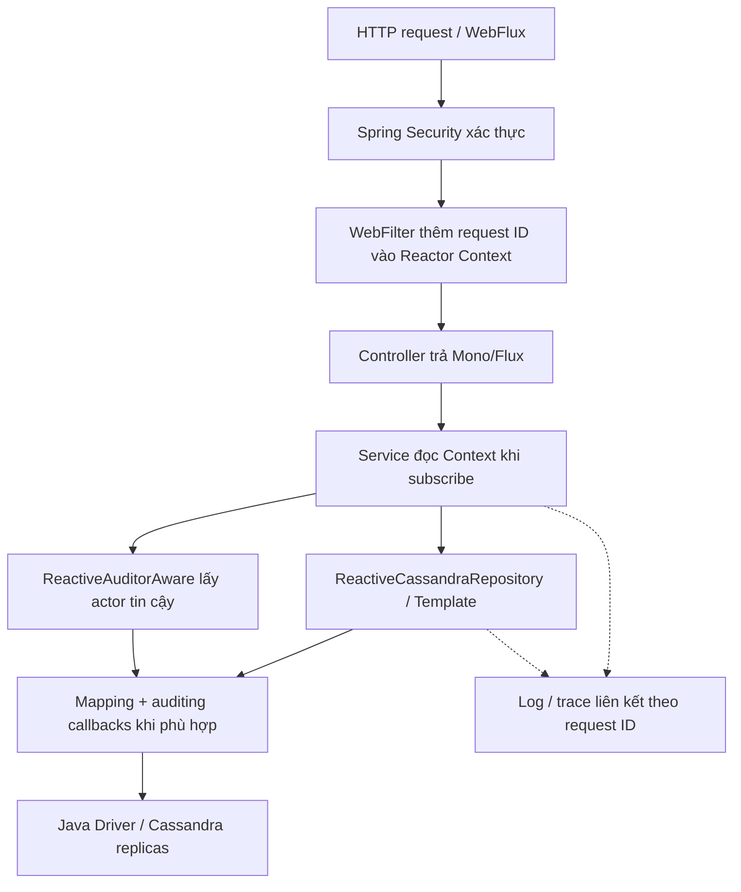

# Giữ ngữ cảnh auditing và mã theo dõi yêu cầu

Khi xây dựng API bằng **Spring WebFlux + Spring Data Cassandra**, lập trình viên thường muốn biết: **ai** đã tạo hoặc chỉnh sửa một entity, **khi nào** thay đổi xảy ra, và **HTTP request nào** dẫn tới các truy vấn Cassandra tương ứng. Ở mô hình servlet/đồng bộ, nhiều dự án từng dựa vào `ThreadLocal` hoặc `MDC` để mang thông tin người dùng và request ID. Trong mô hình **reactive**, một luồng xử lý có thể chuyển qua nhiều thread và sử dụng chung event loop. Giữ ngữ cảnh chỉ bằng biến gắn với thread rất dễ làm mất thông tin hoặc, nghiêm trọng hơn, trộn ngữ cảnh của hai request.

**Project Reactor** cung cấp **`Context`** gắn với *subscriber* của chuỗi reactive. **Spring Security** có thể đặt security context trong Reactor context để API như `ReactiveSecurityContextHolder` truy cập được. **Spring Data Cassandra** có hỗ trợ auditing cho các thao tác mapping reactive thông qua `ReactiveAuditorAware` và những annotation như `@CreatedBy`, `@LastModifiedBy`. Còn **request ID/correlation ID** phục vụ quan sát log, trace và các lệnh gọi qua service; nó không tự là một trường auditing và không tự di chuyển vào SLF4J MDC.

Bài thuộc chương **Truy cập phản ứng** của module **SPRING_DATA_CASSANDRA**. Ta sẽ kết nối các khái niệm đó thành một đường đi có thể kiểm thử từ WebFlux đến `ReactiveCassandraRepository`, `ReactiveCassandraTemplate` và Cassandra Java Driver; nhận diện những trường hợp ngữ cảnh bị mất khi dùng `subscribe()` tùy tiện, `CompletableFuture`, `@Async` hoặc raw CQL; đồng thời thiết kế logging/tracing không gây rò rỉ dữ liệu.

> **Nguyên tắc cốt lõi:** Với Reactive Spring, ngữ cảnh yêu cầu phải được truyền qua **Reactor Context** hoặc được truyền như tham số tường minh; không giả định một thread cố định. **Auditor** lấy danh tính từ nguồn đã được xác thực; **request ID** dùng để truy vết; **operation/idempotency ID** dùng để nhận diện một thao tác nghiệp vụ qua retry. Ba giá trị này có vai trò khác nhau.

## 1. Mục tiêu và phạm vi bài học

Sau bài này, bạn có thể:

1. Phân biệt `Reactor Context` với Java `ThreadLocal`, SLF4J MDC và Spring Security context.
2. Tạo/đưa request ID vào pipeline WebFlux bằng `WebFilter` và đọc nó trong service qua `Mono.deferContextual`.
3. Cấu hình **reactive auditing** với `ReactiveAuditorAware`, `@CreatedBy`, `@CreatedDate`, `@LastModifiedBy` và `@LastModifiedDate`.
4. Xác định chỗ nào auditing của Spring Data Cassandra hoạt động và chỗ nào raw CQL/bulk update bỏ qua entity callbacks.
5. Tích hợp `ReactiveCassandraRepository`, `ReactiveCassandraTemplate` và Java Driver không làm mất context.
6. Ghi log có correlation ID mà không để MDC cũ tồn tại trên thread tái sử dụng.
7. Mang ngữ cảnh qua các reactive operators, outbound HTTP, retries và background jobs.
8. Phân biệt tracing ID với idempotency key, đồng thời ngăn request headers giả mạo danh tính.
9. Viết test chứng minh hai request đồng thời không bị trộn auditor/request ID.
10. Xử lý trường hợp subscription bị hủy, lỗi timeout và side effects ghi dữ liệu chưa rõ kết quả.

Các ví dụ giả định **Spring Framework 6 / Spring Boot 3, Spring Data Cassandra reactive, Project Reactor và Java 17+** trong một kiến trúc tương thích. **API và cấu hình cụ thể phụ thuộc phiên bản** dự án; hãy đối chiếu dependency đang sử dụng trước khi đưa đoạn ví dụ vào production. Bài chỉ mô tả thao tác reactive Cassandra, không hứa Cassandra cung cấp transaction SQL nhiều partition.

## 2. Một request đi qua các tầng nào?

Giả sử người dùng đã đăng nhập gọi:

```http
PATCH /api/orders/22222222-2222-2222-2222-222222222222
Authorization: Bearer <access-token>
Content-Type: application/json

{"status":"PAID"}
```

Ứng dụng cần:

- Xác định **tenant** và actor từ authentication/authorization context đã được kiểm tra.
- Ghi `status` của đơn hàng vào Cassandra.
- Đặt `updated_by` và `updated_at` thông qua auditing khi đi qua thao tác entity mapping phù hợp.
- Ghi `last_request_id` nếu nghiệp vụ muốn giữ liên kết với HTTP request.
- Đưa `request_id` vào log của các tầng để tìm được toàn bộ diễn biến.
- Trả cùng request ID qua response header hoặc thông tin quan sát phù hợp, không đưa dữ liệu bí mật ra ngoài.



Sơ đồ biểu diễn **luồng logic**. Thứ tự thực của WebFilter và security filter chain cần được kiểm tra theo cấu hình ứng dụng; đừng dựa vào vị trí của một filter trong danh sách class để suy rằng mọi request luôn có principal.

## 3. Vì sao ThreadLocal không còn là lời giải mặc định?

Một thread trong ứng dụng WebFlux có thể xử lý xen kẽ nhiều request. Một pipeline cũng có thể đổi thread khi có `publishOn`, `subscribeOn`, I/O không chặn hoặc khi bridge sang API bất đồng bộ.

```text
Thread reactor-http-nio-2:
    T0 xử lý một tín hiệu của request A
    T1 xử lý một tín hiệu của request B
    T2 xử lý tiếp tín hiệu của request A

Một request có thể đi qua:
    reactor-http-nio-2
    parallel-3
    reactor-http-nio-1
```

Nếu code làm:

```java
// Mẫu cần tránh trong reactive request context:
static final ThreadLocal<String> REQUEST_ID =
    new ThreadLocal<>();

REQUEST_ID.set(requestId);

// Sau các async boundaries:
String id = REQUEST_ID.get(); // Có thể null hoặc giá trị không phù hợp.
```

thì không có cơ sở bảo đảm thread của lần `get()` trùng với thread đã `set()`.

**Rủi ro còn lớn hơn mất log:** một `ThreadLocal` hoặc MDC không được xóa có thể được thread pool tái sử dụng, khiến request B nhìn thấy ID/actor của A. Với dữ liệu nhiều tenant, đó có thể là vấn đề bảo mật.

### Reactor Context khác gì?

`Reactor Context` gắn với **subscriber**, không gắn với thread. Context mang dữ liệu bất biến theo cấu trúc được chia sẻ qua pipeline, và các operator có thể đọc nó lúc subscription/signal.

Hai API thường gặp:

- `contextWrite(...)`: bổ sung/biến đổi context cho **chuỗi upstream** tại vị trí operator.
- `Mono.deferContextual(contextView -> ...)` hoặc `Flux.deferContextual(...)`: trì hoãn đọc context tới **lúc subscribe**, thay vì đọc một biến thread-local khi xây pipeline.

Thực tế `Context` gần như “truyền dữ liệu từ downstream đến upstream” trong quá trình subscription. Nếu đặt `contextWrite` sai vị trí, operator mong đợi ở downstream có thể không đọc thấy giá trị.

## 4. Reactor Context, Security Context, MDC và trace không đồng nhất

| Khái niệm | Gắn với | Mục đích | Điều không nên giả định |
| --- | --- | --- | --- |
| **Reactor Context** | Subscriber/chuỗi reactive | Truyền metadata ngầm định xuyên operator hợp lệ | Tự đi vào mọi `ThreadLocal` hoặc `CompletableFuture` callback |
| **Reactive Security Context** | Thường được tích hợp với Reactor Context | Truy cập `Authentication` đã được framework thiết lập | Đồng nghĩa `SecurityContextHolder` thread-local |
| **SLF4J MDC** | Thông thường là `ThreadLocal` | Gắn cặp key/value vào log đồng bộ trên thread hiện tại | Tự mang qua `publishOn`/I/O |
| **Trace ID / span ID** | Tracing instrumentation/span context | Theo dõi luồng phân tán nhiều service | Là mã định danh nghiệp vụ hoặc quyền truy cập |
| **Request/correlation ID** | Một HTTP request hay luồng nghiệp vụ theo quy ước | Nối log, hỗ trợ, truy lỗi | Tự ngăn retry trùng |
| **Idempotency/operation ID** | Một operation nghiệp vụ có thể retry | Đánh dấu tác vụ để dedup/đối soát | Luôn giống request ID hoặc trace ID |

Ví dụ một thao tác thanh toán:

```text
auditor     = "account:9f2c..."       (actor đã xác thực)
requestId   = "req-9b3d..."           (mỗi HTTP request)
traceId     = "d5cc..."               (mã trace liên dịch vụ)
operationId = "payment-op-8421"       (giữ ổn định qua retry)
```

Nếu client gửi lại thao tác với **request mới**, request ID và đôi khi trace ID có thể đổi, nhưng **operation ID phải giữ nguyên** nếu muốn nhận ra đây là cùng một thanh toán. Không được dùng request ID như một khóa chống thu tiền hai lần.

## 5. Thiết kế bảng Cassandra có các cột audit

Một bảng tra đơn theo ID và tenant:

```sql
CREATE TABLE IF NOT EXISTS commerce_ks.orders_by_id (
    tenant_id uuid,
    order_id uuid,
    status text,
    total_amount decimal,
    created_by text,
    created_at timestamp,
    updated_by text,
    updated_at timestamp,
    last_request_id text,
    PRIMARY KEY ((tenant_id, order_id))
);
```

Ở đây:

- `(tenant_id, order_id)` là **composite partition key**. Query theo ID phải cung cấp đầy đủ hai thành phần.
- `created_by` và `updated_by` là **actor của thay đổi** theo policy auditing.
- `created_at` và `updated_at` là dấu mốc **ứng dụng/auditing**, không phải commit timestamp chung của mọi replica.
- `last_request_id` lưu request gây ra lần ghi gần nhất, nhưng **không phải lịch sử đầy đủ**. Mỗi lần ghi mới có thể thay thế giá trị cũ.
- Những cột audit là **regular columns**. Chúng không tạo secondary index, unique constraint hoặc transaction chỉ vì tên gọi.
- **Không lưu access token** hay toàn bộ request headers vào bảng để “dễ truy vết”.

### Last request ID không phải audit log bất biến

Một đơn có thể thay đổi nhiều lần. Nếu chỉ có `last_request_id`, bạn biết ID gần nhất **theo giá trị đang còn**, không có lịch sử từng thay đổi. Muốn audit trail đầy đủ, cần thiết kế bảng/event ledger riêng với khóa phù hợp, retention và cách xử lý dữ liệu nhạy cảm.

Ví dụ read model lịch sử:

```sql
CREATE TABLE IF NOT EXISTS commerce_ks.order_audit_events_by_order (
    tenant_id uuid,
    order_id uuid,
    event_time timestamp,
    event_id uuid,
    actor_id text,
    request_id text,
    operation_id text,
    action text,
    PRIMARY KEY ((tenant_id, order_id), event_time, event_id)
) WITH CLUSTERING ORDER BY (
    event_time DESC,
    event_id DESC
);
```

Bảng này là **một read model riêng** và không được tự đồng bộ khi `orders_by_id` thay đổi. Việc ghi nhiều bảng cần workflow/idempotency/reconciliation; không nên gọi reactive auditing annotations là một “transaction lịch sử” mà chúng không cung cấp.

## 6. Entity Spring Data Cassandra có trường auditing

Với mapping entity, bạn có thể dùng các annotation của Spring Data Commons:

```java
import java.math.BigDecimal;
import java.time.Instant;

import org.springframework.data.annotation.CreatedBy;
import org.springframework.data.annotation.CreatedDate;
import org.springframework.data.annotation.LastModifiedBy;
import org.springframework.data.annotation.LastModifiedDate;
import org.springframework.data.cassandra.core.mapping.Column;
import org.springframework.data.cassandra.core.mapping.PrimaryKey;
import org.springframework.data.cassandra.core.mapping.Table;

@Table("orders_by_id")
public class OrderDocument {

    @PrimaryKey
    private OrderKey key;

    @Column("status")
    private String status;

    @Column("total_amount")
    private BigDecimal totalAmount;

    @CreatedBy
    @Column("created_by")
    private String createdBy;

    @CreatedDate
    @Column("created_at")
    private Instant createdAt;

    @LastModifiedBy
    @Column("updated_by")
    private String updatedBy;

    @LastModifiedDate
    @Column("updated_at")
    private Instant updatedAt;

    @Column("last_request_id")
    private String lastRequestId;

    // Constructors, getters và phương thức cập nhật có kiểm soát.
}
```

`OrderKey` là một `@PrimaryKeyClass` chứa `tenantId` và `orderId` với `@PrimaryKeyColumn(type = PARTITIONED)` đúng schema. Ví dụ tập trung vào **audit fields** nên không lặp lại toàn bộ class khóa.

### Các annotation làm việc gì?

| Annotation | Ý nghĩa | Lưu ý |
| --- | --- | --- |
| `@CreatedBy` | Actor của lần tạo entity theo auditing callback | Cần `ReactiveAuditorAware` trả actor phù hợp |
| `@CreatedDate` | Thời điểm entity được audit là mới | Không phải Cassandra commit time |
| `@LastModifiedBy` | Actor của lần chỉnh sửa theo auditing | Phụ thuộc mapping operation và newness |
| `@LastModifiedDate` | Dấu thời gian chỉnh sửa | Có thể thay đổi ngay cả khi thao tác bị retry |
| `@Column` | Mapping tên field Java sang CQL column | Không tự tạo cột/index hoặc bật schema migration |

### Entity “mới” là quyết định quan trọng

Spring Data xác định entity mới/cũ theo chiến lược new-entity detection của version và mapping, ví dụ `@Id`/`@PrimaryKey`, `@Version` khi hỗ trợ, hoặc `Persistable`. Với **primary key do ứng dụng gán sẵn**, không nên mặc định `@CreatedBy`/`@CreatedDate` chắc chắn được kích hoạt ở lần `save(...)` đầu theo mọi phiên bản/cấu hình.

Do đó, **integration test** phải xác minh lần tạo đầu ghi đúng `created_by/created_at` và lần cập nhật sau chỉ thay `updated_by/updated_at` theo policy. Nếu dùng `Persistable`, phải triển khai `isNew()` và lifecycle của cờ newness cẩn thận để không đánh dấu một entity đã lưu là “mới” sau khi đọc lại.

**Không nhận `createdBy` hoặc `updatedBy` từ JSON body để đưa thẳng vào entity.** Đây là metadata cần lấy từ security/auditing context tin cậy.

## 7. Bật reactive auditing

Trong phiên bản Spring Data Cassandra hỗ trợ reactive auditing, cấu hình điển hình sử dụng `@EnableReactiveCassandraAuditing` và một bean `ReactiveAuditorAware<T>`.

```java
import org.springframework.context.annotation.Configuration;
import org.springframework.data.cassandra.config.EnableReactiveCassandraAuditing;

@Configuration
@EnableReactiveCassandraAuditing(
    auditorAwareRef = "reactiveAuditorAware"
)
public class ReactiveCassandraAuditConfiguration {
}
```

Annotation cần được khai báo trong application context có cấu hình reactive Cassandra repository/operations tương ứng. **Chỉ thêm `@CreatedBy` trên class mà chưa bật auditing chưa đủ**.

### Phân biệt auditing sync và reactive

| Trường hợp | Đường API tương ứng |
| --- | --- |
| Cassandra đồng bộ | `@EnableCassandraAuditing` và `AuditorAware<T>` khi hỗ trợ |
| Cassandra reactive | `@EnableReactiveCassandraAuditing` và `ReactiveAuditorAware<T>` khi hỗ trợ |
| Raw `CqlSession.execute(...)` | Không đi qua entity auditing callbacks |
| `@Query` cập nhật trực tiếp bằng CQL | Cần xác minh callbacks; không mặc định có entity auditing |
| Custom event/ledger service | Cần cung cấp actor/request ID rõ theo hợp đồng |

Các chính sách cấu hình có thể khác theo phiên bản Spring Data Cassandra. Không nên tạo cả hai auditor providers trùng lặp rồi không biết callback nào được dùng.

## 8. Lấy người thực hiện bằng ReactiveAuditorAware

Thông thường actor đáng tin nằm trong authentication context do **Spring Security** cung cấp. Trong WebFlux reactive, dùng `ReactiveSecurityContextHolder` thay vì cố lấy `SecurityContextHolder.getContext()` từ một thread bất kỳ.

```java
import org.springframework.context.annotation.Bean;
import org.springframework.context.annotation.Configuration;
import org.springframework.data.domain.ReactiveAuditorAware;
import org.springframework.security.authentication.AnonymousAuthenticationToken;
import org.springframework.security.core.Authentication;
import org.springframework.security.core.context.ReactiveSecurityContextHolder;
import reactor.core.publisher.Mono;

@Configuration
public class AuditActorConfiguration {

    @Bean("reactiveAuditorAware")
    ReactiveAuditorAware<String> reactiveAuditorAware() {
        return () -> ReactiveSecurityContextHolder
            .getContext()
            .map(securityContext ->
                securityContext.getAuthentication()
            )
            .filter(auth -> auth != null
                && auth.isAuthenticated()
                && !(auth instanceof AnonymousAuthenticationToken))
            .map(Authentication::getName);
    }
}
```

Trong code trên:

1. `ReactiveAuditorAware<String>` trả một publisher cung cấp actor khi Spring Data cần audit.
2. `ReactiveSecurityContextHolder.getContext()` đọc security context trong **subscription chain**, không dựa vào thread-local.
3. `Authentication.getName()` là tên actor theo cấu hình Spring Security. Trong production có thể cần một **stable internal user ID** từ claims/identity service thay vì tên hiển thị có thể đổi.
4. Anonymous/unauthenticated không được chấp nhận làm actor của một thao tác cần authentication.
5. Nếu không có authentication context, publisher có thể **rỗng**. Hệ thống phải quyết định thao tác có bị chặn hay dùng actor hệ thống theo policy; đừng âm thầm giả mạo một người dùng.

### Không coi auditor là cơ chế authorization

`ReactiveAuditorAware` giúp điền metadata. Nó **không kiểm tra** người gọi có được phép sửa `tenant_id/order_id` hay không. Service và Spring Security phải thực hiện authorization trước, và không cho client đổi actor bằng header `X-User` không đáng tin.

### Principal có thể là dữ liệu nhạy cảm

Tránh ghi email, token, session ID hoặc tên đầy đủ vào `created_by` theo mặc định. Dùng định danh nội bộ ổn định với quyền truy cập và retention phù hợp. Nếu principal chứa claims nhạy cảm, không serialize trực tiếp đối tượng `Authentication` vào bảng audit.

## 9. Audit actor cho scheduled job và message consumer

Scheduled jobs, retry workers và message consumers **không có HTTP authentication context** giống một WebFlux request. Nếu `ReactiveAuditorAware` chỉ đọc `ReactiveSecurityContextHolder`, những tác vụ này có thể không có actor.

Một cách mở rộng có kiểm soát là dùng **một khóa Reactor Context dành riêng cho actor hệ thống**. Khóa này chỉ được set bởi code nội bộ đã được tin cậy.

```java
public final class AuditContextKeys {

    public static final String REQUEST_ID = "app.requestId";
    public static final String SYSTEM_ACTOR = "app.systemActor";

    private AuditContextKeys() {}
}
```

Bean auditor kết hợp actor hệ thống và authentication:

```java
@Bean("reactiveAuditorAware")
ReactiveAuditorAware<String> reactiveAuditorAware() {
    return () -> Mono.deferContextual(context -> {
        if (context.hasKey(AuditContextKeys.SYSTEM_ACTOR)) {
            return Mono.just(
                context.<String>get(AuditContextKeys.SYSTEM_ACTOR)
            );
        }

        return ReactiveSecurityContextHolder.getContext()
            .map(sc -> sc.getAuthentication())
            .filter(a -> a != null
                && a.isAuthenticated()
                && !(a instanceof AnonymousAuthenticationToken))
            .map(Authentication::getName);
    });
}
```

Đoạn trên là **một phương án thay thế** cho bean ở phần 8, **không phải khai báo thêm một bean cùng tên trong cùng ứng dụng**. Chọn một implementation phù hợp với security policy.

Job nội bộ có thể set:

```java
Mono<Void> job = updateDailyAggregate()
    .contextWrite(ctx -> ctx
        .put(AuditContextKeys.SYSTEM_ACTOR, "system:nightly-aggregator")
        .put(AuditContextKeys.REQUEST_ID, "job:nightly-2026-11-25")
    );
```

Ở đây `updateDailyAggregate()` là phương thức nghiệp vụ minh họa, trả `Mono<Void>`. **Không lấy `SYSTEM_ACTOR` từ request header, JSON body hay queue message do client kiểm soát.** Nếu actor hệ thống được phép override principal, giới hạn quyền chỉ ở đường chạy nội bộ.

### Khi job không có auditing actor

Đưa ra policy rõ ràng:

- **Reject** nếu thao tác cần actor nhưng không có authenticated/system actor.
- Hoặc dùng một **service account** đã được cấu hình sẵn và chỉ ở đường tin cậy.
- Không mặc định actor = `unknown` rồi dùng nó để bỏ qua mọi kiểm soát.
- Nếu sự kiện đến từ user ở thời điểm trước, cần xác định lưu actor ban đầu trong event đã xác minh và cách projector sử dụng actor đó.

## 10. Tạo correlation ID trong WebFlux WebFilter

Một filter có thể tạo ID nội bộ cho mỗi HTTP request và đặt vào Reactor Context. Sử dụng `UUID` để minh họa một ID đủ phân biệt ở phạm vi ứng dụng:

```java
import java.util.UUID;

import org.springframework.http.HttpHeaders;
import org.springframework.stereotype.Component;
import org.springframework.web.server.ServerWebExchange;
import org.springframework.web.server.WebFilter;
import org.springframework.web.server.WebFilterChain;
import reactor.core.publisher.Mono;

@Component
public final class RequestIdFilter implements WebFilter {

    public static final String REACTOR_KEY = "app.requestId";
    public static final String RESPONSE_HEADER = "X-Request-Id";

    @Override
    public Mono<Void> filter(
            ServerWebExchange exchange,
            WebFilterChain chain) {

        String requestId = "req-" + UUID.randomUUID();

        exchange.getResponse()
            .getHeaders()
            .set(RESPONSE_HEADER, requestId);

        return chain.filter(exchange)
            .contextWrite(context ->
                context.put(REACTOR_KEY, requestId)
            );
    }
}
```

Đây là **cách đơn giản để tạo correlation ID nội bộ**. Nó cố tình **không tin `X-Request-Id` do client gửi**; ứng dụng có thể giữ một external request ID đã sanitize riêng, nhưng không dùng trực tiếp dữ liệu tùy ý đó làm log context/bằng chứng định danh.

### Vì sao dùng contextWrite ở đây?

`chain.filter(exchange)` trả một `Mono<Void>` cho chuỗi xử lý downstream. `contextWrite` bổ sung giá trị mà các publisher trong chuỗi có thể đọc qua Reactor Context khi được subscribe.

Phải kiểm tra **thứ tự và phạm vi filter** nếu security context hoặc tracing instrumentation được thêm ở tầng khác. Việc code filter được gọi không có nghĩa người dùng đã được xác thực; đó là một bước riêng.

### Cần có request ID ngay khi filter bị lỗi?

Nếu lỗi xảy ra trước filter trong pipeline hoặc response header đã commit ở tầng khác, header có thể không được set như kỳ vọng. Với production, nên xác định filter ordering, exception handling và log strategy bao gồm cả lỗi rất sớm. Không xem một filter đơn lẻ là thay thế toàn bộ cơ chế observability của gateway/tracing.

## 11. Đọc request ID trong service đúng thời điểm

Dùng `Mono.deferContextual`, không đọc từ `ThreadLocal` hoặc lấy ID một lần lúc cấu hình bean.

```java
import org.springframework.stereotype.Service;
import reactor.core.publisher.Mono;

@Service
public final class OrderTraceService {

    private final ReactiveOrderRepository repository;

    public OrderTraceService(ReactiveOrderRepository repository) {
        this.repository = repository;
    }

    public Mono<OrderDocument> saveWithRequestId(
            OrderDocument draft) {

        return Mono.deferContextual(context -> {
            String requestId = context.getOrDefault(
                AuditContextKeys.REQUEST_ID, "untracked"
            );

            OrderDocument prepared =
                draft.withLastRequestId(requestId);

            return repository.save(prepared);
        });
    }
}
```

`ReactiveOrderRepository`, `OrderDocument.withLastRequestId(...)` và entity constructors cần được định nghĩa theo dự án; ví dụ tập trung vào **cơ chế Context**. Với immutable entity, phương thức `withLastRequestId` nên trả instance mới; với mutable entity, tránh chia sẻ cùng instance giữa hai request đồng thời.

**Dữ liệu auditing và request ID được xử lý khác nhau**:

- `ReactiveAuditorAware` điền `created_by/updated_by` từ actor tin cậy khi callback auditing chạy.
- Service điền `last_request_id` một cách tường minh vì **`@CreatedBy` không được thiết kế để chứa correlation ID**.
- Không cho request body cung cấp hoặc ghi đè `last_request_id` nếu chính sách đòi request ID nội bộ.

### Hãy đọc ngữ cảnh lúc subscribe

`Mono.deferContextual` trì hoãn việc đọc context. Nếu tạo Mono từ một biến `requestId` lấy bằng thread-local trước đó, rồi mới `contextWrite` ở controller, pipeline vẫn có thể mang ID sai. Context cần được đọc **bên trong** publisher đang được subscribe.

## 12. Reactive Repository và CassandraTemplate

Một reactive repository:

```java
import org.springframework.data.cassandra.repository.ReactiveCassandraRepository;

public interface ReactiveOrderRepository
        extends ReactiveCassandraRepository<OrderDocument, OrderKey> {
}
```

Controller/service trả publisher thay vì gọi `subscribe()` thủ công:

```java
public Mono<OrderDocument> updateOrder(
        OrderKey key, String newStatus) {

    return repository.findById(key)
        .switchIfEmpty(
            Mono.error(new IllegalArgumentException(
                "Order not found"
            ))
        )
        .flatMap(current ->
            saveWithRequestId(current.withStatus(newStatus))
        );
}
```

Ví dụ trên chỉ mô tả composition. **Read–modify–save thông thường không phải compare-and-set**; nếu có hai writer cạnh tranh, Cassandra conflict resolution vẫn áp dụng. Nếu nghiệp vụ yêu cầu “chỉ đổi PENDING sang PAID khi vẫn còn PENDING”, cần xem **LWT/conditional update** cùng workflow thích hợp; auditing không tạo transaction.

Với reactive template:

```java
import org.springframework.data.cassandra.core.ReactiveCassandraOperations;
import reactor.core.publisher.Mono;

public final class OrderTemplateService {

    private final ReactiveCassandraOperations operations;

    public OrderTemplateService(
            ReactiveCassandraOperations operations) {
        this.operations = operations;
    }

    public Mono<OrderDocument> read(OrderKey key) {
        return operations.selectOneById(key, OrderDocument.class);
    }
}
```

`ReactiveCassandraOperations`/`ReactiveCassandraTemplate` tương ứng cho phép mapping và thao tác reactive. Tuy nhiên, **không phải mọi method của mọi version đều cung cấp auditing callback như nhau**. Phải phân biệt object mapping `save/insert/update` với raw CQL/statement và kiểm tra hành vi cụ thể trong integration test.

### Reactor Context không được truyền như một cột CQL tự động

Cassandra **không tự lưu** `requestId` hoặc principal chỉ vì Reactor Context chứa các giá trị đó. Phải có audit callback/mapper hoặc service bind đúng cột. Tương tự, Spring Security không tự thêm `tenant_id` vào `WHERE`: đó là trách nhiệm authorization/query design của ứng dụng.

## 13. Auditing callbacks hoạt động trong trường hợp nào?

**Auditing annotations** do Spring Data xử lý ở **đường persistence có entity mapping và callback được kích hoạt**. Một số đường khác đi thẳng tới Cassandra và **không gọi lifecycle auditing của entity**.

| Đường ghi | Có nên giả định auditing tự chạy? | Cách đảm bảo |
| --- | --- | --- |
| `ReactiveCassandraRepository.save(entity)` | Có thể khi reactive auditing được bật và callback áp dụng | Integration test created/modified fields |
| `ReactiveCassandraTemplate.insert/update(entity)` | Phụ thuộc operation và version; thường là đường mapping | Kiểm tra callback và CQL thực |
| Repository `@Query` trực tiếp `UPDATE` | **Không mặc định** | Bind audit columns tường minh hoặc custom write path |
| Raw `CqlSession.execute(stmt)` | **Không** | Lấy actor/context và bind CQL rõ ràng |
| Driver `executeAsync(stmt)` | **Không** | Tương tự raw CQL, đồng thời quản lý async boundary |
| CQL BATCH nhiều statements | **Không tự chạy per-entity auditing callback** | Xác định audit fields cho từng statement |
| Ghi bằng service khác/CLI | Không phụ thuộc Spring callbacks | Thống nhất hợp đồng audit với các writers |

### Ví dụ raw CQL bỏ qua @LastModifiedBy

```sql
UPDATE commerce_ks.orders_by_id
SET status = 'PAID'
WHERE tenant_id = ?
  AND order_id = ?;
```

Cassandra chỉ nhận các cột trong statement. Nó **không biết** annotation `@LastModifiedBy` ở Java, và không tự điền `updated_by` hay `updated_at`.

Nếu service chuyển sang raw CQL để tối ưu một đường nóng, phải **duy trì các audit columns một cách có chủ đích** hoặc chấp nhận documented limitation. Ví dụ:

```sql
UPDATE commerce_ks.orders_by_id
SET status = ?,
    updated_by = ?,
    updated_at = ?,
    last_request_id = ?
WHERE tenant_id = ? AND order_id = ?;
```

Actor và request ID ở đây phải lấy từ **trusted application context**, không bind từ tham số HTTP body tùy ý. Timestamp có thể do ứng dụng sinh với clock policy phù hợp; nó không đồng nghĩa Cassandra cell write timestamp.

## 14. Một số khác biệt giữa audit timestamps và Cassandra timestamps

`@CreatedDate`, `@LastModifiedDate` thường mô tả **thời gian ứng dụng/auditing** ghi nhận thao tác. Cassandra còn có **cell write timestamp** (microseconds trong CQL `WRITETIME(column)` khi hỗ trợ) để giải quyết các mutation cạnh tranh.

Hai giá trị này không nhất thiết bằng nhau:

- Audit date có thể lấy từ clock của service.
- CQL write timestamp có thể được chọn theo driver/coordinator hoặc được cung cấp tường minh.
- Request timeout có thể dẫn đến retry; audit timestamp lần retry có thể khác.
- Clock skew có thể làm thứ tự sự kiện theo `updated_at` khác thứ tự Cassandra chọn khi giải quyết conflict.
- Cùng một entity có thể gồm các cell cập nhật ở thời điểm khác nhau.

**Không dùng `updated_at` như optimistic lock tự động.** Để bảo đảm state transition có điều kiện, xem LWT/CAS và quy tắc cập nhật của Cassandra.

### CreatedBy không phải người “đầu tiên từng gọi endpoint”

Tính đúng của `created_by` phụ thuộc entity newness, auditing callback, write đầu và các thao tác từ các dịch vụ khác. Nếu một key đã tồn tại nhưng ứng dụng nhầm entity là mới và ghi lại, các audit fields có thể bị đặt lại không đúng ý định. Muốn **lịch sử bất biến**, cần cơ chế audit event/event ledger riêng với chính sách và kiểm thử phù hợp.

## 15. Request ID không phải user identity, tenant key hay secret

Một request ID hữu ích phải:

- Đủ phân biệt trong phạm vi yêu cầu quan sát.
- Không chứa email, số điện thoại, tên khách, access token hoặc PII.
- Không được coi là bằng chứng một người dùng đã đăng nhập.
- Có thể đưa vào response header theo chính sách, nhưng không phải bí mật.
- Bị giới hạn định dạng/độ dài nếu chấp nhận từ bên ngoài.
- Không dùng làm **partition key** duy nhất cho dữ liệu chính chỉ vì muốn tìm log nhanh.
- Không dùng làm **idempotency key** cho một operation phải tồn tại qua nhiều request.

Một hệ thống có thể chọn **trace ID** của OpenTelemetry/Micrometer Tracing để nối nhiều service, cộng thêm request ID nội bộ nếu sản phẩm cần. Không nhất thiết tạo hai ID giống chức năng; hãy thống nhất tên và propagation policy để tránh log rối.


## 16. Đưa request ID vào log mà không để rò rỉ MDC

**SLF4J MDC** thường dùng `ThreadLocal`. Khi sử dụng WebFlux, không nên đặt MDC một lần tại đầu request rồi kỳ vọng nó tự theo mọi `publishOn` hoặc bước I/O.

Cách đơn giản, dễ kiểm soát cho một log statement là lấy ID từ Reactor Context rồi **chỉ đặt MDC trong phạm vi thực hiện log**:

```java
import org.slf4j.Logger;
import org.slf4j.LoggerFactory;
import org.slf4j.MDC;
import reactor.core.publisher.Mono;

public final class OrderLoggingService {

    private static final Logger log =
        LoggerFactory.getLogger(OrderLoggingService.class);

    private final ReactiveOrderRepository repository;

    public OrderLoggingService(
            ReactiveOrderRepository repository) {
        this.repository = repository;
    }

    public Mono<OrderDocument> load(OrderKey key) {
        return Mono.deferContextual(ctx -> {
            String requestId = ctx.getOrDefault(
                AuditContextKeys.REQUEST_ID, "untracked"
            );

            return repository.findById(key)
                .doOnNext(order -> {
                    try (MDC.MDCCloseable ignored =
                        MDC.putCloseable("request_id", requestId)) {

                        log.info("Order loaded");
                    }
                });
        });
    }
}
```

**Vì sao an toàn hơn một `MDC.put(...)` ở đầu controller?**

- Reactor Context được đọc tại thời điểm subscribe.
- `requestId` được đưa vào một scope ngắn, chỉ trong lúc log.
- `MDCCloseable` đóng scope khi kết thúc, kể cả khi code log ném lỗi.
- MDC không bị để lại trên thread phục vụ request tiếp theo.

Tuy nhiên, ví dụ này chỉ bao phủ **lời log trong callback đó**. Nó không tự đồng bộ MDC cho toàn bộ framework logs hoặc driver logs.

### Logging trong doOnEach

Một hướng khác là dùng `doOnEach(signal -> ...)` và `signal.getContextView()` để lấy ID từ context tại mỗi tín hiệu:

```java
return repository.findById(key)
    .doOnEach(signal -> {
        if (!signal.isOnNext() && !signal.isOnError()) {
            return;
        }

        String requestId = signal.getContextView()
            .getOrDefault(
                AuditContextKeys.REQUEST_ID, "untracked"
            );

        try (MDC.MDCCloseable ignored =
            MDC.putCloseable("request_id", requestId)) {

            if (signal.isOnError()) {
                log.warn("Order read failed", signal.getThrowable());
            } else {
                log.info("Order read completed");
            }
        }
    });
```

Đây là **đoạn code bên trong một class có logger và repository**, không phải file Java độc lập.

Trong những phiên bản Reactor/Micrometer có **context-propagation integration**, có thể thiết lập bridge giữa Reactor Context và MDC/ThreadLocal theo tài liệu tương ứng. Cách đó cần cấu hình, kiểm thử và kiểm soát cleanup; không nên tuyên bố auto-propagation luôn bật trong mọi Spring Boot version.

### Những sai lầm hay gặp với MDC

- `MDC.put("request_id", id)` trong WebFilter nhưng không `remove` trong `finally`.
- Gắn actor/tenant vào MDC rồi dùng nó làm nguồn **authorization**.
- Dùng `MDC.get(...)` làm nguồn dữ liệu để ghi `created_by` trong reactive callback.
- Đặt MDC ở một thread rồi mong callback của `CompletableFuture` có giá trị.
- Ghi access token, toàn bộ principal claims, IP hoặc PII vào MDC không kiểm soát.

**MDC phục vụ log, không phải nguồn dữ liệu có thẩm quyền để audit hay kiểm soát quyền.**

## 17. Correlation ID so với distributed tracing

Trong một hệ thống microservices, một HTTP request có thể trải qua gateway, order service, payment service và Cassandra. **Distributed tracing** dùng **trace ID** để liên kết spans và **span ID** để phân biệt bước.

Ví dụ:

```text
traceId = 8c79...     (toàn bộ hành trình)
  spanId = 001...     (gateway)
  spanId = 002...     (order service)
  spanId = 003...     (HTTP outbound)
  spanId = 004...     (database operation, nếu instrumented)

requestId = req-ab3...
operationId = payment-384...
```

Khi đã dùng **Micrometer Tracing/OpenTelemetry** và propagation được cấu hình, có thể không cần tự sinh một correlation ID nữa nếu trace ID đáp ứng nhu cầu. Nếu vẫn cần một ID ứng dụng, hãy giữ rõ quan hệ và đừng tự ghi đè `traceparent` theo ý client.

### Trace context không đồng nghĩa Reactor Context

Instrumentation có thể lưu/propagate tracing context qua những cơ chế tích hợp với Reactor. Nhưng không nên suy rằng:

```java
MDC.get("traceId")
```

luôn có giá trị đúng trong mọi reactive operator mà không cần bridge/configuration. Cần kiểm thử thực tế trên các phiên bản Micrometer/OTel/Reactor đang dùng.

### CQL tracing của Cassandra là một công cụ khác

Java Driver/Cassandra có khả năng tracing ở tầng database theo cơ chế được hỗ trợ, nhưng **CQL tracing không phải trace phân tán của ứng dụng** và có overhead. Không bật tracing chi tiết cho mọi request production chỉ để tìm một request ID.

Một thiết kế observability tốt thường kết hợp:

- Trace/span instrumentation trên HTTP và database operations.
- Log có request/trace ID theo policy.
- Metrics tổng hợp theo operation/table/latency/error.
- Metadata audit do application chủ động ghi.
- Operation ID để xử lý retry nghiệp vụ.

**Không đưa request ID/trace ID thành metric tag không giới hạn cardinality** như `request_id=req-...` cho mỗi request. Histogram và counters nên gắn các chiều có cardinality thấp như operation, status, error category, route được chuẩn hóa.

## 18. Propagate correlation ID sang WebClient

Nếu order service gọi một downstream HTTP service, Reactor Context **không tự biến thành HTTP header** chỉ vì WebClient được dùng trong cùng pipeline. Cần cấu hình propagation.

Ví dụ một `ExchangeFilterFunction` đọc ID từ Reactor Context và gắn header outbound:

```java
import org.springframework.web.reactive.function.client.ClientRequest;
import org.springframework.web.reactive.function.client.ExchangeFilterFunction;
import org.springframework.web.reactive.function.client.WebClient;
import reactor.core.publisher.Mono;

public final class CorrelatedWebClient {

    public static WebClient create(String baseUrl) {
        ExchangeFilterFunction propagateRequestId =
            (request, next) -> Mono.deferContextual(ctx -> {

                if (!ctx.hasKey(AuditContextKeys.REQUEST_ID)) {
                    return next.exchange(request);
                }

                String requestId = ctx.get(
                    AuditContextKeys.REQUEST_ID
                );

                ClientRequest correlated =
                    ClientRequest.from(request)
                        .headers(headers ->
                            headers.set("X-Request-Id", requestId)
                        )
                        .build();

                return next.exchange(correlated);
            });

        return WebClient.builder()
            .baseUrl(baseUrl)
            .filter(propagateRequestId)
            .build();
    }
}
```

Ở đây:

- Service outbound dùng **ID nội bộ đã được tạo/kiểm tra**, không nhận lại một header không tin cậy.
- `Mono.deferContextual` đọc ID khi request được subscribe.
- Nếu không có request ID, filter không tự bịa actor hoặc giả mạo identity.
- Authentication/authorization outbound dùng cơ chế riêng (service credential, token exchange, mTLS...) chứ không dựa trên `X-Request-Id`.

Nếu đã bật OpenTelemetry propagation, hãy để instrumentation quản lý các header tracing chuẩn (ví dụ `traceparent`) thay vì thủ công tạo trace context khác với span đang hoạt động.

### Downstream có nên tin X-Request-Id?

Không nên coi nó là bằng chứng bảo mật. Một upstream có thể truyền ID không hợp lệ hoặc trùng. Service downstream cần quy ước rõ liệu giữ external correlation ID hay sinh ID nội bộ, kiểm soát độ dài/ký tự và log injection.

## 19. Truyền request ID qua message và background consumer

Khi một HTTP request đẩy một message vào queue, subscriber của consumer **không còn là cùng subscriber Reactor** của HTTP request. Context ban đầu không tự vượt qua boundary queue.

Muốn tiếp tục truy vết, cần đưa **metadata đã kiểm tra** vào message envelope:

```json
{
  "eventId": "order-event-2849",
  "operationId": "pay-op-8102",
  "correlationId": "req-7ef4...",
  "tenantId": "11111111-1111-1111-1111-111111111111",
  "eventType": "ORDER_PAID"
}
```

Đây là ví dụ envelope, **không phải định dạng bắt buộc của Kafka/RabbitMQ**.

Consumer cần:

1. Xác minh message source, schema và quyền truy cập.
2. Phân biệt **actor gốc đã được xác thực** với actor hệ thống đang chạy projection.
3. Tạo Reactor Context mới cho consumer pipeline, hoặc truyền metadata thành tham số tường minh.
4. Giữ `operationId` ổn định qua retries.
5. Đưa correlation ID vào log/trace theo chính sách.
6. Không coi tên user trong payload không ký/xác thực là auditor tin cậy.

Một cách tạo ngữ cảnh cho job đáng tin:

```java
public Mono<Void> handle(OrderPaidMessage message) {
    return applyProjection(message)
        .contextWrite(ctx -> ctx
            .put(AuditContextKeys.REQUEST_ID,
                 message.correlationId())
            .put(AuditContextKeys.SYSTEM_ACTOR,
                 "system:order-projection")
        );
}
```

`OrderPaidMessage` và `applyProjection` là những thành phần ứng dụng giả định. **Chỉ sử dụng correlation ID từ message nếu nó đã được validate/sanitize và nguồn message tin cậy**. Actor hệ thống là một constant do consumer chọn, không lấy trực tiếp từ client payload.

### Một request khác một operation

Retry một message có thể tạo nhiều attempts, mỗi attempt có một trace/span riêng. Operation ID phải là danh tính chung của nghiệp vụ; correlation ID chỉ phục vụ liên kết log. Muốn exactly-once theo event cần deduplication/checkpoint có thể phục hồi, không chỉ giữ giống nhau request ID.

## 20. Context propagation qua flatMap, publishOn và subscribeOn

Một điểm mạnh của Reactor Context là giá trị có thể truyền qua những async operators **trong cùng subscription chain**.

Ví dụ:

```java
import reactor.core.publisher.Mono;
import reactor.core.scheduler.Schedulers;

Mono<String> chain = Mono.just("start")
    .publishOn(Schedulers.parallel())
    .flatMap(value -> Mono.deferContextual(ctx ->
        Mono.just(
            ctx.getOrDefault(
                AuditContextKeys.REQUEST_ID, "missing"
            )
        )
    ))
    .contextWrite(ctx ->
        ctx.put(AuditContextKeys.REQUEST_ID, "req-123")
    );
```

Nếu pipeline được subscribe đúng cách, `deferContextual` đọc được `req-123` dù đã có `publishOn`. Đây là điểm khác với `ThreadLocal`.

### Lưu ý vị trí contextWrite

`contextWrite` làm context mới khả dụng **theo hướng upstream** cho các operators khi subscribe.

```java
Mono<String> correct = Mono.deferContextual(ctx ->
        Mono.just(ctx.<String>get("key"))
    )
    .contextWrite(ctx -> ctx.put("key", "value"));
```

Còn ví dụ sau đọc thiếu nếu không có context khác từ subscriber:

```java
Mono<String> incorrect = Mono.deferContextual(ctx ->
        Mono.just(ctx.<String>get("key"))
    )
    .contextWrite(ctx -> ctx.delete("key"));
```

Nếu muốn minh họa **đặt contextWrite phía ngoài phạm vi của operator cần đọc**, hãy lưu ý điều đó thường xuất hiện khi tách publisher và tạo subscription độc lập; không nên kết luận chỉ từ sự xuất hiện của `contextWrite` mà mọi chỗ trong graph đều nhìn thấy key.

### Context không phải mutable global map

Mỗi lần `ctx.put(...)` tạo context mới theo mô hình API, không sửa biến static dùng chung. Tránh:

```java
static String currentRequestId;
```

vì hai request đồng thời có thể ghi đè lẫn nhau.

Cũng không nhồi cả HTTP request object, payload lớn hoặc mutable entity vào Reactor Context. Context dành cho **metadata nhỏ, hữu ích ở nhiều tầng**.

## 21. Những chỗ làm mất hoặc hiểu sai ngữ cảnh

### Gọi subscribe() trong service

```java
// Sai về quyền sở hữu subscription:
public Mono<Void> update(OrderDocument draft) {
    repository.save(draft).subscribe();
    return Mono.empty();
}
```

Đoạn code này tạo một **subscription thứ hai** do service tự quản lý. WebFlux không còn đợi/kiểm soát lỗi từ save, correlation/security context của request có thể không được truyền như mong muốn, và retry/cancellation trở nên khó hiểu.

**Đúng hơn:** trả publisher để framework hoặc outer pipeline subscribe:

```java
public Mono<OrderDocument> update(OrderDocument draft) {
    return repository.save(draft);
}
```

### Tạo CompletableFuture không mang theo Reactor Context

```java
Mono<String> work = Mono.deferContextual(ctx -> {
    String requestId = ctx.getOrDefault(
        AuditContextKeys.REQUEST_ID, "missing"
    );

    return Mono.fromFuture(
        CompletableFuture.supplyAsync(() -> {
            // Không đọc requestId bằng MDC/ThreadLocal ở đây.
            return externalCall(requestId);
        })
    );
});
```

`externalCall` là method giả định. Ví dụ **truyền requestId tường minh** vào callback; không dựa vào thread-local ở executor. Với callback đọc security identity, tốt hơn là lấy **định danh đã được xác thực trước boundary** và truyền dưới một contract rõ thay vì tự tái tạo `SecurityContextHolder` ở worker thread.

### @Async và thread pools

Một method `@Async` dùng executor khác không tự nhận Reactor Context như một phần của hợp đồng Java. Nếu cần tích hợp legacy blocking work, hãy dùng adapter có kiểm soát, truyền metadata tường minh hoặc context-propagation bridge được cấu hình/kiểm thử. Không đặt actor/tenant trong thread-local rồi đợi Spring Data reactive tự đọc đúng.

### subscribeOn không giống publishOn về phạm vi

Cả hai thay đổi scheduling theo cách khác nhau; chúng **không phải lý do để bỏ Reactor Context**. Nhưng callback ngoài publisher (future listeners, raw executors, library code tự tạo threads) có thể mất ngữ cảnh nếu không có bridge.

## 22. Tránh block() trong WebFlux request pipeline

Một anti-pattern:

```java
// Tránh trong handler/reactive service:
OrderDocument order = repository.findById(key).block();
return Mono.just(order);
```

`block()` đợi kết quả đồng bộ và có thể tạo subscription riêng, làm mất lợi ích non-blocking và gây vấn đề ngữ cảnh nếu dùng sai phạm vi. Trên event-loop thread, nó có thể gây lỗi hoặc nghẽn.

Thay bằng composition:

```java
return repository.findById(key)
    .flatMap(order -> repository.save(order.withStatus("PAID")));
```

Cách này giữ một chuỗi Publisher mà WebFlux có thể quản lý về cancellation, error propagation và Reactor Context.

**Lưu ý:** Reactive pipeline giữ context đúng không có nghĩa hoạt động ghi đã hoàn tất khi tạo Mono. **Publisher thường cold**; hành động được thực thi khi subscribe. Nhiều subscription có thể khiến ghi lặp lại nếu publisher tái thực hiện side effect.

## 23. Retry, repeat và nhiều subscription làm gì với auditing?

Giả sử:

```java
Mono<OrderDocument> write =
    repository.save(entity);

Mono<OrderDocument> retried =
    write.retry(2);
```

Khi gặp lỗi, `retry` có thể **subscribe lại** upstream. Những gì xảy ra với auditing, thời gian ghi, request ID và Cassandra mutation phụ thuộc callback/persistence lifecycle:

- `@LastModifiedDate` có thể được tính ở mỗi attempt hoặc gắn với entity state theo implementation.
- Cùng một request ID vẫn có thể đi theo chain nếu `contextWrite` bao phủ subscriptions.
- Cassandra write timeout **không luôn có nghĩa mutation chưa được áp dụng**.
- Retry có thể viết cùng entity lần nữa với timestamp mới.
- Nếu có counter increment hoặc side effect ngoài Cassandra, retry có thể gây trùng.
- Tạo audit event mới trong mỗi attempt có thể làm duplicate audit rows nếu `event_id` không ổn định.

### Request ID ≠ operation ID

Một retry bên trong cùng WebFlux request thường giữ request ID nhưng vẫn có thể tạo nhiều Cassandra mutations. Một retry HTTP bên ngoài có thể có request ID khác nhưng cùng operation ID.

Muốn chống trùng mutation hoặc audit event, cần:

1. Một **operation/idempotency ID** được xác định theo nghiệp vụ.
2. Khóa/ledger/dedup theo chính operation đó.
3. Hiểu các hạn chế LWT/CAS khi cập nhật có điều kiện.
4. Xử lý `UNKNOWN` sau timeout và đối soát trạng thái.
5. Không đánh đồng logs có cùng request ID với “chỉ có một lần ghi DB”.

### Timeout và cancellation

Nếu client hủy request hoặc gateway timeout, publisher có thể nhận signal cancel. Nhưng Cassandra mutation **có thể đã được gửi và áp dụng** trước khi cancellation được quan sát. Vì vậy:

- Cancellation không phải rollback.
- Không xóa audit metadata vì cho rằng DB không ghi.
- Không tự retry counter hoặc thanh toán sau cancel.
- Với workflow dài, dùng operation ID và reconciliation để xác định outcome.

## 24. Khi reactive auditing không có actor: xử lý như thế nào?

Một số tình huống điển hình:

| Tình huống | Vì sao thiếu actor | Hướng xử lý |
| --- | --- | --- |
| Unit test không tạo security context | Không có principal trong subscriber | Dùng `ReactiveSecurityContextHolder.withAuthentication(...)` ở test |
| Scheduled job | Không đi qua WebFlux security filter | Trusted system actor context |
| Kafka consumer | Subscription khác HTTP request | Actor/service identity từ nguồn tin cậy |
| Application gọi `subscribe()` rời | Mất context từ outer pipeline | Trả publisher; không fire-and-forget bừa |
| Raw Java Driver statement | Bỏ qua entity callback | Bind `updated_by` tường minh |
| Anonymous endpoint | Không có user được xác thực | Chính sách `public/anonymous/system` rõ ràng |
| Token hết hạn/không hợp lệ | Spring Security không tạo principal hợp lệ | Chặn ghi theo authorization policy |
| Driver/SDK callback từ executor khác | Không có Reactor Context bridge | Truyền metadata tường minh |
| Writer dùng phiên bản framework khác | Callback/auditing config không đồng nhất | Integration test + hợp đồng audit cross-service |

### Không lấy auditor từ MDC

Đây là anti-pattern dễ tạo lỗi phân quyền:

```java
// Không nên làm:
String actor = MDC.get("user_id");
```

Giá trị có thể thiếu hoặc thuộc request khác nếu quản lý thread-local sai; MDC cũng không có chứng cứ authentication. Actor phải được lấy từ **trusted security context** hoặc một system identity nội bộ được quy định rõ.

### Nếu actor vắng mặt, có nên ghi “unknown”?

Tùy nghiệp vụ. Đối với bảng audit quan trọng, nên **fail closed** nếu không thể xác định actor hợp lệ. Với một job maintenance không có user, dùng identity hệ thống cố định. Không silently biến mọi request không xác thực thành “system” chỉ để callback auditing không trả Mono rỗng.

## 25. Bảo mật và cách ly tenant khi mang ngữ cảnh

Một `Context` chứa `tenantId` từ token hoặc authentication chỉ có ích nếu **nguồn dữ liệu đã xác thực** và service thực thi authorization.

Sai lầm:

```java
// Không được tin header như bằng chứng tenant:
String tenantId = request.getHeaders()
    .getFirst("X-Tenant-Id");
```

Nếu client tự đổi header, họ có thể truy cập partition của tenant khác. Phải lấy tenant theo claims/identity đã kiểm tra và so với tài nguyên yêu cầu.

### Auditing và authorization cần hai kiểm soát riêng

1. **Authentication:** Ai đang gọi?
2. **Authorization:** Actor được thao tác với tenant/order nào?
3. **Auditing:** Ai thực hiện thay đổi, khi nào?
4. **Correlation:** Request/trace nào đã kích hoạt?
5. **Idempotency:** Operation nào có thể được retry mà không lặp side effect?

`@CreatedBy` chỉ thuộc mục 3. `X-Request-Id` chỉ thuộc mục 4. Không được dùng một mục thay mục khác.

### Context key collision và giả mạo

Dùng tên key có namespace hoặc object key ổn định, tránh `"user"`/`"id"` quá chung. Chỉ cho phép **trusted code** đặt `SYSTEM_ACTOR`; không map trực tiếp JSON fields lên Reactor Context.

Đặc biệt, khi viết helper nhận `Context` hoặc `ContextView` từ nơi khác, không cho caller tùy ý ghi đè security context. Nên dùng API nghiệp vụ explicit parameters và kiểm tra authorization để giảm bề mặt sai sót.

## 26. Hiệu năng, bộ nhớ và log volume

`Reactor Context` phù hợp với metadata nhỏ, ít biến đổi. Nó không phải nơi để lưu object graph lớn hay giữ dữ liệu request body trong suốt một stream dài.

Các điểm cần tối ưu:

- Đưa vào Context **ID ngắn, actor đã chuẩn hóa**, không cho cả DTO/payload.
- Không log **mọi row** của một `Flux` lớn từ Cassandra. Dùng sampling và log theo operation/page khi cần.
- Không gọi `MDC.put` quá thường xuyên trong hot path chỉ để đo performance.
- Không label `requestId` hoặc `traceId` trong metrics histogram; high cardinality có thể làm hệ đo quá tải.
- Không materialize `Flux.collectList()` vô hạn để lưu metadata/log.
- Dùng paging và partition key phù hợp; reactive không sửa query `ALLOW FILTERING` đắt.
- Kiểm soát `flatMap` concurrency và in-flight Cassandra requests; không giả định backpressure downstream luôn chặn ngay mọi I/O đang chạy.
- Giới hạn structured log payload, sanitize nội dung người dùng và không log PII không cần thiết.

### Context propagation không giải quyết mọi vấn đề vận hành

Ngay cả khi request ID được truyền đúng, một query có thể timeout do partition quá lớn, tombstones, compaction, replica lỗi hoặc consistency level không phù hợp. Correlation ID giúp **điều tra**, nhưng không tự tăng throughput hay giải quyết distributed consistency.

## 27. Kiểm thử Reactor Context không cần Cassandra

Bắt đầu từ một publisher đơn giản:

```java
import org.junit.jupiter.api.Test;
import reactor.core.publisher.Mono;
import reactor.test.StepVerifier;

class ReactorContextTest {

    @Test
    void readsRequestIdFromSubscriberContext() {
        Mono<String> publisher =
            Mono.deferContextual(ctx ->
                Mono.just(
                    ctx.<String>get(AuditContextKeys.REQUEST_ID)
                )
            );

        StepVerifier.create(
            publisher.contextWrite(ctx ->
                ctx.put(AuditContextKeys.REQUEST_ID, "req-test-1")
            )
        )
        .expectNext("req-test-1")
        .verifyComplete();
    }
}
```

Bài test này chứng minh `contextWrite` và `deferContextual` hoạt động trong một subscription chain, **chưa chứng minh** Spring Data Cassandra auditing được bật hay database ghi đúng metadata.

### Kiểm thử auditor từ Reactive SecurityContextHolder

```java
import java.util.List;

import org.junit.jupiter.api.Test;
import org.springframework.security.authentication.UsernamePasswordAuthenticationToken;
import org.springframework.security.core.context.ReactiveSecurityContextHolder;
import reactor.test.StepVerifier;

class ReactiveAuditorTest {

    private final ReactiveAuditorAware<String> auditor =
        new AuditActorConfiguration()
            .reactiveAuditorAware();

    @Test
    void auditorUsesAuthenticatedPrincipal() {
        var auth = new UsernamePasswordAuthenticationToken(
            "user-42",
            "ignored",
            List.of()
        );

        StepVerifier.create(
            auditor.getCurrentAuditor()
                .contextWrite(
                    ReactiveSecurityContextHolder
                        .withAuthentication(auth)
                )
        )
        .expectNext("user-42")
        .verifyComplete();
    }
}
```

Ví dụ cần imports `ReactiveAuditorAware` và class config cùng package/phạm vi truy cập. Authentication trong test được tạo dưới dạng authenticated token bằng constructor có collection authorities, không dùng nó thay production authentication flow.

**Nên có thêm test** không có principal, anonymous authentication và trusted system actor để đảm bảo chính sách fail-closed/fallback được thực hiện đúng.

## 28. Integration test với Spring Data Cassandra reactive

Vì audited fields được viết qua mapping callbacks, cần kiểm tra trên **Cassandra thật** hoặc test cluster tương thích. Mock repository không chứng minh database chứa đúng metadata.

Một kịch bản:

1. Tạo keyspace test với `orders_by_id` theo schema.
2. Bật reactive auditing và bean `ReactiveAuditorAware`.
3. Tạo một order mới bằng đường entity mapping, với tenant/order key hợp lệ.
4. Gọi `repository.save(order)` trong publisher có:
   - Security context cho user A.
   - `requestId = req-A`.
5. Đọc lại bằng `repository.findById(key)`.
6. Xác minh `created_by`, `created_at` theo rule “new entity”, và `last_request_id` nếu service đã set.
7. Gọi update cùng key bằng user B, request ID B.
8. Xác minh `updated_by`, `updated_at` thay đổi theo policy, `created_by` không bị ghi đè ngoài ý muốn.
9. So với raw CQL update chỉ ghi `status`, xác minh audit columns **không tự đổi** khi bypass callbacks.
10. Thử concurrent requests với hai keys khác nhau và xác minh **không trộn actor/request IDs**.

### Test cô lập ngữ cảnh khi chạy song song

```java
Mono<OrderDocument> writeA =
    service.saveWithRequestId(draftA)
        .contextWrite(ctx ->
            ctx.put(AuditContextKeys.REQUEST_ID, "req-A")
        )
        .contextWrite(
            ReactiveSecurityContextHolder
                .withAuthentication(authA)
        );

Mono<OrderDocument> writeB =
    service.saveWithRequestId(draftB)
        .contextWrite(ctx ->
            ctx.put(AuditContextKeys.REQUEST_ID, "req-B")
        )
        .contextWrite(
            ReactiveSecurityContextHolder
                .withAuthentication(authB)
        );

StepVerifier.create(Mono.zip(writeA, writeB))
    .expectNextMatches(tuple ->
        tuple.getT1().getLastRequestId().equals("req-A")
        && tuple.getT2().getLastRequestId().equals("req-B")
    )
    .verifyComplete();
```

Đây là **test fragment**; cần tạo `draftA/draftB` trên các keys riêng, `authA/authB` và cấu hình test thực. Ngoài assertion object trả về, phải **đọc lại Cassandra** để kiểm tra các cột audit được lưu đúng.

### Test entity newness

Với Cassandra thường cấp primary key trước khi save. Tạo một test riêng cho entity có assigned key; nếu Spring Data nhận nhầm “đã tồn tại” và không ghi created audit fields, cần sửa chiến lược newness (`Persistable` hoặc mapping policy phù hợp) chứ không chỉ thay auditor.

### Test timeout và cancellation

- Giả lập timeout sau khi CQL có thể đã được gửi.
- Xác minh service không biến lỗi thành “đã rollback”.
- Dùng operation ID và reconciliation nếu write có side effect quan trọng.
- Hủy subscriber, kiểm tra cleanup của reactive resources/log context.
- Không đánh dấu Cassandra entity là chưa từng được ghi chỉ vì HTTP client ngắt kết nối.

## 29. Bài tập thực hành

### Bài 1 — vì sao MDC mất?

WebFilter gọi `MDC.put("user", "alice")`. Service sử dụng `publishOn(Schedulers.parallel())` và đọc lại MDC, nhận `null` hoặc giá trị khác. Vì sao?

<details>
<summary>Gợi ý đáp án</summary>

MDC thường dựa trên ThreadLocal, trong khi một reactive request có thể được xử lý bởi nhiều thread. Dùng Reactor Context hoặc cơ chế context-propagation bridge được cấu hình/kiểm thử; chỉ đặt MDC trong scope ngắn khi log và luôn cleanup. Không dùng MDC làm nguồn auditor/authorization.

</details>

### Bài 2 — correlation ID và auditor

Một HTTP request có `X-Request-Id=req-123` và authentication principal `user-42`. Nên đặt gì vào `@CreatedBy`?

<details>
<summary>Gợi ý đáp án</summary>

Actor từ authentication đã xác thực, ví dụ `user-42` hoặc stable internal user ID. Request ID chỉ dùng để truy vết; không lưu nó vào `created_by`. Nếu header do client gửi, cần validate/sanitize hoặc tạo ID nội bộ.

</details>

### Bài 3 — raw CQL có tự audit không?

Một service gọi `CqlSession.execute(...)` với câu `UPDATE orders_by_id SET status = ? WHERE ...`. Entity Java có `@LastModifiedBy`. Database có tự cập nhật `updated_by` không?

<details>
<summary>Gợi ý đáp án</summary>

Không. Raw CQL không chạy entity auditing callbacks. Cần bind `updated_by`, `updated_at` hoặc dùng đường mapped entity persistence được bật auditing và kiểm chứng bằng integration test.

</details>

### Bài 4 — contextWrite ở đâu?

Một service trả `Mono.deferContextual(ctx -> Mono.just(ctx.get("requestId")))`. Controller subscribe/return chain nhưng quên `contextWrite`, điều gì xảy ra?

<details>
<summary>Gợi ý đáp án</summary>

Nếu subscriber context không có key, `ctx.get(...)` có thể phát lỗi. Đặt `contextWrite` trong phạm vi chain phù hợp (ví dụ WebFilter), hoặc dùng `getOrDefault` với policy rõ. Không mặc định mỗi request luôn có ID nếu request có thể vào qua job/consumer.

</details>

### Bài 5 — user A và user B đồng thời

Hai request cùng chạy trên event loop, một request ghi user A vào ThreadLocal, request khác ghi user B. Lỗi nghiêm trọng có thể xảy ra là gì?

<details>
<summary>Gợi ý đáp án</summary>

Ngữ cảnh có thể bị lẫn hoặc mất, khiến audit field sai actor, log trộn request và có nguy cơ rò rỉ thông tin nhiều tenant. Dùng Reactive SecurityContextHolder/Reactor Context và authorization độc lập theo tài nguyên.

</details>

### Bài 6 — scheduled job có ai là auditor?

Một job hàng đêm lưu entity qua reactive repository, nhưng không có HTTP authentication. Có nên tự đặt `created_by = "alice"` từ một biến static không?

<details>
<summary>Gợi ý đáp án</summary>

Không. Dùng một trusted system actor như `system:nightly-aggregator` theo policy rõ, được set bởi code nội bộ trong Context hoặc truyền tường minh. Không dùng identity của người dùng ngẫu nhiên hay header không đáng tin.

</details>

### Bài 7 — request ID chống duplicate?

Một HTTP client retry thao tác thanh toán vì timeout. Request ID mới khác request trước, nhưng đó là cùng một operation. Dùng request ID làm idempotency key có an toàn không?

<details>
<summary>Gợi ý đáp án</summary>

Không. Request ID có thể thay đổi qua HTTP retry. Cần operation/idempotency ID ổn định theo nghiệp vụ, ghi/claim/dedup và reconciliation. Correlation ID chỉ giúp tìm log liên quan.

</details>

### Bài 8 — subscribe() trong service

Service gọi `repository.save(entity).subscribe()` rồi trả `Mono.empty()` cho controller. Vì sao sai?

<details>
<summary>Gợi ý đáp án</summary>

Service tạo subscription tách khỏi request pipeline, làm mất quyền quản lý context/error/cancellation của WebFlux và có thể báo thành công trước khi ghi xong. Nên trả `repository.save(entity)` hoặc compose publisher để outer chain subscribe.

</details>

### Bài 9 — retry auditing và Cassandra

`repository.save(entity).retry(2)` được gọi và lần đầu gặp write timeout. Có chắc Cassandra chưa ghi lần đầu không?

<details>
<summary>Gợi ý đáp án</summary>

Không. Write timeout là outcome chưa rõ; mutation có thể đã áp dụng. Retry có thể tạo timestamp/audit events trùng hoặc gây side effects bổ sung. Cần idempotency và đối soát phù hợp; với counter/payment đặc biệt tránh retry mù.

</details>

### Bài 10 — MDC và logging hiệu năng

Một service gắn `request_id` vào tất cả metric labels để dễ xem mỗi request. Tác hại có thể là gì?

<details>
<summary>Gợi ý đáp án</summary>

Mỗi request ID thường là một giá trị mới, tạo metric cardinality cực lớn, tăng memory/storage và tải hệ quan sát. Đưa request ID vào structured logs/traces, còn metrics nên gắn các label có cardinality thấp như route và operation.

</details>

## 30. Checklist trước khi triển khai

- [ ] Biết chính xác `menuLevel2` là **giữ ngữ cảnh auditing và mã theo dõi yêu cầu** trong truy cập reactive.
- [ ] Phân biệt Reactor Context, Reactive Security Context, MDC, trace ID và operation ID.
- [ ] Không dùng `ThreadLocal` hay MDC như nguồn auditor tin cậy trong WebFlux.
- [ ] Đã bật reactive Cassandra auditing đúng phiên bản khi dùng entity mapping.
- [ ] Có `ReactiveAuditorAware` đọc actor từ authenticated `ReactiveSecurityContextHolder`.
- [ ] Có chính sách rõ với anonymous, scheduled jobs và service accounts.
- [ ] Không cho client tự đặt `SYSTEM_ACTOR` hoặc `updated_by`.
- [ ] Đã kiểm chứng entity newness với assigned composite primary key.
- [ ] Đã kiểm chứng created/modified audit fields ở cả insert và update.
- [ ] Biết raw CQL, direct update và driver statements không tự kích hoạt entity auditing.
- [ ] Có request ID được sinh/kiểm tra ở ingress, không tin header tùy ý.
- [ ] Dùng `Mono.deferContextual`/`Flux.deferContextual` để đọc context khi subscribe.
- [ ] Đặt `contextWrite` ở phạm vi có thể phục vụ upstream cần đọc.
- [ ] Không tạo `subscribe()` rời trong controller/service chỉ để chạy side effect.
- [ ] Tránh `block()` trên WebFlux event loop.
- [ ] Nếu bridge sang CompletableFuture/@Async, đã truyền metadata tường minh hoặc có bridge đáng tin.
- [ ] Scoped MDC khi log và cleanup, không để dữ liệu của request cũ trên thread.
- [ ] Có tracing propagation chuẩn nếu sử dụng Micrometer/OTel.
- [ ] Không nhầm Cassandra CQL tracing với distributed application tracing.
- [ ] Đưa correlation ID vào WebClient/message theo quy ước và kiểm tra nguồn.
- [ ] Không dùng request ID hay trace ID làm idempotency key của payment/workflow.
- [ ] Có operation ID ổn định qua retry và đường reconciliation cho write outcome UNKNOWN.
- [ ] Có authorization độc lập theo tenant/partition key.
- [ ] Không lưu PII/token/claims tùy tiện vào audit columns, Context hoặc logs.
- [ ] Không gắn ID có cardinality cao vào metric labels.
- [ ] Đã kiểm thử hai subscriber đồng thời không lẫn request ID/actor.
- [ ] Đã kiểm thử background job, anonymous request, HTTP retry và subscription cancellation.
- [ ] Đã đọc lại Cassandra để xác minh auditing fields thật, không chỉ mock objects.
- [ ] Đã kiểm soát partition key, CL, paging và backpressure của query reactive.
- [ ] Không coi reactive auditing là transaction nhiều bảng hoặc audit event ledger bất biến.

**Kết luận:** Trong truy cập **Spring Data Cassandra reactive**, **Reactor Context** là công cụ quan trọng để đưa metadata theo đúng subscription khi pipeline chuyển thread. **ReactiveAuditorAware** nên lấy actor từ **Reactive SecurityContextHolder** hoặc một trusted system context, trong khi request/correlation ID được tạo/kiểm tra ở ingress và có thể được ghi vào log, HTTP outbound hoặc entity field theo policy. **MDC** chỉ được sử dụng qua bridge được kiểm chứng hoặc scope logging ngắn; **raw CQL** không tự chạy auditing callbacks; **retry và cancellation** không đồng nghĩa Cassandra đã rollback. Giữ rõ ranh giới giữa auditing, tracing, authorization và idempotency sẽ giúp log có thể đối chiếu, dữ liệu audit đáng tin và ứng dụng reactive vận hành an toàn trong môi trường phân tán.

