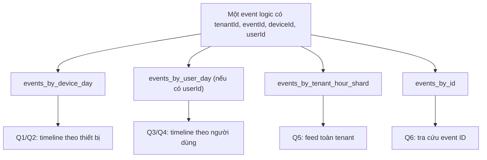
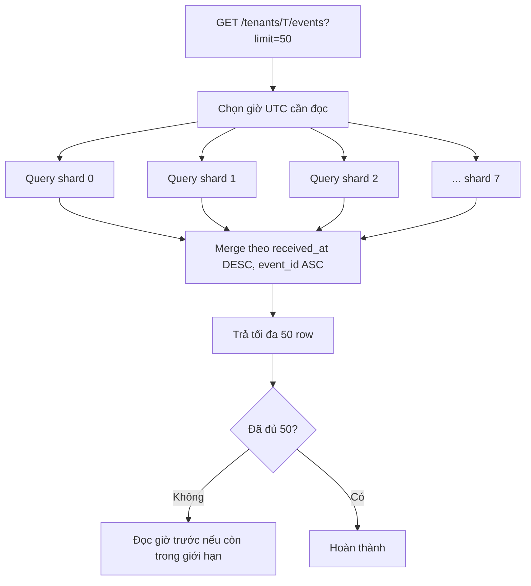
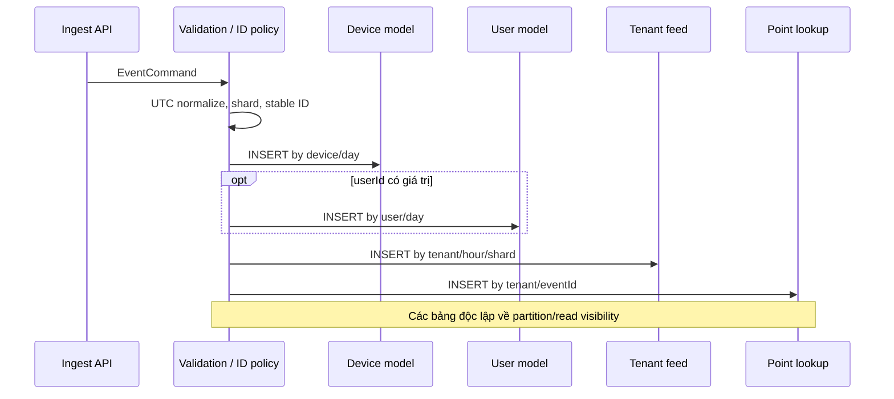
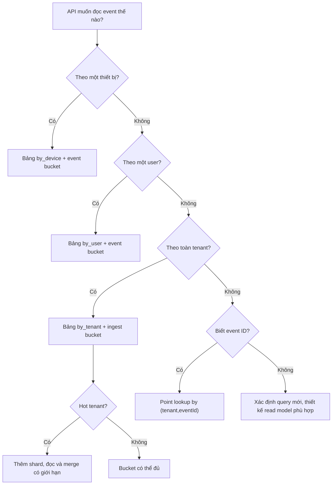

# Mẫu truy vấn sự kiện theo thiết bị, người dùng hoặc tenant

Một hệ thống IoT hoặc SaaS đa tenant thường nhận nhiều sự kiện có cấu trúc tương tự: thiết bị báo trạng thái, người dùng thực hiện thao tác, backend phát sinh thông báo, hoặc một dịch vụ ghi audit log. Tuy nhiên, các màn hình lại đặt ra **ba câu hỏi khác nhau**:

- “Trong 15 phút gần đây, **thiết bị D của tenant T** có những sự kiện gì?”
- “Hiển thị 30 hoạt động mới nhất của **người dùng U trong tenant T**.”
- “Hiển thị những sự kiện mới tiếp nhận của **toàn tenant T**, có thể đến từ hàng nghìn thiết bị và người dùng.”

Với **Apache Cassandra**, ba câu hỏi này hiếm khi được phục vụ hiệu quả bằng **một bảng chung rồi lọc tùy ý**. Cassandra tối ưu cho **query-first data modeling**: thiết kế partition key và clustering key từ truy vấn cần chạy; khi cần những đường đọc khác nhau, ứng dụng thường **ghi một event vào nhiều bảng read model**.

Trong **Spring Data Cassandra**, các bảng này có thể được ánh xạ bằng `@Table`, `@PrimaryKeyClass`, truy vấn qua `CassandraRepository`/`CassandraTemplate`, hoặc sử dụng prepared CQL của Java driver. Trọng tâm không phải một annotation đặc biệt cho “time series”, mà là **khóa phân vùng, bucket theo thời gian, thứ tự clustering, quyền truy cập tenant, giới hạn fan-out và tính nhất quán giữa các bản sao dữ liệu**.

Bài thuộc chương **Dữ liệu thời gian** của module **SPRING_DATA_CASSANDRA**, sử dụng ví dụ Java 17+, Spring Data Cassandra **4.5.x**, Apache Cassandra CQL và Java driver 4.x. Các khóa và dữ liệu là mẫu lab, không phải dữ liệu thực. Mục tiêu là giải thích cách xây các **mẫu truy vấn sự kiện theo thiết bị, người dùng hoặc tenant** có thể kiểm soát hiệu năng trong một hệ thống phân tán.

> **Quy ước:** `event_at` là thời điểm sự kiện xảy ra theo nguồn; `received_at` là thời điểm hệ thống tiếp nhận; `event_id` là ID ổn định của một event logic. Tất cả bucket được tính theo **UTC**, và ví dụ dùng `timestamp` + `uuid` để giữ nhiều event trùng mili-giây. Nếu ứng dụng có yêu cầu sắp xếp theo thời điểm tạo UUID hoặc thứ tự nghiệp vụ nghiêm ngặt, phải xem xét `timeuuid` hoặc sequence riêng; không tự suy ra từ `timestamp`.

## 1. Mục tiêu học tập

Sau bài này, bạn có thể:

1. Liệt kê các truy vấn quan trọng theo **device**, **user** và **tenant** trước khi tạo schema Cassandra.
2. Thiết kế **`PRIMARY KEY ((tenant_id, device_id, event_day), event_at, event_id)`** để đọc dòng thời gian một thiết bị.
3. Thiết kế bảng tương ứng theo **người dùng** mà không dùng `ALLOW FILTERING` trên bảng thiết bị.
4. Giải thích vì sao feed toàn tenant có thể cần **bucket theo giờ và shard**, cũng như chi phí đọc nhiều shard.
5. Chọn **event time** hoặc **ingest time** làm trục sắp xếp đúng yêu cầu.
6. Viết CQL đọc **N sự kiện mới nhất**, đọc **khoảng `[start, end)`**, và tra cứu một event theo ID.
7. Dùng composite partition key và clustering columns để tránh partition quá lớn và tránh ghi đè event cùng timestamp.
8. Ánh xạ read model bằng Spring Data Cassandra và chạy `@Query`/`CassandraTemplate.select(...)`.
9. Đọc giới hạn `LIMIT`, page size, paging state, multi-bucket và multi-shard đúng nghĩa.
10. Giải thích sự khác biệt giữa **denormalization có chủ đích** và **transaction đa bảng có isolation**.
11. Đảm bảo **tenant isolation ở cả khóa dữ liệu lẫn tầng authorization**.
12. Đánh giá TTL, compaction, hot partition, retention, retry, duplicate và late events.
13. Viết integration test chứng minh truy vấn thiết bị, người dùng và tenant không đọc nhầm dữ liệu.

## 2. Bắt đầu từ hợp đồng truy vấn

Trước khi viết `CREATE TABLE`, hãy liệt kê truy vấn được API thực sự hỗ trợ:

| Mã | Câu hỏi của ứng dụng | Tham số bắt buộc | Thứ tự mong muốn |
|---|---|---|---|
| **Q1** | 50 event mới nhất của thiết bị | `tenantId`, `deviceId`, khoảng ngày | `event_at DESC` |
| **Q2** | Event của thiết bị trong `[from, to)` | `tenantId`, `deviceId`, khoảng thời gian | `event_at DESC` |
| **Q3** | 30 hoạt động gần đây của user | `tenantId`, `userId`, khoảng ngày | `event_at DESC` |
| **Q4** | Timeline user trong một ngày | `tenantId`, `userId`, `day` | `event_at DESC` |
| **Q5** | Các event vừa tiếp nhận của tenant | `tenantId`, các giờ gần nhất | `received_at DESC` |
| **Q6** | Lấy chi tiết một event khi biết ID | `tenantId`, `eventId` | Không cần sắp thứ tự |
| **Q7** | Dashboard toàn tenant theo loại event | `tenantId`, `eventType`, khoảng thời gian | Tùy nhu cầu; cần read model/index riêng nếu là hot query |
| **Q8** | Tổng hợp 100 event mới nhất của 10.000 thiết bị | `tenantId`, tập thiết bị, thời gian | Global order; cần merge hoặc read model chuyên biệt |

Ba bảng **theo thiết bị**, **theo người dùng**, **theo feed tenant** không phải lựa chọn dư thừa. Mỗi bảng phục vụ một **access pattern**.

### 2.1. Ánh xạ query sang bảng



**Read model** ở đây nghĩa là bảng phi chuẩn hóa phục vụ một cách đọc. Đó **không bắt buộc** là tính năng Cassandra `MATERIALIZED VIEW`. Ví dụ sẽ chủ động ghi nhiều bảng để dễ hiểu khóa và chiến lược consistency.

### 2.2. Không có một bảng “event” vạn năng

Nếu lưu:

```sql
CREATE TABLE events_bad (
    event_id uuid PRIMARY KEY,
    tenant_id uuid,
    device_id uuid,
    user_id uuid,
    event_at timestamp,
    payload text
);
```

thì truy vấn:

```sql
-- Không phù hợp primary key của events_bad:
SELECT *
FROM events_bad
WHERE tenant_id = ?
  AND device_id = ?
ORDER BY event_at DESC;
```

không trở thành query hiệu quả chỉ vì có cột `tenant_id`, `device_id` và `event_at`. Bảng này chỉ tối ưu **point lookup theo `event_id`**, không tối ưu timeline theo device/user.

Thêm `ALLOW FILTERING` để chạy truy vấn trên phạm vi rộng thường biến vấn đề schema thành vấn đề latency, fan-out và tài nguyên. Secondary index/SAI có những use case hữu ích nhưng **không thay thế tự động thiết kế partition key + clustering order cho timeline thường xuyên được đọc**.

### 2.3. Thứ tự đọc phải được định nghĩa

Hai hệ thống có thể nhận cùng event nhưng yêu cầu thứ tự khác nhau:

- **Device timeline:** event sensor đo lúc 08:00 có thể đến gateway lúc 08:10; API xếp theo **`event_at`**.
- **Tenant activity feed:** UI hỏi “những gì hệ thống vừa tiếp nhận”, nên xếp theo **`received_at`**.
- **Audit workflow nghiêm ngặt:** nếu yêu cầu A trước B bất kể đồng hồ host, phải có **sequence/offset authoritative**; `timestamp`/`timeuuid` chỉ có khả năng sắp theo thành phần thời gian và không sửa được clock skew.

Trong bài, tất cả event được lưu thêm cả `event_at` và `received_at` để có thể phân tích độ trễ và tránh dùng nhầm một trục thời gian.

## 3. Ba quy tắc nền tảng của Cassandra

### 3.1. Partition key quyết định đơn vị truy vấn hiệu quả

Ví dụ:

```sql
PRIMARY KEY ((tenant_id, device_id, event_day), event_at, event_id)
```

Ba cột **`tenant_id`, `device_id`, `event_day`** cùng tạo **một composite partition key**. `event_at` và `event_id` là **clustering columns** sắp xếp row trong partition.

Một query theo `device_id` mà bỏ `tenant_id`/`event_day` **không biết đầy đủ partition**, dù tên cột “device ID” có vẻ đủ trong logic nghiệp vụ.

### 3.2. Clustering giúp đọc theo thứ tự trong một partition

```sql
WITH CLUSTERING ORDER BY (event_at DESC, event_id ASC)
```

Nghĩa là khi đọc một partition:

1. Sự kiện có `event_at` **mới hơn đứng trước**.
2. Nếu hai sự kiện cùng mili-giây, `event_id` quyết định thứ tự ổn định.

Cassandra không cấp một `ORDER BY event_at DESC` **toàn cluster** chỉ vì một số bảng dùng clustering DESC. Query xuyên nhiều partition phải **merge** hoặc dùng read model được thiết kế cho cách đọc đó.

### 3.3. Không có JOIN đa bảng như RDBMS

Cassandra không hỗ trợ cách mô hình hóa “đọc bảng events rồi JOIN với users/devices để có dữ liệu hiển thị” theo SQL quan hệ thông thường. Thực tế thường là:

- **Nhân bản những cột cần hiển thị** vào bảng read model.
- Chỉ giữ những trường tương đối nhỏ, cần thiết; tránh copy payload rất lớn khắp nơi.
- Chấp nhận và quản lý chi phí đồng bộ nhiều bảng khi cập nhật/xóa.
- Nếu dữ liệu nhạy cảm cần xóa ở mọi bản sao, có kế hoạch xóa/retention cho **từng bảng**.

Đây là **denormalization theo truy vấn**, không phải thất bại của thiết kế chuẩn hóa.

## 4. Chuẩn bị schema lab theo bốn đường truy vấn

### 4.1. Keyspace thử nghiệm

```sql
-- Chỉ cho cluster lab một node.
CREATE KEYSPACE IF NOT EXISTS sdc_event_lab
WITH replication = {
    'class': 'SimpleStrategy',
    'replication_factor': 1
};
```

Production nhiều node/datacenter cần `NetworkTopologyStrategy`, RF, consistency, TLS, authentication và repair policy phù hợp. Không dùng mẫu RF=1 làm production template.

### 4.2. Bảng sự kiện theo thiết bị

```sql
CREATE TABLE IF NOT EXISTS sdc_event_lab.events_by_device_day (
    tenant_id uuid,
    device_id uuid,
    event_day date,
    event_at timestamp,
    event_id uuid,
    user_id uuid,
    event_type text,
    received_at timestamp,
    payload text,
    PRIMARY KEY (
        (tenant_id, device_id, event_day),
        event_at,
        event_id
    )
) WITH CLUSTERING ORDER BY (
    event_at DESC,
    event_id ASC
);
```

Các lựa chọn chủ đích:

- `tenant_id` đứng trong partition key để chia tách phạm vi dữ liệu tenant.
- `device_id` đứng trong partition key để đọc một thiết bị mà không quét thiết bị khác.
- `event_day` (UTC) giới hạn quy mô partition và hỗ trợ retention theo bucket.
- `event_at timestamp` là clustering chính theo **thời điểm sự kiện**.
- `event_id uuid` giúp giữ **hai event trùng millisecond** dưới hai row.
- `user_id`, `event_type`, `received_at`, `payload` là regular columns, không phải khóa của query theo device.

**Không nhầm `event_id` của PK với version/lần sửa**. Một event logic phải giữ ID ổn định qua retry, nếu không sẽ bị nhân bản.

### 4.3. Bảng sự kiện theo người dùng

```sql
CREATE TABLE IF NOT EXISTS sdc_event_lab.events_by_user_day (
    tenant_id uuid,
    user_id uuid,
    event_day date,
    event_at timestamp,
    event_id uuid,
    device_id uuid,
    event_type text,
    received_at timestamp,
    payload text,
    PRIMARY KEY (
        (tenant_id, user_id, event_day),
        event_at,
        event_id
    )
) WITH CLUSTERING ORDER BY (
    event_at DESC,
    event_id ASC
);
```

Đây là **một read model riêng**, không phải Cassandra tự sắp lại bảng thiết bị theo `user_id`.

Bảng này phù hợp query “**user U làm những gì trong ngày D**”. Nếu event **không gắn user** (ví dụ heartbeat tự động của thiết bị), ứng dụng **không tạo row** ở bảng theo user; không dùng một UUID giả cho “mọi user không xác định” vì nó có thể tạo partition rất nóng.

### 4.4. Bảng feed toàn tenant theo giờ và shard

Một tenant lớn có thể có hàng chục nghìn device. Nếu đặt tất cả event của tenant vào một partition duy nhất, nó sẽ thành **hot/wide partition**. Ta tạo read model có:

- Bucket theo **giờ nhận**: `ingest_hour`, chuẩn hóa UTC về đầu giờ.
- Shard `0..7` cho mỗi tenant/giờ.
- Sắp theo `received_at DESC`, vì feed tenant hỏi “vừa nhận”.

```sql
CREATE TABLE IF NOT EXISTS sdc_event_lab.events_by_tenant_hour_shard (
    tenant_id uuid,
    ingest_hour timestamp,
    shard smallint,
    received_at timestamp,
    event_id uuid,
    device_id uuid,
    user_id uuid,
    event_type text,
    event_at timestamp,
    payload text,
    PRIMARY KEY (
        (tenant_id, ingest_hour, shard),
        received_at,
        event_id
    )
) WITH CLUSTERING ORDER BY (
    received_at DESC,
    event_id ASC
);
```

**Vì sao `shard` là một phần partition key?** Nó phân tán write/read trên nhiều partition logic trong cùng tenant và cùng giờ. Khi tìm “50 event mới nhất của tenant”, phải **đọc những shard liên quan rồi merge kết quả** ở ứng dụng. Shard làm tăng chi phí đọc, nên **không chọn 8 một cách máy móc**; số shard phụ thuộc tải tenant và mục tiêu fan-out.

**Không bảo đảm thứ tự tenant toàn cầu** chỉ bằng cách đặt `tenant_id` và `received_at` vào schema. CQL chỉ sắp xếp **trong mỗi partition**, còn 8 shard là 8 partition.

### 4.5. Bảng tra cứu event theo ID

Nếu một API nhận `tenantId` và `eventId` nhưng không biết thiết bị/ngày, cần read model tra cứu điểm:

```sql
CREATE TABLE IF NOT EXISTS sdc_event_lab.events_by_id (
    tenant_id uuid,
    event_id uuid,
    device_id uuid,
    user_id uuid,
    event_at timestamp,
    received_at timestamp,
    event_type text,
    payload text,
    PRIMARY KEY ((tenant_id, event_id))
);
```

Cặp `(tenant_id, event_id)` là **composite partition key**, nên mỗi event ID của tenant trỏ tới một partition riêng. Đây là trade-off **nhiều partition nhỏ để point lookup**, không phải bảng để quét timeline.

Nếu không cần Q6, **đừng tạo bảng này chỉ vì mọi event phải có một bảng “gốc”**. Cassandra không bắt buộc một bảng canonical cho mọi mô hình nghiệp vụ; quyết định phụ thuộc query thật và nhu cầu đối soát.

### 4.6. Tổng hợp bốn khóa

| Bảng | Partition key | Clustering keys | Trục thời gian |
|---|---|---|---|
| `events_by_device_day` | `(tenant_id, device_id, event_day)` | `event_at DESC, event_id ASC` | **Event time** |
| `events_by_user_day` | `(tenant_id, user_id, event_day)` | `event_at DESC, event_id ASC` | **Event time** |
| `events_by_tenant_hour_shard` | `(tenant_id, ingest_hour, shard)` | `received_at DESC, event_id ASC` | **Ingest time** |
| `events_by_id` | `(tenant_id, event_id)` | Không có | Point lookup |

Đây là **bốn bảng cho bốn truy vấn**, không phải bốn cách viết cùng một CQL SELECT.

## 5. Ghi dữ liệu lab vào nhiều read model

### 5.1. Một sự kiện logic

Giả sử có event:

```text
tenant_id   = 11111111-1111-4111-8111-111111111111
device_id   = 22222222-2222-4222-8222-222222222222
user_id     = 33333333-3333-4333-8333-333333333333
event_id    = aaaaaaaa-aaaa-4aaa-8aaa-aaaaaaaaaaaa
event_type  = USER_ACTION
event_at    = 2026-11-25T09:15:00.123Z
received_at = 2026-11-25T09:15:01.200Z
event_day   = 2026-11-25        (theo event_at)
ingest_hour = 2026-11-25T09:00:00Z (theo received_at)
shard       = 3                 (giá trị ví dụ đã xác định)
```

Đây là **một sự kiện**, không phải bốn sự kiện riêng. Nó được nhân bản sang những bảng có đường đọc tương ứng.

### 5.2. INSERT vào bảng theo thiết bị

```sql
INSERT INTO sdc_event_lab.events_by_device_day
(tenant_id, device_id, event_day, event_at, event_id,
 user_id, event_type, received_at, payload)
VALUES (
    11111111-1111-4111-8111-111111111111,
    22222222-2222-4222-8222-222222222222,
    '2026-11-25',
    '2026-11-25T09:15:00.123Z',
    aaaaaaaa-aaaa-4aaa-8aaa-aaaaaaaaaaaa,
    33333333-3333-4333-8333-333333333333,
    'USER_ACTION',
    '2026-11-25T09:15:01.200Z',
    'Opened dashboard'
);
```

### 5.3. INSERT vào bảng theo user

```sql
INSERT INTO sdc_event_lab.events_by_user_day
(tenant_id, user_id, event_day, event_at, event_id,
 device_id, event_type, received_at, payload)
VALUES (
    11111111-1111-4111-8111-111111111111,
    33333333-3333-4333-8333-333333333333,
    '2026-11-25',
    '2026-11-25T09:15:00.123Z',
    aaaaaaaa-aaaa-4aaa-8aaa-aaaaaaaaaaaa,
    22222222-2222-4222-8222-222222222222,
    'USER_ACTION',
    '2026-11-25T09:15:01.200Z',
    'Opened dashboard'
);
```

### 5.4. INSERT vào feed tenant

```sql
INSERT INTO sdc_event_lab.events_by_tenant_hour_shard
(tenant_id, ingest_hour, shard, received_at, event_id,
 device_id, user_id, event_type, event_at, payload)
VALUES (
    11111111-1111-4111-8111-111111111111,
    '2026-11-25T09:00:00Z',
    3,
    '2026-11-25T09:15:01.200Z',
    aaaaaaaa-aaaa-4aaa-8aaa-aaaaaaaaaaaa,
    22222222-2222-4222-8222-222222222222,
    33333333-3333-4333-8333-333333333333,
    'USER_ACTION',
    '2026-11-25T09:15:00.123Z',
    'Opened dashboard'
);
```

### 5.5. INSERT vào bảng point lookup

```sql
INSERT INTO sdc_event_lab.events_by_id
(tenant_id, event_id, device_id, user_id,
 event_at, received_at, event_type, payload)
VALUES (
    11111111-1111-4111-8111-111111111111,
    aaaaaaaa-aaaa-4aaa-8aaa-aaaaaaaaaaaa,
    22222222-2222-4222-8222-222222222222,
    33333333-3333-4333-8333-333333333333,
    '2026-11-25T09:15:00.123Z',
    '2026-11-25T09:15:01.200Z',
    'USER_ACTION',
    'Opened dashboard'
);
```

Bốn INSERT riêng lẻ minh họa mô hình. **Chúng không có transaction SQL đa bảng**. Nếu thao tác thứ ba thất bại thì hai bảng đầu có thể đã được ghi. Mục 14 sẽ bàn về retry, logged batch nhỏ và reconciliation.

### 5.6. Thêm event thứ hai cùng mili-giây

```sql
INSERT INTO sdc_event_lab.events_by_device_day
(tenant_id, device_id, event_day, event_at, event_id,
 user_id, event_type, received_at, payload)
VALUES (
    11111111-1111-4111-8111-111111111111,
    22222222-2222-4222-8222-222222222222,
    '2026-11-25',
    '2026-11-25T09:15:00.123Z',
    bbbbbbbb-bbbb-4bbb-8bbb-bbbbbbbbbbbb,
    33333333-3333-4333-8333-333333333333,
    'USER_ACTION',
    '2026-11-25T09:15:01.250Z',
    'Clicked button'
);
```

Hai event có **cùng `event_at`** nhưng khác `event_id`, nên sẽ có **hai row**. Nếu primary key chỉ có `event_at`, mutation sau có thể ghi đè giá trị của row trước.

Bài lab chỉ seed event thứ hai vào **bảng thiết bị** để kiểm tra timestamp collision. Trong pipeline production, nếu đó là event hợp lệ cho user/tenant, phải ghi đầy đủ những read model được yêu cầu và theo dõi độ lệch giữa chúng.

## 6. Mẫu Q1: những sự kiện mới nhất của một thiết bị

### 6.1. Một ngày, một partition

```sql
SELECT event_at, event_id, event_type, received_at, payload
FROM sdc_event_lab.events_by_device_day
WHERE tenant_id = 11111111-1111-4111-8111-111111111111
  AND device_id = 22222222-2222-4222-8222-222222222222
  AND event_day = '2026-11-25'
LIMIT 50;
```

Query đã biết **toàn bộ partition key**. Vì schema đặt `event_at DESC`, những event mới hơn **đứng trước trong một partition**. `LIMIT 50` giới hạn số row của query.

Không cần `ALLOW FILTERING`, không cần sort một List hàng triệu row trong Java, và không cần index `event_at` riêng.

### 6.2. Chỉ đọc trong một khoảng thời gian

```sql
SELECT event_at, event_id, event_type, payload
FROM sdc_event_lab.events_by_device_day
WHERE tenant_id = 11111111-1111-4111-8111-111111111111
  AND device_id = 22222222-2222-4222-8222-222222222222
  AND event_day = '2026-11-25'
  AND event_at >= '2026-11-25T09:00:00Z'
  AND event_at <  '2026-11-25T10:00:00Z'
LIMIT 100;
```

Đây là **khoảng nửa mở `[from, to)`**: bao gồm mốc bắt đầu và loại mốc kết thúc. Nó thuận tiện khi ghép nhiều cửa sổ liên tiếp và tránh đếm trùng event nằm đúng biên.

Đối với CQL `timestamp`, điều kiện dùng **độ phân giải mili-giây**. Nếu Java nhận `Instant` có nanosecond, phải chuẩn hóa cách làm tròn/cắt và kiểm thử tại biên.

### 6.3. Vì sao chỉ WHERE device_id là sai?

```sql
-- Sai access pattern đối với bảng này:
SELECT *
FROM sdc_event_lab.events_by_device_day
WHERE device_id = 22222222-2222-4222-8222-222222222222;
```

Vì partition key là **`(tenant_id, device_id, event_day)`**. Cassandra cần đủ giá trị để định tuyến read; không được suy ra `device_id` toàn cầu là duy nhất nếu schema/authorization yêu cầu tenant.

Nếu API muốn “mọi event của device trong 90 ngày”, ứng dụng phải **xác định 90 buckets**, và **giới hạn số ngày/partition** được phép đọc trong một request. Nếu workload thường xuyên cần timeline không giới hạn, cần xem xét read model khác hoặc cơ chế export riêng.

### 6.4. Truy vấn 50 sự kiện mới nhất qua nhiều ngày

Nếu ngày hiện tại chỉ có 5 row, mà API cần 50:

1. Đọc partition **ngày hiện tại** với `LIMIT 50`.
2. Nếu có ít hơn 50, đọc **ngày trước** với số lượng còn thiếu.
3. Lặp đến khi có đủ hoặc chạm **giới hạn số ngày**, ví dụ tối đa 7 ngày.
4. Ghép kết quả theo `event_at DESC, event_id ASC`, có tính đến late events và timezone UTC.

**Không** phát một truy vấn không `WHERE` để Cassandra tự “tìm 50 event toàn bảng”. Đó là quét dữ liệu rộng không kiểm soát.

### 6.5. Device timeline không đồng nghĩa trạng thái hiện tại

Một bảng event time-series phục vụ **lịch sử**. Nếu UI cần “trạng thái ONLINE/OFFLINE hiện tại”, có thể cần **bảng trạng thái hiện tại theo device ID** riêng (latest-state read model), thay vì mỗi lần đọc lại hàng nghìn event và suy ra trạng thái.

Cần bảo đảm state update tuân thủ ordering/clock chính sách phù hợp; một event đến muộn không nên tự động ghi đè state hiện tại nếu business yêu cầu monotonic state.

## 7. Mẫu Q2: sự kiện theo người dùng trong tenant

### 7.1. Đọc activity timeline

```sql
SELECT event_at, event_id, device_id, event_type, payload
FROM sdc_event_lab.events_by_user_day
WHERE tenant_id = 11111111-1111-4111-8111-111111111111
  AND user_id = 33333333-3333-4333-8333-333333333333
  AND event_day = '2026-11-25'
LIMIT 30;
```

Chỉ khác truy vấn theo device ở **bảng** và **partition key**. Đây là lý do ứng dụng ghi một event có user vào read model `events_by_user_day` ngay từ ingest (hoặc cập nhật bằng pipeline projection).

**Không** chạy:

```sql
-- Không phù hợp schema events_by_device_day:
SELECT *
FROM sdc_event_lab.events_by_device_day
WHERE user_id = 33333333-3333-4333-8333-333333333333;
```

`user_id` ở bảng thiết bị là regular column. Nó không đủ để truy vấn timeline user theo partition. `ALLOW FILTERING` có thể khiến Cassandra phải bỏ qua lượng dữ liệu rất lớn.

### 7.2. Một người dùng dùng nhiều thiết bị

Giả sử user U dùng device A và B cùng ngày. Vì bảng `events_by_user_day` dùng `(tenant_id, user_id, event_day)`, event của A và B thuộc **cùng partition user/ngày**, giúp UI đọc timeline của user không cần fan-out theo từng device.

Đổi lại:

- User có tải cực cao có thể tạo **hot partition**.
- Lưu event theo user cần nhận diện chính xác user tại thời điểm sự kiện.
- Event ẩn danh hoặc background device có thể không có user.
- Nếu cần lọc riêng theo device **trong user timeline** với tải lớn, có thể cần một read model cụ thể hơn.

### 7.3. Multi-tenant identity

`user_id` có thể trùng giữa các tenant, nhất là khi user ID do hệ thống bên ngoài cung cấp. **Không dùng mỗi `user_id` để làm partition key** nếu dữ liệu cần phân tách theo tenant.

Ví dụ:

```text
Tenant A, User U -> partition (A, U, 2026-11-25)
Tenant B, User U -> partition (B, U, 2026-11-25)
```

Sự khác nhau này nằm trong khóa và query. Nhưng đó mới là **phân tách logical bằng schema**. Ứng dụng vẫn phải kiểm tra quyền tenant trước khi chạy SELECT.

### 7.4. Event không có userId

Ví dụ `DEVICE_HEARTBEAT` không có user hợp lệ:

- Vẫn ghi vào `events_by_device_day`.
- Vẫn ghi vào `events_by_tenant_hour_shard` nếu tenant feed cần.
- **Không ghi** vào `events_by_user_day`.

Không tạo “user `00000000-...`” gom mọi event không có user vào một partition, vì nó có thể thành điểm nóng và khiến business semantics sai.

### 7.5. Theo user trong khoảng nhiều ngày

Với query `[2026-11-24T23:30Z, 2026-11-25T00:30Z)`, event thuộc **hai partitions** theo `event_day`:

```text
(tenant_id, user_id, 2026-11-24)
(tenant_id, user_id, 2026-11-25)
```

Ứng dụng chạy hai CQL query theo ngày rồi merge. Một `ORDER BY event_at DESC` không tự sắp đồng thời dữ liệu của cả hai partition.

## 8. Mẫu Q3: feed hoạt động theo toàn tenant

### 8.1. Vì sao chỉ partition theo tenant_id dễ nguy hiểm?

Một thiết kế đơn giản:

```sql
-- Anti-pattern cho tenant có lưu lượng lớn:
PRIMARY KEY ((tenant_id), received_at, event_id)
```

tạo **một partition ngày càng lớn cho mỗi tenant**, dễ thành hot partition theo số lượt ghi. Retention dài, nhiều sự kiện và đọc phạm vi lớn sẽ gây áp lực disk, SSTable, compaction, coordinator và repair.

Bucket theo thời gian hạn chế chiều rộng, còn **sharding** phân tán tải của cùng tenant trong một bucket. Hai kỹ thuật giải quyết hai khía cạnh khác nhau.

### 8.2. Bucket theo ingest hour

Schema đã chọn:

```sql
PRIMARY KEY (
    (tenant_id, ingest_hour, shard),
    received_at,
    event_id
)
```

`ingest_hour` được tính từ **`received_at`**, làm tròn **xuống đầu giờ UTC**.

Ví dụ:

```text
received_at = 2026-11-25T09:15:01.200Z
ingest_hour = 2026-11-25T09:00:00.000Z
```

Không tính `ingest_hour` từ `event_at`, vì một sự kiện xảy ra hôm qua nhưng vừa được tiếp nhận sáng nay phải xuất hiện trong **feed “vừa nhận” của giờ hiện tại**.

### 8.3. Shard là một quy tắc ổn định, không phải số random mỗi retry

Giả sử có 8 shard (`0..7`). Một hàm mapping ổn định:

```java
import java.util.UUID;

public final class TenantShard {

    public static short forEvent(UUID eventId, int shardCount) {
        if (eventId == null || shardCount <= 0 ||
            shardCount > Short.MAX_VALUE) {
            throw new IllegalArgumentException("Shard config khong hop le");
        }
        return (short) Math.floorMod(
            eventId.hashCode(), shardCount
        );
    }
}
```

`UUID.hashCode()` được dùng minh họa để chọn shard ổn định cho **cùng một UUID**; mức phân phối thực tế phải được đo. Trong production, có thể dùng hash ổn định có đặc tính phân phối tốt hơn, nhưng **đừng đổi shard algorithm/shardCount tùy tiện**: event cũ có thể nằm ở shard khác, và reader phải biết cả cấu hình lịch sử.

**Không chọn shard bằng `new Random().nextInt(8)` ở mỗi retry**. Khi đó một event logic có thể được ghi vào nhiều partition khác nhau, gây duplicate khó đối soát.

### 8.4. Query một shard của một giờ

```sql
SELECT received_at, event_id, device_id, user_id,
       event_type, event_at, payload
FROM sdc_event_lab.events_by_tenant_hour_shard
WHERE tenant_id = 11111111-1111-4111-8111-111111111111
  AND ingest_hour = '2026-11-25T09:00:00Z'
  AND shard = 3
LIMIT 50;
```

Đây là **một partition**: tenant + giờ + shard. CQL trả row theo `received_at DESC, event_id ASC` trong partition.

### 8.5. Feed toàn tenant phải đọc nhiều shard rồi merge

Để trả **50 event mới nhất toàn tenant của giờ 09:00**, ví dụ có 8 shard:

1. Đọc **8 partition** tương ứng `shard = 0..7`, mỗi query có `LIMIT 50`.
2. Mỗi partition trả kết quả đã sort theo `received_at DESC` với tie-break `event_id ASC`.
3. Ứng dụng **k-way merge** các chuỗi kết quả và lấy 50 event đầu, có tie-breaker nhất quán.
4. Nếu giờ hiện tại chưa đủ 50, tiếp tục giờ trước, với **giới hạn số giờ**.
5. Áp dụng timeout và giới hạn concurrency, thay vì gửi vô hạn query cho mọi shard/giờ.



**Lưu ý về ordering:** nếu tự merge/paginate ở Java, comparator cho `UUID` phải phù hợp với thứ tự được định nghĩa trong CQL, không mặc định rằng `java.util.UUID.compareTo` luôn đồng nhất với comparator của Cassandra cho mọi kiểu UUID. Với màn hình không cần thứ tự vật lý của event trùng millisecond, có thể định nghĩa một tie-breaker thống nhất trong API và thực hiện merge đúng theo contract đó.

### 8.6. Khi nào không nên shard?

Nếu tenant chỉ có vài chục event/giờ, tám shard có thể tăng từ **1 lên 8 query** cho một feed mà chẳng giảm được tải đáng kể. Khi đó một partition theo `(tenant_id, ingest_hour)` có thể đơn giản hơn.

Nếu một tenant có hàng trăm nghìn event/phút, một giờ × tám shard có thể vẫn quá rộng/hot. Hãy cân nhắc bucket ngắn hơn hoặc nhiều shard hơn, nhưng phải dựa trên **mức ghi, row size, p95/p99 và chi phí đọc**.

**Trade-off quan trọng:** càng nhiều shard, write càng phân tán; read feed toàn tenant càng phải fan-out và merge nhiều.

### 8.7. Query theo event type ở tenant là một access pattern khác

Câu:

```sql
-- event_type là regular column, không phải key của table này:
SELECT *
FROM sdc_event_lab.events_by_tenant_hour_shard
WHERE tenant_id = ?
  AND event_type = 'ALERT'
ORDER BY received_at DESC;
```

không phải query được bảng hiện tại hỗ trợ hiệu quả; còn thiếu `ingest_hour` và `shard`.

Nếu `event_type` là filter thường xuyên của dashboard, có thể cân nhắc bảng riêng như:

```sql
CREATE TABLE IF NOT EXISTS sdc_event_lab.alerts_by_tenant_hour_shard (
    tenant_id uuid,
    ingest_hour timestamp,
    shard smallint,
    received_at timestamp,
    event_id uuid,
    device_id uuid,
    event_type text,
    PRIMARY KEY (
        (tenant_id, ingest_hour, shard),
        received_at,
        event_id
    )
) WITH CLUSTERING ORDER BY (
    received_at DESC,
    event_id ASC
);
```

Tác vụ ghi **chỉ đưa những event thực sự là ALERT** vào bảng này. Đây là **read model riêng có lọc trước lúc ghi**, không phải Cassandra tự “biến mọi regular column thành index”. Nếu cần tất cả loại event chọn động, phân tích SAI/secondary index hoặc một bảng theo `(tenant_id, event_type, bucket, shard)` với read fan-out phù hợp.

## 9. Mẫu Q4: tra cứu một event theo tenant và ID

```sql
SELECT event_id, device_id, user_id, event_at,
       received_at, event_type, payload
FROM sdc_event_lab.events_by_id
WHERE tenant_id = 11111111-1111-4111-8111-111111111111
  AND event_id = aaaaaaaa-aaaa-4aaa-8aaa-aaaaaaaaaaaa;
```

Với `PRIMARY KEY ((tenant_id, event_id))`, đây là point lookup đúng khóa.

Không dùng `WHERE event_id = ...` rồi giả định tenant được Cassandra tự suy ra. Nếu ID là UUID toàn cục, schema vẫn quy định **tenant_id phải có** trong composite partition key.

Lợi ích phụ: API nhận `eventId` có thể tải từ bảng điểm, tìm metadata `device_id`/`event_at`, rồi khi cần kiểm tra/projection sang bảng timeline sẽ biết đủ khóa. Nhưng hai read model có thể **tạm thời không đồng bộ** nếu pipeline ghi một bảng trước bảng kia.

## 10. Chuẩn hóa mốc thời gian và khóa trước khi ghi

### 10.1. Dùng UTC và millisecond

CQL `timestamp` biểu diễn **millisecond từ Unix epoch**. Java `Instant` có thể mang nanosecond; khi lưu vào Cassandra, độ phân giải cao hơn millisecond không được bảo toàn.

Vì vậy, chuẩn hóa khi tạo khóa:

```java
import java.time.Instant;
import java.time.LocalDate;
import java.time.ZoneOffset;
import java.time.temporal.ChronoUnit;

public final class TimeBuckets {

    public static Instant cqlTimestamp(Instant value) {
        if (value == null) {
            throw new IllegalArgumentException("Instant bat buoc");
        }
        return value.truncatedTo(ChronoUnit.MILLIS);
    }

    public static LocalDate eventDayUtc(Instant eventAt) {
        return LocalDate.ofInstant(
            cqlTimestamp(eventAt),
            ZoneOffset.UTC
        );
    }

    public static Instant ingestHourUtc(Instant receivedAt) {
        return cqlTimestamp(receivedAt).truncatedTo(
            ChronoUnit.HOURS
        );
    }
}
```

**Ranh giới quan trọng:** `event_day` luôn lấy từ `event_at`; `ingest_hour` lấy từ `received_at`. Không dùng timezone hệ điều hành/`LocalDate.now()` tùy tiện vì có thể tạo bucket sai khi qua nửa đêm UTC.

### 10.2. Event ID phải ổn định khi retry

Cassandra xem các row có **cùng tất cả thành phần primary key** là cùng row. Nếu retry tạo `UUID.randomUUID()` mới, một event logic trở thành hai row trong tất cả bảng timeline.

Quy tắc:

- Nếu nguồn đã có event ID unique, **giữ nguyên ID**.
- Nếu cần cấp ID, cấp **một lần** trước khi persist và lưu trong message/command khi retry.
- Không tự tạo ID mới trong mỗi attempt của retry operator.
- Với create-only semantics mạnh, cân nhắc CAS/`IF NOT EXISTS` tại nguồn idempotency; không trông chờ UUID ngẫu nhiên tự deduplicate.

### 10.3. Late arrival là dữ liệu bình thường

Một sự kiện từ thiết bị xảy ra `2026-11-24T23:58Z` nhưng chỉ được nhận `2026-11-25T09:00Z`:

```text
events_by_device_day   -> event_day = 2026-11-24
events_by_user_day     -> event_day = 2026-11-24 (nếu có user)
events_by_tenant_hour_shard -> ingest_hour = 2026-11-25T09:00Z
```

Không “sửa” event_at thành giờ nhận chỉ để nó xuất hiện ở trang mới nhất của device timeline, vì như vậy làm sai semantic event time. Nếu UI cần cả hai thứ tự, giữ **hai read model hoặc hai trục dữ liệu** như trên.

## 11. Spring Data Cassandra: ánh xạ bảng theo device

### 11.1. Composite key `EventDeviceKey`

```java
import java.io.Serializable;
import java.time.Instant;
import java.time.LocalDate;
import java.util.Objects;
import java.util.UUID;

import org.springframework.data.cassandra.core.cql.Ordering;
import org.springframework.data.cassandra.core.cql.PrimaryKeyType;
import org.springframework.data.cassandra.core.mapping.PrimaryKeyClass;
import org.springframework.data.cassandra.core.mapping.PrimaryKeyColumn;

@PrimaryKeyClass
public class EventDeviceKey implements Serializable {

    @PrimaryKeyColumn(
        name = "tenant_id", ordinal = 0,
        type = PrimaryKeyType.PARTITIONED
    )
    private UUID tenantId;

    @PrimaryKeyColumn(
        name = "device_id", ordinal = 1,
        type = PrimaryKeyType.PARTITIONED
    )
    private UUID deviceId;

    @PrimaryKeyColumn(
        name = "event_day", ordinal = 2,
        type = PrimaryKeyType.PARTITIONED
    )
    private LocalDate eventDay;

    @PrimaryKeyColumn(
        name = "event_at", ordinal = 3,
        type = PrimaryKeyType.CLUSTERED,
        ordering = Ordering.DESCENDING
    )
    private Instant eventAt;

    @PrimaryKeyColumn(
        name = "event_id", ordinal = 4,
        type = PrimaryKeyType.CLUSTERED,
        ordering = Ordering.ASCENDING
    )
    private UUID eventId;

    public EventDeviceKey() {}

    public EventDeviceKey(
        UUID tenantId,
        UUID deviceId,
        LocalDate eventDay,
        Instant eventAt,
        UUID eventId
    ) {
        this.tenantId = tenantId;
        this.deviceId = deviceId;
        this.eventDay = eventDay;
        this.eventAt = eventAt;
        this.eventId = eventId;
    }

    public UUID getTenantId() { return tenantId; }
    public void setTenantId(UUID value) { tenantId = value; }

    public UUID getDeviceId() { return deviceId; }
    public void setDeviceId(UUID value) { deviceId = value; }

    public LocalDate getEventDay() { return eventDay; }
    public void setEventDay(LocalDate value) { eventDay = value; }

    public Instant getEventAt() { return eventAt; }
    public void setEventAt(Instant value) { eventAt = value; }

    public UUID getEventId() { return eventId; }
    public void setEventId(UUID value) { eventId = value; }

    @Override
    public boolean equals(Object object) {
        if (this == object) return true;
        if (!(object instanceof EventDeviceKey other)) return false;
        return Objects.equals(tenantId, other.tenantId)
            && Objects.equals(deviceId, other.deviceId)
            && Objects.equals(eventDay, other.eventDay)
            && Objects.equals(eventAt, other.eventAt)
            && Objects.equals(eventId, other.eventId);
    }

    @Override
    public int hashCode() {
        return Objects.hash(
            tenantId, deviceId, eventDay, eventAt, eventId
        );
    }
}
```

Với key này:

- `tenant_id`/`device_id`/`event_day` là **ba phần của composite partition key**.
- `event_at`/`event_id` là **clustering columns**.
- `Ordering.DESCENDING/ASCENDING` phải tương thích **schema CQL thực**; annotation không tự làm migration primary key production.
- `Instant` được lưu về **millisecond** khi map CQL timestamp. Chuẩn hóa trước khi tạo key để tránh so sánh Java object sai sau readback.

### 11.2. Entity `EventByDevice`

```java
import java.time.Instant;
import java.util.UUID;

import org.springframework.data.cassandra.core.mapping.Column;
import org.springframework.data.cassandra.core.mapping.PrimaryKey;
import org.springframework.data.cassandra.core.mapping.Table;

@Table("events_by_device_day")
public class EventByDevice {

    @PrimaryKey
    private EventDeviceKey key;

    @Column("user_id")
    private UUID userId;

    @Column("event_type")
    private String eventType;

    @Column("received_at")
    private Instant receivedAt;

    @Column("payload")
    private String payload;

    public EventByDevice() {}

    public EventByDevice(
        EventDeviceKey key,
        UUID userId,
        String eventType,
        Instant receivedAt,
        String payload
    ) {
        this.key = key;
        this.userId = userId;
        this.eventType = eventType;
        this.receivedAt = receivedAt;
        this.payload = payload;
    }

    public EventDeviceKey getKey() { return key; }
    public void setKey(EventDeviceKey value) { key = value; }

    public UUID getUserId() { return userId; }
    public void setUserId(UUID value) { userId = value; }

    public String getEventType() { return eventType; }
    public void setEventType(String value) { eventType = value; }

    public Instant getReceivedAt() { return receivedAt; }
    public void setReceivedAt(Instant value) { receivedAt = value; }

    public String getPayload() { return payload; }
    public void setPayload(String value) { payload = value; }
}
```

Entity này được map **đúng bảng theo device**. Để dùng `CassandraTemplate.insert` cho bảng user/tenant, cần các entity/key class riêng hoặc dùng **prepared CQL**. Không đổi tên `@Table` runtime một cách tùy tiện để tái sử dụng object cho tất cả bảng.

### 11.3. Tạo entity với eventDay chính xác

```java
public EventByDevice forDevice(EventCommand command) {
    Instant at = TimeBuckets.cqlTimestamp(command.eventAt());
    Instant received = TimeBuckets.cqlTimestamp(
        command.receivedAt()
    );

    EventDeviceKey key = new EventDeviceKey(
        command.tenantId(),
        command.deviceId(),
        TimeBuckets.eventDayUtc(at),
        at,
        command.eventId()
    );

    return new EventByDevice(
        key,
        command.userId(),
        command.eventType(),
        received,
        command.payload()
    );
}
```

`EventCommand` ở ví dụ là DTO đầu vào được khai báo ở mục 13. Đây là **fragment** đặt trong service/factory. Không tạo `eventId` trong method chuyển entity nếu command đã mang stable ID — làm vậy sẽ phá idempotency.

## 12. Repository và CassandraTemplate đọc timeline device

### 12.1. Repository với @Query

```java
import java.time.Instant;
import java.time.LocalDate;
import java.util.List;
import java.util.UUID;

import org.springframework.data.cassandra.repository.CassandraRepository;
import org.springframework.data.cassandra.repository.Query;

public interface EventByDeviceRepository
        extends CassandraRepository<EventByDevice, EventDeviceKey> {

    @Query("""
        SELECT *
        FROM events_by_device_day
        WHERE tenant_id = ?0
          AND device_id = ?1
          AND event_day = ?2
          AND event_at >= ?3
          AND event_at < ?4
        LIMIT ?5
        """)
    List<EventByDevice> findInWindow(
        UUID tenantId,
        UUID deviceId,
        LocalDate eventDay,
        Instant fromInclusive,
        Instant toExclusive,
        int limit
    );
}
```

Đây là CQL **có bind markers** theo thứ tự, không ghép raw input vào query text. Tên table không kèm keyspace vì giả định Spring đã kết nối **`sdc_event_lab`** làm default keyspace.

Khi `findInWindow(...)` trả `List`, ứng dụng nên validate `limit` nhỏ và có upper bound, ví dụ `1..100`. Không gọi một query không `LIMIT` rồi materialize toàn bộ partition trong heap.

### 12.2. Đọc bằng CassandraTemplate và Criteria

```java
import java.time.Instant;
import java.time.LocalDate;
import java.util.List;
import java.util.UUID;

import org.springframework.data.cassandra.core.CassandraTemplate;
import org.springframework.data.cassandra.core.query.Criteria;
import org.springframework.data.cassandra.core.query.Query;

public class EventDeviceReader {

    private final CassandraTemplate template;

    public EventDeviceReader(CassandraTemplate template) {
        this.template = template;
    }

    public List<EventByDevice> readWindow(
        UUID tenantId,
        UUID deviceId,
        LocalDate day,
        Instant from,
        Instant to,
        int limit
    ) {
        if (!from.isBefore(to) || limit < 1 || limit > 100) {
            throw new IllegalArgumentException(
                "Range/limit khong hop le"
            );
        }

        Query query = Query.query(
            Criteria.where("tenant_id").is(tenantId),
            Criteria.where("device_id").is(deviceId),
            Criteria.where("event_day").is(day),
            Criteria.where("event_at").gte(from),
            Criteria.where("event_at").lt(to)
        ).limit(limit);

        return template.select(query, EventByDevice.class);
    }
}
```

`Query.query(Criteria...)`, `gte(...)`/`lt(...)` và `limit(...)` là APIs của Spring Data Cassandra 4.5. **Hãy giữ kết quả của `limit(...)`** vì Query settings có semantics tạo Query mới. Đừng bỏ giá trị trả về rồi kỳ vọng limit tự được áp dụng.

### 12.3. Không sort tùy ý bằng Pageable

Với Cassandra, `Sort.by("eventType")` không làm server sort mọi sự kiện theo `event_type` nếu cột này không nằm trong clustering order. Chỉ dùng những thứ tự hợp lệ với schema, hoặc thiết kế read model theo tiêu chí mới.

Trong bảng này, query mặc định đã trả `event_at DESC, event_id ASC`. `Sort`/`ORDER BY` tùy ý có thể gây lỗi CQL và/hoặc khiến code hiểu sai kết quả.

### 12.4. Repository khác CqlTemplate ở đâu?

- Repository: nhận `EventByDevice` và tự map composite primary key.
- `CassandraTemplate`: chọn query bằng `Criteria` nhưng vẫn dùng entity mapping.
- `CqlTemplate`/driver: tự viết CQL, map `Row`/DTO và quản lý prepared statements.
- Cả ba đều chạy trên **cùng Cassandra storage**; abstraction **không làm biến mất** chi phí quét nhiều partition, count, tombstone hoặc paging.

## 13. Luồng ingest: một event logic, nhiều bảng

### 13.1. DTO đầu vào

```java
import java.time.Instant;
import java.util.UUID;

public record EventCommand(
    UUID tenantId,
    UUID deviceId,
    UUID userId,
    UUID eventId,
    String eventType,
    Instant eventAt,
    Instant receivedAt,
    String payload
) {}
```

**Điều kiện dữ liệu:**

- `tenantId`, `deviceId`, `eventId`, `eventType`, `eventAt`, `receivedAt` bắt buộc.
- `userId` có thể **null**, khi event không thuộc một người dùng cụ thể.
- `eventId` phải là **ID ổn định cho event logic**, có thể đến từ upstream.
- `eventAt` có thể đến từ device, nên cần validate timestamp quá xa quá khứ/tương lai.
- `receivedAt` nên được đặt theo clock ingestion đã kiểm soát, không tin hoàn toàn từ raw payload của client.

### 13.2. Sơ đồ fan-out ghi



Ghi nhiều bảng là **denormalization có chủ đích**, nhưng phải có chính sách retry/partial failure; không coi bốn lời gọi `INSERT` là transaction SQL.

### 13.3. Prepared INSERT vào tenant feed

Ví dụ code dùng Java driver để ghi read model tenant:

```java
import java.time.Instant;
import java.util.UUID;

import com.datastax.oss.driver.api.core.CqlSession;
import com.datastax.oss.driver.api.core.cql.PreparedStatement;

public final class TenantFeedWriter {

    private final CqlSession session;
    private final PreparedStatement insert;

    public TenantFeedWriter(CqlSession session) {
        this.session = session;
        this.insert = session.prepare("""
            INSERT INTO sdc_event_lab.events_by_tenant_hour_shard
            (tenant_id, ingest_hour, shard, received_at, event_id,
             device_id, user_id, event_type, event_at, payload)
            VALUES (?, ?, ?, ?, ?, ?, ?, ?, ?, ?)
            """);
    }

    public void write(EventCommand command, int shardCount) {
        Instant eventAt = TimeBuckets.cqlTimestamp(
            command.eventAt()
        );
        Instant receivedAt = TimeBuckets.cqlTimestamp(
            command.receivedAt()
        );
        Instant hour = TimeBuckets.ingestHourUtc(receivedAt);
        short shard = TenantShard.forEvent(
            command.eventId(), shardCount
        );

        session.execute(insert.bind(
            command.tenantId(),
            hour,
            shard,
            receivedAt,
            command.eventId(),
            command.deviceId(),
            command.userId(),
            command.eventType(),
            eventAt,
            command.payload()
        ));
    }
}
```

**Lưu ý về cột tùy chọn:** nếu `userId` null, driver bind `null` cho regular column có semantics CQL riêng (có thể tạo tombstone ở một số đường ghi). Trong pipeline lớn, cân nhắc **UNSET** hoặc mutation bỏ cột không có giá trị, theo API driver và quy tắc schema, để không tạo tombstone không cần thiết. Việc bỏ `events_by_user_day` cho event không có user là bắt buộc về business, không đồng nghĩa mọi bảng còn lại phải loại bỏ cột user.

### 13.4. Ghi bảng theo device bằng Spring Data

```java
import org.springframework.data.cassandra.core.CassandraTemplate;

public final class DeviceEventWriter {

    private final CassandraTemplate template;

    public DeviceEventWriter(CassandraTemplate template) {
        this.template = template;
    }

    public void write(EventCommand command) {
        Instant at = TimeBuckets.cqlTimestamp(command.eventAt());
        EventDeviceKey key = new EventDeviceKey(
            command.tenantId(),
            command.deviceId(),
            TimeBuckets.eventDayUtc(at),
            at,
            command.eventId()
        );

        EventByDevice entity = new EventByDevice(
            key,
            command.userId(),
            command.eventType(),
            TimeBuckets.cqlTimestamp(command.receivedAt()),
            command.payload()
        );

        template.insert(entity);
    }
}
```

Đây là **một write** vào bảng theo device. Nếu gọi thêm writer theo user/tenant, mỗi lệnh có thể đã được áp dụng trước khi lệnh sau thất bại. `template.insert(...)` không tự phối hợp nhiều bảng thành transaction.

### 13.5. Nếu user không tồn tại

Một ingest pipeline phải kiểm tra:

```text
if command.userId != null:
    ghi events_by_user_day
else:
    bỏ qua user projection

luôn ghi device projection nếu device hợp lệ
ghi tenant feed theo ingest hour/shard
ghi point-lookup projection nếu API cần
```

Đây là pseudocode. Không sinh user ID giả chỉ để “bảng theo user luôn có row”; nó vừa sai nghĩa vừa có nguy cơ hot partition.

## 14. Tính nhất quán giữa các read model

### 14.1. Một event, nhiều partition

Ngay cả khi cả bốn bảng cùng lưu một event, đó là **nhiều table-partition**:

```text
Device table:  (T, D, event_day)
User table:    (T, U, event_day)
Tenant table:  (T, ingest_hour, shard)
ID table:      (T, event_id)
```

Vì vậy, người đọc có thể thấy event trong timeline device trước khi thấy nó trong feed tenant nếu ingestion thực hiện các writes riêng.

### 14.2. LOGGED batch nhỏ có thể giúp eventual completion, không isolation đa bảng

Khi thực sự cần **một nhóm ít mutation** liên quan cùng được hoàn tất, Cassandra **LOGGED batch** có batchlog để hỗ trợ eventual completion khi có sự cố. Tuy nhiên:

- **Không có snapshot isolation xuyên nhiều partition**.
- Reader có thể tạm thấy bảng device mới mà bảng user cũ.
- Batch lớn trải nhiều partition là anti-pattern, không phải bulk import accelerator.
- Timeout không chứng minh batch chưa được áp dụng.
- Không có transaction SQL đồng thời với Kafka, HTTP service hay payment.

Nếu pipeline chấp nhận eventual consistency, một lựa chọn khác là **writes idempotent + retry + reconciliation**. Hãy chọn dựa trên SLA/invariant, không chỉ vì “muốn ít lượt gọi hơn”.

### 14.3. Đối soát bằng event ID

Mỗi projection đều lưu **`event_id` ổn định**, giúp hệ thống:

1. Nhận diện một event từ upstream.
2. Kiểm tra event có mặt trong từng read model không.
3. Retry chính những projection còn thiếu.
4. Tránh tự nhân bản event khi request được gửi lại.
5. Giải quyết xóa/retention theo các bảng mà không dựa vào join.

**Không dùng `COUNT(*)` toàn bảng để “đối soát mỗi phút”**. Với dữ liệu lớn, cần pipeline/checkpoint, sampling, event log hoặc reconciliation theo batch/time bucket.

### 14.4. Cập nhật và xóa phải đi qua mọi view liên quan

Một event đã bị xóa theo chính sách privacy/retention mà vẫn còn trong `events_by_user_day` là lỗi hệ thống. Cần:

- Lưu đủ khóa hoặc metadata để xóa **từng projection**.
- Định nghĩa quyền và thời gian retention theo bảng.
- Bảo vệ đồng bộ giữa các pipeline ingest/delete.
- Giám sát lỗi projection và queue backlog.
- Biết rằng `DELETE`/TTL tạo tombstone; bytes được thu hồi bởi compaction khi an toàn, không biến mất ngay.

## 15. Paging: một partition khác nhiều bucket hoặc shard

### 15.1. `LIMIT` khác page size

| Cơ chế | Ý nghĩa | Có tự chặn đọc toàn bộ không? |
|---|---|---|
| CQL `LIMIT 50` | Giới hạn tối đa số row của **query đó** | Có, theo query |
| Driver `setPageSize(50)` | Số row mục tiêu trong **một page** | Không, query có thể còn page sau |
| Spring `CassandraPageRequest.first(50)` | Phân trang tiến về phía trước theo paging state | Không tự tạo snapshot dài hạn |
| Query tiếp theo sang ngày/shard khác | Đọc **partition khác** | Phải merge và điều tiết riêng |

Một query đơn theo **device/day** dễ page hơn feed tenant cần **nhiều shard**. Cursor duy nhất của Cassandra áp dụng cho **một query cụ thể**, không phải tự động cho tám query khác nhau.

### 15.2. Spring Data CassandraPageRequest và Slice

Ví dụ phương thức repository dùng paging thay vì tự giới hạn bằng `LIMIT`:

```java
import java.time.LocalDate;
import java.util.UUID;

import org.springframework.data.cassandra.repository.Query;
import org.springframework.data.domain.Pageable;
import org.springframework.data.domain.Slice;

public interface DeviceSliceRepository
        extends CassandraRepository<EventByDevice, EventDeviceKey> {

    @Query("""
        SELECT *
        FROM events_by_device_day
        WHERE tenant_id = ?0
          AND device_id = ?1
          AND event_day = ?2
        """)
    Slice<EventByDevice> findDay(
        UUID tenantId,
        UUID deviceId,
        LocalDate day,
        Pageable pageable
    );
}
```

Caller:

```java
import org.springframework.data.cassandra.core.query.CassandraPageRequest;
import org.springframework.data.domain.Slice;

CassandraPageRequest first = CassandraPageRequest.first(25);

Slice<EventByDevice> slice = repository.findDay(
    tenantId, deviceId, day, first
);

if (slice.hasNext()) {
    Slice<EventByDevice> second = repository.findDay(
        tenantId, deviceId, day, slice.nextPageable()
    );
}
```

`CassandraPageRequest` hỗ trợ **forward-only** pagination; không giả định có thể nhảy thẳng tới page 100 như SQL `OFFSET 2500`. `Slice` hữu ích vì không cần đếm toàn bộ số row, còn `Page` với total-count thường tốn kém trong Cassandra.

### 15.3. Cursor qua nhiều ngày

Nếu trả 25 event mới nhất của device từ nhiều day buckets, cursor nghiệp vụ cần biết:

- `tenantId`, `deviceId`.
- **`event_day` đang đọc**.
- Paging state của query partition hiện tại hoặc **đủ clustering keys** để tiếp theo.
- Giới hạn thời gian hoặc số ngày còn được quét.
- Thông tin version của query/cấu hình nếu API có nhiều loại filter.

Nếu dùng `event_at` làm cursor nhưng bỏ `event_id`, những event trùng millisecond có thể bị bỏ sót ở trang tiếp theo.

**Paging state không phải snapshot transaction**: late event, TTL, delete hoặc retry có thể làm dữ liệu các trang thay đổi.

### 15.4. Cursor toàn tenant nhiều shard

Với 8 shard, một opaque cursor có thể cần **8 vị trí tiếp tục** cho giờ hiện tại, cộng vị trí giờ, tham số filter và chính sách k-way merge. Không thể gửi một Cassandra paging state của shard 3 rồi coi đó là vị trí tổng hợp của shard 0..7.

Một thuật toán an toàn phải định nghĩa:

1. Comparator thống nhất toàn feed.
2. State của từng shard và các row chưa tiêu thụ.
3. Cách chuyển sang giờ trước.
4. Giới hạn số shard/giờ/page.
5. Cách xử lý insert muộn và deduplication.

Đó là một **thiết kế pagination ứng dụng**, không phải phần được Spring Data tự làm chỉ bằng `Pageable`.

## 16. Tenant isolation: khóa dữ liệu không thay authorization

### 16.1. Partition key có tenant không có nghĩa tự bảo vệ quyền

CQL:

```sql
WHERE tenant_id = ?
```

giúp định tuyến dữ liệu. Nhưng client có thể đưa `tenant_id` khác nếu API không xác thực quyền.

Service phải lấy tenant scope từ **identity/security context đáng tin**, kiểm tra actor có quyền trên device/user của tenant và bind tenant đúng vào mọi query.

### 16.2. Những biện pháp cần áp dụng

- **Authentication:** xác minh actor/service caller.
- **Authorization:** kiểm tra actor được xem tenant, device và user.
- **Query scoping:** luôn truyền `tenant_id` đúng scope vào partition key.
- **Input validation:** giới hạn ngày, `LIMIT`, event type, shard/bucket, page size.
- **Resource isolation:** rate limit, concurrency control và quota cho tenant lớn.
- **Observability:** log truy vấn theo operation/tenant đã ẩn danh hóa phù hợp, không log payload nhạy cảm.
- **Retention/deletion:** xóa đúng mọi bản sao của tenant theo chính sách dữ liệu.

### 16.3. Tránh tưởng rằng device ID là toàn cục

Có hệ thống cấp device ID trong phạm vi tenant, hoặc dữ liệu được nhập từ nhà cung cấp bên thứ ba. Nếu bỏ tenant khỏi khóa và authorization, một `device_id` có thể trùng hoặc bị đoán. Composite key `(tenant_id, device_id, bucket)` thể hiện scope nhưng **không thay** kiểm tra quan hệ giữa tenant và device.

## 17. TTL và compaction cho dữ liệu sự kiện

### 17.1. Retention theo nghiệp vụ

Một yêu cầu phổ biến: giữ telemetry 30 ngày, activity theo user 90 ngày, audit tenant một năm. Nếu sao chép một event vào ba bảng, **retention có thể khác nhau**.

Ví dụ tạo bảng **mới** chuyên cho telemetry 30 ngày:

```sql
CREATE TABLE IF NOT EXISTS sdc_event_lab.telemetry_30d_by_device_day (
    tenant_id uuid,
    device_id uuid,
    event_day date,
    event_at timestamp,
    event_id uuid,
    value double,
    PRIMARY KEY (
        (tenant_id, device_id, event_day),
        event_at,
        event_id
    )
) WITH CLUSTERING ORDER BY (
    event_at DESC,
    event_id ASC
)
AND default_time_to_live = 2592000;
```

`2592000` giây = 30 ngày. CQL TTL tính trên các **giá trị được ghi** (và metadata expiration), không tự nói “tự xóa tất cả sự kiện có `event_at` trước thời điểm hiện tại trừ 30 ngày”.

### 17.2. TTL tính từ lúc ghi không phải event_at

Một late event có `event_at` cách đây 29 ngày nhưng **vừa được ingest** sẽ thường bắt đầu TTL **từ write mới** nếu dùng `USING TTL`/default TTL. Khi đó nó có thể vẫn sống 30 ngày **kể từ khi ghi**, chứ không phải chỉ thêm một ngày tới mốc event+30.

Nếu retention phải tính theo **thời điểm event** (absolute event age), ingestion cần tự tính hạn còn lại hoặc từ chối/đưa vào archive những event đã quá hạn. Với tính pháp lý/retention chặt, cần thiết kế riêng cho clock, timestamp validity và audit.

### 17.3. Tombstone và gc grace

Khi TTL hết, regular values bị xem là expired/tombstone, nhưng SSTable không được xóa vật lý ngay. `gc_grace_seconds` và compaction/repair liên quan việc dọn tombstone an toàn, **không kéo dài thời gian giá trị sống để SELECT**.

Nhiều event ngắn hạn trong partition lớn có thể tạo áp lực tombstone và read latency. Đừng giảm `gc_grace_seconds` tùy tiện chỉ để thấy disk giảm, vì có nguy cơ dữ liệu cũ hồi sinh nếu replica offline/repair không phù hợp.

### 17.4. TWCS và UCS

**TimeWindowCompactionStrategy (TWCS)** thường có ích với workload time-series/TTL khi dữ liệu được ghi gần theo thời gian và hết hạn có trật tự. Nó tổ chức SSTable theo cửa sổ thời gian để dễ dọn những SSTable đã expired.

Tuy nhiên, tài liệu Cassandra 5.0 cũng nêu **UnifiedCompactionStrategy (UCS)** là lựa chọn chung khuyến nghị cho nhiều workload; không tự động chọn TWCS cho mọi bảng có `timestamp`.

Đặc biệt cẩn trọng:

- **Late data/backfill** ghi thời gian cũ vào các SSTable mới.
- Mixed TTL lengths hoặc dữ liệu không TTL.
- Updates/deletes vào row cũ và SSTable overlap.
- Repair/clock behavior.
- Sự khác nhau giữa **thời gian trong clustering key** và **write timestamp** dùng cho compaction.

Đánh giá bằng benchmark trên phiên bản Cassandra thực, không mặc định schema có `event_at` là đủ để compaction tối ưu.

## 18. Hiệu năng: partition size, hot tenant và read fan-out

### 18.1. Ước lượng kích thước partition trước khi chọn bucket

Giả sử một device ghi 100 event/giây. Trong một ngày:

```text
100 event/giây × 86.400 giây ≈ 8,64 triệu row/ngày
```

Chừng đó row trong **một partition/day** có thể rất lớn, tùy kích thước row/SSTable. Có thể cân nhắc bucket theo giờ hoặc ngắn hơn.

**Quy tắc định hướng của tài liệu Cassandra data modeling** thường nhắc nên giữ partition dưới khoảng 100.000 values và 100 MB, nhưng đây chỉ là **guideline**, không phải hard cap hoặc bảo đảm latency. Cần đo row width, workload, compaction, repair và thiết bị nóng nhất.

### 18.2. Không tự chọn bucket một ngày

| Bucket | Ưu điểm | Đánh đổi |
|---|---|---|
| 5 phút | Giới hạn partition ở thiết bị phát event rất dày | Query 24 giờ phải đọc tới 288 buckets |
| Theo giờ | Partition nhỏ hơn ngày, dễ giới hạn hot writes | Query tuần có nhiều partitions |
| Theo ngày | Dễ triển khai timeline 1–7 ngày | Thiết bị tải rất cao có thể thành wide partition |
| Theo tháng | Ít partition cho query dài | Rủi ro partition quá rộng |
| Theo ngày + shard | Phân tán writes mạnh hơn | Tăng fan-out và merge khi đọc device/user |

Không chỉ dựa vào “kích thước trung bình một tenant”: **tenant lớn nhất/thiết bị nóng nhất** quyết định điểm nghẽn.

### 18.3. Một query đọc bao nhiêu partitions?

| Query | Bảng | Số partition tối thiểu theo thiết kế |
|---|---|---|
| Device D, ngày X | `events_by_device_day` | **1** |
| User U, ba ngày | `events_by_user_day` | **3** |
| Tenant T, một giờ, 8 shard | `events_by_tenant_hour_shard` | **8** |
| Tenant T, 24 giờ, 8 shard | `events_by_tenant_hour_shard` | **Tối đa 192** nếu quét mọi giờ/shard |
| Event ID trong tenant | `events_by_id` | **1** |

Đếm partition là bước quan trọng trước khi tối ưu Java code hoặc thread pool. Với feed tenant, nếu request thường xuyên cần 24 giờ trên 8 shard, hãy cân nhắc read model/aggregation riêng hoặc giới hạn cửa sổ API.

### 18.4. Shard Count không nên đổi mà không migrate

Nếu dữ liệu cũ được ghi với 8 shard nhưng writer mới dùng 16, reader phải biết khoảng thời gian nào dùng policy nào; nếu không có thể bỏ sót shard cũ hoặc lãng phí query.

Khi thay `shardCount`, cần có:

- Version của projection/schema hoặc config theo thời gian.
- Kế hoạch dual-read/dual-write hoặc backfill.
- Cursor pagination tương thích.
- Metrics để phát hiện mất dữ liệu/duplicate.
- Chính sách rollback.

Không dùng `shardCount` như một runtime knob tùy ý để “xử lý tải ngay” khi chưa giải quyết ảnh hưởng đến đọc.

### 18.5. LIMIT không chữa mọi truy vấn quét rộng

`LIMIT 20` không tự ngăn toàn bộ chi phí tìm 20 row qua hàng nghìn partition không có filter khóa phù hợp. Cassandra có thể phải quét index/partitions/tombstone trước khi trả 20 row.

Muốn query rẻ, **định tuyến đúng partition + đọc clustering range** là yếu tố cơ bản; page size, `LIMIT` và caching chỉ giúp khi query đã hợp lý.

## 19. Consistency, concurrent writes và ordering

### 19.1. Consistency level

Đọc/ghi Cassandra có thể chọn `LOCAL_ONE`, `LOCAL_QUORUM`, ... tùy replication topology và SLA. Ví dụ `LOCAL_QUORUM` trong production cần RF/datacenter phù hợp; không bê cấu hình RF=1 từ lab sang vận hành.

Consistency level giúp quy định mức phản hồi replica, nhưng **không biến nhiều SELECT trên nhiều bảng thành snapshot đa partition**.

### 19.2. Event time không phải write timestamp

- `event_at`: dữ liệu nghiệp vụ, kiểu CQL `timestamp`, độ phân giải mili-giây.
- `received_at`: thời điểm ingest, cũng là regular/clustering timestamp tùy bảng.
- `WRITETIME(payload)`: metadata write timestamp của một cell sống, tính bằng microsecond.
- `USING TIMESTAMP ...`: tùy chọn gắn write timestamp; **không thay đổi primary key/clustering order đã lưu**.

Vì vậy, event đến muộn vẫn có `event_at` trong bucket cũ, dù write timestamp là ngày hôm nay.

### 19.3. Không có thứ tự toàn hệ thống chỉ với timestamp

Hai device có thể bị clock lệch, hoặc hai service ingest sinh `received_at` gần nhau. Sort theo timestamps chỉ cho thứ tự **theo các giá trị lưu**, không phải thứ tự causal/global tuyệt đối.

Nếu nghiệp vụ yêu cầu thứ tự một stream:

- Single writer/sequencer theo stream.
- Offset/sequence từ nguồn đáng tin.
- CAS/LWT nếu cần kiểm tra điều kiện.
- Merge logic rõ ràng giữa các stream.

**Không nâng `event_id uuid v4` thành “số thứ tự thật”**. UUID tie-break giúp deterministic ordering khi timestamp bằng nhau, không phản ánh sự kiện nào xảy ra trước.

### 19.4. Concurrent retry và last-write-wins

Hai attempts cùng `event_id` nhưng payload khác nhau có thể ghi vào **cùng primary key**. Cassandra hòa giải các cell theo write timestamps; một kết quả write ack không đồng nghĩa sửa đổi đó thắng mọi write cạnh tranh.

Cần xác định event là **immutable** hay mutable. Nếu immutable, dùng deduplication/validation để không có hai payload trái nhau cho cùng event ID. Với update có điều kiện, dùng LWT/idempotency policy phù hợp, tránh âm thầm ghi đè lịch sử.

## 20. API design và quan sát production

### 20.1. Đề xuất HTTP endpoints

| Endpoint | Read model | Giới hạn cần validate |
|---|---|---|
| `GET /tenants/{t}/devices/{d}/events` | `events_by_device_day` | Ngày tối đa, limit, cursor |
| `GET /tenants/{t}/users/{u}/events` | `events_by_user_day` | Tenant scope, day/window |
| `GET /tenants/{t}/events` | `events_by_tenant_hour_shard` | Max hours, shards, limit, rate limit |
| `GET /tenants/{t}/events/{id}` | `events_by_id` | Tenant + event ID quyền truy cập |

Đây là gợi ý routing; production cần xác thực/ủy quyền và giao thức pagination cụ thể. Không trả `payload` nhạy cảm vào log hoặc API chỉ vì nó có mặt trong read model.

### 20.2. Các metric nên theo dõi

- **p50/p95/p99** read latency cho device/user/tenant endpoints.
- Số **table-partitions** thực sự chạm mỗi request.
- Số rows/page, bytes/page và tổng row trả về.
- Tỷ lệ query có `ALLOW FILTERING` không chủ đích.
- Hot tenant/device, shard skew, largest partition.
- Write throughput mỗi projection, retry/timeout và projection lag.
- Event duplicates, late arrival, clock skew.
- Tombstones read, SSTable count, compaction/repair health.
- Client/server timeouts và workload vượt giới hạn giờ/ngày.

### 20.3. Logging không lộ dữ liệu

Theo dõi `tenantId`/`deviceId` có thể cần để debug, nhưng identifiers và payload có thể là dữ liệu nhạy cảm. Dùng correlation ID, masking/hash hoặc metric có cardinality kiểm soát; không tạo một metric label cho mọi UUID nếu hệ monitoring không chịu được cardinality rất cao.

### 20.4. Sơ đồ lựa chọn nhanh



## 21. Integration test: query theo đúng tenant/device/day

### 21.1. Điều kiện test

Dùng Cassandra test cluster đã tạo `sdc_event_lab` và `events_by_device_day`. Spring Boot kết nối đúng keyspace; `@SpringBootTest` một mình **không tự chạy Cassandra server**. Có thể dùng Testcontainers hoặc cluster CI riêng.

### 21.2. Test ba yêu cầu quan trọng

```java
import static org.assertj.core.api.Assertions.assertThat;

import java.time.Instant;
import java.time.LocalDate;
import java.util.List;
import java.util.UUID;

import org.junit.jupiter.api.Test;
import org.springframework.beans.factory.annotation.Autowired;
import org.springframework.boot.test.context.SpringBootTest;

@SpringBootTest
class EventDeviceQueryIT {

    @Autowired
    private EventByDeviceRepository repository;

    @Test
    void shouldRespectTenantDeviceAndTimeOrder() {
        UUID tenantA = UUID.randomUUID();
        UUID tenantB = UUID.randomUUID();
        UUID device = UUID.randomUUID();
        LocalDate day = LocalDate.parse("2026-11-25");

        Instant older = Instant.parse(
            "2026-11-25T09:00:00.123Z"
        );
        Instant newer = Instant.parse(
            "2026-11-25T09:01:00.000Z"
        );

        EventByDevice a1 = new EventByDevice(
            new EventDeviceKey(
                tenantA, device, day, older, UUID.randomUUID()
            ),
            null, "SAMPLE", older, "old"
        );

        EventByDevice a2 = new EventByDevice(
            new EventDeviceKey(
                tenantA, device, day, newer, UUID.randomUUID()
            ),
            null, "SAMPLE", newer, "new"
        );

        EventByDevice b = new EventByDevice(
            new EventDeviceKey(
                tenantB, device, day, newer, UUID.randomUUID()
            ),
            null, "SAMPLE", newer, "other tenant"
        );

        repository.save(a1);
        repository.save(a2);
        repository.save(b);

        List<EventByDevice> own = repository.findInWindow(
            tenantA, device, day,
            Instant.parse("2026-11-25T09:00:00Z"),
            Instant.parse("2026-11-25T09:02:00Z"),
            10
        );

        assertThat(own).hasSize(2);
        assertThat(own.get(0).getKey().getEventAt())
            .isEqualTo(newer);
        assertThat(own.get(1).getKey().getEventAt())
            .isEqualTo(older);
        assertThat(own)
            .extracting(EventByDevice::getPayload)
            .doesNotContain("other tenant");
    }
}
```

Test này chứng minh **partition scoping và clustering order trong một ngày** trên Cassandra thật. Nó **không chứng minh authorization**: service HTTP phải kiểm tra user có quyền tenant A, thay vì chỉ bind UUID.

### 21.3. Test event trùng millisecond

```java
@Test
void twoEventsAtSameMillisecondHaveDistinctKeys() {
    UUID tenantId = UUID.randomUUID();
    UUID deviceId = UUID.randomUUID();
    Instant at = Instant.parse("2026-11-25T09:00:00.123Z");
    LocalDate day = LocalDate.parse("2026-11-25");

    UUID id1 = UUID.randomUUID();
    UUID id2 = UUID.randomUUID();

    repository.save(new EventByDevice(
        new EventDeviceKey(tenantId, deviceId, day, at, id1),
        null, "A", at, "event A"
    ));
    repository.save(new EventByDevice(
        new EventDeviceKey(tenantId, deviceId, day, at, id2),
        null, "B", at, "event B"
    ));

    List<EventByDevice> result = repository.findInWindow(
        tenantId, deviceId, day,
        Instant.parse("2026-11-25T09:00:00Z"),
        Instant.parse("2026-11-25T09:01:00Z"),
        10
    );

    assertThat(result).hasSize(2);
    assertThat(result)
        .extracting(row -> row.getKey().getEventId())
        .containsExactlyInAnyOrder(id1, id2);
}
```

Đây là fragment test method thêm vào class có `repository` đã inject như mục 21.2. Không dựa vào thứ tự hai UUID v4 để suy ra event nào xảy ra sớm hơn khi timestamp bằng nhau.

### 21.4. Test các read model khác

Trên test cluster, tạo đầy đủ ba/bốn bảng như mục 4, ghi cùng event với stable ID vào các view, rồi xác minh:

- Query `events_by_user_day` trả event khi có user, không trả event khi user khác.
- Query `events_by_tenant_hour_shard` chỉ thấy event trong **đúng shard và ingest hour**.
- Query `events_by_id` theo tenant A không trả row nếu tra cùng ID ở tenant B.
- Khi bỏ cố ý một projection, reconciliation phát hiện/khôi phục thiếu sót.
- Query nhiều ngày/giờ có thể merge nhưng phải giới hạn fan-out.
- TTL/clock late arrival không làm sai cách tính bucket.

Mock repository có ích để kiểm thử business logic, nhưng **không chứng minh CQL partition, clustering, paging hoặc compaction**. Cần integration test trên Cassandra phù hợp.

## 22. Troubleshooting: truy vấn event chậm hoặc trả sai

| Hiện tượng | Nguyên nhân có thể | Hướng xử lý |
|---|---|---|
| Query theo device không chạy | Thiếu `tenant_id` hoặc `event_day` trong partition key | Truy vấn đủ khóa; viết multi-bucket query có giới hạn |
| Query theo user phải `ALLOW FILTERING` | Dùng bảng theo device, `user_id` là regular column | Tạo/ghi bảng `events_by_user_day` |
| Feed tenant chậm khi tenant lớn | Một partition tenant quá rộng/hot | Time buckets và shard, đo fan-out |
| Đã shard nhưng feed vẫn sai thứ tự | Chỉ đọc một shard hoặc không merge | Đọc các shard liên quan và k-way merge |
| Shard count tăng, thiếu event cũ | Đổi hash/shard policy không có migration | Version cấu hình, dual read/migration |
| Event cùng timestamp bị mất | Không có `event_id` trong clustering key | Thêm tie-breaker qua schema mới/backfill |
| Late event không hiện trong device timeline hôm nay | Bucket theo **event time** của hôm qua | Query đúng bucket/hỗ trợ late-event policy |
| Late event không hiện trong tenant feed hiện tại | Bucket nhầm theo `event_at` | Tính ingest hour từ `received_at` |
| Query ORDER BY toàn cluster bị từ chối | Clustering order chỉ trong partition | Bounded fan-out/merge hoặc read model mới |
| `LIMIT 20` vẫn chậm | Read quét rộng hoặc nhiều tombstone | Sửa schema/partition và đo query plan |
| `COUNT(*)` trên lịch sử gây timeout | Đếm nhiều row Cassandra | Pre-aggregation/read model riêng |
| Retry tạo duplicate | Thay `event_id` trên mỗi attempt | Stable ID/idempotency |
| Một event xuất hiện ở device nhưng không ở tenant | Projection write thất bại/lag | Retry và reconciliation; xem logged batch nhỏ nếu phù hợp |
| Query theo tenant khác trả dữ liệu | API tin tenant từ request không kiểm tra quyền | Authorize tenant từ security context |
| `CassandraPageRequest.of(10,25)` gây lỗi | Không thể nhảy tới page tùy ý khi thiếu paging state | Bắt đầu `first(25)` và đi tiếp theo cursor |
| Cursor bỏ sót event cùng millisecond | Chỉ lưu `event_at`, thiếu `event_id` | Dùng đủ khóa clustering hoặc paging state |
| Backfill có TTL “dài quá” | TTL tính từ write, không từ `event_at` | Tính retention remaining/archival policy |
| Disk chưa giảm sau TTL | Tombstone/compaction/repair | Đo SSTable, gc grace, compaction; không tùy tiện ép xóa |
| Cột payload quá lớn | Denormalize toàn payload vào nhiều bảng | Lưu metadata/summary hoặc reference phù hợp |
| Hot device dù đã bucket ngày | Quá nhiều row/write trên cùng device/day | Bucket ngắn hơn hoặc strategy phân tán khác |

### 22.1. Checklist điều tra theo thứ tự

1. Viết lại **truy vấn cần chạy**, kèm khóa tenant/device/user và thời gian.
2. Đọc schema của **đúng bảng read model**.
3. Xác định số **table-partitions** và clustering range đang đọc.
4. Kiểm tra `event_at`/`received_at`/timezone và quy tắc bucket UTC.
5. Kiểm tra query có `ALLOW FILTERING`/count/filter trên regular column không.
6. Kiểm tra giới hạn `LIMIT`, page size, cursor và số bucket/shard.
7. Đối chiếu stable `event_id` khi retry/duplicate.
8. Kiểm tra projection lag giữa device/user/tenant/id tables.
9. Kiểm tra tenant authorization, không chỉ CQL WHERE.
10. Đo p95/p99, hot partitions, tombstones, compaction và RF/consistency.
11. Nếu query mới liên tục xuất hiện, thiết kế **read model theo query**, không vá bằng quét toàn bảng.

## 23. Bài tập thực hành

### Bài 1 — Chọn bảng đúng

Một API cần **30 event gần đây của user U trong tenant T**, không cần biết user dùng thiết bị nào.

**Đáp án:** `events_by_user_day` theo khóa `(tenant_id, user_id, event_day)`; query từng day bucket có giới hạn. Không tìm user bằng `ALLOW FILTERING` trong `events_by_device_day`.

### Bài 2 — Tính số partition

Một tenant feed có 8 shard/giờ, API hỏi tối đa 6 giờ gần nhất.

**Câu hỏi:** Nếu đọc tất cả shard của cả 6 giờ, tối đa bao nhiêu partition?

**Đáp án:** **48 partition**. Số này chưa kể retry/read consistency overhead; cần giới hạn concurrency và có thể dừng trước khi đủ kết quả.

### Bài 3 — Tách event time và ingest time

Event xảy ra lúc 20:00 hôm qua, hệ thống nhận lúc 09:00 hôm nay.

**Hỏi:** Dữ liệu nằm ở bucket nào của device timeline và tenant feed?

**Đáp án:** Device/user timeline → ngày theo `event_at` hôm qua. Tenant feed → giờ theo `received_at` hôm nay.

### Bài 4 — Vì sao cần event_id?

Hai event của cùng device/day có `event_at` bằng `09:00:00.123Z`. Nếu primary key chỉ có `event_at`, hậu quả là gì?

**Đáp án:** Cùng primary key nên có thể ghi đè/hòa giải thành một row; thêm stable `event_id` để giữ cả hai.

### Bài 5 — CQL đúng partition key

Viết CQL trả 20 event của device D, tenant T, ngày 25/11/2026 trong `[09:00,10:00)`.

```sql
SELECT event_at, event_id, event_type
FROM sdc_event_lab.events_by_device_day
WHERE tenant_id = ?
  AND device_id = ?
  AND event_day = ?
  AND event_at >= ?
  AND event_at < ?
LIMIT 20;
```

**Ghi chú:** Dùng prepared/bind arguments thay vì nối CQL string trực tiếp. `?` ở đây là placeholders cho driver.

### Bài 6 — Tối ưu user feed

Một user có event từ 200 thiết bị. So sánh đọc 200 partitions theo device rồi merge với việc ghi `events_by_user_day`.

**Đáp án định hướng:** Bảng user gom event theo user/day giúp read ít partitions hơn; đánh đổi là thêm write/duy trì read model và có thể hot user partition.

### Bài 7 — Chọn bucket

Một device ghi 200.000 event/ngày, payload trung bình 500 byte; API thường chỉ xem 15 phút mới nhất.

**Hỏi:** Có nên luôn giữ bucket ngày?

**Gợi ý:** Ước lượng kích thước/partition và benchmark; có thể chọn bucket giờ hoặc nhỏ hơn. Đổi bucket tăng số partition của query dài ngày.

### Bài 8 — Tenant authorization

Nếu API nhận `tenantId` từ URL và bind vào CQL, điều đó đã ngăn user đọc tenant khác chưa?

**Đáp án:** Chưa. Phải authorize tenant từ identity/security context và kiểm tra quyền trên device/user.

### Bài 9 — Shard không phải random retry

Một event `E` được ghi tenant feed lần đầu ở shard 3. Khi retry, writer chọn shard 5.

**Hỏi:** Rủi ro gì?

**Đáp án:** Duplicate hoặc divergence ở hai partitions; shard phải được tính bằng quy tắc ổn định theo stable ID.

### Bài 10 — Denormalization và partial failure

Pipeline ghi device projection thành công nhưng user projection timeout.

**Hỏi:** Có được thông báo “không có event nào được lưu” không?

**Đáp án:** Không chắc. Cần xác định contract và đối soát/ retry dựa trên event ID. Logged batch nhỏ có eventual completion nhưng không isolation đa bảng.

### Bài 11 — Paging khi trùng timestamp

Một trang dừng tại `event_at=09:00:00.123Z`, còn ba event cùng mốc chưa đọc.

**Hỏi:** Chỉ dùng `event_at < lastTimestamp` cho trang kế tiếp có đúng không?

**Đáp án:** Không; bỏ sót event trùng millisecond. Cursor cần `event_id` hoặc paging state của query không đổi.

### Bài 12 — TTL và late arrival

Bảng có TTL mặc định 30 ngày. Một event xảy ra 29 ngày trước mới được insert hôm nay.

**Hỏi:** Nó tự hết hạn vào ngày mai không?

**Đáp án:** Không chỉ vì event_at cũ. TTL thông thường tính theo write, nên ứng dụng cần retention policy theo event deadline nếu đó là hợp đồng.

### Bài 13 — Test cross-tenant

Tạo cùng `deviceId` nhưng khác `tenantId`, rồi query device timeline của tenant A.

**Kỳ vọng:** Không trả event của tenant B. Ngoài ra cần test tầng API từ chối actor của tenant B truy cập dữ liệu tenant A.

### Bài 14 — Global feed và sorting

Vì sao CQL `ORDER BY received_at DESC` không trả top 50 event toàn tenant nếu feed có 8 shard?

**Đáp án:** Sorting chỉ trong partition; phải đọc các shard liên quan rồi merge hoặc tạo read model khác.

### Bài 15 — Query theo event_type

Bạn muốn truy vấn ALERT gần đây cho tenant T, và event_type là regular column.

**Hỏi:** Có nên thêm `ALLOW FILTERING` vào feed chính?

**Đáp án:** Không mặc định. Nếu là hot query, tạo bảng alert chuyên dụng hoặc bảng theo event type/tenant/bucket/shard và đo read/write trade-off.

## 24. Câu hỏi tự kiểm tra

1. **Cassandra nên thiết kế schema từ điều gì?** Access pattern/query cần phục vụ.
2. **Ba timeline chính của bài?** Device, user, tenant.
3. **`events_by_device_day` partition key gồm gì?** `tenant_id, device_id, event_day`.
4. **`events_by_user_day` partition key gồm gì?** `tenant_id, user_id, event_day`.
5. **Vì sao tenant_id nằm trong composite key?** Định tuyến đúng scope dữ liệu, tránh trộn tenant logic.
6. **Có đủ tenant_id trong WHERE thì đã authorize user chưa?** Chưa.
7. **`event_at` dùng làm gì trong device/user timeline?** Clustering theo thời điểm sự kiện.
8. **`received_at` dùng làm gì trong tenant feed?** Clustering theo lúc tiếp nhận.
9. **CQL timestamp có độ phân giải gì?** Millisecond.
10. **Vì sao thêm `event_id` sau `event_at`?** Phân biệt event trùng millisecond, có tie-breaker.
11. **UUID v4 tie-break có bảo đảm causal order không?** Không.
12. **Bucket theo giờ có tự chia write đều ra nhiều partition không?** Chia theo giờ, nhưng tenant nóng trong một giờ vẫn có thể hot; có thể thêm shard.
13. **Sharding đổi lại điều gì?** Giảm hot partition, tăng read fan-out/merge.
14. **Shard có nên đổi mỗi retry không?** Không; phải deterministic.
15. **Nếu event không có userId, có ghi `events_by_user_day` không?** Không.
16. **`LIMIT 50` có thay việc biết partition key không?** Không.
17. **Page size 50 có là tổng limit 50 không?** Không.
18. **CassandraPageRequest có nhảy tùy ý tới page 100 không?** Không khi thiếu paging state; forward-only.
19. **`Slice` thường có lợi gì so với `Page`?** Không cần tổng count đắt đỏ.
20. **Một paging state áp dụng được cho cả tám shard không?** Không.
21. **Một CQL ORDER BY có sắp giữa hai day buckets không?** Không tự động.
22. **Vì sao có nhiều bảng read model?** Mỗi truy vấn cần primary key/clustering phù hợp.
23. **Ghi nhiều bảng có transaction SQL đa bảng không?** Không.
24. **LOGGED batch có isolation đa partition không?** Không.
25. **Nếu projection thiếu thì làm gì?** Retry/reconciliation theo stable event ID.
26. **TTL tính theo event_at hay lúc ghi?** Thông thường theo lúc ghi và metadata TTL, không tự theo event_at.
27. **Cassandra có JOIN nhiều read model như RDBMS không?** Không theo mô hình truy vấn CQL thông thường.
28. **Muốn query tenant theo loại event thường xuyên nên làm gì?** Read model/index thích hợp, không quét mù.
29. **CassandraTemplate có tự làm query sai partition nhanh hơn không?** Không.
30. **Strict ordering đa writer có thể bảo đảm chỉ bằng timestamp không?** Không; cần authoritative sequence/ownership/CAS.
31. **Điểm cần benchmark khi chọn bucket?** Row/bytes partition, hot key, fan-out, p95/p99, compaction.
32. **Lỗi nguy hiểm khi retry?** Sinh event ID/shard mới tạo duplicate hoặc thay khóa.
33. **Lỗi bảo mật nguy hiểm nhất?** Dùng tenantId từ client mà không xác minh quyền.
34. **Read model theo ID tối ưu kiểu query nào?** Lookup khi biết tenantId + eventId.
35. **Mục tiêu cuối cùng của query-first modeling?** Đọc ít partition nhất, có thứ tự/giới hạn phù hợp, với chi phí ghi/duy trì rõ ràng.

## 25. Tổng kết

- **Một event có nhiều cách đọc**: theo device, user, tenant hoặc ID. Cassandra tối ưu bằng **bảng/read model phù hợp với từng query**, không phải một bảng bất kỳ rồi `ALLOW FILTERING`.
- Theo **device**: `PRIMARY KEY ((tenant_id, device_id, event_day), event_at, event_id)`; đọc event time trong một partition/day.
- Theo **user**: `PRIMARY KEY ((tenant_id, user_id, event_day), event_at, event_id)`; gom event của nhiều device do user tạo mà không cần quét bảng device.
- Theo **tenant feed**: `PRIMARY KEY ((tenant_id, ingest_hour, shard), received_at, event_id)`; bucket giờ + shard có thể giảm hot partition nhưng **phải đọc/merge nhiều shard**.
- Theo **event ID**: bảng `events_by_id` dùng composite key `(tenant_id, event_id)` cho point lookup.
- **Phân biệt event time và ingest time**; bucket theo đúng nguồn thời gian. Event đến muộn có thể nằm ở bucket cũ của device/user nhưng ở feed tenant hiện tại.
- **`timestamp` + `event_id`** giữ các event trùng mili-giây. ID phải **ổn định qua retry**, shard phải tính theo quy tắc ổn định.
- **Spring Data Cassandra** hỗ trợ `@PrimaryKeyClass`/`@PrimaryKeyColumn`, repository `@Query`, `CassandraTemplate` và prepared CQL, nhưng không thay yêu cầu về partition key, paging và latency.
- **Denormalization nhiều bảng** đòi hỏi idempotency, retry, reconciliation và kế hoạch xóa/retention. Logged batch nhỏ có thể hỗ trợ eventual completion nhưng không tạo isolation đa bảng.
- **Tenant isolation** cần cả khóa có tenantId lẫn **authorization thật ở API**, không chỉ bind UUID vào WHERE.
- **TTL, TWCS/UCS, time buckets, sharding, paging và consistency** phải được đánh giá theo workload; không có một cấu hình đúng cho mọi tenant/device.
- **Truy vấn hiệu quả bắt đầu từ hợp đồng truy vấn**: biết partition, giới hạn thời gian, sắp theo clustering phù hợp và đo số partition/bytes thực tế.

## Tài liệu tham khảo

1. [Apache Cassandra — Data Modeling: Introduction](https://cassandra.apache.org/doc/stable/cassandra/developing/data-modeling/intro.html): query-first modeling, denormalization, partition sizing và nguyên tắc giảm partition reads.
2. [Apache Cassandra — Logical Data Modeling](https://cassandra.apache.org/doc/latest/cassandra/developing/data-modeling/data-modeling_logical.html): xác định một bảng/read model theo query và lựa chọn primary key.
3. [Apache Cassandra — CQL Data Definition](https://cassandra.apache.org/doc/stable/cassandra/developing/cql/ddl.html): partition key, clustering columns, `CLUSTERING ORDER BY` và giới hạn thứ tự.
4. [Apache Cassandra — CQL Data Manipulation](https://cassandra.apache.org/doc/stable/cassandra/developing/cql/dml.html): `WHERE`, `ORDER BY`, `LIMIT`, `ALLOW FILTERING` và dữ liệu theo partition.
5. [Spring Data Cassandra — Cassandra-specific Query Methods](https://docs.spring.io/spring-data/cassandra/reference/4.5/cassandra/repositories/query-methods.html): query theo repository, `Slice`, `Pageable`, `@Query` và giới hạn Cassandra.
6. [Spring Data Cassandra 4.5 — CassandraPageRequest API](https://docs.spring.io/spring-data/cassandra/reference/4.5/api/java/org/springframework/data/cassandra/core/query/CassandraPageRequest.html): paging state và forward-only pagination.
7. [Spring Data Cassandra 4.5 — Query API](https://docs.spring.io/spring-data/cassandra/docs/4.5.x/api/org/springframework/data/cassandra/core/query/Query.html): `Query.query`, `limit`, `pageRequest` và Query settings.
8. [Spring Data Cassandra — Persisting Entities/CassandraTemplate](https://docs.spring.io/spring-data/cassandra/reference/cassandra/template.html): `Criteria`, `Query`, `select` và entity mapping.
9. [Spring Data Cassandra 4.5 — PrimaryKeyColumn API](https://docs.spring.io/spring-data/cassandra/reference/4.5/api/java/org/springframework/data/cassandra/core/mapping/PrimaryKeyColumn.html): `ordinal`, `PrimaryKeyType` và `Ordering`.
10. [Spring Data Cassandra — Object Mapping](https://docs.spring.io/spring-data/cassandra/reference/object-mapping.html): composite primary key, `@Table`/`@PrimaryKeyClass`.
11. [Apache Cassandra — Time Window Compaction Strategy](https://cassandra.apache.org/doc/stable/cassandra/managing/operating/compaction/twcs.html): time-series/TTL, expired SSTables và caveats với out-of-order data.
12. [Apache Cassandra — Compaction Overview](https://cassandra.apache.org/doc/stable/cassandra/managing/operating/compaction/overview.html): tombstones, TTL, grace và reclaim.
13. [Apache Cassandra Java Driver 4.19 — Prepared Statements](https://apache.github.io/cassandra-java-driver/4.19.0/core/statements/prepared/): prepared CQL, typed bind arguments và reuse.
14. [Apache Cassandra Java Driver 4.19 — Paging](https://apache.github.io/cassandra-java-driver/4.19.0/core/paging/): paging state/fetch size, hiệu quả và giới hạn snapshot.
