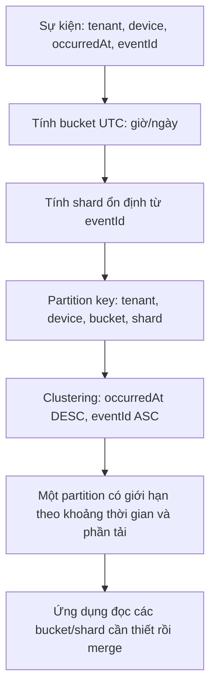
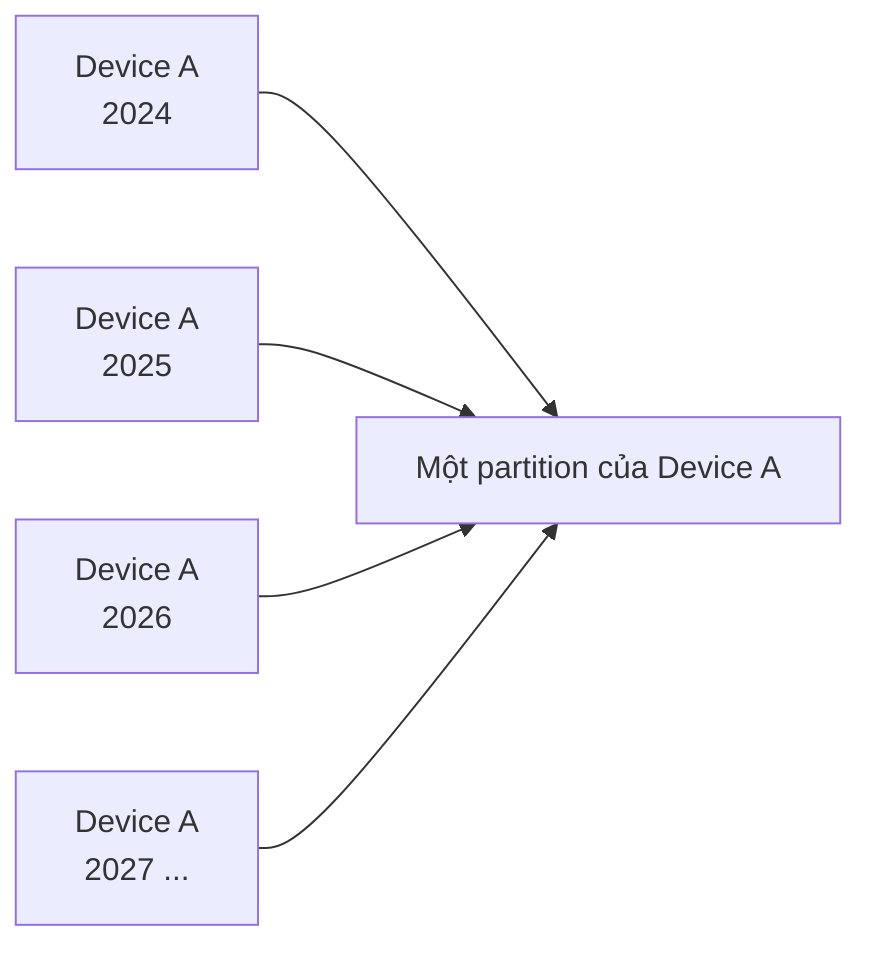
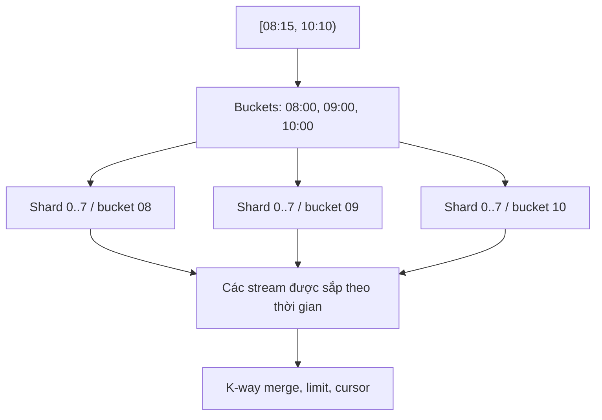

# Partition theo khoảng thời gian và shard

## 1. Bài toán dữ liệu thời gian trên Apache Cassandra

Các hệ thống telemetry, IoT, nhật ký truy cập, lịch sử trạng thái thiết bị và dữ liệu giao dịch thường nhận **nhiều bản ghi nối tiếp theo thời gian**. Người dùng ít khi hỏi “tìm bất kỳ dòng nào trong cả cơ sở dữ liệu”; họ thường hỏi:

- Lấy **100 sự kiện mới nhất** của một thiết bị.
- Đọc các đo đạc của thiết bị X trong **hai giờ gần đây**.
- Tiếp tục trang kế tiếp của lịch sử trong **một ngày**.
- Xóa hoặc hết hạn dữ liệu **sau 30 ngày**.
- Chịu được một vài thiết bị phát hàng nghìn sự kiện mỗi giây, trong khi thiết bị khác phát vài sự kiện mỗi giờ.

Với **Spring Data Cassandra**, chúng ta có thể triển khai những đường đọc này bằng entity mapping, repository, `CassandraTemplate` hoặc CQL/`CqlSession`. Tuy nhiên, **API truy cập không thay thế thiết kế primary key**. Cassandra phân bố dữ liệu bằng **partition key** và sắp xếp dữ liệu bên trong partition bằng **clustering key**; nếu chọn khóa sai, thêm paging hay gọi bất đồng bộ cũng không biến truy vấn quét rộng thành rẻ.

Hai công cụ thiết kế rất quan trọng là:

1. **Time bucket:** chia dữ liệu của một chủ thể theo khoảng thời gian, chẳng hạn giờ hoặc ngày. Mỗi bucket giúp giới hạn kích thước và tuổi đời partition.
2. **Shard:** chia lưu lượng của **cùng chủ thể trong cùng bucket** thành nhiều partition, nhằm giảm tải ghi/hot partition.



**Mục tiêu bài học:** biết khi nào partition theo thời gian là đủ, khi nào cần thêm shard, cách tính khóa nhất quán khi ghi/đọc, cách merge và paging nhiều partition, tác động của TTL/TWCS, và cách đo chi phí để tránh “tối ưu ghi nhưng làm hỏng đọc”.

## 2. Thiết kế từ các truy vấn trước khi chọn partition key

Giả sử hệ thống nhận sự kiện thiết bị với các thuộc tính:

| Thuộc tính | Ý nghĩa |
| --- | --- |
| `tenant_id` | Định danh khách hàng/tenant; bắt buộc để cô lập dữ liệu |
| `device_id` | Thiết bị phát sự kiện |
| `occurred_at` | Thời gian sự kiện xảy ra, ở dạng `Instant`/UTC |
| `event_id` | Định danh ổn định cho một sự kiện; dùng chống trùng theo key |
| `event_type` | Loại sự kiện, ví dụ `TEMPERATURE`, `ALERT` |
| `numeric_value` | Giá trị đo, khi loại sự kiện hỗ trợ |
| `payload` | Nội dung bổ sung; có thể khá lớn |

Đặt trước những câu hỏi mà API **thực sự phải hỗ trợ**:

| API/use case | Đường truy cập mong muốn | Hệ quả thiết kế |
| --- | --- | --- |
| Lấy N sự kiện mới nhất của thiết bị | Theo tenant + device + các bucket gần nhất | Cần clustering theo thời gian giảm dần |
| Đọc trong `[from, to)` | Xác định các bucket chạm khoảng thời gian | Phải biết bucket nào cần truy vấn |
| Tiếp tục trang lịch sử | Khóa cố định, thứ tự xác định và cursor | Cần tie-break `event_id` |
| Đọc tất cả cảnh báo của tenant | Không chỉ khóa theo thiết bị | Có thể cần **bảng đọc khác** theo tenant/type/time |
| Tra cứu chính xác theo `event_id` | Chưa chắc biết device/bucket | Có thể cần bảng lookup `event_id -> routing key` |
| Xem tổng số sự kiện theo ngày | Không nên `COUNT(*)` trên lịch sử lớn | Có thể cần aggregate/read model riêng |

**Không có một bảng tối ưu mọi truy vấn.** Cassandra thường dùng nhiều bảng phi chuẩn hóa theo đường đọc, với trách nhiệm cập nhật và đối soát tại application service.

## 3. Vì sao một partition chứa toàn bộ lịch sử là phản mẫu?

Một schema trông tiện lúc đầu:

```sql
-- Phản mẫu khi một device có lịch sử dài/tốc độ ghi lớn.
CREATE TABLE events_unbounded (
    tenant_id uuid,
    device_id uuid,
    occurred_at timestamp,
    event_id uuid,
    event_type text,
    payload text,
    PRIMARY KEY ((tenant_id, device_id), occurred_at, event_id)
) WITH CLUSTERING ORDER BY (occurred_at DESC, event_id ASC);
```

Với partition key `(tenant_id, device_id)`, tất cả sự kiện trong nhiều năm của cùng thiết bị thuộc **một partition**. Clustering `occurred_at DESC` giúp đọc vài sự kiện mới nhất, nhưng không giải quyết các vấn đề sau:

- **Partition lớn dần:** số hàng và byte tích lũy theo tuổi đời thiết bị.
- **Hot partition:** tất cả lượt ghi cho thiết bị rất bận đều tập trung vào tập replica của một khóa.
- **Đọc lịch sử rộng:** một partition rất lớn phải xử lý nhiều hàng và tombstone khi duyệt.
- **Retention:** xóa các sự kiện cũ trên partition dài hạn có thể gây nhiều tombstone/compaction.
- **Skew:** một thiết bị rất “ồn” chi phối p99 dù phần lớn thiết bị có tải nhỏ.
- **Vận hành:** khó dự đoán partition size từ số tenant hoặc số device đơn thuần.



Không phải mọi partition chứa hàng triệu dòng đều thất bại ngay, và cũng không có một ngưỡng byte “tốt” phổ quát cho mọi cluster. Nhưng **partition tăng không giới hạn** khiến chi phí đọc/ghi và vận hành khó kiểm soát. Giải pháp đầu tiên là **time bucketing**.

## 4. Time bucket: chia lịch sử thành giờ, ngày hoặc khoảng phù hợp

Thay vì khóa chỉ gồm `(tenant_id, device_id)`, thêm **`bucket_start`**:

```text
Event thời gian 2026-11-25T08:12:34Z
Bucket theo giờ: 2026-11-25T08:00:00Z

Event thời gian 2026-11-25T08:59:59Z
Bucket theo giờ: 2026-11-25T08:00:00Z

Event thời gian 2026-11-25T09:00:00Z
Bucket theo giờ: 2026-11-25T09:00:00Z
```

Khi dùng bucket theo ngày:

```text
2026-11-25T08:12:34Z -> day_bucket = 2026-11-25
2026-11-25T23:59:59Z -> day_bucket = 2026-11-25
2026-11-26T00:00:00Z -> day_bucket = 2026-11-26
```

**Chọn một quy tắc duy nhất**: ví dụ bucket theo giờ UTC dựa trên **`occurred_at`**, làm tròn xuống đầu giờ. Mọi writer và reader phải tính bucket giống nhau. Không để server A dùng giờ Việt Nam, server B dùng UTC và server C lấy `LocalDate.now()` theo múi giờ JVM.

### 4.1. Event time và ingest time

| Khái niệm | Ví dụ | Hệ quả |
| --- | --- | --- |
| **Event time** (`occurred_at`) | Cảm biến ghi lúc 08:12 nhưng gửi lúc 08:40 | Chia bucket theo thời gian thực của sự kiện |
| **Ingest time** (`received_at`) | Cluster nhận sự kiện lúc 08:40 | Chia bucket theo thời gian nhận; dễ tổ chức pipeline nhập |
| **Processing time** | Worker bắt đầu xử lý lúc 08:41 | Có thể trễ thêm do queue/retry |

Nếu API hỏi “sự kiện xảy ra trong 08:00–09:00”, bucket theo **event time** giúp xác định những partition phải đọc. Nhưng một thiết bị offline gửi lại sự kiện **hôm qua** sẽ ghi vào bucket cũ. Nếu bucket theo **ingest time**, truy vấn theo khoảng `occurred_at` có thể phải chạm nhiều bucket ingest hơn dự kiến.

**Quyết định chính sách late arrivals trước khi chọn khóa:**

- Cho phép dữ liệu đến muộn tới bao lâu? Vài phút, một ngày hay nhiều tháng?
- Có chấp nhận sự kiện cũ được bổ sung vào bucket lịch sử không?
- Nếu một event có timestamp lỗi/tương lai, đưa vào quarantine hay sửa bằng quy tắc nào?
- Retention tính từ **thời điểm xảy ra** hay **thời điểm ghi**?

Không dùng một phép `now()` tùy ý để “chữa” timestamp sai; nó có thể thay đổi vị trí dữ liệu và phá kết quả truy vấn theo event time.

### 4.2. Tính bucket UTC trong Java

```java
import java.time.Instant;
import java.time.temporal.ChronoUnit;

public final class TimeBuckets {

    private TimeBuckets() {}

    public static Instant hourStart(Instant occurredAt) {
        return occurredAt.truncatedTo(ChronoUnit.HOURS);
    }

    public static Instant dayStart(Instant occurredAt) {
        return occurredAt.truncatedTo(ChronoUnit.DAYS);
    }
}
```

`Instant` biểu diễn một thời điểm tuyệt đối, nên phép làm tròn xuống giờ/ngày không phụ thuộc timezone hoặc daylight saving của máy chạy. Nếu muốn bucket theo “ngày địa phương” của tenant, phải **định nghĩa một `ZoneId` và hợp đồng truy vấn riêng**; độ dài ngày có thể không đúng 24 giờ ở vùng có DST.

Trong schema dưới đây, `bucket_start` có kiểu CQL `timestamp`, được Driver 4.x bind với `Instant` (độ chính xác của kiểu CQL là milliseconds). Vì bucket được chuẩn hóa tới đầu giờ nên giới hạn millisecond không làm mất ranh giới.

## 5. Khi nào cần shard ngoài time bucket?

Time bucket giới hạn dữ liệu **theo tuổi**, nhưng có thể chưa đủ để phân tải:

```text
Thiết bị A phát 10 events/giây:
    Partition giờ -> tương đối nhỏ, tải ghi vừa phải

Thiết bị B phát 30.000 events/giây:
    Partition giờ -> rất nhiều dòng, hot replica
```

Nếu một thiết bị vẫn ghi quá nhiều vào **một bucket**, thêm `shard` vào partition key:

```text
Không shard:
    (tenant=A, device=B, hour=08:00)

8 shard:
    (tenant=A, device=B, hour=08:00, shard=0)
    (tenant=A, device=B, hour=08:00, shard=1)
    ...
    (tenant=A, device=B, hour=08:00, shard=7)
```

Mỗi partition là một khóa token khác nhau và có thể được phân bố trên các replica khác nhau. Mục tiêu: **giảm tải ghi/partition**, không phải tăng một cách tùy ý số partition chỉ để có nhiều file.

### 5.1. Shard phải ổn định theo định danh sự kiện

Một lựa chọn trong ứng dụng Java:

```java
import java.util.UUID;

static int shardFor(UUID eventId, int shardCount) {
    if (shardCount <= 0) {
        throw new IllegalArgumentException("shardCount phải > 0");
    }
    return Math.floorMod(eventId.hashCode(), shardCount);
}
```

Với cùng `eventId` và cùng `shardCount`, hàm trên trả **cùng shard**. Đây là một ví dụ routing **chỉ dành cho hệ thống đã thống nhất dùng `UUID.hashCode()` của Java**; nếu hệ thống có writer bằng Python, Go hoặc nhiều ngôn ngữ, cần đặc tả **hash function, byte ordering, encoding và modulo** chung, có test vectors xuyên ngôn ngữ.

`UUID.hashCode()` không phải một hàm cryptographic hash; nó chỉ minh họa tính ổn định. Với dữ liệu/phân bố thực tế, cần đo độ lệch shard và có thể dùng một hàm hash được chuẩn hóa tốt hơn.

**Không tính shard ngẫu nhiên mỗi lần retry** nếu cùng một event ID phải có cùng khóa:

```text
Lần đầu: event E42 -> shard 2
Retry:   event E42 -> shard 7

Hai lần INSERT vào hai primary key khác nhau,
không còn là upsert cùng một hàng.
```

Nếu `event_id` thật sự là duy nhất và bất biến, ghi lại cùng ID, cùng event time và cùng routing rule sẽ trỏ tới **cùng primary key**. Điều này giúp tránh tạo hai hàng từ một sự kiện, nhưng **không bảo đảm exactly once đối với các tác dụng phụ khác** (counter, Kafka offset, payment) hoặc nếu timestamp/payload của event bị thay đổi khi replay.

### 5.2. Shard không thay thế bucket

| Chỉ có bucket | Chỉ có shard | Bucket **và** shard |
| --- | --- | --- |
| Giới hạn tuổi/kích thước lịch sử theo thời gian | Phân tải ghi giữa N khóa | Giới hạn cả tuổi và tải ghi/partition |
| Một bucket vẫn có thể hot | Mỗi shard có thể chứa dữ liệu của nhiều năm | Nhiều partition hơn, đọc phải merge |
| Đọc N bucket | Đọc N shard toàn lịch sử | Đọc N bucket × S shard |

Không cần bật sharding ngay từ ngày đầu nếu đo được mỗi bucket đã nhỏ và không hot. **Shard tăng chi phí fan-out khi đọc**, nên phải có bằng chứng từ workload.

## 6. Thiết kế schema CQL: `(tenant, device, bucket, shard)`

Ví dụ local:

```sql
CREATE KEYSPACE IF NOT EXISTS telemetry_lab
WITH replication = {
    'class': 'SimpleStrategy',
    'replication_factor': 1
};

CREATE TABLE IF NOT EXISTS telemetry_lab.events_by_device_bucket_shard (
    tenant_id uuid,
    device_id uuid,
    bucket_start timestamp,
    shard int,
    occurred_at timestamp,
    event_id uuid,
    event_type text,
    numeric_value double,
    payload text,
    PRIMARY KEY (
        (tenant_id, device_id, bucket_start, shard),
        occurred_at,
        event_id
    )
) WITH CLUSTERING ORDER BY (
    occurred_at DESC,
    event_id ASC
);
```

Phân tích:

| Thành phần | Vai trò |
| --- | --- |
| `(tenant_id, device_id, bucket_start, shard)` | **Composite partition key**: định vị một partition vật lý |
| `occurred_at` | **Clustering key**: sắp xếp theo thời gian giảm dần trong partition |
| `event_id` | Clustering key phụ để thứ tự xác định khi có hai event cùng thời điểm và tăng khả năng duy nhất của row key |
| `event_type`, `numeric_value`, `payload` | Cột thường: chọn theo nhu cầu của từng API |

**Không đổi `event_id` thành partition key độc lập** nếu API chủ yếu đọc lịch sử thiết bị theo thời gian: lúc đó mỗi sự kiện một partition và rất khó truy vấn danh sách theo thiết bị.

Một ví dụ ghi trực tiếp:

```sql
INSERT INTO telemetry_lab.events_by_device_bucket_shard (
    tenant_id, device_id, bucket_start, shard,
    occurred_at, event_id, event_type, numeric_value, payload
) VALUES (
    11111111-1111-4111-8111-111111111111,
    22222222-2222-4222-8222-222222222222,
    '2026-11-25T08:00:00Z',
    3,
    '2026-11-25T08:12:34Z',
    33333333-3333-4333-8333-333333333333,
    'TEMPERATURE',
    28.5,
    '{"unit":"celsius"}'
);
```

Ở ví dụ tay này, `shard=3` chỉ để trình bày câu CQL; **không dùng con số đó như kết quả đã tính bằng `hash(eventId)`**. Trong chương trình thật, phải luôn gọi hàm routing rồi bind shard đã tính.

### 6.1. Query đọc một partition

```sql
SELECT occurred_at, event_id, event_type, numeric_value
FROM telemetry_lab.events_by_device_bucket_shard
WHERE tenant_id = ?
  AND device_id = ?
  AND bucket_start = ?
  AND shard = ?
LIMIT ?;
```

Câu query chỉ đọc **một partition cụ thể**. Clustering order mặc định trả các hàng theo `occurred_at DESC, event_id ASC` khi không yêu cầu thứ tự khác. Thêm `LIMIT` có kiểm soát ở API không có nghĩa toàn bộ hệ thống tự tính top N trên tất cả shard.

Để lọc thời gian bên trong partition:

```sql
SELECT occurred_at, event_id, event_type, numeric_value
FROM telemetry_lab.events_by_device_bucket_shard
WHERE tenant_id = ?
  AND device_id = ?
  AND bucket_start = ?
  AND shard = ?
  AND occurred_at >= ?
  AND occurred_at < ?;
```

Đây là **range trên clustering key đầu tiên** sau khi đã có **đầy đủ partition key**. Chọn `[from, to)` giúp tránh đếm trùng ranh giới giữa các khoảng. Không giả định có thể viết `bucket_start >= ?` rồi Cassandra tự đọc nhiều time buckets: `bucket_start` ở đây là **thành phần partition key**, không phải clustering key.

### 6.2. Tại sao không có một `ORDER BY` toàn cụm?

Trong mỗi partition, clustering order là xác định. Nhưng:

```text
Partition shard 0: 08:59, 08:54, 08:48 ...
Partition shard 1: 08:58, 08:57, 08:35 ...
Partition shard 2: 08:56, 08:40 ...
```

Cassandra **không tự trộn ba kết quả trên thành một chuỗi 08:59, 08:58, 08:57...** chỉ vì tất cả bảng có clustering DESC. API phải **merge** các stream đã được sắp xếp, hoặc chọn một read model khác phù hợp nếu fan-out quá lớn.

## 7. Tính kích thước partition và lựa chọn bucket/shard

Không có công thức nào chọn đúng 8, 16 hay 32 shard cho mọi ứng dụng. Bắt đầu từ số liệu thực hoặc ước lượng:

```text
E = số events/ngày của một thiết bị
B = số byte lưu/row trung bình (ước lượng)
H = số bucket/ngày
S = số shard/bucket

rows_per_partition  ≈ E / (H × S)
bytes_per_partition ≈ E × B / (H × S)
```

Nếu một thiết bị sinh **2.400.000 sự kiện/ngày**, trung bình khoảng **400 byte/row** (đã giả định), tổng payload thô khoảng **960 MB/ngày**:

| Thiết kế | H × S partition/ngày | Trung bình row/partition | Trung bình byte/partition |
| --- | ---: | ---: | ---: |
| Một bucket theo ngày, 1 shard | 1 | 2.400.000 | ~960 MB |
| Một bucket/ngày, 8 shard | 8 | 300.000 | ~120 MB |
| 24 bucket theo giờ, 1 shard | 24 | 100.000 | ~40 MB |
| 24 bucket theo giờ, 8 shard | 192 | 12.500 | ~5 MB |

Đây là **ước lượng trung bình**, không phải kích thước SSTable hay hiệu năng thật. Cần cộng overhead lưu trữ, compression, index, tombstones, replication factor và **độ lệch phân bố**. Một giờ có burst lớn gấp 20 lần trung bình vẫn có thể tạo partition nóng; hash không hoàn toàn đều cũng làm các shard khác nhau về kích thước.

### 7.1. Chi phí đọc tăng theo số partition

Nếu cần đọc **48 giờ** của một thiết bị:

| Thiết kế | Partition cần xem xét tối đa cho 48 giờ |
| --- | ---: |
| Theo ngày, 1 shard | ~2–3 partition, tùy thời điểm bắt đầu/kết thúc |
| Theo ngày, 8 shard | ~16–24 partition |
| Theo giờ, 1 shard | ~48–49 partition |
| Theo giờ, 8 shard | ~384–392 partition |

Với khoảng `[from, to)` sát hai đầu giờ, số bucket có thể khác một đơn vị; các con số minh họa cho thấy xu hướng **bucket càng nhỏ và shard càng nhiều thì fan-out lịch sử càng lớn**.

Do đó, chọn thông số dựa trên **hai chiều**:

1. **Write path:** rows/bytes và write RPS/partition, hot replicas, p95/p99.
2. **Read path:** số partition/API, số shard phải merge, latency, tổng bytes trả về, số requests in-flight.

Mục tiêu là **partition có kích thước và tải ghi quản lý được**, đồng thời API đọc phổ biến không phải mở quá nhiều partition. Không dùng “100 MB luôn an toàn” hoặc “mỗi partition chỉ 1 MB” như luật bất biến.

### 7.2. Chọn bucket theo thời gian hay theo số lượng?

Bucket cố định theo **giờ/ngày** dễ xác định từ query range và thuận tiện cho retention. Bucket dựa trên **số event** có thể giúp kiểm soát rows/partition chính xác hơn, nhưng reader phải biết event thuộc bucket số mấy qua một index/metadata riêng.

Nếu lưu lượng cực lệch giữa các thiết bị, có thể chọn **bucket/shard policy theo nhóm thiết bị** (ví dụ nhóm tốc độ cao theo giờ + 8 shard; nhóm thấp theo ngày + 1 shard). Tuy nhiên, reader cần biết **policy và phiên bản áp dụng theo từng thời đoạn**; không suy policy từ dữ liệu mới nhất rồi áp đặt lên toàn lịch sử.

## 8. Java Driver: route và ghi với khóa ổn định

Một record bất biến cho sự kiện:

```java
import java.time.Instant;
import java.util.UUID;

public record TelemetryEvent(
    UUID tenantId,
    UUID deviceId,
    UUID eventId,
    Instant occurredAt,
    String eventType,
    double numericValue,
    String payload
) {}
```

Hàm tính bucket và shard:

```java
import java.time.Instant;
import java.time.temporal.ChronoUnit;
import java.util.UUID;

public record EventRoute(Instant bucketStart, int shard) {}

public final class EventRouting {
    private EventRouting() {}

    public static EventRoute route(TelemetryEvent event, int shardCount) {
        if (shardCount <= 0) {
            throw new IllegalArgumentException("shardCount phải > 0");
        }
        Instant bucket = event.occurredAt()
            .truncatedTo(ChronoUnit.HOURS);
        int shard = Math.floorMod(event.eventId().hashCode(), shardCount);
        return new EventRoute(bucket, shard);
    }
}
```

**Điều kiện idempotency về khóa:** một event phải giữ nguyên `(tenantId, deviceId, eventId, occurredAt)` khi retry. Nếu chỉnh `occurredAt` giữa hai lần gửi, bucket và clustering key có thể đổi, tạo **hai hàng khác nhau**. Nếu đổi `shardCount` mà không versioning, cùng event cũng có thể sang shard khác.

Adapter ghi dùng **prepared statement**:

```java
import com.datastax.oss.driver.api.core.CqlSession;
import com.datastax.oss.driver.api.core.cql.PreparedStatement;
import org.springframework.stereotype.Repository;

@Repository
public class TelemetryEventWriter {

    private final CqlSession session;
    private final PreparedStatement insert;
    private final int shardCount = 8; // Minh họa; production phải có routing policy.

    public TelemetryEventWriter(CqlSession session) {
        this.session = session;
        this.insert = session.prepare("""
            INSERT INTO telemetry_lab.events_by_device_bucket_shard (
                tenant_id, device_id, bucket_start, shard,
                occurred_at, event_id, event_type, numeric_value, payload
            ) VALUES (?, ?, ?, ?, ?, ?, ?, ?, ?)
            """);
    }

    public void save(TelemetryEvent event) {
        EventRoute route = EventRouting.route(event, shardCount);

        var statement = insert.bind(
            event.tenantId(),
            event.deviceId(),
            route.bucketStart(),
            route.shard(),
            event.occurredAt(),
            event.eventId(),
            event.eventType(),
            event.numericValue(),
            event.payload()
        );

        session.execute(statement);
    }
}
```

Lưu ý:

- `CqlSession` là **session dùng chung**, được Spring Boot/Spring Data quản lý. Không tạo session cho mỗi event.
- Bảng được prefix keyspace; nếu dùng entity/repository không prefix, keyspace mặc định phải đúng.
- `PreparedStatement` được chuẩn bị một lần, `BoundStatement` tạo theo từng event.
- CQL `INSERT` ở đây là **upsert**, không phải `INSERT IF NOT EXISTS`; dùng khóa ổn định giúp replay cùng key không sinh thêm dòng, nhưng cập nhật lại cell có thể thay đổi timestamp/TTL.
- Không tự biến tất cả event thành LWT: `IF NOT EXISTS` trên mọi sự kiện làm tăng chi phí đồng thuận, cần cân nhắc theo yêu cầu chống trùng nghiêm ngặt và throughput.
- Việc chọn consistency, retry và timeout vẫn phải theo replication strategy/SLO; **không** được xem một ACK là bằng chứng mọi read model phụ đã đồng bộ.

### 8.1. Mapping entity bằng Spring Data Cassandra

Khi cần repository/`CassandraTemplate`, composite key được biểu diễn bằng `@PrimaryKeyClass` và các `@PrimaryKeyColumn`.

```java
import java.io.Serializable;
import java.time.Instant;
import java.util.UUID;

import org.springframework.data.cassandra.core.cql.Ordering;
import org.springframework.data.cassandra.core.mapping.PrimaryKeyClass;
import org.springframework.data.cassandra.core.mapping.PrimaryKeyColumn;
import org.springframework.data.cassandra.core.mapping.PrimaryKeyType;

@PrimaryKeyClass
public class EventKey implements Serializable {

    @PrimaryKeyColumn(name = "tenant_id", ordinal = 0,
        type = PrimaryKeyType.PARTITIONED)
    private UUID tenantId;

    @PrimaryKeyColumn(name = "device_id", ordinal = 1,
        type = PrimaryKeyType.PARTITIONED)
    private UUID deviceId;

    @PrimaryKeyColumn(name = "bucket_start", ordinal = 2,
        type = PrimaryKeyType.PARTITIONED)
    private Instant bucketStart;

    @PrimaryKeyColumn(name = "shard", ordinal = 3,
        type = PrimaryKeyType.PARTITIONED)
    private int shard;

    @PrimaryKeyColumn(name = "occurred_at", ordinal = 4,
        type = PrimaryKeyType.CLUSTERED,
        ordering = Ordering.DESCENDING)
    private Instant occurredAt;

    @PrimaryKeyColumn(name = "event_id", ordinal = 5,
        type = PrimaryKeyType.CLUSTERED,
        ordering = Ordering.ASCENDING)
    private UUID eventId;

    protected EventKey() {}

    // Cần constructor/getters và equals/hashCode nhất quán với toàn bộ key.
}
```

Entity:

```java
import org.springframework.data.cassandra.core.mapping.Column;
import org.springframework.data.cassandra.core.mapping.PrimaryKey;
import org.springframework.data.cassandra.core.mapping.Table;

@Table("events_by_device_bucket_shard")
public class DeviceEvent {

    @PrimaryKey
    private EventKey key;

    @Column("event_type")
    private String eventType;

    @Column("numeric_value")
    private Double numericValue;

    @Column("payload")
    private String payload;

    protected DeviceEvent() {}

    // Bổ sung constructor/getters/setters tùy chiến lược materialization.
}
```

Đây là skeleton mapping để giải thích **thứ tự và loại khóa**; trong project thực phải triển khai đầy đủ value semantics của `EventKey`, kiểm thử Spring Data Cassandra mapping trên đúng phiên bản framework và không thay đổi loại `PrimaryKeyType` sau khi dữ liệu đã lưu.

Repository theo `CassandraRepository<DeviceEvent, EventKey>` thuận tiện cho truy xuất một hàng theo **đầy đủ key**. Nhưng `findById(EventKey)` **không tự tìm tất cả shard** cho một khoảng thời gian. Với các truy vấn đa partition, service phải tự xác định các bucket/shard và gọi các CQL tương ứng.

## 9. Đọc một khoảng thời gian: enumerate bucket rồi shard

Giả sử API:

```http
GET /tenants/{tenantId}/devices/{deviceId}/events
    ?from=2026-11-25T08:15:00Z
    &to=2026-11-25T10:10:00Z
    &limit=100
```

Với bucket **theo giờ**, khoảng `[08:15, 10:10)` chạm:

```text
2026-11-25T08:00:00Z
2026-11-25T09:00:00Z
2026-11-25T10:00:00Z
```

Với **8 shard**, có tối đa `3 × 8 = 24` partition query. Mỗi query đặt **đầy đủ partition key** rồi lọc clustering time trong khoảng yêu cầu.



**Đừng viết một CQL kiểu:**

```sql
-- Không phải đường truy cập hẹp của schema này.
SELECT *
FROM telemetry_lab.events_by_device_bucket_shard
WHERE tenant_id = ?
  AND device_id = ?
  AND bucket_start >= ?;
```

`bucket_start` là **một phần của composite partition key**; thiếu thành phần `shard` và dùng bất đẳng thức trên bucket không cho Cassandra một tập partition xác định theo khóa như ví dụ đọc một bucket. Không thêm `ALLOW FILTERING` để ép hệ thống quét. **Ứng dụng phải enumerate các routing keys** hoặc chọn một bảng đọc khác.

### 9.1. Chặn các request đọc quá rộng

Trước khi phát query, service nên validate:

1. Tenant có quyền đọc thiết bị không?
2. `from < to` và đều là timestamp hợp lệ?
3. Khoảng thời gian tối đa bao lâu cho endpoint tương tác, ví dụ 24 giờ?
4. Có bao nhiêu bucket và shard thực sự cần truy vấn?
5. `limit` có giới hạn và deadline tổng rõ không?
6. Nếu workload cần quét 90 ngày của hàng nghìn thiết bị, có nên chuyển sang export/analytics pipeline?

Một API “lấy mọi event trong 10 năm” không trở nên rẻ chỉ nhờ sharding. Ngay cả khi mỗi partition nhỏ, **số partition cần mở** vẫn có thể rất lớn.

### 9.2. Thứ tự đọc bucket

Với lịch sử mới nhất trước, thường bắt đầu từ **bucket mới nhất**, sau đó lùi dần về bucket cũ hơn. Nếu bucket được xác định từ `occurred_at`, các bucket theo giờ không chồng lấn khoảng thời gian: event thuộc bucket 09:00 không thể mới hơn event thuộc bucket 10:00 khi xét đúng `occurred_at`.

Tuy nhiên, **trong cùng một bucket phải merge các shard** mới biết thứ tự toàn cục. Nếu một bucket mới nhất có đủ N event, API có thể không cần đọc bucket cũ hơn cho trang đầu; cần quan tâm late arrivals và paging/cursor để không làm rơi các event đến muộn trong bucket cũ.

## 10. K-way merge: tạo thứ tự tổng khi có nhiều shard

Giả sử một bucket có ba shard:

```text
Shard 0: 08:59 E9, 08:54 E6, 08:42 E3
Shard 1: 08:58 E8, 08:56 E7, 08:33 E1
Shard 2: 08:57 E5, 08:48 E4
```

API muốn lấy top 5 theo `occurred_at DESC` cần:

```text
08:59 E9
08:58 E8
08:57 E5
08:56 E7
08:54 E6
```

Không thể nối danh sách shard 0 trước rồi shard 1 sau. Dùng **k-way merge** trên những stream đã có clustering order. Mỗi stream cần một cursor/iterator, mỗi lượt chọn phần tử đứng đầu phù hợp theo comparator rồi tiến cursor của stream đó.

### 10.1. Thứ tự xác định

Đặt thứ tự nghiệp vụ:

```text
occurred_at DESC
event_id ASC
```

Nếu `event_id` thực sự là ID duy nhất trong phạm vi các stream được merge, cặp này đủ làm tie-break. Nếu ID có thể lặp hoặc dữ liệu có thể trùng giữa bảng/shard/phiên bản routing, cần tiêu chuẩn so sánh đầy đủ hơn:

```text
occurred_at DESC, event_id ASC,
bucket_start, shard, tenant_id, device_id
```

Trên cùng `(tenant,device)`, các trường bổ sung giúp định danh nguồn rõ ràng. **Comparator merge phải tương thích với thứ tự trong từng stream**; nếu thêm tie-break khác khi cần, thiết kế sao cho nó không đảo thứ tự các hàng trong một partition.

Ví dụ Java:

```java
import java.time.Instant;
import java.util.Comparator;
import java.util.UUID;

public record EventRow(
    UUID eventId,
    Instant occurredAt,
    int shard,
    String eventType,
    double numericValue
) {}

public final class EventOrdering {
    public static final Comparator<EventRow> NEWEST_FIRST =
        Comparator.comparing(EventRow::occurredAt)
            .reversed()
            .thenComparing(EventRow::eventId)
            .thenComparingInt(EventRow::shard);

    private EventOrdering() {}
}
```

**Chỉ `Comparator` không tạo ra phân trang đúng.** Với dữ liệu lớn, dùng **priority queue (heap)** để merge K stream mà không nạp toàn bộ lịch sử lên JVM; nếu chỉ merge một page giới hạn nhỏ có thể dùng danh sách và sort, nhưng vẫn phải bảo đảm mỗi shard đã có đủ ứng viên.

### 10.2. Muốn top N, lấy bao nhiêu từ mỗi shard?

Với N shard độc lập và muốn top **K** của một bucket, việc lấy **tối đa K hàng mới nhất ở mỗi shard** rồi merge có thể đủ để tìm top K toàn cục, nếu tất cả query dùng cùng điều kiện thời gian/sort và không có thay đổi đồng thời ảnh hưởng logic. Lý do: một hàng đứng ngoài top K **trong chính shard của nó** không thể lọt vào top K của tổng hợp.

Nhưng cái giá tối đa là `K × số_shard` hàng ứng viên và nhiều request; đây là **upper bound**, không có nghĩa lúc nào cũng nên tải đủ K ở mọi shard. Một heap/streaming merge với fetch-on-demand có thể giảm payload, đổi lại quản lý cursor và page fetch phức tạp hơn.

Khi phải loại bỏ duplicates, áp dụng filter sau đọc hoặc hợp nhất nhiều bucket có late arrivals, cần cân nhắc **đọc thêm ứng viên** để thực sự trả đủ K hàng hợp lệ.

## 11. Phân trang nhiều partition: cursor không còn là một paging state

Java Driver có `pageSize`, `AsyncResultSet.currentPage()` và paging state để tiếp tục **một câu CQL cụ thể** với bind values tương ứng. Nhưng với 8 shard × 3 bucket, API có nhiều truy vấn riêng:

```text
(bucket=08, shard=0) -> paging state A
(bucket=08, shard=1) -> paging state B
...
(bucket=10, shard=7) -> paging state X
```

Một **paging state của shard 0** không có nghĩa là “đã đọc đến trang thứ hai của toàn bộ lịch sử thiết bị”. API cần **cursor tổng hợp** do application service quản lý.

Một thiết kế cursor khái niệm:

```json
{
  "cursorVersion": 2,
  "tenantScope": "<server-bound-tenant>",
  "deviceScope": "<server-bound-device>",
  "from": "2026-11-25T08:15:00Z",
  "to": "2026-11-25T10:10:00Z",
  "routingPolicy": "hour-v1-shards-8",
  "streams": [
    {
      "bucket": "2026-11-25T10:00:00Z",
      "shard": 0,
      "pagingState": "<opaque>",
      "unconsumedBufferRef": "<server-managed>"
    }
  ]
}
```

**Đây là mô tả cấu trúc để học, không phải token thật để gửi nguyên JSON cho client.** Trong production, token phải opaque, được ký/xác thực hoặc giữ state server-side, có TTL/capacity, ràng buộc tenant/quyền truy cập, filter, query version, schema/routing policy và những thành phần cần thiết để tiếp tục chính xác.

### 11.1. Vì sao cần lưu cả phần chưa dùng của mỗi page?

Giả sử driver fetch page 20 hàng của shard 0, nhưng khi merge tổng chỉ dùng **3 hàng** trong page đó. Nếu API lưu **paging state của page tiếp theo** và bỏ 17 hàng còn lại, trang tiếp theo sẽ **mất dữ liệu**. Cần một trong hai cách:

1. Giữ **unconsumed rows + vị trí trong page**, kết hợp paging state của mỗi stream.
2. Dùng **keyset continuation** theo clustering keys, chỉ bắt đầu sau hàng cuối thực sự đã tiêu thụ trong mỗi stream; câu CQL và thứ tự phải được thiết kế/kiểm thử cẩn thận.

Không thực hiện `OFFSET 1000` giống SQL thông thường trên một tập nhiều partition. Một cursor đúng có thể phải ghi nhớ **trạng thái của nhiều stream**; số stream càng lớn, token hoặc server-side state càng đắt.

### 11.2. Dữ liệu mới đến khi người dùng đang lật trang

Cassandra không cung cấp một snapshot transaction toàn cục cho 24 partition chỉ vì chúng được đọc trong một request. Các sự kiện đến muộn có thể được ghi vào bucket lịch sử sau khi trang đầu đã được lấy. Khi tiếp tục, ứng dụng có thể quan sát hàng mới, trùng hoặc bỏ lỡ tùy cursor/ordering và chính sách.

Những lựa chọn rõ ràng:

- **Live timeline:** chấp nhận kết quả thay đổi, có cơ chế dedup theo `eventId`.
- **Stable export:** chốt một **watermark/cutoff** và chỉ xuất những sự kiện được đưa vào tập dữ liệu trước cutoff theo chính sách ingestion. Chỉ chặn `occurred_at <= cutoff` **không đủ** nếu backfill có thể ghi muộn sự kiện cũ; cần tracking ingest watermark hoặc snapshot/materialized batch phù hợp.
- **API mới nhất:** chỉ cần top N, có thể không hỗ trợ cursor xuyên lịch sử quá dài.

Cursor cần được version hóa khi thay đổi danh sách cột được chọn, thứ tự sort, routing/shard count hoặc phạm vi dữ liệu.

## 12. Java Driver đọc một partition và quản lý paging

Prepared query:

```java
import com.datastax.oss.driver.api.core.CqlSession;
import com.datastax.oss.driver.api.core.cql.PreparedStatement;

PreparedStatement readPartition = session.prepare("""
    SELECT occurred_at, event_id, event_type, numeric_value
    FROM telemetry_lab.events_by_device_bucket_shard
    WHERE tenant_id = ?
      AND device_id = ?
      AND bucket_start = ?
      AND shard = ?
    LIMIT ?
    """);
```

Gọi cho một partition:

```java
var bound = readPartition.bind(
    tenantId, deviceId, bucketStart, shard, maxRows
).setPageSize(Math.min(maxRows, 50))
 .setIdempotent(true);

var result = session.execute(bound);
for (var row : result) {
    // Mapping row -> DTO. Đọc cả ResultSet có thể fetch thêm page!
}
```

**Phân biệt rõ:**

- **`LIMIT 100`** giới hạn **tổng số hàng** trả từ một câu CQL.
- **Page size 50** chỉ là kích thước page mục tiêu, không có nghĩa iterator chắc chắn chỉ đi qua 50 hàng.
- **Paging state** tiếp tục một statement/bind values, không phải cursor đã merge nhiều partition.
- **`SELECT *`** có thể tăng bytes khi `payload` lớn; projection chỉ chọn các cột cần cho danh sách.

Với nhiều shard, có thể dùng `executeAsync` và `CompletionStage` cho các lượt đọc độc lập **đã được giới hạn concurrency**. `CompletableFuture.allOf` không tự giới hạn số truy vấn; phải có bulkhead/semaphore hoặc scheduler có bounded queue. Không phát hàng nghìn request cùng lúc chỉ vì mỗi query là async.

### 12.1. Kiểm soát fan-out

Giả sử endpoint muốn đọc 90 ngày × 24 giờ × 8 shard:

```text
90 × 24 × 8 = 17.280 partition queries / một thiết bị
```

Con số này là dấu hiệu nên **thay đổi chiến lược đọc**: giới hạn khoảng API, tăng bucket duration cho lịch sử lưu trữ, thêm read model tổng hợp, hoặc chạy export/analytics riêng. Tăng `pageSize` hay tạo `CompletableFuture` không xóa được 17.280 partition keys.

Khi đọc nhiều partition:

1. Chỉ phát một số lượng truy vấn in-flight có hạn.
2. Ưu tiên bucket mới nhất nếu API cần newest-first.
3. Dừng sớm khi đã đủ kết quả theo logic merge chính xác.
4. Giới hạn payload, max pages, tổng rows/bytes và deadline.
5. Quan sát partial failures, timeout và chính sách retry.

## 13. Spring Data repository, CassandraTemplate và composite key

Entity mapping giúp thực hiện CRUD theo khóa, nhưng truy vấn nhiều bucket/shard phải được thiết kế **rõ trong adapter**.

Ví dụ repository có câu CQL chọn các cột đủ để materialize key:

```java
import java.time.Instant;
import java.util.List;
import java.util.UUID;

import org.springframework.data.cassandra.repository.CassandraRepository;
import org.springframework.data.cassandra.repository.Query;

public interface DeviceEventRepository
        extends CassandraRepository<DeviceEvent, EventKey> {

    @Query("""
        SELECT tenant_id, device_id, bucket_start, shard,
               occurred_at, event_id, event_type, numeric_value, payload
        FROM events_by_device_bucket_shard
        WHERE tenant_id = ?0
          AND device_id = ?1
          AND bucket_start = ?2
          AND shard = ?3
        LIMIT ?4
        """)
    List<DeviceEvent> latestInPartition(
        UUID tenantId,
        UUID deviceId,
        Instant bucketStart,
        int shard,
        int limit
    );
}
```

Đây là **một method cho một partition**. Tầng service enumerate các bucket/shard, gọi method cho từng key theo budget và merge. Không suy `latestInPartition(...)` có thể trả **top N toàn thiết bị**.

`CassandraTemplate` cũng có thể dùng `Query` và `Criteria` trên đầy đủ partition key, ví dụ:

```java
import org.springframework.data.cassandra.core.query.Criteria;
import org.springframework.data.cassandra.core.query.Query;

Query q = Query.query(
    Criteria.where("tenant_id").is(tenantId)
        .and("device_id").is(deviceId)
        .and("bucket_start").is(bucketStart)
        .and("shard").is(shard)
).limit(100);

// List<DeviceEvent> rows = cassandraTemplate.select(q, DeviceEvent.class);
```

Đoạn này minh họa **cấu trúc query**; cần đối chiếu API và naming/mapping với phiên bản Spring Data Cassandra đang dùng. `Query` của Spring Data Cassandra **không tự biết** bao nhiêu shard có dữ liệu; application service vẫn phải truyền các routing keys.

**Quyết định công cụ:**

- `CassandraRepository`: thích hợp đọc/ghi entity theo key và query method cố định.
- `CassandraTemplate`: mapping entity, query/update qua criteria với ứng dụng muốn lập trình linh hoạt.
- `CqlTemplate`: CQL tường minh với row mapping khi không cần full entity.
- `CqlSession`: quản lý prepared/bound statements, paging state và async fan-out chi tiết.

Dù chọn cách nào, giới hạn **partition, consistency, read model và paging** của Cassandra vẫn không đổi.

## 14. TTL, tombstone và TimeWindowCompactionStrategy (TWCS)

Dữ liệu thời gian thường có **retention cố định**, ví dụ giữ 7 ngày. Cassandra có **TTL** để dữ liệu hết hiệu lực sau một khoảng thời gian kể từ lúc ghi. Ví dụ bảng chuyên biệt:

```sql
CREATE TABLE IF NOT EXISTS telemetry_lab.events_ttl_by_device_bucket_shard (
    tenant_id uuid,
    device_id uuid,
    bucket_start timestamp,
    shard int,
    occurred_at timestamp,
    event_id uuid,
    event_type text,
    PRIMARY KEY (
        (tenant_id, device_id, bucket_start, shard),
        occurred_at, event_id
    )
) WITH CLUSTERING ORDER BY (occurred_at DESC, event_id ASC)
  AND default_time_to_live = 604800
  AND compaction = {
      'class': 'TimeWindowCompactionStrategy',
      'compaction_window_unit': 'DAYS',
      'compaction_window_size': '1'
  };
```

`604800` giây là **7 ngày**. TWCS tổ chức compaction theo các cửa sổ thời gian phù hợp với nhiều workload **ghi theo thời gian, ít cập nhật dữ liệu cũ, có TTL tương đối đồng nhất**.

**Điểm dễ nhầm:**

1. TTL thường tính từ **thời điểm mutation được ghi**, không tự tính từ cột `occurred_at`. Backfill hôm nay một event xảy ra tuần trước vẫn có thể sống thêm 7 ngày từ lúc ghi nếu không tính TTL riêng.
2. `bucket_start` theo **event time** không phải “cửa sổ TWCS” theo nghĩa nội bộ SSTable. Hai thứ phục vụ **mục đích khác nhau**.
3. Event đến muộn, ghi đè dữ liệu cũ hoặc cập nhật có timestamps không đồng bộ có thể làm lifecycle SSTable/compaction phức tạp và giảm lợi ích TWCS.
4. TTL/hết hạn tạo **tombstone/expired cells** theo cơ chế Cassandra; hết TTL không đồng nghĩa bytes lập tức biến mất trên disk.
5. `gc_grace_seconds`, repair, các replica offline và compaction policy cần được đánh giá để tránh dữ liệu xóa hồi sinh (*zombie*). Không tự hạ `gc_grace_seconds` để “xóa nhanh”.
6. Nếu nghiệp vụ yêu cầu xóa dữ liệu đúng theo **event age** (không phải ingest age), cần quy tắc TTL/backfill và policy từ chối dữ liệu quá hạn, không chỉ dùng `default_time_to_live`.

### 14.1. TTL trong lệnh ghi

Nếu retention được tính ở phía ứng dụng:

```sql
INSERT INTO telemetry_lab.events_by_device_bucket_shard (
    tenant_id, device_id, bucket_start, shard,
    occurred_at, event_id, event_type, numeric_value, payload
) VALUES (?, ?, ?, ?, ?, ?, ?, ?, ?)
USING TTL ?;
```

Phải kiểm tra `ttlSeconds > 0`, giới hạn được server hỗ trợ và tính từ thời điểm ghi hợp lý. Nếu sự kiện đã hết hạn theo chính sách, có thể **không nhận lại** hoặc gửi vào kho archive thay vì ghi rồi chờ TTL. Một TTL tùy chọn không thay thế quy trình đối soát late event.

### 14.2. Có nên xóa toàn partition khi hết bucket?

Xóa partition cũ bằng:

```sql
DELETE FROM telemetry_lab.events_by_device_bucket_shard
WHERE tenant_id = ?
  AND device_id = ?
  AND bucket_start = ?
  AND shard = ?;
```

về ngữ nghĩa là **partition delete** và tạo tombstone, không phải thao tác xóa vật lý tức thì. Nếu có hàng triệu partition, xóa đồng loạt có thể gây áp lực tombstone/compaction. Với workload giữ thời gian cố định, TTL/TWCS có thể phù hợp hơn, nhưng cần kiểm thử và kế hoạch vận hành đúng phiên bản Cassandra.

## 15. Late events, duplicates và thay đổi routing policy

Một sự kiện sinh lúc 08:10 nhưng chỉ đến cluster lúc 12:00 sẽ thuộc bucket **08:00** nếu routing dựa trên event time. Khi ấy:

- Reader của khung 08:00 có thể nhìn thấy **một sự kiện mới được thêm muộn**.
- API đã đọc hết bucket 08:00 trước 12:00 có thể không tự cập nhật cursor cũ.
- TTL nếu tính từ lúc ghi có thể giữ late event lâu hơn các event cùng bucket.
- Nếu TWCS được tối ưu cho write-once time-series, nhiều late writes có thể làm giảm hiệu quả compaction.

**Ba chính sách cần định nghĩa:**

| Trường hợp | Quy tắc đề xuất để cân nhắc | Tác động |
| --- | --- | --- |
| Đến muộn trong vài phút | Cho phép ghi bucket cũ | Timeline có thể được bổ sung |
| Đến muộn sau retention | Từ chối hoặc đưa archive/quarantine | Không tạo dữ liệu đã hết hạn nhưng mới được TTL |
| Timestamp nằm quá xa tương lai | Validate/clamp chỉ theo hợp đồng nghiệp vụ hoặc quarantine | Tránh ghi vào bucket “tương lai” |
| Cùng `eventId`, cùng event time, cùng routing policy | Ghi lại cùng full primary key | Upsert có thể tránh tạo row trùng |
| Cùng `eventId` nhưng event time hoặc policy khác | Có nguy cơ hai physical rows | Cần định nghĩa identity/routing ổn định và reconciliation |

Đừng dùng `INSERT IF NOT EXISTS` cho **mọi** telemetry event chỉ vì muốn chống trùng: LWT có chi phí Paxos/consensus và cần đo throughput. Nếu yêu cầu exactly-once nghiệp vụ, một event ledger hoặc workflow idempotent có thể cần thiết; chỉ upsert cùng key không làm các tác dụng phụ khác nguyên tử.

### 15.1. Đổi 8 shard thành 16 shard có nguy cơ gì?

Nếu trước đây:

```text
shard = hash(eventId) % 8
```

và giờ đổi thành:

```text
shard = hash(eventId) % 16
```

cùng một event có thể chuyển shard; dữ liệu cũ vẫn ở bucket/shard theo policy cũ. Hệ quả:

- Replay event cũ có thể tạo row mới ở shard mới.
- Reader chỉ quét `0..15` với policy mới có thể **tìm thấy dữ liệu cũ** nếu các shard cũ vẫn nằm trong tập mới, nhưng không biết nên dedup/route update đúng shard nào, và các policy phức tạp hơn không đảm bảo quan hệ bao hàm.
- Nếu đổi cả hash algorithm, bucket duration hoặc cách phân phối tenant, dữ liệu cũ có thể nằm ở **routing keys hoàn toàn khác**.
- Cursor chứa policy cũ có thể không còn hợp lệ nếu lệnh đọc thay đổi.

**Phương án an toàn:** quản lý routing policy bằng **phiên bản có hiệu lực theo thời đoạn** hoặc metadata được persist cùng đối tượng/cấu hình; writer biết policy cho event và reader biết **những policy cần dùng cho khoảng thời gian**. Khi thực sự phải chuyển:

1. Đóng băng/ghi lại quy tắc cũ và test vectors.
2. Chọn thời điểm chuyển policy hoặc triển khai dual-read/dual-write có kiểm soát.
3. Xác định cách backfill/migrate, chống trùng theo `eventId`.
4. Version API cursor và đo fan-out trong thời gian chuyển đổi.
5. Chỉ bỏ policy cũ khi dữ liệu theo policy đó đã hết retention hoặc đã được migrate/đối soát đầy đủ.

Không thay số shard trong hằng số Java rồi coi như hoàn thành migration.

## 16. Sự nhất quán và giới hạn khi đọc nhiều partition

Với keyspace có **replication factor 3** trong một datacenter, `LOCAL_ONE` và `LOCAL_QUORUM` có điều kiện phản hồi khác nhau; chúng ảnh hưởng khả năng quan sát những mutation mới khi replica chưa hội tụ. Nhưng:

1. `LOCAL_QUORUM` cho shard 0 **không tạo snapshot nguyên tử** với shard 1, 2...
2. Một lệnh `INSERT` thành công ở bảng telemetry không tự cập nhật bảng `alerts_by_tenant_day` nếu service chưa ghi xong.
3. Late event có thể xuất hiện sau khi reader đã đi qua một bucket.
4. Không có cách dùng `@Transactional` của Spring để biến hàng trăm partition thành transaction ACID toàn cụm.
5. Nếu một shard timeout, service cần lựa chọn **fail cả request** hoặc **trả partial results với cờ degraded** theo hợp đồng rõ; không âm thầm trả trang thiếu mà tuyên bố đầy đủ.

Khi kết quả là báo cáo tính phí hoặc kiểm toán, không nên cộng mọi thống kê từ các page có thể thay đổi rồi tuyên bố đã có **một snapshot nhất quán**. Có thể cần ingestion cutoff, nguồn dữ liệu ledger, batch snapshot và reconciliation riêng.

### 16.1. Index không thay thế time bucket

Secondary index hoặc SAI (khi cluster hỗ trợ) có thể giúp một số bộ lọc theo cột, nhưng không tự cung cấp thứ tự thời gian toàn cluster hoặc loại bỏ fan-out cho một truy vấn “tất cả sự kiện 90 ngày của tenant”. Với những API ổn định, **bảng theo truy vấn** thường là nền tảng; index cần được đánh giá theo selectivity, số kết quả, version hỗ trợ và chi phí thực tế.

Nếu cần tìm các event `ALERT` của một tenant trong ngày, cân nhắc một read model riêng:

```sql
CREATE TABLE IF NOT EXISTS telemetry_lab.alerts_by_tenant_day (
    tenant_id uuid,
    day_bucket date,
    occurred_at timestamp,
    event_id uuid,
    device_id uuid,
    message text,
    PRIMARY KEY ((tenant_id, day_bucket), occurred_at, event_id)
) WITH CLUSTERING ORDER BY (occurred_at DESC, event_id ASC);
```

Bảng này cũng có nguy cơ hot partition khi tenant sinh quá nhiều alerts mỗi ngày; có thể phải thêm shard nếu workload chứng minh cần. Đồng bộ hai bảng là trách nhiệm application service/workflow, không phải tính năng tự động của `CassandraTemplate`.

## 17. Quan sát, benchmark và chọn cấu hình thực tế

Chọn bucket và shard bằng **workload đại diện**, không bằng một hằng số copy từ bài viết khác.

### 17.1. Bộ metric tối thiểu

| Nhóm đo | Tại sao cần? |
| --- | --- |
| Rows/partition và bytes/partition (phân vị p95/p99) | Phát hiện bucket quá lớn hoặc một shard lệch |
| Events/giây theo tenant/device/bucket/shard | Phát hiện hot keys thay vì chỉ đo traffic tổng |
| Write p50/p95/p99, timeout, retry | Kiểm tra tải ghi và phân bố replica |
| Read p50/p95/p99 theo query family | Đo trade-off nhỏ partition vs fan-out |
| Số partition/query và in-flight CQL | Phát hiện request mở quá nhiều bucket × shard |
| Bytes returned/page fetches | Kiểm soát payload và paging |
| Tombstone scan, compaction, SSTable aging | Đánh giá TTL/TWCS và late updates |
| Replica CPU, disk, network, pending tasks | Xác định nút thắt thực |
| Late-arrival rate, duplicate event IDs | Theo dõi chính sách event-time routing |
| Tỷ lệ partial results, cursor errors | Kiểm tra độ tin cậy khi merge nhiều streams |

Không phải mọi metric có cùng tên ở mọi Cassandra distribution/Java Driver. Dùng metrics mà cluster thực cung cấp và đo theo **query family**, tránh labels chứa raw device ID có cardinality vô hạn hoặc dữ liệu cá nhân.

### 17.2. Ma trận benchmark

Thử ít nhất:

| Kịch bản | Bucket | Shard | Mục tiêu |
| --- | --- | ---: | --- |
| A | Ngày | 1 | Baseline ít fan-out nhưng partition có thể lớn |
| B | Ngày | 8 | Giảm kích thước/tải partition; đọc 8 shard |
| C | Giờ | 1 | Nhiều partition hơn theo thời gian, ít shard |
| D | Giờ | 8 | Giảm tải hot key, nhưng fan-out theo giờ × 8 |
| E | Giờ | 16 | Xem lợi ích tăng shard có vượt read overhead không |

Mỗi kịch bản cần đo trên phân bố dữ liệu:

1. **Thiết bị thường** (lưu lượng thấp).
2. **Thiết bị hot** (ghi burst lớn).
3. **Late events** đến muộn theo nhiều mức.
4. **Nhiều event trùng cùng `occurred_at`** để test clustering tie-break.
5. **Đọc latest 100**, đọc 2 giờ, 48 giờ và xuất lịch sử rộng.
6. **Retention/TTL** với nhiều sự kiện hết hạn và compaction.

Giữ topology, RF, consistency, số tenant, payload và concurrency đủ tương đồng để so sánh công bằng. Không so sánh một node RF=1 trên laptop với cluster RF=3 production rồi kết luận một design nhanh hơn.

### 17.3. Công thức cân bằng sơ bộ

```text
bytes_per_partition giảm khi (bucket_count × shard_count) tăng

read_fanout       tăng khi (bucket_count × shard_count) tăng

write_hotspot     có thể giảm khi shard_count tăng,
                  nhưng vẫn phụ thuộc phân bố hash và replica set
```

Không tối ưu một chiều. Ví dụ thiết bị chỉ phát 200 sự kiện/ngày thì `hour×16` tạo rất nhiều partition cực thưa, trong khi `day×1` có thể đủ. Thiết bị phát hàng triệu sự kiện/ngày có thể cần `hour×8`, hoặc policy khác theo thực đo.

## 18. Kiểm thử tính đúng của routing và pagination

### 18.1. Unit test tính bucket

```java
import java.time.Instant;
import static org.junit.jupiter.api.Assertions.assertEquals;

@Test
void routesAcrossHourBoundary() {
    assertEquals(
        Instant.parse("2026-11-25T08:00:00Z"),
        TimeBuckets.hourStart(
            Instant.parse("2026-11-25T08:59:59.999Z")
        )
    );

    assertEquals(
        Instant.parse("2026-11-25T09:00:00Z"),
        TimeBuckets.hourStart(
            Instant.parse("2026-11-25T09:00:00Z")
        )
    );
}
```

Ở file test thật cần import `org.junit.jupiter.api.Test`. Kiểm tra thêm event time trước epoch, múi giờ của JVM khác nhau và thời điểm DST trong những hệ thống có người dùng đa vùng; bucket theo `Instant`/UTC phải bất biến trước timezone JVM.

### 18.2. Unit test shard

```java
import java.util.UUID;
import static org.junit.jupiter.api.Assertions.*;

@Test
void sameEventGoesToSameShard() {
    UUID id = UUID.fromString(
        "33333333-3333-4333-8333-333333333333"
    );

    int first = Math.floorMod(id.hashCode(), 8);
    int retry = Math.floorMod(id.hashCode(), 8);

    assertEquals(first, retry);
    assertTrue(first >= 0 && first < 8);
}
```

Test này chứng minh tính ổn định **trong Java**; hệ thống nhiều ngôn ngữ phải có test vectors cross-language, không chỉ unit test Java. Kiểm thử cả khi `shardCount` chuyển từ 8 sang 16 và xác minh routing policy được version hóa.

### 18.3. Integration test CQL trên Cassandra thật

1. Tạo schema `events_by_device_bucket_shard` trong test keyspace.
2. Seed event ở trước/sau ranh giới giờ, nhiều shard, cùng timestamp nhưng event IDs khác.
3. Query **đầy đủ partition key** và range clustering; xác nhận đúng dữ liệu/thứ tự.
4. Query tất cả shard của 2–3 bucket, merge, đối chiếu với thứ tự in-memory mong đợi.
5. `LIMIT` và driver `pageSize`: test nhiều page; kiểm tra **không mất 17 hàng còn lại** khi chỉ tiêu thụ 3 hàng từ page.
6. Replay cùng event với cùng routing key, xác nhận không tạo row thứ hai do khóa trùng.
7. Thử late event vào bucket cũ và nêu chính sách pagination/cutoff.
8. Test TTL ngắn trong môi trường thử, xác nhận expiry **không đồng nghĩa compaction tức thì**.
9. Thử request vượt max bucket/shard budget và kết quả khi một shard timeout.
10. Nếu dùng repository/`CassandraTemplate`, xác nhận `@PrimaryKeyClass` mapping đúng với schema và key order.

Mock repository không đủ chứng minh CQL có thể truy cập partition hay paging state hoạt động đúng. Dùng test instance Cassandra thật với đúng phiên bản framework/driver để kiểm tra.

### 18.4. Những test cần cluster nhiều replica

- `LOCAL_ONE` so với `LOCAL_QUORUM` trong lúc replica chưa đồng bộ.
- Replica/node bị lỗi khi đang ghi vào một bucket hot.
- Tombstone/repair/compaction sau một quãng downtime.
- Tail latency khi nhiều device nóng tập trung vào cùng token range.
- Kết quả đọc nhiều shard dưới điều kiện ghi đồng thời và partial failures.

Một Cassandra node local RF=1 không đại diện cho topology production. Không cố gây lỗi mạng, xóa node hay thay đổi replication trong môi trường production chỉ để chạy bài học.

## 19. Những sai lầm thường gặp

| Sai lầm | Hệ quả | Cách khắc phục |
| --- | --- | --- |
| Toàn bộ lịch sử thiết bị nằm trong một partition | Partition tăng không giới hạn, hot key | Thêm time bucket |
| Chọn bucket chỉ theo thói quen “mỗi ngày” | Có thiết bị tạo partition quá lớn | Tính rows/bytes và write rate |
| Shard ngẫu nhiên mỗi retry | Cùng event có thể tạo nhiều physical rows | Hash ổn định từ `eventId` |
| Đổi `shardCount` mà không versioning | Routing khác, replay trùng, cursor lỗi | Routing policy theo thời đoạn + migration |
| Writer dùng local timezone, reader dùng UTC | Truy vấn sai bucket | Chuẩn hóa `Instant` và bucket UTC |
| Dùng thời điểm nhận thay event time nhưng API lọc event time | Quét nhiều bucket, bỏ sót late events | Làm rõ event-time/ingest-time contract |
| `WHERE bucket_start >= ?` trên composite partition key | Không truy cập hẹp như mong đợi | Enumerate bucket + shard |
| Nghĩ `ORDER BY` có tác dụng toàn các shard | Timeline sai thứ tự | K-way merge theo comparator |
| Ghép các page nhưng bỏ phần rows chưa tiêu thụ | Mất sự kiện khi sang trang | Cursor per-stream + buffers/keyset |
| Dùng một paging state cho cả 24 query | Trang kế tiếp sai/không hợp lệ | Cursor API tổng hợp/opaque |
| `LIMIT 100` tưởng cluster chỉ đọc 100 hàng | Có thể nhiều shard, tombstone, fan-out | Đo tổng partition/bytes/requests |
| Bucket quá nhỏ và shard quá nhiều | RPS đọc và số partition tăng mạnh | Cân bằng cả đọc lẫn ghi |
| TTL được hiểu theo `occurred_at` | Backfill được giữ quá lâu | Chính sách retention/late event riêng |
| TWCS được hiểu là “một bucket một SSTable” | Vận hành/compaction sai kỳ vọng | Phân biệt bucket logic và compaction window |
| Multi-shard read được coi là snapshot | Trộn thời điểm giữa các partition | Watermark/snapshot nghiệp vụ nếu cần |
| Một shard timeout nhưng trả response như đầy đủ | Mất dữ liệu âm thầm | Fail/partial flag theo hợp đồng |
| Cứ dùng `SELECT *` cho danh sách | Tải payload lớn, tăng latency | Projection đúng cột |
| Dùng `ALLOW FILTERING` để khỏi thiết kế bảng | Quét rộng không kiểm soát | Bảng theo truy vấn/index được đo kỹ |

## 20. Bài tập thực hành

**Bài 1 — Phát hiện phản mẫu.** Bảng có primary key `((tenant_id, device_id), occurred_at, event_id)`, một thiết bị sinh 1 triệu event/ngày trong 5 năm. Hãy phân tích kích thước partition tăng theo thời gian, hot key và chi phí retention.

**Bài 2 — Time bucket UTC.** Viết hàm từ `Instant` sang bucket theo giờ và ngày. Test event lúc `08:59:59.999Z`, `09:00:00Z` và một timestamp trước 1970. Giải thích vì sao không dùng `LocalDateTime.now()` theo timezone JVM.

**Bài 3 — Shard ổn định.** Cho một `eventId` UUID và `shardCount=8`, viết hàm routing. Test retry vẫn vào cùng shard. Vì sao cùng hàm hash nhưng đổi `shardCount=16` có thể làm thay đổi khóa?

**Bài 4 — Schema.** Thiết kế CQL `PRIMARY KEY ((tenant_id, device_id, bucket_start, shard), occurred_at, event_id)` và clustering order giảm dần. Viết câu SELECT theo một partition và khoảng thời gian `[from,to)`.

**Bài 5 — Tính dung lượng.** Một thiết bị sinh 2,4 triệu event/ngày, 400 byte/row. So sánh 1 bucket/ngày, 8 shard/ngày, 24 bucket/giờ và giờ × 8 shard. Nếu burst gấp 20 lần trung bình, cần đo thêm điều gì?

**Bài 6 — Top N.** Ba shard có các timestamp đan xen. Viết hàm merge để trả 5 event mới nhất, tie-break theo `eventId`. Giải thích vì sao nối shard 0, rồi shard 1, shard 2 là sai.

**Bài 7 — Cursor.** Driver fetch 20 rows của một shard nhưng API chỉ dùng 3 rows trong trang tổng. Nếu lưu paging state của page kế tiếp, 17 rows còn lại đi đâu? Thiết kế cursor giữ buffer/offset hoặc keyset continuation.

**Bài 8 — Đọc hai ngày.** Một API cần 48 giờ lịch sử với bucket giờ × 8 shard. Ước lượng số partition, đề xuất concurrency cap, deadline và khi nào chuyển sang job export.

**Bài 9 — TTL và late events.** Retention 7 ngày theo event time; event cách đây 6 ngày chỉ được ingest hôm nay. `default_time_to_live=604800` có đúng thời điểm xóa mong muốn không? Đề xuất tính TTL/nhận sự kiện.

**Bài 10 — Đổi shard.** Hệ thống tăng từ 8 lên 16 shard. Thiết kế versioned routing, dual-read/backfill và cách đảm bảo các cursor cũ không bị xử lý sai.

**Bài 11 — Spring Data mapping.** Tạo `@PrimaryKeyClass` có bốn partition components và hai clustering components, `@Table` tương ứng, repository query theo đủ partition key. Test mapping bằng Cassandra thật.

**Bài 12 — Time-series theo event type.** API cần mọi `ALERT` của tenant theo ngày trên hàng nghìn thiết bị. Vì sao bảng theo device không đủ? Thiết kế `alerts_by_tenant_day` và phân tích khi nào phải shard bảng đó.

**Bài 13 — Compaction.** Bảng telemetry có TTL 7 ngày và TWCS; phần lớn event đến đúng giờ nhưng 5% đến muộn 2 ngày. Giải thích ảnh hưởng tới compaction/retention và những metric cần theo dõi.

**Bài 14 — Consistency.** Hai shard đọc tại `LOCAL_QUORUM` nhưng vẫn không tạo snapshot cùng thời điểm. Hãy giải thích và đề xuất ingest watermark/snapshot cho báo cáo kiểm toán.

### Câu hỏi tự kiểm tra

1. Partition key và clustering key làm hai công việc gì trong Cassandra?
2. Vì sao time bucket giúp kiểm soát partition size nhưng chưa chắc giảm hot write?
3. Thêm shard mang lại lợi ích và chi phí đọc nào?
4. Vì sao shard phải ổn định theo `eventId` hoặc định danh bất biến tương đương?
5. Khi nào nên dùng event time, khi nào nên cân nhắc ingest time?
6. `Instant.truncatedTo(HOURS)` tránh được vấn đề timezone nào?
7. Tại sao `bucket_start >= ?` không phải range scan đơn giản trên schema có bucket trong partition key?
8. Tại sao cần `event_id` sau `occurred_at` trong clustering key?
9. Khi đọc từ nhiều shard, có thể dùng trực tiếp `ORDER BY occurred_at DESC` để sắp xếp toàn cluster không?
10. Một paging state có đủ đại diện cho cursor tổng hợp của nhiều partition không?
11. Vì sao buffer chưa dùng của một page phải được bảo toàn?
12. Bucket/shard nhỏ hơn luôn tốt hơn cho API history không?
13. `default_time_to_live` tính từ lúc nào, và tại sao late event có thể lệch retention?
14. TWCS window có phải là cùng khái niệm với application time bucket không?
15. Vì sao đổi shard count cần policy migration và cursor versioning?
16. `LOCAL_QUORUM` trên từng partition có tạo snapshot toàn bộ các shard không?
17. Test nào cần Cassandra thật, và test nào có thể chỉ dùng Java?

## Kết luận

Với **Spring Data Cassandra**, thiết kế dữ liệu thời gian tốt bắt đầu từ **đường truy vấn**: chủ thể nào được đọc, đọc trong bao lâu, cần thứ tự nào và dữ liệu hết hạn ra sao. **Time bucket** giới hạn lịch sử của một partition theo giờ/ngày, còn **shard** phân tán tải khi một chủ thể vẫn ghi quá nhiều trong một bucket. Một schema điển hình là `PRIMARY KEY ((tenant_id, device_id, bucket_start, shard), occurred_at, event_id)` với clustering theo thời gian giảm dần. Writer phải tính bucket UTC và shard **ổn định**, reader phải enumerate các bucket/shard cần thiết rồi **merge có thứ tự**, còn cursor phải giữ được trạng thái của nhiều stream để không làm mất hàng. Bucket nhỏ và nhiều shard giảm kích thước/tải ghi mỗi partition nhưng tăng **fan-out, số request, chi phí paging và complexity**. Retention bằng TTL/TWCS, late events, thay đổi shard count, consistency và read models phi chuẩn hóa đều cần chính sách rõ ràng. Hãy kiểm thử CQL/entity mapping trên Cassandra thật, đo partition size cùng read/write p95/p99, và chỉ chọn kích thước bucket/số shard khi đã cân bằng được **tính đúng, hiệu năng và vận hành** của hệ dữ liệu phân tán.
