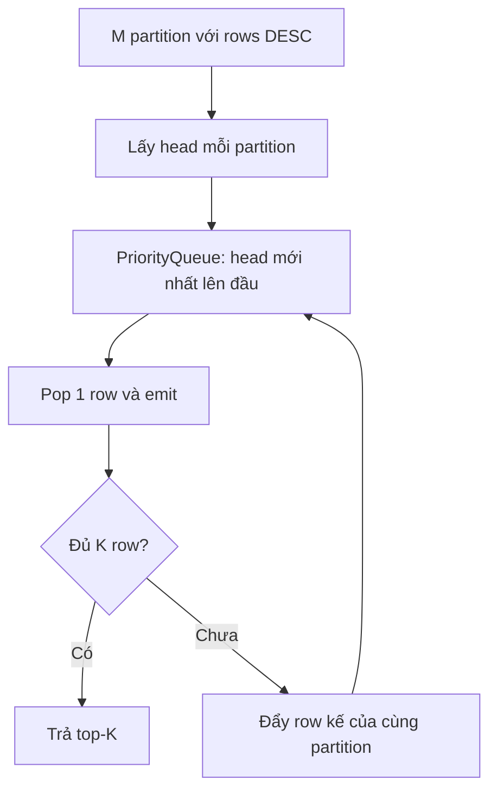

# Đọc nhiều nhóm thời gian và hợp nhất kết quả có giới hạn trong Spring Data Cassandra

Dữ liệu **time-series** như số đo cảm biến, log ứng dụng, trạng thái thiết bị, sự kiện thanh toán hay telemetry thường được ghi liên tục và đọc theo yêu cầu: **“Lấy 50 bản ghi mới nhất trong 7 ngày gần đây”**. Với Apache Cassandra, cách thiết kế bảng phổ biến là chia dữ liệu thành các **time bucket** (theo ngày, giờ hoặc khoảng cố định) để một partition không tăng vô hạn. Điều đó cải thiện khả năng phân phối và quản lý dữ liệu, nhưng làm xuất hiện một bài toán mới: khi khoảng thời gian đi qua nhiều bucket hoặc một bucket có nhiều shard, **mỗi bucket/shard là một partition có thứ tự riêng, còn Cassandra không tự trả một danh sách được sắp xếp toàn cục giữa tất cả partition**.

Vì vậy, ứng dụng phải lập kế hoạch những partition sẽ đọc, giới hạn **số nhóm**, **số request đồng thời**, **số hàng đọc từ từng nhóm**, rồi **hợp nhất (merge)** những luồng kết quả đã được sắp xếp để lấy top-K chính xác. Nếu làm không đúng, API có thể trả thiếu hàng mới, thứ tự thiếu ổn định, gửi hàng trăm request vào cluster hoặc dùng một paging token không hợp lệ cho nhiều query.

Bài thuộc chương **Dữ liệu thời gian** của module `SPRING_DATA_CASSANDRA`. Nội dung đặt trong bối cảnh truy cập Apache Cassandra bằng Spring Data Cassandra, entity mapping, repository, CassandraTemplate, CQL và Java Driver. Trọng tâm là **query-driven data modeling**, partition key/clustering key, bounded fan-out, k-way merge, paging, consistency, TTL và hiệu năng hệ phân tán.

> **Nguyên tắc:** **Đúng kết quả trước, có giới hạn tài nguyên sau — cả hai đều bắt buộc.** Không bỏ qua partition chỉ để giữ latency rồi vẫn quảng cáo kết quả là “50 sự kiện mới nhất”. Nếu không thể kiểm tra đầy đủ những partition cần thiết trong ngân sách, phải thu hẹp request, báo lỗi có ý nghĩa hoặc trả trạng thái **partial** được mô tả rõ, không âm thầm làm sai top-K.

## 1. Phân biệt bucket, partition, shard và trang

| Khái niệm | Ví dụ | Ý nghĩa |
|---|---|---|
| **Time bucket** | `2026-11-25` theo UTC | Nhóm dữ liệu theo khoảng thời gian cố định |
| **Partition key** | `(tenant_id, sensor_id, bucket_day, shard_id)` | Xác định vị trí logic và các replica của một partition |
| **Clustering key** | `(measured_at, event_seq)` | Định danh row và thứ tự **bên trong partition** |
| **Shard** | `0..3` | Chia tải một bucket thành nhiều partition nếu cần |
| **Result set/page** | 32 rows từ một query | Phần dữ liệu Driver đã fetch; không phải time bucket |
| **Top-K toàn cục** | 50 sự kiện mới nhất từ mọi nhóm | Kết quả đã merge trên một thứ tự chung |
| **Bounded fan-out** | Tối đa 16 nhóm, tối đa 4 request in-flight | Chính sách giới hạn tài nguyên của API |
| **Paging state** | Token của một SELECT cụ thể | Điểm tiếp tục **của query đó**, không tự dùng chung cho nhiều partition |

Một **bucket ngày** có thể là một partition nếu không shard và chỉ có một sensor. Nhưng nếu mỗi ngày của một sensor có 4 shard thì **một bucket ngày gồm 4 partition**; đọc 7 ngày cần tới 28 partition cho sensor đó.

**Trang mạng (driver page) không phải bucket.** Mỗi partition có thể được đọc qua nhiều network pages. Khi hợp nhất nhiều partition, ứng dụng phải quản lý cả **hàng đã đọc nhưng chưa emit** lẫn **paging state riêng của từng query**.

## 2. Khi nào cần đọc qua nhiều nhóm thời gian?

Ba tình huống thường gặp:

1. **Một sensor, nhiều ngày, không shard:** tìm 20 điểm gần nhất trong 7 ngày. Nếu bucket được gán chính xác từ timestamp, có thể đọc ngày mới nhất trước, rồi ngày cũ hơn cho đến đủ 20 điểm; không nhất thiết cần heap merge phức tạp.
2. **Nhiều sensor trong cùng một khoảng:** mỗi sensor có partition riêng và dòng thời gian riêng. Muốn một timeline chung theo timestamp, phải **merge nhiều luồng đã sắp xếp**.
3. **Một sensor, nhiều shard mỗi bucket:** nhiều sự kiện cùng ngày nằm ở các partition shard khác nhau. Không thể nối kết quả shard 0 rồi shard 1 mà vẫn đảm bảo top-K theo thời gian; cần **k-way merge**.

Một tình huống còn khó hơn là lấy top-K trên hàng trăm tenant/sensor/tháng. Khi số partition cần đọc quá lớn, vấn đề không còn là tối ưu một vòng lặp Java: cần **giảm phạm vi truy vấn, xây projection/aggregate theo nhu cầu đọc hoặc chuyển sang search/analytics phù hợp**.

## 3. Schema mẫu: bucket ngày UTC và shard hữu hạn

Giả sử mỗi số đo có timestamp sự kiện `measured_at` và số thứ tự `event_seq` để phân biệt nhiều đo đạc có cùng millisecond. Một bảng phục vụ đọc timeline:

```sql
CREATE TABLE sensor_measurements_by_day_shard (
    tenant_id uuid,
    sensor_id uuid,
    bucket_day date,
    shard_id int,
    measured_at timestamp,
    event_seq bigint,
    value_milli int,
    quality text,
    PRIMARY KEY (
        (tenant_id, sensor_id, bucket_day, shard_id),
        measured_at, event_seq
    )
) WITH CLUSTERING ORDER BY (
    measured_at DESC,
    event_seq DESC
);
```

Ở đây:

- **Composite partition key** gồm `tenant_id`, `sensor_id`, `bucket_day` và `shard_id`: tất cả **bốn** giá trị phải được biết để truy vấn đúng một partition.
- `measured_at` là clustering column thứ nhất, `event_seq` là clustering column thứ hai. Khi đọc bình thường, các row mới hơn xuất hiện trước; cùng thời điểm thì `event_seq` lớn hơn xuất hiện trước.
- `value_milli` lưu số đo theo đơn vị nguyên nhỏ để ví dụ tránh sai số số thực; `quality` là metadata, không phải clustering key.
- `bucket_day` phải được tính **nhất quán từ `measured_at` theo UTC**, không lấy “ngày request đến”. Một event đến muộn vẫn thuộc ngày của event.
- `shard_id` được chọn theo quy tắc deterministic hoặc routing nghiệp vụ đã document; để đọc đầy đủ một ngày phải biết **tất cả shard có thể chứa dữ liệu**.

CQL để đọc một partition:

```sql
SELECT measured_at, event_seq, value_milli, quality
FROM sensor_measurements_by_day_shard
WHERE tenant_id = ?
  AND sensor_id = ?
  AND bucket_day = ?
  AND shard_id = ?
  AND measured_at >= ?
  AND measured_at < ?
LIMIT ?;
```

Điều kiện `measured_at` là **range trên clustering column đầu tiên**, sau khi đã cố định đủ partition key. Cách này phù hợp mô hình lưu trữ Cassandra, không cần `ALLOW FILTERING`.

**Bảng không tự sắp xếp nhiều partition chung.** CQL `ORDER BY measured_at DESC` chỉ sắp xếp kết quả trong phạm vi clustering order được server hỗ trợ; không được coi là global ORDER BY giữa nhiều sensor, ngày và shard.

## 4. Bucketing: bắt buộc thống nhất đồng hồ và biên thời gian

Chọn **UTC** làm múi giờ xác định `bucket_day`:

```java
import java.time.Instant;
import java.time.LocalDate;
import java.time.ZoneOffset;

static LocalDate utcBucket(Instant measuredAt) {
    return measuredAt.atZone(ZoneOffset.UTC).toLocalDate();
}
```

Với truy vấn khoảng **nửa mở** `[fromInclusive, toExclusive)`:

- Bao gồm row có `measured_at >= fromInclusive`.
- Loại row có `measured_at >= toExclusive`.
- Một sự kiện ở đúng biên kết thúc của ngày hôm trước nằm ở **bucket ngày mới**, không được đếm hai lần.
- Nếu API nhận ngày local của người dùng, chuyển sang `Instant` bằng một timezone **được chỉ định rõ** trước khi lập kế hoạch các bucket UTC; không lấy timezone mặc định của server.

Ví dụ:

```text
from = 2026-11-23T16:00:00Z
to   = 2026-11-26T00:00:00Z       (exclusive)

Những bucket UTC cần xét:
  2026-11-23, 2026-11-24, 2026-11-25

Không có bucket 2026-11-26 vì to là thời điểm đầu ngày 26
và biên to được loại trừ.
```

Cột CQL `timestamp` thông dụng có độ chính xác millisecond. Nếu request API nhận nanosecond, phải **chuẩn hóa/validate độ chính xác** trước khi bind hoặc so sánh. Một cách an toàn trong ví dụ là yêu cầu `from` và `to` nằm đúng millisecond boundary; không âm thầm làm tròn khiến row ở biên bị lọt hoặc mất.

**Không dùng giờ local để tự cộng “24 giờ = một ngày lịch”** khi tính bucket qua ngày đổi giờ mùa hè (DST). Tách việc xác định `LocalDate` trong timezone của nghiệp vụ và việc tính Instant boundary; với bucket UTC thì ranh giới ngày luôn rõ.

## 5. Lập kế hoạch số partition trước khi truy vấn

Nếu:

- `D` = số bucket ngày trong khoảng;
- `S` = số sensor đã được xác thực và cấp quyền;
- `H` = số shard cần đọc mỗi sensor-ngày;

thì số partition dự kiến tối đa là:

```text
M = D × S × H
```

Ví dụ:

| Khoảng | Số sensor | Shard mỗi ngày | Partition cần đọc |
|---|---:|---:|---:|
| 2 ngày | 1 | 1 | 2 |
| 7 ngày | 2 | 2 | 28 |
| 14 ngày | 10 | 4 | 560 |
| 30 ngày | 50 | 4 | 6.000 |

Ngay cả với `LIMIT 20` trong mỗi SELECT, trường hợp 6.000 partition có thể phải phát rất nhiều request. **Không được biến mọi yêu cầu “7 ngày” thành một fan-out không giới hạn**.

Ví dụ chính sách API:

```text
MAX_GROUPS       = 32 partitions / request
MAX_OUTPUT_ROWS  = 100
MAX_IN_FLIGHT    = 4 Cassandra requests
MAX_PAGE_SIZE    = 32 rows / request page
MAX_PAGES_GROUP  = 16
REQUEST_DEADLINE = theo SLO của endpoint
```

Các ngưỡng trên **chỉ là minh họa**, không phải giá trị khuyến nghị chung. Chọn dựa trên RF/CL, độ lớn row, p95/p99, loại ổ đĩa, cluster topology và tốc độ ingest.

Khi `M > MAX_GROUPS`, lựa chọn đúng là **từ chối/thu hẹp truy vấn** hoặc dùng một index/projection chuyên cho timeline; không được tự bỏ bớt nhóm ngày/sensor rồi vẫn trả kết quả như thể đã đọc đủ toàn bộ phạm vi.

## 6. Khi nào chỉ cần ghép tuần tự các bucket theo ngày?

Nếu **một sensor**, **không shard**, các row được đặt vào bucket **đúng theo `measured_at` UTC**, và mỗi bucket được đọc **DESC** theo `measured_at, event_seq`, thì mọi sự kiện của ngày mới hơn chắc chắn không cũ hơn sự kiện của ngày trước.

```text
Bucket ngày 25 (DESC): 09:05, 08:40, 08:00
Bucket ngày 24 (DESC): 23:59, 19:20
Bucket ngày 23 (DESC): 22:00, 12:10

Timeline DESC đúng:
  ngày 25 → ngày 24 → ngày 23
```

Thuật toán đơn giản:

1. Liệt kê các ngày từ mới nhất về cũ nhất.
2. Trong mỗi ngày, đọc đúng partition và các row hợp lệ theo DESC.
3. Emit tối đa K row, chỉ chuyển sang ngày cũ hơn khi chưa đủ.
4. Dừng khi đã đủ K hoặc hết khoảng; vẫn phải tuân hạn mức số ngày/page/deadline.

Điểm mạnh là **early termination**: nếu ngày 25 đã có đủ 50 row thì không cần query ngày 24 và 23. Nhưng điều kiện đúng chỉ khi **bucket bám theo timestamp dùng để sort**; nếu bucket dựa vào thời điểm ingest còn sort bằng event time, một event gửi muộn có thể nằm trong bucket mới nhưng có timestamp cũ, phá vỡ giả định nối ngày.

**Nhiều sensor hoặc nhiều shard cùng ngày phải merge**, không nối lần lượt từng sensor/shard.

## 7. Vì sao CONCAT từng nhóm sẽ cho timeline sai?

Giả sử cùng ngày có hai shard:

```text
Shard 0 (đã DESC):
  10:05 seq=8
  10:01 seq=7

Shard 1 (đã DESC):
  10:05 seq=9
  10:03 seq=5
```

Nếu ghép `shard0 + shard1` thì kết quả là:

```text
10:05 (shard0)
10:01 (shard0)
10:05 (shard1)  <-- quay ngược thời gian!
10:03 (shard1)
```

Muốn thứ tự chung ổn định, cần comparator toàn cục. Trong ví dụ dưới đây ta chọn:

```text
1. measured_at DESC
2. sensor_id (UUID canonical string) ASC khi timestamp bằng nhau
3. shard_id ASC
4. bucket_day DESC (tie-break phụ, thường đã suy ra từ time)
5. event_seq DESC
```

Comparator là **hợp đồng của ứng dụng**, không phải CQL ORDER BY được thực hiện xuyên nhiều partition. Nó phải **phù hợp với thứ tự trong từng partition**: với sensor/day/shard cố định, các trường khác là hằng; chỉ còn `measured_at DESC, event_seq DESC` nên khớp clustering order.

Khi hai row giống hệt toàn bộ primary key, Cassandra coi đó là **cùng một row** và các lần ghi là upsert. Nếu muốn hai sự kiện trùng timestamp vẫn là hai row, `event_seq` hoặc một clustering identifier khác phải đủ để phân biệt. Nếu sequence có thể va chạm, cần sửa mô hình khóa trước khi viết merge.

## 8. K-way merge bằng PriorityQueue

Với `M` luồng, **mỗi luồng đã được sắp xếp**, k-way merge lấy **row đầu tiên của mỗi luồng** đưa vào heap ưu tiên:



Mỗi lần pop:

1. Row ở đỉnh heap là row mới nhất trong số **tất cả head hiện tại**.
2. Vì từng luồng sắp xếp DESC, không có row ở sâu bên trong luồng nào mới hơn head của luồng đó.
3. Sau khi pop từ luồng X, chỉ cần đưa **head tiếp theo của X** vào heap.
4. Dừng sau K lần pop hoặc khi heap rỗng.

Nếu giữ tối đa một head mỗi luồng, heap có `O(M)` phần tử; merge K kết quả mất khoảng `O((M+K) log M)` thao tác heap, ngoài chi phí fetch mạng. Với một phiên bản đơn giản tải trước tới K row từ mỗi partition, bộ nhớ tạm tăng lên `O(M×K)`, nhưng vẫn **có trần** nếu M và K được validate.

## 9. Vì sao đọc tối đa K hàng mỗi partition đủ để tìm top-K?

Một tối ưu đơn giản: mỗi partition chỉ cần trả tối đa **K row mới nhất trong phạm vi truy vấn**, rồi merge tất cả và lấy K đầu.

**Chứng minh:** giả sử một row `r` đứng ở vị trí thứ `K+1` trong một partition đã sắp xếp theo cùng comparator toàn cục. Đã có ít nhất **K row khác của chính partition ấy** đứng trước `r`. Vì các row này cũng đứng trước `r` trong thứ tự toàn cục, `r` **không thể** thuộc top-K chung. Vậy không cần lấy quá K row của bất kỳ partition nào để tính top-K.

Điều kiện để lập luận đúng:

- Các partition cần xét được liệt kê **đầy đủ**.
- Thứ tự của mỗi partition tương thích với comparator toàn cục.
- Điều kiện thời gian/lọc của mỗi query là đúng và đồng nhất.
- Không âm thầm bỏ qua một query thất bại.
- Tập dữ liệu không thay đổi đáng kể trong lúc đọc **nếu** ứng dụng đòi kết quả như một snapshot; Cassandra không mặc định cung cấp snapshot nhất quán xuyên các partition.

**Giới hạn:** K per partition là trần **số row sống trả về**, không phải trần I/O vật lý. Cassandra có thể phải duyệt tombstone/SSTable để tìm các row sống, nên cần giám sát tombstones và partition size.

## 10. LIMIT không phải page size và không phải global LIMIT

| Thuộc tính | Phạm vi | Kết luận đúng |
|---|---|---|
| `LIMIT 50` trong SELECT trên một partition | Kết quả query **của partition đó** | Không phải global 50 trên 10 partitions |
| `PER PARTITION LIMIT` | Giới hạn số row trong mỗi partition của query nếu cú pháp hợp lệ | Không tự sắp xếp toàn cục |
| Driver `setPageSize(32)` | Kích thước **mỗi network page**, là gợi ý | Không phải tổng số row được trả |
| `AsyncResultSet.currentPage()` | Chỉ các row ở response trang hiện tại | Chưa chắc đã có đủ LIMIT rows |
| `AsyncResultSet.fetchNextPage()` | Yêu cầu trang kế tiếp của **query ấy** | Không tiếp tục một query khác |
| Output `topK=50` ở service | Danh sách đã merge từ tất cả nhóm | Chỉ đúng nếu mọi nhóm cần xét đã được xử lý |

Ví dụ dùng `LIMIT 50` và `setPageSize(20)` có thể cần nhiều page để lấy tối đa 50 row từ **một partition**. Cassandra có thể trả ít hơn số gợi ý trên một page, nên code không được giả định “LIMIT bằng page size thì chỉ có một page”.

**Không dùng `SELECT ... WHERE bucket_day IN (...) ORDER BY measured_at DESC LIMIT 50` rồi kỳ vọng server trả global top-50 giữa nhiều partition.** Với composite partition key và nhiều sensor/shard, các ràng buộc CQL và thứ tự giữa partition không cung cấp hợp đồng ấy. Việc đưa `IN` vào một phần khóa không thay thế kế hoạch fan-out/merge.

## 11. Java model và comparator chung cho bài thực hành

Đoạn code dùng **Java 17+** và Apache Cassandra Java Driver **4.x**, package `com.datastax.oss.driver.api.core.*`. Giả định mỗi partition chứa event có cùng tenant/sensor/day/shard.

```java
import java.time.Instant;
import java.time.LocalDate;
import java.util.Comparator;
import java.util.UUID;

public record Group(
    UUID tenantId,
    UUID sensorId,
    LocalDate day,
    int shard
) {}

public record Reading(
    UUID tenantId,
    UUID sensorId,
    LocalDate day,
    int shard,
    Instant measuredAt,
    long eventSeq,
    int valueMilli
) {}

public final class ReadingOrder {
    private ReadingOrder() {}

    public static final Comparator<Reading> NEWEST_FIRST =
        Comparator.<Reading, Instant>comparing(
                Reading::measuredAt, Comparator.reverseOrder()
            )
            .thenComparing(r -> r.tenantId().toString())
            .thenComparing(r -> r.sensorId().toString())
            .thenComparingInt(Reading::shard)
            .thenComparing(Reading::day, Comparator.reverseOrder())
            .thenComparing((a, b) ->
                Long.compare(b.eventSeq(), a.eventSeq()));
}
```

Các record/class `public` cần nằm trong file Java riêng khi đưa vào project. Comparator có thể chọn quy tắc tie-break khác nhưng phải:

- **Ổn định qua các lần gọi API**.
- Đồng nhất giữa data sources và các lần phân trang.
- Sắp xếp đúng **trong từng luồng** theo thứ tự clustering mà Cassandra trả về.
- Không dựa vào thứ tự query hoàn tất hoặc thứ tự phần tử từ một `HashMap`.
- Định danh row rõ ràng để có thể **deduplicate** nếu kiến trúc lưu sự kiện có thể xuất hiện ở nhiều projection.

**Không dùng Java `Instant` với nano không được bảo toàn bởi cột Cassandra `timestamp` để phân biệt hai event cùng millisecond**; `eventSeq` có vai trò tie-break của dữ liệu.

## 12. Đọc một partition bất đồng bộ với giới hạn hàng và trang

Bước thứ nhất của chiến lược “load tối đa K mỗi nhóm, rồi merge” là một method lấy **tối đa K live rows** từ một partition đã biết. Nó phải chủ động đọc các page sau nếu server chỉ trả một phần.

```java
import java.time.Duration;
import java.time.Instant;
import java.util.ArrayList;
import java.util.List;
import java.util.concurrent.CompletableFuture;
import java.util.concurrent.CompletionStage;

import com.datastax.oss.driver.api.core.CqlSession;
import com.datastax.oss.driver.api.core.DefaultConsistencyLevel;
import com.datastax.oss.driver.api.core.cql.AsyncResultSet;
import com.datastax.oss.driver.api.core.cql.BoundStatement;
import com.datastax.oss.driver.api.core.cql.PreparedStatement;
import com.datastax.oss.driver.api.core.cql.Row;

public final class BoundedTimeSeriesDao {
    private static final int MAX_K = 100;
    private static final int MAX_GROUPS = 32;
    private static final int MAX_CONCURRENCY = 4;
    private static final int MAX_PAGES_PER_GROUP = 16;

    private final CqlSession session;
    private final PreparedStatement select;

    public BoundedTimeSeriesDao(CqlSession session) {
        this.session = session;
        this.select = session.prepare(
            "SELECT measured_at, event_seq, value_milli " +
            "FROM sensor_measurements_by_day_shard " +
            "WHERE tenant_id = ? AND sensor_id = ? " +
            "AND bucket_day = ? AND shard_id = ? " +
            "AND measured_at >= ? AND measured_at < ? " +
            "LIMIT ?"
        );
    }

    private CompletionStage<List<Reading>> fetchGroup(
            Group group, Instant from, Instant to, int k) {

        BoundStatement statement = select.bind(
                group.tenantId(), group.sensorId(),
                group.day(), group.shard(),
                from, to, k)
            .setPageSize(Math.min(k, 32))
            .setConsistencyLevel(DefaultConsistencyLevel.LOCAL_QUORUM)
            .setTimeout(Duration.ofSeconds(3));

        return session.executeAsync(statement)
            .thenCompose(first ->
                consumePage(first, group, new ArrayList<>(), k, 1));
    }

    private CompletionStage<List<Reading>> consumePage(
            AsyncResultSet page,
            Group group,
            List<Reading> rows,
            int k,
            int pagesRead) {

        for (Row row : page.currentPage()) {
            if (rows.size() >= k) {
                return CompletableFuture.completedFuture(
                    List.copyOf(rows));
            }

            rows.add(new Reading(
                group.tenantId(),
                group.sensorId(),
                group.day(),
                group.shard(),
                row.getInstant("measured_at"),
                row.getLong("event_seq"),
                row.getInt("value_milli")
            ));
        }

        if (rows.size() >= k || !page.hasMorePages()) {
            return CompletableFuture.completedFuture(
                List.copyOf(rows));
        }

        if (pagesRead >= MAX_PAGES_PER_GROUP) {
            return CompletableFuture.failedFuture(
                new IllegalStateException(
                    "Page budget exceeded: " + group));
        }

        return page.fetchNextPage()
            .thenCompose(next ->
                consumePage(next, group, rows, k, pagesRead + 1));
    }

    // loadWaves(), mergeTopK() và newest() ở các mục tiếp theo.
}
```

Lớp ví dụ **chưa kết thúc hoàn chỉnh** vì các method tiếp theo được bổ sung ở mục 13–14; khi copy các đoạn code phải **ghép vào cùng class**. Các imports của method kế tiếp được bổ sung tương ứng.

**Tại sao phải có `MAX_PAGES_PER_GROUP`?** `pageSize` là gợi ý, dữ liệu nhiều tombstone hoặc page nhỏ có thể gây nhiều lượt fetch. Nếu vượt ngân sách, code trả **failure rõ ràng** chứ không trả danh sách thiếu rồi báo đã hoàn tất. Trong production còn cần overall deadline và metrics theo page.

**Không gọi `join()` trong callback I/O để chờ trang kế.** `thenCompose` nối tiếp request bất đồng bộ mà không block luồng. `row` được map ngay khi xử lý từng trang; nếu mapping nặng, offload sang bounded executor.

## 13. Giới hạn số request đồng thời bằng wave bất đồng bộ

Một phương pháp dễ đọc là chia `M` partition thành các **wave**, mỗi wave có tối đa `C` query độc lập. Sau khi cả wave hoàn tất, mới phát wave tiếp theo. Đây là **bounded concurrency** nhưng chưa tối ưu throughput tối đa vì phải đợi query chậm nhất trong wave.

Thêm method sau vào `BoundedTimeSeriesDao`:

```java
import java.util.ArrayList;
import java.util.List;
import java.util.concurrent.CompletableFuture;
import java.util.concurrent.CompletionStage;

private CompletionStage<List<List<Reading>>> loadWaves(
        List<Group> groups,
        Instant from,
        Instant to,
        int k,
        int maxConcurrent,
        int nextIndex,
        List<List<Reading>> loaded) {

    if (nextIndex >= groups.size()) {
        return CompletableFuture.completedFuture(
            List.copyOf(loaded));
    }

    int end = Math.min(
        nextIndex + maxConcurrent, groups.size());

    List<CompletableFuture<List<Reading>>> wave =
        new ArrayList<>();

    for (int i = nextIndex; i < end; i++) {
        wave.add(
            fetchGroup(groups.get(i), from, to, k)
                .toCompletableFuture());
    }

    CompletableFuture<?>[] futures =
        wave.toArray(new CompletableFuture<?>[0]);

    return CompletableFuture.allOf(futures)
        .thenCompose(ignored -> {
            // allOf đã hoàn tất thành công: getNow KHÔNG chờ.
            for (CompletableFuture<List<Reading>> future : wave) {
                loaded.add(future.getNow(null));
            }
            return loadWaves(
                groups, from, to, k,
                maxConcurrent, end, loaded);
        });
}
```

Ý nghĩa:

- Chỉ có tối đa `maxConcurrent` query `executeAsync` được phát trong một wave.
- Nếu một query hoàn tất ngoại lệ, `allOf` hoàn tất ngoại lệ; bước merge **không chạy**, nên không âm thầm coi partition lỗi như partition không có dữ liệu.
- `future.getNow(null)` được gọi **sau khi `allOf` thành công**; không block Driver I/O thread. Mã không dùng `join()`/`get()` để đợi I/O trong callback.
- Các `List<Reading>` được giữ trong `loaded` để merge; với `M<=32` và `K<=100`, số row được giữ trong các danh sách tối đa khoảng **3.200**, chưa tính internal page/driver buffers.
- Bởi vì wave chỉ thêm vào `loaded` sau khi tất cả futures cùng wave đã hoàn tất, mutation của danh sách này không xảy ra đồng thời từ nhiều query callbacks.

**Giới hạn:** nhiều wave có overhead chờ query chậm nhất. Khi cần throughput cao hơn, có thể viết scheduler “sliding window” phát query mới ngay khi một query hoàn tất, dùng `Semaphore`/work queue hoặc Reactor `flatMap(..., concurrency)`. Nhưng không nên đánh đổi tính đơn giản thành queue không giới hạn hoặc callback nặng chạy trên driver thread.

## 14. Hợp nhất danh sách đã sắp xếp bằng heap

Sau khi lấy tối đa K row từ mỗi group, ta có `List<List<Reading>>`, mỗi danh sách **đã được Cassandra sắp xếp theo clustering order**. Dùng `PriorityQueue` để hợp nhất:

```java
import java.util.ArrayList;
import java.util.List;
import java.util.PriorityQueue;

private record Cursor(
    int streamIndex,
    int rowIndex,
    Reading row
) {}

static List<Reading> mergeTopK(
        List<List<Reading>> streams,
        int k) {

    PriorityQueue<Cursor> heap = new PriorityQueue<>(
        (a, b) -> ReadingOrder.NEWEST_FIRST.compare(
            a.row(), b.row()));

    for (int i = 0; i < streams.size(); i++) {
        List<Reading> stream = streams.get(i);
        if (!stream.isEmpty()) {
            heap.add(new Cursor(0 + i, 0, stream.get(0)));
        }
    }

    List<Reading> result = new ArrayList<>(k);

    while (!heap.isEmpty() && result.size() < k) {
        Cursor head = heap.remove();
        result.add(head.row());

        int nextRow = head.rowIndex() + 1;
        List<Reading> source =
            streams.get(head.streamIndex());

        if (nextRow < source.size()) {
            heap.add(new Cursor(
                head.streamIndex(),
                nextRow,
                source.get(nextRow)));
        }
    }

    return List.copyOf(result);
}
```

Method `mergeTopK` được đặt trong `BoundedTimeSeriesDao` hoặc một utility class tùy cấu trúc project. Method không truy cập Cassandra; nó là **pure function** trên dữ liệu có thứ tự nên rất dễ unit test.

**Độ phức tạp:** giả sử M danh sách với tổng số row đã tải tối đa M×K; khởi tạo heap O(M log M), sau đó tối đa K vòng pop/push với O(log M) mỗi vòng. Bộ nhớ riêng của heap là O(M) và output O(K). Tổng bộ nhớ của **chiến lược prefetch trước rồi merge** vẫn O(M×K) vì giữ các danh sách row; điều này chấp nhận được **chỉ khi M và K được giới hạn nghiêm ngặt**.

**Quan trọng:** `PriorityQueue` không tự loại duplicate. Nếu cùng sự kiện nghiệp vụ bị ghi vào nhiều projection và đọc trùng qua các streams, cần có event ID toàn cục và chính sách dedup **trước khi đếm đủ K**, có thể phải fetch thêm để đủ K bản ghi duy nhất. Không lấy `K` row rồi dedup tùy tiện và báo thiếu trong khi dữ liệu nguồn vẫn còn.

## 15. Điểm vào của DAO: validate rồi đọc và merge

Phương thức public của DAO:

```java
import java.time.Instant;
import java.util.ArrayList;
import java.util.List;
import java.util.concurrent.CompletionStage;

public CompletionStage<List<Reading>> newest(
        List<Group> groups,
        Instant fromInclusive,
        Instant toExclusive,
        int k,
        int maxConcurrent) {

    if (groups == null || groups.isEmpty()
            || groups.size() > MAX_GROUPS
            || fromInclusive == null
            || toExclusive == null
            || !fromInclusive.isBefore(toExclusive)
            || k < 1 || k > MAX_K
            || maxConcurrent < 1
            || maxConcurrent > MAX_CONCURRENCY) {
        throw new IllegalArgumentException(
            "Invalid time range, group count or query budget");
    }

    return loadWaves(
        List.copyOf(groups),
        fromInclusive,
        toExclusive,
        k,
        maxConcurrent,
        0,
        new ArrayList<>()
    ).thenApply(streams -> mergeTopK(streams, k));
}
```

Đây là **API nội bộ**, chỉ nhận `groups` đã được **planner phía server** tạo từ tenant và sensor được cấp quyền. Không chuyển trực tiếp danh sách partition tùy ý từ JSON request vào method rồi coi việc có `MAX_GROUPS` là đủ để ngăn truy cập chéo tenant.

Các điều kiện cần thêm ở service boundary:

1. Mọi `Group` có cùng `tenantId` được xác thực.
2. Mỗi `sensorId` thuộc tenant/role và nằm trong tập sensor đã được duyệt.
3. `day` nằm trong các bucket được tính từ `[from, to)`; `shard` thuộc tập shard hiện có của schema/version.
4. Không có `Group` trùng nhau, nếu không dữ liệu có thể bị xuất hiện hai lần trong merge.
5. `from`/`to` có độ chính xác phù hợp CQL `timestamp` và không vượt retention.
6. Request bị từ chối nếu số partition dự kiến vượt ngân sách; không âm thầm cắt danh sách.
7. Tổng thời gian request có deadline; nếu hết hạn phải báo lỗi hoặc explicit partial response.
8. Trong production, quản lý `CqlSession` bằng Spring Boot và dùng test xác nhận mọi query được bind đúng partition key.

**Sự chính xác của top-K phụ thuộc planner.** `BoundedTimeSeriesDao` có thể merge chính xác những nhóm **được giao**, nhưng nếu planner bỏ một nhóm có dữ liệu mới hơn thì kết quả không còn đúng đối với phạm vi người dùng yêu cầu.

## 16. Planner: từ thời gian, danh sách sensor và shard ra các Group

Tầng service không nên tự tạo Group từ giá trị tùy ý. Hợp đồng đầu vào:

```text
actor/tenant từ authentication
authorizedSensorIds: danh sách sensor user được phép đọc
fromInclusive: Instant
toExclusive: Instant
k: số hàng mong muốn
shardLayout: tập shard theo version của schema
```

Pseudo-code planner:

```java
// PSEUDOCODE; giả định shardLayout đã được kiểm chứng.
validateAuthenticatedTenant(tenantId);
validateSensorPermissions(tenantId, selectedSensors);
validateInstantBounds(from, to);       // from < to; millisecond aligned
validateRetentionWindow(from, to);

LocalDate firstDay =
    from.atZone(ZoneOffset.UTC).toLocalDate();

LocalDate lastDay =
    to.minusNanos(1).atZone(ZoneOffset.UTC).toLocalDate();

long dayCount =
    ChronoUnit.DAYS.between(firstDay, lastDay) + 1L;

long plannedGroups = Math.multiplyExact(
    Math.multiplyExact(dayCount, selectedSensors.size()),
    shardLayout.activeShardCount());

if (plannedGroups > MAX_GROUPS) {
    throw new QueryScopeTooBroadException();
}

List<Group> groups = new ArrayList<>();

for (LocalDate day = firstDay;
        !day.isAfter(lastDay);
        day = day.plusDays(1)) {

    for (UUID sensor : selectedSensors) {
        for (int shard : shardLayout.shardsFor(day, sensor)) {
            groups.add(new Group(
                tenantId, sensor, day, shard));
        }
    }
}

return dao.newest(groups, from, to, k, 4);
```

**Lưu ý:** `activeShardCount()` trong pseudo-code giả định số shard không đổi; nếu layout lịch sử thay đổi theo ngày/sensor, phải **tính tổng chính xác** `shardsFor(day,sensor)`, không nhân một số cố định rồi lập kế hoạch thiếu. Tránh `to.minusNanos(1)` với Instant ngoài miền được hỗ trợ; production cần validation trước khi làm toán ngày. `Math.multiplyExact` giúp phát hiện overflow thay vì âm thầm vượt qua budget.

Đặc biệt, **không cho client tự chọn `tenant_id` hoặc `shard_id` để đọc partition của người khác**. Tenant ID và schema layout phải đến từ server-side authority.

## 17. Hai thuật toán nâng cao: đọc tuần tự theo ngày và lazy k-way merge

Đoạn Java ở các mục trên **đọc tối đa K hàng từ tất cả M nhóm**. Với M nhỏ, cách này đơn giản và bảo đảm đúng top-K. Với dữ liệu rất lớn, có thể tiết kiệm nhiều hơn.

### 17.1. Duyệt ngày mới về ngày cũ (early stop)

Nếu ngày bucket hoàn toàn xác định từ `measured_at`:

- Lấy tất cả shard/sensor của **ngày mới nhất**.
- Merge top-K trong ngày ấy.
- Nếu đã đủ K row, có thể dừng: ngày cũ hơn không thể chứa timestamp mới hơn.
- Nếu chưa đủ K, tiếp tục ngày cũ, merge thêm vào kết quả.
- Cần giới hạn số ngày, số partition/ngày, số request đồng thời và tổng deadline.

**Không** dừng sau khi thấy một sensor của ngày mới đủ K nếu còn sensor/shard khác **trong cùng ngày chưa đọc**: nhóm chưa đọc có thể có K row mới hơn tất cả row đã thấy.

### 17.2. Lazy k-way merge (một head mỗi stream)

Nếu M nhóm đều có thể chứa bản ghi cùng khoảng thời gian, chiến lược nâng cao là:

1. Fetch một page nhỏ của mỗi nhóm, đưa head của mỗi nhóm vào heap.
2. Pop head mới nhất và emit.
3. Khi buffer của nhóm bị pop hết, fetch page kế của **nhóm đó**, rồi mới tiếp tục merge.
4. Không được emit phần tử kế tiếp nếu một nhóm còn khả năng chứa dữ liệu **mới hơn** nhưng head của nhóm ấy chưa được nạp do I/O chậm.
5. Dừng sau K row hoặc hết tất cả nhóm; giữ group cursor/paging state nếu cần phân trang toàn cục.

Cách này có thể giảm số row đọc xuống gần `O(M+K)` trong trường hợp thuận lợi, thay vì `M×K`. Nhưng cần quản lý **buffer, token, in-flight cap và lỗi từng group** cẩn thận. Về bộ nhớ, giữ một page nhỏ của mỗi nhóm có thể là `O(M×pageSize + K)`.

**Nguyên tắc bất biến:** để pop row tiếp theo theo thứ tự toàn cục, phải có **head hợp lệ của mọi luồng chưa cạn**. Nếu group chưa fetch được head vì timeout, không coi nó như empty stream.

## 18. Global pagination khó hơn pagination của một partition

Cassandra Driver cung cấp **paging state của một SELECT**, ví dụ một query đến `(tenant, sensor, day, shard)`. Nhưng sau khi merge nhiều query, không có “một paging token Cassandra” tự động biểu diễn vị trí toàn cục.

Giả sử đã fetch page của shard A gồm 32 rows nhưng mới emit 3 rows từ A; shard B cũng đã fetch 32 nhưng chưa emit row nào. Nếu chỉ lưu `pagingState` của A và B và bỏ những row chưa emit, lần tiếp tục có thể **nhảy mất** các row còn trong page cũ.

Để xây continuation đúng, cần giữ:

- **Danh sách nhóm/plan** được bảo vệ và được cấp quyền.
- **Query bounds, filter và comparator version** bất biến.
- **Cursor hoặc paging state riêng** của từng query.
- **Các row đã fetch nhưng chưa emit**, hoặc một cách có thể tái tạo chúng bằng keyset/cursor được thử nghiệm chính xác.
- Thông tin row cuối đã emit để tránh duplicate giữa những lần gọi.
- Hạn sử dụng và ràng buộc tenant/auth; schema/shard-layout version khi cần.

Hai kiến trúc:

| Phương án | Lợi điểm | Đánh đổi |
|---|---|---|
| **Cursor server-side** lưu trạng thái các luồng trong kho tạm có TTL | Dễ giữ buffer/paging state đúng, token client nhỏ | Cần quản lý state, scale-out, expire, cleanup |
| **Cursor stateless có chữ ký** chứa trạng thái/offset cần thiết | Không cần session state server | Có thể phình to với nhiều nhóm; phải ký/mã hóa phù hợp và bảo vệ replay |

**Không khuyến nghị** dùng `page=100` rồi giả lập OFFSET bằng cách fetch bỏ 9.900 row. Cassandra paging là **forward-only**; deep offset có chi phí lớn. Spring Data `CassandraPageRequest`/`Slice` giúp đi tiếp **một query**, không tự merge hàng chục partition.

Một cách đơn giản nếu không cần phân trang toàn cục là API chỉ cho `topK <= 100` và yêu cầu người dùng thu hẹp khoảng để xem tiếp. Đây thường là quyết định sản phẩm/vận hành tốt hơn một hệ thống cursor phức tạp khi use case còn nhỏ.

## 19. Dữ liệu có thể thay đổi trong lúc đọc nhiều partition

Khi M query được gửi vào các thời điểm khác nhau, Cassandra **không cung cấp snapshot giao dịch nhất quán toàn cục** giữa tất cả kết quả. Trong lúc đọc:

- Event mới có thể được insert vào một bucket đã đọc.
- TTL có thể hết hạn ở một shard trước khi đọc shard khác.
- Mutation có thể được xác nhận ở local DC nhưng chưa hội tụ ở remote DC.
- Update/delete có thể làm kết quả khác giữa hai request.
- Event đến muộn có timestamp cũ có thể được thêm vào bucket lịch sử trong lúc đang quét.

Vì thế, top-K được tạo là **hình ảnh quan sát** ở các thời điểm đọc, không phải snapshot ACID nhiều partition. Nếu yêu cầu báo cáo chính xác tại một mốc, có thể cần **watermark, immutable event log, snapshot/versioning hoặc analytics pipeline**.

Ví dụ chính sách:

```text
Chỉ hiển thị sự kiện có measured_at < ingestion_watermark.
Watermark do pipeline cung cấp và có độ trễ công bố rõ ràng.
```

Watermark không tự đảm bảo transaction; nó là một công cụ giúp xác định dữ liệu đã tương đối ổn định trong một khoảng khi hệ thống ghi theo luồng. Cần định nghĩa rõ tính trễ, nguồn thời gian và trường hợp backfill.

## 20. Late events và thay đổi cách gán bucket

Một sự kiện đo lúc 23:58 nhưng chỉ được gửi đến server lúc 00:05 ngày hôm sau:

| Thuộc tính | Giá trị |
|---|---|
| `measured_at` | 2026-11-25T23:58:00Z |
| `received_at` | 2026-11-26T00:05:00Z |
| `bucket_day` theo event-time | 2026-11-25 |
| `bucket_day` theo ingestion-time | 2026-11-26 |

Nếu ứng dụng **sắp xếp theo measured_at** nhưng **bucket theo received_at**, một bucket ngày 26 có thể chứa sự kiện có measured_at của ngày 25, làm giả định đọc “ngày mới nhất trước sẽ luôn có row mới nhất” **không còn đúng**. Khi đó cần:

- Gán bucket theo đúng event-time được sắp xếp; hoặc
- Cho phép overlap/backfill window có kế hoạch và merge nhiều nhóm; hoặc
- Dùng bảng/projection khác phù hợp với cách nghiệp vụ tìm kiếm theo received time.

Không lặng lẽ đổi quy tắc bucket trên bảng đang có dữ liệu. Nếu migration thay shard count hoặc timezone policy, query planner phải biết **version layout theo thời gian** để đọc cả partition cũ lẫn mới khi cần.

## 21. Spring Data Cassandra: mapping, repository và CassandraTemplate

Một entity có composite primary key:

```java
import java.io.Serializable;
import java.time.Instant;
import java.time.LocalDate;
import java.util.UUID;

import org.springframework.data.cassandra.core.cql.Ordering;
import org.springframework.data.cassandra.core.mapping.PrimaryKeyClass;
import org.springframework.data.cassandra.core.mapping.PrimaryKeyColumn;
import org.springframework.data.cassandra.core.mapping.PrimaryKeyType;

@PrimaryKeyClass
public class MeasurementKey implements Serializable {

    @PrimaryKeyColumn(
        name = "tenant_id", ordinal = 0,
        type = PrimaryKeyType.PARTITIONED)
    private UUID tenantId;

    @PrimaryKeyColumn(
        name = "sensor_id", ordinal = 1,
        type = PrimaryKeyType.PARTITIONED)
    private UUID sensorId;

    @PrimaryKeyColumn(
        name = "bucket_day", ordinal = 2,
        type = PrimaryKeyType.PARTITIONED)
    private LocalDate day;

    @PrimaryKeyColumn(
        name = "shard_id", ordinal = 3,
        type = PrimaryKeyType.PARTITIONED)
    private Integer shard;

    @PrimaryKeyColumn(
        name = "measured_at", ordinal = 4,
        type = PrimaryKeyType.CLUSTERED,
        ordering = Ordering.DESCENDING)
    private Instant measuredAt;

    @PrimaryKeyColumn(
        name = "event_seq", ordinal = 5,
        type = PrimaryKeyType.CLUSTERED,
        ordering = Ordering.DESCENDING)
    private Long eventSeq;

    // Constructor, getters/setters, equals/hashCode cho key.
}
```

```java
import org.springframework.data.cassandra.core.mapping.Column;
import org.springframework.data.cassandra.core.mapping.PrimaryKey;
import org.springframework.data.cassandra.core.mapping.Table;

@Table("sensor_measurements_by_day_shard")
public class MeasurementEntity {
    @PrimaryKey
    private MeasurementKey key;

    @Column("value_milli")
    private Integer valueMilli;

    @Column("quality")
    private String quality;

    // Constructor/getters/setters cho mapping.
}
```

Repository:

```java
import org.springframework.data.cassandra.repository.CassandraRepository;

public interface MeasurementRepository
        extends CassandraRepository<MeasurementEntity, MeasurementKey> {
}
```

Mã Java rút gọn, cần accessor, constructor và converter theo phiên bản project. Entity mapping giúp **đọc/ghi một partition hoặc entity đúng khóa**, nhưng repository **không tự tạo global top-K merge** của nhiều partition.

### Nên dùng API nào để đọc nhiều bucket?

| Tình huống | API phù hợp | Cần làm thêm |
|---|---|---|
| CRUD theo đủ primary key | Repository | Không có merge toàn cục |
| Query một bucket với mapped entity | `CassandraTemplate`/`CassandraOperations` | Hợp lệ về partition key, giới hạn row |
| Dùng repository `Slice` để phân trang một query | Spring Data paging | Mỗi query có continuation riêng |
| K-way merge nhiều partition với paging/metadata rõ | Java Driver `CqlSession.executeAsync` hoặc custom DAO | Planner, bounded fan-out, merge, cursor |
| Reactive stream theo nhiều bucket | `ReactiveCassandraOperations`/Reactor | Concurrency cap, sort/merge, error propagation |

**Không dùng `Sort.by("measuredAt").descending()` trên repository rồi kỳ vọng Cassandra sắp xếp mọi partition.** Sort trong Cassandra bị ràng buộc bởi clustering order, không phải SQL global order. Khi nhiều bucket, service vẫn phải định nghĩa thứ tự hợp nhất.

## 22. Reactor và bounded concurrency: lợi ích và bẫy

Nếu đã dùng Spring Data Cassandra reactive, có thể biểu diễn một luồng nhóm bằng Reactor:

```java
import reactor.core.publisher.Flux;
import reactor.core.publisher.Mono;

// PSEUDOCODE: fetchGroupReactive trả Mono<List<Reading>>
// và đã xử lý paging/limit đúng cho một partition.
Mono<List<Reading>> merged =
    Flux.fromIterable(groups)
        .flatMap(
            group -> fetchGroupReactive(group, from, to, k),
            4
        )
        .collectList()
        .map(streams -> mergeTopK(streams, k));
```

Điểm đúng:

- `flatMap(..., 4)` giới hạn tối đa bốn inner publishers được subscribe đồng thời.
- `collectList()` chỉ chấp nhận được nếu **số nhóm và số row mỗi nhóm có trần** như `M<=32, K<=100`.
- `mergeTopK` dùng comparator toàn cục, không dựa vào thứ tự `flatMap` trả completion.

Điểm dễ sai:

- `flatMap` **không đảm bảo thứ tự các group theo thời gian**; kết quả phải merge đúng chứ không concat.
- Nếu một inner publisher thất bại, pipeline mặc định có thể fail/cancel; không được thay bằng `Mono.empty()` rồi coi group lỗi là rỗng.
- Nếu nguồn group quá lớn hoặc `fetchGroupReactive` trả kết quả vô hạn, `collectList()` vẫn có nguy cơ OOM.
- Dùng `Flux.sort(...)` trên toàn bộ sự kiện không có giới hạn cũng có thể phải buffer toàn bộ luồng.
- Reactor backpressure/`flatMap` concurrency không thay authorization, query scope và request deadline.

Khi cần **lazy sorted merge** với nhiều asynchronous cursors, việc dùng `Flux.merge` trực tiếp chỉ cho thứ tự **completion/emission**, không phải thứ tự event-time; phải có k-way merge hoặc operator/source được thiết kế rõ cho sorted streams.

## 23. Kiểm soát deadline, failure và partial results

Một API nhiều nhóm có thể gặp timeout ở một partition trong khi các nhóm khác thành công. Không thể lặng lẽ thay kết quả lỗi bằng `List.of()` rồi trả “top-50”:

```text
Group A → 20 rows
Group B → timeout
Group C → 17 rows

Sai:
  merge(A, empty, C) → HTTP 200 "Top-50 đầy đủ"

Đúng:
  failure có thể retry theo ngân sách,
  hoặc HTTP error/partial response với metadata rõ ràng,
  hoặc yêu cầu thu hẹp truy vấn.
```

Một hợp đồng API minh họa:

```json
{
  "items": [],
  "complete": false,
  "requestedGroups": 12,
  "completedGroups": 11,
  "failedGroups": 1,
  "reason": "SOURCE_TIMEOUT"
}
```

Đây **chỉ là shape minh họa**, không phải một kết quả đo thực tế. Khi `complete=false`, không được mô tả `items` là **global top-K đầy đủ**; cần quy tắc rõ về việc UI được phép hiển thị một tập partial và cảnh báo.

Về vận hành:

1. Đặt **timeout per statement** và **deadline tổng** cho toàn bộ fan-out.
2. Giới hạn retry và dùng backoff/jitter khi lỗi tạm thời.
3. Không retry mù quáng những query sai schema hoặc thiếu partition key.
4. Nếu nhóm thất bại sau nhiều lần thử, fail cả kết quả hoặc trả partial explicit.
5. Quan sát `M`, số trang, bytes, in-flight, timeout, và tần suất fan-out bị từ chối.
6. Khi client hủy request, không giả định mọi query server-side đã được dừng tức thì.

Đọc SELECT có thể retry dễ hơn một mutation không idempotent, nhưng retry vẫn tạo thêm tải. Nếu cluster đang bão hòa, retry đồng loạt cả 32 group có thể dẫn tới **retry storm**.

## 24. TTL, tombstone và compaction ảnh hưởng truy vấn liên bucket

Time-series thường có retention, ví dụ TTL 7 hoặc 30 ngày. Khi các cell hết hạn:

- Một SELECT vẫn có thể phải xét tombstone/SSTable để tìm row sống.
- `LIMIT 50` không bảo đảm đọc đúng 50 entry vật lý.
- Nhiều partition cũ có thể không còn row sống nhưng query vẫn tốn RTT/network.
- Một bucket ngày có nhiều row đến muộn và TTL khác nhau có thể khó dự đoán chi phí hơn.
- Xóa dữ liệu theo partition/bucket với retention khác TTL và phải được vận hành có kiểm soát.

**Không tự suy rằng “ngày cũ chắc chắn rỗng”** nếu chính sách retention có backfill/late arrivals hoặc đã thay TTL giữa các giai đoạn. Planner có thể bỏ qua bucket ngoài retention **chỉ khi có một invariant được hệ thống bảo đảm**; nếu không phải đọc/kiểm chứng hoặc chuyển sang nguồn dữ liệu lịch sử.

Các lựa chọn như **TimeWindowCompactionStrategy (TWCS)** có thể phù hợp với workload time-series theo cửa sổ thời gian và TTL, nhưng cần cân nhắc late writes, compaction windows, repair và dữ liệu lâu dài. Không đổi compaction strategy chỉ để giảm latency của một API merge mà chưa benchmark.

## 25. Kiểm thử thuật toán merge bằng dữ liệu trong bộ nhớ

Không cần Cassandra để kiểm tra tính đúng đắn cơ bản của `mergeTopK`. Tạo streams đã sort và so với một baseline “flatten rồi sort” **chỉ trong test nhỏ**:

```java
import static org.junit.jupiter.api.Assertions.assertEquals;

import java.time.Instant;
import java.time.LocalDate;
import java.util.Comparator;
import java.util.List;
import java.util.UUID;
import java.util.stream.Stream;

@Test
void heapMergeMatchesFullSort() {
    UUID tenant = UUID.randomUUID();
    UUID sensor = UUID.randomUUID();
    LocalDate day = LocalDate.parse("2026-11-25");

    Reading a = new Reading(tenant, sensor, day, 0,
        Instant.parse("2026-11-25T10:05:00Z"), 8L, 27000);
    Reading b = new Reading(tenant, sensor, day, 0,
        Instant.parse("2026-11-25T10:01:00Z"), 7L, 26000);
    Reading c = new Reading(tenant, sensor, day, 1,
        Instant.parse("2026-11-25T10:05:00Z"), 9L, 28000);
    Reading d = new Reading(tenant, sensor, day, 1,
        Instant.parse("2026-11-25T10:03:00Z"), 5L, 27500);

    List<List<Reading>> streams =
        List.of(List.of(a, b), List.of(c, d));

    List<Reading> actual =
        BoundedTimeSeriesDao.mergeTopK(streams, 3);

    List<Reading> expected =
        Stream.of(a, b, c, d)
            .sorted(ReadingOrder.NEWEST_FIRST)
            .limit(3)
            .toList();

    assertEquals(expected, actual);
    assertEquals(List.of(a, c, d), actual);
}
```

Test dùng JUnit 5 và Java 17+. `mergeTopK` nên có visibility phù hợp cho test trong cùng package; `@Test` cần import JUnit. Với tie timestamp ở hai shard, comparator chọn `shard 0` trước `shard 1` theo quy ước đã công bố; không dựa vào thứ tự network completion.

### Property-based tests nên có

1. M=1 thì merge cho prefix của stream ấy.
2. M=0 nếu API cho phép thì trả empty, còn API public ở ví dụ **từ chối** groups rỗng để tránh kết quả mơ hồ.
3. K=1, K nhỏ, K bằng và lớn hơn tổng live rows.
4. Stream có 0 row, stream có nhiều row, mọi stream cùng timestamp.
5. Dữ liệu đúng thứ tự DESC được merge ra cùng kết quả với flatten/sort trên dataset test nhỏ.
6. Trùng event ID giữa streams: test chính sách dedup hoặc đảm bảo schema không sinh trùng.
7. Mỗi stream bị shuffle để xác minh **precondition sorted** phải được test/validate ở tầng nguồn; thuật toán không tự sửa một stream sai thứ tự.
8. Thử lỗi một stream: không được coi nó như stream rỗng rồi trả complete=true.

## 26. Integration lab với Cassandra test

Lab dùng keyspace **riêng**, không phá dữ liệu production:

```sql
CREATE KEYSPACE IF NOT EXISTS timeseries_lab
WITH replication = {
    'class': 'NetworkTopologyStrategy',
    'dc1': 1
};

CREATE TABLE IF NOT EXISTS timeseries_lab.sensor_measurements_by_day_shard (
    tenant_id uuid,
    sensor_id uuid,
    bucket_day date,
    shard_id int,
    measured_at timestamp,
    event_seq bigint,
    value_milli int,
    quality text,
    PRIMARY KEY (
        (tenant_id, sensor_id, bucket_day, shard_id),
        measured_at, event_seq
    )
) WITH CLUSTERING ORDER BY (
    measured_at DESC, event_seq DESC
);
```

`dc1` phải trùng tên datacenter trên node test; RF=1 chỉ phục vụ học API, **không mô phỏng** quorum/replica failure.

### Bước 1: seed hai shard và hai ngày

```sql
INSERT INTO timeseries_lab.sensor_measurements_by_day_shard (
    tenant_id, sensor_id, bucket_day, shard_id,
    measured_at, event_seq, value_milli, quality
) VALUES (
    11111111-1111-1111-1111-111111111111,
    22222222-2222-2222-2222-222222222222,
    '2026-11-25', 0,
    '2026-11-25T10:05:00Z', 8, 27000, 'OK'
);

INSERT INTO timeseries_lab.sensor_measurements_by_day_shard (
    tenant_id, sensor_id, bucket_day, shard_id,
    measured_at, event_seq, value_milli, quality
) VALUES (
    11111111-1111-1111-1111-111111111111,
    22222222-2222-2222-2222-222222222222,
    '2026-11-25', 1,
    '2026-11-25T10:05:00Z', 9, 28000, 'OK'
);

INSERT INTO timeseries_lab.sensor_measurements_by_day_shard (
    tenant_id, sensor_id, bucket_day, shard_id,
    measured_at, event_seq, value_milli, quality
) VALUES (
    11111111-1111-1111-1111-111111111111,
    22222222-2222-2222-2222-222222222222,
    '2026-11-24', 0,
    '2026-11-24T23:59:00Z', 7, 26500, 'OK'
);
```

Thêm các row khác giữa thời điểm trên để có ít nhất 10–20 row qua nhiều shard. Đọc từng partition bằng `WHERE tenant_id = ... AND sensor_id = ... AND bucket_day = ... AND shard_id = ...` trước khi gọi service merge.

### Bước 2: thực thi CQL giới hạn per-group

```sql
SELECT measured_at, event_seq, value_milli
FROM timeseries_lab.sensor_measurements_by_day_shard
WHERE tenant_id = 11111111-1111-1111-1111-111111111111
  AND sensor_id = 22222222-2222-2222-2222-222222222222
  AND bucket_day = '2026-11-25'
  AND shard_id = 0
  AND measured_at >= '2026-11-24T00:00:00Z'
  AND measured_at < '2026-11-26T00:00:00Z'
LIMIT 3;
```

Chỉ query **một partition**, và server sắp theo clustering order. Sau đó đọc `shard_id=1`, thử merge hai streams. Không thêm `ALLOW FILTERING` để thay điều kiện partition key.

### Bước 3: xác minh fan-out và giới hạn

- Tạo Group cho đúng hai shard của ngày 25 và một Group của ngày 24.
- Chạy `newest(groups, from, to, 2, 2)` và so đúng thứ tự.
- Với `k=1`, xác minh lấy row mới nhất trong cả hai shard, không phải row mới nhất của shard được query đầu.
- Thử `maxConcurrent=1`, `2`, `4`; kiểm tra cùng kết quả và in-flight không quá giới hạn.
- Thử 33 Group khi `MAX_GROUPS=32`: phải từ chối request trước khi phát hàng loạt query.
- Thử một group sai quyền/tenant: phải bị chặn ở planner.
- Thử timeout/failure: stage trả error, không trả kết quả “complete” với thiếu group.

### Bước 4: paging của từng query

Đặt `pageSize=2` và mỗi shard có ít nhất 5 row:

- Xác minh `currentPage()` chưa phải toàn bộ kết quả.
- Gọi `fetchNextPage()` qua `thenCompose` đến khi đủ LIMIT hoặc hết page.
- Test `MAX_PAGES_PER_GROUP`: vượt budget phải fail explicit, không cắt bớt rồi báo top-K chính xác.
- Không lấy paging state của shard 0 gắn vào shard 1.

### Bước 5: mô phỏng late event

Ghi một row với `measured_at` thuộc ngày 24 **sau khi** đã seed ngày 25. Row vẫn phải ở `bucket_day=2026-11-24` nếu event-time là source of truth. Hãy xác minh điều kiện đọc ngày 24 tìm được row ấy và thuật toán ngày mới → cũ vẫn đúng theo **event time**.

## 27. Các anti-pattern và cách sửa

| Anti-pattern | Hậu quả | Cách sửa |
|---|---|---|
| `SELECT *` toàn bảng với range thời gian | Quét/fan-out lớn, latency khó dự đoán | Partition theo sensor/bucket/shard |
| Chỉ biết `tenant_id` nhưng bỏ các thành phần partition key khác | CQL không có access path phù hợp | Planner tạo full partition keys |
| `ORDER BY` cột thường trên nhiều partition | Cassandra không cung cấp global sort tùy ý | Sort/merge tại service hoặc projection |
| Nối kết quả shard 0 rồi shard 1 | Sai thứ tự global top-K | K-way merge với comparator ổn định |
| Query 1.000 nhóm đồng thời | Coordinator/driver overload | MAX_GROUPS + bounded concurrency |
| `LIMIT K` được coi là giới hạn toàn bộ nhiều query | Trả quá nhiều rows/không đúng global K | LIMIT per-group + global merge top-K |
| `pageSize=K` được coi là trả đủ K rows | Có thể thiếu các page sau | `hasMorePages()/fetchNextPage()` |
| Chỉ lưu một driver paging state cho mọi nhóm | Mất row/nhảy sai stream | Cursor per-group + buffer |
| Bỏ group timeout để giữ latency | Kết quả thiếu nhưng tuyên bố complete | Fail hoặc explicit partial |
| Bỏ bớt bucket khi vượt ngân sách | Không còn global top-K chính xác | Reject/narrow scope/projection |
| Sort bằng timestamp nhưng bucket theo received_at | Không thể early stop theo ngày | Event-time bucketing hoặc overlap plan |
| Dùng `collectList()` trên luồng không giới hạn | OOM | Cap M×K hoặc lazy paged merge |
| Dùng `Flux.merge` làm sorted merge | Thứ tự emission không phải event-time | K-way merge |
| Không có tie-breaker khi timestamp trùng | Phân trang/merge không ổn định | Clustering ID + comparator version |
| Dùng OFFSET để đi đến trang sâu | I/O lớn và không có native offset | Forward-only cursor/keyset design |
| Giả định paging là snapshot | Có thể duplicate/skip khi concurrent writes | Watermark/snapshot nghiệp vụ |
| Đọc multi-tenant không kiểm tra quyền từng Group | Rò rỉ dữ liệu chéo tenant | Authorization server-side |
| Dùng TTL để che partition quá rộng | Tombstone scan/compaction vẫn tốn | Bucketing, retention, monitoring |

## 28. Checklist production

1. **Mục tiêu:** endpoint cần top-K của một sensor hay nhiều sensor/shard?
2. **Time semantics:** dữ liệu sort theo event time hay ingest time; bucket dùng cùng nguồn?
3. **UTC:** ranh giới ngày và `[from,to)` được chuẩn hóa/kiểm tra chính xác millisecond?
4. **Partition key:** mọi group đều có đủ tenant/sensor/day/shard?
5. **Authorization:** tenant và sensor IDs xuất phát từ context đáng tin cậy?
6. **Shard layout:** planner biết đúng số shard theo từng version/ngày?
7. **Group budget:** kiểm tra số M trước khi query, không âm thầm bỏ nhóm?
8. **Concurrency:** tối đa bao nhiêu request in-flight; có bounded upstream queue?
9. **Row budget:** tối đa K/output, LIMIT per-group, network page size và max pages?
10. **Thứ tự:** comparator toàn cục có deterministic tie-break và khớp clustering?
11. **Đúng top-K:** đã chứng minh K per stream đủ và dùng k-way merge đúng?
12. **Early stop:** chỉ dừng theo ngày khi buckets bám theo timestamp dùng để sort?
13. **Page state:** mỗi query có state/buffer riêng, không dùng một token cho mọi stream?
14. **Continuation:** có cursor tổng hợp được ký/bảo vệ tenant nếu API cần nhiều trang?
15. **Consistency:** RF/CL và local DC được cấu hình cho workload thực tế?
16. **Deadline:** timeout per-query và toàn request, retry budget, backoff?
17. **Partial:** có hợp đồng rõ khi một group lỗi, không báo complete sai?
18. **Memory:** tổng row M×K và size/value payload có trần; không collect vô hạn?
19. **Late data:** có watermark, backfill/versioned layout hoặc snapshot nếu cần?
20. **TTL/tombstone:** theo dõi read latency, compaction và retention?
21. **Spring Data:** repository/template chỉ trả dữ liệu theo query, không tự global merge?
22. **Driver:** `CqlSession` được quản lý vòng đời, statements được prepare và bind đúng?
23. **Testing:** unit merge, boundary ngày, tie timestamp, errors và integration paging?
24. **Observability:** metrics fan-out, pages, p95/p99, rows read vs rows returned, throttle?
25. **Capacity:** nếu M quá lớn, đã có kế hoạch projection/search thay vì mở ngưỡng mãi?

**Kết luận:** Đọc nhiều nhóm time-series trong Cassandra là bài toán **hợp nhất những partition đã được sắp xếp cục bộ**. Với một sensor và bucket ngày không shard, có thể đọc ngày mới về ngày cũ và dừng sớm. Với nhiều sensor/shard, hãy xác định đầy đủ các nhóm cần đọc, dùng **bounded concurrency**, lấy tối đa K hàng từ từng nhóm, rồi **k-way merge** theo comparator ổn định để trả global top-K. `LIMIT`, driver page size và Spring Data `Slice` đều có phạm vi riêng, **không tự tạo global sort/paging**. Với dữ liệu động, TTL, late events và replication, cần thêm chính sách consistency, watermark, authorization và continuation rõ ràng. Khi fan-out vượt ngân sách, **thay đổi access pattern hoặc projection** thay vì âm thầm giảm tính đúng đắn.

## Tài liệu tham khảo

- [Apache Cassandra — CQL Data Manipulation](https://cassandra.apache.org/doc/stable/cassandra/developing/cql/dml.html): `WHERE` theo partition/clustering, `ORDER BY` và `LIMIT`.
- [Apache Cassandra — Primary key và clustering](https://cassandra.apache.org/doc/stable/cassandra/developing/cql/ddl.html): cấu trúc khóa và thứ tự lưu trong partition.
- [Apache Cassandra — Data Modeling](https://cassandra.apache.org/doc/stable/cassandra/developing/data-modeling/): query-driven data modeling, time-series access patterns và partition design.
- [Apache Cassandra Java Driver 4 — Paging](https://apache.github.io/cassandra-java-driver/4.18.0/core/paging/): page size, `AsyncResultSet`, paging state và forward-only paging.
- [Apache Cassandra Java Driver 4 — Asynchronous Programming](https://apache.github.io/cassandra-java-driver/4.18.0/core/async/): `CompletionStage`, `executeAsync` và callback threading.
- [Spring Data Cassandra — Cassandra Repositories](https://docs.spring.io/spring-data/cassandra/reference/cassandra/repositories/repositories.html): `Slice`, `CassandraPageRequest` và giới hạn paging.
- [Spring Data Cassandra — CQL Template](https://docs.spring.io/spring-data/cassandra/reference/cassandra/cql-template.html): query options, bind parameters và CqlOperations.
- [Spring Data Cassandra — Object Mapping](https://docs.spring.io/spring-data/cassandra/reference/object-mapping.html): `@PrimaryKeyClass`, `@PrimaryKeyColumn`, `@Table` và kiểu dữ liệu.
- [Project Reactor — Flux API](https://projectreactor.io/docs/core/release/api/reactor/core/publisher/Flux.html): `flatMap`, concurrency và reactive composition.
