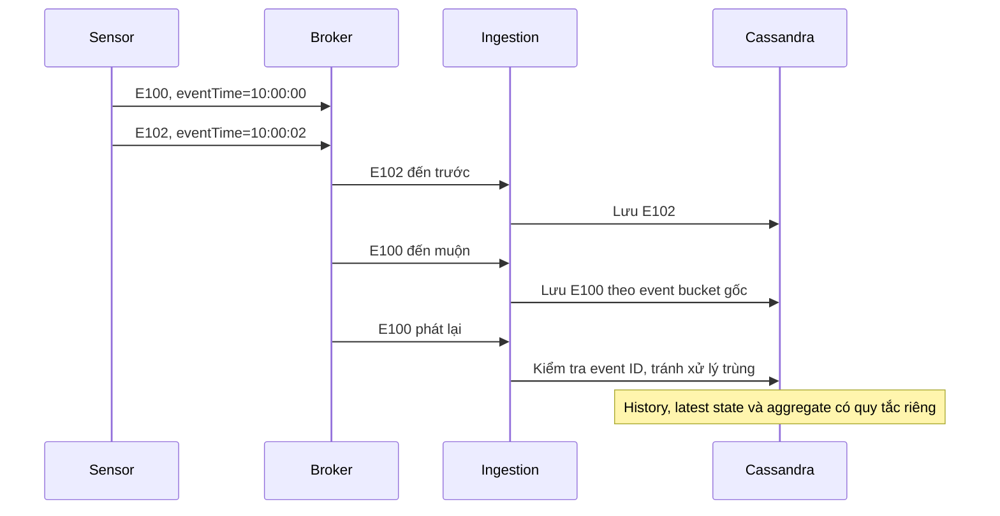
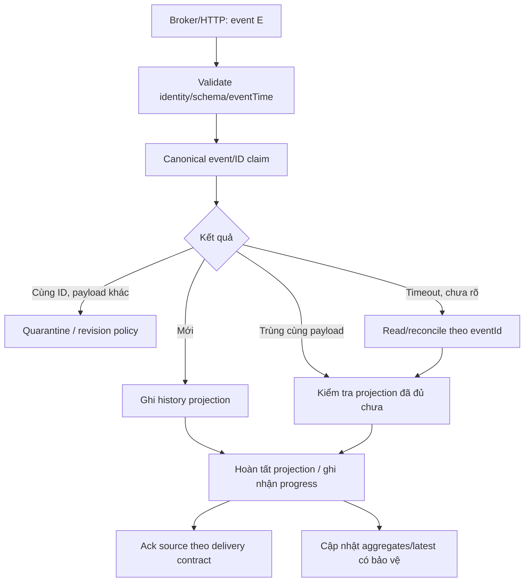
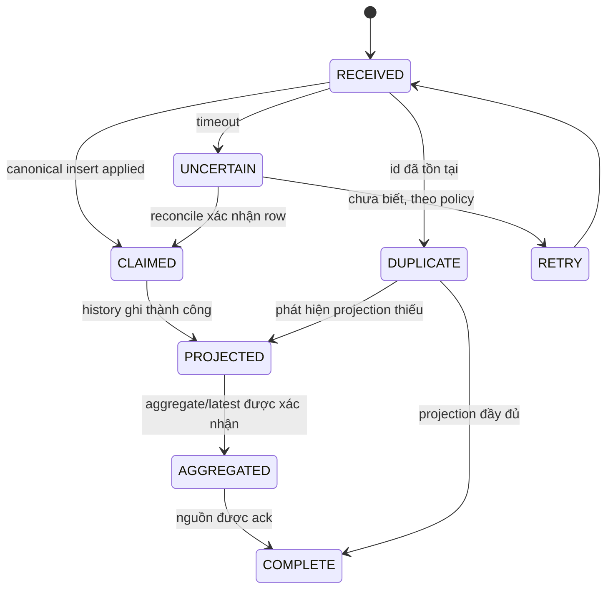

# Sự kiện đến muộn, dữ liệu gửi lại và phát hiện trùng lặp

Trong hệ thống dữ liệu thời gian (*time-series*), thiết bị, ứng dụng và message broker thường không gửi dữ liệu theo đúng thứ tự mà sự kiện xảy ra. Một cảm biến có thể mất mạng rồi gửi lại dữ liệu của hôm qua; broker có thể phát lại cùng một message sau khi consumer khởi động lại; hai nguồn thậm chí có thể gửi **cùng event ID với payload khác nhau**. Nếu ứng dụng lưu những dữ liệu đó vào Apache Cassandra mà chỉ dựa vào thời gian nhận request, bảng lịch sử, bảng trạng thái mới nhất và số liệu tổng hợp rất dễ mâu thuẫn.

Bài này thuộc chương **Dữ liệu thời gian** của module **`SPRING_DATA_CASSANDRA`**. Module hướng dẫn truy cập Cassandra qua entity mapping, Repository, `CassandraTemplate` và CQL; thiết kế bảng theo truy vấn, partition key, consistency, paging và hiệu năng phù hợp với hệ dữ liệu phân tán. Chủ đề trực tiếp là **sự kiện đến muộn, dữ liệu gửi lại và phát hiện trùng lặp**: cách mô hình hóa khóa, chọn chính sách tiếp nhận, kiểm soát các thao tác có điều kiện và sửa các read model chịu ảnh hưởng của late events.

**Sau bài học, bạn có thể:**

1. Phân biệt **event time**, **ingestion time**, **processing time**, **Cassandra write timestamp** và **watermark**.
2. Thiết kế khóa phân vùng theo thời gian mà một event đến muộn vẫn tìm đúng bucket gốc.
3. Hiểu các trường hợp **late arrival**, **out-of-order**, **re-delivery**, **duplicate** và **correction**.
4. Dùng event ID ổn định, fingerprint/payload hash và `INSERT ... IF NOT EXISTS` để phát hiện trùng trong phạm vi phù hợp.
5. Biết tại sao dedup ở bảng này và ghi projection ở bảng khác **không phải một giao dịch nguyên tử**.
6. Xử lý retry/timeout, retention/TTL, thứ tự event, aggregate và bảng “latest state”.
7. Viết CQL và Java Driver/Spring Data Cassandra mẫu, kiểm thử concurrency và xây metrics cho pipeline.

## 1. Bối cảnh: cảm biến gửi lại dữ liệu sau khi mất kết nối

Giả sử một hệ thống quản lý nhiệt độ phòng nhận dữ liệu từ nhiều thiết bị. Mỗi sự kiện có:

```json
{
  "tenantId": "5e039fd0-19a2-4be5-a60c-d104b6fae7c1",
  "sensorId": "room-42",
  "eventId": "ed378e0e-b310-4ae6-b522-bf5f01f589b4",
  "eventTime": "2026-11-24T23:59:58Z",
  "sequence": 8120,
  "temperatureC": 24.6
}
```

Thiết bị mất mạng lúc 23:59:59 và đến 00:10 hôm sau mới gửi được event. Trong khi đó, những event lúc 00:00:01 và 00:00:02 đã được ứng dụng nhận.

Nếu server tạo bucket bằng **ngày nhận dữ liệu** (`2026-11-25`), event lúc `2026-11-24T23:59:58Z` sẽ bị lưu sai ngày. Nếu bảng `latest_temperature` nhận update thông thường theo thứ tự xử lý, event cũ đến sau có thể **ghi đè nhiệt độ mới**. Nếu broker phát lại cùng event sau timeout, bộ đếm “số mẫu trong ngày” có thể bị cộng thêm một lần nữa.

Ba sai lệch độc lập:

| Vấn đề | Triệu chứng | Cần xử lý bằng |
| --- | --- | --- |
| **Late event** | Mẫu hôm qua được nhận hôm nay | Bucket dựa trên event time, chính sách lateness/retention |
| **Out-of-order event** | Mẫu cũ được xử lý sau mẫu mới | Thứ tự/version theo nguồn và điều kiện cập nhật latest |
| **Duplicate/re-delivery** | Cùng một mẫu đi qua pipeline nhiều lần | Event ID ổn định, idempotency/dedup |

Một hệ thống có thể đồng thời gặp cả ba vấn đề. Đừng coi chúng là một lỗi duy nhất có thể sửa bằng cách tăng `LOCAL_QUORUM`.

## 2. Năm khái niệm thời gian cần tách biệt

| Khái niệm | Định nghĩa | Ví dụ |
| --- | --- | --- |
| **Event time** | Thời điểm sự kiện thực sự phát sinh theo nguồn dữ liệu | `2026-11-24T23:59:58Z` |
| **Ingestion time** | Thời điểm điểm nhận/gateway ghi nhận sự kiện đã đến | `2026-11-25T00:10:00Z` |
| **Processing time** | Thời điểm một consumer bắt đầu/xong công việc xử lý | `2026-11-25T00:10:03Z` |
| **Cassandra write timestamp** | Metadata timestamp của mutation/cell để hòa giải phiên bản | Số microsecond theo quy tắc CQL/driver |
| **Watermark** | Ngưỡng tiến độ event time do pipeline ước lượng/chọn | `event time <= 23:58` được xem đủ chín để đóng window, theo policy |

**Event time không tự là write timestamp.** Một cột CQL `event_time timestamp` là **dữ liệu trong hàng**; Cassandra không tự dùng giá trị này để quyết định mutation nào thắng trên `latest_temperature`.

**Ingestion time không phải “ngày đúng” của dữ liệu lịch sử**. Nó hữu ích để đo độ trễ, audit và retention ở tầng ingestion, nhưng nếu API hỏi “nhiệt độ ngày 24/11” thì việc chia bucket theo thời điểm nhận có thể làm sai kết quả.

### Một hàng có thể mang nhiều thời điểm

```text
event_time   = 2026-11-24 23:59:58 UTC
ingested_at  = 2026-11-25 00:10:00 UTC
processed_at = 2026-11-25 00:10:03 UTC
write_time   = metadata của Cassandra, không phải event_time
```

Đặt tên rõ và tài liệu hóa timezone/đơn vị; không dùng một field tên `timestamp` cho mọi ý nghĩa.

## 3. Late, out-of-order, duplicate và correction khác nhau

**Late arrival** là event đến sau ngưỡng chờ thường lệ; event vẫn có thể hoàn toàn hợp lệ và độc nhất.

**Out-of-order** là thứ tự xử lý không trùng thứ tự của nguồn. Chẳng hạn event sequence `12` đến trước `11`. Một event có thể out-of-order nhưng chưa vượt ngưỡng late theo policy.

**Re-delivery/replay** là cùng một event được gửi lại, thường vì retry, reconnect, consumer restart hoặc broker rebalancing.

**Duplicate** là hai record biểu diễn **cùng ý định/sự kiện** theo định nghĩa business; cần một quy tắc nhận diện rõ, thường là `(tenantId, sourceId, eventId)`.

**Correction** là thông tin mới có chủ đích sửa event cũ. Nó có thể mang **event ID mới**, `correctsEventId` và version, hoặc cơ chế revision riêng. Không tự coi correction là duplicate rồi bỏ qua.

| Trường hợp | Event ID | Event time | Cách xử lý |
| --- | --- | --- | --- |
| Event mới | Mới | Có thể là quá khứ | Lưu theo event bucket nếu policy cho phép |
| Retry cùng event | **Giống** | Giống | Dedup, không cộng aggregate lần hai |
| Retry nhưng payload khác | Giống | Có thể khác | Báo conflict/corrupt source hoặc giải quyết bằng revision contract |
| Event đến sai thứ tự | Khác | Cũ hơn event đã nhận | Có thể thêm vào history, không mù quáng cập nhật latest |
| Correction hợp lệ | ID/version theo contract | Có thể chỉ vào event cũ | Quy trình sửa/tính lại projection riêng |

### Ví dụ tiến trình



## 4. Bắt đầu bằng câu hỏi truy vấn, không bắt đầu bằng timestamp

Một mô hình time-series hợp lý cần biết hệ thống sẽ đọc như thế nào:

1. “Cho tôi các mẫu của **sensor S** trong **ngày D**, mới nhất trước.”
2. “Cho tôi mẫu của sensor S từ **10:00 đến 10:15**.”
3. “Cho tôi **mẫu mới nhất đã được chấp nhận** của sensor S.”
4. “Event ID E đã được ghi nhận chưa?”
5. “Tổng số mẫu hợp lệ trong window 5 phút là bao nhiêu?”

Đây là **năm đường truy vấn/điều kiện khác nhau**. Không nên ép tất cả thành một bảng và dựa vào `ALLOW FILTERING`.

| Nhu cầu | Gợi ý bảng/luồng |
| --- | --- |
| Đọc dải thời gian | `sensor_events_by_day` (theo sensor, bucket, clustering theo time) |
| Kiểm tra event ID | `sensor_events_by_id` (key theo ID ổn định, có thể dùng LWT) |
| Trạng thái hiện tại | `latest_sensor_state` (cập nhật với thứ tự/version có kiểm soát) |
| Tổng theo cửa sổ | `sensor_window_summaries` hoặc streaming aggregate có replay |

Các bảng này phục vụ những nhu cầu khác nhau. **Việc ghi chúng không tự trở thành một transaction nhiều bảng chỉ vì được gọi từ cùng service.**

## 5. CQL schema cho lịch sử theo ngày

Một thiết kế cơ bản:

```sql
CREATE TABLE IF NOT EXISTS sensor_events_by_day (
    tenant_id uuid,
    sensor_id text,
    event_day date,
    event_time timestamp,
    event_id uuid,
    source_sequence bigint,
    temperature_c double,
    ingested_at timestamp,
    PRIMARY KEY (
        (tenant_id, sensor_id, event_day),
        event_time,
        event_id
    )
) WITH CLUSTERING ORDER BY (
    event_time DESC,
    event_id ASC
);
```

**Giải thích khóa:**

- `(tenant_id, sensor_id, event_day)` là **composite partition key**.
- `event_time` là clustering column đầu tiên, sắp xếp **giảm dần** để hỗ trợ lấy mẫu gần nhất trong ngày.
- `event_id` là clustering column bổ sung để hai event có cùng `event_time` vẫn có thể thành **hai hàng khác nhau**.
- `source_sequence` là cột thường mang thông tin thứ tự từ thiết bị; **không tự tham gia conflict resolution**.
- `ingested_at` cho phép đo độ trễ đến muộn, **không điều khiển vị trí của hàng trong clustering order**.

### Vì sao không chỉ dùng event_time làm clustering key?

CQL `timestamp` có độ chính xác hiển thị/lưu trữ theo **millisecond**. Hai event có thể trùng millisecond, nhất là ở nguồn tốc độ cao. Nếu primary key chỉ gồm `event_time`, các write vào cùng key có thể **ghi đè** dữ liệu lẫn nhau theo write timestamp.

Thêm `event_id` để phân biệt event, đồng thời xác định **ID ổn định qua retry**. Nó không tạo unique constraint toàn mọi partition: cùng ID có thể xuất hiện ở bucket khác nếu logic tính bucket sai.

## 6. Event đến muộn phải vào bucket nào?

Với pipeline định nghĩa bucket theo **UTC event date**:

```text
eventTime  = 2026-11-24T23:59:58Z
receivedAt = 2026-11-25T00:10:00Z

event_day  = 2026-11-24    (UTC, từ eventTime)
không phải = 2026-11-25   (từ receivedAt)
```

Trong Java:

```java
import java.time.Instant;
import java.time.LocalDate;
import java.time.ZoneOffset;

Instant eventTime = Instant.parse(
        "2026-11-24T23:59:58Z");

LocalDate eventDay = eventTime
        .atZone(ZoneOffset.UTC)
        .toLocalDate();
```

**Chính sách timezone phải rõ ràng.** Nếu nghiệp vụ quy định ngày theo múi giờ địa phương của từng tenant, cần dùng `ZoneId` có cấu hình/version cụ thể và xử lý DST/ràng buộc lịch. Không âm thầm trộn UTC bucket với local bucket giữa các service.

### Hai điều kiện cho dedup theo khóa

Nếu bạn dùng **primary key của bảng history** để tránh tạo thêm row cho retry, cùng một event phải luôn cho:

1. **Cùng `tenant_id`, `sensor_id` và `event_day`.**
2. **Cùng `event_time` và `event_id`.**

Nếu retry lấy ngày từ `Instant.now()` thay vì `eventTime` gốc, cùng event sẽ rơi vào **một partition khác**, và khóa history không còn phát hiện trùng.

## 7. Đọc dải thời gian trong đúng partition

Ví dụ truy vấn một khoảng trong ngày của một sensor:

```sql
SELECT event_time, event_id, source_sequence,
       temperature_c, ingested_at
FROM sensor_events_by_day
WHERE tenant_id = 5e039fd0-19a2-4be5-a60c-d104b6fae7c1
  AND sensor_id = 'room-42'
  AND event_day = '2026-11-24'
  AND event_time >= '2026-11-24T23:30:00Z'
  AND event_time < '2026-11-25T00:00:00Z';
```

Truy vấn có đủ partition key và lọc theo clustering column đầu tiên; đây là **đường đọc phù hợp mô hình bảng**. Cassandra áp dụng clustering order đã khai báo cho rows trong partition.

Nếu một khoảng trải **hai ngày**, ứng dụng nên tách thành **hai truy vấn theo bucket** rồi hợp nhất kết quả theo `event_time`/`event_id` tại tầng đọc. Không coi một `SELECT` không có `event_day` là cách quét toàn bộ dữ liệu mà vẫn có hiệu năng tốt.

### Paging và late arrivals

Một truy vấn lớn cần paging, nhưng **paging state không phải snapshot bất biến**. Nếu late events được ghi trong lúc client duyệt các trang, kết quả có thể thay đổi theo quy tắc paging/consistency. Muốn báo cáo reproducible, dùng cut-off/watermark, snapshot materialization hoặc một cơ chế job riêng thay vì mặc định nhiều lần SELECT có cùng một ảnh chụp dữ liệu.

## 8. Ghi lại cùng primary key có phải dedup hoàn chỉnh?

Giả sử cùng một event được gửi lại với cùng khóa:

```sql
INSERT INTO sensor_events_by_day (
    tenant_id, sensor_id, event_day,
    event_time, event_id, temperature_c, ingested_at
) VALUES (?, ?, ?, ?, ?, ?, ?);
```

Vì primary key giống nhau, Cassandra **không tạo thêm một row mới** trong cùng bảng history chỉ vì một upsert trùng khóa. Nhưng điều đó **không đủ** để nói toàn bộ pipeline đã xử lý sự kiện đúng một lần:

- `INSERT` thường là **upsert**, không trả “mới hay đã tồn tại”.
- Retry có thể **ghi đè cột** với write timestamp mới, đặc biệt `ingested_at`, TTL hoặc payload khác.
- Nếu service đã cộng counter/ghi aggregate **trước hoặc sau upsert**, cùng event vẫn có thể được tính **nhiều lần**.
- Nếu event ID giống nhau nhưng `event_time` hoặc bucket khác, khóa toàn bộ khác nên có thể thành **hai rows**.
- Không có unique constraint toàn bảng chỉ trên `event_id` khi nó là một phần của clustering key.

**Kết luận:** “Không có hàng trùng theo primary key” là **tính chất lưu trữ một bảng**, còn “không tạo side effect trùng theo event” là **tính chất workflow**.

## 9. Quy tắc nhận diện event trùng cần được định nghĩa

Tốt nhất nguồn phát cung cấp một event ID bất biến:

```text
eventIdentity = (tenantId, sourceId, eventId)
```

Trong nhiều hệ, `eventId` đã được bảo đảm duy nhất trong phạm vi tenant; khi đó key có thể là `(tenant_id, event_id)`. Nếu ID chỉ duy nhất trong từng sensor, cần thêm `sensor_id` vào phạm vi nhận diện.

Một thiết kế đúng phải xác định:

1. Ai **tạo** event ID và tạo **vào thời điểm nào**?
2. Event ID có **giữ nguyên** khi API/broker retry không?
3. Event ID có thể bị tái sử dụng sau khi thiết bị reset hay không?
4. Hai sự kiện khác nhau có thể cùng timestamp nhưng khác ID không?
5. Khi cùng ID có **payload khác**, đó là lỗi nguồn hay correction có chủ đích?
6. Hệ thống cần nhớ event ID trong bao lâu so với **thời gian broker có thể replay**?

**Không tạo UUID ngẫu nhiên mới trong ingestion handler cho mỗi lần nhận**, rồi mong dedup bằng UUID đó. Nếu nguồn không có ID, cần một quy tắc **deterministic identity** từ các thuộc tính ổn định, nhưng phải phân tích khả năng collision và khác biệt serialization.

## 10. Fingerprint/payload hash giúp phát hiện trùng sai nội dung

Event ID chỉ trả lời “cùng danh tính hay không”; không trả lời “payload có đúng giống nhau không”. Có thể lưu một **hash của payload chuẩn hóa**:

```text
canonicalFields = tenantId, sensorId, eventId,
                  eventTime, sourceSequence, temperatureC

payloadHash = SHA-256(canonicalEncoding(canonicalFields))
```

**Canonical encoding** rất quan trọng. Hai JSON có thứ tự field khác nhau, cách biểu diễn số `24.60` khác `24.6` hoặc timestamp khác định dạng nhưng cùng thời điểm có thể tạo hash khác nếu hash nguyên chuỗi.

Chính sách:

| Cùng ID? | Cùng hash? | Xử lý gợi ý |
| --- | --- | --- |
| Không | — | Event mới |
| Có | Có | Duplicate/re-delivery, không làm side effect lần hai |
| Có | Không | **Payload conflict**; quarantine/log/review hoặc xử lý revision contract |

**Đừng xem hash là bảo mật/chứng thực nguồn.** Nó chỉ là fingerprint dữ liệu; cần authentication, authorization và kiểm soát nguồn event riêng. Với dữ liệu nhạy cảm, không log toàn payload để debug.

## 11. Bảng canonical theo event ID để đánh dấu đã tiếp nhận

Nếu pipeline cần biết event ID có tồn tại chưa, có thể tạo **một bảng canonical** với khóa ổn định:

```sql
CREATE TABLE IF NOT EXISTS sensor_events_by_id (
    tenant_id uuid,
    event_id uuid,
    sensor_id text,
    event_time timestamp,
    event_day date,
    source_sequence bigint,
    temperature_c double,
    payload_hash text,
    first_seen_at timestamp,
    PRIMARY KEY ((tenant_id, event_id))
);
```

`(tenant_id, event_id)` là **composite partition key** nên mọi lần xử lý **cùng danh tính trong tenant** đi đến cùng partition, không phụ thuộc event đến vào ngày nào.

Đánh đổi rõ ràng:

- Tìm theo ID rất hiệu quả với đầy đủ khóa.
- Không thể dùng bảng này để quét theo thời gian mà không có đường đọc/index khác.
- Mỗi event tạo một partition riêng; phân bố ID tương đối đều thì thường dễ phân tán tải, nhưng cần đo metadata/overhead theo quy mô.
- Lưu và giữ dedup key quá lâu tốn dung lượng; xóa quá sớm có thể khiến replay cũ được nhận lại.

Nếu `eventId` chỉ duy nhất trong từng sensor, điều chỉnh primary key thành phạm vi có `sensor_id`, và **giữ cùng quy tắc nhận diện ở mọi writer**.

## 12. Chặn duplicate bằng INSERT IF NOT EXISTS

Trên bảng canonical, dùng lightweight transaction (LWT):

```sql
INSERT INTO sensor_events_by_id (
    tenant_id, event_id, sensor_id,
    event_time, event_day, source_sequence,
    temperature_c, payload_hash, first_seen_at
) VALUES (?, ?, ?, ?, ?, ?, ?, ?, ?)
IF NOT EXISTS;
```

Kết quả CQL có trường `[applied]`:

| Phản hồi | Cách hiểu |
| --- | --- |
| `[applied] = true` | Đã tạo canonical event mới theo điều kiện |
| `[applied] = false` | Event ID/key đã tồn tại; cần so hash/owner để phân loại duplicate hay conflict |
| Timeout hoặc unknown | **Không biết chắc** canonical write đã được áp dụng chưa |

**Tại sao dùng LWT?** Hai consumer cùng nhận một event có thể cạnh tranh; `IF NOT EXISTS` giúp đưa quyết định **chỉ một thao tác được chấp nhận tạo key** vào giao thức Paxos thay vì client đọc trước rồi upsert sau.

**Chi phí:** LWT đắt hơn write thường và có yêu cầu về serial consistency. Không áp dụng LWT cho mọi telemetry event nếu SLA, throughput và nhu cầu dedup không cần đến mức đó; một ledger/stream processor khác có thể phù hợp hơn.

## 13. Java Driver 4.x: thực thi claim event bất đồng bộ

Ví dụ gateway cho thao tác **ghi canonical ID**:

```java
package example.telemetry.data;

import java.time.Instant;
import java.time.LocalDate;
import java.util.UUID;
import java.util.concurrent.CompletableFuture;

import com.datastax.oss.driver.api.core.CqlSession;
import com.datastax.oss.driver.api.core.DefaultConsistencyLevel;
import com.datastax.oss.driver.api.core.cql.AsyncResultSet;
import com.datastax.oss.driver.api.core.cql.BoundStatement;
import com.datastax.oss.driver.api.core.cql.PreparedStatement;

public final class EventClaimGateway {
    private final CqlSession session;
    private final PreparedStatement insertIfAbsent;

    public EventClaimGateway(CqlSession session) {
        this.session = session;
        this.insertIfAbsent = session.prepare("""
            INSERT INTO sensor_events_by_id (
                tenant_id, event_id, sensor_id,
                event_time, event_day, source_sequence,
                temperature_c, payload_hash, first_seen_at
            ) VALUES (?, ?, ?, ?, ?, ?, ?, ?, ?)
            IF NOT EXISTS
            """);
    }

    public CompletableFuture<Boolean> claim(
            UUID tenantId, UUID eventId, String sensorId,
            Instant eventTime, LocalDate eventDay,
            long sequence, double temperature,
            String hash, Instant receivedAt) {

        BoundStatement statement = insertIfAbsent.bind(
                tenantId, eventId, sensorId, eventTime,
                eventDay, sequence, temperature, hash, receivedAt)
            .setConsistencyLevel(
                DefaultConsistencyLevel.LOCAL_QUORUM)
            .setSerialConsistencyLevel(
                DefaultConsistencyLevel.LOCAL_SERIAL)
            .setIdempotent(false);

        return session.executeAsync(statement)
                .thenApply(AsyncResultSet::wasApplied)
                .toCompletableFuture();
    }
}
```

Lưu ý:

- `CqlSession` được Spring cấu hình và **dùng chung**, không mở/đóng cho mỗi event.
- `PreparedStatement` tái sử dụng query shape; `BoundStatement` giữ tham số cho một request.
- `LOCAL_QUORUM` và `LOCAL_SERIAL` chỉ là ví dụ cho mô hình writer được kiểm soát trong **một DC**. Trong multi-DC có writer cạnh tranh cùng key, phải đánh giá `SERIAL`/writer ownership và topology.
- `Boolean false` là **conditional conflict**, không phải exception.
- **Timeout làm future thất bại**, không tự trở thành `false`. Kết quả có thể chưa rõ với caller.
- `setIdempotent(false)` không có nghĩa retry cùng LWT sẽ luôn phá dữ liệu; nó là lựa chọn bảo thủ để driver không tự giả định mọi retry là an toàn cho workflow. Tính idempotent **nghiệp vụ** còn phụ thuộc việc đối soát và side effects.

## 14. Cùng event ID nhưng payload khác: không âm thầm bỏ qua

Sau khi `claim` trả `false`, ứng dụng cần xác minh **dữ liệu canonical** hiện tại. Có thể đọc theo khóa:

```sql
SELECT sensor_id, event_time, event_day,
       source_sequence, temperature_c, payload_hash
FROM sensor_events_by_id
WHERE tenant_id = ?
  AND event_id = ?;
```

Sau đó:

```text
IF existing.payload_hash == incoming.payload_hash:
    DUPLICATE_SAME_EVENT
ELSE:
    CONFLICT_SAME_ID_DIFFERENT_PAYLOAD
```

Một `INSERT IF NOT EXISTS` thất bại cũng có thể trả dữ liệu của hàng hiện tại trong phản hồi LWT; tuy nhiên **không giả định mọi câu conditional đều trả toàn bộ cột**. Nếu dùng response hiện có, kiểm tra `ColumnDefinitions`; nếu cần đầy đủ payload, đọc lại theo khóa.

**Không tự sửa canonical row bằng unconditional UPSERT** khi thấy cùng ID khác hash. Phải có một **correction protocol**: revision, tombstone có kiểm soát, event thay thế hoặc quy trình điều tra nguồn.

### Nếu cùng event được gửi bằng kiểu số khác nhau?

Nếu `24.60` và `24.6` được coi là bằng nhau theo nghiệp vụ, canonicalize trước khi hash. Nếu một sensor có thể thay đổi độ chính xác hoặc đơn vị, thêm **schemaVersion/unit** vào contract, tránh coi biến đổi ngữ nghĩa là duplicate giống hệt.

## 15. Ranh giới nguy hiểm: đã claim event nhưng chưa ghi lịch sử

Thiết kế gồm hai bảng:

```text
1. LWT INSERT sensor_events_by_id IF NOT EXISTS
2. INSERT sensor_events_by_day (projection)
```

Nếu bước 1 **thành công** nhưng process chết trước bước 2:

```text
Canonical row:  có
History row:    chưa có
```

Khi broker gửi lại event, `IF NOT EXISTS` trả `false`. Nếu ứng dụng lập tức `ack` và bỏ qua mọi duplicate, **history row có thể không bao giờ được ghi**.

Đây là **dual-write gap**: hai bước trên hai bảng/partition khác nhau không tự tạo một transaction ACID toàn cục.

### Cách xử lý đúng là thiết kế recovery

- Xác định bảng `sensor_events_by_id` hay một durable broker log là **nguồn sự thật**.
- Ghi projection với **khóa/giá trị xác định từ canonical event**, sao cho xử lý lặp không tạo hàng duplicate.
- Nếu projection bị thiếu, có **replay/reconciliation** để tạo lại, thay vì “event đã được claim nghĩa là mọi projection đã xong”.
- Không ack message từ broker trước khi điều kiện **durable acceptance** của ứng dụng đạt theo contract.
- Nếu cần chính xác tuyệt đối nhiều bảng, cân nhắc mô hình dữ liệu/transaction boundary khác; không tuyên bố LWT trên một bảng đã bao trùm bảng kia.

**Bản chất:** dedup để chặn event mới trùng và retry để hoàn tất các bước còn thiếu là **hai trách nhiệm khác nhau**.

## 16. Một pipeline ingest có thể phục hồi

Sơ đồ khái niệm:



Sơ đồ không phải transaction một bước. Trong thực tế, phải quyết định rõ **điểm nào được ack**, projection nào là mandatory, và **cách khôi phục** nếu chết giữa bất kỳ hai nút.

Một thiết kế có thể giữ message trong **durable event log có retention đủ dài** và cho projector xử lý lại nhiều lần. Một thiết kế khác dùng canonical event table + **hàng đợi/outbox trạng thái xử lý có thể duyệt**. Chỉ lưu canonical row phân tán theo UUID mà **không có đường quét/replay** sẽ khiến việc tìm các projection bị thiếu khó hơn.

## 17. Idempotent projection không có nghĩa idempotent mọi side effect

Với history table, một event có đủ khóa:

```sql
INSERT INTO sensor_events_by_day (
    tenant_id, sensor_id, event_day, event_time, event_id,
    source_sequence, temperature_c, ingested_at
) VALUES (?, ?, ?, ?, ?, ?, ?, ?);
```

Nếu **mọi giá trị và primary key đều xác định từ canonical event**, chạy lại câu `INSERT` có thể giữ cùng **một row logic**. Nhưng phải kiểm soát:

1. `ingested_at` có được giữ từ lần nhận đầu hay thay bằng “thời điểm retry”?
2. Có dùng TTL làm thời điểm hết hạn bị kéo dài sau mỗi lần ghi lại không?
3. Payload có thay đổi giữa các retry không?
4. Có một writer khác sửa dữ liệu cùng key không?
5. Có thêm thao tác tăng **counter/aggregate** sau khi upsert không?

**Counter increment không idempotent**: chạy lại `SET samples = samples + 1` là một lần cộng nữa. Một upsert history theo cùng key **không tự chặn counter bị cộng trùng**.

Vì vậy nên phân biệt:

- **Idempotency của projection row**: xử lý lặp không tạo bản ghi logic mới.
- **Idempotency của aggregate**: xử lý lặp không cộng số liệu hai lần.
- **Idempotency của workflow**: xử lý lặp không gửi thông báo, trừ tiền hay publish event lần hai.

## 18. Ghi lịch sử qua Java Driver

Một gateway ghi row projection:

```java
import java.time.Instant;
import java.time.LocalDate;
import java.util.UUID;
import java.util.concurrent.CompletableFuture;

import com.datastax.oss.driver.api.core.CqlSession;
import com.datastax.oss.driver.api.core.cql.PreparedStatement;

public final class EventHistoryGateway {
    private final CqlSession session;
    private final PreparedStatement insert;

    public EventHistoryGateway(CqlSession session) {
        this.session = session;
        this.insert = session.prepare("""
            INSERT INTO sensor_events_by_day (
                tenant_id, sensor_id, event_day, event_time, event_id,
                source_sequence, temperature_c, ingested_at
            ) VALUES (?, ?, ?, ?, ?, ?, ?, ?)
            """);
    }

    public CompletableFuture<Void> project(
            UUID tenantId, String sensorId, LocalDate eventDay,
            Instant eventTime, UUID eventId, long sequence,
            double temperature, Instant firstSeenAt) {

        return session.executeAsync(insert.bind(
                    tenantId, sensorId, eventDay, eventTime, eventId,
                    sequence, temperature, firstSeenAt))
                .thenApply(ignored -> (Void) null)
                .toCompletableFuture();
    }
}
```

Hãy để `firstSeenAt` lấy từ canonical event; **không tự thay bằng `Instant.now()` sau mỗi retry** nếu muốn bảo toàn thời điểm được tiếp nhận đầu tiên.

**Thận trọng với thuộc tính `setIdempotent(true)` của driver:** chỉ đánh dấu khi đã xác nhận câu lệnh **có thể gửi lại an toàn** đối với đúng schema/TTL/writes và các tác động trong toàn workflow. Upsert một row cùng key với cùng payload thường thuận lợi hơn counter increments, nhưng driver retries có thể lặp việc ghi; không nhầm nó với exactly-once delivery.

## 19. Spring Data Cassandra: entity mapping cho bucket

Khóa tổng hợp của `sensor_events_by_day` có ba thành phần partition và hai clustering columns:

```java
package example.telemetry.data;

import java.io.Serializable;
import java.time.Instant;
import java.time.LocalDate;
import java.util.UUID;

import org.springframework.data.cassandra.core.mapping.PrimaryKeyClass;
import org.springframework.data.cassandra.core.mapping.PrimaryKeyColumn;
import org.springframework.data.cassandra.core.mapping.PrimaryKeyType;

@PrimaryKeyClass
public class SensorEventKey implements Serializable {
    @PrimaryKeyColumn(
        name = "tenant_id", ordinal = 0,
        type = PrimaryKeyType.PARTITIONED)
    private UUID tenantId;

    @PrimaryKeyColumn(
        name = "sensor_id", ordinal = 1,
        type = PrimaryKeyType.PARTITIONED)
    private String sensorId;

    @PrimaryKeyColumn(
        name = "event_day", ordinal = 2,
        type = PrimaryKeyType.PARTITIONED)
    private LocalDate eventDay;

    @PrimaryKeyColumn(
        name = "event_time", ordinal = 3,
        type = PrimaryKeyType.CLUSTERED)
    private Instant eventTime;

    @PrimaryKeyColumn(
        name = "event_id", ordinal = 4,
        type = PrimaryKeyType.CLUSTERED)
    private UUID eventId;

    public SensorEventKey() {}
    // Constructor, getters/setters, equals và hashCode.
}
```

Entity:

```java
package example.telemetry.data;

import java.time.Instant;
import org.springframework.data.cassandra.core.mapping.Column;
import org.springframework.data.cassandra.core.mapping.PrimaryKey;
import org.springframework.data.cassandra.core.mapping.Table;

@Table("sensor_events_by_day")
public class SensorEventRow {
    @PrimaryKey
    private SensorEventKey key;

    @Column("source_sequence")
    private Long sourceSequence;

    @Column("temperature_c")
    private Double temperatureC;

    @Column("ingested_at")
    private Instant ingestedAt;

    public SensorEventRow() {}
    // Constructor, getters/setters.
}
```

Các đoạn code trên là **khung mapping**. Cần bổ sung constructors/getters/setters, `equals/hashCode` cho key, kiểm tra mapping/conversion của `Instant`/`LocalDate` theo phiên bản Spring Data, và viết integration test với schema thực tế.

**Giới hạn quan trọng:** Repository hoặc `CassandraTemplate` giúp ánh xạ entity, nhưng `save(...)` không tự phát hiện “đây là một event đã xử lý trong pipeline khác”, không dedup theo ID ở partition khác và không biến hai bảng thành một transaction.

## 20. Repository và Template nên đảm nhận phần nào?

Một Repository có thể phục vụ thao tác đọc/ghi entity theo khóa:

```java
import org.springframework.data.cassandra.repository.CassandraRepository;

public interface SensorEventRepository
        extends CassandraRepository<SensorEventRow, SensorEventKey> {
}
```

Nhưng chiến lược triển khai nên phân tầng:

| Tầng | API phù hợp | Trách nhiệm |
| --- | --- | --- |
| Entity/history read | Repository, `CassandraTemplate` | Mapping, lookup, paging có kiểm soát |
| Canonical claim | `CqlSession`/CQL `IF NOT EXISTS` hoặc API Spring hỗ trợ điều kiện đầy đủ | Xử lý LWT/`[applied]`/timeout rõ ràng |
| Projection write | Prepared statement, template update/insert phù hợp | Tái lập row theo khóa ổn định |
| Latest state | LWT/version/state machine | Không để event đến muộn ghi đè trạng thái mới |
| Aggregation | Processor/read model chuyên dụng | Dedup, window, corrections, replay |

Nếu dùng `@Version` của Spring Data Cassandra, phải hiểu nó bảo vệ **optimistic update của entity tương ứng**; không tự tạo uniqueness theo `event_id` xuyên các bảng có partition key khác nhau.

**Không gọi cùng lúc một Repository `save` và một driver LWT rồi coi chúng là một thao tác nguyên tử.**

## 21. Late event không tự được phép cập nhật bảng latest

Một bảng trạng thái mới nhất:

```sql
CREATE TABLE IF NOT EXISTS latest_sensor_state (
    tenant_id uuid,
    sensor_id text,
    event_id uuid,
    event_time timestamp,
    source_sequence bigint,
    temperature_c double,
    PRIMARY KEY ((tenant_id, sensor_id))
);
```

Nếu mọi event thực hiện upsert:

```sql
UPDATE latest_sensor_state
SET event_id = ?,
    event_time = ?,
    source_sequence = ?,
    temperature_c = ?
WHERE tenant_id = ?
  AND sensor_id = ?;
```

thì **event cũ xử lý muộn** có thể thắng về Cassandra write timestamp và che giá trị mới. Cột `event_time` không tự điều khiển last-write-wins của các cột còn lại.

### Quy tắc đúng cần định nghĩa riêng

Nếu thiết bị bảo đảm sequence tăng đơn điệu qua mọi lần restart, có thể định nghĩa:

```text
incoming.sequence > latest.sequence
    -> có thể cập nhật latest
incoming.sequence <= latest.sequence
    -> vẫn lưu history, không cập nhật latest
```

Nếu sequence reset khi thiết bị khởi động lại, phải thêm **source epoch/generation** vào ordering key; nếu không, một event mới sau restart có sequence thấp sẽ bị nhầm là cũ.

**Đừng dùng sequence làm nguồn sự thật khi nhà sản xuất thiết bị không bảo đảm semantics của nó.** Nếu chỉ có event time, cần một quy tắc tie/clock quality và xác định có cho phép correction hay không.

## 22. Bảo vệ latest bằng optimistic CAS

Một cách đơn giản, rõ ràng về mặt nghiệp vụ:

1. Đọc `latest_sensor_state` theo `(tenant_id, sensor_id)`.
2. So sánh thứ tự event mới với `source_sequence` (và source epoch nếu có).
3. Nếu event mới **không mới hơn**, bỏ qua cập nhật latest.
4. Nếu mới hơn, gửi `UPDATE ... IF source_sequence = <giá trị đã đọc>`.
5. Nếu CAS trả `false`, đọc lại và đánh giá từ đầu theo **giới hạn retry**.
6. Nếu hàng chưa tồn tại, khởi tạo qua `INSERT ... IF NOT EXISTS`.

Ví dụ cho đường cập nhật với **sequence cũ đã biết**:

```sql
UPDATE latest_sensor_state
SET event_id = ?,
    event_time = ?,
    source_sequence = ?,
    temperature_c = ?
WHERE tenant_id = ?
  AND sensor_id = ?
IF source_sequence = ?;
```

Điều kiện `IF` là **so sánh phiên bản đã đọc**, không trực tiếp bảo đảm `incoming > existing`. **Ứng dụng phải so sánh theo nghiệp vụ trước**, và CAS giúp phát hiện một writer khác thay state kể từ lần đọc.

### Tại sao không chỉ dùng MAX(event_time)?

- Cassandra không dùng `MAX(event_time)` làm điều kiện upsert tự động.
- Đồng hồ thiết bị có thể nhảy lùi/nhảy tới tương lai.
- Hai event có thể trùng millisecond.
- Một correction hợp lệ có thể chỉ đến event cũ nhưng yêu cầu cập nhật state theo rule đặc biệt.

Nếu cần latest với quy tắc phức tạp, xây một **state machine/projection processor** có ordering key rõ, không dùng last-write-wins như business ordering.

## 23. Watermark là chính sách tiến độ, không phải timestamp của Cassandra

Trong streaming analytics, **watermark** biểu diễn ngưỡng event time mà pipeline tin rằng phần lớn dữ liệu đến trước ngưỡng ấy đã được quan sát.

Ví dụ một chiến lược đơn giản:

\[
\text{watermark} = \text{maxObservedEventTime} - \text{allowedLateness}
\]

Nếu `maxObservedEventTime = 10:15` và `allowedLateness = 5 phút`, watermark là `10:10`. Một cửa sổ kết thúc lúc `10:09` có thể được xem đủ điều kiện **đóng tạm** theo policy.

**Chú ý:** công thức chỉ là một chiến lược. Các stream processors thực tế có thể quản lý watermark riêng theo partition, event time skew, idle partition và state. Watermark **không phải bảo đảm tuyệt đối** rằng không còn event cũ.

### Đừng dùng watermark làm filter mất dữ liệu một cách vô thức

Khi event cũ hơn watermark đến:

- **Drop và ghi nhận**, nếu SLA cho phép bỏ quá hạn.
- **Quarantine**, để đối soát thủ công.
- **Accept vào history**, nhưng không thay aggregate đã đóng.
- **Accept và phát correction/retraction**, nếu hệ thống hỗ trợ cập nhật kết quả cũ.

Chính sách cần được công bố. Một màn hình “tổng cuối cùng của ngày hôm qua” và một bảng lịch sử đầy đủ có thể có **độ trễ hội tụ khác nhau**.

## 24. Xử lý một event muộn hơn allowed lateness

Ví dụ:

```text
Window 10:00 - 10:05 đã được publish.
Watermark hiện là 10:12.
Một event mới đến có eventTime = 10:03.
```

Bạn có bốn lựa chọn, không có đáp án duy nhất:

| Chính sách | Ưu điểm | Đánh đổi |
| --- | --- | --- |
| **Discard** | Kết quả đã publish không đổi | Mất dữ liệu muộn |
| **History-only** | Giữ lịch sử đầy đủ hơn | Aggregate khác lịch sử nếu không giải thích |
| **Recompute window** | Aggregate phản ánh dữ liệu mới | Tốn I/O/CPU, cần version/correction |
| **Correction event** | Có audit thay đổi kết quả | Downstream phải hỗ trợ update/retract |

**Ví dụ booking/thanh toán:** dữ liệu muộn có thể thay đổi quyết định nghiệp vụ quan trọng; không được drop chỉ vì analytics watermark đã đi qua. Watermark là **công cụ pipeline**, không phải quyền bỏ một sự kiện hợp lệ theo domain.

## 25. Aggregates: nguy cơ đếm đôi khi duplicate

Giả sử một bảng tổng hợp ghi số mẫu theo 5 phút:

```sql
CREATE TABLE IF NOT EXISTS sensor_window_summaries (
    tenant_id uuid,
    sensor_id text,
    window_start timestamp,
    sample_count bigint,
    sum_temperature double,
    version bigint,
    PRIMARY KEY ((tenant_id, sensor_id), window_start)
);
```

Nếu processor tăng `sample_count` mỗi lần nhận event mà **không dedup**, một message được redeliver sẽ khiến mẫu bị tính nhiều lần. Nếu dùng counter column `sample_count counter` rồi gửi `+1`, retry của chính counter update cũng có thể cộng đôi.

### Ba cách tiếp cận

1. **Snapshot recomputation:** lấy canonical events trong window, tính lại `count/sum` và ghi **giá trị snapshot/version** có kiểm soát.
2. **Stateful streaming aggregation:** processor theo dõi event ID/window state và dùng checkpoint/replay có semantics đã kiểm chứng.
3. **Event ledger + incremental projection:** phát delta có idempotency theo event, có recovery cho khoảng trống giữa ledger và aggregate.

**Không giả định một `INSERT IF NOT EXISTS` ở bảng canonical và một `UPDATE counter +1` ở bảng summary là transaction.** Hai bước ở những partition/bảng khác nhau có thể chỉ hoàn thành một bước.

### COUNT(*) không phải giải pháp real-time tổng quát

`SELECT COUNT(*)` trên partition lớn hoặc nhiều partition có thể tốn tài nguyên. Đối với dashboard thường xuyên, cân nhắc materialized aggregate với chiến lược replay/reconciliation, không bắt Cassandra đếm tất cả event cho mỗi HTTP request.

## 26. TTL và retention không được tính ngây thơ từ event time

Trong Cassandra, **TTL cho một mutation thông thường** được tính theo thời điểm ghi và khoảng TTL, không tự căn vào giá trị `event_time` của hàng.

Giả sử chính sách “giữ event 30 ngày kể từ **ngày sự kiện**”:

```text
Event xảy ra:       2026-10-01
Event được gửi muộn: 2026-10-25
TTL cấu hình:        30 ngày kể từ lúc ghi

Hậu quả: có thể còn tới 2026-11-24,
trong khi chính sách event-time mong hết hạn từ 2026-10-31.
```

### Chính sách hợp lý

- Nếu retention tính từ **event time**, tính thời điểm hết hạn đích `expiresAt` theo event timestamp/bucket.
- Tại lúc ghi, xác định **thời gian còn lại**; nếu đã quá hạn, drop/archive/quarantine theo business policy.
- Nếu dùng `USING TTL ?` trên câu INSERT, tính TTL phù hợp và có **giới hạn hợp lệ** cho số giây; tránh giá trị âm/0 được diễn giải sai.
- Nếu muốn tất cả event của một ngày hết hạn cùng lúc, có thể tính theo **ngày UTC + retention**, không cộng 30 ngày riêng cho từng ingestion.
- Không tự đặt `USING TIMESTAMP` bằng event time như một mẹo thay thế TTL; đây là metadata hòa giải khác với giá trị event time.

**Tái ghi cùng row có TTL** có thể thay đổi tuổi thọ cell tùy mutation/options. Nếu projection được replay, đảm bảo **không vô tình kéo dài retention** cho event cũ.

## 27. Dedup horizon phải rộng hơn khả năng replay

Nếu broker có thể replay event trong **14 ngày**, nhưng bảng `sensor_events_by_id` chỉ giữ event ID trong **7 ngày**, một event được gửi lại vào ngày 10 có thể bị coi là **event mới**.

```text
Ngày 0: event E được claim và project.
Ngày 7: dedup key hết hạn.
Ngày 10: broker replay E.
        INSERT IF NOT EXISTS thấy key không còn -> applied=true.
        Aggregate có nguy cơ xử lý E lần nữa.
```

**Thiết kế dedup horizon:**

| Thành phần | Cần so sánh |
| --- | --- |
| Broker retention/replay | Bao lâu một message có thể quay lại? |
| Thiết bị offline buffer | Thiết bị có thể gửi lại sau tối đa bao lâu? |
| Manual backfill | Có thể nhập lại event của năm trước không? |
| Canonical dedup TTL | Bảng còn nhớ event ID không? |
| History retention | Event row còn tồn tại để đối chiếu không? |
| Aggregate correction | Có còn cho phép sửa window cũ không? |

Nếu dedup phải tồn tại lâu hơn history, có thể cần **giữ ledger ID** trong thời gian khác với bảng time-series chính. Nếu buộc phải hủy ID vì retention/privacy, hãy **công bố rằng replay sau mốc đó có thể không còn được dedup**.

## 28. Tombstone, repair và dữ liệu được gửi lại

Xóa/TTL tạo tombstone trong Cassandra. Sau thời gian giữ và compaction, dữ liệu cũ có thể được dọn theo điều kiện vận hành/repair.

Tình huống cần tránh:

1. Event canonical có TTL và đã hết hạn.
2. Bản sao history hoặc một replica bị offline lâu.
3. Event đến lại sau thời gian dedup.
4. Ứng dụng nhận event như mới hoặc quan sát dữ liệu không khớp.

Đây **không nhất thiết là lỗi Cassandra**: bạn đã chọn retention/dedup policy không đủ bao thời gian replay.

**Đừng điều chỉnh `gc_grace_seconds` tùy ý để sửa dedup.** Thông số tombstone liên quan repair/replica consistency, không biến bảng thành event ledger vô hạn. Giải pháp chính nằm ở **ID retention, nguồn replay đáng tin và chính sách phục hồi**.

## 29. Last-write-wins không hiểu thứ tự sự kiện

Cassandra thường hòa giải các cell thông thường theo **write timestamp**. Điều đó khác:

```text
eventTime của E10 = 10:00
eventTime của E11 = 10:01

E11 được ingest lúc 10:01:01.
E10 được ingest muộn lúc 10:05:00.

Nếu hai event cùng UPDATE latest row không điều kiện:
  E10 có thể thắng vì write timestamp mới hơn,
  dù eventTime cũ hơn.
```

Tăng regular consistency từ `ONE` lên `QUORUM` **không làm Cassandra tự so sánh eventTime/sourceSequence**.

**Phân biệt rõ:**

- **Write timestamp**: metadata dùng để giải quyết xung đột tại cell.
- **Event time**: một giá trị nghiệp vụ trong row.
- **Source sequence**: thứ tự được nguồn bảo đảm (nếu có).
- **LWT condition**: điều kiện mà ứng dụng đặt vào mutation để bảo vệ cập nhật.

Không dùng explicit write timestamp lấy từ thiết bị không đáng tin làm “business ordering” mặc định: clock lệch và timestamp trong tương lai có thể che những update hợp lệ sau này.

## 30. Multi-DC, consistency và dedup

Nếu cùng event được ingest tại nhiều datacenter, cần xác định **writer ownership**:

| Câu hỏi | Vì sao quan trọng? |
| --- | --- |
| Cùng event ID có thể vào hai DC đồng thời? | Hai thao tác claim có thể cạnh tranh cùng key |
| Dùng `SERIAL` hay `LOCAL_SERIAL`? | Phạm vi đồng thuận của LWT khác nhau |
| Đọc sau claim qua DC nào? | Regular consistency/replication lag ảnh hưởng quan sát |
| Có nơi nào viết canonical row không qua IF? | Bỏ qua CAS phá invariant |
| Failover writer diễn ra thế nào? | Không được âm thầm tạo hai authority cho cùng ID |

**Một câu LWT** có thể được cấu hình:

```java
BoundStatement bound = prepared.bind(/* event fields */)
    .setConsistencyLevel(DefaultConsistencyLevel.LOCAL_QUORUM)
    .setSerialConsistencyLevel(DefaultConsistencyLevel.SERIAL);
```

Đoạn trên mang tính minh họa; `SERIAL` đòi cân nhắc chi phí liên DC và topology cụ thể. **`LOCAL_SERIAL` chỉ phối hợp local DC** theo quy tắc Cassandra; không tự xem hai DC cùng dùng `LOCAL_SERIAL` là một global dedup transaction.

Regular `LOCAL_QUORUM`, `QUORUM` không tự biến một `INSERT` không có `IF` thành CAS, và không tạo exactly-once cho các side effects sau khi claim.

## 31. Hành vi khi lỗi: phân loại thay vì retry mù quáng

| Kết quả | Điều đã biết | Hành động gợi ý |
| --- | --- | --- |
| Claim `[applied] = true` | Canonical event được tạo | Bắt đầu/tiếp tục projection |
| Claim `[applied] = false` | Key đã tồn tại | Đọc/so hash, xác minh projection/replay |
| Claim timeout | Chưa biết chắc event được tạo chưa | Read/reconcile theo ID, không mặc định `false` |
| Projection write timeout | Không rõ projection đã được ghi chưa | Retry idempotent theo PK hoặc đối soát |
| Aggregate update timeout | Không rõ delta đã tính chưa | Tránh retry cộng counter trực tiếp nếu có thể gây đếm đôi |
| Lỗi schema/permission | Query/config không hợp lệ | Sửa code/triển khai, không retry vô hạn |
| Broker redelivery | Message từng được gửi | Idempotency dựa vào event ID, không dựa vào số lần nhận |

### Một kiểu outcome ở tầng ứng dụng

```java
public sealed interface IngestOutcome {
    record NewAccepted() implements IngestOutcome {}
    record DuplicateAccepted() implements IngestOutcome {}
    record PayloadConflict() implements IngestOutcome {}
    record PendingReconciliation() implements IngestOutcome {}
}
```

Các `record` trên là domain model Java 17+ minh họa. **Không trả `DuplicateAccepted` khi chỉ biết `IF NOT EXISTS` false nhưng chưa kiểm tra payload/projection** nếu contract của bạn yêu cầu đã hoàn tất xử lý.

## 32. Workflow cho correction thay vì ghi đè event cũ

Giả sử cảm biến phát hiện E100 có nhiệt độ sai. Một correction được gửi:

```json
{
  "eventId": "4b89007a-f81d-4f87-9827-31360782bd46",
  "correctsEventId": "ed378e0e-b310-4ae6-b522-bf5f01f589b4",
  "revision": 2,
  "eventTime": "2026-11-24T23:59:58Z",
  "temperatureC": 23.1
}
```

Correction nên có **quy tắc nghiệp vụ tường minh**:

1. Cùng nguồn đã được xác thực.
2. Event gốc có tồn tại hoặc có lý do hợp lệ để không còn tồn tại.
3. Revision mới hơn revision đã được chấp nhận.
4. Ghi audit về việc sửa; không âm thầm thay bản ghi lịch sử nếu cần truy vết.
5. Recompute/retract aggregate trong affected window.
6. Nếu correction chạm latest state, quyết định theo rule phiên bản, **không chỉ dựa vào eventTime**.

**Không coi correction cùng timestamp là duplicate**. Hãy phân biệt **“cùng event đã đến lại”** và **“một sự kiện mới mô tả việc sửa dữ liệu cũ”**.

## 33. Hiệu năng: hot partition, LWT contention và kích thước bucket

Một sensor gửi 10.000 events/giây có thể làm partition **sensor/day** rất nóng và lớn. Nếu tất cả event dùng một bucket ngày, một nhóm replica phải xử lý mọi ghi của sensor đó.

Các lựa chọn:

- Đổi bucket theo **giờ** hoặc cửa sổ ngắn hơn nếu query/retention phù hợp.
- Đưa **shard** vào partition key khi thực sự cần phân tán một sensor cực nóng.
- Giới hạn size partition, số rows/page, query range và concurrency.
- Giảm payload bằng projection đúng cột.
- Dùng **id claim LWT** một cách chọn lọc; không bắt mọi event độc lập tranh cùng partition marker.

### Sharding cần thiết kế đọc lại

Ví dụ nếu `shard_no` chỉ là clustering column trong `PRIMARY KEY ((tenant_id, sensor_id, event_day), shard_no, event_time, event_id)`, mọi shard **vẫn nằm chung một partition**. Muốn phân tán write load, shard phải nằm trong **partition key**:

```sql
-- Phác thảo key của bảng sharded:
PRIMARY KEY (
    (tenant_id, sensor_id, event_day, shard_no),
    event_time, event_id
)
```

Nhưng khi đọc “toàn bộ event của sensor trong ngày D”, phải **fan-out tới mọi shard**, gộp/sắp xếp và phân trang có kiểm soát. Thêm shard không miễn phí và không giải quyết duplicate nếu ID/bucket không ổn định.

## 34. Một state machine ingest có thể quan sát

Nên có trạng thái theo **event identity** hoặc một workflow log phục hồi:



Sơ đồ là **mô hình nghiệp vụ**, không phải Cassandra tự cung cấp transaction giữa các trạng thái. Nếu cần trạng thái bền vững, phải thiết kế bảng/queue/offset phù hợp; nếu thiếu nơi lưu progress và nơi tìm pending events, tiến trình crash có thể làm data không được project.

### Trạng thái “đã nhận” cần định nghĩa chính xác

Một HTTP `202 Accepted` sau khi event chỉ có trong memory không đồng nghĩa đã được lưu bền vững. Quyết định response khi nào phụ thuộc contract: đã vào durable broker, đã claim canonical, hay đã project đủ read models.

Không hứa với caller “event đã hiển thị trong mọi dashboard” nếu mới chỉ lưu canonical ID.

## 35. Kiểm thử tích hợp: bộ tình huống bắt buộc

| Case | Input/thứ tự | Điều cần xác minh |
| --- | --- | --- |
| 1. Event mới | E1 một lần | Canonical và history đúng |
| 2. Replay cùng payload | E1, E1 | Chỉ một identity; aggregate không tăng đôi |
| 3. Replay khác payload | E1, E1' | Conflict/quarantine; không âm thầm overwrite |
| 4. Out-of-order | E3 rồi E2 | History có cả hai; latest không bị lùi |
| 5. Qua nửa đêm | Event 23:59, nhận 00:10 | Bucket dựa trên event day UTC |
| 6. Hai sự kiện cùng millisecond | E4/E5 khác ID | Hai hàng history riêng |
| 7. Hai consumers cạnh tranh | Cùng event ID đồng thời | Claim LWT không có hai `applied=true` trong phạm vi được bảo vệ |
| 8. Crash sau claim | Claim ok, projection chưa ghi | Replay/reconciliation hoàn tất projection |
| 9. Crash sau projection | Projection ok, chưa ack | Replay không tạo side effect thừa |
| 10. Timeout claim | Không có response | Không coi là duplicate hoặc new chắc chắn |
| 11. Dedup TTL hết hạn | Replay sau horizon | Được xử lý theo retention policy công bố |
| 12. Correction hợp lệ | E1 rồi correction C1 | Audit + recompute/retract theo workflow |
| 13. Late hơn watermark | Old event sau khi publish window | Drop/quarantine/correction đúng policy |
| 14. Multi-DC | Cùng ID từ hai vùng | Kiểm tra serial scope/writer ownership |
| 15. Hot sensor | Nhiều event/giây cùng bucket | Theo dõi p95/p99/partition size, đánh giá shard |

**Cần integration test với phiên bản Cassandra/Driver thực tế**, vì mock `Repository.save` hoặc một `Map<UUID,...>` không chứng minh được hành vi LWT, consistency, TTL và paging.

## 36. Bài thực hành A: dữ liệu đến muộn qua ranh giới ngày

**Bước 1 — Tạo bảng history** `sensor_events_by_day` như mục 5 trong keyspace test.

**Bước 2 — Chọn hai sự kiện**:

```text
E1:
  eventId = ed378e0e-b310-4ae6-b522-bf5f01f589b4
  eventTime = 2026-11-24T23:59:58Z
  receivedAt = 2026-11-25T00:10:00Z

E2:
  eventId = 3d245a30-fe5f-4e58-aacb-59c5d2de7843
  eventTime = 2026-11-25T00:00:01Z
  receivedAt = 2026-11-25T00:00:02Z
```

**Bước 3 — Tính `event_day` từ UTC event time**, không từ ingestion time.

**Bước 4 — Ghi E2 trước, E1 sau** bằng CQL `INSERT` với đầy đủ khóa.

**Bước 5 — Đọc bucket `2026-11-24` và `2026-11-25` riêng**, xác minh mỗi event nằm đúng ngày.

**Bước 6 — Gửi lại E1** với **cùng event ID, timestamp và bucket**, xác minh không tạo hàng logic thứ hai trong cùng partition.

**Bước 7 — Thử cách tính bucket sai** bằng `receivedAt` trên môi trường test; chỉ ra vì sao cùng event có thể thành hai hàng ở hai partition.

**Bước 8 — Thảo luận**: nếu tenant dùng ngày địa phương khác UTC, quy tắc partition key phải sửa ở những đâu?

## 37. Bài thực hành B: LWT claim và phục hồi projection

**Bước 1 — Tạo bảng canonical** `sensor_events_by_id` theo mục 11.

**Bước 2 — Cùng một event ID**: chạy hai `INSERT ... IF NOT EXISTS` từ hai consumer test.

**Bước 3 — Đọc `[applied]`**. Trong trường hợp được xử lý thành công và cùng phạm vi Paxos, không mong cả hai đều `true`.

**Bước 4 — Gửi cùng ID với hash khác**. Khi `false`, đọc canonical và báo `PayloadConflict`, không upsert tùy tiện.

**Bước 5 — Mô phỏng crash** ngay sau khi canonical claim thành công nhưng trước khi ghi history.

**Bước 6 — Phát lại event**. Kiểm tra logic không chỉ bỏ qua vì `[applied]=false` mà còn **tái lập history thiếu**.

**Bước 7 — Mô phỏng timeout** ở claim và projection riêng; ghi nhận outcome chưa biết, dùng SELECT theo ID/PK để đối soát.

**Bước 8 — Test broker ack**: đảm bảo contract không báo hoàn tất khi còn bước bắt buộc chưa được bảo vệ bởi durable recovery.

**Bước 9 — Nếu dùng aggregate**, kiểm chứng replay không khiến `sample_count` tăng thêm một lần.

## 38. Bài thực hành C: late event và bản ghi latest

**Bước 1 — Tạo bảng `latest_sensor_state`** như mục 21.

**Bước 2 — Ghi event sequence 102**, rồi gửi event sequence 100 đến muộn.

**Bước 3 — Với UPDATE thường**, quan sát rằng event đến sau có thể ghi đè `latest` nếu mang write timestamp mới hơn.

**Bước 4 — Thêm logic ordering**: đọc sequence hiện tại, chỉ đề xuất thay latest khi sequence mới lớn hơn.

**Bước 5 — Bảo vệ ghi bằng `IF source_sequence = ?`**, bootstrap bằng `IF NOT EXISTS`.

**Bước 6 — Cho hai writer cạnh tranh**: nếu CAS thất bại, đọc lại và kiểm tra thứ tự trước khi thử tiếp.

**Bước 7 — Mô phỏng sensor restart** với sequence reset; đề xuất bổ sung source epoch/generation vào comparison.

**Bước 8 — Thảo luận**: correction của event cũ có làm latest thay đổi hay chỉ sửa window history/aggregate?

## 39. Các lỗi thiết kế thường gặp

| Sai lầm | Hậu quả | Cách sửa |
| --- | --- | --- |
| Bucket theo thời điểm nhận | Late event vào sai ngày | Bucket từ event time theo timezone policy |
| Retry tạo UUID mới | Không thể nhận diện replay | Event ID ổn định từ nguồn/ingestion boundary |
| Dùng event timestamp làm unique key duy nhất | Hai events cùng millisecond ghi đè | Thêm event ID vào clustering key |
| Chỉ dựa vào PK history để dedup toàn pipeline | Aggregate/counter vẫn có thể đếm đôi | Dedup ở identity + thiết kế side effects riêng |
| `IF NOT EXISTS` ở bảng ID rồi bỏ mọi false | Crash sau claim làm thiếu projection | Reconcile/replay projection |
| Cùng ID nhưng payload khác vẫn coi là trùng | Mất dấu lỗi nguồn/correction | Hash, quarantine, revision contract |
| Upsert latest theo ingestion time | Event cũ đến muộn ghi đè mới | Ordering + CAS/version theo domain |
| Dùng `LOCAL_QUORUM` như unique-event guard | Quorum không tạo CAS | LWT/identity authority khi cần |
| Dùng `LOCAL_SERIAL` độc lập ở nhiều DC | Có thể không đáp ứng invariant toàn cục | `SERIAL`/writer ownership phù hợp |
| Gắn TTL cố định từ thời điểm ghi | Late event tồn tại vượt event-time retention | Tính expiry theo policy |
| Dedup TTL ngắn hơn broker replay | Event cũ trở thành “mới” | Đồng bộ dedup horizon |
| Dùng counter +1 cho mọi message | Redelivery gây double count | Dedup/aggregate replayable |
| Gọi COUNT(*) trên partition khổng lồ | Read latency/load cao | Materialized aggregate + reconciliation |
| Dùng watermark như bằng chứng không còn event cũ | Mất dữ liệu hợp lệ | Chọn late policy công khai |
| Shard chỉ là clustering column | Không giảm hot partition | Đưa shard vào partition key |
| Không lưu khả năng duyệt pending events | Crash gây trạng thái treo vĩnh viễn | Durable log/outbox/progress + recovery |
| Coi `timeout` là `false` | Phát lại sai hoặc ghi double | Phân loại unknown + đọc xác minh |
| Không phân quyền tenant tại ingestion/read | Rò rỉ/chèn dữ liệu cross-tenant | Authentication, authorization, schema rõ |

## 40. Monitoring và vận hành

Để hiểu vì sao dữ liệu báo cáo khác nhau, đo cả **pipeline semantics** lẫn hiệu năng Cassandra:

| Chỉ số | Ý nghĩa |
| --- | --- |
| Event ingestion lag (p50/p95/p99) | `ingestedAt - eventTime`, tách clock skew |
| Late event rate | Tỷ lệ event đến sau lateness policy |
| Out-of-order rate | Tỷ lệ sequence/time nhỏ hơn event đã quan sát |
| Duplicate rate | Số event ID trùng hash |
| Payload conflict rate | Cùng ID nhưng hash khác |
| Claim LWT applied/false/unknown | Chất lượng dedup và chi phí Paxos |
| Projection recovery backlog | Canonical đã nhận nhưng history/aggregate thiếu |
| Correction/retraction count | Số window/dashboard phải sửa |
| Watermark lag | Mức trễ của tiến độ event time |
| Cassandra p95/p99 latency | Hiệu năng CQL theo query shape |
| Hot partition/bucket size | Rủi ro quá tải do sensor nóng |
| TTL/tombstone/repair health | Retention và tính nhất quán lưu trữ |
| Broker replay/consumer lag | Khả năng redelivery và độ trễ xử lý |

**Nên gắn correlation ID/event ID vào trace có kiểm soát**, nhưng tránh log raw payload chứa dữ liệu riêng tư. Một dashboard cần phân biệt “event chưa tới”, “event bị drop vì too late”, “đã claim nhưng chưa project” và “projection đã sửa sau late event”.

### Hạn chế của số liệu lag

Nếu đồng hồ thiết bị sai, `ingestedAt - eventTime` có thể **âm** hoặc rất lớn. Đó có thể là lỗi clock, không phải tất cả đều là độ trễ mạng. Theo dõi clock-quality/source health và không dùng lag âm để tự kết luận event “đến từ tương lai” hợp lệ.

## 41. Câu hỏi tự kiểm tra

**Câu 1.** Event xảy ra 23:59 hôm qua nhưng gửi lúc 00:10 hôm nay; nên tính `event_day` từ đâu?

<details>
<summary>Đáp án gợi ý</summary>

Từ **event time** đã chuẩn hóa theo timezone/bucketing policy, không phải ingestion time. Nếu dùng UTC, event thuộc bucket hôm qua.
</details>

**Câu 2.** Hai sự kiện cùng `event_time` có nhất thiết là duplicate không?

<details>
<summary>Đáp án gợi ý</summary>

Không. Chúng có thể là hai event khác nhau xảy ra trong cùng millisecond. Cần event ID/identity ổn định để phân biệt.
</details>

**Câu 3.** Gửi lại `INSERT` vào cùng primary key history có bảo đảm mọi aggregate chỉ tính một lần không?

<details>
<summary>Đáp án gợi ý</summary>

Không. Hàng history có thể vẫn là một row, nhưng counter, notification hoặc aggregate khác vẫn có thể được cập nhật lặp.
</details>

**Câu 4.** LWT claim event `[applied] = false` thì có thể lập tức ack message không?

<details>
<summary>Đáp án gợi ý</summary>

Chưa chắc. Phải phân biệt trùng cùng payload với conflict và kiểm tra các projection bắt buộc đã hoàn tất; có thể sự kiện được claim ở lần trước nhưng process chết trước khi project.
</details>

**Câu 5.** Nếu `[applied]` không được trả vì timeout, có thể coi là `false` không?

<details>
<summary>Đáp án gợi ý</summary>

Không. Kết quả có thể đã được commit nhưng client không nhận xác nhận. Cần đọc/reconcile theo event ID và retry có giới hạn.
</details>

**Câu 6.** Cùng ID với hash khác nên xử lý như thế nào?

<details>
<summary>Đáp án gợi ý</summary>

Theo conflict/revision contract; thường quarantine hoặc reject để điều tra, không âm thầm ghi đè canonical event hay coi là duplicate giống nhau.
</details>

**Câu 7.** Vì sao event cũ đến sau có thể làm `latest_sensor_state` trở về giá trị cũ?

<details>
<summary>Đáp án gợi ý</summary>

Vì Cassandra hòa giải upsert thông thường theo write timestamp, không theo `event_time`/`source_sequence`. Cần policy ordering và CAS/optimistic update cho latest.
</details>

**Câu 8.** Watermark vượt qua một window có bảo đảm tuyệt đối không còn event cũ không?

<details>
<summary>Đáp án gợi ý</summary>

Không. Watermark là tiến độ/ước lượng theo policy; vẫn có event late và phải chọn drop, history-only, recompute hoặc correction.
</details>

**Câu 9.** Vì sao dedup TTL cần xét thời gian broker replay?

<details>
<summary>Đáp án gợi ý</summary>

Nếu dedup key bị xóa trước khi message cũ có thể quay lại, replay sẽ được coi như event mới và có thể đếm đôi.
</details>

**Câu 10.** `LOCAL_QUORUM` có thay thế `IF NOT EXISTS` trong dedup chính xác không?

<details>
<summary>Đáp án gợi ý</summary>

Không. Regular consistency chỉ quy định mức replica phản hồi; nó không tạo điều kiện atomic “ID chưa tồn tại”.
</details>

**Câu 11.** Dedup canonical LWT và ghi projection ở bảng khác có là transaction hai bảng không?

<details>
<summary>Đáp án gợi ý</summary>

Không. Crash giữa hai bước tạo dual-write gap; cần durable replay/outbox/progress và idempotent projection để khôi phục.
</details>

**Câu 12.** Khi nào không nên dùng counter để tính số event?

<details>
<summary>Đáp án gợi ý</summary>

Khi mỗi event phải được tính đúng một lần theo business contract mà pipeline chưa bảo đảm dedup/aggregation. Counter increments không idempotent; retry có thể tăng đôi.
</details>

## 42. Checklist review trước production

1. **Event identity** có được xác định và duy trì ổn định qua retry không?
2. Có phân biệt **late**, **out-of-order**, **duplicate**, **correction** không?
3. Event time có timezone/source clock quality rõ ràng không?
4. Bucket có được tính từ event time, không phải ingestion time không?
5. Primary key của history có chứa event ID để tránh collision cùng millisecond không?
6. Query range có đủ partition key và kế hoạch fan-out qua buckets không?
7. Có LWT/identity authority nếu cần strict dedup không?
8. Có phát hiện **same ID, different payload hash** không?
9. Có xử lý **claim timeout unknown** thay vì giả định `false` không?
10. Có khả năng **replay/reconcile** nếu crash sau claim trước projection không?
11. Có biết chính xác lúc nào được ack broker/HTTP không?
12. Aggregate/counter có chống double count khi redelivery không?
13. Latest state có ordering key/CAS, tránh event cũ ghi đè không?
14. Source sequence có thể reset không; nếu có đã tính epoch/generation chưa?
15. Watermark/allowed lateness có định nghĩa cho event quá hạn không?
16. Có correction/retraction policy khi aggregate đã publish không?
17. TTL/retention có theo event time hay ingestion time; có khớp dedup horizon không?
18. Có kế hoạch repair/tombstone, không tự giảm `gc_grace_seconds` để “sửa trùng” không?
19. Multi-DC có writer ownership và serial consistency phù hợp invariant không?
20. Có kiểm tra authorization/tenant ở cả ingest và truy vấn không?
21. Có giới hạn concurrency, batch size, bucket size, query page/bytes không?
22. Có integration test đầy đủ các failure modes ở mục 35 không?
23. Có metric **lag, duplicate, conflict, unknown, recovery backlog, late corrections, p99** không?
24. Có tài liệu cho vận hành biết cách đối soát khi history/summary/latest khác nhau không?

## 43. Ghi nhớ

- **Event time khác ingestion time**, processing time và Cassandra write timestamp. Bucket lịch sử cần theo **thời điểm sự kiện** và timezone policy của sản phẩm.
- **Đến muộn không đồng nghĩa trùng lặp**, và **out-of-order không đồng nghĩa lỗi**. Cần nhận diện từng tình huống.
- **Event ID ổn định qua retry** là nền tảng của dedup; cùng ID nhưng payload khác phải có conflict/revision policy.
- **Khóa history chứa event time và event ID** giúp tránh đụng độ cùng millisecond, nhưng không tự dedup toàn pipeline.
- **`INSERT ... IF NOT EXISTS`** trên canonical ID có thể bảo vệ thao tác claim, nhưng `[applied] = false` cần được diễn giải và **timeout không phải false**.
- **Claim ở một bảng và ghi history/aggregate ở bảng khác không phải một transaction ACID**. Thiết kế durable replay, idempotent projection và reconciliation cho dual-write gap.
- **Counter increment không idempotent**, nên broker redelivery có thể gây double count ngay cả khi history row chỉ có một.
- **Latest state phải dùng ordering/version/CAS**; Cassandra last-write-wins không tự so eventTime/sourceSequence.
- **Watermark là ngưỡng chính sách**, không phải cam kết tuyệt đối không có sự kiện cũ; late event cần drop/history-only/recompute/correction policy.
- **TTL tính theo mutation/write, không tự theo event time**. Dedup horizon phải tính cả replay, offline device và backfill.
- **Spring Data Cassandra mapping, Repository và CassandraTemplate không thay đổi semantics của Cassandra**. Thiết kế partition, LWT, consistency và recovery mới quyết định dữ liệu đúng hay không.

### Tài liệu tham khảo

- [Apache Cassandra – Data Modeling](https://cassandra.apache.org/doc/stable/cassandra/developing/data-modeling/intro.html)
- [Apache Cassandra – CQL Data Definition](https://cassandra.apache.org/doc/stable/cassandra/developing/cql/ddl.html)
- [Apache Cassandra – CQL Data Manipulation](https://cassandra.apache.org/doc/stable/cassandra/developing/cql/dml.html)
- [Apache Cassandra – CQL Consistency](https://cassandra.apache.org/doc/stable/cassandra/developing/cql/consistency.html)
- [Apache Cassandra – Storage Engine](https://cassandra.apache.org/doc/stable/cassandra/architecture/storage-engine.html)
- [Apache Cassandra Java Driver – Prepared Statements](https://apache.github.io/cassandra-java-driver/4.18.0/core/statements/prepared/)
- [Apache Cassandra Java Driver – Paging](https://apache.github.io/cassandra-java-driver/4.18.0/core/paging/)
- [Apache Cassandra Java Driver – Consistency](https://apache.github.io/cassandra-java-driver/4.18.0/core/consistency/)
- [Spring Data for Apache Cassandra – Object Mapping](https://docs.spring.io/spring-data/cassandra/reference/object-mapping.html)
- [Spring Data for Apache Cassandra – CassandraTemplate](https://docs.spring.io/spring-data/cassandra/reference/cassandra/template.html)
- [Spring Data for Apache Cassandra – Repository Query Methods](https://docs.spring.io/spring-data/cassandra/reference/cassandra/repositories/query-methods.html)
